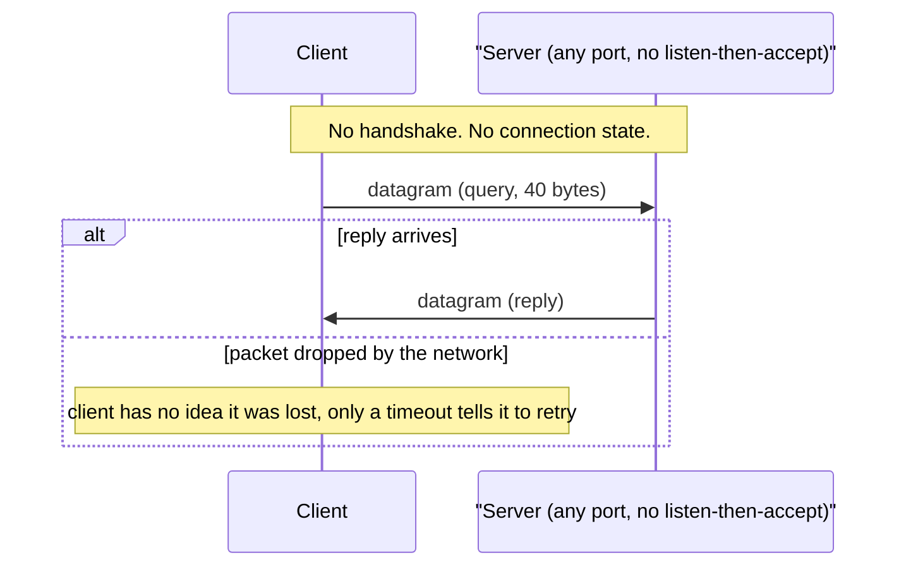
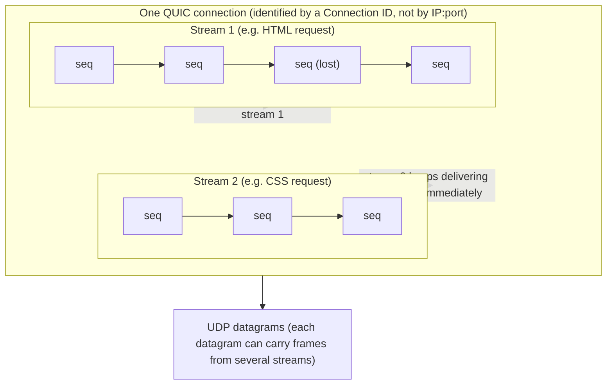
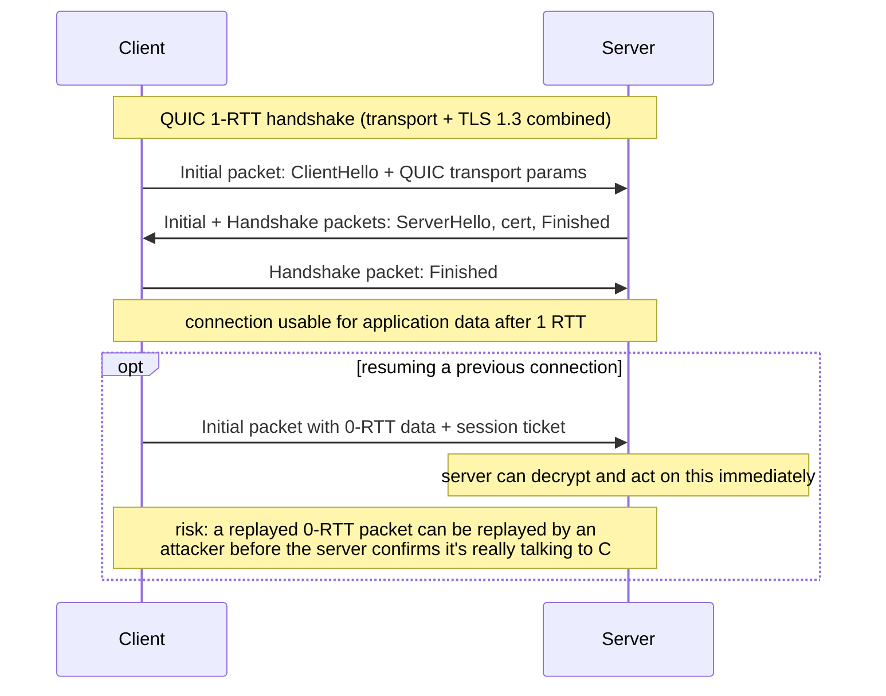

# UDP and QUIC

> [!summary] TL;DR
> UDP sends a single datagram with no connection, no ordering, and no delivery guarantee — the application gets whatever showed up, or nothing. QUIC builds a modern, reliable, encrypted, multi-stream transport on top of UDP, giving most of what TCP gives except head-of-line blocking across streams, while adding things TCP can't do, like surviving a client's IP address changing mid-connection.

> [!abstract] Core idea
> - UDP is TCP with everything taken out: no handshake, no ordering, no retransmission, no congestion control. The application gets datagrams as they arrive, or not at all.
> - QUIC reimplements TCP's reliability and congestion control, but does it per-stream and in userspace, over UDP, with TLS 1.3 baked in from the first packet.
> - Because QUIC's streams are independent, one dropped packet only stalls the one stream it belonged to — not the whole connection, unlike HTTP/2 over TCP.
> - Classic mistake: assuming QUIC is "unreliable like UDP." QUIC is reliable and ordered per stream; only the *transport it rides on* (UDP) is unreliable.

## 1. Why it exists

TCP's guarantees aren't free: a 3-way handshake before any data moves, in-order delivery that stalls everything behind one lost packet, and congestion control tuned for a general-purpose byte stream. Some applications don't want any of that. A DNS query is one request and one small reply — paying for a handshake to send 40 bytes doubles the cost of every lookup. A live video or game-position update is time-sensitive and loss-tolerant: a frame that arrives late is worse than a frame that never arrives, so retransmitting a stale packet is actively the wrong behavior.

UDP (RFC 768, one of the oldest RFCs still in daily use) is what's left of IP once you add only port numbers and an optional checksum: a single datagram, fire and forget, no connection state anywhere. An application that wants reliability on top can build exactly the amount it needs — which is what QUIC does, and what DNS mostly doesn't (DNS just lives with occasional loss and retries at the resolver level, and falls back to TCP for large or sensitive responses).

QUIC exists because HTTP/2 exposed a sharp limit of building multiplexing *inside* TCP: with many logical HTTP streams sharing one TCP connection, a single lost IP packet stalls literally all of them until it's retransmitted, because TCP's one ordered byte stream can't deliver stream 2's bytes to the application while it's still waiting on stream 1's missing segment. QUIC (RFC 9000, standardized 2021; carries HTTP/3 per RFC 9114) moves stream multiplexing below the reliability layer instead of above it, over UDP, so one stream's loss no longer blocks the others.

## 2. Mental model

UDP is a postcard: you write an address and a message, drop it in the mailbox, and have no idea if it arrived, arrived twice, or arrived before a postcard you sent earlier. There's no "UDP connection" to speak of — `net.DialUDP` in Go just remembers a destination address locally; it sends nothing to set that up.

QUIC is what happens if you decide postcards aren't enough, but instead of switching to TCP's single registered-mail envelope, you put several independent registered-mail threads inside one envelope, each with its own sequence numbers and its own retransmission — so a lost page in thread 2 only reprints thread 2, not the whole letter.

## 3. How it works

### UDP: a datagram, nothing more



There is no `Accept()` on the server side the way TCP has one — every incoming datagram just carries the sender's address with it, and the server can reply to any address at any time. The application is responsible for everything TCP would otherwise give it: knowing a reply didn't arrive (a timeout), retrying, deduplicating a packet that arrived twice, and reordering if that matters.

**Common uses, by what they trade away:**
- **DNS**: a lost query just times out and retries; a response over 512 bytes (without EDNS0) falls back to TCP. Latency matters more than guaranteed delivery for a single lookup.
- **Video/voice calls (RTP/WebRTC)**: a dropped or late frame is discarded, not retransmitted — showing a stale frame late is worse than skipping it. Congestion response is handled by the application (adaptive bitrate), not the transport.
- **Online games**: the latest position update matters, not every historical one; an old retransmitted position is actively wrong information by the time it would arrive.
- **mDNS/SSDP and other discovery protocols**: broadcast/multicast only works without a connection to begin with.

### QUIC: reliable streams, multiplexed, over UDP



Each stream gets its own sequence numbers and its own retransmission, so the application can read stream 2's data as soon as it arrives, even while stream 1 is still waiting on a retransmit — this is the direct fix for TCP+HTTP/2's head-of-line blocking.

**TLS 1.3 is not bolted on, it's structural.** QUIC's handshake *is* a TLS 1.3 handshake, carried in QUIC's own frames instead of as a separate stream of bytes: the cryptographic handshake and the transport handshake happen in the same round trip (RFC 9001). A fresh QUIC connection reaches a usable, encrypted state in **1-RTT**, versus TCP+TLS 1.3's two separate round trips (1 for the TCP handshake, 1 for TLS) before the first encrypted application byte moves. There is no such thing as unencrypted QUIC in practice — the spec has no cleartext mode for application data.



**0-RTT resumption:** if the client has a session ticket from a prior connection (the same mechanism as TLS 1.3's 0-RTT), it can send application data in its very first flight, before any round trip completes. The documented cost is **replay**: a network attacker who captures that first flight can resend it, and the server has no way yet to tell a resent copy from the original — so 0-RTT data must be limited to operations safe to receive twice (an idempotent GET, not a payment submission).

**Connection migration.** A QUIC connection is identified by a **Connection ID** the endpoints choose, not by the classic IP+port 4-tuple TCP uses. A phone that switches from Wi-Fi to cellular gets a new IP address, which would silently kill a TCP connection (the 4-tuple no longer matches any open socket) — QUIC instead recognizes the Connection ID in the first packet from the new address, validates the peer owns that connection (a path validation handshake), and keeps the connection running without the application noticing a drop.

**Loss recovery and congestion control** are reimplemented inside QUIC itself (not reused from the OS's TCP stack) using packet-number-based ACKs (every QUIC packet, even a retransmission, gets a fresh packet number, avoiding TCP's retransmission-ambiguity problem) and a pluggable congestion controller — most implementations ship a CUBIC- or BBR-like algorithm, same ideas as [[TCP - Handshake, Reliability, Flow and Congestion Control]], just running in userspace per connection instead of in the kernel per socket.

## 4. Worked example

A UDP echo exchange, and a QUIC connection carrying two independent streams, both over loopback. The QUIC code uses `github.com/quic-go/quic-go`; everything compiles and its tests pass with `go vet` and `go test -race` on Go 1.24.

```go
package udpquic

import (
	"net"
	"time"
)

// EchoUDP reads one datagram and sends the same bytes back to whoever sent
// it. Unlike TCP there is no Accept: every packet carries its sender's
// address, and the server never learns a reply didn't arrive — only a
// client-side timeout reveals that.
func EchoUDP(conn *net.UDPConn) error {
	buf := make([]byte, 1500) // a conservative Ethernet-safe datagram size
	n, addr, err := conn.ReadFromUDP(buf)
	if err != nil {
		return err
	}
	_, err = conn.WriteToUDP(buf[:n], addr)
	return err
}

// SendAndWaitUDP sends msg to addr and waits up to timeout for a reply.
func SendAndWaitUDP(addr string, msg []byte, timeout time.Duration) ([]byte, error) {
	raddr, err := net.ResolveUDPAddr("udp", addr)
	if err != nil {
		return nil, err
	}
	conn, err := net.DialUDP("udp", nil, raddr)
	if err != nil {
		return nil, err
	}
	defer conn.Close()

	if _, err := conn.Write(msg); err != nil {
		return nil, err
	}
	conn.SetReadDeadline(time.Now().Add(timeout))
	buf := make([]byte, 1500)
	n, err := conn.Read(buf)
	if err != nil {
		return nil, err
	}
	return buf[:n], nil
}
```

```go
package udpquic

import (
	"context"
	"crypto/rand"
	"crypto/rsa"
	"crypto/tls"
	"crypto/x509"
	"encoding/pem"
	"io"
	"math/big"
	"time"

	"github.com/quic-go/quic-go"
)

// selfSignedTLSConfig builds an in-memory TLS 1.3 certificate so the demo
// needs no files on disk. QUIC always carries TLS 1.3 inside it; there is
// no cleartext QUIC, unlike plain TCP.
func selfSignedTLSConfig() (*tls.Config, error) {
	key, err := rsa.GenerateKey(rand.Reader, 2048)
	if err != nil {
		return nil, err
	}
	tmpl := &x509.Certificate{SerialNumber: big.NewInt(1)}
	der, err := x509.CreateCertificate(rand.Reader, tmpl, tmpl, &key.PublicKey, key)
	if err != nil {
		return nil, err
	}
	certPEM := pem.EncodeToMemory(&pem.Block{Type: "CERTIFICATE", Bytes: der})
	keyPEM := pem.EncodeToMemory(&pem.Block{Type: "RSA PRIVATE KEY", Bytes: x509.MarshalPKCS1PrivateKey(key)})
	cert, err := tls.X509KeyPair(certPEM, keyPEM)
	if err != nil {
		return nil, err
	}
	return &tls.Config{Certificates: []tls.Certificate{cert}, NextProtos: []string{"demo-echo"}}, nil
}

// RunQUICEchoServer accepts one connection and, independently on every
// stream the client opens, echoes back whatever it reads on that stream.
// Each stream is served in its own goroutine, so one slow or lost stream
// never blocks the others: this is QUIC's fix for TCP head-of-line blocking.
func RunQUICEchoServer(ctx context.Context, ln *quic.Listener) error {
	conn, err := ln.Accept(ctx)
	if err != nil {
		return err
	}
	for {
		stream, err := conn.AcceptStream(ctx)
		if err != nil {
			return nil // connection closed: normal end of the demo
		}
		go func(s quic.Stream) {
			defer s.Close()
			io.Copy(s, s)
		}(stream)
	}
}

// OpenStreamAndEcho opens a new independent stream on conn, writes msg,
// half-closes the write side so the server sees EOF, and reads the echo.
func OpenStreamAndEcho(ctx context.Context, conn quic.Connection, msg []byte) ([]byte, error) {
	stream, err := conn.OpenStreamSync(ctx)
	if err != nil {
		return nil, err
	}
	if _, err := stream.Write(msg); err != nil {
		return nil, err
	}
	stream.Close() // half-close: "I'm done sending on this stream"

	buf := make([]byte, len(msg))
	if _, err := io.ReadFull(stream, buf); err != nil {
		return nil, err
	}
	return buf, nil
}

// Listen starts a QUIC listener on a loopback UDP port with the demo's
// self-signed TLS config.
func Listen() (*quic.Listener, error) {
	tlsConf, err := selfSignedTLSConfig()
	if err != nil {
		return nil, err
	}
	return quic.ListenAddr("127.0.0.1:0", tlsConf, &quic.Config{MaxIdleTimeout: 10 * time.Second})
}

// Dial opens a QUIC connection to addr. InsecureSkipVerify is used only
// because the demo's certificate is self-signed and unknown to any CA;
// real clients must verify the chain (see the TLS and HTTPS note).
func Dial(ctx context.Context, addr string) (quic.Connection, error) {
	tlsConf := &tls.Config{InsecureSkipVerify: true, NextProtos: []string{"demo-echo"}}
	return quic.DialAddr(ctx, addr, tlsConf, nil)
}
```

```go
func TestUDPNoReplyTimesOut(t *testing.T) {
	// Nothing is listening on this port: UDP gives no connection-refused
	// signal the way a client expects a TCP RST; the request just never
	// gets a reply, and the caller must time out on its own.
	laddr, _ := net.ResolveUDPAddr("udp", "127.0.0.1:0")
	probe, _ := net.ListenUDP("udp", laddr)
	addr := probe.LocalAddr().String()
	probe.Close() // free the port; nothing will answer on it now

	_, err := SendAndWaitUDP(addr, []byte("ping"), 300*time.Millisecond)
	if err == nil {
		t.Fatalf("expected a timeout, got a reply")
	}
}

func TestQUICStreamsAreIndependent(t *testing.T) {
	ln, err := Listen()
	if err != nil {
		t.Fatalf("Listen: %v", err)
	}
	defer ln.Close()
	ctx, cancel := context.WithTimeout(context.Background(), 5*time.Second)
	defer cancel()

	var wg sync.WaitGroup
	wg.Add(1)
	go func() { defer wg.Done(); RunQUICEchoServer(ctx, ln) }()

	conn, err := Dial(ctx, ln.Addr().String())
	if err != nil {
		t.Fatalf("Dial: %v", err)
	}
	defer conn.CloseWithError(0, "done")

	// Two streams on the same connection; one carries a much larger
	// payload. Both complete: a "slow" stream never blocks the other.
	var slowReply, fastReply []byte
	var inner sync.WaitGroup
	inner.Add(2)
	go func() {
		defer inner.Done()
		slowReply, _ = OpenStreamAndEcho(ctx, conn, make([]byte, 64*1024))
	}()
	go func() {
		defer inner.Done()
		fastReply, _ = OpenStreamAndEcho(ctx, conn, []byte("small, independent stream"))
	}()
	inner.Wait()

	if len(slowReply) != 64*1024 {
		t.Fatalf("slow stream echoed %d bytes, want 65536", len(slowReply))
	}
	if string(fastReply) != "small, independent stream" {
		t.Fatalf("fast stream = %q", fastReply)
	}

	conn.CloseWithError(0, "test done")
	wg.Wait()
}
```

**Measured** on this machine (Go 1.24.4, darwin/arm64, `github.com/quic-go/quic-go` v0.48.2, loopback, `go test -race`, 2026-11-06): both the 64KB stream and the 25-byte stream completed correctly inside a 5s context, confirming that the large stream's extra packets never blocked the small stream's delivery — they're independent sequence spaces on the same connection.

## 5. Variants and comparison

| Option | How it works | Use when | Cost |
| --- | --- | --- | --- |
| Raw UDP | One send, one maybe-receive, no state | You'll build exactly the reliability you need, or need none (DNS, game state, media) | Every guarantee (ordering, retry, congestion response) is your own code |
| TCP | One ordered, reliable byte stream, OS-managed | General-purpose reliable transport; simplicity matters more than per-stream independence | Head-of-line blocking across anything multiplexed on top |
| QUIC | Many reliable, ordered streams multiplexed over UDP, TLS 1.3 built in | Modern web transport (HTTP/3), anything wanting independent streams plus connection migration | Userspace implementation costs more CPU per byte than kernel TCP; some middleboxes still rate-limit or block UDP |
| RTP/WebRTC over UDP | Application-managed loss tolerance, jitter buffers, adaptive bitrate | Real-time audio/video where late data is worse than lost data | No delivery guarantee at all; entirely the application's problem |

## 6. Trade-offs and when not to use

- QUIC moves TCP's work from the kernel (one implementation, shared, hardware-offload-friendly) into every application's userspace process, which costs more CPU per byte transferred — a real operational cost at very high throughput.
- Some corporate and ISP middleboxes still rate-limit, deprioritize, or outright block UDP traffic (historically abused for amplification DDoS attacks), which can make QUIC fall back to HTTP/2 over TCP in practice; a client must always be prepared for that fallback.
- 0-RTT's replay exposure means it's only safe for operations that are fine being executed twice — never attach it to a non-idempotent action.
- Plain UDP with no reliability layer at all is the wrong choice the moment "is this delivered, in order, at least once" starts to matter even a little — at that point you're reimplementing a worse version of QUIC or TCP from scratch.

## 7. In production

- **Real systems:** HTTP/3 (QUIC) is served by Google, Cloudflare, Facebook/Meta, and most major CDNs as the default negotiated protocol for supporting browsers (see [[HTTP-1.1 vs HTTP-2 vs HTTP-3]]); DNS runs over UDP/53 by default with TCP fallback for large or truncated responses; WebRTC (video calls) and most multiplayer game networking run their own protocols over UDP.
- **Failure modes → fixes:**
	- UDP blocked or heavily rate-limited by a network → clients must detect the failure and fall back to TCP (HTTP/3 clients retry over HTTP/2 automatically; this is why "QUIC is the default" still needs a working TCP fallback path).
	- 0-RTT replay of a non-idempotent request → restrict 0-RTT to explicitly idempotent request types at the application layer, not just at the transport.
	- A QUIC connection's migration path validation fails (a NAT or firewall doesn't let the new path's probe through) → the connection falls back to treating it as a new connection, same as TCP would have.
- **What to monitor:** UDP packet loss and retransmit rate per stream, 0-RTT accept/reject counts, connection migration events and their success rate, and the fallback rate from HTTP/3 to HTTP/2 (a rising fallback rate usually means a network path is newly blocking UDP).

## 8. Deep dive

- **Why QUIC can't just be "TCP but faster."** TCP's state machine, congestion control and retransmission all live in kernel code that changes on OS-release timescales. QUIC deliberately lives in userspace specifically so it can evolve as fast as application code ships — a new congestion controller or a bug fix deploys with the next binary release, not the next OS kernel update across billions of devices.
- **Packet numbers vs TCP sequence numbers.** TCP sequence numbers describe bytes in the stream, so a retransmission reuses the *same* sequence number as the original — which creates the "retransmission ambiguity problem": an ACK for that sequence number can't tell the sender whether it acknowledges the original or the retransmit, which matters for RTT estimation. QUIC gives every packet, including every retransmission, a strictly increasing packet number, so an ACK for packet number N is unambiguous about exactly which transmission attempt it covers — cleaner RTT samples, among other benefits.
- **Multipath potential.** Because a QUIC connection is identified by a Connection ID rather than a 4-tuple, and path validation is already part of the spec for migration, QUIC is a more natural base than TCP for using multiple network paths (Wi-Fi and cellular at once) simultaneously, not just migrating between them — an active area of extension work, not yet universal.
- **Why DNS mostly stays on UDP instead of moving to QUIC.** DNS-over-QUIC (DoQ, RFC 9250) exists and gives DNS privacy plus QUIC's fast resumption, but plain UDP DNS remains dominant because a typical query/response round trip is already one datagram each way — there's very little head-of-line blocking to fix when there's only one "stream" per query to begin with. QUIC earns its keep most clearly when many logical exchanges share one connection, which is HTTP's situation, not a single DNS lookup's.

## 9. Interview questions

> [!question]- What exactly does UDP guarantee, and what does it not?
> It guarantees almost nothing beyond "here is a datagram with a checksum, addressed to this port." No connection setup, no ordering between datagrams, no retransmission of a lost one, and no notification to the sender that it was lost. Any of that must be built by the application.

> [!question]- How does QUIC fix TCP's head-of-line blocking without giving up reliability?
> By multiplexing streams *below* the reliability layer instead of above it: each stream has its own sequence space and its own retransmission, so a lost packet only stalls the one stream whose data it carried. TCP can't do this because it has exactly one ordered byte stream for the whole connection — HTTP/2's streams are a logical layer on top of that single stream, so they all wait on the same gap.

> [!question]- Why is QUIC's handshake 1-RTT when TCP+TLS 1.3 needs 2?
> Because QUIC's transport handshake and its TLS 1.3 handshake are the same handshake — TLS messages ride inside QUIC's own Initial and Handshake packet types from the first flight, instead of TLS waiting for a separate TCP handshake to finish first. TCP+TLS pays one RTT to establish the TCP connection and a second RTT for the TLS handshake on top of it.

> [!question]- Trap: is QUIC "unreliable" because it runs over UDP?
> No. QUIC rebuilds reliability, ordering (per stream) and congestion control entirely on top of UDP; the datagram transport underneath is unreliable, but the QUIC layer the application actually talks to is not. Conflating "runs over UDP" with "behaves like UDP" is the trap.

> [!question]- What is 0-RTT data, and what's its documented risk?
> With a session ticket from a previous connection, a client can send application data in its very first flight, before any round trip with the server completes. The risk is replay: an attacker who captures that first flight can resend it, and the server can't yet distinguish the resend from the original, so 0-RTT must be restricted to operations that are safe to execute more than once.

> [!question]- How does QUIC survive a client's IP address changing mid-connection?
> The connection is identified by a Connection ID the endpoints chose at setup, not by the IP+port 4-tuple. When packets arrive from a new address carrying a known Connection ID, the server runs a path validation handshake to confirm the same peer owns it, then continues the connection on the new path — TCP has no equivalent because its connection identity *is* the 4-tuple.

## 10. Cheat sheet

- UDP: one datagram, no connection, no ordering, no retransmission, no congestion control — the application builds whatever it needs.
- QUIC: reliable, ordered, congestion-controlled streams multiplexed over UDP, with TLS 1.3 structurally part of the handshake.
- QUIC fixes head-of-line blocking by keeping streams independent below the reliability layer, unlike HTTP/2's streams sitting on one TCP byte stream.
- 1-RTT handshake (vs TCP+TLS 1.3's 2-RTT); 0-RTT resumption is possible but replayable, so restrict it to idempotent requests.
- Connection migration: identified by Connection ID, not IP:port, so a network change doesn't kill the connection.
- Packet numbers are always unique, even on retransmission — no TCP-style ACK ambiguity.
- UDP use cases share one theme: loss tolerance or extreme latency sensitivity (DNS, live video/voice, games).
- Some networks still rate-limit or block UDP; a QUIC client needs a working TCP fallback.

## Links

- **Before this:** [[TCP - Handshake, Reliability, Flow and Congestion Control]]
- **Next:** [[HTTP-1.1 vs HTTP-2 vs HTTP-3]], [[HTTP Fundamentals - Methods, Status Codes, Headers, Cookies]]
- **Compare with:** [[TLS and HTTPS]] (the handshake QUIC embeds), [[DNS - Resolution, Records and Caching]] (the best-known UDP-first protocol)
