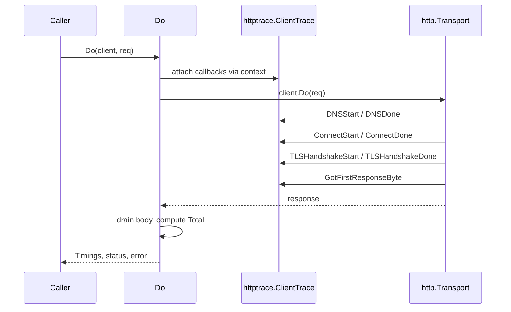

# What Happens When You Type a URL - Go

> [!summary] TL;DR
> This code measures the four phases [[What Happens When You Type a URL]] walks through for a single HTTP request — DNS lookup, TCP connect, TLS handshake, and time to first byte — using `net/http/httptrace`, the same mechanism `curl -w` and a browser's DevTools waterfall panel are built on.

> [!info] How to read this note (pick your level)
> - 🟢 **New to this?** Read the "From zero" paragraph below, then "Before the code", "What this code shows" and Setup. Stop there.
> - 🟡 **Know the basics?** Read the Code and Tests sections top to bottom; each big block has a plain-words opener first.
> - 🔴 **Interview / SDE-3 prep?** Add Design decisions, Pitfalls and the Exercises. Headings are tagged 🟢🟡🔴 so you always know where you are.

> [!note] Before this note
> - [[DNS - Resolution, Records and Caching]]: a name becomes an IP; a literal IP like `127.0.0.1` needs no lookup at all.
> - [[TCP - Handshake, Reliability, Flow and Congestion Control]]: opening a connection costs a handshake, which this code times as `Connect`.
> - [[TLS and HTTPS]]: an `https://` request also pays a TLS handshake, timed as `TLSHandshake`.
> - [[HTTP Fundamentals - Methods, Status Codes, Headers, Cookies]]: `client.Do(req)` sends one request and gets a response with a body.
> - [[HTTP Caching - Cache-Control, ETag, Conditional Requests]]: background only; this code times the network phases, not caching.

**From zero** 🟢 — This file is the hands-on twin of [[What Happens When You Type a URL]]. It builds a tiny stopwatch in Go that times the four phases of one web request — finding the address (DNS), connecting (TCP), agreeing on encryption (TLS), and waiting for the first answer byte — then proves with tests that a second request on the same kept-open connection skips the connect and encryption steps entirely. Read each "In plain words" line before its code block and you can follow without deep Go knowledge.

## Before the code 🟢

- **`net/http`**: Go's built-in HTTP client and server; `client.Do(req)` sends one request.
- **`net/http/httptrace`**: lets you attach callbacks that fire at DNS, connect, TLS and first-byte moments.
- **Closures**: small inline functions that capture local variables (`t`, `dnsStart`) and update them when called.
- **`context.Context`**: the trace rides on the request's context, so it affects only that one request.
- **`httptest.NewTLSServer`**: a real local HTTPS server for tests, no network needed.
- **Run it:** `go vet ./...` and `go test -race ./...` (standard library only).

## What this code shows 🟢

| Code | Theory concept | Theory section |
| --- | --- | --- |
| `Timings` struct | The four measurable phases of one request | [[What Happens When You Type a URL#3 How it works]] |
| `Do` | Wiring an `httptrace.ClientTrace` to capture each phase's start/end | [[What Happens When You Type a URL#Tracing the same four phases in Go]] |
| `TestDoHTTPS` | A plain request pays for connect + TLS; a phase is zero only when the transport genuinely skipped it | [[What Happens When You Type a URL#TCP and TLS two handshakes before one byte of HTTP moves]] |
| `TestDoReusesConnection` | A second request on a kept-alive connection skips Connect and TLSHandshake entirely | [[What Happens When You Type a URL#Where the time actually goes]] |

## Setup 🟢

- **Module layout:** a single package, `urltrace`, with `urltrace.go` and `urltrace_test.go` in one directory.
- **Go version:** 1.24.
- **Dependencies:** standard library only (`net/http`, `net/http/httptrace`, `crypto/tls`).
- **Run it:**

```text
go mod init urltrace
go vet ./...
go test -race ./...
```

## Code 🟡

> 🟢 → 🟡 **You now know** the goal: put a stopwatch on DNS, connect, TLS and first byte for one request. **Next we read the code**: a struct with one slot per phase, and `Do`, which attaches small callbacks that fire at each phase boundary.

### The Timings type: one field per phase

**In plain words:** first we need a box with five slots, one per phase we want to time. An empty slot is meaningful too — it means that phase was skipped, not that it was instant.

```go
package urltrace

import (
	"crypto/tls"
	"fmt"
	"io"
	"net/http"
	"net/http/httptrace"
	"time"
)

// Timings holds the duration of each phase. A phase is zero when the
// transport skipped it (for example DNSLookup is 0 when connecting to a
// literal IP, and TLSHandshake is 0 for a plain http:// URL).
type Timings struct {
	DNSLookup    time.Duration
	Connect      time.Duration
	TLSHandshake time.Duration
	TTFB         time.Duration // time to first response byte, measured from request start
	Total        time.Duration
}
```

**Concept.** This is the Go shape of the table in [[What Happens When You Type a URL#Where the time actually goes]]: one field per phase the theory note names.

The zero value matters as much as a populated one — a zero `TLSHandshake` is the code's way of confirming "this request never paid for TLS," which is exactly the claim the tests below check.

An alternative design (one flat `map[string]time.Duration`) was rejected because a struct gives compile-time field names and lets a caller inspect `timings.TTFB` directly instead of a string lookup that could typo silently.

**How it works.**
1. Every field is a `time.Duration`, Go's standard type for an elapsed time — it prints cleanly (`14.2ms`) and supports normal comparisons (`<`, `<=`) the tests below rely on.
2. `Total` is the one field that always has a non-zero, meaningful value for a successful request; the others are legitimately zero in specific circumstances described above each field.

### Do: wiring the trace to the request

**In plain words:** Go lets you hang little bells on an outgoing request — one rings when DNS starts, one when the connection opens, one when encryption finishes, one when the first answer byte lands. `Do` hangs the bells, sends the request, and writes down when each bell rang.

The first half of `Do` builds the trace itself — one callback per phase boundary:

```go
// Do performs req and returns the phase breakdown alongside the response
// status. The caller is responsible for closing the body it no longer needs;
// Do drains and closes it after measuring TTFB so the connection can be reused.
func Do(client *http.Client, req *http.Request) (Timings, int, error) {
	var t Timings
	var start, dnsStart, connectStart, tlsStart time.Time

	trace := &httptrace.ClientTrace{
		DNSStart: func(httptrace.DNSStartInfo) { dnsStart = time.Now() },
		DNSDone: func(httptrace.DNSDoneInfo) {
			if !dnsStart.IsZero() {
				t.DNSLookup = time.Since(dnsStart)
			}
		},
		ConnectStart: func(string, string) { connectStart = time.Now() },
		ConnectDone: func(network, addr string, err error) {
			if err == nil && !connectStart.IsZero() {
				t.Connect = time.Since(connectStart)
			}
		},
		TLSHandshakeStart: func() { tlsStart = time.Now() },
		TLSHandshakeDone: func(tls.ConnectionState, error) {
			if !tlsStart.IsZero() {
				t.TLSHandshake = time.Since(tlsStart)
			}
		},
		GotFirstResponseByte: func() {
			t.TTFB = time.Since(start)
		},
	}
```

The second half attaches that trace to the request, runs it, and drains the body so the connection can be reused:

```go
	start = time.Now()
	req = req.WithContext(httptrace.WithClientTrace(req.Context(), trace))
	resp, err := client.Do(req)
	if err != nil {
		return t, 0, fmt.Errorf("do request: %w", err)
	}
	defer resp.Body.Close()
	if _, err := io.Copy(io.Discard, resp.Body); err != nil {
		return t, resp.StatusCode, fmt.Errorf("read body: %w", err)
	}
	t.Total = time.Since(start)
	return t, resp.StatusCode, nil
}
```

**Concept.** This implements [[What Happens When You Type a URL#Tracing the same four phases in Go]]: `httptrace.ClientTrace` is Go's hook into the exact moments the standard library's own HTTP transport reaches each phase boundary — the same instrumentation point `curl -w` reads from inside libcurl.

The alternative — timing the whole `client.Do(req)` call as one block — was rejected because it only gives `Total`, which hides exactly which phase is slow, the one piece of information this note's entire "where do you look next" interview question depends on.

**How it works.**
1. Each callback (`DNSStart`, `DNSDone`, and so on) fires at an exact point inside the transport's own request lifecycle; the closures record a `time.Now()` at the start of a phase and compute the elapsed duration at its end.
2. `req.WithContext(httptrace.WithClientTrace(...))` attaches the trace to this one request's `context.Context` — it never affects any other request on the same client, which matters because a shared `*http.Client` is often reused across many calls.
3. Draining the body with `io.Copy(io.Discard, resp.Body)` before computing `Total` is what lets the underlying connection return to the client's connection pool (the set of open connections kept for reuse) for reuse — skipping this would silently defeat the exact connection-reuse behavior `TestDoReusesConnection` checks for.
4. A nil-check (`!dnsStart.IsZero()`) guards every "done" callback, because a phase that the transport skipped entirely (no DNS lookup for a literal IP, no TLS for a plain `http://` URL) never calls that phase's "start" callback either — the field is left at its zero value by design, not by omission.



## Design decisions 🔴

> 🟡 → 🔴 **You now know** how `Do` records each phase and what both tests prove. **Next, the advanced part**: why the struct, body-draining and context choices were made, the misreadings and races to avoid, and exercises.

| Choice | Alternative | Trade-off |
| --- | --- | --- |
| A `Timings` struct with named fields | A `map[string]time.Duration` | The struct catches a typo'd phase name at compile time and is self-documenting at the call site |
| Draining the body before computing `Total` | Closing the body immediately after `GotFirstResponseByte` fires | Draining lets the connection return to the pool for reuse, which is the behavior `TestDoReusesConnection` depends on being true |
| Zero-value phases for skipped steps | A `*time.Duration` (nil = skipped) | A plain `time.Duration` with "0 means skipped" is simpler to read and compare in tests, at the cost of not distinguishing "skipped" from "measured exactly 0ns" (never happens in practice) |
| Attaching the trace via `context.Context` | A global/package-level trace variable | Context-scoped tracing is safe for concurrent requests on a shared `*http.Client`; a global would corrupt readings under concurrent use |

## Tests 🟡

### TestDoHTTPS

**In plain words:** this test starts a tiny local HTTPS server that deliberately dawdles for 5 ms, makes one request, and checks each stopwatch slot matches what the theory predicts.

**Property proved:** a plain HTTPS request pays for connect and TLS (both strictly greater than zero), never pays for DNS when connecting to a literal IP (an address written as numbers, like `127.0.0.1`, as `httptest.NewTLSServer` uses), and every phase is internally consistent — nothing measures longer than the request's own `Total`.

| Input | Expected output |
| --- | --- |
| `GET` against a local `httptest.NewTLSServer` whose handler sleeps 5 ms before replying | `DNSLookup == 0`, `Connect > 0`, `TLSHandshake > 0`, `TTFB >= 5ms`, `Total >= TTFB` |

A failure here would mean either the trace callbacks aren't firing where expected (a change to `Do`'s wiring), or the test server's behavior changed — either way, the theory note's claim that "DNS is skippable, TLS never is for an `https://` URL" would no longer be demonstrated.

The setup spins up a local TLS server with a deliberate 5 ms delay, so `TTFB` has something non-trivial to measure:

```go
func TestDoHTTPS(t *testing.T) {
	srv := httptest.NewTLSServer(http.HandlerFunc(func(w http.ResponseWriter, r *http.Request) {
		time.Sleep(5 * time.Millisecond) // simulate server think time so TTFB is non-trivial
		w.Write([]byte("ok"))
	}))
	defer srv.Close()

	client := srv.Client()
	req, err := http.NewRequest(http.MethodGet, srv.URL, nil)
	if err != nil {
		t.Fatalf("new request: %v", err)
	}

	timings, status, err := Do(client, req)
	if err != nil {
		t.Fatalf("Do: %v", err)
	}
	if status != http.StatusOK {
		t.Fatalf("status = %d, want 200", status)
	}
```

The assertions check every phase against the prediction a reader should make before running it — DNS skipped, connect and TLS both paid, TTFB at least the handler's sleep:

```go
	if timings.DNSLookup != 0 {
		t.Errorf("DNSLookup = %v, want 0 for a literal-IP test server", timings.DNSLookup)
	}
	if timings.Connect <= 0 {
		t.Errorf("Connect = %v, want > 0", timings.Connect)
	}
	if timings.TLSHandshake <= 0 {
		t.Errorf("TLSHandshake = %v, want > 0 for an https:// server", timings.TLSHandshake)
	}
	if timings.TTFB < 5*time.Millisecond {
		t.Errorf("TTFB = %v, want >= 5ms (the handler's sleep)", timings.TTFB)
	}
	if timings.Total < timings.TTFB {
		t.Errorf("Total (%v) < TTFB (%v): total must cover every phase", timings.Total, timings.TTFB)
	}
}
```

### TestDoReusesConnection

**Property proved:** a second request on a kept-alive connection skips `Connect` and `TLSHandshake` entirely — the exact mechanism that makes every request after the first in a browser waterfall so much faster.

| Input | Expected output |
| --- | --- |
| Two sequential `GET`s against the same `*http.Client` and server | First request: `Connect > 0`, `TLSHandshake > 0`. Second request: both `== 0` |

A failure here (the second request still paying for connect or TLS) would mean the client isn't reusing its connection pool, directly contradicting the theory note's central warm-vs-cold claim.

**What this code does, in plain words:** it sends two requests one after the other with the same client to the same test server, then checks the first paid for connect and TLS and the second paid for neither, because it reused the open connection.

```go
func TestDoReusesConnection(t *testing.T) {
	srv := httptest.NewTLSServer(http.HandlerFunc(func(w http.ResponseWriter, r *http.Request) {
		w.Write([]byte("ok"))
	}))
	defer srv.Close()
	client := srv.Client()

	req1, _ := http.NewRequest(http.MethodGet, srv.URL, nil)
	if _, _, err := Do(client, req1); err != nil {
		t.Fatalf("first request: %v", err)
	}

	req2, _ := http.NewRequest(http.MethodGet, srv.URL, nil)
	timings, _, err := Do(client, req2)
	if err != nil {
		t.Fatalf("second request: %v", err)
	}
	if timings.Connect != 0 || timings.TLSHandshake != 0 {
		t.Errorf("reused connection still paid Connect=%v TLSHandshake=%v, want both 0", timings.Connect, timings.TLSHandshake)
	}
}
```

**Measured** (Go 1.24.4, darwin/arm64, `go test -race -run TestDo -v`, 2026-11-06):

```text
=== RUN   TestDoHTTPS
--- PASS: TestDoHTTPS (0.01s)
=== RUN   TestDoReusesConnection
--- PASS: TestDoReusesConnection (0.00s)
PASS
```

> [!example]- Full file
> ```go
> package urltrace
>
> import (
> 	"crypto/tls"
> 	"fmt"
> 	"io"
> 	"net/http"
> 	"net/http/httptrace"
> 	"time"
> )
>
> type Timings struct {
> 	DNSLookup    time.Duration
> 	Connect      time.Duration
> 	TLSHandshake time.Duration
> 	TTFB         time.Duration
> 	Total        time.Duration
> }
>
> func Do(client *http.Client, req *http.Request) (Timings, int, error) {
> 	var t Timings
> 	var start, dnsStart, connectStart, tlsStart time.Time
>
> 	trace := &httptrace.ClientTrace{
> 		DNSStart: func(httptrace.DNSStartInfo) { dnsStart = time.Now() },
> 		DNSDone: func(httptrace.DNSDoneInfo) {
> 			if !dnsStart.IsZero() {
> 				t.DNSLookup = time.Since(dnsStart)
> 			}
> 		},
> 		ConnectStart: func(string, string) { connectStart = time.Now() },
> 		ConnectDone: func(network, addr string, err error) {
> 			if err == nil && !connectStart.IsZero() {
> 				t.Connect = time.Since(connectStart)
> 			}
> 		},
> 		TLSHandshakeStart: func() { tlsStart = time.Now() },
> 		TLSHandshakeDone: func(tls.ConnectionState, error) {
> 			if !tlsStart.IsZero() {
> 				t.TLSHandshake = time.Since(tlsStart)
> 			}
> 		},
> 		GotFirstResponseByte: func() {
> 			t.TTFB = time.Since(start)
> 		},
> 	}
>
> 	start = time.Now()
> 	req = req.WithContext(httptrace.WithClientTrace(req.Context(), trace))
> 	resp, err := client.Do(req)
> 	if err != nil {
> 		return t, 0, fmt.Errorf("do request: %w", err)
> 	}
> 	defer resp.Body.Close()
> 	if _, err := io.Copy(io.Discard, resp.Body); err != nil {
> 		return t, resp.StatusCode, fmt.Errorf("read body: %w", err)
> 	}
> 	t.Total = time.Since(start)
> 	return t, resp.StatusCode, nil
> }
> ```
>
> ```go
> package urltrace
>
> import (
> 	"net/http"
> 	"net/http/httptest"
> 	"testing"
> 	"time"
> )
>
> func TestDoHTTPS(t *testing.T) {
> 	srv := httptest.NewTLSServer(http.HandlerFunc(func(w http.ResponseWriter, r *http.Request) {
> 		time.Sleep(5 * time.Millisecond)
> 		w.Write([]byte("ok"))
> 	}))
> 	defer srv.Close()
>
> 	client := srv.Client()
> 	req, err := http.NewRequest(http.MethodGet, srv.URL, nil)
> 	if err != nil {
> 		t.Fatalf("new request: %v", err)
> 	}
>
> 	timings, status, err := Do(client, req)
> 	if err != nil {
> 		t.Fatalf("Do: %v", err)
> 	}
> 	if status != http.StatusOK {
> 		t.Fatalf("status = %d, want 200", status)
> 	}
> 	if timings.DNSLookup != 0 {
> 		t.Errorf("DNSLookup = %v, want 0 for a literal-IP test server", timings.DNSLookup)
> 	}
> 	if timings.Connect <= 0 {
> 		t.Errorf("Connect = %v, want > 0", timings.Connect)
> 	}
> 	if timings.TLSHandshake <= 0 {
> 		t.Errorf("TLSHandshake = %v, want > 0 for an https:// server", timings.TLSHandshake)
> 	}
> 	if timings.TTFB < 5*time.Millisecond {
> 		t.Errorf("TTFB = %v, want >= 5ms (the handler's sleep)", timings.TTFB)
> 	}
> 	if timings.Total < timings.TTFB {
> 		t.Errorf("Total (%v) < TTFB (%v): total must cover every phase", timings.Total, timings.TTFB)
> 	}
> }
>
> func TestDoReusesConnection(t *testing.T) {
> 	srv := httptest.NewTLSServer(http.HandlerFunc(func(w http.ResponseWriter, r *http.Request) {
> 		w.Write([]byte("ok"))
> 	}))
> 	defer srv.Close()
> 	client := srv.Client()
>
> 	req1, _ := http.NewRequest(http.MethodGet, srv.URL, nil)
> 	if _, _, err := Do(client, req1); err != nil {
> 		t.Fatalf("first request: %v", err)
> 	}
>
> 	req2, _ := http.NewRequest(http.MethodGet, srv.URL, nil)
> 	timings, _, err := Do(client, req2)
> 	if err != nil {
> 		t.Fatalf("second request: %v", err)
> 	}
> 	if timings.Connect != 0 || timings.TLSHandshake != 0 {
> 		t.Errorf("reused connection still paid Connect=%v TLSHandshake=%v, want both 0", timings.Connect, timings.TLSHandshake)
> 	}
> }
> ```

## Pitfalls in the code 🔴

- **Forgetting to drain the response body** before computing `Total` would leave the connection unable to return to the pool, silently defeating `TestDoReusesConnection`'s whole premise — a caller copying this pattern elsewhere must keep the drain-then-close order.
- **Reading `timings.Connect == 0` as "instant"** instead of "skipped" is an easy misread — the zero value means the transport never called `ConnectStart` at all, not that connecting took zero nanoseconds.
- **Sharing one `*http.Client` across goroutines while reusing the same `*http.Request`** would race, because `req.WithContext` returns a new request value but the original request object is still shared; each goroutine in a concurrent caller needs its own `*http.Request`, not a shared one with a swapped context.
- **Treating absolute test timings as portable numbers** is a pitfall of the numbers in this note generally: the exact milliseconds measured here are specific to this machine and a loopback `httptest` server, not a guarantee about any other network path — only the *ordering* and *zero vs. non-zero* relationships are the stable, teachable claims.

## Exercises 🔴

1. Add a `DNSLookup` test using `httptest.NewServer` with a hostname instead of a literal IP (you'll need a fake resolver or a real hostname that resolves to loopback). Predict whether `DNSLookup` will be non-zero, then confirm.
2. Change `Do` to also record `TLSHandshake` as zero for a plain `http://` test server (`httptest.NewServer`, not `NewTLSServer`). Predict the result before running it, then write the test.
3. Add a `Redirects int` field to `Timings` that counts how many redirects the request followed, using `http.Client.CheckRedirect`. Predict how this interacts with a reused connection — does a redirect to the same host still reuse the connection from the first hop?

## Self-check 🟢🟡

> [!question]- 🟢 Which Go package provides the phase callbacks?
> `net/http/httptrace`.

> [!question]- 🟢 Why is `DNSLookup` zero in `TestDoHTTPS`?
> The test server's URL uses a literal IP, so no DNS lookup happens.

> [!question]- 🟢 What does a zero `TLSHandshake` mean?
> That phase was skipped (no TLS, or a reused connection), not that it was instant.

> [!question]- 🟡 Why must `Do` drain the response body?
> So the connection can go back to the pool; otherwise the next request opens a new one.

> [!question]- 🟡 Why attach the trace through the request's context instead of a global?
> It applies only to that one request, so concurrent requests on a shared client don't mix readings.

> [!question]- 🟡 What does the second request in `TestDoReusesConnection` skip?
> Both `Connect` and `TLSHandshake`, because the kept-alive connection is reused.

## Links

- **Theory:** [[What Happens When You Type a URL]]
- **Related:** [[Network Debugging Toolkit - dig, curl, ss, tcpdump]], [[Connection Pooling]]
