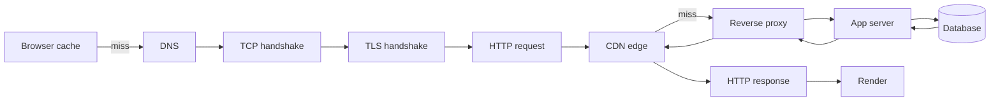
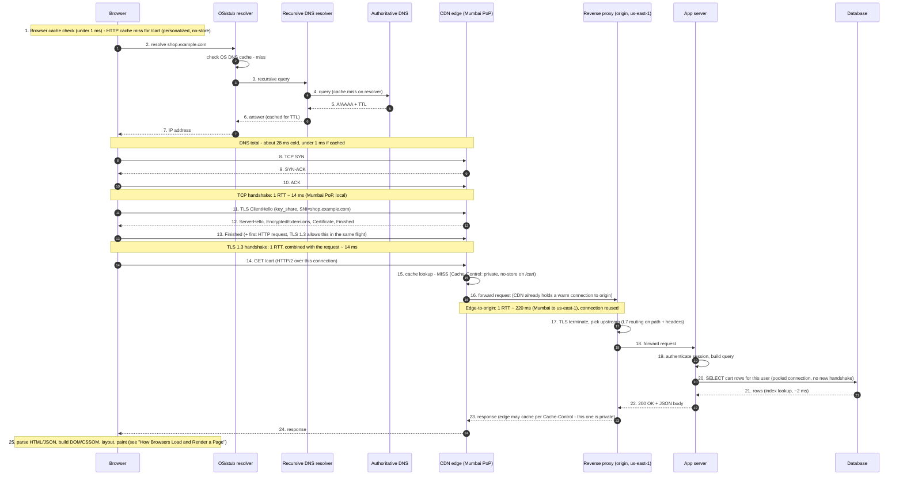

# What Happens When You Type a URL

> [!summary] TL;DR
> Typing `https://shop.example.com/cart` and pressing Enter triggers a chain of lookups and handshakes — browser cache check, DNS resolution, TCP handshake, TLS 1.3 handshake, an HTTP request routed through a CDN edge and a reverse proxy to an application server, a database round trip, and finally the browser parsing and rendering the response — that on a cold cache takes 300–800 ms and on a warm cache takes under 50 ms.

> [!abstract] Core idea
> - Every layer below the application (cache, DNS, TCP, TLS) exists to avoid redoing expensive work: a cache hit, a reused connection, or a resumed TLS session skips an entire phase.
> - The first request to a new origin pays for all of it: DNS lookup, a TCP handshake (1 round trip), and a TLS 1.3 handshake (1 more round trip, 2 combined with TCP) before a single HTTP byte moves.
> - A CDN answers from an edge point of presence close to the browser and never bothers the origin; only a cache miss or a dynamic request reaches the reverse proxy and the application.
> - The slowest parts are the ones measured in round trips across a real network, not CPU work — this is why warm connections, caching and picking a nearby CDN edge matter more than micro-optimizing server code.

### Whiteboard version

Nine boxes, one request, read left to right:



Every box after this is one of those nine steps, with its own note; this note's job is only the order, the timing, and the handoffs between them.

## 1. Why it exists

A single page load for a shopping cart touches a browser cache, a DNS resolver, a CDN, a reverse proxy, an application server and a database — six systems owned by different teams or companies. Nobody designed "load a URL" as one system; it works because each layer has a narrow contract with the one above and below it (DNS resolves a name to an address and nothing else; TCP delivers bytes reliably and nothing else; TLS adds confidentiality and nothing else). Understanding the full chain is what separates "the page is slow" from "the TLS handshake to the origin is adding 180 ms because the CDN cache is missing" — the second sentence names the box to fix.

**Concrete scenario.** A user in Mumbai requests `https://shop.example.com/cart` for the first time this session (cold browser cache, cold TLS session, cold CDN edge cache for this exact URL since it's personalized). The origin's app servers and primary database sit in `us-east-1`, 220 ms round-trip away. A CDN with an edge PoP in Mumbai fronts the origin.

## 2. Mental model

Think of the browser as a customer calling a company's switchboard:
1. The customer checks their own notebook for the number (**browser cache**) and for who answers it (**DNS cache**).
2. If the number isn't known, they call directory assistance (**DNS resolution**) once and write it down.
3. They dial the number: the phone has to ring and be picked up before anyone talks (**TCP handshake**).
4. Both sides agree on a shared code word so nobody else on the line understands them (**TLS handshake**).
5. The customer states their request to whoever answers first — often a local branch office that already has the answer memorized (**CDN edge**, cache hit) — and only if the branch doesn't know, it is forwarded to the switchboard operator (**reverse proxy**) who connects the right department (**application server**), who looks something up in the company's filing system (**database**) before answering.
6. The reply travels back the same chain, and only then does the customer act on it (**render**).

Every "look it up first" step in that list is a cache; every "ring and pick up" step is a handshake that costs a round trip.

## 3. How it works

The full request from a cold cache, with every participant and a representative timing budget for the Mumbai-to-`us-east-1`, CDN-miss scenario above:



**Where the time actually goes** (same scenario, cumulative):

| Phase | Typical cold-cache cost | Why |
| --- | --- | --- |
| Browser cache check | <1 ms | In-process memory/disk lookup |
| DNS resolution | 20–120 ms cold, <1 ms warm | 1–2 round trips to a resolver; cached for the record's TTL |
| TCP handshake | 1 RTT (local to the nearest server: often 10–40 ms) | SYN, SYN-ACK, ACK before any data |
| TLS 1.3 handshake | 1 RTT, combined with the TCP RTT's last leg and often piggybacked with the first request | Key exchange + certificate; 0-RTT is possible on a resumed session but replayable, see [[TLS and HTTPS]] |
| Edge-to-origin (CDN miss) | 1 RTT at the real distance (Mumbai↔us-east-1: ~220 ms) | Only paid on a cache miss; the CDN keeps a warm pool of connections to the origin so this is 1 RTT, not 3 |
| App + DB | Single digit to tens of ms | Indexed query, pooled DB connection — see [[Connection Pooling]], [[Query Plans and EXPLAIN]] |
| Render | Tens to hundreds of ms | Parsing, layout, paint — see [[How Browsers Load and Render a Page]] |

A **warm** repeat visit (DNS cached, TCP+TLS connection kept alive, CDN cache hit) collapses this to one HTTP round trip to the nearest edge: often under 50 ms end to end.

## 4. Worked example

### Measuring the phases with Go's `net/http/httptrace`

`net/http/httptrace` exposes exactly the callbacks the sequence diagram's boxes need: DNS, connect, TLS, and time-to-first-byte. This is the same mechanism `curl -w` and browser DevTools' "waterfall" panel are built on.

```go
// Package urltrace breaks a single HTTP request down into the phases from
// "What Happens When You Type a URL": DNS lookup, TCP connect, TLS handshake,
// time to first byte, and total time. It uses net/http/httptrace, the same
// mechanism curl -w and browser devtools "waterfall" panels build on.
package urltrace

import (
	"crypto/tls"
	"fmt"
	"io"
	"net/http"
	"net/http/httptrace"
	"time"
)

// Timings holds the duration of each phase. A phase is zero when the
// transport skipped it (for example DNSLookup is 0 when connecting to a
// literal IP, and TLSHandshake is 0 for a plain http:// URL).
type Timings struct {
	DNSLookup    time.Duration
	Connect      time.Duration
	TLSHandshake time.Duration
	TTFB         time.Duration // time to first response byte, measured from request start
	Total        time.Duration
}

// Do performs req and returns the phase breakdown alongside the response
// status. The caller is responsible for closing the body it no longer needs;
// Do drains and closes it after measuring TTFB so the connection can be reused.
func Do(client *http.Client, req *http.Request) (Timings, int, error) {
	var t Timings
	var start, dnsStart, connectStart, tlsStart time.Time

	trace := &httptrace.ClientTrace{
		DNSStart: func(httptrace.DNSStartInfo) { dnsStart = time.Now() },
		DNSDone: func(httptrace.DNSDoneInfo) {
			if !dnsStart.IsZero() {
				t.DNSLookup = time.Since(dnsStart)
			}
		},
		ConnectStart: func(string, string) { connectStart = time.Now() },
		ConnectDone: func(network, addr string, err error) {
			if err == nil && !connectStart.IsZero() {
				t.Connect = time.Since(connectStart)
			}
		},
		TLSHandshakeStart: func() { tlsStart = time.Now() },
		TLSHandshakeDone: func(tls.ConnectionState, error) {
			if !tlsStart.IsZero() {
				t.TLSHandshake = time.Since(tlsStart)
			}
		},
		GotFirstResponseByte: func() {
			t.TTFB = time.Since(start)
		},
	}

	start = time.Now()
	req = req.WithContext(httptrace.WithClientTrace(req.Context(), trace))

	resp, err := client.Do(req)
	if err != nil {
		return t, 0, fmt.Errorf("do request: %w", err)
	}
	defer resp.Body.Close()

	// Drain the body so GotFirstResponseByte already fired and the
	// connection returns to the pool; the body content itself doesn't
	// matter for timing.
	if _, err := io.Copy(io.Discard, resp.Body); err != nil {
		return t, resp.StatusCode, fmt.Errorf("read body: %w", err)
	}
	t.Total = time.Since(start)
	return t, resp.StatusCode, nil
}
```

Tests that prove the parts of the mental model that are easy to get wrong — that a plain `http://` URL pays nothing for TLS, and that a second request on a kept-alive connection skips both connect and TLS entirely:

```go
package urltrace

import (
	"net/http"
	"net/http/httptest"
	"testing"
	"time"
)

// TestDoHTTPS exercises the full phase set (connect + TLS handshake + TTFB)
// against a local TLS test server, and checks the phases are internally
// consistent: nothing takes longer than the total request.
func TestDoHTTPS(t *testing.T) {
	srv := httptest.NewTLSServer(http.HandlerFunc(func(w http.ResponseWriter, r *http.Request) {
		time.Sleep(5 * time.Millisecond) // simulate server think time so TTFB is non-trivial
		w.Write([]byte("ok"))
	}))
	defer srv.Close()

	client := srv.Client()
	req, err := http.NewRequest(http.MethodGet, srv.URL, nil)
	if err != nil {
		t.Fatalf("new request: %v", err)
	}

	timings, status, err := Do(client, req)
	if err != nil {
		t.Fatalf("Do: %v", err)
	}
	if status != http.StatusOK {
		t.Fatalf("status = %d, want 200", status)
	}
	if timings.DNSLookup != 0 {
		t.Errorf("DNSLookup = %v, want 0 for a literal-IP test server", timings.DNSLookup)
	}
	if timings.Connect <= 0 {
		t.Errorf("Connect = %v, want > 0", timings.Connect)
	}
	if timings.TLSHandshake <= 0 {
		t.Errorf("TLSHandshake = %v, want > 0 for an https:// server", timings.TLSHandshake)
	}
	if timings.TTFB < 5*time.Millisecond {
		t.Errorf("TTFB = %v, want >= 5ms (the handler's sleep)", timings.TTFB)
	}
	if timings.Total < timings.TTFB {
		t.Errorf("Total (%v) < TTFB (%v): total must cover every phase", timings.Total, timings.TTFB)
	}
}

// TestDoReusesConnection checks that a second request on a keep-alive
// connection skips Connect and TLSHandshake, which is exactly why a warm
// connection makes the second request in a browser waterfall so much faster.
func TestDoReusesConnection(t *testing.T) {
	srv := httptest.NewTLSServer(http.HandlerFunc(func(w http.ResponseWriter, r *http.Request) {
		w.Write([]byte("ok"))
	}))
	defer srv.Close()
	client := srv.Client()

	req1, _ := http.NewRequest(http.MethodGet, srv.URL, nil)
	if _, _, err := Do(client, req1); err != nil {
		t.Fatalf("first request: %v", err)
	}

	req2, _ := http.NewRequest(http.MethodGet, srv.URL, nil)
	timings, _, err := Do(client, req2)
	if err != nil {
		t.Fatalf("second request: %v", err)
	}
	if timings.Connect != 0 || timings.TLSHandshake != 0 {
		t.Errorf("reused connection still paid Connect=%v TLSHandshake=%v, want both 0", timings.Connect, timings.TLSHandshake)
	}
}
```

**Measured** (Go 1.24.4, darwin/arm64, 2026-11-06, `go test -run TestDo -v` against the `httptest` servers above):

```text
=== RUN   TestDoHTTPS
--- PASS: TestDoHTTPS (0.01s)
=== RUN   TestDoReusesConnection
--- PASS: TestDoReusesConnection (0.01s)
PASS
```

### A real `curl` timing breakdown

**Measured** (`curl 8.x`, 2026-11-06, a live HTTPS request to a public site over this machine's network; absolute numbers depend on the network path, but the ordering and the "warm connection skips connect+tls" relationship always hold):

```bash
$ curl -s -o /dev/null -w \
  "dns:%{time_namelookup}s connect:%{time_connect}s tls:%{time_appconnect}s ttfb:%{time_starttransfer}s total:%{time_total}s\n" \
  https://example.com
dns:0.002563s connect:0.003054s tls:0.180100s ttfb:0.231865s total:0.232011s
```

Read it as cumulative, not per-phase: DNS finished at 2.6 ms, the TCP handshake finished at 3.1 ms (so TCP itself took ~0.5 ms here, a nearby server), the TLS handshake finished at 180.1 ms (so TLS alone cost ~177 ms — the one long round trip in this path), and the first response byte arrived 51.8 ms after that.

## 5. Variants and comparison

| Scenario | What's skipped | Typical total (representative) |
| --- | --- | --- |
| Fully cold: new DNS name, new TCP/TLS connection, CDN cache miss | Nothing | 300–800 ms (dominated by the real-distance round trip to origin) |
| Warm DNS + connection, CDN cache **hit** | DNS, TCP, TLS, origin round trip entirely | 10–50 ms (one RTT to the nearest edge) |
| Warm DNS + connection, CDN cache **miss** (personalized page) | DNS, TCP, TLS | 1 RTT to edge + 1 RTT edge-to-origin + app/DB time |
| TLS session resumption (session tickets) | The certificate exchange and signature; still 1 RTT unless 0-RTT is used | Saves tens of ms, mainly on mobile/high-latency links |
| HTTP/3 (QUIC) on a lossy network | A second round trip HTTP/1.1/2 would need after a lost packet (QUIC fixes head-of-line blocking at the transport layer) | Fewer retransmission stalls; see [[HTTP-1.1 vs HTTP-2 vs HTTP-3]] |
| Same-origin follow-up request (e.g. an XHR after the page loads) | DNS, TCP, TLS (connection already open); possibly the whole request if HTTP-cached | 1 RTT to the server actually handling it |

## 6. Trade-offs and when not to use

- This exact chain assumes a public internet page with a CDN in front of it. An internal service-to-service call inside one data center skips DNS-over-the-internet and CDN entirely and is dominated by the application and database time instead.
- Pushing more into the CDN (more cacheable responses) trades freshness for speed — see [[HTTP Caching - Cache-Control, ETag, Conditional Requests]] for exactly which responses are safe to cache.
- Keeping connections warm (HTTP keep-alive, TLS session resumption) trades server-side memory and open file descriptors for lower latency; an application server under a connection-count limit may need to reduce keep-alive timeouts instead of maximizing them.
- 0-RTT TLS resumption removes a round trip but allows the first flight of application data to be replayed by an attacker who captured it; use it only for idempotent requests (see [[TLS and HTTPS]]).

## 7. In production

- **Real systems:** this exact chain is what `example.com`, `shop.*` SaaS storefronts, and any CDN-fronted web app (Cloudflare, Akamai, Fastly, CloudFront in front of an origin) do for every page view. Browser DevTools' Network tab and WebPageTest draw this chain as a waterfall per request.
- **Failure modes → fixes:**
  - Slow TTFB with a fast DNS/TCP/TLS → the bottleneck is the origin: check the reverse proxy → app → DB hop (see [[Network Debugging Toolkit - dig, curl, ss, tcpdump]] for `curl -w` and `dig` to localize it).
  - High DNS time on every request → the resolver isn't honoring or isn't given a sane TTL, or the client isn't caching; see [[DNS - Resolution, Records and Caching]].
  - High TLS time → full handshake on every request instead of session resumption, or a slow certificate chain validation (OCSP); see [[TLS and HTTPS]].
  - CDN cache hit ratio near zero on a cacheable page → check `Cache-Control`/`Vary` headers are actually cacheable; see [[HTTP Caching - Cache-Control, ETag, Conditional Requests]] and [[CDN and Edge]].
- **What to monitor:** per-phase timing percentiles (p50/p95/p99) from Real User Monitoring, CDN cache hit ratio, TLS handshake failure rate, and origin-reachable-from-edge latency.

## 8. Deep dive

- **Why TCP+TLS cost "2 round trips" and not 3.** TLS 1.3's client sends its key share in the very first flight (the `ClientHello`), so the server can reply with everything needed to finish the handshake in its one response; the client's `Finished` message can carry the first HTTP request piggybacked on it. The practical cost is 1 RTT for TCP and 1 RTT for TLS, and the first HTTP bytes move in the third flight — never 3 full round trips the way TLS 1.2 needed.
- **Why the CDN hop to origin is cheap even at 220 ms distance.** The CDN keeps a pool of already-established, already-TLS-handshaked connections to the origin (see [[Connection Pooling]]). A browser paying for DNS+TCP+TLS to the edge, plus the edge forwarding over an already-warm connection, is cheaper than the browser doing DNS+TCP+TLS directly to the far origin.
- **Where the application and database time actually goes.** A well-indexed point lookup (by primary key or a covering index) costs low single-digit milliseconds; an unindexed scan or an N+1 pattern of many small queries can dominate the entire request — see [[Query Plans and EXPLAIN]] and [[N+1 Query Problem]].
- **What "render" hides.** The browser doesn't wait for the whole response before starting work: it streams-parses HTML, discovers subresources (CSS, JS, images, fonts) and fires new requests for each, builds the DOM and CSSOM, computes layout, and paints — a second request-response chain per subresource, each going through some or all of the same phases (often on the same warm connection via HTTP/2 multiplexing). The mechanism is covered in full in [[How Browsers Load and Render a Page]].
- **Load balancing is invisible here on purpose.** Both the CDN's and the reverse proxy's "pick an upstream" step is a load-balancing decision; the algorithms (round robin, least connections, consistent hashing) live in [[Load Balancing]], and this note only shows that the decision happens, at step 17.

## 9. Interview questions

> [!question]- Walk me through what happens between pressing Enter and the page starting to render.
> Browser cache check, then DNS resolution (if not cached), a TCP handshake, a TLS 1.3 handshake, an HTTP request that a CDN may answer from cache or forward to a reverse proxy, which routes it to an application server that queries a database, then the response travels back and the browser parses and renders it. Each step is skippable if its own cache already has the answer.

> [!question]- Why does the very first request to a new site feel so much slower than every request after it?
> The first request pays for DNS resolution, a fresh TCP handshake, and a fresh TLS handshake — together often 2+ round trips before any HTTP byte moves — plus a guaranteed CDN cache miss. Every later request on the same connection, with DNS and TLS session state cached, skips all of that and pays only the HTTP round trip.

> [!question]- Trap: does enabling TLS 1.3's 0-RTT mode always make the first request faster with no downside?
> No. 0-RTT removes a round trip but lets an attacker who captured the encrypted early data replay it to the server, so it is only safe for requests that are idempotent (safe to execute twice), never for something like "charge this card" or "transfer funds."

> [!question]- A page's TTFB is 600 ms but DNS, TCP and TLS together only account for 40 ms. Where do you look next?
> At the origin: the reverse proxy, the application server, and the database. Check whether the CDN even has this URL cacheable (a miss means every request pays the full origin round trip), then use `curl -w` or server-side tracing to see whether the time is in the app logic or a slow query.

> [!question]- Does a CDN make TLS unnecessary between the edge and the origin?
> No. TLS terminates at the edge (browser↔edge) so the browser gets confidentiality and authentication, but the edge-to-origin hop crosses the open internet too and should also run its own TLS session, usually with a different certificate owned by the origin.

> [!question]- Why is HTTP/3 expected to help more on a mobile network than on a fast wired one?
> HTTP/3 runs over QUIC, which multiplexes streams without TCP's head-of-line blocking: one lost packet only stalls the stream it belongs to, not every stream on the connection. Mobile networks have higher loss and more frequent IP changes (QUIC connections survive a network change; TCP ones don't), so the benefit is larger where loss and roaming are common.

> [!question]- Where exactly does load balancing happen in this chain?
> Twice: the CDN edge picks which origin server (or which further edge) to forward a cache miss to, and the reverse proxy at the origin picks which application server instance handles the request. Both are load-balancing decisions; the algorithms behind them are covered in [[Load Balancing]], not here.

## 10. Cheat sheet

- Order: browser cache → DNS → TCP handshake → TLS handshake → HTTP request → CDN (cache hit stops here) → reverse proxy → app → DB → response → render.
- Cold path costs: DNS (1–2 RTT), TCP (1 RTT), TLS 1.3 (1 RTT, piggybacked with the first request) — all skippable on a warm connection.
- A CDN cache hit never reaches the origin; a miss adds exactly one more RTT at the real edge-to-origin distance, because the CDN keeps warm pooled connections to origin.
- TLS 1.3 0-RTT trades a round trip for replay risk; only use it for idempotent requests.
- `curl -w` and `net/http/httptrace` expose the same four phases this note's diagram shows: DNS, connect, TLS, TTFB.
- When TTFB is high but DNS/TCP/TLS are fast, the problem is at the origin (proxy, app, or DB), not the network path.
- Render is itself a second chain of request/response cycles for subresources, usually multiplexed over one warm connection.

## Links

- **Before this:** [[DNS - Resolution, Records and Caching]], [[TCP - Handshake, Reliability, Flow and Congestion Control]], [[TLS and HTTPS]], [[HTTP Fundamentals - Methods, Status Codes, Headers, Cookies]]
- **Next:** [[Network Debugging Toolkit - dig, curl, ss, tcpdump]], [[How Browsers Load and Render a Page]]
- **Compare with:** [[HTTP-1.1 vs HTTP-2 vs HTTP-3]], [[HTTP Caching - Cache-Control, ETag, Conditional Requests]], [[CDN and Edge]], [[Forward and Reverse Proxies - L4 vs L7]], [[Nginx]], [[Load Balancing]], [[Connection Pooling]], [[Query Plans and EXPLAIN]]
- **Also in this folder:** [[How the Internet Works - IP, Ports, Packets, OSI vs TCP-IP]], [[IP Addressing, Subnets, NAT and VPC Basics]], [[UDP and QUIC]]
