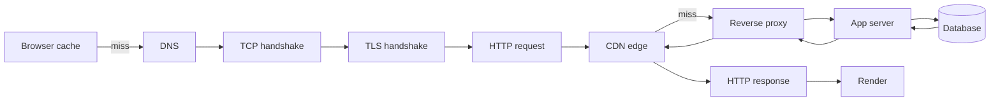
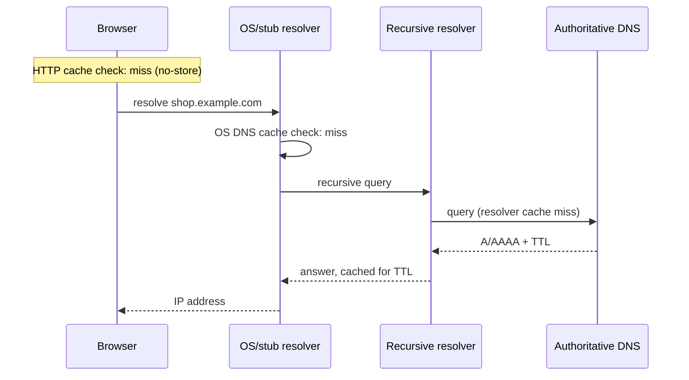
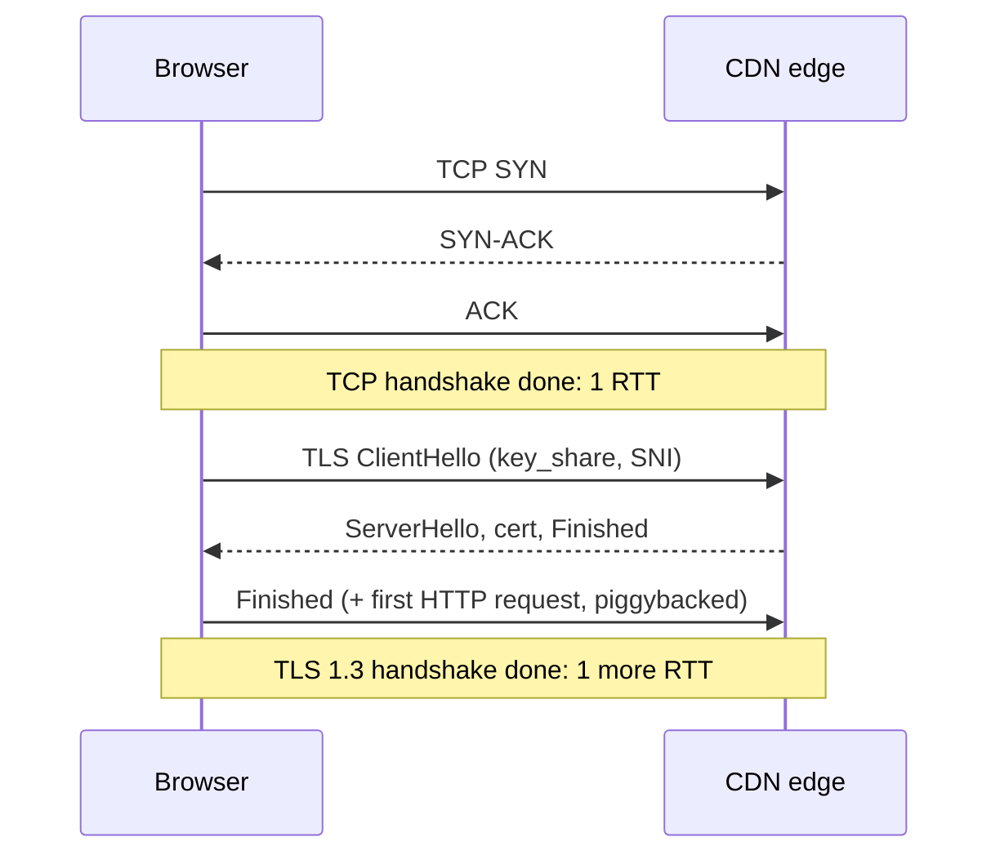
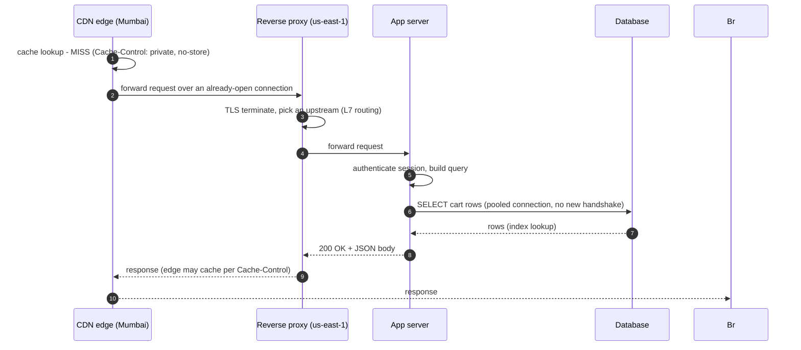
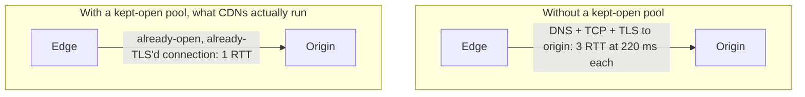
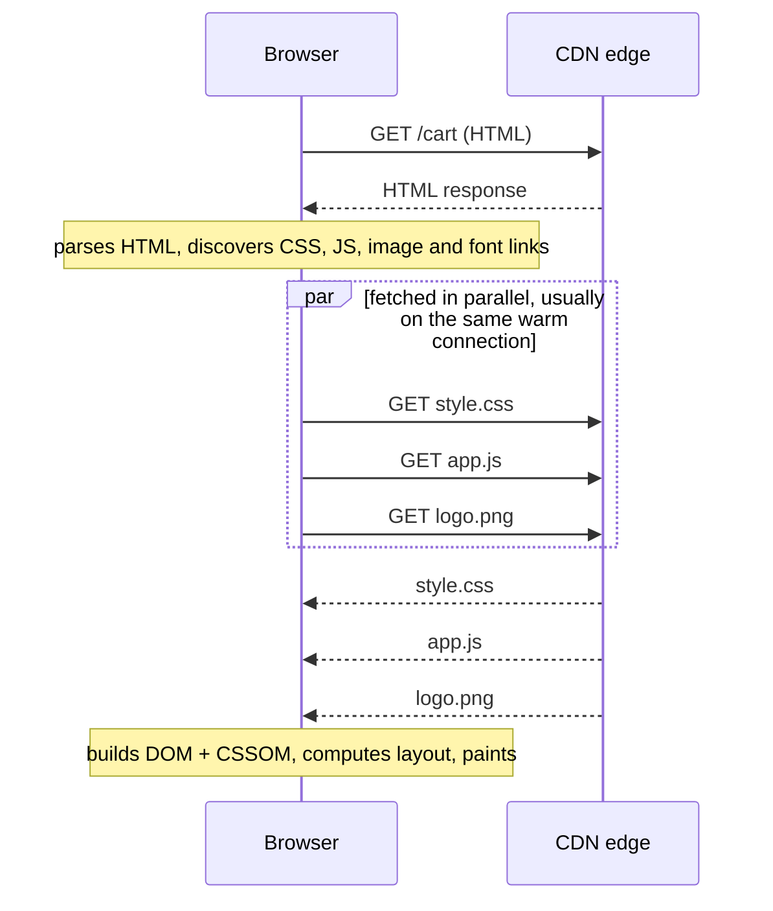

# What Happens When You Type a URL

> [!summary] TL;DR
> Typing `https://shop.example.com/cart` and pressing Enter triggers a chain of lookups and handshakes — browser cache check, DNS resolution, TCP handshake, TLS 1.3 handshake, an HTTP request routed through a CDN edge and a reverse proxy to an application server, a database round trip, and finally the browser parsing and rendering the response — that on a cold cache takes 300–800 ms and on a warm cache takes under 50 ms.

> [!abstract] Core idea
> - Every layer below the application (cache, DNS, TCP, TLS) exists to avoid redoing expensive work: a cache hit, a reused connection, or a resumed TLS session skips an entire phase.
> - The first request to a new origin pays for all of it: DNS lookup, a TCP handshake (1 round trip), and a TLS 1.3 handshake (1 more round trip, 2 combined with TCP) before a single HTTP byte moves.
> - A CDN answers from an edge point of presence close to the browser and never bothers the origin; only a cache miss or a dynamic request reaches the reverse proxy and the application.
> - The slowest parts are the ones measured in round trips across a real network, not CPU work — this is why warm connections, caching and picking a nearby CDN edge matter more than micro-optimizing server code.

### Whiteboard version

Nine boxes, one request, read left to right:



Every box after this is one of those nine steps, with its own explanation below; this note's job is only the order, the timing, and the handoffs between them.

## 1. Why it exists

A single page load for a shopping cart touches a browser cache, a DNS resolver, a CDN, a reverse proxy, an application server and a database — six systems owned by different teams or companies. Nobody designed "load a URL" as one system; it works because each layer has a narrow contract with the one above and below it (DNS resolves a name to an address and nothing else; TCP delivers bytes reliably and nothing else; TLS adds confidentiality and nothing else).

Understanding the full chain is what separates "the page is slow" from "the TLS handshake to the origin is adding 180 ms because the CDN cache is missing" — the second sentence names the box to fix.

**Concrete scenario, used throughout this note.** A user in Mumbai requests `https://shop.example.com/cart` for the first time this session (cold browser cache, cold TLS session, cold CDN edge cache for this exact URL since it's personalized). The origin's app servers and primary database sit in `us-east-1`, 220 ms round-trip away. A CDN with an edge PoP in Mumbai fronts the origin.

> [!tip] Remember
> Each layer's narrow contract is what lets six independently-owned systems cooperate without ever agreeing on a shared design — DNS, TCP, TLS, the CDN, the proxy and the app each only need to keep their own one promise.

## 2. Mental model

Think of the browser as a customer calling a company's switchboard:
1. The customer checks their own notebook for the number (**browser cache**) and for who answers it (**DNS cache**).
2. If the number isn't known, they call directory assistance (**DNS resolution**) once and write it down.
3. They dial the number: the phone has to ring and be picked up before anyone talks (**TCP handshake**).
4. Both sides agree on a shared code word so nobody else on the line understands them (**TLS handshake**).
5. The customer states their request to whoever answers first — often a local branch office that already has the answer memorized (**CDN edge**, cache hit) — and only if the branch doesn't know, it is forwarded to the switchboard operator (**reverse proxy**) who connects the right department (**application server**), who looks something up in the company's filing system (**database**) before answering.
6. The reply travels back the same chain, and only then does the customer act on it (**render**).

**Picture it:**



```mermaid
flowchart LR
    A["You (customer)"] --> B["Check your notebook (browser + DNS cache)"]
    B -->|not written down| C["Call directory assistance (DNS resolution)"]
    C --> D["Dial and wait for pickup (TCP handshake)"]
    D --> E["Agree on a secret code word (TLS handshake)"]
    E --> F["Local branch office (CDN edge)"]
    F -->|"branch doesn't know"| G["Switchboard operator (reverse proxy)"]
    G --> H["Right department (app server)"]
    H --> I["Filing cabinet (database)"]
```

Every "look it up first" step in that list is a cache; every "ring and pick up" step is a handshake that costs a round trip.

**Where the analogy breaks down:** a phone call is one continuous conversation once connected. The real chain is not one conversation — it's several separate request/response pairs (DNS is its own exchange, the TLS handshake is its own exchange, the HTTP request is yet another), each of which can independently be skipped if its own cache already holds the answer. The switchboard picture is useful for ordering, not for "it's all one call."

> [!tip] Remember
> If you can name which "call" in this chain is slow, you've already found the box to fix — the fix for a slow DNS call is never the same fix as a slow database call.

## 3. How it works

The full request below is the Mumbai-to-`us-east-1`, CDN-miss scenario from section 1, broken into the stages the whiteboard flowchart named. Each stage gets its own explanation; the exact round-trip costs for every stage are gathered once, in the table at the end of this section, so the numbers live in one place instead of being repeated in every diagram.

### Browser cache and DNS: checking the notebook first

**In plain words:** before sending anything onto the network, the browser asks itself two questions it can answer from memory: "do I already have this exact response cached?" and "do I already know this hostname's IP address?" Both checks are local, in-process lookups — no network round trip, no handshake.

**Example:** `/cart` is a personalized, `Cache-Control: no-store` response, so the browser cache check is a guaranteed miss (under 1 ms to find that out). The hostname `shop.example.com` has never been looked up this session, so the DNS cache is also a miss, which sends the request to a recursive resolver, which asks the authoritative server, caches the answer for the record's TTL, and hands the IP back.



**Why it matters:** a cold DNS lookup is one of the few delays an application can't fix by writing faster code — the only lever is the record's TTL and whether the client is allowed to cache it at all (see [[DNS - Resolution, Records and Caching]]).

> [!warning] Common mistake
> Assuming the DNS answer, once received, is good for the rest of the session. It's only good until its TTL expires — a resolver that ignores a short TTL (or a client resolver with its own minimum cache floor) can serve a stale IP after the origin has moved.

### TCP and TLS: two handshakes before one byte of HTTP moves

**In plain words:** TCP has to confirm both sides are listening and agree on starting sequence numbers before any payload can ride on the connection — that's the three-packet SYN / SYN-ACK / ACK handshake. TLS then has to agree on an encryption key and prove the server's identity before the connection is safe to send real data over. With TLS 1.3, both sides' first messages carry enough information that the whole security handshake finishes in one more round trip, not two.

**Picture it:**



**Example:** the browser's TCP SYN reaches the nearby CDN edge in Mumbai, not the far origin — so this handshake costs roughly one *local* round trip, not one trans-Pacific round trip. The TLS 1.3 handshake that follows is the same shape: local to the edge, not to `us-east-1`.

**Why it matters:** this is the entire reason a CDN edge exists at the TCP/TLS layer, not only at the caching layer — terminating the connection near the browser turns two expensive long-distance round trips into two cheap local ones.

> [!tip] Remember
> TLS 1.3 needs one round trip for its handshake because the client's very first message already carries its key share; TLS 1.2 needed two, because the key exchange and the final confirmation were two separate round trips.

### CDN edge, reverse proxy, app and database: who actually answers

**In plain words:** once the secure connection exists, the browser sends one HTTP request. The CDN edge checks its own cache first; only a miss (as it is here, since `/cart` is personalized) forwards the request onward, over a connection the CDN already keeps open to the origin's reverse proxy. The reverse proxy picks which application server instance should handle it, that server authenticates the session and queries the database, and the answer travels back the same chain.

**Picture it:**



**Example:** the edge-to-origin hop crosses the real 220 ms Mumbai-to-`us-east-1` distance, but it's only one round trip, because the CDN keeps a pool of connections to the origin already open and already TLS-handshaked (see [[Connection Pooling]]) — without that pool, this single hop would cost three round trips of its own (its own TCP + TLS handshake, on top of its own distance).

**Picture it — why the warm pool matters:**



**Why it matters:** this single design choice — the CDN keeping warm connections to the origin — is why a CDN-fronted site at real global distance still feels fast on a cache miss; without it, every miss would cost roughly four times the round trips.

> [!warning] Common mistake
> Assuming a CDN cache miss is as expensive as the browser's own DNS+TCP+TLS cost to a far origin would be. It isn't, because the CDN's connection to the origin is already warm — the miss only costs the one new round trip at the real distance, not three.

### Render: the browser's own second chain of requests

**In plain words:** the response arriving at the browser isn't the end of the work — the browser still has to parse it, discover everything else the page needs, fetch those things, and only then show anything. This step is itself a smaller version of the whole chain, repeated per subresource.

**Picture it:**



**Why it matters:** none of these subresource fetches pay for a new DNS lookup, TCP handshake or TLS handshake if they share the page's origin and connection — the only new cost is each request's own round trip and the server's own response time, which is why HTTP/2's multiplexing (reusing one connection for many requests at once) matters so much for a typical page with dozens of subresources. The full mechanism is covered in [[How Browsers Load and Render a Page]].

> [!tip] Remember
> "The page loaded" is not one request-response pair — it's one primary request plus a second, usually-parallel chain of subresource requests, most of them riding the same already-warm connection.

### Where the time actually goes

All the numeric costs named above, gathered in one place for the same cold-cache, Mumbai-to-`us-east-1` scenario:

| Phase | Typical cold-cache cost | Why |
| --- | --- | --- |
| Browser cache check | <1 ms | In-process memory/disk lookup |
| DNS resolution | 20–120 ms cold, <1 ms warm | 1–2 round trips to a resolver; cached for the record's TTL |
| TCP handshake | 1 RTT to the nearest server (CDN edge): often 10–40 ms | SYN, SYN-ACK, ACK before any data |
| TLS 1.3 handshake | 1 RTT, combined with the last leg of the TCP RTT and often piggybacked with the first request | Key exchange + certificate; 0-RTT is possible on a resumed session but replayable, see [[TLS and HTTPS]] |
| Edge-to-origin (CDN miss) | 1 RTT at the real distance (Mumbai↔us-east-1: ~220 ms) | Only paid on a cache miss; the CDN's warm pool makes this 1 RTT, not 3 |
| App + DB | Single digit to tens of ms | Indexed query, pooled DB connection — see [[Connection Pooling]], [[Query Plans and EXPLAIN]] |
| Render | Tens to hundreds of ms | Parsing, layout, paint, plus the subresource chain above — see [[How Browsers Load and Render a Page]] |

A **warm** repeat visit (DNS cached, TCP+TLS connection kept alive, CDN cache hit) collapses this to one HTTP round trip to the nearest edge: often under 50 ms end to end.

> [!tip] Remember
> Every row in this table is skippable by some form of caching or connection reuse except the app/DB row — that's the one phase that genuinely has to run on every single request.

## 4. Worked example

### A real `curl` timing breakdown

The same four phases the sequence diagrams above show — DNS, TCP connect, TLS, time to first byte — are exactly what `curl -w` exposes on a live request, and exactly what browser DevTools' "waterfall" panel is built on.

**Measured** (`curl 8.x`, 2026-11-06, a live HTTPS request to a public site over this machine's network; absolute numbers depend on the network path, but the ordering and the "warm connection skips connect+tls" relationship always hold):

```bash
curl -s -o /dev/null -w \
  "dns:%{time_namelookup}s connect:%{time_connect}s tls:%{time_appconnect}s ttfb:%{time_starttransfer}s total:%{time_total}s\n" \
  https://example.com
```

```text
dns:0.002563s connect:0.003054s tls:0.180100s ttfb:0.231865s total:0.232011s
```

Read it as cumulative, not per-phase: DNS finished at 2.6 ms, the TCP handshake finished at 3.1 ms (so TCP itself took ~0.5 ms here, a nearby server), the TLS handshake finished at 180.1 ms (so TLS alone cost ~177 ms — the one long round trip in this path), and the first response byte arrived 51.8 ms after that.

### Tracing the same four phases in Go

The same breakdown can be measured from inside an application instead of from the command line, using `net/http/httptrace` — the mechanism both `curl -w` and the browser's own waterfall panel are built on. A Go package built around it confirms two things a learner should predict before running anything: a plain `http://` URL pays nothing for TLS, and a second request on a kept-alive connection skips both connect and TLS entirely.

**Measured** (Go 1.24.4, darwin/arm64, `go test -race -run TestDo -v`, 2026-11-06):

```text
=== RUN   TestDoHTTPS
--- PASS: TestDoHTTPS (0.01s)
=== RUN   TestDoReusesConnection
--- PASS: TestDoReusesConnection (0.00s)
PASS
```

Runnable Go version: [[What Happens When You Type a URL - Go]].

## 5. Variants and comparison

| Scenario | What's skipped | Typical total (representative) |
| --- | --- | --- |
| Fully cold: new DNS name, new TCP/TLS connection, CDN cache miss | Nothing | 300–800 ms (dominated by the real-distance round trip to origin) |
| Warm DNS + connection, CDN cache **hit** | DNS, TCP, TLS, origin round trip entirely | 10–50 ms (one RTT to the nearest edge) |
| Warm DNS + connection, CDN cache **miss** (personalized page) | DNS, TCP, TLS | 1 RTT to edge + 1 RTT edge-to-origin + app/DB time |
| TLS session resumption (session tickets) | The certificate exchange and signature; still 1 RTT unless 0-RTT is used | Saves tens of ms, mainly on mobile/high-latency links |
| HTTP/3 (QUIC) on a lossy network | A second round trip HTTP/1.1/2 would need after a lost packet (QUIC fixes head-of-line blocking at the transport layer) | Fewer retransmission stalls; see [[HTTP-1.1 vs HTTP-2 vs HTTP-3]] |
| Same-origin follow-up request (e.g. an XHR after the page loads) | DNS, TCP, TLS (connection already open); possibly the whole request if HTTP-cached | 1 RTT to the server actually handling it |

## 6. Trade-offs and when not to use

- This exact chain assumes a public internet page with a CDN in front of it. An internal service-to-service call inside one data center skips DNS-over-the-internet and CDN entirely and is dominated by the application and database time instead.
- Pushing more into the CDN (more cacheable responses) trades freshness for speed — see [[HTTP Caching - Cache-Control, ETag, Conditional Requests]] for exactly which responses are safe to cache.
- Keeping connections warm (HTTP keep-alive, TLS session resumption) trades server-side memory and open file descriptors for lower latency; an application server under a connection-count limit may need to reduce keep-alive timeouts instead of maximizing them.
- 0-RTT TLS resumption removes a round trip but allows the first flight of application data to be replayed by an attacker who captured it; use it only for idempotent requests (see [[TLS and HTTPS]]).

> [!tip] Remember
> Every trade-off in this chain has the same shape: something is cached or kept warm to save a round trip, at the cost of memory, staleness risk, or (for 0-RTT) a real security trade-off.

## 7. In production

- **Real systems:** this exact chain is what `example.com`, `shop.*` SaaS storefronts, and any CDN-fronted web app (Cloudflare, Akamai, Fastly, CloudFront in front of an origin) do for every page view. Browser DevTools' Network tab and WebPageTest draw this chain as a waterfall per request.
- **Failure modes → fixes:**
  - Slow TTFB with a fast DNS/TCP/TLS → the bottleneck is the origin: check the reverse proxy → app → DB hop (see [[Network Debugging Toolkit - dig, curl, ss, tcpdump]] for `curl -w` and `dig` to localize it).
  - High DNS time on every request → the resolver isn't honoring or isn't given a sane TTL, or the client isn't caching; see [[DNS - Resolution, Records and Caching]].
  - High TLS time → full handshake on every request instead of session resumption, or a slow certificate chain validation (OCSP); see [[TLS and HTTPS]].
  - CDN cache hit ratio near zero on a cacheable page → check `Cache-Control`/`Vary` headers are actually cacheable; see [[HTTP Caching - Cache-Control, ETag, Conditional Requests]] and [[CDN and Edge]].
- **What to monitor:** per-phase timing percentiles (p50/p95/p99) from Real User Monitoring, CDN cache hit ratio, TLS handshake failure rate, and origin-reachable-from-edge latency.

## 8. Deep dive

- **Why TCP+TLS cost "2 round trips" and not 3.** TLS 1.3's client sends its key share in the very first flight (the `ClientHello`), so the server can reply with everything needed to finish the handshake in its one response; the client's `Finished` message can carry the first HTTP request piggybacked on it. TLS 1.2 needed its own separate `ClientKeyExchange`/`Finished` round trip on top of the `ClientHello`/`ServerHello` exchange, which is the round trip TLS 1.3 removes.

  ```mermaid
  flowchart TB
      subgraph tls12["TLS 1.2 on top of TCP: 3 round trips before data"]
          direction LR
          a1["RTT 1: TCP SYN / SYN-ACK / ACK"] --> a2["RTT 2: ClientHello to ServerHello + cert"] --> a3["RTT 3: ClientKeyExchange, Finished, then first HTTP byte"]
      end
      subgraph tls13["TLS 1.3 on top of TCP: 2 round trips before data"]
          direction LR
          b1["RTT 1: TCP SYN / SYN-ACK / ACK"] --> b2["RTT 2: ClientHello with key share, to ServerHello + cert + Finished, then client Finished + first HTTP byte piggybacked"]
      end
  ```

  **Why it matters:** the practical cost is 1 RTT for TCP and 1 RTT for TLS, and the first HTTP bytes move in the third flight — never 3 full round trips the way TLS 1.2 needed.
- **Why the CDN hop to origin is cheap even at 220 ms distance.** The CDN keeps a pool of already-established, already-TLS-handshaked connections to the origin (see [[Connection Pooling]]). A browser paying for DNS+TCP+TLS to the edge, plus the edge forwarding over an already-warm connection, is cheaper than the browser doing DNS+TCP+TLS directly to the far origin.
- **Where the application and database time actually goes.** A well-indexed point lookup (by primary key or a covering index) costs low single-digit milliseconds; an unindexed scan or an N+1 pattern of many small queries can dominate the entire request — see [[Query Plans and EXPLAIN]] and [[N+1 Query Problem]].
- **What "render" hides.** The browser doesn't wait for the whole response before starting work: it streams-parses HTML, discovers subresources (CSS, JS, images, fonts) and fires new requests for each, builds the DOM and CSSOM, computes layout, and paints — a second request-response chain per subresource, each going through some or all of the same phases (often on the same warm connection via HTTP/2 multiplexing). The mechanism is covered in full in [[How Browsers Load and Render a Page]].
- **Load balancing is invisible here on purpose.** Both the CDN's and the reverse proxy's "pick an upstream" step is a load-balancing decision; the algorithms (round robin, least connections, consistent hashing) live in [[Load Balancing]], and this note only shows that the decision happens.

## 9. Interview questions

> [!question]- Walk me through what happens between pressing Enter and the page starting to render.
> Browser cache check, then DNS resolution (if not cached), a TCP handshake, a TLS 1.3 handshake, an HTTP request that a CDN may answer from cache or forward to a reverse proxy, which routes it to an application server that queries a database, then the response travels back and the browser parses and renders it. Each step is skippable if its own cache already has the answer.

> [!question]- Why does the very first request to a new site feel so much slower than every request after it?
> The first request pays for DNS resolution, a fresh TCP handshake, and a fresh TLS handshake — together often 2+ round trips before any HTTP byte moves — plus a guaranteed CDN cache miss. Every later request on the same connection, with DNS and TLS session state cached, skips all of that and pays only the HTTP round trip.

> [!question]- Trap: does enabling TLS 1.3's 0-RTT mode always make the first request faster with no downside?
> No. 0-RTT removes a round trip but lets an attacker who captured the encrypted early data replay it to the server, so it is only safe for requests that are idempotent (safe to execute twice), never for something like "charge this card" or "transfer funds."

> [!question]- A page's TTFB is 600 ms but DNS, TCP and TLS together only account for 40 ms. Where do you look next?
> At the origin: the reverse proxy, the application server, and the database. Check whether the CDN even has this URL cacheable (a miss means every request pays the full origin round trip), then use `curl -w` or server-side tracing to see whether the time is in the app logic or a slow query.

> [!question]- Does a CDN make TLS unnecessary between the edge and the origin?
> No. TLS terminates at the edge (browser↔edge) so the browser gets confidentiality and authentication, but the edge-to-origin hop crosses the open internet too and should also run its own TLS session, usually with a different certificate owned by the origin.

> [!question]- Why is HTTP/3 expected to help more on a mobile network than on a fast wired one?
> HTTP/3 runs over QUIC, which multiplexes streams without TCP's head-of-line blocking: one lost packet only stalls the stream it belongs to, not every stream on the connection. Mobile networks have higher loss and more frequent IP changes (QUIC connections survive a network change; TCP ones don't), so the benefit is larger where loss and roaming are common.

> [!question]- Where exactly does load balancing happen in this chain?
> Twice: the CDN edge picks which origin server (or which further edge) to forward a cache miss to, and the reverse proxy at the origin picks which application server instance handles the request. Both are load-balancing decisions; the algorithms behind them are covered in [[Load Balancing]], not here.

## 10. Cheat sheet

- Order: browser cache → DNS → TCP handshake → TLS handshake → HTTP request → CDN (cache hit stops here) → reverse proxy → app → DB → response → render.
- Cold path costs: DNS (1–2 RTT), TCP (1 RTT), TLS 1.3 (1 RTT, piggybacked with the first request) — all skippable on a warm connection.
- A CDN cache hit never reaches the origin; a miss adds exactly one more RTT at the real edge-to-origin distance, because the CDN keeps warm pooled connections to origin.
- TLS 1.3 0-RTT trades a round trip for replay risk; only use it for idempotent requests.
- `curl -w` and `net/http/httptrace` expose the same four phases this note's diagrams show: DNS, connect, TLS, TTFB.
- When TTFB is high but DNS/TCP/TLS are fast, the problem is at the origin (proxy, app, or DB), not the network path.
- Render is itself a second chain of request/response cycles for subresources, usually multiplexed over one warm connection.

## Links

- **Before this:** [[DNS - Resolution, Records and Caching]], [[TCP - Handshake, Reliability, Flow and Congestion Control]], [[TLS and HTTPS]], [[HTTP Fundamentals - Methods, Status Codes, Headers, Cookies]]
- **Next:** [[Network Debugging Toolkit - dig, curl, ss, tcpdump]], [[How Browsers Load and Render a Page]]
- **Compare with:** [[HTTP-1.1 vs HTTP-2 vs HTTP-3]], [[HTTP Caching - Cache-Control, ETag, Conditional Requests]], [[CDN and Edge]], [[Forward and Reverse Proxies - L4 vs L7]], [[Nginx]], [[Load Balancing]], [[Connection Pooling]], [[Query Plans and EXPLAIN]]
- **Also in this folder:** [[How the Internet Works - IP, Ports, Packets, OSI vs TCP-IP]], [[IP Addressing, Subnets, NAT and VPC Basics]], [[UDP and QUIC]]
- **Code:** [[What Happens When You Type a URL - Go]]
