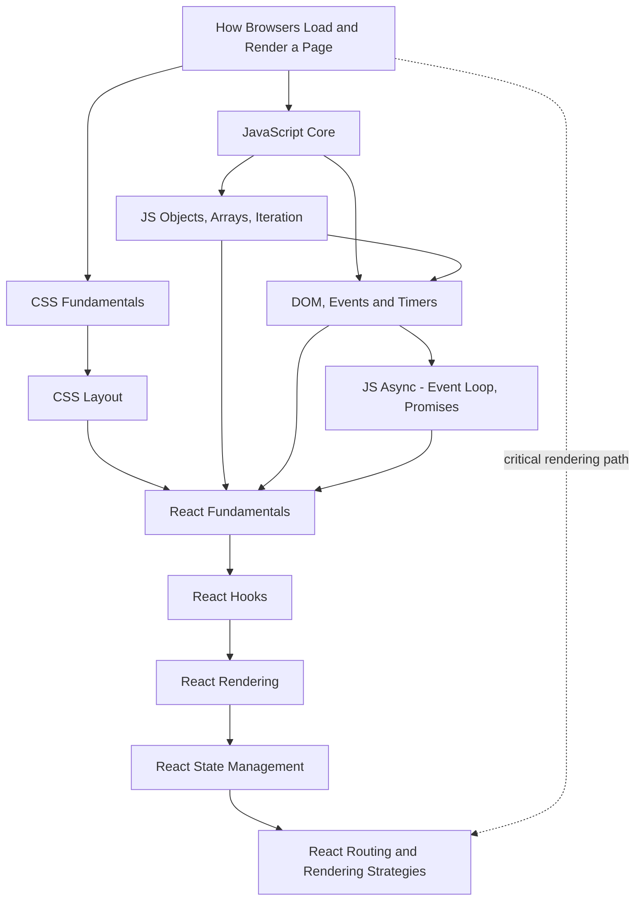

# 03 Frontend MOC

> [!summary] What this folder covers
> How a browser turns HTML/CSS/JS into pixels, the core language and DOM mechanics behind any frontend, and enough React (components, hooks, rendering, state, routing) to read and lightly modify a modern frontend codebase — not to become a frontend expert.

## Before and after

- **Before this:** [[02 Networking & Web MOC]]
- **After this:** nothing; this is a starting point

## Learning path

### Browser and CSS foundations

1. [[How Browsers Load and Render a Page]] · basic. The pipeline (HTML→DOM, CSS→CSSOM→render tree→layout→paint) everything else in this folder assumes.
2. [[CSS Fundamentals - Cascade, Selectors, Box Model]] · basic. How a browser picks a winning style and sizes every box on the page.
3. [[CSS Layout - Position, Flexbox, Grid]] · basic. Taking elements out of normal flow, and arranging them along one or two axes.

### JavaScript core

4. [[JavaScript Core - Types, Scope, Hoisting, Closures, this]] · basic. Primitives vs. references, `var`/`let`/`const`, closures, and how `this` is actually resolved.
5. [[JavaScript Objects, Arrays and Iteration]] · basic. The two general-purpose data shapes and the loops/methods (`map`/`filter`/`reduce`) that move data through them.
6. [[DOM, Events and Timers]] · basic. The live tree JavaScript mutates, how events bubble, and the two timer primitives.
7. [[JavaScript Async - Event Loop, Promises, async-await]] · intermediate. Why the event loop never blocks, and how Promises/`async`/`await` schedule "later."

### React

8. [[React Fundamentals - Components, JSX, Props, State]] · basic. Components as functions of props/state, JSX, lists and keys.
9. [[React Hooks]] · intermediate. `useState`/`useEffect` and friends, the rules of hooks, and why call order matters.
10. [[React Rendering - Virtual DOM, Reconciliation, Lifecycle]] · intermediate. What actually happens between a state change and a DOM write.
11. [[React State Management - Props, Context, Redux]] · intermediate. When props stop scaling, and what Context/Redux each actually buy you.
12. [[React Routing and Rendering Strategies - CSR, SSR, SSG]] · intermediate. Client-side routing, and the CSR/SSR/SSG/ISR/Server Components spectrum for where HTML gets generated.

## Concept map

## Interview focus

- "What's the actual difference between `async` and `defer`?" → [[How Browsers Load and Render a Page]]
- "Why does `#nav .item a` beat a selector with more classes?" → [[CSS Fundamentals - Cascade, Selectors, Box Model]]
- "When would you choose grid over flexbox?" → [[CSS Layout - Position, Flexbox, Grid]]
- "What does a closure capture, the value or the variable?" → [[JavaScript Core - Types, Scope, Hoisting, Closures, this]]
- "What's the difference between `map` and `forEach`?" → [[JavaScript Objects, Arrays and Iteration]]
- "What's the difference between event capturing and bubbling?" → [[DOM, Events and Timers]]
- "Why does a `.then` callback run before a `setTimeout(fn, 0)`?" → [[JavaScript Async - Event Loop, Promises, async-await]]
- "Why does React want a stable `key`, and why is the array index a bad choice?" → [[React Fundamentals - Components, JSX, Props, State]]
- "Why can't you call a hook inside an `if` statement?" → [[React Hooks]]
- "Does the virtual DOM make React faster than direct DOM manipulation?" → [[React Rendering - Virtual DOM, Reconciliation, Lifecycle]]
- "Is Redux a replacement for `useState`?" → [[React State Management - Props, Context, Redux]]
- "What do React Server Components give you that classic SSR doesn't?" → [[React Routing and Rendering Strategies - CSR, SSR, SSG]]

## Sources worth reading

- web.dev, Critical Rendering Path and Core Web Vitals
- MDN Web Docs, CSS Cascade and Inheritance; Flexbox and Grid Basic Concepts
- ECMA-262 (ECMAScript Language Specification) and MDN's JavaScript Guide
- react.dev — Describing the UI, Reusing Logic with Custom Hooks, Render and Commit, Server Components
- Redux Toolkit docs (redux-toolkit.js.org) and React Router docs (reactrouter.com)
