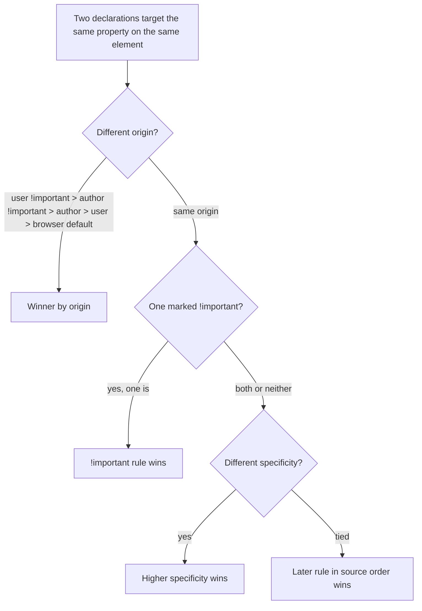
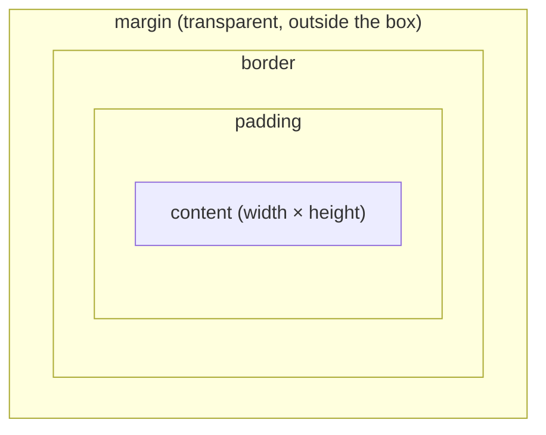

# CSS Fundamentals - Cascade, Selectors, Box Model

> [!summary] TL;DR
> CSS applies rules to elements through **selectors**, and when two rules target the same element with the same property, the **cascade** picks a winner using origin, `!important`, **specificity**, and source order, in that priority. Every element is laid out as a **box**: content, then padding, then border, then margin, from the inside out.

> [!abstract] Core idea
> - A selector's specificity is a triple `(IDs, classes/attrs/pseudo-classes, type selectors)`; higher wins, compared left to right like digits — twenty classes never beat one ID.
> - `!important` and inline styles jump the queue ahead of specificity; later same-specificity rules win by source order.
> - `#id` selects by ID, `.class` selects by class — mixing them up is the single most common CSS selector mistake.
> - The box model is content → padding → border → margin; `box-sizing: border-box` makes `width` include padding and border instead of excluding them.
> - Not every property inherits: text properties (color, font) do; box properties (margin, border, width) don't.

### Whiteboard version

```css
#nav .item a { color: blue; }   /* specificity (1, 1, 1) */
.item a.active { color: red; }  /* specificity (0, 2, 1) */
```

Both rules can match the same `<a>`. `(1,1,1)` beats `(0,2,1)` because you compare the ID count first — one ID beats any number of classes — so the link is blue, even though the red rule has more class selectors and appears later in the file. This is the entire cascade in miniature: compare the left-most number first, and only fall through to source order when every number ties.

## 1. Why it exists

A page has a global stylesheet with `a { color: blue; }`, a component stylesheet with `.card a { color: green; }`, and a designer who adds `style="color: red"` directly on one special link for a promotion. Three rules, one element, three different colors requested. Without a deterministic rule for "which one wins," every browser could render the page differently, and every CSS file would need to be read top to bottom in full to predict any single element's final style. The cascade is the fixed, documented procedure that makes the outcome the same in every standards-compliant browser, and lets you reason about one rule at a time instead of the whole file.

## 2. Mental model

Think of the cascade as a four-round tournament. Round 1 asks "where did this rule come from" (a browser default loses to your stylesheet, which loses to `!important` from your stylesheet reversed to the top — see below). Round 2 asks "is it marked `!important`." Round 3 asks "which selector is more specific." Round 4, only if every earlier round tied, asks "which rule appears later in the source." Each round only runs if the previous one was a tie.

## 3. How it works

### Adding CSS and why the method matters

| Method | Syntax | Scope | Notes |
| --- | --- | --- | --- |
| External | `<link rel="stylesheet" href="style.css">` in `<head>` | whole site | cached by the browser and by CDNs across pages; the one that scales |
| Internal | `<style>…</style>` in `<head>` | one page | no caching across pages; fine for a single-page demo |
| Inline | `style="…"` on one element | one element | highest precedence of the three; no reuse, hard to maintain |

External CSS is render-blocking (see [[How Browsers Load and Render a Page]]): the browser cannot paint until the CSSOM from every linked stylesheet is built, so a large unnecessary stylesheet delays first paint even though it never touches JavaScript.

### The cascade, in order



**Origin and `!important`.** Normally author (your) styles beat the browser's default stylesheet. `!important` flips the fight within its own origin: an `!important` author rule beats a normal author rule regardless of specificity, and a user stylesheet's `!important` (accessibility overrides a user sets) beats even an `!important` author rule. In practice, treat `!important` as an escape hatch for utility classes or overriding a third-party widget you don't control, not a habit — a page where every rule is `!important` has no cascade left to reason about.

**Specificity.** Computed as a triple `(a, b, c)`:
- `a` = number of ID selectors (`#nav`)
- `b` = number of class, attribute, and pseudo-class selectors (`.card`, `[type="text"]`, `:hover`)
- `c` = number of type selectors and pseudo-elements (`div`, `a`, `::before`)

Compare `a` first; only if tied, compare `b`; only if tied, compare `c`. The universal selector `*` and combinators (`>`, `+`, `~`, space) contribute nothing.

| Selector | (a, b, c) | Why |
| --- | --- | --- |
| `a` | (0, 0, 1) | one type selector |
| `.btn` | (0, 1, 0) | one class |
| `#nav .item a` | (1, 1, 1) | 1 ID, 1 class, 1 type |
| `div.card:hover::before` | (0, 2, 2) | 1 class + 1 pseudo-class = 2; 1 type + 1 pseudo-element = 2 |
| `:where(#nav) .item a` | (0, 1, 1) | `:where()` always contributes zero, even around an ID |
| `:is(#nav, .item) a` | (1, 0, 1) | `:is()` takes the specificity of its most specific matched argument (here `#nav`, an ID) |

`:not()` is the odd one out: it contributes the specificity of its argument, not of `:not()` itself — `a:not(.disabled)` is `(0, 1, 1)`, the same as `a.disabled` would be, not `(0, 2, 1)`.

Styling by ID is discouraged in practice precisely because of this table: an ID selector is nearly impossible to override later without another ID or `!important`, which is why most style guides cap selectors at classes and reserve IDs for JavaScript hooks and anchors.

**Source order.** Only reached when origin, `!important`, and specificity all tie. The rule that appears later — later in the same file, or in a file linked later — wins. This is why `@import` at the top of a file is placed exactly where its rules sit in the cascade, and why your overrides must come after a third-party stylesheet's `<link>` tag, not before it.

**Cascade layers (`@layer`, since 2022 across evergreen browsers).** `@layer reset, base, components, utilities;` declares layer order up front; rules inside an earlier-named layer always lose to a later-named layer regardless of specificity, and only within the same layer does the normal specificity battle happen. This is how design systems let a one-class utility override a highly specific component rule without an `!important` war.

### Selectors and combinators

| Selector | Matches | Example |
| --- | --- | --- |
| Type | every element of that tag | `p` |
| Class | elements with that class, reusable | `.btn` |
| ID | the one element with that ID, must be unique on the page | `#hero` |
| Attribute | elements with a matching attribute | `[type="text"]`, `[href^="https"]` |
| Universal | every element | `*` |
| Descendant | B anywhere inside A | `.card p` |
| Child | B a direct child of A | `.card > p` |
| Adjacent sibling | B immediately after A, same parent | `h2 + p` |
| General sibling | B anywhere after A, same parent | `h2 ~ p` |

**ID vs. class, correctly:** an ID is selected with `#`, a class with `.`. `<div id="hero">` is selected by `#hero { }`, never `.hero { }` or `#hero { }` written as a heading-style `# hero {}` — that `#` is CSS syntax for an ID selector, not Markdown. An ID must be unique on the page; a class can repeat on as many elements as you like. In JavaScript, the ID maps to `document.getElementById('hero')` or `document.querySelector('#hero')`; the class maps to `document.getElementsByClassName('btn')` or `document.querySelectorAll('.btn')`.

**Selector matching direction (performance myth).** Browsers match compound selectors right-to-left (starting from the rightmost, most specific part, then walking up ancestors only if needed), which used to make very long descendant selectors a measurable cost. On modern rendering engines this is rarely the actual bottleneck for typical stylesheets; layout and paint cost dominate far more often, so writing readable, class-based selectors is the right default rather than hand-optimizing selector shape.

### Inheritance

Some properties inherit from parent to child by default; others don't:

| Inherits by default | Does not inherit by default |
| --- | --- |
| `color`, `font-family`, `font-size`, `line-height`, `visibility`, `cursor` | `margin`, `padding`, `border`, `width`, `height`, `background`, `display` |

The rule of thumb: text-related properties inherit (so you can set a font once on `body`), box and layout properties don't (so a child doesn't silently inherit its parent's border). `inherit`, `initial`, and `unset` as values force the behavior either way explicitly.

### The box model



Every element's rendered box is, from the inside out: **content** (sized by `width`/`height`), **padding** (space between content and border, same background as the content), **border** (a visible or invisible line), **margin** (transparent space outside the border, used to separate this box from others).

**`box-sizing`** decides what `width`/`height` measure:
- `content-box` (the CSS default): `width` is the content box only; padding and border are added on top, so a `width: 200px; padding: 20px; border: 5px solid` box actually renders 250px wide.
- `border-box`: `width` includes padding and border, so that same box renders exactly 200px wide, with the content area shrinking to fit. Nearly every CSS reset sets `*, *::before, *::after { box-sizing: border-box; }` because it makes widths predictable when you add padding or a border later without needing to recompute anything.

**Margin collapsing:** two vertical margins touching between block-level siblings (or between a parent and its first/last child, if nothing separates them) collapse into a single margin equal to the larger of the two, not their sum. A `10px` bottom margin followed by a `15px` top margin produces `15px` of gap, not `25px`. This only applies to vertical margins in normal flow, not horizontal margins, and not to flex or grid children.

**Units:** `px` is an absolute pixel; `%` is relative to the parent's size for that property; `em` is relative to the current element's font size (and compounds through nested elements); `rem` is relative to the root (`html`) font size, which is why most codebases default to `rem` for spacing and font sizes — it doesn't compound unpredictably as you nest; `vw`/`vh` are 1% of the viewport width/height; `ch` is the width of the `0` character in the current font, useful for capping line length for readability.

### Typography, colors and backgrounds

```css
body {
  font-family: Arial, sans-serif; /* fallback list, generic family last */
  font-size: 16px;
  font-weight: 400;
  line-height: 1.5;
  color: #1a1a1a;
}

.hero {
  background: linear-gradient(blue, green);
  background-size: cover;
  background-position: center;
  background-attachment: fixed;
}
```

A font stack lists specific fonts first and a generic family (`sans-serif`, `serif`, `monospace`) last as the guaranteed fallback. Colors can be hex (`#1a1a1a`), `rgb()`/`rgba()`, `hsl()` (often easier to tweak lightness on), or `currentColor` (reuses the element's own computed `color`, handy for an SVG icon that should match surrounding text). Loading a custom web font causes either FOIT (flash of invisible text, if the browser hides text until the font arrives) or FOUT (flash of unstyled text, if it shows a fallback font first); `font-display: swap` opts into FOUT, which is usually the better user experience.

`overflow: hidden` combined with `text-overflow: ellipsis` and `white-space: nowrap` truncates long text with `…` instead of letting it break the layout. `float: left` pulls an element out of normal flow to one side and lets inline content (typically text) wrap around it — this is the old way to wrap text around an image, mostly replaced today by flexbox or grid (see [[CSS Layout - Position, Flexbox, Grid]]), though floats still need an explicit "clearfix" (or a parent with `display: flow-root`) so the parent doesn't collapse to zero height around only-floated children.

Custom properties (CSS variables) are declared with `--name: value` and read with `var(--name, fallback)`; they cascade and inherit like any other property, which is what makes them useful for theming (`--brand-color` set once on `:root`, read everywhere).

**Responsive basics.** `@media (min-width: 768px) { … }` scopes a block of rules to a viewport condition (width, height, orientation, `prefers-color-scheme`); it's still ordinary cascade rules underneath, just gated by the query. `clamp(min, preferred, max)` picks a single fluid value between two bounds (e.g. `font-size: clamp(1rem, 2vw + 0.5rem, 2rem)`) so a size scales smoothly with the viewport without a breakpoint for every step — one declaration instead of three media queries.

### Pseudo-classes and pseudo-elements

A **pseudo-class** (one colon, `:hover`) selects an element in a particular *state*; a **pseudo-element** (two colons, `::before`) selects a *part* of an element that isn't a real DOM node.

| Category | Examples |
| --- | --- |
| Link/interaction states | `:link`, `:visited`, `:hover`, `:active`, `:focus`, `:focus-visible` |
| Structural | `:first-child`, `:last-child`, `:nth-child(2n+1)`, `:nth-of-type(2)` |
| Logical | `:not(.disabled)`, `:is(h1, h2, h3)`, `:where(.card)`, `:has(> img)` |
| Form state | `:checked`, `:disabled`, `:required`, `:invalid` |
| Pseudo-elements | `::before`, `::after` (need a `content` value to render at all), `::placeholder`, `::selection` |

Link states must be declared in **LVHA** order — `:link`, `:visited`, `:hover`, `:active` — because they tie on specificity and a later rule wins on a tie; writing them out of order means `:hover` or `:active` can silently lose to `:visited` for a visited link.

```css
a:link    { color: #0645ad; }
a:visited { color: #551a8b; }
a:hover   { color: #e8710a; }
a:active  { color: #faa700; }
```

`:focus` matches any focused element, including a mouse click on a button; `:focus-visible` matches only when the browser decides focus should be visibly shown — typically keyboard navigation — which is the one to use for a custom focus ring that shouldn't flash on every mouse click but must appear for keyboard users (an accessibility requirement, not a style preference).

`:has()` (a "parent selector", widely supported since 2023) lets a rule select a parent based on what's inside it: `.card:has(> img) { padding-top: 0; }` matches a `.card` only when it directly contains an `img`, something no earlier version of CSS could express without JavaScript.

Pseudo-class specificity counts as a class, `(0, 1, 0)`, same weight as `.btn`.

### Shadows

```css
.card {
  box-shadow: 2px 4px 8px 0px rgba(0, 0, 0, 0.2); /* x y blur spread color */
}
.card:focus-visible {
  box-shadow: 0 0 0 3px rgba(37, 99, 235, 0.5); /* accessible focus ring, no layout shift */
}
h1 {
  text-shadow: 0 0 5px yellow, 0 -5px 5px orange; /* comma-separated: multiple shadows */
}
```

`box-shadow` takes `x y blur spread color`, plus an optional `inset` keyword to draw the shadow inside the box instead of outside. `text-shadow` takes only `x y blur color` — it has no spread value, unlike `box-shadow`. Both accept a comma-separated list for multiple shadows, stacked from first (top) to last (bottom). Shadows never affect layout or take up box space, which is what makes `box-shadow` a cheap way to draw an accessible focus ring (`:focus-visible { box-shadow: 0 0 0 3px blue; }`) without shifting neighboring content the way adding a real `border` would. Design systems typically define a small "elevation" scale (shadow presets for `sm`/`md`/`lg` surfaces) rather than hand-picking values per component. `filter: drop-shadow()` is the one to reach for on a transparent PNG or SVG, since `box-shadow` only follows the element's rectangular box, not the shape of transparent pixels inside it. Animating a shadow's blur/spread directly is expensive (it's a paint-affecting property); animating the `opacity` of a pseudo-element pre-rendered with the target shadow is the cheap equivalent, since opacity can be composited.

### Display and normal flow

Block elements (`div`, `p`, `section`, `h1`) take the full available width and start on a new line; inline elements (`span`, `a`, `strong`) take only the width their content needs and sit in the flow of text. Inline elements ignore `width`, `height`, and vertical `margin` entirely — setting `height` on a `<span>` has no effect. `inline-block` behaves like inline from the outside (sits in text flow, doesn't force a new line) but accepts `width`, `height`, and vertical margin like a block from the inside — the classic use is a button or nav item that needs explicit sizing but shouldn't break onto its own line. One gotcha: adjacent `inline-block` elements in the HTML source pick up a small gap matching the whitespace between their tags in the markup, unless that whitespace is removed or `font-size: 0` is set on the parent.

`img` and `input` are **replaced elements**: the browser renders external content (an image, a form control) inside their box, so unlike a plain inline element, `width` and `height` do apply to them even though their default `display` is inline.

`display: none` removes an element from the render tree entirely — no box, no space reserved, invisible to screen readers. `visibility: hidden` keeps the box's space reserved but paints nothing. `opacity: 0` keeps both the space and the element in the accessibility tree and still receives clicks — it's invisible paint only, not removed from interaction, which is a common accessibility bug source if used where `display: none` was meant.

Setting `display: flex`, `display: grid`, or `display: contents` changes the *outer* display (how the element behaves in its parent's layout) while also establishing a new *inner* layout mode for its own children — this outer/inner split is why `display: inline-flex` exists: flex layout for the children, inline behavior in the parent's flow.

A **block formatting context** (`display: flow-root`) contains floats and prevents margin collapsing across its boundary — it's the modern replacement for old float "clearfix" hacks.

## 4. Worked example

### Computing specificity with code

```go
package specificity

import "strings"

// Triple is the (a, b, c) specificity tuple. Higher a wins first, then b, then c.
type Triple struct {
	A, B, C int
}

// Less reports whether t is lower specificity than other (loses the cascade fight).
func (t Triple) Less(other Triple) bool {
	if t.A != other.A {
		return t.A < other.A
	}
	if t.B != other.B {
		return t.B < other.B
	}
	return t.C < other.C
}

// Of parses one compound selector like "#nav .item a" or "div.card:hover::before"
// and returns its specificity triple. It splits on whitespace and combinators
// first, then classifies each token inside a compound.
func Of(selector string) Triple {
	var t Triple
	selector = strings.NewReplacer(">", " ", "+", " ", "~", " ").Replace(selector)
	for _, part := range strings.Fields(selector) {
		for _, tok := range splitCompound(part) {
			switch {
			case tok == "*":
				// universal selector contributes nothing
			case strings.HasPrefix(tok, "#"):
				t.A++
			case strings.HasPrefix(tok, "."):
				t.B++
			case strings.HasPrefix(tok, "["):
				t.B++
			case strings.HasPrefix(tok, "::"):
				t.C++
			case strings.HasPrefix(tok, ":"):
				t.B++ // pseudo-class, e.g. :hover, :nth-child()
			case tok != "":
				t.C++ // type selector, e.g. div, a, h1
			}
		}
	}
	return t
}

// splitCompound breaks "div.card:hover::before" into ["div", ".card", ":hover", "::before"].
func splitCompound(s string) []string {
	var toks []string
	start := 0
	for i := 1; i < len(s); i++ {
		c := s[i]
		if (c == '#' || c == '.' || c == '[' || c == ':') && s[i-1] != ':' {
			toks = append(toks, s[start:i])
			start = i
		}
	}
	toks = append(toks, s[start:])
	return toks
}
```

Test, run with `go test -race` on Go 1.24:

```go
package specificity

import "testing"

func TestOf(t *testing.T) {
	cases := []struct {
		selector string
		want     Triple
	}{
		{"h1", Triple{0, 0, 1}},
		{".btn", Triple{0, 1, 0}},
		{"#nav .item a", Triple{1, 1, 1}},
		{"div.card:hover::before", Triple{0, 2, 2}},
		{"*", Triple{0, 0, 0}},
		// simplified parser: it does not special-case :not(), so both the
		// pseudo-class token and its argument's class count (real engines
		// score only the argument, giving {0,1,1} for this selector).
		{"a:not(.disabled)", Triple{0, 2, 1}},
	}
	for _, c := range cases {
		got := Of(c.selector)
		if got != c.want {
			t.Errorf("Of(%q) = %+v, want %+v", c.selector, got, c.want)
		}
	}
}

func TestLessOrdersByIDFirst(t *testing.T) {
	manyClasses := Of(".a.b.c.d.e.f") // 0 IDs, 6 classes
	oneID := Of("#x")                // 1 ID, 0 classes
	if !manyClasses.Less(oneID) {
		t.Fatalf("expected six classes to lose to a single ID, got manyClasses=%+v oneID=%+v", manyClasses, oneID)
	}
}
```

Output of `go test -race ./...` for this package, measured in a scratch module on Go 1.24: both tests pass. The second test is the one that matters for intuition: six chained classes (`.a.b.c.d.e.f`, specificity `(0,6,0)`) still lose to a single ID (`#x`, specificity `(1,0,0)`), because the comparison never looks at `b` until `a` ties.

## 5. Variants and comparison

| Approach to styling conflicts | How it works | Use when | Cost |
| --- | --- | --- | --- |
| Plain cascade + specificity | browser picks a winner by the rules above | small to medium stylesheets, one team | easy to get "specificity wars" as the codebase grows |
| BEM naming (`.block__element--modifier`) | keeps every selector to one flat class, so specificity stays equal everywhere | larger codebases, multiple contributors | more verbose class names; still no scoping, just convention |
| CSS Modules / scoped styles | build tool hashes class names per component | component-based frontends (React, Vue) | adds a build step; styles truly can't leak, but also can't be shared without explicit export |
| `@layer` cascade layers | explicit layer order overrides specificity order | mixing a reset, a design system, and page overrides without `!important` | needs modern browser support (fine since ~2022) and a bit of upfront planning |
| CSS-in-JS / utility-first (Tailwind) | styles co-located with markup or generated from utility classes | component libraries, rapid prototyping | different mental model from the cascade above; Tailwind especially front-loads class lists in markup |

## 6. Trade-offs and when not to use

- Specificity-chasing (adding more classes or nesting to "win") escalates into a specificity war; prefer flattening selectors (BEM-style) or cascade layers over stacking more qualifiers.
- `!important` solves the immediate conflict but removes the normal escape hatch for the *next* person who needs to override that rule — reserve it for truly final over­rides (print styles, accessibility user stylesheets), not routine component styling.
- `box-sizing: border-box` is close to a universal win; the only reason not to set it globally is working inside a legacy codebase that already assumes `content-box` everywhere and can't be touched.

## 7. In production

- **Real systems:** every mainstream CSS reset (`modern-normalize`, Tailwind's preflight) starts with a universal `box-sizing: border-box` rule; component libraries like Material UI and shadcn/ui use cascade layers or CSS Modules specifically to avoid specificity conflicts with consumer apps.
- **Failure modes → fixes:** a third-party widget's CSS overriding your button styles because its selector happens to be more specific → wrap your overrides in a layer declared after theirs, or raise specificity deliberately (`.my-app .btn`) rather than reaching for `!important`. A `:visited`/`:hover` link color flip-flopping → check LVHA order.
- **What to monitor:** CLS from web-font swapping or images without a reserved box size; these are the box-model and rendering-path interactions this note and [[How Browsers Load and Render a Page]] both cover.

## 8. Deep dive

- **Specificity is not a single number.** A common beginner mistake is to add up `a+b+c` into one integer; that breaks down the moment `b` or `c` would need to exceed 9 in a naive base-10 sum. The correct comparison is lexicographic — compare `a`, then `b`, then `c` — which is exactly why ten classes can never outweigh one ID: the comparison never advances to `b` while `a` differs.
- **`:is()` vs `:where()` vs `:not()` specificity.** `:where()` always contributes `(0,0,0)` regardless of its argument, which makes it the tool for "apply this everywhere, but let anything else override it trivially." `:is()` takes the specificity of its *most specific* matched argument. `:not()` is unique in that its own colon contributes nothing — only its argument's specificity counts, which is easy to get wrong by assuming it behaves like a normal pseudo-class.
- **Cascade layers vs. source order.** Before `@layer`, "my override isn't applying" debugging meant computing specificity by hand or reordering `<link>` tags. Layers make precedence an explicit, readable list at the top of your CSS, independent of which file loads in which order, which scales much better across a large app's many stylesheets.
- **Inheritance through the cascade, not around it.** An inherited value is itself subject to being overridden by a more specific rule on the child — inheritance is the *fallback* when no rule targets the child directly, not a separate channel that bypasses the cascade.

## 9. Interview questions

> [!question]- Why does `#nav .item a { color: blue; }` beat `.item a.active.highlighted.special { color: red; }` even though the second rule has more classes?
> Specificity compares the ID count first. The first rule has 1 ID (`(1,1,1)`); the second has 0 IDs and more classes (`(0,4,1)`). Since `a` (ID count) differs, the comparison stops there — `b` and `c` are never even examined. One ID always beats any number of classes.

> [!question]- Trap: a developer says "to select an element by its ID in CSS, use a `.`, same as a class." What's wrong, and what actually happens if you write `.hero { color: red; }` on `<div id="hero">`?
> That's backwards: `#` selects by ID, `.` selects by class. `.hero` matches an element with `class="hero"`, not `id="hero"` — it simply won't match the div in question unless it also happens to carry `class="hero"`. The correct selector is `#hero { color: red; }`.

> [!question]- What's the actual difference between `display: none`, `visibility: hidden`, and `opacity: 0`?
> `display: none` removes the box entirely — no space reserved, not in the accessibility tree, no clicks. `visibility: hidden` keeps the box's space but paints nothing and removes it from the accessibility tree and from click targets. `opacity: 0` keeps the box, its space, its accessibility presence, and its click target — it's purely invisible paint, which is why an `opacity: 0` element can still accidentally intercept clicks.

> [!question]- `box-sizing: content-box` (the default) vs. `border-box` — concretely, what changes for `width: 200px; padding: 20px; border: 5px solid black;`?
> With `content-box`, `width` measures only the content area, so the rendered box is 200 + 2×20 + 2×5 = 250px wide. With `border-box`, `width` is the final rendered width including padding and border, so the box is exactly 200px wide and the content area shrinks to 200 − 2×20 − 2×5 = 150px.

> [!question]- Does every CSS property inherit from its parent by default?
> No. Text-related properties (`color`, `font-family`, `font-size`, `line-height`) inherit by default; box and layout properties (`margin`, `padding`, `border`, `width`, `background`) do not. You can force either direction explicitly with the `inherit`, `initial`, or `unset` keywords.

> [!question]- Why must link pseudo-classes be written in the order `:link, :visited, :hover, :active`?
> All four have identical specificity, `(0,1,0)`. When specificity ties, the cascade falls through to source order, so whichever rule is written last wins for an element matching more than one — e.g. a hovered, visited link. Writing `:hover` before `:visited` would make a visited link never show its hover color.

> [!question]- What's the difference between `:focus` and `:focus-visible`, and why does it matter for accessibility?
> `:focus` matches any focused element, including one focused by a mouse click. `:focus-visible` matches only when the browser judges the focus indicator should be shown — generally keyboard navigation. Styling the focus ring with `:focus-visible` instead of `:focus` avoids an unwanted visible ring flashing on every mouse click while still showing it for keyboard users, who rely on it to know where they are.

## 10. Cheat sheet

- Cascade order: origin + `!important` → specificity → source order. Each step runs only on a tie from the step before.
- Specificity triple `(IDs, classes/attrs/pseudo-classes, type/pseudo-elements)`, compared left to right as separate digits, never summed.
- `#id` selects an ID (unique per page); `.class` selects a class (reusable).
- Box model, inside out: content → padding → border → margin. `box-sizing: border-box` makes `width` include padding and border.
- Text properties inherit by default; box/layout properties don't.
- LVHA order for link pseudo-classes: `:link`, `:visited`, `:hover`, `:active`.
- `:focus-visible` for an accessible focus ring; plain `:focus` fires on mouse clicks too.
- `box-shadow` has an optional spread value; `text-shadow` does not.

## Links
- **Before this:** [[How Browsers Load and Render a Page]]
- **Next:** [[CSS Layout - Position, Flexbox, Grid]]
- **Compare with:** [[React Fundamentals - Components, JSX, Props, State]]
