# CSS Fundamentals - Cascade, Selectors, Box Model

> [!summary] TL;DR
> CSS applies rules to elements through **selectors**, and when two rules target the same element with the same property, the **cascade** picks a winner using origin, `!important`, **specificity**, and source order, in that priority. Every element is laid out as a **box**: content, then padding, then border, then margin, from the inside out.

> [!abstract] Core idea
> - A selector's specificity is a triple `(IDs, classes/attrs/pseudo-classes, type selectors)`; higher wins, compared left to right like digits — twenty classes never beat one ID.
> - `!important` and inline styles jump the queue ahead of specificity; later same-specificity rules win by source order.
> - `#id` selects by ID, `.class` selects by class — mixing them up is the single most common CSS selector mistake.
> - The box model is content → padding → border → margin; `box-sizing: border-box` makes `width` include padding and border instead of excluding them.
> - Not every property inherits: text properties (color, font) do; box properties (margin, border, width) don't.

> [!note] How this note is laid out
> Sections 1–3 build the basic layer first: what the cascade is, how specificity is counted, and the box model.
>
> Everything from "Cascade layers" onward in section 3, plus the deep dive, is the intermediate layer: edge cases (`:is()`/`:where()`/`:not()` weighting, `@layer`) that only matter once the basics are solid. Skip straight to the cheat sheet if you only need the basics refreshed.

### Whiteboard version

**In plain words:** the whole note compressed into two rules fighting over one link.

```css
#nav .item a { color: blue; }   /* specificity (1, 1, 1) */
.item a.active { color: red; }  /* specificity (0, 2, 1) */
```

Both rules can match the same `<a>`.

`(1,1,1)` beats `(0,2,1)` because you compare the ID count first — one ID beats any number of classes — so the link is blue, even though the red rule has more class selectors and appears later in the file.

This is the entire cascade in miniature: compare the left-most number first, and only fall through to source order when every number ties.

## Start here: the basics 🟢

> [!info] How to read this note (pick your level)
> - 🟢 **New to this?** Read "From zero" below, then sections 1, 2 and the cheat sheet (10). Stop there, that is a full first pass.
> - 🟡 **Know the basics?** Add section 3 (how it works) and 4 (worked example).
> - 🔴 **Interview / SDE-3 prep?** Add 7, 8 and 9. Headings are tagged 🟢🟡🔴 so you always know where you are.

> [!note] Before this note
> - [[How Browsers Load and Render a Page]]: the browser reads your HTML into a tree of elements, reads your CSS, and then works out how each element looks and where it sits. That rough picture is enough.

**From zero, in 60 seconds** 🟢

A web page is built from boxes: every heading, button and paragraph is a box. CSS is the list of rules that says how each box looks. A rule has two parts: a **selector** ("which boxes?") and some settings ("make them blue").

Sometimes two rules point at the same box and disagree. The browser never guesses. It runs a fixed tie-breaker called the **cascade**: the more precisely-aimed rule wins, and on a perfect tie the rule written later wins.

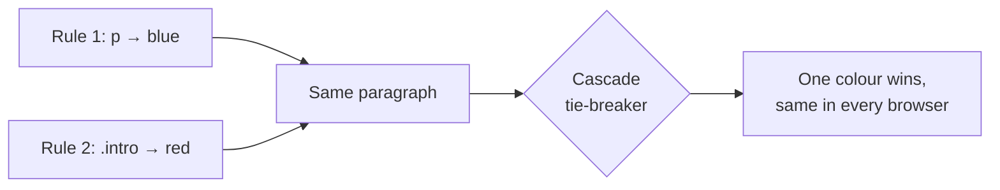

How precise a selector is has a name: **specificity**. It is three counters — IDs, classes, tag names — compared left to right, never added up.

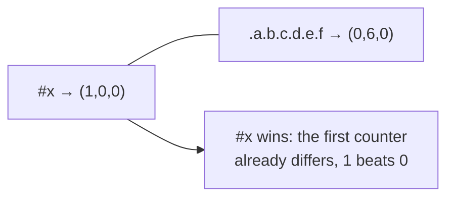

That is the whole game. The rest of this note is just these 3 questions:
1. When rules clash, which one wins, exactly?
2. How is a selector's score counted?
3. How big is each box really (content, padding, border, margin)?

**The problem in one story.**
You write `p { color: blue; }` in one file and `.intro { color: red; }` in another.
A paragraph has class `intro`, so both rules match it.
The browser must pick one colour, every time, the same way.
CSS has a fixed rulebook for that choice, plus a fixed recipe for how big each box is.

**Words you need first**

| Word | Plain meaning | Tiny example |
| --- | --- | --- |
| Element | One tag on the page | `<p>`, `<div>`, `<button>` |
| Selector | The "which elements?" part of a CSS rule | `p`, `.card`, `#header` |
| Property / value | The setting and what you set it to | `color: red` |
| Class / ID | Labels you put on elements; a class can repeat, an ID should be unique | `class="card"`, `id="main"` |
| Cascade | The rulebook deciding which matching rule wins | Later rule wins on a tie |
| Specificity | A score of how precise a selector is | `#main` beats `.card` beats `p` |
| Inherit | A child takes a value from its parent | Text colour flows into nested `<span>` |
| Padding / border / margin | Space inside the edge / the edge / space outside it | `padding: 8px` |
| `!important` | A flag that makes one setting beat normal settings | `color: red !important;` |
| Pseudo-class | A selector for an element in a certain state | `a:hover` (mouse is over the link) |
| Pseudo-element | A selector for a made-up part of an element | `p::first-line` |
| `box-sizing` | Decides whether `width` counts padding and border | `box-sizing: border-box` |
| Viewport | The visible area of the browser window | a phone screen is about 400px wide |
| Inline style | CSS written straight on one tag | `<p style="color:red">` |

**Picture it**

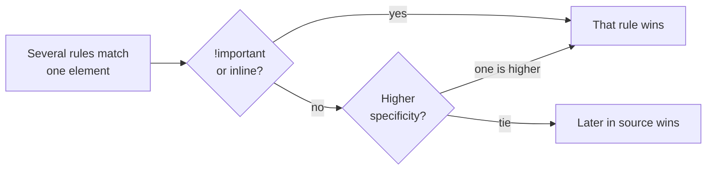

**Analogy.** A cascade is like a set of instructions from parents, teacher and coach: a more specific instruction ("you, Priya, sit here") beats a general one ("everyone sit anywhere"), and on a tie the most recent one counts.
Where it breaks: people negotiate; CSS never does — it follows the score mechanically, even when the result looks wrong.

**How the rest of this note builds up**

- First, why the cascade exists and a mental model of it (sections 1-2).
- Then how it works: ways to add CSS, the cascade order, selectors, inheritance and the box model (section 3).
- Then styling details (typography, pseudo-classes, shadows, display) and a step-by-step specificity trace (section 4).
- Finally variants, trade-offs, production practice and the deep dive, then interview questions (sections 5-9).

> [!tip] Remember
> When rules clash, CSS checks importance, then specificity, then source order — and every box is content + padding + border + margin.

## 1. Why it exists 🟢

A page has a global stylesheet with `a { color: blue; }`, a component stylesheet with `.card a { color: green; }`, and a designer who adds `style="color: red"` directly on one special link for a promotion. Three rules, one element, three different colors requested.

Without a deterministic rule for "which one wins," every browser could render the page differently, and every CSS file would need to be read top to bottom in full to predict any single element's final style.

The cascade is the fixed, documented procedure that makes the outcome the same in every standards-compliant browser, and lets you reason about one rule at a time instead of the whole file.

> [!tip] Remember
> The cascade exists so three conflicting rules on one element always resolve the same way, in every browser, without you reading the whole stylesheet to find out which one wins.

### Real-life example: the "Book" button 🟢

Think of the red "Book tickets" button on BookMyShow.
The site-wide stylesheet says every button is grey with small padding.
The movie page's stylesheet says buttons on that page are red.
On a sold-out show, one more rule says the button is faded and not clickable.
All three rules hit the same button, and the cascade decides, every time and in every browser, that the sold-out rule wins because it is the most precise (more classes) or comes last.

## 2. Mental model 🟢

> [!quote] Analogy: a four-round tournament
> Picture four judges, each only allowed to speak if every judge before them scored a tie. Judge 1 asks "where did this rule come from" (a browser default loses to your stylesheet, which loses to `!important` — see below).
>
> Judge 2 asks "is it marked `!important`." Judge 3 asks "which selector is more specific." Judge 4, only reached if everyone before tied, asks "which rule appears later in the source." The analogy breaks down in one place: real judges could overrule each other, but these rounds never do — once an earlier round has a winner, the later rounds are never even consulted.

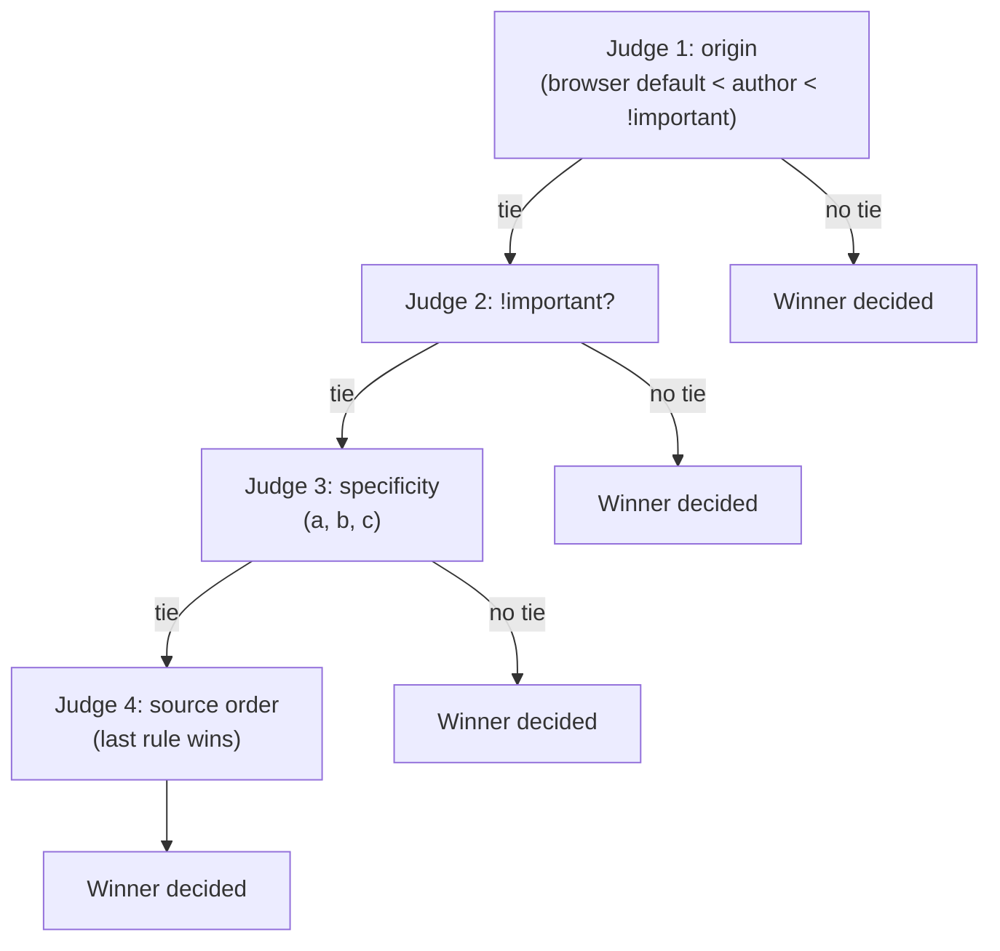

> [!tip] Remember
> Each round of the tournament only runs when the previous round was an exact tie — a rule never gets a second chance to win on a later round once it has already lost an earlier one.

## Common beginner mistakes 🟢

- **Selecting an ID with a dot** (`.hero` for `<div id="hero">`) → a dot means class, so the rule matches nothing → use `#hero` for an ID and `.hero` for a class.
- **Adding more and more classes to beat an ID** → specificity compares IDs first, so 10 classes still lose to 1 ID → remove the ID from the old rule, or use `@layer`.
- **Using `!important` to fix every clash** → the next person can only win with another `!important`, and the cascade stops being useful → make the selector simpler or reorder the rules.
- **Forgetting that padding and border add to `width`** → `width: 200px` plus `padding: 20px` shows a 240px box and breaks the row → set `box-sizing: border-box` once for all elements.
- **Expecting two vertical margins to add up** → 10px and 15px give a 15px gap, not 25px (margin collapsing) → use padding, or a `gap` in flex or grid, when you need an exact gap.

## Often confused 🟡

| These two | First one | Second one |
| --- | --- | --- |
| Class vs ID | `.card`: can repeat on many elements, weight (0,1,0) | `#main`: one per page, weight (1,0,0), hard to override |
| Padding vs margin | Space **inside** the border, shows the box's background | Space **outside** the border, always see-through |
| Pseudo-class vs pseudo-element | One colon, a **state** of a real element (`:hover`) | Two colons, a made-up **part** (`::before`) |
| `display: none` vs `visibility: hidden` | Box is gone, takes no space | Box is invisible but still takes its space |

## 3. How it works 🟡

> 🟢 → 🟡 **You now know** that rules can clash and that a fixed tie-breaker (the cascade) picks one winner. **Next we open the box**: where CSS can live, the exact order of the tie-breaker, how selectors aim, which settings flow down to children, and how big each box really is. Each subsection starts with a short step-by-step walk, then the full detail.

### Adding CSS and why the method matters

**In plain words:** there are three places to put CSS — a separate file, a block inside the page, or right on one tag — like keeping recipes in a cookbook, on the fridge, or scribbled on the plate itself.

**Step by step:**
1. You write `button { color: white; }` in a file `style.css` and add `<link rel="stylesheet" href="style.css">` in the page head. Every page that links it gets the rule.
2. Or you put the same rule inside `<style>…</style>` in one page. Only that page gets it.
3. Or you write `style="color: white"` right on one `<button>`. Only that one button gets it, and it beats the other two.
4. The browser saves (caches) `style.css` after the first page, so the next page loads faster. Rules inside one page cannot be reused like that.

| Method | Syntax | Scope | Notes |
| --- | --- | --- | --- |
| External | `<link rel="stylesheet" href="style.css">` in `<head>` | whole site | cached by the browser and by CDNs (content delivery networks: servers near the user that keep copies of files) across pages; the one that scales |
| Internal | `<style>…</style>` in `<head>` | one page | no caching across pages; fine for a single-page demo |
| Inline | `style="…"` on one element | one element | highest precedence of the three; no reuse, hard to maintain |

External CSS is **render-blocking** (the browser shows nothing until it has it; see [[How Browsers Load and Render a Page]]): the browser cannot paint until the **CSSOM** (the browser's in-memory tree of all CSS rules) from every linked stylesheet is built, so a large unnecessary stylesheet delays first paint even though it never touches JavaScript.

### The cascade, in order

**In plain words:** this is the full tie-breaker, as a flowchart. Read it top to bottom: the first question with a clear answer ends the fight.

**Step by step:**
1. Two rules both set `color` on the same `<a>`: one says blue, one says red.
2. Where did each come from? Your stylesheet beats the browser's built-in default. If they come from different places, done.
3. Same place? Is exactly one of them marked `!important`? That one wins.
4. Still tied? Count specificity: `#nav a` is (1,0,1), `.menu a` is (0,1,1). The ID wins, so the link is whatever `#nav a` says.
5. Exact tie on everything? The rule written later in the file wins.

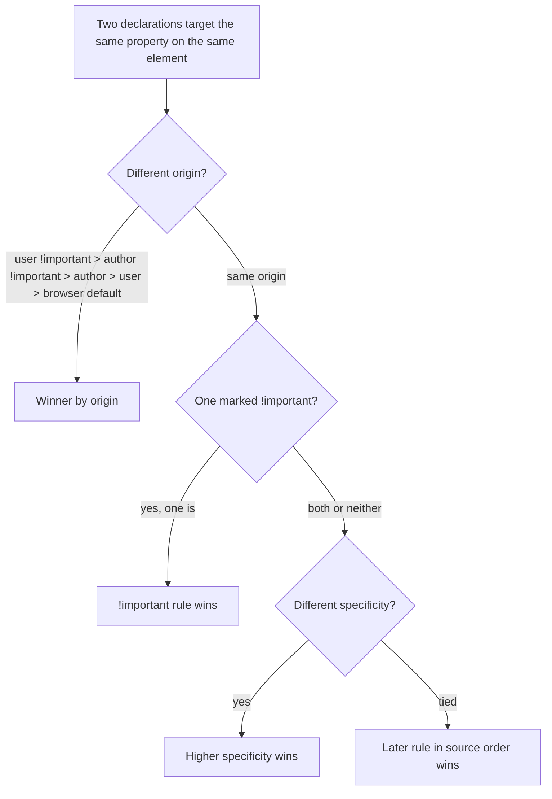

**Origin and `!important`.** Normally author (your) styles beat the browser's default stylesheet.

`!important` flips the fight within its own **origin** (who wrote the rule: the browser, the website author, or the person using the browser): an `!important` author rule beats a normal author rule regardless of specificity, and a user stylesheet's `!important` (accessibility overrides a user sets, such as "always use big text") beats even an `!important` author rule.

In practice, treat `!important` as an escape hatch for utility classes or overriding a third-party widget you don't control, not a habit — a page where every rule is `!important` has no cascade left to reason about.

**Specificity.** Computed as a triple `(a, b, c)`:
- `a` = number of ID selectors (`#nav`)
- `b` = number of class, attribute, and pseudo-class selectors (`.card`, `[type="text"]`, `:hover`)
- `c` = number of type selectors and pseudo-elements (`div`, `a`, `::before`)

Compare `a` first; only if tied, compare `b`; only if tied, compare `c`. The universal selector `*` (matches every element) and **combinators** (the symbols that join selectors into a family relation: `>`, `+`, `~`, space) contribute nothing.

**In plain words:** specificity is three separate counters, not one combined score. You never add them together; you compare the ID counter first, and only look at the class counter if the ID counters are exactly equal.

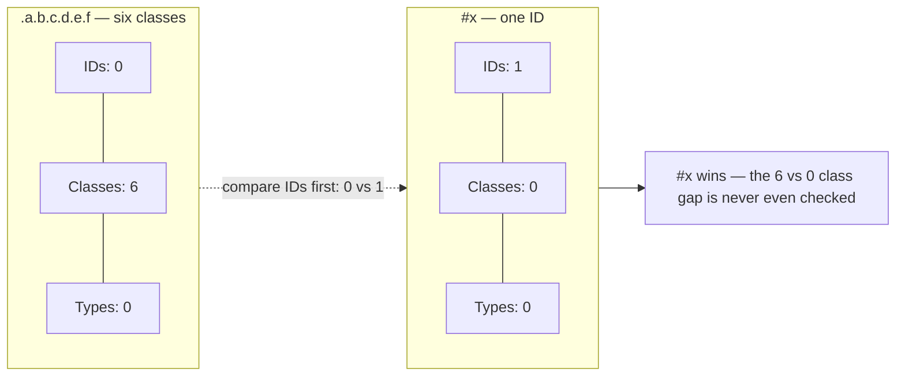

**Example with numbers:** `.a.b.c.d.e.f` scores `(0, 6, 0)`; `#x` scores `(1, 0, 0)`. Comparing left to right, the first digit already differs (`0` vs `1`), so `#x` wins immediately — the `6` vs `0` in the second position is never inspected.

**Why it matters:** this is why "just add one more class" never beats a single ID in a specificity fight, no matter how many classes you stack.

| Selector | (a, b, c) | Why |
| --- | --- | --- |
| `a` | (0, 0, 1) | one type selector |
| `.btn` | (0, 1, 0) | one class |
| `#nav .item a` | (1, 1, 1) | 1 ID, 1 class, 1 type |
| `div.card:hover::before` | (0, 2, 2) | 1 class + 1 pseudo-class = 2; 1 type + 1 pseudo-element = 2 |
| `:where(#nav) .item a` | (0, 1, 1) | `:where()` always contributes zero, even around an ID |
| `:is(#nav, .item) a` | (1, 0, 1) | `:is()` takes the specificity of its most specific matched argument (here `#nav`, an ID) |

`:not()` is the odd one out: it contributes the specificity of its argument, not of `:not()` itself — `a:not(.disabled)` is `(0, 1, 1)`, the same as `a.disabled` would be, not `(0, 2, 1)`.

Styling by ID is discouraged in practice precisely because of this table: an ID selector is nearly impossible to override later without another ID or `!important`, which is why most style guides cap selectors at classes and reserve IDs for JavaScript hooks and anchors.

> [!warning] Common mistake
> Treating specificity as a single number — adding `a + b + c` together — looks harmless until `b` or `c` would need to reach double digits, at which point the sum can accidentally make a weaker selector look "bigger" than a stronger one.
>
> There is no addition anywhere in specificity: it is always a left-to-right digit comparison, never a sum.

**Source order.** Only reached when origin, `!important`, and specificity all tie. The rule that appears later — later in the same file, or in a file linked later — wins.

This is why `@import` (a line that pulls another CSS file into this one) at the top of a file is placed exactly where its rules sit in the cascade, and why your overrides must come after a third-party stylesheet's `<link>` tag, not before it.

**Cascade layers (`@layer`, since 2022 across evergreen browsers, meaning browsers that update themselves, like Chrome, Firefox, Safari and Edge).** `@layer reset, base, components, utilities;` declares layer order up front; rules inside an earlier-named layer always lose to a later-named layer regardless of specificity, and only within the same layer does the normal specificity battle happen.

This is how **design systems** (a company's shared kit of buttons, colours and spacing rules) let a one-class **utility** (a tiny class that does one thing, like `.text-blue`) override a highly specific component rule without an `!important` war.

**In plain words:** layers add a fifth, earlier judge to the tournament — one that runs before specificity is even looked at. **Picture it:**

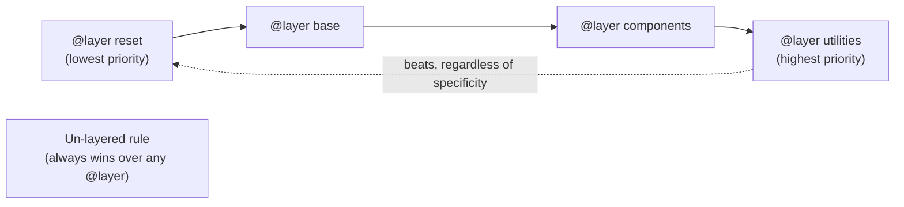

**Example:** a `#sidebar .widget { color: red; }` rule inside `@layer components` still loses to a plain `.text-blue { color: blue; }` utility class inside `@layer utilities`, even though `(1,1,0)` is a far higher specificity than `(0,1,0)` — because the layer comparison happens first and the specificity comparison inside `components` never gets a chance to matter against a rule in a later layer.

**Why it matters:** teams stop needing `!important` to make a one-off utility class win over a deeply nested component selector.

### Selectors and combinators

**In plain words:** selectors are the "which boxes?" aiming tools. Some aim at a tag name, some at a label (class or ID), and combinators aim at family relations like "child of" or "right after".

**Step by step:**
1. `p` aims at every paragraph on the page.
2. `.price` aims at every element that has `class="price"`, on any tag.
3. `#cart` aims at the one element with `id="cart"`.
4. `.card p` aims at paragraphs anywhere inside a `.card`. `.card > p` aims only at paragraphs that are direct children of it.
5. `h2 + p` aims at the one paragraph that comes right after an `h2`.

| Selector | Matches | Example |
| --- | --- | --- |
| Type | every element of that tag | `p` |
| Class | elements with that class, reusable | `.btn` |
| ID | the one element with that ID, must be unique on the page | `#hero` |
| Attribute | elements with a matching attribute | `[type="text"]`, `[href^="https"]` |
| Universal | every element | `*` |
| Descendant | B anywhere inside A | `.card p` |
| Child | B a direct child of A | `.card > p` |
| Adjacent sibling | B immediately after A, same parent | `h2 + p` |
| General sibling | B anywhere after A, same parent | `h2 ~ p` |

**ID vs. class, correctly:** an ID is selected with `#`, a class with `.`.

`<div id="hero">` is selected by `#hero { }`, never `.hero { }` or `#hero { }` written as a heading-style `# hero {}` — that `#` is CSS syntax for an ID selector, not Markdown.

An ID must be unique on the page; a class can repeat on as many elements as you like. In JavaScript, the ID maps to `document.getElementById('hero')` or `document.querySelector('#hero')`; the class maps to `document.getElementsByClassName('btn')` or `document.querySelectorAll('.btn')`.

**Selector matching direction (performance myth).** Browsers match **compound selectors** (several selectors chained together, like `.card p span`) right-to-left (starting from the rightmost, most specific part, then walking up ancestors only if needed), which used to make very long descendant selectors a measurable cost.

On modern **rendering engines** (the part of the browser that turns HTML and CSS into pixels) this is rarely the actual bottleneck for typical stylesheets; **layout** (working out sizes and positions) and **paint** (filling in the pixels) cost dominate far more often, so writing readable, class-based selectors is the right default rather than hand-optimizing selector shape.

### Inheritance

**In plain words:** some settings flow from a parent box into its children (mostly text settings, like a family surname), and some never do (like a parent's border — you do not want one on every child).

**Step by step:**
1. You set `body { color: #333; font-family: Arial; }` once.
2. A `<p>` inside the body has no colour rule of its own, so it takes `#333` and Arial from its parent.
3. A `<span>` inside that `<p>` takes them from the `<p>`, and so on down.
4. You also set `body { border: 1px solid red; }`. The `<p>` does **not** get a border, because border does not inherit.
5. If a rule targets the `<span>` directly (`span { color: green; }`), that rule wins over the inherited colour.

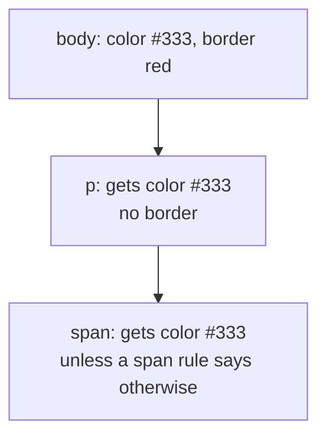

Some properties inherit from parent to child by default; others don't:

| Inherits by default | Does not inherit by default |
| --- | --- |
| `color`, `font-family`, `font-size`, `line-height`, `visibility`, `cursor` | `margin`, `padding`, `border`, `width`, `height`, `background`, `display` |

The rule of thumb: text-related properties inherit (so you can set a font once on `body`), box and layout properties don't (so a child doesn't silently inherit its parent's border). `inherit`, `initial`, and `unset` as values force the behavior either way explicitly.

### The box model

**In plain words:** every box is wrapped like a parcel — the item (content), bubble wrap (padding), the cardboard (border), and the empty space you leave around the parcel (margin).

**Step by step:**
1. A card has `width: 200px`. That is the content area: 200px.
2. Add `padding: 20px`. That adds 20px on the left and 20px on the right: 240px.
3. Add `border: 5px solid`. Another 5px each side: 250px on screen.
4. Add `margin: 10px`. The card still looks 250px wide, but it keeps 10px of empty space from its neighbours.
5. Set `box-sizing: border-box` and the card is 200px on screen again; the content area shrinks to 150px to make room.

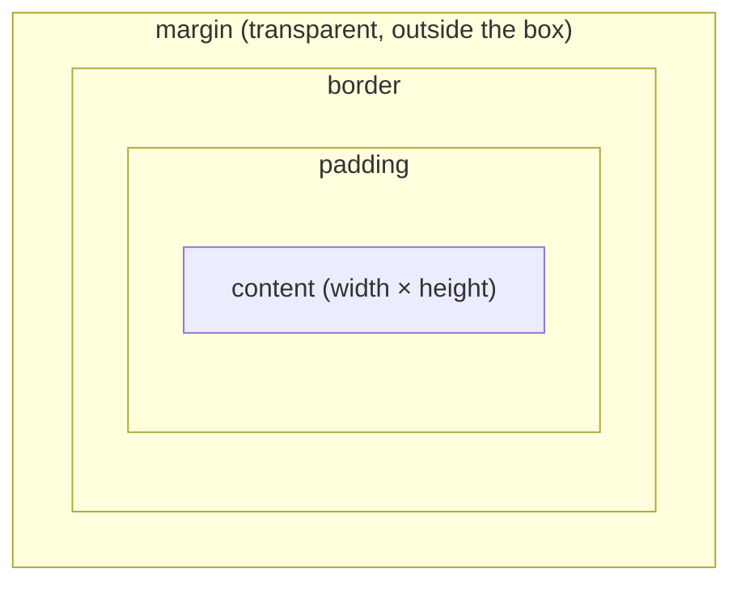

Every element's rendered box is, from the inside out: **content** (sized by `width`/`height`), **padding** (space between content and border, same background as the content), **border** (a visible or invisible line), **margin** (transparent space outside the border, used to separate this box from others).

> [!tip] Remember
> Every box is four nested layers, always in the same order: content, then padding, then border, then margin. `box-sizing` only changes which layers count toward `width`; it never changes the order of the layers themselves.

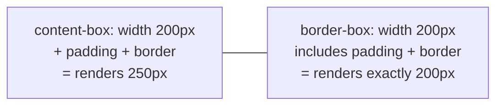

**`box-sizing`** decides what `width`/`height` measure:
- `content-box` (the CSS default): `width` is the content box only; padding and border are added on top, so a `width: 200px; padding: 20px; border: 5px solid` box actually renders 250px wide.
- `border-box`: `width` includes padding and border, so that same box renders exactly 200px wide, with the content area shrinking to fit. Nearly every CSS reset sets `*, *::before, *::after { box-sizing: border-box; }` because it makes widths predictable when you add padding or a border later without needing to recompute anything.

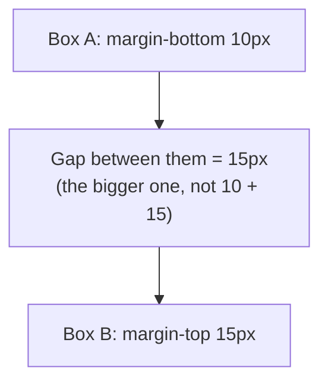

**Margin collapsing:** two vertical margins touching between **block-level** (boxes that take a full row, like `<div>` and `<p>`) siblings (or between a parent and its first/last child, if nothing separates them) collapse into a single margin equal to the larger of the two, not their sum.

A `10px` bottom margin followed by a `15px` top margin produces `15px` of gap, not `25px`. This only applies to vertical margins in normal flow, not horizontal margins, and not to flex or grid children.

**Units:** `px` is an absolute pixel (a fixed screen dot size); `%` is relative to the parent's size for that property; `em` is relative to the current element's font size (and compounds through nested elements); `rem` is relative to the root (`html`) font size, which is why most codebases default to `rem` for spacing and font sizes — it doesn't compound unpredictably as you nest; `vw`/`vh` are 1% of the viewport (the visible window area) width/height; `ch` is the width of the `0` character in the current font, useful for capping line length for readability.

### Typography, colors and backgrounds

**In plain words:** these are the "make text and surfaces look right" settings — fonts with backups, colours written a few ways, and backgrounds that can be gradients or images.

**Step by step:**
1. You write `font-family: "Inter", Arial, sans-serif;`. The browser tries Inter, then Arial, then any plain sans-serif font it has.
2. You write a colour as `#1a1a1a` (hex), `rgb(26, 26, 26)` or `hsl(0, 0%, 10%)`. All three are the same dark grey.
3. You store a brand colour once: `:root { --brand: #e23744; }`, then use `color: var(--brand)` everywhere.
4. You add `@media (min-width: 768px) { … }`. Those rules only apply when the window is at least 768px wide, like a tablet or laptop.

```css
body {
  font-family: Arial, sans-serif; /* fallback list, generic family last */
  font-size: 16px;
  font-weight: 400;
  line-height: 1.5;
  color: #1a1a1a;
}

.hero {
  background: linear-gradient(blue, green);
  background-size: cover;
  background-position: center;
  background-attachment: fixed;
}
```

A font stack lists specific fonts first and a generic family (`sans-serif`, `serif`, `monospace`) last as the guaranteed fallback.

Colors can be hex (`#1a1a1a`), `rgb()`/`rgba()`, `hsl()` (often easier to tweak lightness on), or `currentColor` (reuses the element's own computed `color`, handy for an SVG icon that should match surrounding text).

Loading a custom **web font** (a font file the page downloads, instead of one already on the device) causes either FOIT (flash of invisible text, if the browser hides text until the font arrives) or FOUT (flash of unstyled text, if it shows a fallback font first); `font-display: swap` opts into FOUT, which is usually the better user experience.

`overflow: hidden` combined with `text-overflow: ellipsis` and `white-space: nowrap` truncates long text with `…` instead of letting it break the layout.

`float: left` pulls an element out of normal flow to one side and lets inline content (typically text) wrap around it — this is the old way to wrap text around an image, mostly replaced today by flexbox or grid (see [[CSS Layout - Position, Flexbox, Grid]]), though floats still need an explicit "clearfix" (a small CSS trick that makes the parent grow to wrap its floated children) (or a parent with `display: flow-root`) so the parent doesn't collapse to zero height around only-floated children.

Custom properties (CSS variables: named values you set once and reuse) are declared with `--name: value` and read with `var(--name, fallback)`; they cascade and inherit like any other property, which is what makes them useful for theming (`--brand-color` set once on `:root`, read everywhere).

**Responsive basics.** `@media (min-width: 768px) { … }` scopes a block of rules to a viewport condition (width, height, orientation, `prefers-color-scheme`); it's still ordinary cascade rules underneath, just gated by the query.

`clamp(min, preferred, max)` picks a single fluid value between two bounds (e.g. `font-size: clamp(1rem, 2vw + 0.5rem, 2rem)`) so a size scales smoothly with the viewport without a breakpoint for every step — one declaration instead of three media queries.

### Pseudo-classes and pseudo-elements

**In plain words:** one colon means "the element in a mood" (hovered, focused, first child); two colons mean "an invented part of the element" that is not in your HTML at all.

**Step by step:**
1. `button:hover { background: red; }` turns a button red only while the mouse is over it.
2. `li:first-child { font-weight: bold; }` makes only the first item of each list bold.
3. `input:invalid { border-color: red; }` paints a red edge on an email box that holds "abc".
4. `.price::before { content: "₹"; }` puts a ₹ sign before every price, even though "₹" is not in your HTML.

A **pseudo-class** (one colon, `:hover`) selects an element in a particular *state*; a **pseudo-element** (two colons, `::before`) selects a *part* of an element that isn't a real **DOM node** (an element in the browser's tree of the page).

| Category | Examples |
| --- | --- |
| Link/interaction states | `:link`, `:visited`, `:hover`, `:active`, `:focus`, `:focus-visible` |
| Structural | `:first-child`, `:last-child`, `:nth-child(2n+1)`, `:nth-of-type(2)` |
| Logical | `:not(.disabled)`, `:is(h1, h2, h3)`, `:where(.card)`, `:has(> img)` |
| Form state | `:checked`, `:disabled`, `:required`, `:invalid` |
| Pseudo-elements | `::before`, `::after` (need a `content` value to render at all), `::placeholder`, `::selection` |

Link states must be declared in **LVHA** order — `:link`, `:visited`, `:hover`, `:active` — because they tie on specificity and a later rule wins on a tie; writing them out of order means `:hover` or `:active` can silently lose to `:visited` for a visited link.

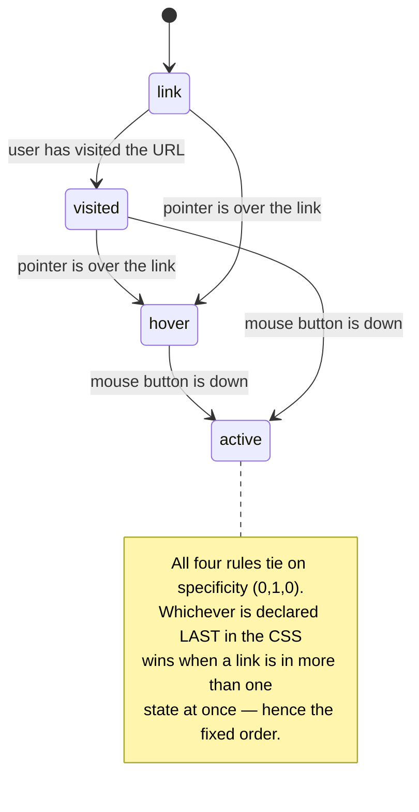

**Why it matters:** a visited, currently-hovered link is in both the `visited` and `hover` states at once; only declaration order decides which color shows, so `:hover` must come after `:visited` in the file or the hover color can never appear on a visited link.

```css
a:link    { color: #0645ad; }
a:visited { color: #551a8b; }
a:hover   { color: #e8710a; }
a:active  { color: #faa700; }
```

`:focus` matches any focused element, including a mouse click on a button; `:focus-visible` matches only when the browser decides focus should be visibly shown — typically keyboard navigation — which is the one to use for a custom **focus ring** (the outline that shows which element the keyboard is on) that shouldn't flash on every mouse click but must appear for keyboard users (an accessibility requirement, not a style preference).

`:has()` (a "parent selector", widely supported since 2023) lets a rule select a parent based on what's inside it: `.card:has(> img) { padding-top: 0; }` matches a `.card` only when it directly contains an `img`, something no earlier version of CSS could express without JavaScript.

Pseudo-class specificity counts as a class, `(0, 1, 0)`, same weight as `.btn`.

### Shadows

**In plain words:** shadows are painted on top of the layout and never push anything around — that is exactly what makes them useful for focus rings.

**Step by step:**
1. `box-shadow: 0 2px 8px rgba(0,0,0,0.2);` means: no sideways shift, 2px down, 8px of blur, light see-through black.
2. The card looks lifted off the page, but its size and its neighbours do not move at all.
3. Add `inset` and the shadow is drawn inside the card instead, like a pressed-in button.
4. For a keyboard focus ring, `box-shadow: 0 0 0 3px blue;` draws a solid 3px blue edge without moving anything.

```css
.card {
  box-shadow: 2px 4px 8px 0px rgba(0, 0, 0, 0.2); /* x y blur spread color */
}
.card:focus-visible {
  box-shadow: 0 0 0 3px rgba(37, 99, 235, 0.5); /* accessible focus ring, no layout shift */
}
h1 {
  text-shadow: 0 0 5px yellow, 0 -5px 5px orange; /* comma-separated: multiple shadows */
}
```

`box-shadow` takes `x y blur spread color`, plus an optional `inset` keyword to draw the shadow inside the box instead of outside. `text-shadow` takes only `x y blur color` — it has no spread value, unlike `box-shadow`.

Both accept a comma-separated list for multiple shadows, stacked from first (top) to last (bottom).

Shadows never affect layout or take up box space, which is what makes `box-shadow` a cheap way to draw an accessible focus ring (`:focus-visible { box-shadow: 0 0 0 3px blue; }`) without shifting neighboring content the way adding a real `border` would.

Design systems typically define a small "elevation" scale (shadow presets for `sm`/`md`/`lg` surfaces) rather than hand-picking values per component.

`filter: drop-shadow()` is the one to reach for on a transparent PNG or SVG, since `box-shadow` only follows the element's rectangular box, not the shape of transparent pixels inside it.

Animating a shadow's blur/spread directly is expensive (it's a paint-affecting property); animating the `opacity` of a pseudo-element pre-rendered with the target shadow is the cheap equivalent, since opacity can be **composited** (the graphics card just blends finished layers, with no repainting).

### Display and normal flow

**In plain words:** by default boxes stack in two styles — big boxes that take the whole row (block) and small ones that sit inside a line of text (inline). `display` lets you change a box's style.

**Step by step:**
1. Three `<p>` tags stack on top of each other, each one full width. They are block boxes.
2. Three `<a>` links inside a sentence sit side by side, only as wide as their text. They are inline boxes.
3. You set `height: 40px` on a link. Nothing happens, because inline boxes ignore height.
4. Change the link to `display: inline-block`. It still sits in the line, and now it accepts the 40px height. Good for a nav button.
5. Change it to `display: none` and the link vanishes and gives up its space.

Block elements (`div`, `p`, `section`, `h1`) take the full available width and start on a new line; inline elements (`span`, `a`, `strong`) take only the width their content needs and sit in the flow of text.

Inline elements ignore `width`, `height`, and vertical `margin` entirely — setting `height` on a `<span>` has no effect.

`inline-block` behaves like inline from the outside (sits in text flow, doesn't force a new line) but accepts `width`, `height`, and vertical margin like a block from the inside — the classic use is a button or nav item that needs explicit sizing but shouldn't break onto its own line.

One gotcha: adjacent `inline-block` elements in the HTML source pick up a small gap matching the whitespace between their tags in the markup, unless that whitespace is removed or `font-size: 0` is set on the parent.

`img` and `input` are **replaced elements**: the browser renders external content (an image, a form control) inside their box, so unlike a plain inline element, `width` and `height` do apply to them even though their default `display` is inline.

`display: none` removes an element from the **render tree** (the list of boxes the browser will actually draw) entirely — no box, no space reserved, invisible to **screen readers** (software that reads the page aloud for blind users). `visibility: hidden` keeps the box's space reserved but paints nothing.

`opacity: 0` keeps both the space and the element in the **accessibility tree** (the version of the page that screen readers use) and still receives clicks — it's invisible paint only, not removed from interaction, which is a common accessibility bug source if used where `display: none` was meant.

Setting `display: flex`, `display: grid`, or `display: contents` changes the *outer* display (how the element behaves in its parent's layout) while also establishing a new *inner* layout mode for its own children — this outer/inner split is why `display: inline-flex` exists: flex layout for the children, inline behavior in the parent's flow.

A **block formatting context** (`display: flow-root`) contains floats and prevents margin collapsing across its boundary — it's the modern replacement for old float "clearfix" hacks.

## 4. Worked example 🟡

### Computing specificity, traced step by step

A specificity calculator just needs one data shape: a triple `(a, b, c)` with a comparison rule — compare `a`, then `b`, then `c` — and a parser that turns a selector string into that triple:

```go
type Triple struct{ A, B, C int }
```

Tracing the parser over `div.card:hover::before`:

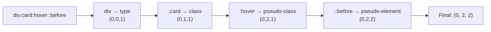

| Step | Token seen | Running triple |
| --- | --- | --- |
| 1 | `div` | `(0, 0, 1)` |
| 2 | `.card` | `(0, 1, 1)` |
| 3 | `:hover` | `(0, 2, 1)` |
| 4 | `::before` | `(0, 2, 2)` |

Each token only ever bumps exactly one counter, and the counters are never combined — the parser's whole job is correctly classifying each token (ID, class/attribute/pseudo-class, or type/pseudo-element) and incrementing the matching counter.

**Runnable Go version:** [[CSS Fundamentals - Cascade, Selectors, Box Model - Go]].

## 5. Variants and comparison 🟡

| Approach to styling conflicts | How it works | Use when | Cost |
| --- | --- | --- | --- |
| Plain cascade + specificity | browser picks a winner by the rules above | small to medium stylesheets, one team | easy to get "specificity wars" as the codebase grows |
| BEM naming (`.block__element--modifier`) | keeps every selector to one flat class, so specificity stays equal everywhere | larger codebases, multiple contributors | more verbose class names; still no scoping, just convention |
| CSS Modules / scoped styles | build tool hashes class names per component | component-based frontends (React, Vue) | adds a build step; styles truly can't leak, but also can't be shared without explicit export |
| `@layer` cascade layers | explicit layer order overrides specificity order | mixing a reset, a design system, and page overrides without `!important` | needs modern browser support (fine since ~2022) and a bit of upfront planning |
| CSS-in-JS / utility-first (Tailwind) | styles co-located with markup or generated from utility classes | component libraries, rapid prototyping | different mental model from the cascade above; Tailwind especially front-loads class lists in markup |

## 6. Trade-offs and when not to use 🟡

- Specificity-chasing (adding more classes or nesting to "win") escalates into a specificity war; prefer flattening selectors (BEM-style) or cascade layers over stacking more qualifiers.
- `!important` solves the immediate conflict but removes the normal escape hatch for the *next* person who needs to override that rule — reserve it for truly final over­rides (print styles, accessibility user stylesheets), not routine component styling.
- `box-sizing: border-box` is close to a universal win; the only reason not to set it globally is working inside a legacy codebase that already assumes `content-box` everywhere and can't be touched.

## 7. In production 🔴

> 🟡 → 🔴 **You now know** how the cascade, selectors, inheritance and the box model work, and which styling approaches big teams use. **Next is the advanced part**: how real CSS libraries avoid clashes, what breaks in production, and the tricky corners (`:is()`, `:where()`, `:not()`, layers) that interviewers like to ask about.

- **Real systems:** every mainstream **CSS reset** (a small stylesheet that clears browser defaults so every browser starts the same) (`modern-normalize`, Tailwind's preflight) starts with a universal `box-sizing: border-box` rule; component libraries like Material UI and shadcn/ui use cascade layers or CSS Modules specifically to avoid specificity conflicts with consumer apps.
- **Failure modes → fixes:** a third-party widget's CSS overriding your button styles because its selector happens to be more specific → wrap your overrides in a layer declared after theirs, or raise specificity deliberately (`.my-app .btn`) rather than reaching for `!important`. A `:visited`/`:hover` link color flip-flopping → check LVHA order.
- **What to monitor:** CLS (Cumulative Layout Shift: a score for how much the page jumps around while loading) from web-font swapping or images without a reserved box size; these are the box-model and rendering-path interactions this note and [[How Browsers Load and Render a Page]] both cover.

## 8. Deep dive 🔴

- **Specificity is not a single number.** A common beginner mistake is to add up `a+b+c` into one integer; that breaks down the moment `b` or `c` would need to exceed 9 in a naive base-10 sum. The correct comparison is lexicographic — compare `a`, then `b`, then `c` — which is exactly why ten classes can never outweigh one ID: the comparison never advances to `b` while `a` differs.
- **`:is()` vs `:where()` vs `:not()` specificity.** `:where()` always contributes `(0,0,0)` regardless of its argument, which makes it the tool for "apply this everywhere, but let anything else override it trivially." `:is()` takes the specificity of its *most specific* matched argument. `:not()` is unique in that its own colon contributes nothing — only its argument's specificity counts, which is easy to get wrong by assuming it behaves like a normal pseudo-class.
- **Cascade layers vs. source order.** Before `@layer`, "my override isn't applying" debugging meant computing specificity by hand or reordering `<link>` tags. Layers make precedence an explicit, readable list at the top of your CSS, independent of which file loads in which order, which scales much better across a large app's many stylesheets.
- **Inheritance through the cascade, not around it.** An inherited value is itself subject to being overridden by a more specific rule on the child — inheritance is the *fallback* when no rule targets the child directly, not a separate channel that bypasses the cascade.

## 9. Interview questions 🔴

> [!question]- Why does `#nav .item a { color: blue; }` beat `.item a.active.highlighted.special { color: red; }` even though the second rule has more classes?
> Specificity compares the ID count first. The first rule has 1 ID (`(1,1,1)`); the second has 0 IDs and more classes (`(0,4,1)`). Since `a` (ID count) differs, the comparison stops there — `b` and `c` are never even examined. One ID always beats any number of classes.

> [!question]- Trap: a developer says "to select an element by its ID in CSS, use a `.`, same as a class." What's wrong, and what actually happens if you write `.hero { color: red; }` on `<div id="hero">`?
> That's backwards: `#` selects by ID, `.` selects by class. `.hero` matches an element with `class="hero"`, not `id="hero"` — it simply won't match the div in question unless it also happens to carry `class="hero"`. The correct selector is `#hero { color: red; }`.

> [!question]- What's the actual difference between `display: none`, `visibility: hidden`, and `opacity: 0`?
> `display: none` removes the box entirely — no space reserved, not in the accessibility tree, no clicks. `visibility: hidden` keeps the box's space but paints nothing and removes it from the accessibility tree and from click targets.
>
> `opacity: 0` keeps the box, its space, its accessibility presence, and its click target — it's purely invisible paint, which is why an `opacity: 0` element can still accidentally intercept clicks.

> [!question]- `box-sizing: content-box` (the default) vs. `border-box` — concretely, what changes for `width: 200px; padding: 20px; border: 5px solid black;`?
> With `content-box`, `width` measures only the content area, so the rendered box is 200 + 2×20 + 2×5 = 250px wide. With `border-box`, `width` is the final rendered width including padding and border, so the box is exactly 200px wide and the content area shrinks to 200 − 2×20 − 2×5 = 150px.

> [!question]- Does every CSS property inherit from its parent by default?
> No. Text-related properties (`color`, `font-family`, `font-size`, `line-height`) inherit by default; box and layout properties (`margin`, `padding`, `border`, `width`, `background`) do not. You can force either direction explicitly with the `inherit`, `initial`, or `unset` keywords.

> [!question]- Why must link pseudo-classes be written in the order `:link, :visited, :hover, :active`?
> All four have identical specificity, `(0,1,0)`. When specificity ties, the cascade falls through to source order, so whichever rule is written last wins for an element matching more than one — e.g. a hovered, visited link. Writing `:hover` before `:visited` would make a visited link never show its hover color.

> [!question]- What's the difference between `:focus` and `:focus-visible`, and why does it matter for accessibility?
> `:focus` matches any focused element, including one focused by a mouse click. `:focus-visible` matches only when the browser judges the focus indicator should be shown — generally keyboard navigation.
>
> Styling the focus ring with `:focus-visible` instead of `:focus` avoids an unwanted visible ring flashing on every mouse click while still showing it for keyboard users, who rely on it to know where they are.

## 10. Cheat sheet 🟢

- Cascade order: origin + `!important` → specificity → source order. Each step runs only on a tie from the step before.
- Specificity triple `(IDs, classes/attrs/pseudo-classes, type/pseudo-elements)`, compared left to right as separate digits, never summed.
- `#id` selects an ID (unique per page); `.class` selects a class (reusable).
- Box model, inside out: content → padding → border → margin. `box-sizing: border-box` makes `width` include padding and border.
- Text properties inherit by default; box/layout properties don't.
- LVHA order for link pseudo-classes: `:link`, `:visited`, `:hover`, `:active`.
- `:focus-visible` for an accessible focus ring; plain `:focus` fires on mouse clicks too.
- `box-shadow` has an optional spread value; `text-shadow` does not.

## Self-check 🟢🟡

> [!question]- Easy: which selector picks the element with `id="cart"`: `.cart` or `#cart`?
> `#cart`. A dot selects a class, a hash selects an ID.

> [!question]- Easy: list the four layers of a box, from the inside out.
> Content, padding, border, margin.

> [!question]- Easy: if `body` has `color: grey`, does a `<p>` inside it turn grey too? Does it get the body's border?
> Yes to the colour, because text settings inherit. No to the border, because box settings do not.

> [!question]- Medium: `.a.b.c` (0,3,0) vs `#x` (1,0,0). Which wins, and why?
> `#x`. The ID counter is compared first and 1 beats 0, so the class count is never looked at.

> [!question]- Medium: `width: 300px; padding: 10px; border: 2px solid` with the default `box-sizing`. How wide is the box on screen?
> 324px: 300 + 10 + 10 + 2 + 2. With `border-box` it would be exactly 300px.

> [!question]- Medium: a hovered link that is also visited stays purple instead of orange. What is the likely cause?
> The `:hover` rule is written before `:visited`. They tie on specificity, so the later one wins; write them in LVHA order.

## Links 🟢
- **Before this:** [[How Browsers Load and Render a Page]]
- **Next:** [[CSS Layout - Position, Flexbox, Grid]]
- **Compare with:** [[React Fundamentals - Components, JSX, Props, State]]
- **Runnable code:** [[CSS Fundamentals - Cascade, Selectors, Box Model - Go]]

### Watch on YouTube

- [Learn CSS Specificity and Cascade In 10 Minutes](https://www.youtube.com/watch?v=cPBT86_cLv4) · Raj Saha Online · fast, focused drill on cascade and specificity rules
- [HTML & CSS for Beginners Part 12: The CSS Box Model - Margin, Borders & Padding explained](https://www.youtube.com/watch?v=M6coJNLFBWI) · Kevin Powell · clear visual breakdown of the content/padding/border/margin box model
