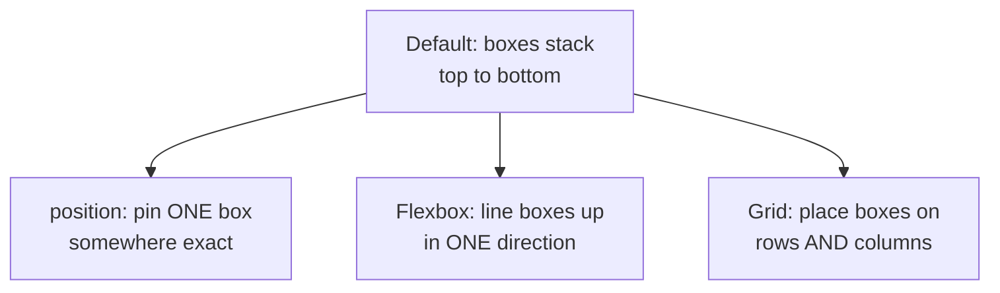
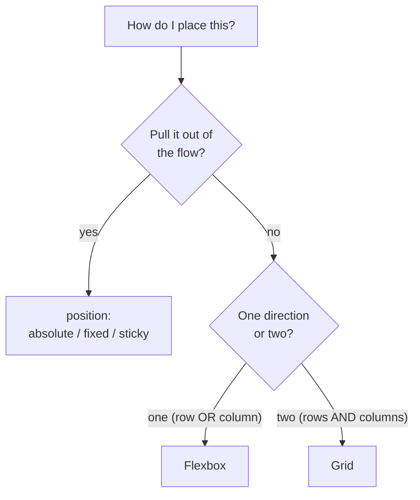
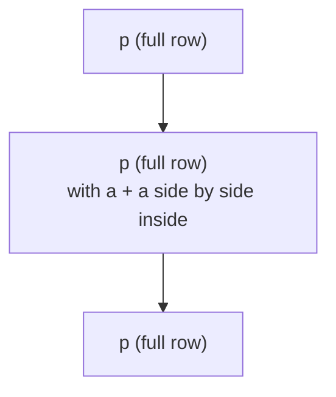
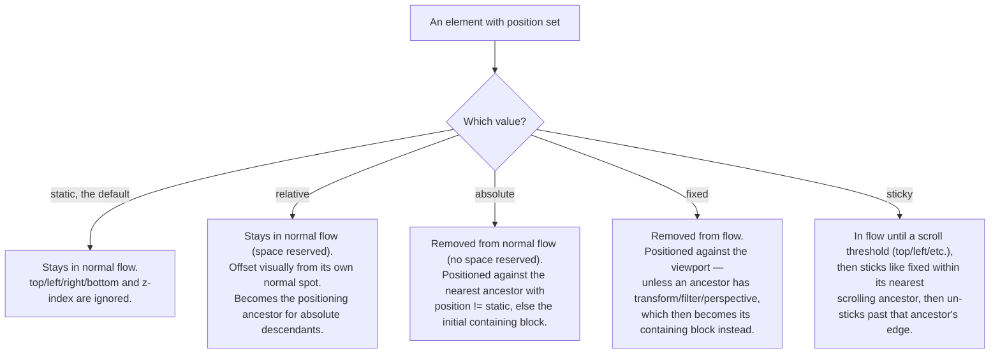
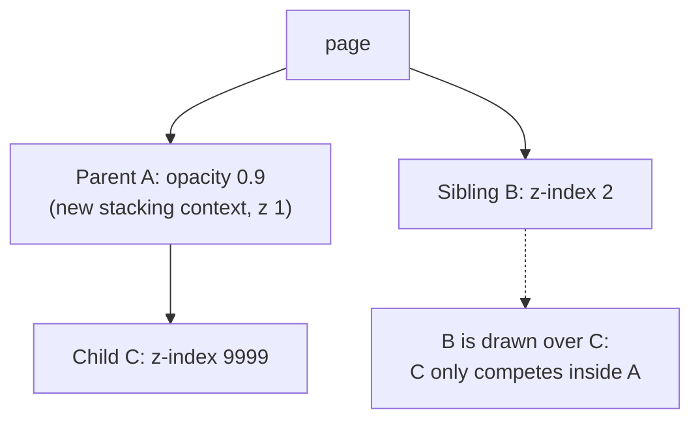
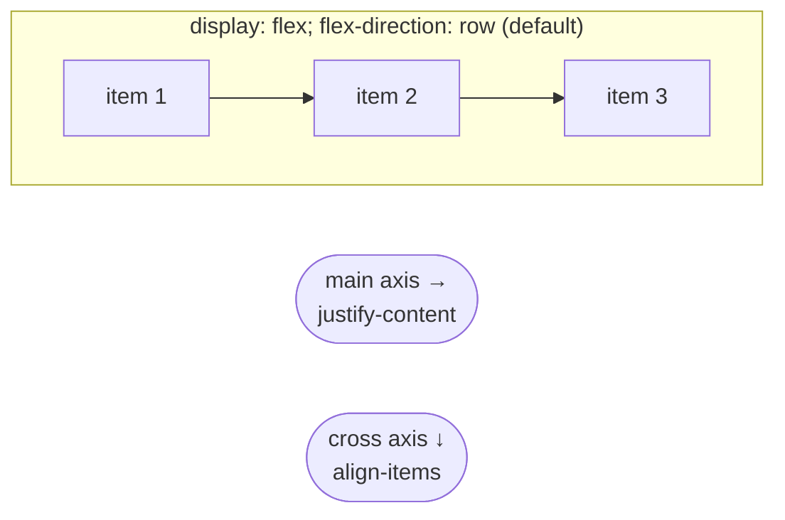
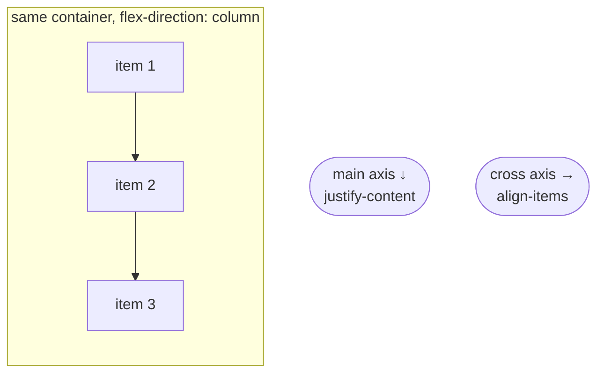
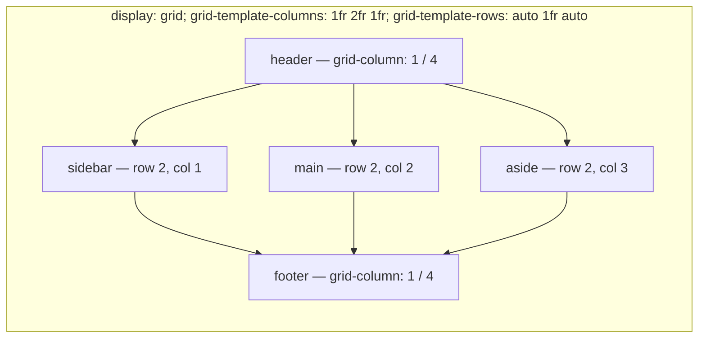
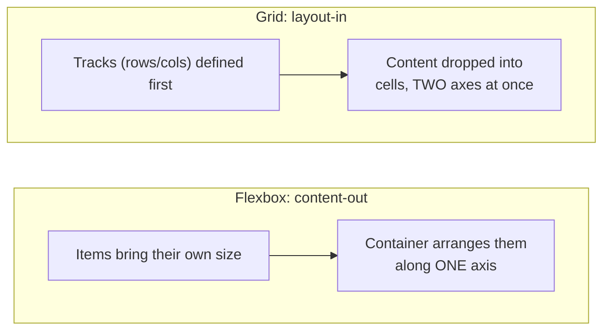

# CSS Layout - Position, Flexbox, Grid

> [!summary] TL;DR
> Every element starts in **normal flow** (block stacks vertically, inline flows horizontally). The `position` property can pull an element out of that flow to place it against an ancestor, the viewport, or a scroll container. **Flexbox** arranges items along one axis; **Grid** arranges them along two axes at once.

> [!abstract] Core idea
> - `position: absolute` positions against the **nearest positioned ancestor** (anything with `position` other than `static`), not the page root — the root is only the fallback when no ancestor is positioned.
> - `relative` keeps an element's original space reserved and offsets it from there; it also becomes the positioning anchor for any `absolute` descendant.
> - Flexbox has a **main axis** and a **cross axis**; `flex-direction` decides which is which, and `justify-content`/`align-items` each always target one specific axis, not "x" or "y".
> - Grid places items by **lines, tracks, and areas** in two dimensions at once; `fr` is a share of the leftover space, not a fixed size.
> - Reach for flex when content decides the size (content-out); reach for grid when the layout decides where content goes (layout-in).

### Whiteboard version

**In plain words:** the one trick you will use most — make the parent the anchor, then pin the child to it.

```css
.parent { position: relative; }   /* becomes the anchor */
.child  { position: absolute; top: 0; right: 0; } /* a badge, pinned to .parent's corner */
```

`.child` ignores the page entirely and pins itself to `.parent`'s top-right corner, because `.parent` is the nearest ancestor with a `position` other than `static`.

If `.parent` had no `position` set, `.child` would keep looking up the ancestor chain until it found one, falling back to the whole page only if nothing qualifies. This parent-relative/child-absolute pattern is the standard recipe for badges, dropdowns, and tooltips.

## Start here: the basics 🟢

> [!info] How to read this note (pick your level)
> - 🟢 **New to this?** Read "From zero" below, then sections 1, 2 and the cheat sheet (10). Stop there, that is a full first pass.
> - 🟡 **Know the basics?** Add section 3 (how it works) and 4 (worked example).
> - 🔴 **Interview / SDE-3 prep?** Add 7, 8 and 9. Headings are tagged 🟢🟡🔴 so you always know where you are.

> [!note] Before this note
> - [[CSS Fundamentals - Cascade, Selectors, Box Model]]: every element is a box (content, padding, border, margin), and block boxes take a full row while inline boxes sit inside a line of text.

**From zero, in 60 seconds** 🟢

By default, a browser stacks boxes top to bottom, like lines in a book. That default stacking is called **normal flow**. It is fine for an article, useless for a real page with a header, sidebar and rows of cards.

CSS gives you three tools to break out of the stack. `position` picks one box up and pins it somewhere (a badge on a bell icon). **Flexbox** lines boxes up along one direction, like books on a shelf. **Grid** places boxes on a two-direction board you draw first, like a chessboard.



That is the whole toolbox. The rest of this note is just these 3 questions:
1. Where does a pinned (`absolute`/`fixed`/`sticky`) box actually attach itself?
2. How does flexbox share space along its one line?
3. How does grid let rows and columns line up with each other?

**The problem in one story.**
You want a page with a header on top, a sidebar on the left and cards in a neat row.
By default the browser just stacks boxes top to bottom like lines in a book.
You need a way to say "put this beside that", "pin this to the corner", "make these equal width".
Positioning, flexbox and grid are three tools for exactly that.

**Words you need first**

| Word | Plain meaning | Tiny example |
| --- | --- | --- |
| Normal flow | The default stacking of boxes | Paragraphs one under another |
| Block / inline | Takes a full row / sits inside a line of text | `<div>` / `<span>` |
| Container / item | The parent you style / its direct children that get arranged | `.row` holding three `.card`s |
| Ancestor | Any element that wraps this one, at any level | `<body>` wraps everything |
| Axis | A direction items are lined up along | Left-to-right is a row axis |
| Track | One row or one column of a grid | `grid-template-columns: 1fr 2fr` = 2 tracks |
| `fr` | One share of the leftover space in a grid | `1fr 1fr` = two equal halves |
| Viewport | The visible part of the browser window | a phone screen about 400px wide |
| Positioned element | A box whose `position` is anything except `static` | `.card { position: relative; }` |
| Containing block | The box that a pinned element measures its `top`/`left` from | the `.card` that a badge sits on |
| `z-index` | Which box is drawn on top when boxes overlap; bigger is closer to you | a popup with `z-index: 10` over the page |
| Main / cross axis | In flexbox: the direction items line up in / the direction across it | row: main is left-right, cross is up-down |
| `gap` | Space between items in flex or grid, never at the outer edge | `gap: 16px` |

**Picture it**



**Analogy.** Flexbox is a bookshelf: books line up along one shelf and you choose how they spread out. Grid is a chessboard: you say which squares each piece covers. Absolute positioning is a sticky note stuck onto a box.
Where it breaks: real shelves don't shrink books; flex items can grow and shrink to fill the line.

**How the rest of this note builds up**

- First, why layout tools exist and a mental model of them (sections 1-2).
- Then normal flow, positioning, flexbox and grid, and how to pick flex vs grid (section 3).
- Then a card component built end to end (section 4).
- Finally variants, trade-offs, production practice and the deep dive, then interview questions (sections 5-9).

> [!tip] Remember
> `absolute` anchors to the nearest positioned ancestor; flex lays out one axis, grid lays out two.

## 1. Why it exists 🟢

A notification badge needs to sit at the exact top-right corner of a bell icon, regardless of where that icon ends up on the page — inside a nav bar, inside a sidebar, wherever.

Normal flow alone can't do this: every element in normal flow pushes the next one down or across.

You need a way to say "place this relative to one specific container, ignoring the elements around it," which is what taking an element out of flow with `position` provides.

Separately, a row of three equal-width cards that should share leftover space, or a page grid with a header, sidebar, main content, and footer that reflows at different screen sizes, both need an axis-aware (flex) or two-dimensional (grid) layout system — normal block/inline flow alone can only stack things in one direction.

### Real-life example: a food app home screen 🟢

Open the Swiggy or Zomato home screen.
The cuisine chips ("Biryani", "Pizza", "Dosa") sit in one scrolling row: that is a flexbox job, one direction.
The restaurant cards on a laptop sit in neat columns that line up from row to row: that is a grid job, two directions.
The small "20% OFF" tag pinned to the corner of each card photo is `position: absolute` inside a `position: relative` card.
The search bar that stays at the top while you scroll is `position: sticky`.

> [!tip] Remember
> Normal flow can only stack things in one direction at a time. The moment you need "pin this exactly here regardless of flow" or "arrange these along an axis, sharing space," you need `position`, flex, or grid — normal flow was never designed to do either.

## 2. Mental model 🟢

> [!quote] Analogy: water, a ruler, and graph paper
> Normal flow is **water finding its level** — block elements stack like bricks, inline elements run like text in a line, wrapping as needed.
>
> `position` lets you pick one element up out of that water and nail it to a specific point on a specific container, ignoring everything flowing around it.
>
> Flexbox is a **ruler laid down in one direction** (say the row); items line up or spread along it, and `align-items` is a second, perpendicular ruler for the direction you didn't choose.
>
> Grid is **graph paper**: you draw the lines first (rows and columns), then drop items into cells or named regions on that paper.
>
> The analogy breaks down for `sticky`, which is water that turns into a nail only past a scroll threshold — neither pure flow nor pure position.

## Common beginner mistakes 🟢

- **Forgetting `position: relative` on the parent** → the `absolute` badge flies to the corner of the whole page → put `position: relative` on the box it should stick to.
- **Building a whole page with `position: absolute`** → nothing makes room for anything else, so text overlaps when content grows → use grid for the page and flex inside parts of it.
- **Thinking `align-items` is always "vertical"** → in `flex-direction: column` it controls left-right instead → remember: `justify-content` is the main axis, `align-items` is the cross axis.
- **Spacing flex items with margins** → you get extra space at the outer edges and fiddly fixes → use `gap: 16px` on the container.
- **Raising `z-index` to 9999 and it still hides behind** → `z-index` only competes inside the same stacking context, and does nothing on a `static` box → give the element a `position`, and check its ancestors for `opacity` or `transform`.

## 3. How it works 🟡

> 🟢 → 🟡 **You now know** the three tools: `position` pins one box, flexbox lines boxes up in one direction, grid places boxes on rows and columns. **Next we open the box** and see the exact rules each tool follows, and how to pick between flex and grid. Each subsection starts with a plain step-by-step walk.

### Normal flow

**Step by step:**
1. You write three `<p>` tags. Each takes the full width and sits under the one before. They are block boxes.
2. Inside the first `<p>` you write two `<a>` links. They sit side by side in the line of text. They are inline boxes.
3. If a line of text is too long, the inline boxes wrap to the next line, like words in a book.
4. Nothing changes until you set `position`, `display: flex` or `display: grid`.



Block-level elements (`div`, `p`, `section`) stack vertically, each taking the full available width. Inline elements (`span`, `a`) flow horizontally within a line, wrapping to a new line when they run out of width. This is the default for every element until `position`, `display: flex`, or `display: grid` changes it.

### Positioning

**In plain words:** `position` has five settings. Think of them as: stay put (static), nudge but keep your seat (relative), leave the room and stick to a chosen wall (absolute), stick to the window itself (fixed), and ride along until you hit the top, then stick (sticky).

**Step by step:**
1. A movie card is 300px wide. You set `.card { position: relative; }`. Nothing moves, but the card is now an anchor.
2. Inside it, a "New" badge gets `position: absolute; top: 8px; right: 8px;`. The browser walks up from the badge, finds `.card` as the first positioned ancestor, and pins the badge 8px from the card's top-right corner.
3. The badge no longer takes up space, so the card's other content acts as if it isn't there.
4. A "Book now" bar gets `position: fixed; bottom: 0;`. It stays at the bottom of the screen while the page scrolls.
5. A date header gets `position: sticky; top: 0;`. It scrolls normally until it reaches the top, then stays there until its list ends.



- **`static`** (the default): the element sits in normal flow. `top`, `left`, `right`, `bottom`, and `z-index` have no effect at all.
- **`relative`**: still in normal flow — its original space in the layout is kept exactly as if it hadn't moved — but it is then visually offset by `top`/`left`/`right`/`bottom` from that original spot. Equally important: a `relative` element becomes the **containing block** (the box that `top`/`left`/`right`/`bottom` are measured from) for any `absolute` descendant, which is the main reason to use `relative` even with no offset at all (`position: relative;` alone, with no top/left, is a common "just to anchor children" pattern).
- **`absolute`**: removed from normal flow entirely — no space reserved for it, so surrounding elements act as if it isn't there. It is positioned relative to its **nearest ancestor whose `position` is anything other than `static`** (relative, absolute, fixed, or sticky). If no ancestor qualifies, it falls back to the initial containing block, which is effectively the page's viewport at the root — the root is the fallback, not the rule.
- **`fixed`**: removed from flow, positioned relative to the viewport, so it stays in the same screen position while the page scrolls — the classic sticky header or **floating action button** (the round "+" button that floats over a screen). One subtlety: if any ancestor has a `transform` (moves, rotates or scales a box), `filter` (blur, brightness and similar effects), or `perspective` (3D depth) property set (even `transform: translateZ(0)`), that ancestor becomes the fixed element's containing block instead of the viewport — a common source of "my `position: fixed` element stopped working" bugs.
- **`sticky`**: behaves like `relative` (in flow) until the element would scroll past a threshold you set (e.g. `top: 0`), at which point it behaves like `fixed` *within its nearest scrolling ancestor* — not the whole viewport — until that ancestor's box ends, at which point it un-sticks. Changing `overflow` (what happens to content too big for its box: cut it off, or add a scrollbar) on an ancestor (e.g. to `auto` or `scroll`) changes which container a sticky element sticks within, since that ancestor becomes the relevant scrolling box.

**z-index and stacking contexts.** `z-index` only has an effect on a positioned element (`position` other than `static`) — or on a flex/grid item, where `z-index` works even without `position`.

A new **stacking context** (a sealed group of layers; everything inside is stacked together as one unit against the outside) is created by several triggers, most commonly: a positioned element with a `z-index` other than `auto`, `opacity` less than 1, or a `transform`/`filter`.

Inside a stacking context, `z-index` values are only compared against siblings *within that same context* — a child with `z-index: 9999` can still render behind an unrelated element if its own ancestor's stacking context sits lower, because the comparison never escapes the parent context to compete directly against elements outside it.



**The relative-parent/absolute-child pattern** (dropdown menus, tooltips, badges): give the container `position: relative` and the item that must pin to a corner `position: absolute` with `top`/`right`/`bottom`/`left`. The `inset` shorthand (`inset: 0;`) sets all four offsets at once — `inset: 0` on an absolutely positioned element makes it fill its positioned ancestor exactly.

> [!warning] Common mistake
> Assuming `position: absolute` always positions against the page. It doesn't — it positions against the **nearest ancestor with any `position` other than `static`**. Forgetting to add `position: relative` to the intended parent is the single most common cause of "my absolutely positioned badge jumped to the corner of the whole page instead of my card."

> [!tip] Remember
> `static` ignores offsets entirely. `relative` offsets visually but keeps its space and anchors any `absolute` descendants. `absolute` and `fixed` both leave flow completely — the only difference is what they're measured against.

### Flexbox

**In plain words:** flexbox is a shelf. You pick which way the shelf runs (row or column); `justify-content` spreads things along the shelf, `align-items` lines them up across it.

**Step by step:**
1. A nav bar holds three links. You set `.nav { display: flex; }`. The links now sit in one row, left to right.
2. You add `justify-content: space-between;`. The first link goes to the left edge, the last to the right edge, the middle one in the centre.
3. You add `align-items: center;`. All three line up through their middle, even if one is taller.
4. You switch to `flex-direction: column;`. Now they stack top to bottom, and `justify-content` spreads them up-down instead.
5. You give one link `flex: 1`. It grows to eat all the spare space in the row.





Flexbox is a one-dimensional layout: put `display: flex` on the parent (the **flex container**), and its direct children become **flex items** laid out along one **main axis**.

`flex-direction: row` (the default) makes the main axis horizontal and the cross axis vertical; `flex-direction: column` swaps them — the main axis becomes vertical. This swap is exactly why `align-items` is not "the vertical one": it always targets the cross axis, whatever that currently is.

| Property | Axis it controls | Values |
| --- | --- | --- |
| `justify-content` | main axis | `flex-start`, `center`, `flex-end`, `space-between` (equal gaps only between items), `space-around` (half-size gaps at the edges, full gaps between), `space-evenly` (all gaps equal, edges included) |
| `align-items` | cross axis, for all items | `flex-start`, `center`, `flex-end`, `stretch` (default), `baseline` |
| `align-self` | cross axis, for one item | overrides `align-items` for that one item |
| `align-content` | cross axis, for the set of wrapped lines | only visible when `flex-wrap: wrap` produces more than one line |

`flex: 1` is shorthand for `flex-grow: 1; flex-shrink: 1; flex-basis: 0%;` — it means "start every item at zero **intrinsic** width (the size its content would naturally want) and grow to share the available space equally." This is different from `flex: 1 1 auto`, which starts from each item's own content size (`flex-basis: auto`) before growing, so items with different amounts of content stay different sizes relative to each other even as they both grow.

`flex-basis` is the starting size before grow/shrink is applied; it takes priority over `width` when both are set on a flex item.

`flex-wrap: wrap` lets items move to a new line instead of shrinking indefinitely; `gap` (not margin tricks) is the modern way to space items, since it only applies *between* items, not around the outer edge.

`order` can visually reorder items without touching the HTML, but doing so can break keyboard **tab order** (the order focus moves in when you press Tab) and **screen-reader** (software that reads the page aloud) reading order from the user's point of view — treat it as a presentation-only tool, verify with a keyboard.

**A gotcha:** a flex item's default `min-width` (or `min-height` in a column) is `auto`, not `0`, which means a flex item with unbreakable long content (a long unbroken string, a wide image) will refuse to shrink below that content's size even if `flex-shrink: 1` is set, overflowing its container. Setting `min-width: 0` explicitly on the item is the standard fix.

### Grid

**In plain words:** grid is graph paper. You draw the columns and rows first, then drop each item into a cell or a named region — so things in different rows can line up perfectly.

**Step by step:**
1. You set `.page { display: grid; grid-template-columns: 200px 1fr 1fr; }` on a 1000px-wide page.
2. The first column gets exactly 200px. 800px is left over.
3. `1fr 1fr` splits that 800px into two shares of 400px each.
4. A header gets `grid-column: 1 / 4`, so it spans from line 1 to line 4: all three columns.
5. Every other child drops into the next free cell, row after row, and cells in different rows line up because they share the same columns.



Grid is a two-dimensional layout: `display: grid` on the parent creates a **grid container**; `grid-template-columns` and `grid-template-rows` define the **tracks** (the columns and rows), and the intersections are **cells**.

```css
.page {
  display: grid;
  grid-template-columns: 200px 1fr 200px; /* sidebar, main, aside */
  grid-template-rows: auto 1fr auto;      /* header, body, footer */
  grid-template-areas:
    "header header header"
    "sidebar main   aside"
    "footer footer footer";
  gap: 16px;
}
.header { grid-area: header; }
.footer { grid-area: footer; }
```

- **`fr`** is a share of the *leftover* space after fixed-size tracks are subtracted — `grid-template-columns: 200px 1fr 1fr` gives the first column exactly 200px, then splits whatever's left evenly between the other two. `fr` is not a percentage and not a fixed unit; it only resizes relative to what's left.
- **`repeat()`** and **`minmax()`** combine for responsive layouts without a single media query: `grid-template-columns: repeat(auto-fit, minmax(200px, 1fr))` creates as many 200px-minimum columns as fit the container, each stretching to fill leftover space — this one line replaces what used to need several breakpoint-specific **media queries** (CSS blocks that apply only at certain screen widths, like `@media (min-width: 768px)`).
- **Explicit vs. implicit grid:** `grid-template-rows`/`-columns` define the *explicit* grid; if an item is placed beyond it (or `grid-auto-flow` creates extra rows automatically), the browser creates *implicit* tracks, sized by `grid-auto-rows`/`grid-auto-columns`. `grid-auto-flow: dense` back-fills earlier empty cells with later items that fit, instead of always moving strictly forward — useful for a **masonry**-like gallery (a Pinterest-style wall of tiles of different heights) of mixed item sizes, at the cost of possibly changing visual (not **DOM**, the order the elements are written in the HTML) order.
- **Placing items** can be done by line numbers (`grid-column: 2 / 4` spans from line 2 to line 4) or by named areas (`grid-template-areas`, `grid-area: header`), which reads far more like an actual page layout and is the more common choice for a full-page grid.
- **`justify-*` vs. `align-*`:** in grid, `justify-items`/`justify-content`/`justify-self` always act on the **inline axis** (horizontal, in a left-to-right language); `align-items`/`align-content`/`align-self` always act on the **block axis** (vertical). The `-items` variant sets every item/cell's default at once; `-self` overrides one item; `-content` positions the whole set of tracks within the container when the tracks don't fill it completely.
- **`subgrid`** (`grid-template-columns: subgrid` on a nested grid item, widely supported since 2023) lets a nested grid's tracks align to its parent grid's tracks instead of defining independent ones — useful for card layouts where internal elements (title, body, footer) should align across sibling cards even though each card is its own grid.

| Axis | Items in that axis | Whole track set in that axis |
| --- | --- | --- |
| Inline (horizontal) | `justify-items`, `justify-self` | `justify-content` |
| Block (vertical) | `align-items`, `align-self` | `align-content` |

### Flex vs. grid

**In plain words:** flexbox starts from the content and arranges it along one line; grid starts from the layout and places content into a two-dimensional structure you drew first. Neither is "better" — they answer different questions.

**Step by step:**
1. Ask: do items in different rows need to line up with each other? If no, flex is enough.
2. A row of three buttons ("Cancel", "Save", "Next"): one row, sizes come from the text. Use flex.
3. A product gallery where 7 cards wrap into rows of 3: with flex, the 1 card on the last row stretches to fill it; with grid, it stays the same width as the cards above.
4. A whole page with header, sidebar, main and footer: use grid for the skeleton, then flex inside each part.

**Picture it:**



**Example — the same card gallery, both ways:**

```css
/* Flexbox version: items wrap, but widths aren't coordinated across rows */
.gallery-flex {
  display: flex;
  flex-wrap: wrap;
  gap: 16px;
}
.gallery-flex .card {
  flex: 1 1 240px; /* grow/shrink from a 240px starting point */
}

/* Grid version: an explicit track list controls every row the same way */
.gallery-grid {
  display: grid;
  grid-template-columns: repeat(auto-fit, minmax(240px, 1fr));
  gap: 16px;
}
```

Both produce a visually similar wrapping row of 240px-ish cards.

The difference shows up once rows don't divide evenly: with `flex-wrap`, the last row's leftover cards simply grow to fill whatever space is left on that row alone, so a 3-cards-then-1 layout gives that lone last card the whole row's width.

With `grid`'s `auto-fit`, every row shares the exact same column tracks, so the lone card in the last row lines up in the first column instead of stretching — because grid coordinates columns across *all* rows at once, and flex only ever coordinates within a single row.

**Why it matters:** reach for flex when you only need one row (or column) of items to behave well together; reach for grid the moment you need items in *different* rows to line up with each other.

A component that just needs to space out a row of buttons is flexbox; a page-level layout with a header, sidebar, and footer that needs to hold its shape regardless of content length is grid. The two combine constantly: a grid for the page skeleton, flexbox inside each grid cell for aligning that cell's own content.

> [!tip] Remember
> Flex coordinates items within one row or column. Grid coordinates items across every row and column at once. That is the real test for which one a layout needs.

## 4. Worked example 🟡

### A card component, end to end

```css
.card {
  position: relative;          /* anchor for the badge */
  display: flex;
  flex-direction: column;
  min-width: 0;                /* allow long text to shrink instead of overflowing */
}
.card .title {
  flex: 1;                     /* grow to push the footer down */
}
.card .badge {
  position: absolute;
  top: -8px;
  right: -8px;                 /* pinned to .card's corner, not the page's */
}
.gallery {
  display: grid;
  grid-template-columns: repeat(auto-fit, minmax(240px, 1fr));
  gap: 16px;
}
```

Tracing this: `.gallery` is a grid that produces as many 240px-minimum, equal-width columns as the viewport allows, reflowing the count automatically as the window resizes — no media query needed.

Each `.card` inside a cell is itself a flex column, so its title grows to fill leftover vertical space and pushes any footer content to the bottom of a fixed-height card.

The `.badge` ignores both the flex and grid layout entirely, because `position: absolute` removes it from flow — it pins to `.card`'s top-right corner because `.card` is the nearest ancestor with `position` other than `static`.

## 5. Variants and comparison 🟡

| Option | How it works | Use when | Cost |
| --- | --- | --- | --- |
| Normal flow | block stacks, inline flows | default text/document content | no control over axis-based arrangement |
| `position: relative`/`absolute` | pin an element to an ancestor, out of flow | badges, tooltips, dropdowns, overlays | breaks out of flow — surrounding layout must account for it manually |
| `position: fixed` | pin to the viewport (or a transformed ancestor) | sticky headers, floating buttons, modals | overlaps content unless layout reserves space for it |
| `position: sticky` | relative until a scroll threshold, then fixed within its scroll container | section headers that stick while scrolling a list | needs a scrolling ancestor with room to scroll past the threshold |
| Flexbox | one-dimensional, content-out | rows/columns of items, centering, nav bars | not built for strict two-axis alignment across rows and columns |
| Grid | two-dimensional, layout-in | full page layouts, card galleries, forms with aligned labels | more upfront design of tracks; overkill for a simple one-axis row |

## 6. Trade-offs and when not to use 🟡

- Don't reach for `position: absolute` to build a general page layout — it was never designed for that and quickly produces fragile, overlap-prone pages; flex or grid handle genuine layout needs.
- `position: fixed` elements need explicit space reserved by something else (e.g. `padding-top` on `body` for a fixed header), or they'll overlap content underneath them.
- Flexbox struggles when you need items in one row to line up with items in the row below (e.g. form labels across multiple rows) — that's a two-dimensional alignment problem, which is what grid is actually for.

## 7. In production 🔴

> 🟡 → 🔴 **You now know** how each layout tool behaves and how to choose one. **Next is the advanced part**: how big UI libraries use them, the bugs that show up in real apps, and the subtle rules (stacking contexts, containing blocks for `fixed`) that interviewers probe.

- **Real systems:** nearly every modern component library (Material UI, shadcn/ui, Bootstrap 5) uses flexbox for component-internal layout (buttons, cards, nav bars) and grid for page-level or dashboard layout; `position: sticky` is the standard mechanism for sticky table headers and sticky section navigation.
- **Failure modes → fixes:** an absolutely positioned element unexpectedly anchoring to the page instead of its intended parent → the parent is missing `position: relative` (still `static`), so the browser walked up to the next positioned ancestor or the root. A flex item refusing to shrink and overflowing its row → missing `min-width: 0` on the item. A grid gallery not reflowing at narrow widths → `minmax()`'s minimum is larger than the viewport; lower it or let `auto-fit` collapse empty tracks.
- **What to monitor:** layout shift (CLS, Cumulative Layout Shift: a score for how much the page jumps around while it loads) from elements changing between `static` and `fixed`/`absolute` at runtime (e.g. a sticky header that only gets `position: fixed` added via JavaScript on scroll) — prefer `position: sticky`, which has no such shift, over a scroll-listener toggling classes.

## 8. Deep dive 🔴

- **Stacking contexts compound.** `z-index: 9999` inside a parent with `opacity: 0.99` (which creates a new stacking context) can still render below a sibling of that parent with a lower `z-index`, because the comparison is scoped to the parent stacking context and never "escapes" to compete directly against elements outside it — debugging a z-index issue means checking for stacking-context-creating properties on ancestors, not just the `z-index` values themselves.
- **`flex-basis: auto` vs. `0%`.** With `flex: 1 1 0%` every item starts from zero and grows purely by its `flex-grow` ratio, producing equal final sizes for equal ratios regardless of content. With `flex: 1 1 auto`, items start from their own content size and then share only the leftover space, so items with more content stay visibly larger even after growing — a frequent source of "why aren't my flex items equal width" confusion.
- **Grid's implicit-track sizing interacts with `grid-auto-flow: dense`.** Dense packing changes the *visual* order of items to fill gaps, but never changes DOM order or focus/tab order — a keyboard or screen-reader user still moves through items in source order, which can now visually jump around the grid. This is a genuine accessibility trade-off, not just a layout detail.
- **Containing blocks for `fixed` are more subtle than "the viewport".** Any ancestor with `transform`, `filter`, `perspective`, `contain: layout`, or `will-change: transform` becomes the containing block for `position: fixed` (and `absolute`) descendants, which is why adding a CSS animation (`transform`) to a wrapping `div` can suddenly make a child's `position: fixed` modal render inside that wrapper's bounds instead of covering the full viewport.

## 9. Interview questions 🔴

> [!question]- Trap: "`position: absolute` positions the element relative to the page/root." Is that accurate?
> Not quite. It positions relative to the **nearest ancestor with a `position` other than `static`**. The root (initial containing block) is only used as the fallback when no ancestor qualifies. In practice, nearly every "absolute positioning isn't working as expected" bug is a missing `position: relative` on the intended parent.

> [!question]- What's the difference between `relative` and `absolute` in terms of space reserved in the layout?
> `relative` keeps the element's original space in normal flow fully reserved — it is only visually offset from that spot, so nothing else moves. `absolute` removes the element from flow entirely; no space is reserved for it, and surrounding elements lay out as if it weren't there at all.

> [!question]- How does `position: sticky` differ from `position: fixed`?
> `fixed` is always positioned against the viewport (or a transformed ancestor), regardless of scrolling. `sticky` behaves like `relative` until scrolling crosses a threshold you set (e.g. `top: 0`), then behaves like `fixed`, but only within its nearest scrolling ancestor — it un-sticks again once that ancestor's box scrolls past, which `fixed` never does.

> [!question]- If `flex-direction` is `column`, which property controls horizontal alignment: `justify-content` or `align-items`?
> `align-items`. `flex-direction: column` makes the main axis vertical, so `justify-content` (which always targets the main axis) now controls vertical spacing, and `align-items` (always the cross axis) controls horizontal alignment. Neither property is fixed to "horizontal" or "vertical" — they're fixed to an axis role that `flex-direction` reassigns.

> [!question]- What does `fr` mean in `grid-template-columns: 1fr 2fr`, and is it a percentage?
> `fr` is a share of the leftover space after any fixed-size tracks are subtracted, not a percentage of the full container.
>
> With `1fr 2fr` and no fixed tracks, the second column gets twice the leftover space of the first — a 1:2 ratio of whatever space remains, which can differ from a 33%/67% split if any sibling tracks have fixed widths.

> [!question]- A flex item with a long, unbreakable string overflows its container even with `flex-shrink: 1` set. Why?
> A flex item's default `min-width` is `auto`, not `0` — the browser refuses to shrink it below its content's intrinsic minimum size even though shrinking is allowed. Setting `min-width: 0` (or `min-height: 0` in a column) explicitly on the item removes that floor and lets it shrink as intended.

> [!question]- When would you choose grid over flexbox for a layout that could technically be built with either?
> When the layout needs two-dimensional alignment — items in one row lining up with items in another row or column, like a form's labels and inputs, or a page skeleton with header/sidebar/main/footer. Flexbox only guarantees alignment along its one main axis; cross-axis alignment between separate flex rows isn't coordinated the way grid's shared tracks are.

## 10. Cheat sheet 🟢

- `static` (default, ignores offsets) → `relative` (offset, space kept, anchors absolute children) → `absolute` (out of flow, pins to nearest positioned ancestor) → `fixed` (pins to viewport, unless an ancestor has transform/filter) → `sticky` (relative, then fixed within its scroll container past a threshold).
- `z-index` only acts on positioned elements (or flex/grid items); stacking contexts scope the comparison to siblings within the same context.
- Flex: one axis, content-out. `flex-direction` picks which axis is "main"; `justify-content` = main axis, `align-items`/`align-self` = cross axis.
- `flex: 1` = grow 1, shrink 1, basis 0% — equal final sizes regardless of content.
- Grid: two axes at once, layout-in. `grid-template-columns`/`-rows` define tracks; `fr` splits leftover space; `grid-template-areas` names regions.
- `justify-*` = inline/horizontal axis; `align-*` = block/vertical axis, in both flex and grid.
- `repeat(auto-fit, minmax(…))` gives a responsive grid with zero media queries.
- Flex item default `min-width`/`min-height` is `auto`, not `0` — set it explicitly to allow shrinking past content size.

## Self-check 🟢🟡

> [!question]- Easy: you want a row of four icons spaced evenly. Flex or grid?
> Flex. It is one row and the items bring their own size.

> [!question]- Easy: which `position` value keeps a header on screen while the rest of the page scrolls?
> `fixed` (always) or `sticky` (once it reaches its threshold, inside its scroll container).

> [!question]- Easy: in `grid-template-columns: 1fr 1fr 1fr`, how wide is each column on a 900px container with no gap?
> 300px. Three equal shares of the 900px.

> [!question]- Medium: a badge with `position: absolute; top: 0; right: 0;` lands on the corner of the whole page instead of its card. Fix?
> Add `position: relative` to the card so it becomes the nearest positioned ancestor.

> [!question]- Medium: with `flex-direction: column`, which property centres items left-to-right?
> `align-items: center`, because in a column the cross axis runs left to right.

> [!question]- Medium: a `position: fixed` modal suddenly shows only inside a small wrapper. What changed?
> An ancestor got a `transform` (or `filter`/`perspective`), which makes it the containing block for `fixed` children.

## Links 🟢
- **Before this:** [[CSS Fundamentals - Cascade, Selectors, Box Model]]
- **Next:** [[React Fundamentals - Components, JSX, Props, State]]
- **Compare with:** [[How Browsers Load and Render a Page]]

### Watch on YouTube

- [Learn flexbox the easy way](https://www.youtube.com/watch?v=u044iM9xsWU) · Kevin Powell · beginner-friendly intro to the flex main/cross axis model
- [Kevin Powell - Flexbox vs. Grid](https://www.youtube.com/watch?v=ESAXStllfcw) · 9elements · when to reach for flexbox vs grid, straight from Kevin Powell
