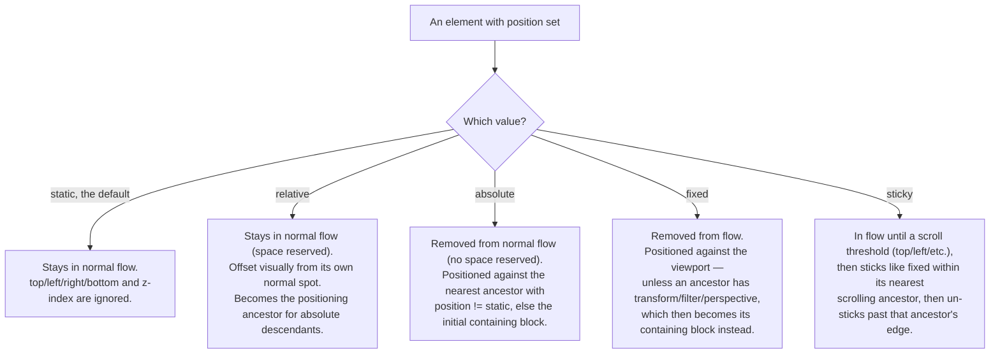
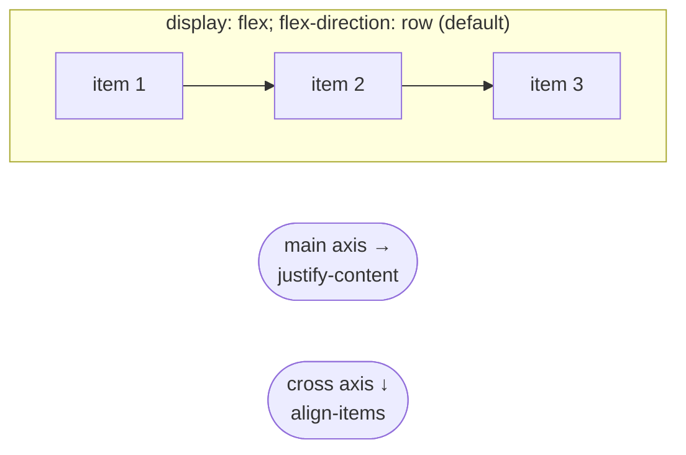
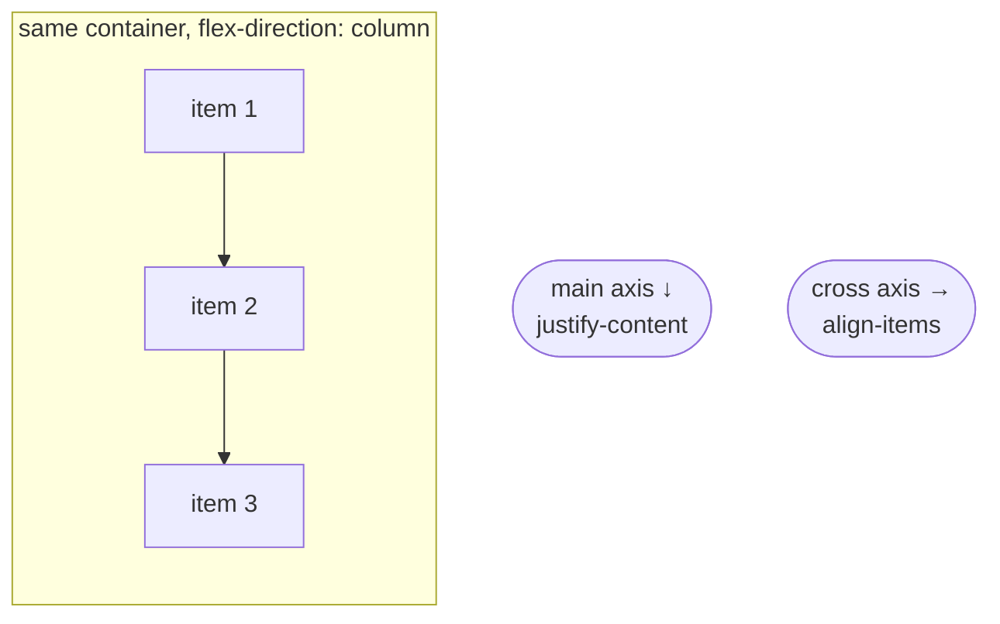
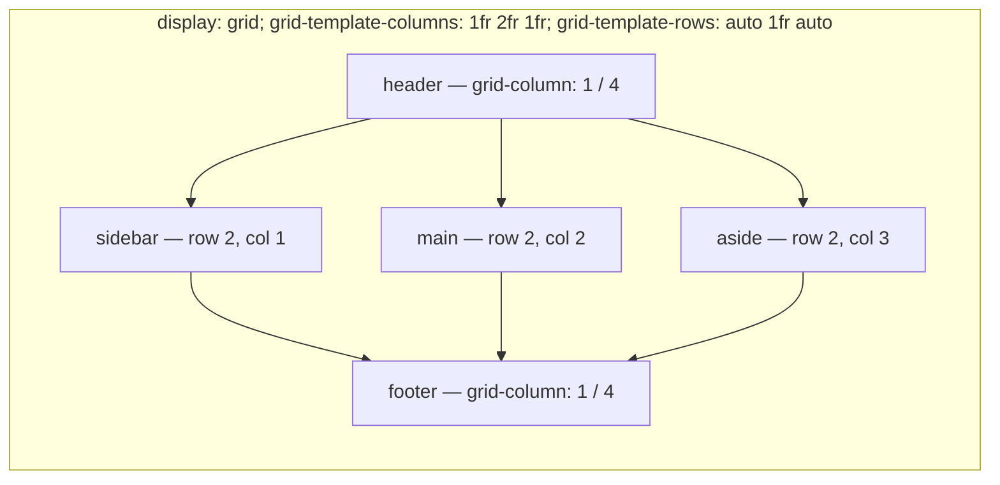

# CSS Layout - Position, Flexbox, Grid

> [!summary] TL;DR
> Every element starts in **normal flow** (block stacks vertically, inline flows horizontally). The `position` property can pull an element out of that flow to place it against an ancestor, the viewport, or a scroll container. **Flexbox** arranges items along one axis; **Grid** arranges them along two axes at once.

> [!abstract] Core idea
> - `position: absolute` positions against the **nearest positioned ancestor** (anything with `position` other than `static`), not the page root — the root is only the fallback when no ancestor is positioned.
> - `relative` keeps an element's original space reserved and offsets it from there; it also becomes the positioning anchor for any `absolute` descendant.
> - Flexbox has a **main axis** and a **cross axis**; `flex-direction` decides which is which, and `justify-content`/`align-items` each always target one specific axis, not "x" or "y".
> - Grid places items by **lines, tracks, and areas** in two dimensions at once; `fr` is a share of the leftover space, not a fixed size.
> - Reach for flex when content decides the size (content-out); reach for grid when the layout decides where content goes (layout-in).

### Whiteboard version

```css
.parent { position: relative; }   /* becomes the anchor */
.child  { position: absolute; top: 0; right: 0; } /* a badge, pinned to .parent's corner */
```

`.child` ignores the page entirely and pins itself to `.parent`'s top-right corner, because `.parent` is the nearest ancestor with a `position` other than `static`. If `.parent` had no `position` set, `.child` would keep looking up the ancestor chain until it found one, falling back to the whole page only if nothing qualifies. This parent-relative/child-absolute pattern is the standard recipe for badges, dropdowns, and tooltips.

## 1. Why it exists

A notification badge needs to sit at the exact top-right corner of a bell icon, regardless of where that icon ends up on the page — inside a nav bar, inside a sidebar, wherever. Normal flow alone can't do this: every element in normal flow pushes the next one down or across. You need a way to say "place this relative to one specific container, ignoring the elements around it," which is what taking an element out of flow with `position` provides. Separately, a row of three equal-width cards that should share leftover space, or a page grid with a header, sidebar, main content, and footer that reflows at different screen sizes, both need an axis-aware (flex) or two-dimensional (grid) layout system — normal block/inline flow alone can only stack things in one direction.

## 2. Mental model

Normal flow is water finding its level: block elements stack like bricks, inline elements run like text in a line, wrapping as needed. `position` lets you pick an element up out of that water and nail it to a specific point on a specific container. Flexbox is a ruler laid down one direction (say the row); items line up or spread along it, and `align-items` is a second, perpendicular ruler for the direction you didn't choose. Grid is graph paper: you draw the lines first (rows and columns), then drop items into cells or named regions on that paper.

## 3. How it works

### Normal flow

Block-level elements (`div`, `p`, `section`) stack vertically, each taking the full available width. Inline elements (`span`, `a`) flow horizontally within a line, wrapping to a new line when they run out of width. This is the default for every element until `position`, `display: flex`, or `display: grid` changes it.

### Positioning



- **`static`** (the default): the element sits in normal flow. `top`, `left`, `right`, `bottom`, and `z-index` have no effect at all.
- **`relative`**: still in normal flow — its original space in the layout is kept exactly as if it hadn't moved — but it is then visually offset by `top`/`left`/`right`/`bottom` from that original spot. Equally important: a `relative` element becomes the **containing block** for any `absolute` descendant, which is the main reason to use `relative` even with no offset at all (`position: relative;` alone, with no top/left, is a common "just to anchor children" pattern).
- **`absolute`**: removed from normal flow entirely — no space reserved for it, so surrounding elements act as if it isn't there. It is positioned relative to its **nearest ancestor whose `position` is anything other than `static`** (relative, absolute, fixed, or sticky). If no ancestor qualifies, it falls back to the initial containing block, which is effectively the page's viewport at the root — the root is the fallback, not the rule.
- **`fixed`**: removed from flow, positioned relative to the viewport, so it stays in the same screen position while the page scrolls — the classic sticky header or floating action button. One subtlety: if any ancestor has a `transform`, `filter`, or `perspective` property set (even `transform: translateZ(0)`), that ancestor becomes the fixed element's containing block instead of the viewport — a common source of "my `position: fixed` element stopped working" bugs.
- **`sticky`**: behaves like `relative` (in flow) until the element would scroll past a threshold you set (e.g. `top: 0`), at which point it behaves like `fixed` *within its nearest scrolling ancestor* — not the whole viewport — until that ancestor's box ends, at which point it un-sticks. Changing `overflow` on an ancestor (e.g. to `auto` or `scroll`) changes which container a sticky element sticks within, since that ancestor becomes the relevant scrolling box.

**z-index and stacking contexts.** `z-index` only has an effect on a positioned element (`position` other than `static`) — or on a flex/grid item, where `z-index` works even without `position`. A new **stacking context** is created by several triggers, most commonly: a positioned element with a `z-index` other than `auto`, `opacity` less than 1, or a `transform`/`filter`. Inside a stacking context, `z-index` values are only compared against siblings *within that same context* — a child with `z-index: 9999` can still render behind an unrelated element if its own ancestor's stacking context sits lower, because the comparison never escapes the parent context to compete directly against elements outside it.

**The relative-parent/absolute-child pattern** (dropdown menus, tooltips, badges): give the container `position: relative` and the item that must pin to a corner `position: absolute` with `top`/`right`/`bottom`/`left`. The `inset` shorthand (`inset: 0;`) sets all four offsets at once — `inset: 0` on an absolutely positioned element makes it fill its positioned ancestor exactly.

### Flexbox





Flexbox is a one-dimensional layout: put `display: flex` on the parent (the **flex container**), and its direct children become **flex items** laid out along one **main axis**. `flex-direction: row` (the default) makes the main axis horizontal and the cross axis vertical; `flex-direction: column` swaps them — the main axis becomes vertical. This swap is exactly why `align-items` is not "the vertical one": it always targets the cross axis, whatever that currently is.

| Property | Axis it controls | Values |
| --- | --- | --- |
| `justify-content` | main axis | `flex-start`, `center`, `flex-end`, `space-between` (equal gaps only between items), `space-around` (half-size gaps at the edges, full gaps between), `space-evenly` (all gaps equal, edges included) |
| `align-items` | cross axis, for all items | `flex-start`, `center`, `flex-end`, `stretch` (default), `baseline` |
| `align-self` | cross axis, for one item | overrides `align-items` for that one item |
| `align-content` | cross axis, for the set of wrapped lines | only visible when `flex-wrap: wrap` produces more than one line |

`flex: 1` is shorthand for `flex-grow: 1; flex-shrink: 1; flex-basis: 0%;` — it means "start every item at zero intrinsic width and grow to share the available space equally." This is different from `flex: 1 1 auto`, which starts from each item's own content size (`flex-basis: auto`) before growing, so items with different amounts of content stay different sizes relative to each other even as they both grow. `flex-basis` is the starting size before grow/shrink is applied; it takes priority over `width` when both are set on a flex item.

`flex-wrap: wrap` lets items move to a new line instead of shrinking indefinitely; `gap` (not margin tricks) is the modern way to space items, since it only applies *between* items, not around the outer edge. `order` can visually reorder items without touching the HTML, but doing so can break keyboard tab order and screen-reader reading order from the user's point of view — treat it as a presentation-only tool, verify with a keyboard.

**A gotcha:** a flex item's default `min-width` (or `min-height` in a column) is `auto`, not `0`, which means a flex item with unbreakable long content (a long unbroken string, a wide image) will refuse to shrink below that content's size even if `flex-shrink: 1` is set, overflowing its container. Setting `min-width: 0` explicitly on the item is the standard fix.

### Grid



Grid is a two-dimensional layout: `display: grid` on the parent creates a **grid container**; `grid-template-columns` and `grid-template-rows` define the **tracks** (the columns and rows), and the intersections are **cells**.

```css
.page {
  display: grid;
  grid-template-columns: 200px 1fr 200px; /* sidebar, main, aside */
  grid-template-rows: auto 1fr auto;      /* header, body, footer */
  grid-template-areas:
    "header header header"
    "sidebar main   aside"
    "footer footer footer";
  gap: 16px;
}
.header { grid-area: header; }
.footer { grid-area: footer; }
```

- **`fr`** is a share of the *leftover* space after fixed-size tracks are subtracted — `grid-template-columns: 200px 1fr 1fr` gives the first column exactly 200px, then splits whatever's left evenly between the other two. `fr` is not a percentage and not a fixed unit; it only resizes relative to what's left.
- **`repeat()`** and **`minmax()`** combine for responsive layouts without a single media query: `grid-template-columns: repeat(auto-fit, minmax(200px, 1fr))` creates as many 200px-minimum columns as fit the container, each stretching to fill leftover space — this one line replaces what used to need several breakpoint-specific media queries.
- **Explicit vs. implicit grid:** `grid-template-rows`/`-columns` define the *explicit* grid; if an item is placed beyond it (or `grid-auto-flow` creates extra rows automatically), the browser creates *implicit* tracks, sized by `grid-auto-rows`/`grid-auto-columns`. `grid-auto-flow: dense` back-fills earlier empty cells with later items that fit, instead of always moving strictly forward — useful for a masonry-like gallery of mixed item sizes, at the cost of possibly changing visual (not DOM) order.
- **Placing items** can be done by line numbers (`grid-column: 2 / 4` spans from line 2 to line 4) or by named areas (`grid-template-areas`, `grid-area: header`), which reads far more like an actual page layout and is the more common choice for a full-page grid.
- **`justify-*` vs. `align-*`:** in grid, `justify-items`/`justify-content`/`justify-self` always act on the **inline axis** (horizontal, in a left-to-right language); `align-items`/`align-content`/`align-self` always act on the **block axis** (vertical). The `-items` variant sets every item/cell's default at once; `-self` overrides one item; `-content` positions the whole set of tracks within the container when the tracks don't fill it completely.
- **`subgrid`** (`grid-template-columns: subgrid` on a nested grid item, widely supported since 2023) lets a nested grid's tracks align to its parent grid's tracks instead of defining independent ones — useful for card layouts where internal elements (title, body, footer) should align across sibling cards even though each card is its own grid.

| Axis | Items in that axis | Whole track set in that axis |
| --- | --- | --- |
| Inline (horizontal) | `justify-items`, `justify-self` | `justify-content` |
| Block (vertical) | `align-items`, `align-self` | `align-content` |

### Flex vs. grid

Flexbox is **content-out**: items bring their own size, and the container arranges them along one axis. Grid is **layout-in**: you define the structure first (rows, columns, named areas), then drop content into it, and it naturally works in two dimensions. A component that just needs to space out a row of buttons is flexbox; a page-level layout with a header, sidebar, and footer that needs to hold its shape regardless of content length is grid. The two combine constantly: a grid for the page skeleton, flexbox inside each grid cell for aligning that cell's own content.

## 4. Worked example

### A card component, end to end

```css
.card {
  position: relative;          /* anchor for the badge */
  display: flex;
  flex-direction: column;
  min-width: 0;                /* allow long text to shrink instead of overflowing */
}
.card .title {
  flex: 1;                     /* grow to push the footer down */
}
.card .badge {
  position: absolute;
  top: -8px;
  right: -8px;                 /* pinned to .card's corner, not the page's */
}
.gallery {
  display: grid;
  grid-template-columns: repeat(auto-fit, minmax(240px, 1fr));
  gap: 16px;
}
```

Tracing this: `.gallery` is a grid that produces as many 240px-minimum, equal-width columns as the viewport allows, reflowing the count automatically as the window resizes — no media query needed. Each `.card` inside a cell is itself a flex column, so its title grows to fill leftover vertical space and pushes any footer content to the bottom of a fixed-height card. The `.badge` ignores both the flex and grid layout entirely, because `position: absolute` removes it from flow — it pins to `.card`'s top-right corner because `.card` is the nearest ancestor with `position` other than `static`.

## 5. Variants and comparison

| Option | How it works | Use when | Cost |
| --- | --- | --- | --- |
| Normal flow | block stacks, inline flows | default text/document content | no control over axis-based arrangement |
| `position: relative`/`absolute` | pin an element to an ancestor, out of flow | badges, tooltips, dropdowns, overlays | breaks out of flow — surrounding layout must account for it manually |
| `position: fixed` | pin to the viewport (or a transformed ancestor) | sticky headers, floating buttons, modals | overlaps content unless layout reserves space for it |
| `position: sticky` | relative until a scroll threshold, then fixed within its scroll container | section headers that stick while scrolling a list | needs a scrolling ancestor with room to scroll past the threshold |
| Flexbox | one-dimensional, content-out | rows/columns of items, centering, nav bars | not built for strict two-axis alignment across rows and columns |
| Grid | two-dimensional, layout-in | full page layouts, card galleries, forms with aligned labels | more upfront design of tracks; overkill for a simple one-axis row |

## 6. Trade-offs and when not to use

- Don't reach for `position: absolute` to build a general page layout — it was never designed for that and quickly produces fragile, overlap-prone pages; flex or grid handle genuine layout needs.
- `position: fixed` elements need explicit space reserved by something else (e.g. `padding-top` on `body` for a fixed header), or they'll overlap content underneath them.
- Flexbox struggles when you need items in one row to line up with items in the row below (e.g. form labels across multiple rows) — that's a two-dimensional alignment problem, which is what grid is actually for.

## 7. In production

- **Real systems:** nearly every modern component library (Material UI, shadcn/ui, Bootstrap 5) uses flexbox for component-internal layout (buttons, cards, nav bars) and grid for page-level or dashboard layout; `position: sticky` is the standard mechanism for sticky table headers and sticky section navigation.
- **Failure modes → fixes:** an absolutely positioned element unexpectedly anchoring to the page instead of its intended parent → the parent is missing `position: relative` (still `static`), so the browser walked up to the next positioned ancestor or the root. A flex item refusing to shrink and overflowing its row → missing `min-width: 0` on the item. A grid gallery not reflowing at narrow widths → `minmax()`'s minimum is larger than the viewport; lower it or let `auto-fit` collapse empty tracks.
- **What to monitor:** layout shift (CLS) from elements changing between `static` and `fixed`/`absolute` at runtime (e.g. a sticky header that only gets `position: fixed` added via JavaScript on scroll) — prefer `position: sticky`, which has no such shift, over a scroll-listener toggling classes.

## 8. Deep dive

- **Stacking contexts compound.** `z-index: 9999` inside a parent with `opacity: 0.99` (which creates a new stacking context) can still render below a sibling of that parent with a lower `z-index`, because the comparison is scoped to the parent stacking context and never "escapes" to compete directly against elements outside it — debugging a z-index issue means checking for stacking-context-creating properties on ancestors, not just the `z-index` values themselves.
- **`flex-basis: auto` vs. `0%`.** With `flex: 1 1 0%` every item starts from zero and grows purely by its `flex-grow` ratio, producing equal final sizes for equal ratios regardless of content. With `flex: 1 1 auto`, items start from their own content size and then share only the leftover space, so items with more content stay visibly larger even after growing — a frequent source of "why aren't my flex items equal width" confusion.
- **Grid's implicit-track sizing interacts with `grid-auto-flow: dense`.** Dense packing changes the *visual* order of items to fill gaps, but never changes DOM order or focus/tab order — a keyboard or screen-reader user still moves through items in source order, which can now visually jump around the grid. This is a genuine accessibility trade-off, not just a layout detail.
- **Containing blocks for `fixed` are more subtle than "the viewport".** Any ancestor with `transform`, `filter`, `perspective`, `contain: layout`, or `will-change: transform` becomes the containing block for `position: fixed` (and `absolute`) descendants, which is why adding a CSS animation (`transform`) to a wrapping `div` can suddenly make a child's `position: fixed` modal render inside that wrapper's bounds instead of covering the full viewport.

## 9. Interview questions

> [!question]- Trap: "`position: absolute` positions the element relative to the page/root." Is that accurate?
> Not quite. It positions relative to the **nearest ancestor with a `position` other than `static`**. The root (initial containing block) is only used as the fallback when no ancestor qualifies. In practice, nearly every "absolute positioning isn't working as expected" bug is a missing `position: relative` on the intended parent.

> [!question]- What's the difference between `relative` and `absolute` in terms of space reserved in the layout?
> `relative` keeps the element's original space in normal flow fully reserved — it is only visually offset from that spot, so nothing else moves. `absolute` removes the element from flow entirely; no space is reserved for it, and surrounding elements lay out as if it weren't there at all.

> [!question]- How does `position: sticky` differ from `position: fixed`?
> `fixed` is always positioned against the viewport (or a transformed ancestor), regardless of scrolling. `sticky` behaves like `relative` until scrolling crosses a threshold you set (e.g. `top: 0`), then behaves like `fixed`, but only within its nearest scrolling ancestor — it un-sticks again once that ancestor's box scrolls past, which `fixed` never does.

> [!question]- If `flex-direction` is `column`, which property controls horizontal alignment: `justify-content` or `align-items`?
> `align-items`. `flex-direction: column` makes the main axis vertical, so `justify-content` (which always targets the main axis) now controls vertical spacing, and `align-items` (always the cross axis) controls horizontal alignment. Neither property is fixed to "horizontal" or "vertical" — they're fixed to an axis role that `flex-direction` reassigns.

> [!question]- What does `fr` mean in `grid-template-columns: 1fr 2fr`, and is it a percentage?
> `fr` is a share of the leftover space after any fixed-size tracks are subtracted, not a percentage of the full container. With `1fr 2fr` and no fixed tracks, the second column gets twice the leftover space of the first — a 1:2 ratio of whatever space remains, which can differ from a 33%/67% split if any sibling tracks have fixed widths.

> [!question]- A flex item with a long, unbreakable string overflows its container even with `flex-shrink: 1` set. Why?
> A flex item's default `min-width` is `auto`, not `0` — the browser refuses to shrink it below its content's intrinsic minimum size even though shrinking is allowed. Setting `min-width: 0` (or `min-height: 0` in a column) explicitly on the item removes that floor and lets it shrink as intended.

> [!question]- When would you choose grid over flexbox for a layout that could technically be built with either?
> When the layout needs two-dimensional alignment — items in one row lining up with items in another row or column, like a form's labels and inputs, or a page skeleton with header/sidebar/main/footer. Flexbox only guarantees alignment along its one main axis; cross-axis alignment between separate flex rows isn't coordinated the way grid's shared tracks are.

## 10. Cheat sheet

- `static` (default, ignores offsets) → `relative` (offset, space kept, anchors absolute children) → `absolute` (out of flow, pins to nearest positioned ancestor) → `fixed` (pins to viewport, unless an ancestor has transform/filter) → `sticky` (relative, then fixed within its scroll container past a threshold).
- `z-index` only acts on positioned elements (or flex/grid items); stacking contexts scope the comparison to siblings within the same context.
- Flex: one axis, content-out. `flex-direction` picks which axis is "main"; `justify-content` = main axis, `align-items`/`align-self` = cross axis.
- `flex: 1` = grow 1, shrink 1, basis 0% — equal final sizes regardless of content.
- Grid: two axes at once, layout-in. `grid-template-columns`/`-rows` define tracks; `fr` splits leftover space; `grid-template-areas` names regions.
- `justify-*` = inline/horizontal axis; `align-*` = block/vertical axis, in both flex and grid.
- `repeat(auto-fit, minmax(…))` gives a responsive grid with zero media queries.
- Flex item default `min-width`/`min-height` is `auto`, not `0` — set it explicitly to allow shrinking past content size.

## Links
- **Before this:** [[CSS Fundamentals - Cascade, Selectors, Box Model]]
- **Next:** [[React Fundamentals - Components, JSX, Props, State]]
- **Compare with:** [[How Browsers Load and Render a Page]]
