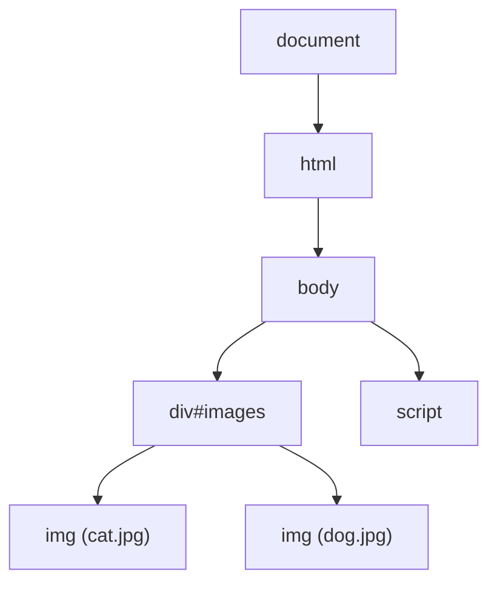
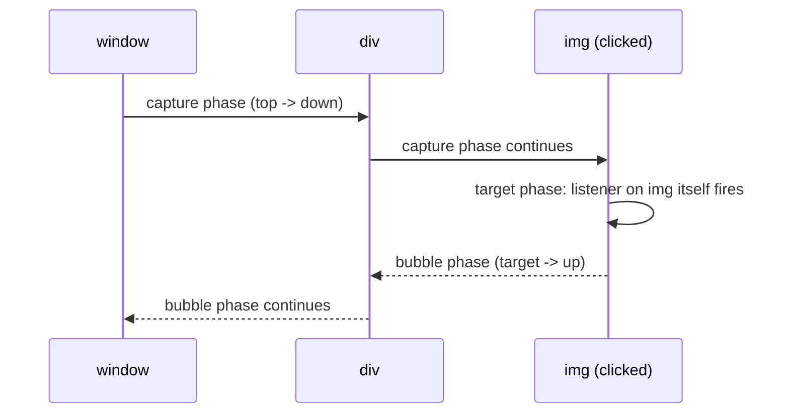
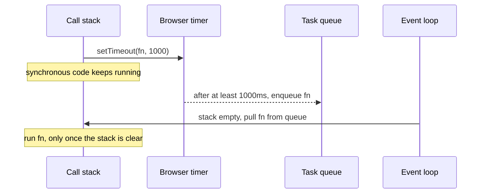

# DOM, Events and Timers

> [!summary] TL;DR
> The **DOM** is a live tree of JavaScript objects the browser builds from HTML text — it's a data structure in memory, not the HTML file itself. Events travel down the tree (capture), hit their target, then bubble back up, which is what makes event delegation possible. `setTimeout` runs once after at least a given delay; `setInterval` keeps running every interval until you explicitly stop it.

> [!abstract] Core idea
> - The DOM tree is built once from HTML text, then JavaScript can keep mutating it; the original HTML string is never consulted again.
> - A click on a nested element triggers listeners in capture order (root → target), then bubble order (target → root) — `stopPropagation` and `preventDefault` do different things.
> - One listener on a parent, checking `event.target`, replaces listeners on every child — that's event delegation.
> - `setInterval(fn, 1000)` fires repeatedly every ~1000ms until `clearInterval` is called; it does not run once. Both timers' delays are a minimum, not a guarantee.

## 1. Why it exists

HTML describes a page's initial structure, but a page has to react after that: a click, a typed character, data arriving from the network. The browser needs (a) an in-memory structure it can inspect and change at runtime, since the original HTML text is long gone by the time a user clicks something, and (b) a way to run code later — after a delay, or every N milliseconds, since not all work can happen the instant the page loads.

Concretely: a task-list app deletes an item when its "x" button is clicked. There is no HTML for "delete the 4th item" — the delete has to find that specific DOM node (the one the event happened on) and remove it, then the browser re-paints the screen to match the new in-memory structure. That round trip — structure in memory, events telling you what changed, timers letting you defer work — is what this note covers.

## 2. Mental model

The **DOM tree is not the HTML file** — HTML is the opening instructions, and the DOM is the building the browser constructs from them and then keeps live and mutable for the rest of the page's life. `document.querySelector(...)` is just "walk this tree and find a room"; `el.remove()` is "tear a room out of the building", and the browser re-paints to match.

An event is a ripple starting at the window, traveling down to the exact element clicked (capture), then traveling back up through every ancestor (bubble) — like dropping a stone into a pond and watching the ripple go out both toward the center and back.

A timer is a sticky note with a minimum wait time on it, handed to the browser: "run this no sooner than N ms from now." The browser is free to run it later if it's busy, but never sooner.

## 3. How it works

### The DOM tree, selecting, and updating nodes



Each box is a **node** (element, text, comment, or the document itself), and nodes have types (`Node.ELEMENT_NODE`, `Node.TEXT_NODE`, …). Selecting nodes:

```js
const parent = document.querySelector(".parent");       // first match, static snapshot
const allImgs = document.querySelectorAll("#images img"); // static NodeList: does NOT update if the DOM changes later
const liveList = document.getElementsByClassName("item"); // live HTMLCollection: DOES update as the DOM changes
```

Updating content: `textContent` sets plain text and is always safe; `innerHTML` parses a string as HTML, which means any value from user input inserted via `innerHTML` can inject a `<script>` or event handler — a cross-site scripting (XSS) hole. Default to `textContent`, and if you must set markup from untrusted data, sanitize it first.

```js
el.textContent = userInput;             // safe: renders literally, never parsed as markup
el.innerHTML = `<b>${userInput}</b>`;   // unsafe if userInput is untrusted: could be ""
```

Building new nodes programmatically (no string parsing, so no XSS risk) uses `createElement` plus `appendChild`/`append`:

```js
const li = document.createElement("li");
li.textContent = userInput;   // still safe: set as text, not markup
document.querySelector("ul").append(li); // appendChild(li) also works; append() also takes plain strings
```

Writing to the DOM triggers layout recalculation; reading a layout property (`offsetHeight`, `getBoundingClientRect()`) right after a write forces the browser to compute layout immediately instead of batching it, and alternating writes and reads in a loop (**layout thrashing**) can make a loop of 100 elements cost 100 forced layouts instead of one. Fix: read all the values you need first, then do all the writes, or batch writes with `requestAnimationFrame`.

### Event flow: capture, target, bubble, and delegation



A listener registered with `addEventListener("click", fn, { capture: true })` fires on the way down; the default (`capture: false`, the common case) fires on the way up. `event.stopPropagation()` stops the ripple from reaching further ancestors (or descendants, in capture); `event.preventDefault()` stops the browser's own default action (following a link, submitting a form) — they solve different problems and neither implies the other.

**Event delegation** uses bubbling to put one listener on a stable ancestor instead of one per (possibly changing) child:

```js
document.querySelector("#images").addEventListener("click", (e) => {
  if (e.target.tagName === "IMG") {
    e.target.parentNode.remove(); // delegation: one listener, works for every current and future  under #images
  }
});
```

This single listener keeps working even if images are added to `#images` later — a per-image listener would need re-attaching every time. For a listener that only reads the event and never calls `preventDefault`, mark it `{ passive: true }` so the browser doesn't have to wait for your handler before scrolling — this matters most for `touchstart`/`wheel` listeners that can otherwise visibly delay scroll. Always `removeEventListener` a listener you no longer need (same function reference required), especially on elements you remove from the DOM, to avoid pinning them in memory.

### Timers and the event loop

```js
const timeoutId = setTimeout(sayHello, 2000);   // runs sayHello ONCE, no sooner than ~2000ms from now
clearTimeout(timeoutId);                         // cancels it if it hasn't fired yet

const intervalId = setInterval(sayDate, 1000, "hi"); // runs sayDate roughly every ~1000ms, passing "hi" as an argument, REPEATEDLY
clearInterval(intervalId);                            // the only way it stops: must be called explicitly
```

`setInterval` does not run once — it keeps firing every interval, forever, until `clearInterval` is called. A timer's delay is a floor, not an exact schedule: the callback is placed on the **task queue** only after the delay elapses, and it still has to wait for the call stack to be empty and for any already-queued task ahead of it to finish.



Two details that are easy to get wrong: nested timers (`setTimeout` calling itself, or a `setInterval` beyond 5 levels deep in some engines) are clamped to a minimum delay around 4ms even if you ask for less; and a timer callback that throws does not stop a `setInterval`'s future firings — each tick is independent. `requestAnimationFrame(fn)` is a different primitive for animation: it runs `fn` once, right before the browser's next repaint, synced to the display's refresh rate, rather than on a fixed millisecond delay.

## 4. Worked example

### Whiteboard version

The owner's original delegation example, now explicit about what it is:

```js
document.querySelector("#images").addEventListener("click", (e) => {
  if (e.target.tagName === "IMG") e.target.parentNode.remove();
}); // this IS event delegation: one listener, checks e.target to act only on IMG clicks
```

### Timer trace: one-shot vs repeating

```js
console.log("A");
setTimeout(() => console.log("C - once, after >= 0ms"), 0);
const id = setInterval(() => console.log("D - repeats until cleared"), 500);
console.log("B");
setTimeout(() => clearInterval(id), 1700); // stop the interval after about 3 ticks
// Printed order: A, B, C, D, D, D   (never: C running twice; D only fires once per 500ms, repeatedly)
```

`A` and `B` print immediately because they're synchronous; `C` and the first `D` only run once the current script finishes and the stack is empty, confirming the "minimum delay, not guaranteed" rule even for a `0ms` timeout.

### Go comparison: `time.Timer` vs `time.Ticker`

Go's standard library draws exactly this same one-shot-vs-repeating line, and the parallel makes `setInterval` easy to remember: a `Timer` is `setTimeout`, a `Ticker` is `setInterval`, and `Ticker.Stop()` is `clearInterval`. Tested on Go 1.24:

```go
// Package timers mirrors the one-shot vs repeating distinction between
// JavaScript's setTimeout/setInterval using Go's time.Timer/time.Ticker.
package timers

import "time"

// AfterOnce fires exactly once after at least d, like setTimeout(fn, d).
// The delay is a minimum, not a guarantee: a busy scheduler can run it later.
func AfterOnce(d time.Duration) <-chan time.Time {
	return time.After(d)
}

// RepeatingTicks starts a ticker that fires every d until stop is closed,
// like setInterval(fn, d) running until clearInterval(id). The caller must
// call Ticker.Stop (the Go equivalent of clearInterval) to release it.
func RepeatingTicks(d time.Duration, n int) []time.Time {
	t := time.NewTicker(d)
	defer t.Stop() // equivalent to clearInterval: never leak the ticker
	ticks := make([]time.Time, 0, n)
	for i := 0; i < n; i++ {
		ticks = append(ticks, <-t.C)
	}
	return ticks
}
```

```go
package timers

import (
	"testing"
	"time"
)

func TestAfterOnceFiresAtLeastOnce(t *testing.T) {
	start := time.Now()
	<-AfterOnce(10 * time.Millisecond)
	if elapsed := time.Since(start); elapsed < 10*time.Millisecond {
		t.Fatalf("fired after %v, want >= 10ms (a minimum delay, not a guarantee)", elapsed)
	}
}

func TestRepeatingTicksFiresMultipleTimes(t *testing.T) {
	ticks := RepeatingTicks(5*time.Millisecond, 3)
	if len(ticks) != 3 {
		t.Fatalf("got %d ticks, want 3 (a ticker repeats, it is not one-shot)", len(ticks))
	}
	for i := 1; i < len(ticks); i++ {
		if !ticks[i].After(ticks[i-1]) {
			t.Fatalf("tick %d did not come after tick %d", i, i-1)
		}
	}
}
```

**Measured:** `go vet ./...` reports no issues and `go test -race ./...` passes both tests (Go 1.24.4, darwin/arm64, 2026-11-04). `TestAfterOnceFiresAtLeastOnce` directly demonstrates the "minimum delay, not guaranteed" rule: it asserts the elapsed time is `>=` the requested delay, never `==`.

## 5. Variants and comparison

| Option | How it works | Use when | Cost |
| --- | --- | --- | --- |
| `setTimeout` | Fires once, no sooner than the given delay | Deferred one-off work (debouncing, a delayed toast) | Must `clearTimeout` if you might want to cancel it |
| `setInterval` | Fires repeatedly every delay, until stopped | Polling, a clock, a repeating UI tick | Drifts under load; must `clearInterval` or it runs forever |
| `requestAnimationFrame` | Fires once per repaint, synced to refresh rate | Animation, anything that changes visual state every frame | Pauses automatically in a background tab |
| `MutationObserver` | Callback fires when watched DOM nodes/attributes change | Reacting to DOM changes made by other code (widgets, extensions) | Batched, asynchronous — not instant |
| `IntersectionObserver` | Callback fires when an element crosses a viewport threshold | Lazy-loading images, infinite scroll, "seen" tracking | Cheaper than scroll-event polling; still asynchronous |

## 6. Trade-offs and when not to use

- `setInterval` drifts: each tick's delay is measured from "whenever the previous callback finished running," so a slow callback makes real intervals longer than requested. A self-rescheduling `setTimeout` is more predictable when exact spacing matters.
- Attaching a listener per list item instead of delegating one listener to the parent costs more memory and must be re-attached whenever the list changes — delegation avoids both, at the cost of one `if` check per bubbled event.
- `innerHTML` is the fastest way to write a chunk of markup but is unsafe with any string that could contain user input; `textContent` and DOM-building APIs are safer but more verbose.
- Polling the DOM (`setInterval` checking `element.getBoundingClientRect()`) to detect visibility works but burns CPU continuously — `IntersectionObserver` does the same job without polling.

## 7. In production

- **Real systems:** `setTimeout`/`clearTimeout` are the backbone of debounce (wait for input to pause before acting — search-as-you-type) and throttle (run at most once per interval — scroll handlers) utilities used in nearly every production frontend. `IntersectionObserver` powers lazy-loaded images and infinite-scroll feeds; `MutationObserver` underlies many browser extensions and some virtual-DOM diffing debug tools.
- **Failure modes → fixes:**
  - A page that gets slower the longer it's open → listeners attached to removed elements (or in a loop without delegation) were never removed; audit with the browser DevTools' "Event Listeners" panel.
  - A UI glitch where a value "flickers" between an old and new state → a read (`offsetHeight`) interleaved with writes in a loop causing layout thrashing; batch reads, then writes.
  - A `setInterval`-based poll that silently stops updating → an uncaught exception inside the callback doesn't stop future ticks, but a forgotten `clearInterval` leak does accumulate timers; always store and clear the id when the component/page using it goes away.
- **What to monitor:** long task warnings in DevTools' Performance panel (tasks over 50ms block input); listener counts per page over time; `IntersectionObserver`/`MutationObserver` callback frequency if a feature feels sluggish.

## 8. Deep dive

- **Macrotasks vs microtasks, and where timers sit.** `setTimeout`/`setInterval` callbacks are macrotasks, always run after any pending Promise callbacks — see [[JavaScript Async - Event Loop, Promises, async-await]] for the full event-loop mechanics.
- **Minimum delay in practice.** Browsers clamp nested timers: after about 5 levels of a timer re-scheduling itself with `delay < 4ms`, engines force a 4ms floor, specifically to stop runaway timer loops from starving the rest of the page. A background (inactive) tab is throttled further, often to once per second or slower, to save power.
- **Event delegation and `stopPropagation`.** Calling `stopPropagation` inside a delegated listener for one widget can silently break a different, unrelated listener higher up the tree that was relying on the event reaching it (for example, a modal's "click outside to close" handler on `document`). Treat `stopPropagation` as a last resort, not a default habit.
- **`requestAnimationFrame` vs timers for animation.** A `setInterval(fn, 16)` tries to approximate 60fps but drifts and keeps running in a background tab (wasting battery) unless you manage it yourself; `requestAnimationFrame` is synced to the actual display refresh and is automatically paused when the tab isn't visible.

## 9. Interview questions

> [!question]- Trap: does `setInterval(fn, 1000)` run `fn` once, after 1 second?
> No — that's `setTimeout`. `setInterval` runs `fn` repeatedly, roughly every 1000ms, forever, until you call `clearInterval` with the id it returned. Conflating the two is the most common timer mistake.

> [!question]- What is the difference between the DOM and HTML?
> HTML is the serialized text the browser parses once, at load (and whenever you set `innerHTML`). The DOM is the live, in-memory tree of objects built from that text; JavaScript reads and mutates the DOM, and the browser re-renders to match it — the original HTML string is never consulted again after parsing.

> [!question]- What's the difference between event capturing and bubbling, and which is the default?
> Capturing fires listeners from the outermost ancestor down to the target; bubbling fires them from the target back up to the outermost ancestor. `addEventListener`'s default (`capture: false`) means your listener fires during the bubble phase unless you explicitly opt into `{ capture: true }`.

> [!question]- Why is event delegation useful, and what's the catch?
> One listener on a stable parent element, checking `event.target`, replaces one listener per child and automatically covers children added later — no re-attaching needed. The catch: it relies on the event bubbling all the way up to that parent, so a descendant's `stopPropagation()` silently breaks it.

> [!question]- Does a `setTimeout(fn, 0)` run `fn` immediately?
> No. Even a 0ms delay only means "as soon as possible, no sooner than now" — `fn` still has to wait for the current synchronous code to finish, for the microtask queue to drain, and for its turn on the macrotask queue. It is a minimum delay, never a guarantee of exact timing.

> [!question]- Why is `el.innerHTML = userInput` dangerous?
> `innerHTML` parses its argument as HTML, so a string like `` executes as markup, not literal text — this is a cross-site-scripting (XSS) vector whenever `userInput` isn't fully trusted. Use `textContent` for plain text, or sanitize the string before using `innerHTML`.

> [!question]- How would you detect when an element scrolls into view, without a scroll listener?
> Use an `IntersectionObserver`, giving it the element and a callback that fires when it crosses a visibility threshold. It's asynchronous and batched by the browser, so it doesn't run on every scroll pixel the way a manual scroll-event handler computing `getBoundingClientRect()` would, which is far cheaper for things like lazy-loading images.

## 10. Cheat sheet

- The DOM is a live in-memory tree built from HTML text once; HTML itself isn't consulted again after parsing.
- Events: capture (down) → target → bubble (up); `stopPropagation` stops the ripple, `preventDefault` stops the browser's default action.
- Event delegation: one listener on a parent, check `event.target`, covers current and future children.
- `setTimeout` = once, after a minimum delay. `setInterval` = repeatedly, until `clearInterval`.
- All timer delays are a floor, not a guarantee — the callback still waits for the call stack and microtask queue.
- `textContent` is always safe; `innerHTML` is an XSS risk with untrusted input.
- Prefer `IntersectionObserver`/`MutationObserver` over polling the DOM in a loop.

## Links

- **Before this:** [[JavaScript Core - Types, Scope, Hoisting, Closures, this]], [[JavaScript Objects, Arrays and Iteration]]
- **Next:** [[JavaScript Async - Event Loop, Promises, async-await]], [[React Fundamentals - Components, JSX, Props, State]]
- **Compare with:** [[How Browsers Load and Render a Page]] (where the initial DOM tree comes from before any of this runs)
