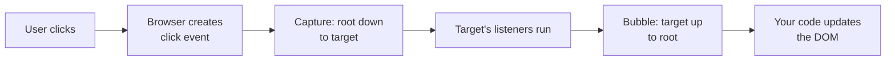
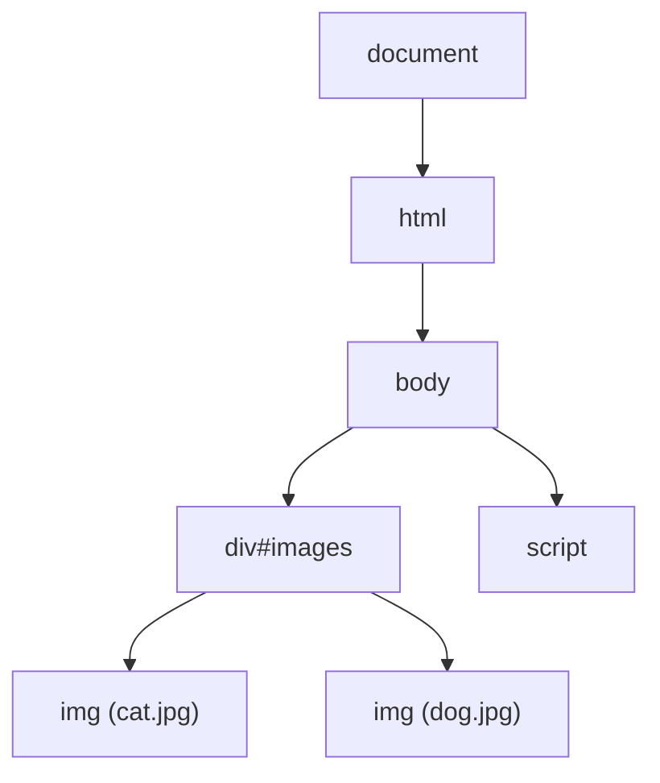
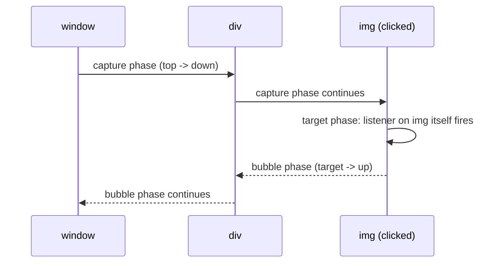
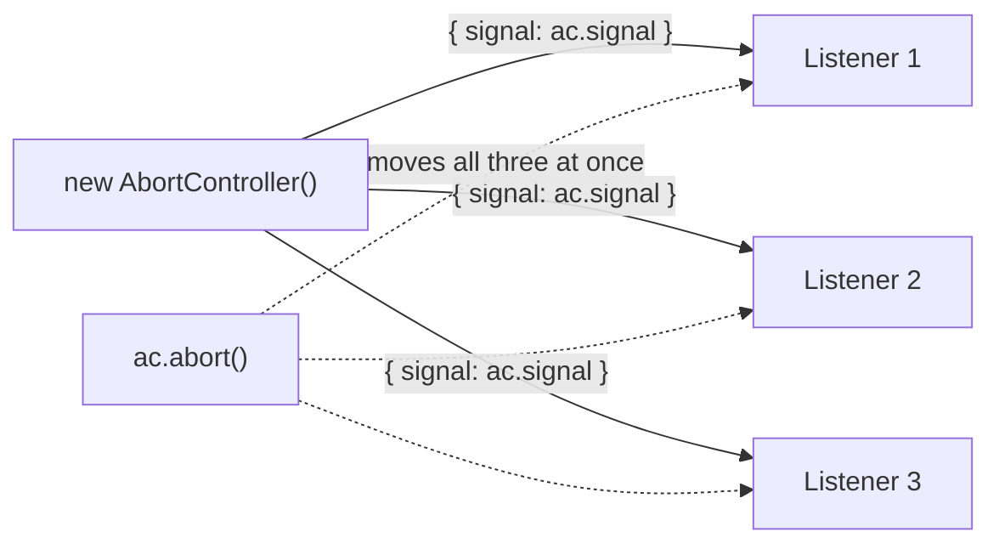
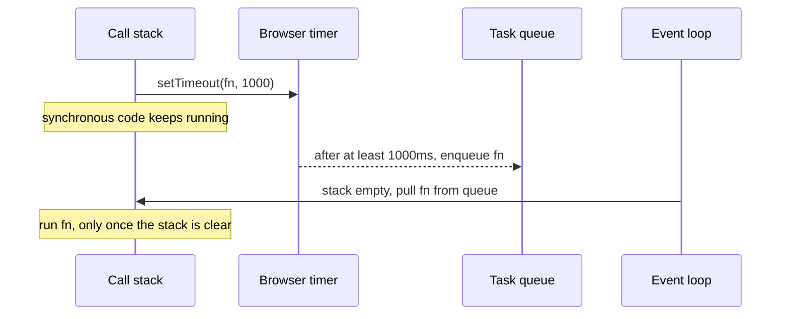
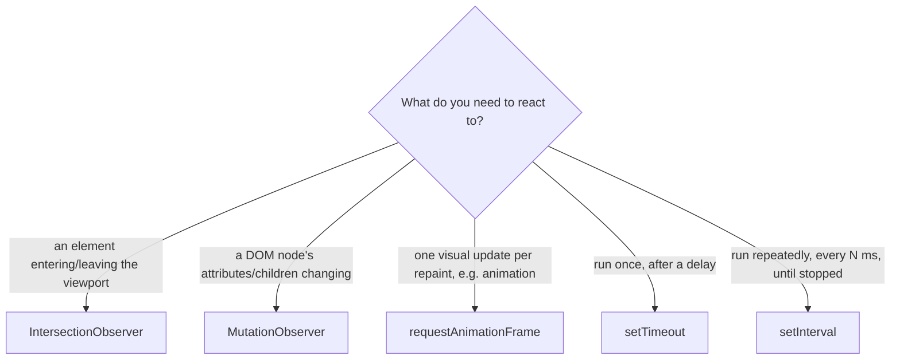

# DOM, Events and Timers

> [!summary] TL;DR
> The **DOM** is a live tree of JavaScript objects the browser builds from HTML text — it's a data structure in memory, not the HTML file itself.
>
> Events travel down the tree (capture), hit their target, then bubble back up, which is what makes event delegation possible. `setTimeout` runs once after at least a given delay; `setInterval` keeps running every interval until you explicitly stop it.

> [!abstract] Core idea
> - The DOM tree is built once from HTML text, then JavaScript can keep mutating it; the original HTML string is never consulted again.
> - A click on a nested element triggers listeners in capture order (root → target), then bubble order (target → root) — `stopPropagation` and `preventDefault` do different things.
> - One listener on a parent, checking `event.target`, replaces listeners on every child — that's event delegation.
> - `setInterval(fn, 1000)` fires repeatedly every ~1000ms until `clearInterval` is called; it does not run once. Both timers' delays are a minimum, not a guarantee.

## Start here: the basics

**The problem in one story.**
You click a "Like" button and the heart turns red without reloading the page.
Something had to notice the click, find the heart on the page and change it.
That "something" is JavaScript talking to the DOM, the browser's live model of the page.
Timers let the same code act later, like hiding a toast after 3 seconds.

**Words you need first**

| Word | Plain meaning | Tiny example |
| --- | --- | --- |
| DOM | A tree of objects, one per tag, that JS can read and change | `document.body` |
| Node / element | One item in that tree | The `<button>` object |
| Event | A message that something happened | `"click"`, `"keydown"` |
| Listener (handler) | A function run when an event fires | `btn.addEventListener("click", fn)` |
| Callback | A function you pass in to be called later | `setTimeout(fn, 500)` |
| Bubbling | An event travelling up from the clicked element to its parents | Click on `<li>` also reaches `<ul>` |
| Event loop | The browser's loop that runs queued callbacks one at a time | Runs your timer callback when the stack is free |

**Picture it**



**Analogy.** The DOM is a family tree of the page; an event is a shout that travels down to the person who was poked and then back up through their parents, and anyone listening along the way can react.
Where it breaks: real family members can't cancel a shout; `stopPropagation` can stop an event from travelling further.

**How the rest of this note builds up**

- First, why the DOM exists and a mental model of it (sections 1-2).
- Then selecting and updating nodes, event flow and delegation, cleanup with `AbortController`, and timers (section 3).
- Then a whiteboard version, a one-shot vs repeating timer trace and a Go comparison (section 4).
- Finally variants, trade-offs, production practice and the deep dive, then interview questions (sections 5-9).

> [!tip] Remember
> JS changes the page through the DOM tree; events flow down then up; timer delays are a minimum, not a promise.

## 1. Why it exists

HTML describes a page's initial structure, but a page has to react after that: a click, a typed character, data arriving from the network.

The browser needs (a) an in-memory structure it can inspect and change at runtime, since the original HTML text is long gone by the time a user clicks something, and (b) a way to run code later — after a delay, or every N milliseconds, since not all work can happen the instant the page loads.

Concretely: a task-list app deletes an item when its "x" button is clicked.

There is no HTML for "delete the 4th item" — the delete has to find that specific DOM node (the one the event happened on) and remove it, then the browser re-paints the screen to match the new in-memory structure.

That round trip — structure in memory, events telling you what changed, timers letting you defer work — is what this note covers.

## 2. Mental model

The **DOM tree is not the HTML file** — HTML is the opening instructions, and the DOM is the building the browser constructs from them and then keeps live and mutable for the rest of the page's life.

`document.querySelector(...)` is just "walk this tree and find a room"; `el.remove()` is "tear a room out of the building", and the browser re-paints to match.

An event is a ripple starting at the window, traveling down to the exact element clicked (capture), then traveling back up through every ancestor (bubble) — like dropping a stone into a pond and watching the ripple go out both toward the center and back.

A timer is a sticky note with a minimum wait time on it, handed to the browser: "run this no sooner than N ms from now." The browser is free to run it later if it's busy, but never sooner.

## 3. How it works

### The DOM tree, selecting, and updating nodes



Each box is a **node** (element, text, comment, or the document itself), and nodes have types (`Node.ELEMENT_NODE`, `Node.TEXT_NODE`, …). Selecting nodes:

```js
const parent = document.querySelector(".parent");       // first match, static snapshot
const allImgs = document.querySelectorAll("#images img"); // static NodeList: does NOT update if the DOM changes later
const liveList = document.getElementsByClassName("item"); // live HTMLCollection: DOES update as the DOM changes
```

Updating content: `textContent` sets plain text and is always safe; `innerHTML` parses a string as HTML, which means any value from user input inserted via `innerHTML` can inject a `<script>` or event handler — a cross-site scripting (XSS) hole. Default to `textContent`, and if you must set markup from untrusted data, sanitize it first.

```js
el.textContent = userInput;             // safe: renders literally, never parsed as markup
el.innerHTML = `<b>${userInput}</b>`;   // unsafe if userInput is untrusted: could be ""
```

Building new nodes programmatically (no string parsing, so no XSS risk) uses `createElement` plus `appendChild`/`append`:

```js
const li = document.createElement("li");
li.textContent = userInput;   // still safe: set as text, not markup
document.querySelector("ul").append(li); // appendChild(li) also works; append() also takes plain strings
```

Writing to the DOM triggers layout recalculation; reading a layout property (`offsetHeight`, `getBoundingClientRect()`) right after a write forces the browser to compute layout immediately instead of batching it, and alternating writes and reads in a loop (**layout thrashing**) can make a loop of 100 elements cost 100 forced layouts instead of one.

Fix: read all the values you need first, then do all the writes, or batch writes with `requestAnimationFrame`.

### Event flow: capture, target, bubble, and delegation



A listener registered with `addEventListener("click", fn, { capture: true })` fires on the way down; the default (`capture: false`, the common case) fires on the way up.

`event.stopPropagation()` stops the ripple from reaching further ancestors (or descendants, in capture); `event.preventDefault()` stops the browser's own default action (following a link, submitting a form) — they solve different problems and neither implies the other.

**Event delegation** uses bubbling to put one listener on a stable ancestor instead of one per (possibly changing) child:

```js
document.querySelector("#images").addEventListener("click", (e) => {
  if (e.target.tagName === "IMG") {
    e.target.parentNode.remove(); // delegation: one listener, works for every current and future  under #images
  }
});
```

This single listener keeps working even if images are added to `#images` later — a per-image listener would need re-attaching every time.

For a listener that only reads the event and never calls `preventDefault`, mark it `{ passive: true }` so the browser doesn't have to wait for your handler before scrolling — this matters most for `touchstart`/`wheel` listeners that can otherwise visibly delay scroll.

> [!warning] Common mistake
> Attaching a listener and forgetting to remove it. `removeEventListener` needs the exact same function reference you passed to `addEventListener` — an inline arrow function can never be removed, because a new function value is created every time you write it.
>
> A listener left on an element you then remove from the DOM keeps that element (and anything it closes over) pinned in memory until the page unloads.

### Cleaning up listeners in bulk with AbortController

**In plain words:** calling `removeEventListener` once per listener works, but it means keeping a reference to every single handler you ever attached. An **`AbortController`** is a single off-switch you hand to as many listeners as you like; calling it once removes all of them, with no list of function references to track.

**Picture it:**



**Example:**

```js
const ac = new AbortController();
btn.addEventListener("click", onClick, { signal: ac.signal });
window.addEventListener("resize", onResize, { signal: ac.signal });
// later, e.g. when a component unmounts:
ac.abort(); // both listeners above are gone — no stored function references needed
```

**Why it matters:** this is now the standard cleanup pattern for any component that attaches more than one or two listeners — one `ac.abort()` replaces a whole list of paired `addEventListener`/`removeEventListener` calls and can't be forgotten for just one of them, because there's only one call to make.

> [!tip] Remember
> One listener you no longer need → `removeEventListener` with the same function reference. Several listeners that should all go away together → one shared `AbortController`, aborted once.

### Timers and the event loop

**In plain words:** `setTimeout` and `setInterval` don't run code immediately, and they don't guarantee an exact delay either — they only promise "no sooner than this many milliseconds," and the browser still has to be free to actually run the callback when that time is up.

```js
const timeoutId = setTimeout(sayHello, 2000);   // runs sayHello ONCE, no sooner than ~2000ms from now
clearTimeout(timeoutId);                         // cancels it if it hasn't fired yet

const intervalId = setInterval(sayDate, 1000, "hi"); // runs sayDate roughly every ~1000ms, passing "hi" as an argument, REPEATEDLY
clearInterval(intervalId);                            // the only way it stops: must be called explicitly
```

`setInterval` does not run once — it keeps firing every interval, forever, until `clearInterval` is called.

**Picture it — what actually happens between "the delay elapses" and "your code runs":**



**Step by step, what the diagram shows:**
1. `setTimeout(fn, 1000)` hands `fn` to the browser's own timer facility, not to JavaScript — the call returns immediately.
2. The rest of your synchronous code keeps running; the timer is counting down in parallel, not blocking anything.
3. Once at least 1000ms have passed, the browser moves `fn` onto the **task queue** — this is a queue position, not an execution.
4. The event loop only pulls a task off that queue and runs it when the call stack is completely empty, and only after it (so a slow synchronous script, or a task already ahead in the queue, delays `fn` further).

**Example:** a page running a synchronous loop that takes 1500ms will make a `setTimeout(fn, 1000)` scheduled just before that loop started fire at roughly 1500ms, not 1000ms — the delay is a floor the browser cannot run earlier than, never a promise it will run exactly on time.

**Why it matters:** code that assumes `setTimeout(fn, 0)` runs "right now" will be surprised the first time a busy page delays it by hundreds of milliseconds — the fix is to never depend on exact timer timing for correctness, only for approximate scheduling.

> [!warning] Common mistake
> Two more details that are easy to get wrong: nested timers (`setTimeout` calling itself, or a `setInterval` beyond 5 levels deep in some engines) are clamped to a minimum delay around 4ms even if you ask for less; and a timer callback that throws does not stop a `setInterval`'s future firings — each tick is independent, so one bad tick never cancels the rest.

`requestAnimationFrame(fn)` is a different primitive for animation: it runs `fn` once, right before the browser's next repaint, synced to the display's refresh rate, rather than on a fixed millisecond delay.

> [!tip] Remember
> A timer's delay is always a minimum, never a guarantee — the callback still waits in line for the call stack to clear and for its turn on the task queue.

## 4. Worked example

### Whiteboard version

The owner's original delegation example, now explicit about what it is:

```js
document.querySelector("#images").addEventListener("click", (e) => {
  if (e.target.tagName === "IMG") e.target.parentNode.remove();
}); // this IS event delegation: one listener, checks e.target to act only on IMG clicks
```

### Timer trace: one-shot vs repeating

```js
console.log("A");
setTimeout(() => console.log("C - once, after >= 0ms"), 0);
const id = setInterval(() => console.log("D - repeats until cleared"), 500);
console.log("B");
setTimeout(() => clearInterval(id), 1700); // stop the interval after about 3 ticks
// Printed order: A, B, C, D, D, D   (never: C running twice; D only fires once per 500ms, repeatedly)
```

`A` and `B` print immediately because they're synchronous; `C` and the first `D` only run once the current script finishes and the stack is empty, confirming the "minimum delay, not guaranteed" rule even for a `0ms` timeout.

### Go comparison: `time.Timer` vs `time.Ticker`

Go's standard library draws exactly this same one-shot-vs-repeating line, and the parallel makes `setInterval` easy to remember: a `Timer` is `setTimeout`, a `Ticker` is `setInterval`, and `Ticker.Stop()` is `clearInterval`. Both sides share the same rule traced above: the delay is a minimum, never a guarantee.

| JavaScript | Go | Fires |
| --- | --- | --- |
| `setTimeout(fn, d)` | `time.After(d)` / `time.NewTimer(d)` | once, no sooner than `d` |
| `setInterval(fn, d)` | `time.NewTicker(d)` | repeatedly every `d`, until stopped |
| `clearInterval(id)` | `Ticker.Stop()` | stops future firings |

**Runnable Go version:** [[DOM, Events and Timers - Go]].

**Picture it — which primitive to reach for:**



## 5. Variants and comparison

| Option | How it works | Use when | Cost |
| --- | --- | --- | --- |
| `setTimeout` | Fires once, no sooner than the given delay | Deferred one-off work (debouncing, a delayed toast) | Must `clearTimeout` if you might want to cancel it |
| `setInterval` | Fires repeatedly every delay, until stopped | Polling, a clock, a repeating UI tick | Drifts under load; must `clearInterval` or it runs forever |
| `requestAnimationFrame` | Fires once per repaint, synced to refresh rate | Animation, anything that changes visual state every frame | Pauses automatically in a background tab |
| `MutationObserver` | Callback fires when watched DOM nodes/attributes change | Reacting to DOM changes made by other code (widgets, extensions) | Batched, asynchronous — not instant |
| `IntersectionObserver` | Callback fires when an element crosses a viewport threshold | Lazy-loading images, infinite scroll, "seen" tracking | Cheaper than scroll-event polling; still asynchronous |
| `AbortController` + `{ signal }` | One `abort()` call removes every listener registered with that signal | Removing several listeners together, e.g. on component teardown | Needs a listener-registration API that accepts `signal` (most DOM APIs do) |

## 6. Trade-offs and when not to use

- `setInterval` drifts: each tick's delay is measured from "whenever the previous callback finished running," so a slow callback makes real intervals longer than requested. A self-rescheduling `setTimeout` is more predictable when exact spacing matters.
- Attaching a listener per list item instead of delegating one listener to the parent costs more memory and must be re-attached whenever the list changes — delegation avoids both, at the cost of one `if` check per bubbled event.
- `innerHTML` is the fastest way to write a chunk of markup but is unsafe with any string that could contain user input; `textContent` and DOM-building APIs are safer but more verbose.
- Polling the DOM (`setInterval` checking `element.getBoundingClientRect()`) to detect visibility works but burns CPU continuously — `IntersectionObserver` does the same job without polling.

## 7. In production

- **Real systems:** `setTimeout`/`clearTimeout` are the backbone of debounce (wait for input to pause before acting — search-as-you-type) and throttle (run at most once per interval — scroll handlers) utilities used in nearly every production frontend. `IntersectionObserver` powers lazy-loaded images and infinite-scroll feeds; `MutationObserver` underlies many browser extensions and some virtual-DOM diffing debug tools.
- **Failure modes → fixes:**
  - A page that gets slower the longer it's open → listeners attached to removed elements (or in a loop without delegation) were never removed; audit with the browser DevTools' "Event Listeners" panel.
  - A UI glitch where a value "flickers" between an old and new state → a read (`offsetHeight`) interleaved with writes in a loop causing layout thrashing; batch reads, then writes.
  - A `setInterval`-based poll that silently stops updating → an uncaught exception inside the callback doesn't stop future ticks, but a forgotten `clearInterval` leak does accumulate timers; always store and clear the id when the component/page using it goes away.
- **What to monitor:** long task warnings in DevTools' Performance panel (tasks over 50ms block input); listener counts per page over time; `IntersectionObserver`/`MutationObserver` callback frequency if a feature feels sluggish.

## 8. Deep dive

- **Macrotasks vs microtasks, and where timers sit.** `setTimeout`/`setInterval` callbacks are macrotasks, always run after any pending Promise callbacks — see [[JavaScript Async - Event Loop, Promises, async-await]] for the full event-loop mechanics.
- **Minimum delay in practice.** Browsers clamp nested timers: after about 5 levels of a timer re-scheduling itself with `delay < 4ms`, engines force a 4ms floor, specifically to stop runaway timer loops from starving the rest of the page. A background (inactive) tab is throttled further, often to once per second or slower, to save power.
- **Event delegation and `stopPropagation`.** Calling `stopPropagation` inside a delegated listener for one widget can silently break a different, unrelated listener higher up the tree that was relying on the event reaching it (for example, a modal's "click outside to close" handler on `document`). Treat `stopPropagation` as a last resort, not a default habit.
- **`requestAnimationFrame` vs timers for animation.** A `setInterval(fn, 16)` tries to approximate 60fps but drifts and keeps running in a background tab (wasting battery) unless you manage it yourself; `requestAnimationFrame` is synced to the actual display refresh and is automatically paused when the tab isn't visible.

## 9. Interview questions

> [!question]- Trap: does `setInterval(fn, 1000)` run `fn` once, after 1 second?
> No — that's `setTimeout`. `setInterval` runs `fn` repeatedly, roughly every 1000ms, forever, until you call `clearInterval` with the id it returned. Conflating the two is the most common timer mistake.

> [!question]- What is the difference between the DOM and HTML?
> HTML is the serialized text the browser parses once, at load (and whenever you set `innerHTML`). The DOM is the live, in-memory tree of objects built from that text; JavaScript reads and mutates the DOM, and the browser re-renders to match it — the original HTML string is never consulted again after parsing.

> [!question]- What's the difference between event capturing and bubbling, and which is the default?
> Capturing fires listeners from the outermost ancestor down to the target; bubbling fires them from the target back up to the outermost ancestor. `addEventListener`'s default (`capture: false`) means your listener fires during the bubble phase unless you explicitly opt into `{ capture: true }`.

> [!question]- Why is event delegation useful, and what's the catch?
> One listener on a stable parent element, checking `event.target`, replaces one listener per child and automatically covers children added later — no re-attaching needed. The catch: it relies on the event bubbling all the way up to that parent, so a descendant's `stopPropagation()` silently breaks it.

> [!question]- Does a `setTimeout(fn, 0)` run `fn` immediately?
> No. Even a 0ms delay only means "as soon as possible, no sooner than now" — `fn` still has to wait for the current synchronous code to finish, for the microtask queue to drain, and for its turn on the macrotask queue. It is a minimum delay, never a guarantee of exact timing.

> [!question]- Why is `el.innerHTML = userInput` dangerous?
> `innerHTML` parses its argument as HTML, so a string like `` executes as markup, not literal text — this is a cross-site-scripting (XSS) vector whenever `userInput` isn't fully trusted. Use `textContent` for plain text, or sanitize the string before using `innerHTML`.

> [!question]- How would you detect when an element scrolls into view, without a scroll listener?
> Use an `IntersectionObserver`, giving it the element and a callback that fires when it crosses a visibility threshold. It's asynchronous and batched by the browser, so it doesn't run on every scroll pixel the way a manual scroll-event handler computing `getBoundingClientRect()` would, which is far cheaper for things like lazy-loading images.

> [!question]- You attached five listeners in a component and need to remove all of them when it unmounts. What's the cleanest way?
> Create one `AbortController`, pass its `signal` to every `addEventListener` call (`{ signal: ac.signal }`), and call `ac.abort()` once on teardown. That removes all five listeners in one call, instead of storing five separate function references and calling `removeEventListener` on each — and it can't accidentally miss one.

## 10. Cheat sheet

- The DOM is a live in-memory tree built from HTML text once; HTML itself isn't consulted again after parsing.
- Events: capture (down) → target → bubble (up); `stopPropagation` stops the ripple, `preventDefault` stops the browser's default action.
- Event delegation: one listener on a parent, check `event.target`, covers current and future children.
- `setTimeout` = once, after a minimum delay. `setInterval` = repeatedly, until `clearInterval`.
- All timer delays are a floor, not a guarantee — the callback still waits for the call stack and microtask queue.
- `textContent` is always safe; `innerHTML` is an XSS risk with untrusted input.
- Prefer `IntersectionObserver`/`MutationObserver` over polling the DOM in a loop.
- Share one `AbortController` across several listeners that should all be removed together; one `abort()` replaces a list of paired `removeEventListener` calls.

## Links

- **Before this:** [[JavaScript Core - Types, Scope, Hoisting, Closures, this]], [[JavaScript Objects, Arrays and Iteration]]
- **Next:** [[JavaScript Async - Event Loop, Promises, async-await]], [[React Fundamentals - Components, JSX, Props, State]]
- **Compare with:** [[How Browsers Load and Render a Page]] (where the initial DOM tree comes from before any of this runs)
- **Runnable code:** [[DOM, Events and Timers - Go]]

### Watch on YouTube

- [Web Development with JavaScript #4 - Event Bubbling, Capturing & Delegation](https://www.youtube.com/watch?v=1DXDizP7COQ) · A Coder's Journey · covers capture/bubble phases and delegation together with examples
- [Event Delegation in JavaScript, Simplified](https://www.youtube.com/watch?v=aZ3JWv0ofuA) · Deeecode · short, simplified reinforcement of the delegation pattern
