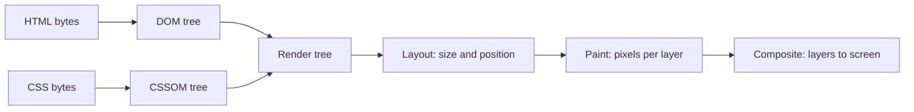
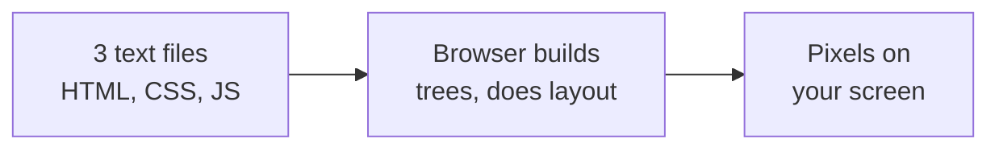
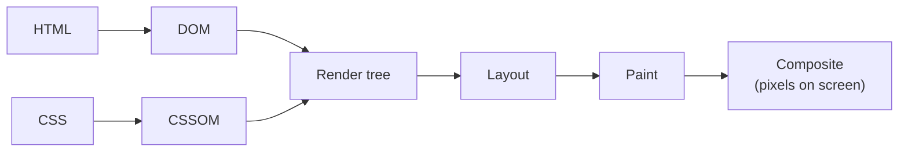
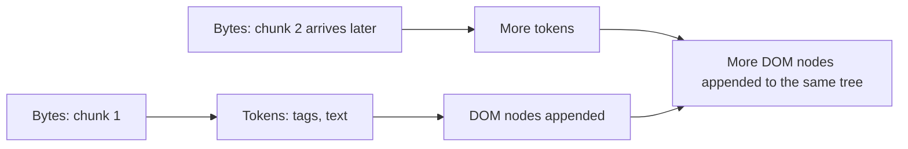
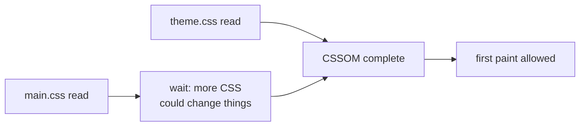
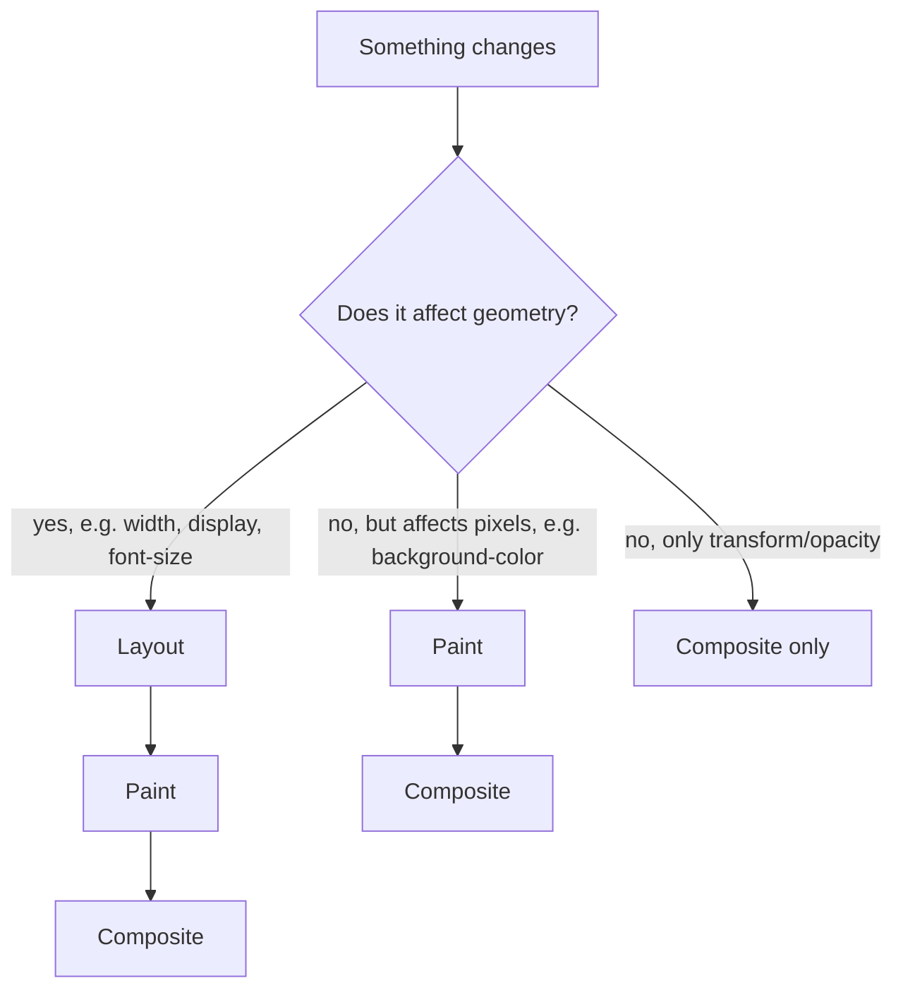
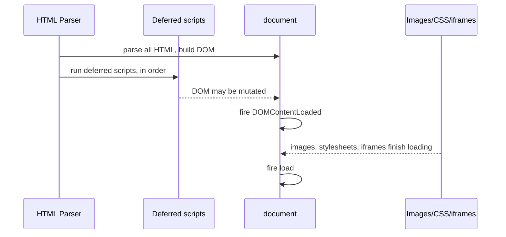

# How Browsers Load and Render a Page

> [!summary] TL;DR
> A browser turns an HTML response into pixels by building two trees (the **DOM** from HTML and the **CSSOM** from CSS), combining them into a **render tree**, then computing **layout** (where things sit) and **paint**+**composite** (how they look on screen). Scripts can block every one of these steps unless you tell the browser not to wait for them.

> [!abstract] Core idea
> - HTML becomes the DOM, CSS becomes the CSSOM; the browser can't paint anything until both exist.
> - A plain `<script>` tag stops HTML parsing dead; `defer` and `async` each remove a different part of that stall.
> - `defer` scripts run in order, after parsing, right before `DOMContentLoaded`. `async` scripts run the instant they finish downloading, in whatever order that happens, which can be mid-parse.
> - `DOMContentLoaded` fires once the DOM and deferred scripts are done; `load` waits for every image, stylesheet and iframe too.
> - You cut the critical path by shrinking or deferring what blocks the first paint, not by sprinkling `async` everywhere.

### Whiteboard version

A backend engineer who has never opened dev tools only needs this picture: the browser cannot draw a single pixel until it has read *all* of the HTML it has so far and *all* of the CSS, because any later CSS rule could still change how an earlier element looks.

Pixels only ever come out of the far end of this pipeline:



Everything below is what delays entry into, or progress through, this pipeline.

## Start here: the basics 🟢

> [!info] How to read this note (pick your level)
> - 🟢 **New to this?** Read "From zero" below, then sections 1, 2 and the cheat sheet (10). Stop there, that is a full first pass.
> - 🟡 **Know the basics?** Add section 3 (how it works) and 4 (worked example).
> - 🔴 **Interview / SDE-3 prep?** Add 7, 8 and 9. Headings are tagged 🟢🟡🔴 so you always know where you are.

> [!note] Before this note
> - [[HTTP Fundamentals - Methods, Status Codes, Headers, Cookies]]: the browser asks a server for a file with a request and gets it back in a response, and each request takes a trip over the network.

**From zero, in 60 seconds** 🟢

A web page arrives as three kinds of text files: HTML (what is on the page), CSS (how it looks), JavaScript (what it does). The browser cannot show text files — it has to turn them into pixels.

To do that, it builds structures first. HTML becomes a tree of elements (the **DOM**); CSS becomes a tree of style rules (the **CSSOM**). Only when both exist can the browser work out sizes and positions (**layout**) and finally colour in the pixels (paint).



One thing can jam the whole machine: a plain `<script>` tag makes the browser stop reading the HTML, download the script, run it, and only then continue.


The rest of this note is just these 3 questions:
1. What are the exact steps from bytes to pixels?
2. How do scripts block those steps, and what do `async`/`defer` change?
3. What do I remove or reorder to make the first paint happen sooner?

**The problem in one story.**
You type a URL and press Enter. A blank white screen sits there for a moment, then the page appears.
In that moment the browser downloaded text files, turned them into structures, worked out sizes and positions, and painted pixels.
If one slow script is in the way, the whole page waits. Knowing the steps tells you what to remove from the way.

**Words you need first**

| Word | Plain meaning | Tiny example |
| --- | --- | --- |
| HTML / CSS / JS | Structure / looks / behaviour of a page | `<h1>`, `color: red`, `onclick` |
| Parse | Read text and turn it into a structure the program can use | HTML text → tree of elements |
| DOM | The tree built from HTML | `<body>` with child `<div>`s |
| CSSOM | The tree of style rules built from CSS | "all `h1` are 32px" |
| Layout | Working out each box's size and position | Header is 1200×80 at the top |
| Paint | Filling in pixels: text, colours, images | Drawing the blue button |
| Render-blocking | Something the browser must finish before showing anything | A CSS file in `<head>` |
| `async` / `defer` | Script attributes that stop a script from pausing the HTML parser | `<script defer src="app.js">` |
| Render tree | DOM + CSSOM merged: only the things that will be visible, with their final style | a hidden menu is left out |
| Composite | Stacking the painted layers onto the screen in the right order | a popup layer put over the page |
| Round trip (RTT) | Time for one message to reach the server and the reply to come back | about 80 ms on a phone network |
| Critical rendering path | The steps that must finish before the first pixels show | HTML + CSS + any blocking script |
| Main thread | The one worker in the browser that parses, runs JS and does layout | a long script freezes clicks |
| Core Web Vitals | Google's three speed scores for real users: LCP, CLS, INP | "page showed its main image in 2 s" |

**Picture it**



**Analogy.** Building a page is like building flat-pack furniture: read the parts list (HTML), read the style guide (CSS), plan where every piece goes (layout), then paint and assemble (paint, composite).
Where it breaks: a carpenter can't start before the whole manual arrives; a browser parses HTML as it streams in and can show parts early.

**How the rest of this note builds up**

- First, why the pipeline exists and a mental model of it (sections 1-2).
- Then each stage: DOM, CSSOM, render tree, layout, paint, composite, script loading and `DOMContentLoaded` vs `load` (section 3).
- Then a worked page load, the critical rendering path, Core Web Vitals and the backend side (section 4).
- Finally variants, trade-offs, production practice and the deep dive, then interview questions (sections 5-9).

> [!tip] Remember
> HTML → DOM, CSS → CSSOM, then layout, paint, composite; anything that blocks those steps delays the first paint.

## 1. Why it exists 🟢

Say a page's HTML references a 40 KB stylesheet and ends with a `<script src="analytics.js">` tag with no attributes, on a connection with 100 ms **round-trip latency** (each request takes 100 ms to go to the server and come back).

Without any of the mechanisms below, the browser does this, strictly in order: download and parse enough HTML to discover the stylesheet → download the stylesheet (one round trip) → parse HTML up to the script tag → **stop parsing HTML entirely** → download the script (another round trip, since it is a separate request) → execute it → resume parsing the rest of the HTML.

Two sequential round trips plus a parser stall, before the user sees anything past that script tag.

For a 50 KB analytics script that has nothing to do with the page's content, that stall is pure waste: it exists only because the HTML parser, by the HTML specification's default behavior, must treat a script tag as "fetch and run it right now, synchronously, in document order."

This is why `<script>` has `async` and `defer` attributes, and why the critical rendering path is something you actively manage rather than something that just happens.

> [!tip] Remember
> A plain `<script>` tag is the one tag in HTML that can stop the parser dead in its tracks — everything else below exists to give you a way around that.

### Real-life example: opening a movie page 🟢

You tap a movie on BookMyShow's website.
The page title and poster appear first, because the HTML and main CSS arrive and are drawn early.
The chat widget and tracking scripts load in the background (`async`), so they never hold up the poster.
The "Book tickets" button's code is `defer`, so it runs right after the page is read, in a fixed order.
If a big analytics script were a plain `<script>` near the top, you would stare at a white screen until it finished downloading.

## 2. Mental model 🟢

Think of the browser as reading a recipe (HTML) out loud while a second person checks a binder of substitutions (CSS) at the same time.

The reader can't say whether "add the red sauce" really means red until the substitutions binder is fully checked, because a later page in the binder might override it.

So before any step of the recipe can be *performed* (laid out and shown), the binder has to be completely read.

A plain `<script>` tag is a recipe instruction that says "stop reading, go fetch and follow a side-note before continuing" — the side-note might rewrite the next few lines, so the reader can't skip ahead.

`defer` changes that instruction to "collect this side-note now, but follow it only after I finish the whole recipe, in the order I collected them." `async` changes it to "follow this side-note the instant it arrives, even if I'm mid-sentence."

This analogy breaks down in one place: a real recipe reader can glance ahead in the binder whenever they like, but the browser genuinely cannot show anything — not even the parts it has already read — until the binder (CSS) is fully checked. The withholding is total, not partial.

## Common beginner mistakes 🟢

- **Putting a plain `<script src>` in the `<head>`** → the browser stops reading the HTML until the script is downloaded and run → add `defer` (or move it to the end of `<body>`).
- **Moving CSS to the bottom "so the page shows faster"** → the browser still waits for all CSS before painting, so it shows later → keep CSS in `<head>` and make it small.
- **Adding `async` to every script** → scripts that depend on each other run in the wrong order → use `defer` for your own code, `async` only for independent extras like analytics.
- **Waiting for `load` to attach click handlers** → buttons stay dead until every image has loaded → use `DOMContentLoaded` (or `defer`).
- **Animating `width` or `top`** → the browser redoes layout and paint on every frame, which stutters → animate `transform` and `opacity` instead.

## Often confused 🟡

| These two | First one | Second one |
| --- | --- | --- |
| DOM vs render tree | Every element, including hidden ones | Only what will be drawn, with final styles |
| Layout vs paint | Works out sizes and positions | Fills in the pixels (colours, text, images) |
| `DOMContentLoaded` vs `load` | HTML read and deferred scripts run | Every image, stylesheet and iframe also finished |
| `preload` vs `prefetch` | Fetch now, this page needs it | Fetch later when idle, the next page may need it |

## 3. How it works 🟡

> 🟢 → 🟡 **You now know** the pipeline: HTML becomes the DOM, CSS becomes the CSSOM, then layout, paint and composite, and a plain script can stall it. **Next we open the box** and walk each stage, see exactly how `async` and `defer` change script timing, and learn which "ready" event to wait for.

### Parsing HTML into the DOM

**In plain words:** the browser reads HTML bytes as they arrive over the network, in a single pass, and keeps building a live tree of nodes as it goes — it doesn't wait for the whole file to download first.

**Step by step:**
1. The server starts sending `index.html`. The first chunk holds `<html><body><h1>Avengers</h1>`.
2. The browser cuts the text into **tokens** (small pieces: a start tag, some text, an end tag).
3. Each token becomes a node: an `h1` node with the text "Avengers", hung under `body`.
4. The next chunk arrives a moment later. Its nodes are added to the same tree.
5. The top of the page can be shown before the bottom has even arrived.

**Picture it:**



**Example:** a 2 MB article page sent at 1 MB/s takes about 2 seconds to fully arrive, but the browser has already built and can show the top third of the page — headline, nav, first paragraphs — after roughly the first 650 ms, because the parser works incrementally on whatever bytes have shown up so far.

**Why it matters:** this is why a slow backend response still lets users start reading the top of a long page instead of staring at a blank screen for the full 2 seconds.

### Building the CSSOM

**In plain words:** the browser refuses to paint anything until it has read ALL the CSS — because the very last rule in the very last file could still change the first element's colour.

**Step by step:**
1. The HTML head has `<link rel="stylesheet" href="main.css">` and `<link rel="stylesheet" href="theme.css">`.
2. `main.css` says `h1 { color: black; }`. The browser cannot paint the `h1` yet.
3. `theme.css` arrives and says `h1 { color: red; }`. That later rule wins.
4. Only now, with every stylesheet read, is the CSSOM complete and the `h1` known to be red.
5. Painting starts. Had it painted early, the heading would have flashed black, then red.



Before naming it, here's the problem: the browser needs to know the final, computed style of an element — its color, size, visibility — before it can draw even one pixel of it.

But CSS rules can come from several places (an external file, a `<style>` block, inline `style=""`), and a rule near the *end* of the last stylesheet can still override something that looked settled near the top.

The browser has no way to know it has seen the "final word" on an element's style until every stylesheet has been read in full.

This completed tree of parsed, cascaded rules is the **CSSOM** (CSS Object Model) — see [[CSS Fundamentals - Cascade, Selectors, Box Model]] for how a winning declaration is chosen among competing rules.

That is what makes CSS **render-blocking**: first paint never happens before the CSSOM is complete, no matter how far along the DOM is.

> [!warning] Common mistake
> Thinking "load CSS last so the page shows faster" helps. It does the opposite: the browser still won't paint anything until that last stylesheet is read, so moving CSS later only delays first paint further. The fix is to shrink or inline the CSS that matters for the first screen, not to defer it.

### Render tree, layout, paint, composite

**In plain words:** once both trees exist, the browser merges them into one **render tree** — one node per thing that is actually visible, each carrying its final computed style — and then runs three distinct passes to turn that tree into pixels on screen.

**Step by step:**
1. The DOM has a header, a hidden cookie banner (`display: none`) and a "Book" button. The render tree keeps only the header and the button.
2. **Layout:** on a 1200px-wide window the header gets 1200×80 at the top; the button gets 120×40 below it.
3. **Paint:** the browser fills in the header's background, the text, and the red button, onto layers.
4. **Composite:** the layers are stacked and sent to the screen.
5. Later you change the button's `background-color`: only paint and composite run again. You change its `width`: layout runs again too.

- **Layout** (also called reflow) walks the render tree and computes an exact box — x, y, width, height — for every node, given the **viewport** (visible window) size.
- **Paint** fills in each node's pixels: text, colors, borders, shadows, onto one or more layers.
- **Composite** merges those layers onto the screen in the right stacking order, which the **GPU** (the graphics chip) can often do without re-running layout or paint (for example, a `transform` or `opacity` change moves or fades an existing layer in place).

Nodes with `display: none` are left out of the render tree entirely (they have no box to lay out); `visibility: hidden` nodes stay in the tree and still take up space, they're just not painted.

**Picture it:**



**Example:** changing an element's `width` re-runs all three steps (layout, paint, composite) on every frame; changing only its `transform: translateX(...)` skips straight to composite.

On a typical laptop, a layout+paint+composite frame for a moderately complex page can take several milliseconds, while a composite-only frame takes a fraction of a millisecond — the difference between a smooth 60 fps (frames, meaning screen redraws, per second) animation and a **janky** (visibly stuttering) one.

**Why it matters:** this is the entire reason "animate `transform`/`opacity`, not `width`/`top`" is standard advice — it is a direct consequence of which of the three steps a property change actually requires.

> [!tip] Remember
> Geometry change → layout + paint + composite. Paint-only change → paint + composite. `transform`/`opacity` → composite alone.

### Script loading: normal, async, defer, module

**In plain words:** a `<script>` tag can be told, through an attribute, when it is allowed to run relative to the rest of the page's parsing — and that choice is what actually determines whether it slows down first paint.

**Step by step:**
1. The browser reads the HTML and reaches `<script src="app.js">`.
2. **No attribute:** it stops reading, downloads `app.js`, runs it, then carries on reading.
3. **`async`:** it keeps reading while `app.js` downloads, then pauses briefly to run it the moment it arrives, wherever the reader is.
4. **`defer`:** it keeps reading while `app.js` downloads, and runs it only after the whole HTML is read, in the order the scripts appear.
5. **`type="module"`:** behaves like `defer` by default.

**Picture it:**

```mermaid
gantt
    title HTML parsing vs. script download/execute (same script, three attributes)
    dateFormat  X
    axisFormat %s
    section Normal <script src>
    HTML parsing (before tag)   :a1, 0, 2
    Parser blocked: download    :crit, a2, 2, 5
    Parser blocked: execute     :crit, a3, 5, 6
    HTML parsing (resumes)      :a4, 6, 9
    section <script async>
    HTML parsing                :b1, 0, 9
    Download (parallel)         :b2, 2, 5
    Execute (parser pauses here):crit, b3, 5, 6
    section <script defer>
    HTML parsing                :c1, 0, 9
    Download (parallel)         :c2, 2, 5
    Execute (after parsing)     :c3, 9, 10
```

Reading the **gantt chart** (a timeline where each bar shows when a task starts and ends): all three download in parallel with parsing, so the download itself is never the differentiator. The real difference is **when execution is allowed to happen**, and that changes what the parser is doing around it:

| Attribute | Downloads | Executes | Order vs. other scripts | Parser state during execution |
| --- | --- | --- | --- | --- |
| (none) | blocks parsing to start | immediately after download | document order (trivially — it's synchronous) | blocked (parser literally paused at that tag) |
| `async` | parallel with parsing | the instant download finishes | not guaranteed; whichever finishes first runs first | paused only for the duration of that execution, which can land mid-token |
| `defer` | parallel with parsing | after parsing completes, before `DOMContentLoaded` | document order, always | not blocked at all during download; parsing never pauses for a deferred script |
| `type="module"` | parallel with parsing | after parsing, like `defer` (this is the default for modules) | document order, respecting static `import` graph (the map of which file imports which) | not blocked |

**Example:** a script tag at byte offset 2,000 that takes 3 seconds to download — plain `<script>` stalls the parser for the full 3 seconds; `async` lets parsing continue for those 3 seconds and only pauses for however long the script itself takes to run (often a few milliseconds); `defer` behaves the same as `async` for the download, but waits to execute until the parser has nothing left to parse.

**Why it matters:** "`async` blocks rendering less" is the wrong mental model — both `async` and `defer` get parallel downloads and don't block parsing *while downloading*.

The real trade a `defer` script makes for its guarantee (document order, runs after a complete DOM) is that it must wait for every other defer script and for parsing to fully finish.

The trade an `async` script makes for running the instant it's ready is giving up both ordering and the guarantee that parsing has finished — it can interrupt the parser mid-document, which is why async scripts must never assume elements below them in the HTML already exist.

Inline scripts (no `src`) ignore both `async` and `defer`: they always run immediately, in place, because there's nothing to "download" to defer.

> [!warning] Common mistake
> Putting `async` on every script "to be safe." An `async` script you depend on from another script can run in the wrong order relative to it — `async` gives you speed, not safety. Use `defer` as the default for your own application code, and reach for `async` only for scripts that are genuinely independent of everything else (analytics, ads).

### DOMContentLoaded vs. load

**In plain words:** the page fires two different "I'm ready" events, and they mean different things — one says the structure is usable, the other says every last resource has shown up.

**Step by step:**
1. A gallery page with 40 photos starts loading.
2. At about 300 ms the HTML is fully read and the deferred scripts have run. `DOMContentLoaded` fires; buttons can now get click handlers.
3. The photos keep downloading in the background.
4. At about 4 seconds the last photo arrives. `load` fires.
5. So code that only needs the page structure should wait for the first event, not the second.

**Picture it:**



- **`DOMContentLoaded`** fires once the HTML is fully parsed and all deferred (and module) scripts have run — it does **not** wait for images, stylesheets already applied, or **iframes** (a page embedded inside another page, like a YouTube player).
- **`load`** fires once everything the page references, including every image, has finished loading. On an image-heavy page, `load` can fire seconds after `DOMContentLoaded`.

**Example:** a photo gallery page with 40 high-resolution images might fire `DOMContentLoaded` at 300 ms (HTML parsed, no heavy JS) but `load` at 4 seconds (last image finally decoded). Code that only needs to attach click handlers to buttons should listen for `DOMContentLoaded`, not `load` — waiting for `load` there would delay interactivity by 3.7 seconds for no reason.

A plain inline `<script>` with no attributes that runs before images finish still runs before `DOMContentLoaded`, because it executes synchronously during parsing, not after.

> [!tip] Remember
> `DOMContentLoaded` = "the page's structure and scripts are ready." `load` = "literally everything, including every image, is ready." Pick the earlier one unless you specifically need the later one.

## 4. Worked example 🟡

Trace a real page load: `index.html` (critical, 8 KB), `styles.css` (critical, 30 KB), `app.js` (needs the DOM, not critical to first paint, 50 KB), `analytics.js` (independent of everything, 20 KB). Round-trip time: 80 ms. Bandwidth is generous enough that transfer time is dominated by round trips, not bytes.

| Step | Unoptimized (`<script>` for both) | Optimized (`defer` for app.js, `async` for analytics.js) |
| --- | --- | --- |
| 1 | Parse HTML until `<link rel="stylesheet">`, start CSS fetch | same |
| 2 | Parse continues to `<script src="app.js">`, **parser stops** | parser does not stop; `app.js` and `analytics.js` fetches start in the background |
| 3 | Fetch `app.js` (80 ms RTT), then execute it | CSS, `app.js`, `analytics.js` all download in parallel |
| 4 | Parser resumes, hits `<script src="analytics.js">`, stops again | parsing finishes; CSSOM is ready; first paint can happen |
| 5 | Fetch `analytics.js` (80 ms RTT), execute it | `app.js` runs (in order, after parsing) → `DOMContentLoaded` |
| 6 | Parser resumes, finishes, fires `DOMContentLoaded` | `analytics.js` runs whenever its download lands, independently |

The unoptimized path pays two serialized 80 ms round trips (160 ms) purely for parser stalls, on top of the CSS fetch; the optimized path overlaps all three downloads with parsing, so the extra cost of the two scripts is close to zero on the critical path.

This is the actual mechanism behind "defer/async make pages faster" — it's a story about overlapping network time with parsing time, not about the scripts becoming lighter.

> [!tip] Remember
> The win from `defer`/`async` is never "the script got smaller" — it's "the download stopped sharing the critical path with parsing."

### Critical rendering path and Core Web Vitals

**In plain words:** shrinking the critical path means shrinking or delaying whatever blocks first paint, and the browser gives you three hint tags to influence exactly when a resource's network request starts, each for a different situation.

| Hint | What it tells the browser | Starts | Typical use |
| --- | --- | --- | --- |
| `<link rel="preload">` | "This page needs this resource soon, fetch it now, at high priority" | immediately, before the parser would normally discover it | a font or hero image referenced only from CSS, which the parser can't see until CSS is parsed |
| `<link rel="preconnect">` | "Open the DNS/TLS connection (DNS finds the server's address; TLS sets up encryption) to this **origin** (a site address: scheme + domain + port) now, before I ask for anything from it" | immediately, connection setup only, no file transferred yet | a third-party origin (CDN, font host) you know you'll request from soon |
| `<link rel="prefetch">` | "The *next* page will probably need this, fetch it at low priority when idle" | only once the browser is otherwise idle on this page | the first chunk of a route the user is likely to click into next |

**Example — before/after on a page using a Google Font hosted on a different origin**, with a 80 ms round trip and a 150 ms DNS+TLS handshake to the font's origin:

| Step | No hints | `preconnect` only | `preconnect` + `preload` |
| --- | --- | --- | --- |
| 1 | Parse HTML, then CSS | same | same |
| 2 | Discover `@font-face` (the CSS rule that names a font file to download) URL inside the parsed CSS | same discovery point | font fetch starts immediately from the preload tag, before CSS is even parsed |
| 3 | Open connection to font origin: DNS + TLS (150 ms) | connection already warm — this step ran in parallel with parsing | connection already warm |
| 4 | Download font (80 ms round trip) | download (80 ms) | download (80 ms), already well underway |
| 5 | Font paints | font paints | font paints |
| **Elapsed to font paint** | **~300–400 ms** after navigation starts | **~150–250 ms** (saves ~150 ms) | **~50–150 ms** (saves ~200–250 ms total) |

Reading the table: `preconnect` removes step 3's 150 ms by moving it earlier, off the critical path; `preload` additionally removes the *discovery* delay in step 2, since the browser no longer waits to parse the CSS before it knows to fetch the font.

**Why it matters:** these hints only pay off because the browser would otherwise have discovered the resource *later* than it could have started fetching it; they do not make the resource itself smaller or the network faster.

> [!tip] Remember
> `preconnect` hides connection setup; `preload` additionally hides discovery. Stack both for a resource the CSS can't reveal until it's parsed.

Avoid `@import` in CSS: imported stylesheets download only after the importing one is parsed, serializing requests that `<link>` tags would have run in parallel — the opposite effect of everything above.

This feeds directly into **Core Web Vitals**: **LCP** (Largest Contentful Paint — when the biggest **above-the-fold** element, meaning visible without scrolling, is painted) is shortened by a shorter critical path; **CLS** (Cumulative Layout Shift) is caused by layout happening again after first paint, for example web fonts swapping in or images without a reserved `width`/`height`; **INP** (Interaction to Next Paint, which replaced FID, First Input Delay, in 2024) measures how long the main thread is busy — and the main thread is exactly what a synchronous script, or a long script execution during parsing, occupies.

> [!question] What happens if you preload too much?
> Preloading competes for the same limited early bandwidth and connection slots as the resources the browser would have fetched anyway. Preloading a dozen things "just in case" can push back the download of the one resource that actually blocks first paint — preload only what the *current* page's first paint genuinely needs.

### What's on the backend side

**In plain words:** none of the browser's work can start before the server sends the first byte — so server speed, compression and caching sit in front of everything in this note.

Nothing above starts until the first HTML bytes exist: TTFB (time to first byte) from the server, response compression, and `Cache-Control`/`ETag` headers (tell the browser how long it may reuse a saved copy, and how to check if it changed) for static assets all shift when this whole pipeline gets to begin.

HTTP/2 server push (the server sending files the browser has not asked for yet) was an attempt to start sending CSS/JS before the browser asked for it; Chrome disabled it by default in 2022 (Chrome 106) and other Chromium browsers followed, because it over-pushed resources the browser already had cached more often than it helped — `preload` headers achieve the same goal with the browser still in control of what it actually needs.

## 5. Variants and comparison 🟡

| Loading strategy | Downloads during parsing | Executes | Preserves order | Typical use |
| --- | --- | --- | --- | --- |
| `<script src="…">` (no attribute) | No — blocks parsing to fetch | immediately, blocking | yes (trivially) | legacy; avoid for anything non-trivial |
| `<script async src="…">` | yes | the instant it's ready | no | independent third-party scripts (analytics, ads) |
| `<script defer src="…">` | yes | after parsing, before `DOMContentLoaded` | yes | your app's own bundle |
| `<script type="module" src="…">` | yes | after parsing (deferred by default); `async` can be added | yes, per the static import graph | ES modules, modern app entry points |
| Inline `<script>` | n/a (already in the document) | immediately, in place | yes | small critical bootstrapping only |

## 6. Trade-offs and when not to use 🟡

- `async` trades ordering for speed-to-execute; never use it for a script another script depends on.
- `defer` is the right default for application code, but it still delays execution until parsing fully completes, so a tiny script that truly must run before anything else (feature detection that gates CSS) may need to stay inline instead.
- Preloading too many resources competes for the same limited early bandwidth and can *delay* the thing that actually matters most — preload only what blocks the current page's first paint.

## 7. In production 🔴

> 🟡 → 🔴 **You now know** every stage of the pipeline, how script attributes change timing, and how hints speed up fetches. **Next is the advanced part**: what real build tools emit, what breaks in production, how to measure real users, and browser internals like the preload scanner.

- **Real systems:** **bundlers** (tools that join and shrink many JS files into a few, like Vite and webpack) (Vite, webpack) emit `type="module"` entry points by default, which already behave like `defer`; CDNs commonly load third-party widgets (chat, analytics) with `async` because the page must not depend on them.
- **Failure modes → fixes:** a `defer` script that reads `document.currentScript` assuming it runs synchronously breaks — fix: don't rely on execution timing from inside a deferred script. A render-blocking web-font swap causing CLS — fix: `font-display: swap` with a matched fallback, or preload the font.
- **What to monitor:** LCP, CLS and INP from Real User Monitoring (RUM: measurements sent back from real visitors' browsers), not just lab tools, since they vary with real users' devices and networks.

## 8. Deep dive 🔴

- **Preload scanner:** modern browsers run a separate, fast "speculative" HTML scanner ahead of the main parser specifically to discover `<script>`, `<link>` and `` URLs early and start their network requests immediately, even though the main parser hasn't reached them yet — this is why download for a plain blocking script still often starts right away rather than only after the parser literally reaches the tag.

  ```mermaid
  sequenceDiagram
      participant Net as Network
      participant Scan as Preload scanner (fast, speculative)
      participant Main as Main HTML parser (slow, authoritative)

      Net->>Scan: raw HTML bytes
      Net->>Main: same raw HTML bytes
      Scan->>Net: request script/link/img URLs it spots ahead
      Main->>Main: builds DOM, node by node, more slowly
      Net-->>Main: responses arrive, often before Main even reaches that tag
  ```

- **Render-blocking CSS and the "flash of unstyled content":** since the CSSOM must be complete before render-tree construction, a browser never shows unstyled HTML the way old wisdom about "load CSS last" would produce — it holds first paint instead.
- **Layout thrashing:** reading a layout-dependent property (`offsetHeight`) immediately after writing a style forces a synchronous layout recalculation ("forced reflow") instead of letting the browser batch it; doing this in a loop (read, write, read, write) is "layout thrashing," a common cause of jank that profilers show as repeated purple "Layout" blocks.
- **Module scripts and the import graph:** a `type="module"` script and everything it statically `import`s are fetched in parallel (the module graph is resolved before execution), then executed in dependency order — a dynamic `import()` is a separate, lazy fetch that runs later, which is how route-based **code splitting** (cutting the app's JS into one chunk per page) defers downloading a page nobody has navigated to yet.

## 9. Interview questions 🔴

> [!question]- What's the actual difference between `async` and `defer`, not just "both load without blocking"?
> Both download in parallel with parsing. `async` executes the moment the download finishes, which can interrupt parsing mid-document and gives no ordering guarantee between scripts. `defer` always executes after parsing completes and always in document order. The difference is in execution timing and ordering, not in whether the network fetch blocks.

> [!question]- Trap: "Using `async` on every script tag is strictly faster, since it never blocks rendering." True or false?
> False. `async` scripts still pause the parser for the duration of their execution, exactly when they happen to finish — which can be mid-parse, at an unpredictable point, and in an unpredictable order relative to other scripts.
>
> It only removes the parser stall during *download*, which `defer` also removes. Using `async` on a script another script depends on also breaks correctness, not just timing.

> [!question]- Does `DOMContentLoaded` wait for images to load?
> No. It fires once the DOM is built and deferred/module scripts have run. Images, stylesheets already being applied, and iframes can still be loading; `load` is the event that waits for all of those.

> [!question]- Why is CSS render-blocking but images aren't?
> The browser cannot know an element's final computed style — and therefore cannot safely paint it — until every applicable CSS rule has been seen, since a later rule could override an earlier one.
>
> Images don't change layout semantics the same way once their box is sized (unless no width/height was reserved, which is a separate CLS problem), so the browser can paint around a missing image and fill it in when it arrives.

> [!question]- What causes layout (reflow) versus only paint versus only composite?
> Anything that changes an element's geometry (width, display, font-size, adding/removing nodes) triggers layout, then paint, then composite. Anything that changes only painted appearance (background-color, box-shadow) skips layout but repaints. Changing only `transform` or `opacity` can be handled entirely on the **compositor thread** (a separate worker that stacks layers, so it keeps going even when the main thread is busy), skipping both layout and paint — the reason those two properties are preferred for animation.

> [!question]- A page has a `<script type="module">` for its entry point. Does it need `defer` too?
> No. Module scripts are deferred by default per the HTML specification — they download in parallel and execute after parsing, in the order dictated by the static import graph. Adding `defer` explicitly is harmless but redundant; adding `async` to a module script is the one case where you'd opt back into async timing.

> [!question]- Why did HTTP/2 server push get removed from major browsers if it could start sending CSS/JS before the browser asked?
> In practice servers often pushed resources the browser already had cached or didn't need for this navigation, wasting bandwidth and sometimes slowing the page down. `Link: rel=preload` headers give the same "start this early" benefit while leaving the browser in control of what it actually fetches, which is why browsers moved to that instead.

## 10. Cheat sheet 🟢

- Pipeline: HTML → DOM, CSS → CSSOM, both → render tree → layout → paint → composite.
- CSS always blocks first paint; a plain `<script>` blocks parsing too.
- `defer`: parallel download, executes after parsing, preserves order. `async`: parallel download, executes the instant it's ready, no order guarantee.
- `type="module"` is deferred by default.
- `DOMContentLoaded` = DOM + deferred scripts done. `load` = everything, including images, done.
- `transform`/`opacity` changes can skip layout and paint entirely (compositor-only).
- `preconnect` warms up a connection early; `preload` starts the fetch itself early; `prefetch` is both of those, but for the *next* page, at low priority.
- LCP, CLS, INP are the Core Web Vitals this pipeline directly determines.
- HTTP/2 push is dead; use `preload`/`preconnect`/`prefetch` instead.

## Self-check 🟢🟡

> [!question]- Easy: what does the browser build from HTML, and what from CSS?
> The DOM from HTML, the CSSOM from CSS.

> [!question]- Easy: does a plain `<script src>` stop the browser from reading the rest of the HTML?
> Yes. It stops, downloads, runs the script, then carries on.

> [!question]- Easy: which fires first, `DOMContentLoaded` or `load`?
> `DOMContentLoaded`. `load` also waits for every image and iframe.

> [!question]- Medium: two scripts must run in order, `lib.js` then `app.js`. `async` or `defer`?
> `defer`. It keeps document order; `async` runs whichever finishes downloading first.

> [!question]- Medium: why is animating `transform` cheaper than animating `left`?
> `left` changes geometry, so layout and paint run every frame; `transform` needs only compositing.

> [!question]- Medium: a font file is named only inside your CSS. Which hint lets the browser start fetching it before the CSS is read?
> `<link rel="preload">` for the font (add `preconnect` too if it is on another origin).

## Links 🟢
- **Before this:** [[HTTP Fundamentals - Methods, Status Codes, Headers, Cookies]]
- **Next:** [[CSS Fundamentals - Cascade, Selectors, Box Model]]
- **Compare with:** [[JavaScript Async - Event Loop, Promises, async-await]]

### Watch on YouTube

- [How Browsers Render HTML — The Full Rendering Pipeline (Zero to Pro)](https://www.youtube.com/watch?v=fwVcbzFSnEw) · Code with Pushpa · full DOM/CSSOM/render-tree/layout/paint pipeline walkthrough
- [How Browsers Render Web Pages Explained / Critical Rendering Path Tutorial](https://www.youtube.com/watch?v=De7Go0qErrY) · freeplacementcourse  · interview-oriented recap of the critical rendering path
