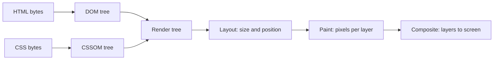
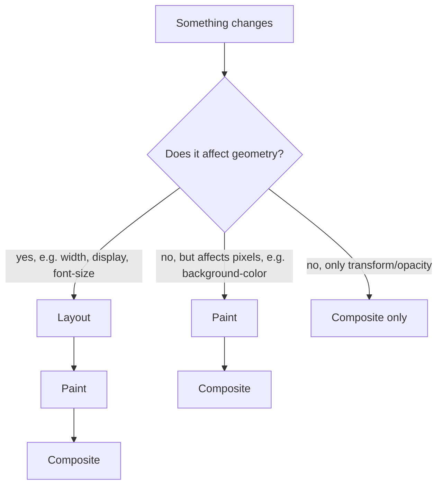
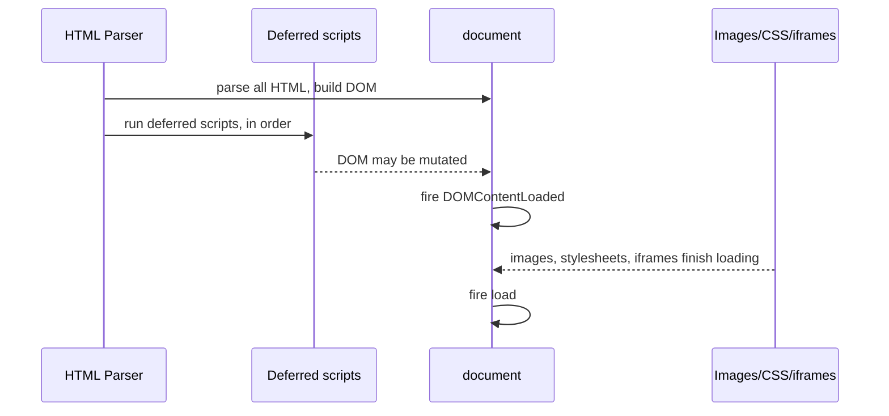

# How Browsers Load and Render a Page

> [!summary] TL;DR
> A browser turns an HTML response into pixels by building two trees (the **DOM** from HTML and the **CSSOM** from CSS), combining them into a **render tree**, then computing **layout** (where things sit) and **paint**+**composite** (how they look on screen). Scripts can block every one of these steps unless you tell the browser not to wait for them.

> [!abstract] Core idea
> - HTML becomes the DOM, CSS becomes the CSSOM; the browser can't paint anything until both exist.
> - A plain `<script>` tag stops HTML parsing dead; `defer` and `async` each remove a different part of that stall.
> - `defer` scripts run in order, after parsing, right before `DOMContentLoaded`. `async` scripts run the instant they finish downloading, in whatever order that happens, which can be mid-parse.
> - `DOMContentLoaded` fires once the DOM and deferred scripts are done; `load` waits for every image, stylesheet and iframe too.
> - You cut the critical path by shrinking or deferring what blocks the first paint, not by sprinkling `async` everywhere.

### Whiteboard version

A backend engineer who has never opened dev tools only needs this picture: the browser cannot draw a single pixel until it has read *all* of the HTML it has so far and *all* of the CSS, because any later CSS rule could still change how an earlier element looks. Pixels only ever come out of the far end of this pipeline:



Everything below is what delays entry into, or progress through, this pipeline.

## 1. Why it exists

Say a page's HTML references a 40 KB stylesheet and ends with a `<script src="analytics.js">` tag with no attributes, on a connection with 100 ms round-trip latency.

Without any of the mechanisms below, the browser does this, strictly in order: download and parse enough HTML to discover the stylesheet → download the stylesheet (one round trip) → parse HTML up to the script tag → **stop parsing HTML entirely** → download the script (another round trip, since it is a separate request) → execute it → resume parsing the rest of the HTML. Two sequential round trips plus a parser stall, before the user sees anything past that script tag. For a 50 KB analytics script that has nothing to do with the page's content, that stall is pure waste: it exists only because the HTML parser, by the HTML specification's default behavior, must treat a script tag as "fetch and run it right now, synchronously, in document order."

This is why `<script>` has `async` and `defer` attributes, and why the critical rendering path is something you actively manage rather than something that just happens.

## 2. Mental model

Think of the browser as reading a recipe (HTML) out loud while a second person checks a binder of substitutions (CSS) at the same time. The reader can't say whether "add the red sauce" really means red until the substitutions binder is fully checked, because a later page in the binder might override it. So before any step of the recipe can be *performed* (laid out and shown), the binder has to be completely read. A plain `<script>` tag is a recipe instruction that says "stop reading, go fetch and follow a side-note before continuing" — the side-note might rewrite the next few lines, so the reader can't skip ahead. `defer` changes that instruction to "collect this side-note now, but follow it only after I finish the whole recipe, in the order I collected them." `async` changes it to "follow this side-note the instant it arrives, even if I'm mid-sentence."

## 3. How it works

### Parsing HTML into the DOM

The HTML parser is a streaming tokenizer: it turns bytes into tokens (start tag, end tag, text, comment) and builds the DOM tree incrementally as bytes arrive, which is why a slow response still lets the browser render the top of a long page before the bottom has downloaded.

### Building the CSSOM

Every stylesheet — external, `<style>`, and (in effect) inline `style=""` — is parsed into the CSSOM: a tree of rules with computed selectors and cascade information (see [[CSS Fundamentals - Cascade, Selectors, Box Model]] for how a winning declaration is chosen). CSS is **render-blocking**: the browser does not know whether the first element on the page should be red or blue until it has seen every CSS rule that could apply to it, including a rule at the very end of the last stylesheet. So first paint never happens before the CSSOM is complete.

### Render tree, layout, paint, composite

The DOM and CSSOM are combined into a **render tree**: one node per visible element, each carrying its final computed style. Nodes with `display: none` are left out entirely (they have no box); `visibility: hidden` nodes stay in the tree and still take up space.

- **Layout** (also called reflow) walks the render tree and computes an exact box — x, y, width, height — for every node, given the viewport size.
- **Paint** fills in each node's pixels: text, colors, borders, shadows, onto one or more layers.
- **Composite** merges those layers onto the screen in the right stacking order, which the GPU can often do without re-running layout or paint (for example, a `transform` or `opacity` change moves or fades an existing layer in place).

Changing something that affects geometry (`width`, adding a DOM node, changing `font-size`) forces layout, then paint, then composite. Changing only a painted property (`background-color`, `box-shadow`) skips layout but still repaints. Changing only `transform` or `opacity` can skip both layout and paint — this is why those two properties are the cheap way to animate.



### Script loading: normal, async, defer, module

```mermaid
gantt
    title HTML parsing vs. script download/execute (same script, three attributes)
    dateFormat  X
    axisFormat %s
    section Normal <script src>
    HTML parsing (before tag)   :a1, 0, 2
    Parser blocked: download    :crit, a2, 2, 5
    Parser blocked: execute     :crit, a3, 5, 6
    HTML parsing (resumes)      :a4, 6, 9
    section <script async>
    HTML parsing                :b1, 0, 9
    Download (parallel)         :b2, 2, 5
    Execute (parser pauses here):crit, b3, 5, 6
    section <script defer>
    HTML parsing                :c1, 0, 9
    Download (parallel)         :c2, 2, 5
    Execute (after parsing)     :c3, 9, 10
```

Reading the gantt chart: all three download in parallel with parsing, so the download itself is never the differentiator. The real difference is **when execution is allowed to happen**, and that changes what the parser is doing around it:

| Attribute | Downloads | Executes | Order vs. other scripts | Parser state during execution |
| --- | --- | --- | --- | --- |
| (none) | blocks parsing to start | immediately after download | document order (trivially — it's synchronous) | blocked (parser literally paused at that tag) |
| `async` | parallel with parsing | the instant download finishes | not guaranteed; whichever finishes first runs first | paused only for the duration of that execution, which can land mid-token |
| `defer` | parallel with parsing | after parsing completes, before `DOMContentLoaded` | document order, always | not blocked at all during download; parsing never pauses for a deferred script |
| `type="module"` | parallel with parsing | after parsing, like `defer` (this is the default for modules) | document order, respecting static `import` graph | not blocked |

So "`async` blocks rendering less" is the wrong mental model — both `async` and `defer` get parallel downloads and don't block parsing *while downloading*. The real trade a `defer` script makes for its guarantee (document order, runs after a complete DOM) is that it must wait for every other defer script and for parsing to fully finish. The trade an `async` script makes for running the instant it's ready is giving up both ordering and the guarantee that parsing has finished — it can interrupt the parser mid-document, which is why async scripts must never assume elements below them in the HTML already exist.

Inline scripts (no `src`) ignore both `async` and `defer`: they always run immediately, in place, because there's nothing to "download" to defer.

### DOMContentLoaded vs. load



- **`DOMContentLoaded`** fires once the HTML is fully parsed and all deferred (and module) scripts have run — it does **not** wait for images, stylesheets already applied, or iframes.
- **`load`** fires once everything the page references, including every image, has finished loading. On an image-heavy page, `load` can fire seconds after `DOMContentLoaded`.

A plain inline `<script>` with no attributes that runs before images finish still runs before `DOMContentLoaded`, because it executes synchronously during parsing, not after.

## 4. Worked example

Trace a real page load: `index.html` (critical, 8 KB), `styles.css` (critical, 30 KB), `app.js` (needs the DOM, not critical to first paint, 50 KB), `analytics.js` (independent of everything, 20 KB). Round-trip time: 80 ms. Bandwidth is generous enough that transfer time is dominated by round trips, not bytes.

| Step | Unoptimized (`<script>` for both) | Optimized (`defer` for app.js, `async` for analytics.js) |
| --- | --- | --- |
| 1 | Parse HTML until `<link rel="stylesheet">`, start CSS fetch | same |
| 2 | Parse continues to `<script src="app.js">`, **parser stops** | parser does not stop; `app.js` and `analytics.js` fetches start in the background |
| 3 | Fetch `app.js` (80 ms RTT), then execute it | CSS, `app.js`, `analytics.js` all download in parallel |
| 4 | Parser resumes, hits `<script src="analytics.js">`, stops again | parsing finishes; CSSOM is ready; first paint can happen |
| 5 | Fetch `analytics.js` (80 ms RTT), execute it | `app.js` runs (in order, after parsing) → `DOMContentLoaded` |
| 6 | Parser resumes, finishes, fires `DOMContentLoaded` | `analytics.js` runs whenever its download lands, independently |

The unoptimized path pays two serialized 80 ms round trips (160 ms) purely for parser stalls, on top of the CSS fetch; the optimized path overlaps all three downloads with parsing, so the extra cost of the two scripts is close to zero on the critical path. This is the actual mechanism behind "defer/async make pages faster" — it's a story about overlapping network time with parsing time, not about the scripts becoming lighter.

### Critical rendering path and Core Web Vitals

Shrinking the critical path means shrinking or delaying whatever blocks first paint:
- Inline or `<link rel="preload">` the CSS needed for above-the-fold content; load the rest with `media="print"` tricks or split stylesheets.
- `<link rel="preconnect">` to a third-party origin before you need it, so DNS/TLS for that origin isn't on the path when the real request starts.
- `<link rel="prefetch">` a resource the *next* page will need, at low priority, during idle time on this one.
- Avoid `@import` in CSS: imported stylesheets download only after the importing one is parsed, serializing requests that `<link>` tags would have run in parallel.

This feeds directly into **Core Web Vitals**: **LCP** (Largest Contentful Paint — when the biggest above-the-fold element is painted) is shortened by a shorter critical path; **CLS** (Cumulative Layout Shift) is caused by layout happening again after first paint, for example web fonts swapping in or images without a reserved `width`/`height`; **INP** (Interaction to Next Paint, which replaced FID in 2024) measures how long the main thread is busy — and the main thread is exactly what a synchronous script, or a long script execution during parsing, occupies.

### What's on the backend side

Nothing above starts until the first HTML bytes exist: TTFB (time to first byte) from the server, response compression, and `Cache-Control`/`ETag` headers for static assets all shift when this whole pipeline gets to begin. HTTP/2 server push was an attempt to start sending CSS/JS before the browser asked for it; Chrome disabled it by default in 2022 (Chrome 106) and other Chromium browsers followed, because it over-pushed resources the browser already had cached more often than it helped — `preload` headers achieve the same goal with the browser still in control of what it actually needs.

## 5. Variants and comparison

| Loading strategy | Downloads during parsing | Executes | Preserves order | Typical use |
| --- | --- | --- | --- | --- |
| `<script src="…">` (no attribute) | No — blocks parsing to fetch | immediately, blocking | yes (trivially) | legacy; avoid for anything non-trivial |
| `<script async src="…">` | yes | the instant it's ready | no | independent third-party scripts (analytics, ads) |
| `<script defer src="…">` | yes | after parsing, before `DOMContentLoaded` | yes | your app's own bundle |
| `<script type="module" src="…">` | yes | after parsing (deferred by default); `async` can be added | yes, per the static import graph | ES modules, modern app entry points |
| Inline `<script>` | n/a (already in the document) | immediately, in place | yes | small critical bootstrapping only |

## 6. Trade-offs and when not to use

- `async` trades ordering for speed-to-execute; never use it for a script another script depends on.
- `defer` is the right default for application code, but it still delays execution until parsing fully completes, so a tiny script that truly must run before anything else (feature detection that gates CSS) may need to stay inline instead.
- Preloading too many resources competes for the same limited early bandwidth and can *delay* the thing that actually matters most — preload only what blocks the current page's first paint.

## 7. In production

- **Real systems:** bundlers (Vite, webpack) emit `type="module"` entry points by default, which already behave like `defer`; CDNs commonly load third-party widgets (chat, analytics) with `async` because the page must not depend on them.
- **Failure modes → fixes:** a `defer` script that reads `document.currentScript` assuming it runs synchronously breaks — fix: don't rely on execution timing from inside a deferred script. A render-blocking web-font swap causing CLS — fix: `font-display: swap` with a matched fallback, or preload the font.
- **What to monitor:** LCP, CLS and INP from Real User Monitoring (RUM), not just lab tools, since they vary with real users' devices and networks.

## 8. Deep dive

- **Preload scanner:** modern browsers run a separate, fast "speculative" HTML scanner ahead of the main parser specifically to discover `<script>`, `<link>` and `` URLs early and start their network requests immediately, even though the main parser hasn't reached them yet — this is why download for a plain blocking script still often starts right away rather than only after the parser literally reaches the tag.
- **Render-blocking CSS and the "flash of unstyled content":** since the CSSOM must be complete before render-tree construction, a browser never shows unstyled HTML the way old wisdom about "load CSS last" would produce — it holds first paint instead.
- **Layout thrashing:** reading a layout-dependent property (`offsetHeight`) immediately after writing a style forces a synchronous layout recalculation ("forced reflow") instead of letting the browser batch it; doing this in a loop (read, write, read, write) is "layout thrashing," a common cause of jank that profilers show as repeated purple "Layout" blocks.
- **Module scripts and the import graph:** a `type="module"` script and everything it statically `import`s are fetched in parallel (the module graph is resolved before execution), then executed in dependency order — a dynamic `import()` is a separate, lazy fetch that runs later, which is how route-based code splitting defers downloading a page nobody has navigated to yet.

## 9. Interview questions

> [!question]- What's the actual difference between `async` and `defer`, not just "both load without blocking"?
> Both download in parallel with parsing. `async` executes the moment the download finishes, which can interrupt parsing mid-document and gives no ordering guarantee between scripts. `defer` always executes after parsing completes and always in document order. The difference is in execution timing and ordering, not in whether the network fetch blocks.

> [!question]- Trap: "Using `async` on every script tag is strictly faster, since it never blocks rendering." True or false?
> False. `async` scripts still pause the parser for the duration of their execution, exactly when they happen to finish — which can be mid-parse, at an unpredictable point, and in an unpredictable order relative to other scripts. It only removes the parser stall during *download*, which `defer` also removes. Using `async` on a script another script depends on also breaks correctness, not just timing.

> [!question]- Does `DOMContentLoaded` wait for images to load?
> No. It fires once the DOM is built and deferred/module scripts have run. Images, stylesheets already being applied, and iframes can still be loading; `load` is the event that waits for all of those.

> [!question]- Why is CSS render-blocking but images aren't?
> The browser cannot know an element's final computed style — and therefore cannot safely paint it — until every applicable CSS rule has been seen, since a later rule could override an earlier one. Images don't change layout semantics the same way once their box is sized (unless no width/height was reserved, which is a separate CLS problem), so the browser can paint around a missing image and fill it in when it arrives.

> [!question]- What causes layout (reflow) versus only paint versus only composite?
> Anything that changes an element's geometry (width, display, font-size, adding/removing nodes) triggers layout, then paint, then composite. Anything that changes only painted appearance (background-color, box-shadow) skips layout but repaints. Changing only `transform` or `opacity` can be handled entirely on the compositor thread, skipping both layout and paint — the reason those two properties are preferred for animation.

> [!question]- A page has a `<script type="module">` for its entry point. Does it need `defer` too?
> No. Module scripts are deferred by default per the HTML specification — they download in parallel and execute after parsing, in the order dictated by the static import graph. Adding `defer` explicitly is harmless but redundant; adding `async` to a module script is the one case where you'd opt back into async timing.

> [!question]- Why did HTTP/2 server push get removed from major browsers if it could start sending CSS/JS before the browser asked?
> In practice servers often pushed resources the browser already had cached or didn't need for this navigation, wasting bandwidth and sometimes slowing the page down. `Link: rel=preload` headers give the same "start this early" benefit while leaving the browser in control of what it actually fetches, which is why browsers moved to that instead.

## 10. Cheat sheet

- Pipeline: HTML → DOM, CSS → CSSOM, both → render tree → layout → paint → composite.
- CSS always blocks first paint; a plain `<script>` blocks parsing too.
- `defer`: parallel download, executes after parsing, preserves order. `async`: parallel download, executes the instant it's ready, no order guarantee.
- `type="module"` is deferred by default.
- `DOMContentLoaded` = DOM + deferred scripts done. `load` = everything, including images, done.
- `transform`/`opacity` changes can skip layout and paint entirely (compositor-only).
- LCP, CLS, INP are the Core Web Vitals this pipeline directly determines.
- HTTP/2 push is dead; use `preload`/`preconnect`/`prefetch` instead.

## Links
- **Before this:** [[HTTP Fundamentals - Methods, Status Codes, Headers, Cookies]]
- **Next:** [[CSS Fundamentals - Cascade, Selectors, Box Model]]
- **Compare with:** [[JavaScript Async - Event Loop, Promises, async-await]]
