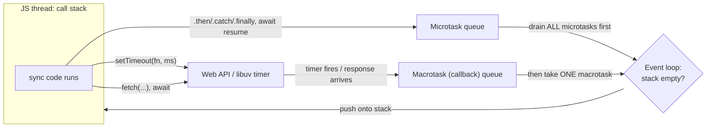
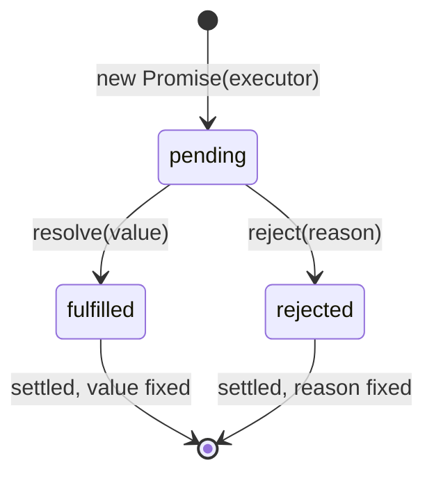

# JavaScript Async - Event Loop, Promises, async-await

> [!summary] TL;DR
> JavaScript runs on one thread with a **call stack**. Slow work (timers, network, file I/O) is handed to the browser or Node runtime, and when it finishes, the runtime queues a **callback** to run later. A **Promise** is an object that represents a value which isn't ready yet; `async`/`await` is syntax that lets you write Promise code as if it were sequential.

> [!abstract] Core idea
> - The call stack runs one thing at a time; it never blocks waiting for a timer or a network call.
> - Finished async work is queued, not run immediately: **microtasks** (Promise callbacks) always drain before the next **macrotask** (a `setTimeout` callback, an I/O event).
> - A Promise is `pending`, then settles exactly once to `fulfilled` or `rejected`.
> - `async`/`await` is sugar over `.then()` chains; it does not make code run in parallel.
> - Classic bugs: an unhandled rejection crashes a Node process; `await` inside a `for` loop runs one request at a time when they could all run together.

## 1. Why it exists

Say a page needs to fetch a user's profile and render it. A network call can take anywhere from 20 ms to several seconds. If JavaScript blocked the single thread while waiting, the whole page would freeze: no scrolling, no clicking, no other code running.

So the runtime (the browser, or Node's libuv) does the actual waiting outside of JavaScript. Your JavaScript function returns immediately, and a callback runs later, when the result is ready. Everything in this note is about **how "later" is scheduled**, and how `Promise` and `async`/`await` make that schedule easier to read and reason about than raw callbacks.

## 2. Mental model

Four pieces work together:

- **Call stack:** the frames of functions currently running. JavaScript can only run one frame at a time.
- **Web APIs / libuv:** where the runtime actually does the waiting — DOM timers, `fetch`, file reads. These live outside the single JS thread.
- **Callback queue (macrotask queue):** holds callbacks that are ready to run: a fired `setTimeout`, a finished `fetch`, a UI event.
- **Microtask queue:** holds `Promise` callbacks (`.then`, `.catch`, `.finally`) and `queueMicrotask` callbacks.

The **event loop** is a simple rule, repeated forever: *if the call stack is empty, first drain the entire microtask queue, then take one task from the macrotask queue, run it, and repeat.* Microtasks jump the line over `setTimeout` because the loop always fully empties the microtask queue before it is allowed to touch the next macrotask.

Analogy: the call stack is a single cashier. The macrotask queue is customers in the main line; the microtask queue is "quick questions" the cashier always finishes answering completely before calling the next customer in the main line, even if a new quick question arrives while answering one.

## 3. How it works



**Ordering puzzle**, the single most common interview question in this area:

```js
console.log("1: sync start");

setTimeout(() => console.log("2: setTimeout (macrotask)"), 0);

Promise.resolve()
  .then(() => console.log("3: promise.then (microtask)"));

queueMicrotask(() => console.log("4: queueMicrotask (microtask)"));

console.log("5: sync end");
```

**Measured output (Node.js v20.20.2):**

```text
1: sync start
5: sync end
3: promise.then (microtask)
4: queueMicrotask (microtask)
2: setTimeout (macrotask)
```

All synchronous code (1, 5) runs first because the stack must empty before anything else is considered. Then every microtask (3, 4) runs, in the order they were queued, before the engine even looks at the macrotask queue. Only then does the `setTimeout` callback (2) run — even though it was scheduled with a 0 ms delay, which means "as soon as possible", not "immediately".

### Promise states



A Promise starts `pending` and **settles exactly once**, to `fulfilled` with a value or `rejected` with a reason — never both, never again after that. `.then(onFulfilled, onRejected)` registers callbacks for either outcome; `.catch(fn)` is `.then(undefined, fn)`; `.finally(fn)` runs on either outcome and doesn't receive the value or reason.

Whatever a `.then` callback returns becomes the value the *next* `.then` in the chain receives — if it returns another Promise, the chain waits for that Promise too, which is how chaining composes async steps:

```js
fetch("https://api.example.com/user")
  .then((res) => res.json())       // returns a Promise; next .then waits for it
  .then((user) => console.log(user.name))
  .catch((err) => console.log("fetch or parsing failed:", err));
```

## 4. Worked example

### Whiteboard version

The bare mental model: `async` always wraps the return value in a Promise, and `await` suspends the function until that Promise settles, then resumes as a microtask.

```js
async function getUser() {
  const res = await fetch("/api/user"); // suspend here until the fetch settles
  return res.json();                    // still inside the same async function
}
```

Calling `getUser()` does not block anything else on the page; it returns a Promise immediately, and the two `await`-ed lines run only once their Promises settle.

### async/await as sugar over Promises

```js
async function getUser() {
  try {
    const res = await fetch("/api/user");
    if (!res.ok) throw new Error(`HTTP ${res.status}`); // fetch does NOT reject on 4xx/5xx
    return await res.json();
  } catch (error) {
    console.log("getUser failed:", error.message);
    throw error;
  }
}
```

This is exactly equivalent to:

```js
function getUser() {
  return fetch("/api/user")
    .then((res) => {
      if (!res.ok) throw new Error(`HTTP ${res.status}`);
      return res.json();
    })
    .catch((error) => {
      console.log("getUser failed:", error.message);
      throw error;
    });
}
```

`await` only pauses the `async` function it's written in; it never blocks the rest of the page. An `async` function's return value is always wrapped in a Promise, even if you `return 5` directly.

### Sequential awaits vs `Promise.all`

A common pitfall: `await` inside a loop runs requests one after another, even when they're independent.

```js
function delay(ms, val) {
  return new Promise((resolve) => setTimeout(() => resolve(val), ms));
}

// Pitfall: each await blocks the next iteration. Three 100ms calls take ~300ms.
async function sequential(ids) {
  const out = [];
  for (const id of ids) {
    out.push(await delay(100, id));
  }
  return out;
}

// Fix: start all the work first, then await together. ~100ms total.
async function parallel(ids) {
  return Promise.all(ids.map((id) => delay(100, id)));
}
```

**Measured (Node.js v20.20.2, 3 calls at 100 ms each):**

| Approach | Elapsed | Why |
| --- | --- | --- |
| `sequential` (await in a `for` loop) | 304 ms | each `delay` only starts after the previous one resolves |
| `parallel` (`Promise.all`) | 101 ms | all three timers start together; `await` just waits for the slowest |

Use the sequential form only when each step genuinely depends on the previous one's result (e.g. paginating until a cursor is empty). When the calls are independent, start them all and await together.

### Unhandled rejections

```js
function risky() {
  return Promise.reject(new Error("boom"));
}

risky(); // no .catch and no await: this becomes an unhandled rejection
```

**Measured (Node.js v20.20.2):** Node prints `UnhandledPromiseRejection` and, depending on configuration, can exit the process. A browser logs an `Unhandled promise rejection` console error. Fix it by adding `.catch(...)`, wrapping the `await` in `try/catch`, or (for triage only) a global `unhandledrejection` / `process.on('unhandledRejection', ...)` listener — the latter should log and alert, not silently swallow the error.

## 5. Variants and comparison

| Mechanism | How it works | Use when | Cost |
| --- | --- | --- | --- |
| Raw callback | Function passed in, called later by the runtime | Legacy APIs, very simple one-shot timers | Callback hell; no built-in error channel; easy to call twice or never |
| `Promise` + `.then` chain | An object that settles once; `.then` composes steps | Library code, conditional branching across async steps | Verbose nesting if overused; manageable with flat chains |
| `async`/`await` | Sugar over Promises; looks synchronous | Most application code | Easy to write that pitfall of sequential awaits by accident |
| `Promise.all` / `allSettled` / `race` / `any` | Combinators over multiple Promises | Running independent work concurrently | `all` rejects fast on the first failure; `allSettled` never rejects |
| Go goroutine + channel (compare) | OS-scheduled, truly parallel on multiple cores | Backend concurrency, not relevant in the browser | Needs explicit synchronization (channels, mutexes) |

> [!warning] Interview trap
> `fetch` only rejects on a network failure (DNS, offline, CORS). A `404` or `500` response is still a **fulfilled** Promise — you must check `res.ok` or `res.status` yourself and throw if it's not what you expect.

## 6. Trade-offs and when not to use

- `async`/`await` reads like sequential code, which makes it easy to forget that `await` inside a loop serializes work that could run concurrently — always ask "do these depend on each other?" before choosing a loop over `Promise.all`.
- `Promise.all` rejects as soon as any one input rejects, discarding the others' results; use `Promise.allSettled` when you need every outcome regardless of individual failures.
- None of this adds real parallelism on a single tab: JavaScript still runs on one thread. True parallel CPU work needs Web Workers (browser) or `worker_threads` (Node), not `async`/`await`.
- For a single, already-resolved value with no real waiting, a Promise is unnecessary overhead; just use the value directly.

## 7. In production

- **Real systems:** every browser fetch call, every Node HTTP handler using `async` route handlers (Express, Fastify), React's `useEffect` data-fetching pattern, and React Query / TanStack Query, which wrap this exact Promise lifecycle with caching and retries.
- **Failure modes → fixes:**
  - Unhandled rejection crashes a Node process → always `.catch` or `try/catch` around `await`; add a top-level handler as a safety net, not a substitute.
  - A stale response from an earlier request overwrites a newer one (race condition) → use `AbortController` to cancel the outdated `fetch`, or an "ignore flag" that drops late responses.
  - A `setTimeout`-based polling loop drifts or overlaps if the callback itself takes longer than the interval → use a recursive `setTimeout` that re-schedules only after the previous call finishes, instead of `setInterval`.
  - Sequential awaits in a loop silently slow down a page → batch with `Promise.all` where requests are independent.
- **What to monitor:** unhandled rejection counts (both window and Node process events), fetch error rates and status-code breakdown, p95 time-to-data for a page's critical fetch.

## 8. Deep dive

- **Macrotask vs microtask, precisely.** `setTimeout`, `setInterval`, UI events, and `fetch`'s network completion are macrotasks (one per event-loop turn). `Promise` callbacks, `queueMicrotask`, and (in Node) `process.nextTick` (which runs even before other microtasks) are microtasks, and the queue is drained completely — including any new microtasks a microtask callback itself queues — before the next macrotask runs. This is why a chain of ten `.then()` calls all run before a single `setTimeout(fn, 0)` scheduled before any of them.
- **Why `setTimeout(fn, 0)` isn't actually 0ms.** Browsers clamp nested timeouts to a minimum (historically 4ms after a few levels of nesting); Node applies its own minimum. "0" means "as soon as the event loop gets to it", after the stack and all microtasks.
- **Top-level await.** Since ES2022 (Node 14.8+ with ES modules, and natively in module `<script type="module">`), `await` is legal at the top level of a module, not only inside an `async function`. This lets a module block its own evaluation until a dependency resolves, which also means importers wait for it.
- **`for await...of`** iterates an async iterable (e.g. a streaming response body or `ReadableStream`), awaiting each chunk in turn — appropriate here because each chunk genuinely depends on the stream's current position.
- **Cancellation.** Promises have no built-in cancel; `AbortController`/`AbortSignal` is the standard pattern — pass `signal` to `fetch`, call `controller.abort()`, and the fetch's Promise rejects with an `AbortError`.
- **Compare with Go.** A goroutine is pre-emptible and can run on a different OS thread; the event loop model here is cooperative and single-threaded — a long synchronous loop (e.g. sorting a huge array) blocks everything, including timer callbacks, until it returns control to the stack. There's no event-loop equivalent of Go's scheduler moving work across cores.

## 9. Interview questions

> [!question]- Why does a `Promise.then` callback run before a `setTimeout(fn, 0)` scheduled earlier?
> Because `.then` callbacks are microtasks and `setTimeout` callbacks are macrotasks. The event loop always drains the entire microtask queue before it takes the next macrotask, regardless of scheduling order or the timeout value.

> [!question]- What's wrong with calling an async function inside `useEffect` like `useEffect(async () => {...}, [])`?
> `useEffect`'s callback must return either `undefined` or a cleanup function. An `async` function always returns a Promise, which React can't call as a cleanup function. Define the async logic as an inner function and call it, or use an IIFE, instead of making the effect callback itself `async`.

> [!question]- Does `fetch` reject when the server returns a 404 or 500?
> No. `fetch`'s Promise only rejects on a network-level failure (DNS failure, no connectivity, CORS). A 404 or 500 is a normal, fulfilled response — check `res.ok` (or `res.status`) and throw yourself if the status isn't acceptable.

> [!question]- You have three independent API calls inside a `for` loop with `await`. How do you speed it up?
> Start all three calls first (e.g. `ids.map(id => fetchOne(id))`, which returns an array of Promises started concurrently), then `await Promise.all(...)` on that array, instead of awaiting inside the loop body one at a time.

> [!question]- What happens to a rejected Promise that has no `.catch` and isn't awaited?
> It becomes an "unhandled rejection". Node logs it and, depending on version and flags, can terminate the process; a browser logs an `unhandledrejection` console warning. Always attach a `.catch` or wrap the `await` in `try/catch`.

> [!question]- Trap: is `async`/`await` making your code run in parallel?
> No. It's syntax sugar over Promises running on the same single JavaScript thread. It changes how the code reads, not how many things run at once; real concurrency for independent work still needs `Promise.all` (or, for CPU-bound work, a separate thread/worker).

> [!question]- What does an `async` function always return, even with `return 5`?
> A Promise. `return 5` inside an `async` function returns a Promise that immediately fulfills with `5`; the caller must still `await` it or `.then` it to get the value out.

## 10. Cheat sheet

- One call stack, one thread; slow work is delegated to the runtime (Web APIs / libuv), not run inline.
- Event loop rule: empty the call stack → drain **all** microtasks → run **one** macrotask → repeat.
- Microtasks (`Promise.then`, `queueMicrotask`) always beat macrotasks (`setTimeout`, I/O), regardless of delay value.
- A Promise is `pending`, then settles once to `fulfilled` or `rejected`, never both.
- `async`/`await` is sugar over `.then()`; `await` suspends only the current async function.
- `fetch` doesn't reject on 4xx/5xx — check `res.ok` yourself.
- Independent awaits: start them together and `Promise.all`, don't `await` one at a time in a loop.
- Always attach `.catch`/`try-catch`; an unhandled rejection can crash a Node process.

## Links

- **Before this:** [[DOM, Events and Timers]]
- **Next:** [[React Fundamentals - Components, JSX, Props, State]], [[React Hooks]] (`useEffect` cleanup races with this exact async lifecycle)
- **Compare with:** [[JavaScript Core - Types, Scope, Hoisting, Closures, this]], [[Goroutines and Channels]] (true OS-scheduled concurrency vs a single-threaded event loop)
