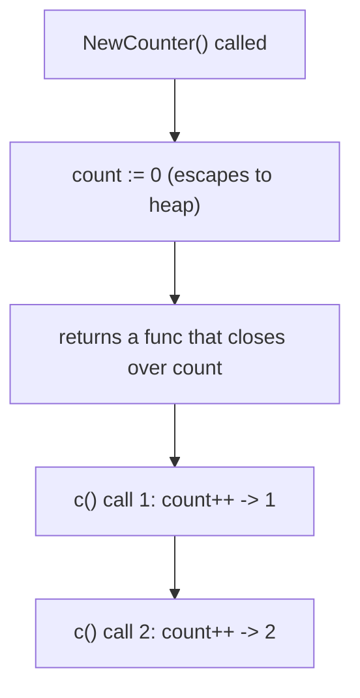
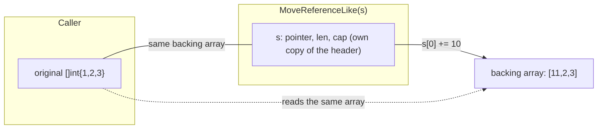

# JavaScript Core - Types, Scope, Hoisting, Closures, this - Go

> [!summary] TL;DR
> This note's Go code demonstrates, with real tests, the two JavaScript mechanisms that are easiest to get wrong on a whiteboard: how a closure captures a variable by reference (not by value), and how a "primitive-like" copy differs from a "reference-like" copy. See [[JavaScript Core - Types, Scope, Hoisting, Closures, this]] for the JavaScript side of each idea.

> [!info] How to read this note (pick your level)
> - 🟢 **New to this?** Read "From zero" below, then "Before the code" and "What this code shows". Stop there, that is a full first pass.
> - 🟡 **Know the basics?** Add the "Code" walkthrough and the "Tests" section.
> - 🔴 **Interview / SDE-3 prep?** Add "Design decisions", "Pitfalls" and the "Exercises". Headings are tagged 🟢🟡🔴 so you always know where you are.

> [!note] Before this note
> - Nothing. This note starts from zero. Reading the "From zero" part of [[JavaScript Core - Types, Scope, Hoisting, Closures, this]] first makes the JS side of each example clearer.

**From zero, in 60 seconds** 🟢

This file is the hands-on twin of the JavaScript Core theory note. In plain words: it uses small Go programs with real tests to prove two ideas people mix up. First, a **closure** — a function that keeps using a variable from the function that created it, even after that function returned; the counter here really shares one `count` across calls. Second, the copy question: copying a plain value (a struct, a JS number) gives you an independent copy, but copying a slice or a JS array only copies the handle — both handles still point at the same data. Read "Before the code" for the Go bits, then walk the four short steps. All code stays runnable as-is.

## Before the code 🟢

- **Closures** (`func() int { count++; ... }`): a **function literal** (a function written inline with no name) that uses a variable from the function around it and keeps it alive after that function returns.
- **Function types** (`func() int`, `[]func() int`): functions are values, so they can be returned and stored in slices.
- **Loop variables per iteration (Go 1.22+)**: each pass of a `for` loop gets a fresh `i`, so closures made in the loop see different values.
- **Structs are copied by value** (`Point`): passing one to a function hands over an independent copy.
- **Slices share their backing array** (the hidden array that actually holds the elements): copying a slice copies a small header, not the elements, so writes through the copy are visible to the caller.
- **What to run:** `go vet ./... && go test -race -v ./...` (`go vet` looks for likely mistakes; `-race` turns on the race detector, which catches two goroutines touching the same data at once) inside the module (with `go 1.22` or later in `go.mod`). No goroutines, interfaces or generics are needed here.

## What this code shows 🟢

| Go code | Implements the theory idea at | What it proves |
| --- | --- | --- |
| `NewCounter` | [[JavaScript Core - Types, Scope, Hoisting, Closures, this#Closures: counter, memoize, and the loop-capture bug]] | A closure keeps a live reference to a variable, so repeated calls see it grow |
| `CapturePerIteration` | [[JavaScript Core - Types, Scope, Hoisting, Closures, this#Closures: counter, memoize, and the loop-capture bug]] | Go 1.22+ gives each loop iteration its own copy of the loop variable — the same fix `let` gives JavaScript over `var` |
| `MovePrimitiveLike` | [[JavaScript Core - Types, Scope, Hoisting, Closures, this#Primitive vs reference types]] | A value-type copy (Go struct, JS primitive) is independent of the original |
| `MoveReferenceLike` | [[JavaScript Core - Types, Scope, Hoisting, Closures, this#Primitive vs reference types]] | A reference-type copy (Go slice header, JS object/array) shares the underlying data |

## Setup 🟢

- Go 1.24, no external dependencies.
- Module layout: a single package, `closures`, with its implementation and its tests side by side.
- To run it yourself: `go vet ./...` then `go test -race ./...` from the module root.

```text
jscoredemo/
└── closures/
    ├── closures.go
    └── closures_test.go
```

## Code 🟡

> 🟢 → 🟡 **You now know** the two ideas being proved: a closure shares one variable across calls, and some copies are independent while others share data. **Next we open the box** and read the four small Go functions, one idea each.

### Step 1: a closure that captures a counter by reference

**In plain words:** `NewCounter` builds a tiny machine with a hidden number inside. Every time you press the button (call the returned function), the same hidden number goes up by one.

**Concept.** This is the Go equivalent of JavaScript's `makeCounter()` from the theory note: a function returns another function, and that returned function keeps working with the *same* `count` variable across calls, because it was never copied — it was captured.

The alternative design would be to return `count`'s current value and make the caller track it themselves, but that would defeat the point: the whole value of a closure is that it hides the **mutable state** (data that changes over time) behind a function call instead of making every caller manage it.

**What this code does, in plain words:** `NewCounter` makes a variable `count` set to 0 and returns a small function. Each time you call that function, it adds 1 to the same `count` and gives back the new number.

```go
package closures

// NewCounter returns a closure that captures count by reference.
// Each call increments the SAME count variable, just like a JS closure
// returned from a function that captures an outer let/const.
func NewCounter() func() int {
	count := 0
	return func() int {
		count++
		return count
	}
}
```

**How it works.**
1. `count := 0` declares a local variable inside `NewCounter`'s scope.
2. The returned anonymous function reads and writes that same `count`, not a copy of it — in Go terms, the compiler detects that `count` is referenced by a function that outlives `NewCounter`'s return and allocates it on the **heap** (long-lived memory) instead of the **stack** (short-lived memory that is thrown away when a function returns) (this is called **escape analysis**), exactly so the closure can keep pointing at it.
3. Every call to the returned function (`c()`) increments the one shared `count` and returns the new value — mirroring how every call to the JS `counter()` sees the same growing `count`.



### Step 2: per-iteration capture (the loop-variable fix)

**In plain words:** three functions are made inside a loop, and each remembers its own `i` (0, 1, 2) — not one shared `i`. This is the modern fix for a classic bug both languages had.

**Concept.** This function exists to demonstrate a single, specific fact: as of Go 1.22, a `for` loop's index variable is a fresh variable on every iteration, not one variable reused and mutated in place.

Before Go 1.22, every closure created inside the loop body would have shared the *same* `i`, and all three would have read whatever `i` ended up being after the loop finished — identical to the pre-`let` JavaScript `var` bug shown in the theory note.

The alternative, had this still been the old behavior, would require manually **shadowing** (declaring a new variable with the same name in an inner scope) the variable inside the loop body (`i := i`) to force a fresh copy per iteration — a workaround you no longer need on modern Go.

**What this code does, in plain words:** it loops 3 times and, on each turn, saves a small function that returns that turn's `i`. It returns the 3 saved functions, which give back 0, 1 and 2.

```go
// CapturePerIteration mirrors the "closures in a loop" fix: since Go 1.22
// (and always true for JS `let`), each loop iteration gets its own copy of i,
// so every returned closure remembers a different value.
func CapturePerIteration() []func() int {
	var fns []func() int
	for i := 0; i < 3; i++ {
		fns = append(fns, func() int { return i })
	}
	return fns
}
```

**How it works.**
1. Each pass through the loop body gets its own `i`, scoped to that iteration (Go 1.22+ semantics).
2. The closure `func() int { return i }` captures *that* iteration's `i`, not a shared one.
3. Calling the three returned closures afterward yields `0`, `1`, `2` — each one remembers a different value, just like JavaScript's `let j` in a `for` loop.

### Step 3: primitive-like copies stay independent

**In plain words:** handing over a struct is like photocopying a page — scribble on the copy all you like, the original stays clean.

**Concept.** This models JavaScript's primitive assignment (`let b = a`), where copying a number, string or boolean gives you a fully independent value.

In Go, passing a `Point` (a plain struct of two `int`s) by value does the same thing: the function receives its own copy, and mutating that copy can never reach back and change the caller's original.

The alternative — passing `*Point` instead — would make it reference-like instead, which is exactly the point this test proves by *not* doing that.

**What this code does, in plain words:** it takes a `Point`, adds 10 to its `X`, and returns it. The caller's own `Point` is not changed, because the function got a copy.

```go
// Primitive-like value: a struct copy is independent, like a JS primitive
// assignment (number, string, boolean) copies the value.
type Point struct{ X, Y int }

func MovePrimitiveLike(p Point) Point {
	p.X += 10 // mutates the copy only
	return p
}
```

**How it works.**
1. `Point` passed by value: Go copies the whole struct onto `MovePrimitiveLike`'s own stack frame.
2. `p.X += 10` mutates that local copy only.
3. The caller's original `Point` is never touched — it's a completely separate copy, the same way `b = a; b = 10` leaves `a` alone for a JS number.

### Step 4: reference-like copies share the underlying data

**In plain words:** handing over a slice is like sharing a link to the same document — edits made through either link show up for both.

**Concept.** This models JavaScript's reference assignment (`let arr2 = arr1`), where both names end up pointing at the same underlying array.

A Go slice is a small header (pointer, length, capacity) that gets copied by value, but that header's pointer still points at the *same* backing array as the original slice — so mutating an element through either slice is visible through both, the same way `arr2.push(4)` is visible through `arr1`.

**What this code does, in plain words:** it adds 10 to the first number in the slice it is given. Because the slice shares its numbers with the caller's slice, the caller sees the change.

```go
// Reference-like value: a slice header is copied, but it shares the
// underlying array, like a JS object/array assignment copies the reference.
func MoveReferenceLike(s []int) {
	if len(s) > 0 {
		s[0] += 10 // mutates the shared backing array
	}
}
```

**How it works.**
1. The slice header (pointer + length + capacity) is copied into the parameter `s`, but the pointer inside it still points at the caller's backing array.
2. `s[0] += 10` writes through that shared pointer, into the one backing array both the caller's slice and `s` point at.
3. The caller sees the mutation after the call returns — the Go analogue of JS's "two array variables, one underlying array."



> [!example]- Full file: closures.go
> ```go
> package closures
>
> // NewCounter returns a closure that captures count by reference.
> // Each call increments the SAME count variable, just like a JS closure
> // returned from a function that captures an outer let/const.
> func NewCounter() func() int {
> 	count := 0
> 	return func() int {
> 		count++
> 		return count
> 	}
> }
>
> // CapturePerIteration mirrors the "closures in a loop" fix: since Go 1.22
> // (and always true for JS `let`), each loop iteration gets its own copy of i,
> // so every returned closure remembers a different value.
> func CapturePerIteration() []func() int {
> 	var fns []func() int
> 	for i := 0; i < 3; i++ {
> 		fns = append(fns, func() int { return i })
> 	}
> 	return fns
> }
>
> // Primitive-like value: a struct copy is independent, like a JS primitive
> // assignment (number, string, boolean) copies the value.
> type Point struct{ X, Y int }
>
> func MovePrimitiveLike(p Point) Point {
> 	p.X += 10 // mutates the copy only
> 	return p
> }
>
> // Reference-like value: a slice header is copied, but it shares the
> // underlying array, like a JS object/array assignment copies the reference.
> func MoveReferenceLike(s []int) {
> 	if len(s) > 0 {
> 		s[0] += 10 // mutates the shared backing array
> 	}
> }
> ```

## Design decisions 🔴

> 🟡 → 🔴 **You now know** what each function does and why it behaves that way. **Next is the advanced part**: the design choices behind the code, its hidden costs (heap allocation), version traps (Go 1.22), and exercises.

| Choice | Alternative | Trade-off |
| --- | --- | --- |
| Return a closure from `NewCounter` instead of an exported `*Counter` struct with a method | A `Counter` struct with an `Inc()` method | The closure hides state with no type to document or export; a struct is more idiomatic Go for anything beyond a single counter, but the closure form is the one that maps directly onto the JS pattern being illustrated |
| `CapturePerIteration` relies on Go 1.22+ loop **semantics** (rules for what the code means) rather than manually shadowing `i := i` | Keep the pre-1.22 `i := i` workaround for portability | The module declares `go 1.24` in `go.mod`, so the newer semantics are guaranteed; code meant to run on older Go **toolchains** (the installed Go compiler and tools) would need the manual shadow |
| `MovePrimitiveLike` takes and returns `Point` by value | Take `*Point` and mutate in place | Pass-by-value is what makes the "independent copy" property true and testable; a pointer parameter would turn this into the reference-like case instead |

## Tests 🟡

### TestNewCounterCapturesByReference

| Property it proves | Why it matters |
| --- | --- |
| Two calls to the same closure share one `count` and see it grow | This is the entire mechanism a closure exists to provide; if this failed, the closure would be creating a fresh `count` per call instead of capturing one |

| Call | Expected output |
| --- | --- |
| `c()` (1st call) | `1` |
| `c()` (2nd call) | `2` |

```go
func TestNewCounterCapturesByReference(t *testing.T) {
	c := NewCounter()
	if got := c(); got != 1 {
		t.Fatalf("got %d, want 1", got)
	}
	if got := c(); got != 2 {
		t.Fatalf("got %d, want 2 (same captured count)", got)
	}
}
```

A failure here (e.g. both calls returning `1`) would mean each call to `c()` is somehow getting a fresh `count` instead of sharing one — a broken closure.

### TestCapturePerIteration

| Property it proves | Why it matters |
| --- | --- |
| Each of the three closures returned from the loop remembers a different `i` | Confirms Go 1.22+ per-iteration loop variable semantics are actually in effect for this module |

| Input | Expected output |
| --- | --- |
| `fns[0]()` | `0` |
| `fns[1]()` | `1` |
| `fns[2]()` | `2` |

```go
func TestCapturePerIteration(t *testing.T) {
	fns := CapturePerIteration()
	want := []int{0, 1, 2}
	for i, f := range fns {
		if got := f(); got != want[i] {
			t.Fatalf("fns[%d]() = %d, want %d", i, got, want[i])
		}
	}
}
```

A failure where all three closures returned `3` would mean the module is somehow running under pre-1.22 loop semantics (or `go.mod` declares an older language version), reintroducing the classic shared-variable bug.

### TestPrimitiveLikeCopyIsIndependent

| Property it proves | Why it matters |
| --- | --- |
| Mutating the copy returned by `MovePrimitiveLike` never changes the original `Point` passed in | Confirms struct-by-value really does copy, the Go analogue of JS primitive assignment |

| Input | Expected output |
| --- | --- |
| `original.X` after calling `MovePrimitiveLike(original)` | still `1` (untouched) |
| `moved.X` (the function's return value) | `11` |

```go
func TestPrimitiveLikeCopyIsIndependent(t *testing.T) {
	original := Point{X: 1, Y: 1}
	moved := MovePrimitiveLike(original)
	if original.X != 1 {
		t.Fatalf("original.X = %d, want 1 (copy must not mutate original)", original.X)
	}
	if moved.X != 11 {
		t.Fatalf("moved.X = %d, want 11", moved.X)
	}
}
```

A failure where `original.X` became `11` would mean `Point` was somehow being passed by reference, not by value — the opposite of what this test exists to confirm.

### TestReferenceLikeSharesBackingArray

| Property it proves | Why it matters |
| --- | --- |
| Mutating an element through the parameter slice is visible on the caller's original slice | Confirms a slice shares its backing array across copies of its header, the Go analogue of JS object/array assignment |

| Input | Expected output |
| --- | --- |
| `original[0]` after calling `MoveReferenceLike(original)` | `11` (mutation is visible) |

```go
func TestReferenceLikeSharesBackingArray(t *testing.T) {
	original := []int{1, 2, 3}
	MoveReferenceLike(original)
	if original[0] != 11 {
		t.Fatalf("original[0] = %d, want 11 (slices share backing storage)", original[0])
	}
}
```

A failure where `original[0]` stayed `1` would mean the slice's backing array was somehow copied instead of shared — contradicting how Go slices actually work.

## Running it 🟢

```text
$ go vet ./...
$ go test -race ./... -v
```

**Measured output (Go 1.24.4, darwin/arm64, 2026-11-09):**

```text
=== RUN   TestNewCounterCapturesByReference
--- PASS: TestNewCounterCapturesByReference (0.00s)
=== RUN   TestCapturePerIteration
--- PASS: TestCapturePerIteration (0.00s)
=== RUN   TestPrimitiveLikeCopyIsIndependent
--- PASS: TestPrimitiveLikeCopyIsIndependent (0.00s)
=== RUN   TestReferenceLikeSharesBackingArray
--- PASS: TestReferenceLikeSharesBackingArray (0.00s)
PASS
ok  	jscoredemo/closures	1.854s
```

Reading it line by line: `go vet` printed nothing, meaning no suspicious constructs were found.

Each `--- PASS` line confirms one property held: the counter's shared state grew across calls, the per-iteration loop variables stayed independent, the struct copy stayed independent, and the slice mutation was shared.

The final `ok` line with `-race` enabled also confirms no data race was detected across any of the four tests — though none of these four functions touch shared memory from more than one goroutine, so this is a basic sanity check rather than a concurrency stress test.

## Pitfalls in the code 🔴

- `NewCounter`'s `count` escapes to the heap because the compiler can prove a reference to it outlives the call to `NewCounter` — this is normal and correct, but it's worth knowing that *every* Go closure capturing a local variable can force that variable onto the heap, which has a (usually negligible) allocation cost compared to a stack-only function.
- `CapturePerIteration` only behaves this way because the module's `go.mod` declares Go 1.22 or later. A module built with an older declared language version keeps the pre-1.22 shared-loop-variable behavior even on a newer `go` toolchain, since the fix is gated by the language version, not the installed compiler.
- `MoveReferenceLike` silently does nothing on an empty slice (`len(s) > 0` guards the write) rather than panicking — a deliberate choice here, but a caller who expects every call to mutate index 0 could be surprised by an empty slice being silently skipped.

## Exercises 🔴

1. Change `NewCounter` so it initializes `count` to `10` instead of `0`. Predict what `c()` and the second `c()` call return, then run the test to check.
2. Remove the Go-1.22 per-iteration guarantee by rewriting `CapturePerIteration` to declare `i` once before the loop with `var i int` and use `i++` inside the loop body instead of `for i := 0; ...`. Predict what all three closures now return, then run `TestCapturePerIteration` and see it fail with the old pre-1.22 bug reproduced.
3. Add a new function `MoveMapLike(m map[string]int)` that sets `m["x"] = 10`, plus a test that confirms the caller's original map sees the write — maps are reference-like in Go exactly like slices. Predict the result before writing the test.

## Self-check 🟢🟡

> [!question]- Easy: `c := NewCounter(); c(); c()`. What does the second call return?
> 2. Both calls share one `count`.

> [!question]- Easy: which Go value type behaves like a JS number when copied?
> A struct such as `Point`: copying it gives an independent copy.

> [!question]- Easy: which Go type behaves like a JS array when copied?
> A slice: the copy shares the same backing array.

> [!question]- Medium: why does `count` live on the heap and not the stack?
> The returned closure still uses it after `NewCounter` returns, so escape analysis moves it to the heap.

> [!question]- Medium: on Go 1.21, what would `CapturePerIteration` return when each function is called?
> 3, 3, 3. All closures shared one `i`, the same bug as JS `var`.

> [!question]- Medium: if `MovePrimitiveLike` took `*Point`, what would change?
> It would change the caller's `Point` too, turning it into the reference-like case.

## Links 🟢

- **Theory:** [[JavaScript Core - Types, Scope, Hoisting, Closures, this]]
