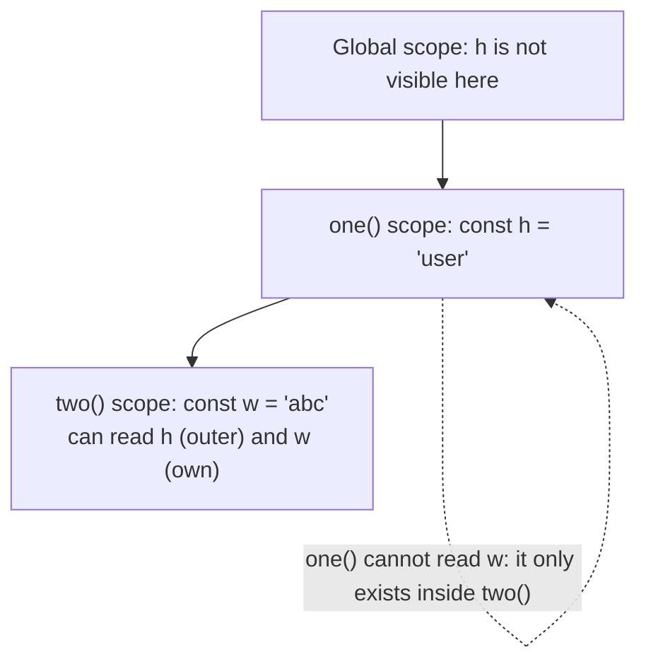
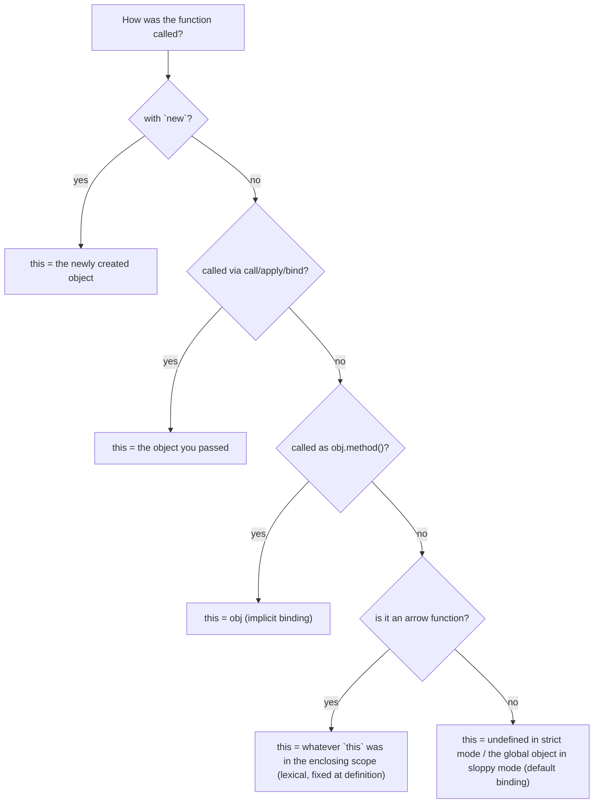

# JavaScript Core - Types, Scope, Hoisting, Closures, this

> [!summary] TL;DR
> JavaScript has two kinds of values — **primitives** (copied) and **references** (shared) — and three ways to declare a variable (`var`, `let`, `const`), each with different scope and hoisting rules. A **closure** is a function that keeps access to the variables of the scope it was created in, even after that scope has returned. `this` is not fixed by where a function is written; it depends on how the function is *called*.

> [!abstract] Core idea
> - Assigning a primitive copies a value; assigning an object, array or function copies a reference to the same thing.
> - `let` and `const` are block-scoped and sit in a **temporal dead zone** until their line runs; `var` is function-scoped and initialized to `undefined` early.
> - Every function remembers the scope chain of where it was *defined*, not where it is called — that's what makes a closure work.
> - `this` is decided at call time by one of five rules: default, implicit (method call), explicit (`call`/`apply`/`bind`), `new`, or lexical (arrow functions borrow `this` from where they were written).

## 1. Why it exists

JavaScript runs inside a browser tab (or Node) with no separate compile step for most of its life: a script loads, and the engine has to decide, line by line, what a name refers to and what each value is. That requirement shapes three design choices that still surprise people today:

- **Dynamic, weak typing.** A variable isn't tied to one type, so `let x = 5` can later hold a string. This gives flexibility for quick scripts but means type mistakes are allowed to run instead of surfacing at compile time — unlike Go, where `var x int` can never hold a string.
- **Three variable keywords instead of one.** `var` existed from 1995. `let` and `const` arrived in ES2015 (2015) specifically to fix two problems with `var`: it ignores block boundaries, and it provides no way to say "this name must not be reassigned."
- **`this` decided per call, not per function.** JavaScript functions are reusable as both plain functions and object methods. The same function body needs a different notion of "the current object" depending on how it is invoked — that is what the `this` binding rules exist to resolve.

Example: a shopping cart's `applyDiscount` function is a plain function in one file and a method on a `Cart` object in another. If `this` were fixed at definition time, one of those two uses would always be broken.

## 2. Mental model

Think of the JavaScript engine as one **call stack** (who is running what, right now) plus a **heap** (where objects, arrays and functions live). A variable is either:

- a **box holding a value directly** (primitive: number, string, boolean, `null`, `undefined`, `symbol`, `bigint`), or
- a **box holding an address**, pointing at something in the heap (reference: object, array, function).

Copying a primitive box copies the value inside it. Copying a reference box copies the address — both boxes now point at the same heap object.

Scope is a set of nested boxes-within-boxes: the global scope contains every top-level function's scope, which contains every block inside it. Looking up a variable walks outward through these boxes until it finds a match — that walk is the **scope chain**.

## 3. How it works

### Primitive vs reference types

JavaScript has exactly 7 primitive types plus `object` (which covers arrays and functions too):

| Primitive | Example | Notes |
| --- | --- | --- |
| `number` | `42`, `3.14` | One IEEE-754 double for every number; see "Deep dive" |
| `string` | `"hi"` | Immutable; every "mutating" method returns a new string |
| `boolean` | `true` | |
| `undefined` | `let x;` | The default value of an unassigned variable |
| `null` | `null` | An explicit "no value"; `typeof null === "object"` is a 1995 bug kept for compatibility |
| `symbol` | `Symbol("id")` | Every call to `Symbol()` produces a unique value, even with the same description |
| `bigint` | `10n` | Arbitrary-precision integers, suffixed with `n` |

There is no separate "default values" heading to memorize — `undefined` is simply what an uninitialized `let`/`var` holds, and the other types have no implicit default; you must assign them.

Assignment and function arguments **copy the value** for primitives and **copy the reference** for objects/arrays/functions:

```js
let a = 5;
let b = a;      // b gets a copy of 5
b = 10;
console.log(a); // 5 — untouched

const arr1 = [1, 2, 3];
const arr2 = arr1;  // arr2 gets the SAME reference
arr2.push(4);
console.log(arr1);  // [1, 2, 3, 4] — arr1 sees the mutation too
```

`const` freezes the **binding**, not the value: `const arr1 = [...]` means `arr1` can never point at a different array, but the array's contents can still change. Equality (`===`) on objects compares identity (same reference), not contents:

```js
console.log({ a: 1 } === { a: 1 }); // false — two different objects
console.log(Symbol("id") === Symbol("id")); // false — every symbol is unique
```

To copy an object instead of sharing it: `{ ...obj }` or `Object.assign({}, obj)` for a **shallow** copy (nested objects are still shared), or `structuredClone(obj)` for a **deep** copy. `Object.freeze(obj)` is also shallow — it stops reassigning the top-level keys, not mutating a nested object inside one of them.

One more size of primitive matters for correctness: `number` is a 64-bit float, so integers are only exact up to `Number.MAX_SAFE_INTEGER` (`2^53 − 1`). Past that, `9007199254740993 === 9007199254740992` is true because both round to the same float. Use `BigInt` (`123n`) when you need an exact integer larger than that.

### var vs let vs const, hoisting and the temporal dead zone

**Hoisting** means the engine scans a scope before running it and sets up its variables in advance. What "set up" means differs sharply by keyword:

| | Hoisted? | Initial value | Scope | Reassign | Redeclare |
| --- | --- | --- | --- | --- | --- |
| `var` | Yes | `undefined` | function | Yes | Yes |
| `let` | Yes (but see TDZ) | *none* — throws if read | block | Yes | No |
| `const` | Yes (but see TDZ) | *none* — throws if read | block | No | No |
| `function decl.` | Yes, whole body | the function itself | block (function-scoped in sloppy mode) | Yes | Yes |

```js
console.log(x); // undefined — var is hoisted and pre-initialized
var x = 5;

console.log(addOne(1)); // 2 — function declarations hoist their entire body
function addOne(n) { return n + 1; }
```

`let` and `const` are also hoisted — the engine knows they exist — but they are **not initialized**. The gap between the top of the scope and the line that declares them is the **temporal dead zone (TDZ)**. Reading the name anywhere in the TDZ throws, it does not silently return `undefined` and it does not silently work:

```js
console.log(y); // ReferenceError: Cannot access 'y' before initialization
let y = 5;

addTwo(5);                       // ReferenceError — addTwo is in its TDZ here
const addTwo = (n) => n + 2;
```

This is the single most common misreading of hoisting: people say "`let`/`const` are not hoisted", but they are — they just aren't initialized, so touching them early is a hard error instead of an `undefined`. `var`'s function scope is also a common bug source: a `var` declared inside an `if` block leaks into the whole function, while `let`/`const` stay confined to the block.

Assigning to a name with no declaration at all (`accountCity = "Jaipur"`) silently creates an **implicit global** in sloppy mode — it becomes a property of the global object, reachable from anywhere, and is a frequent source of bugs that only show up once two unrelated files happen to use the same name. **Strict mode** (`"use strict"`, automatic inside ES modules and `class` bodies) turns that same line into a `ReferenceError` instead, which is why "declare before you assign" is enforced rather than just recommended in modern code.

### Scope chain

Every function remembers the scope it was **defined** in, not the scope it is called from — this is called **lexical scoping**. A name lookup walks outward: block → enclosing function(s) → module/global, stopping at the first match. Scope nests in four layers: **global** (the whole script or, in a module, nothing automatically shared), **module** (each ES module file has its own top-level scope — nothing is global unless explicitly attached to `window`/`globalThis`), **function**, and **block** (`{ }`, including `if`/`for` bodies, for `let`/`const` only).



```js
function one() {
  const h = "user";
  function two() {
    const w = "abc";
    console.log(h); // "user" — found by walking out to one()'s scope
  }
  two();
  console.log(w); // ReferenceError: w is not defined — w never existed out here
}
one();
```

### Strings

Strings are an immutable primitive: every "mutating-looking" method (`slice`, `toUpperCase`, `replaceAll`, `trim`) returns a **new** string and leaves the original untouched.

```js
const name = "Priyanshu";
const city = "Delhi";
const message = `Hello ${name}, ${city} has ${message?.length ?? 0} chars`; // template literal
```

A gotcha worth knowing before you hit it: JavaScript strings are UTF-16, and `.length` counts 16-bit code units, not characters. An emoji outside the Basic Multilingual Plane is 2 code units:

```js
console.log("😀".length);        // 2, not 1
console.log([..."😀"].length);   // 1 — spread iterates by code point
```

Useful methods: `slice(start, end)` (negative indices count from the end; prefer it over `substring`, which swaps backwards args instead of erroring), `split`/`join`, `includes`, `padStart`, `trim`. For ordering strings for a user, use `localeCompare`, not `<`, which compares by raw code unit. Converting to/from numbers: `Number("42")` (strict; `Number("42px")` is `NaN`) vs `parseInt("42px", 10)` (parses a leading number; always pass the radix). This contrasts with Go, where a string is an immutable sequence of bytes, `len(s)` counts bytes (not runes), and you range over it to get one rune at a time.

## 4. Worked example

### Whiteboard version

A closure is just a function plus the variables it still remembers:

```js
function makeCounter() {
  let count = 0;
  return function () {
    count++;
    return count;
  };
}

const counter = makeCounter();
console.log(counter()); // 1
console.log(counter()); // 2 — same captured `count`, not a fresh one
```

`counter` keeps a live reference to `count` even though `makeCounter` already returned. That's the whole mechanism: nothing special happens at call time, the returned function simply never lost its scope chain.

### Closures: counter, memoize, and the loop-capture bug

```js
function memoize(fn) {
  const cache = new Map();
  return function (arg) {
    if (cache.has(arg)) return cache.get(arg);
    const result = fn(arg);
    cache.set(arg, result);
    return result;
  };
}

const slowSquare = (n) => { for (let i = 0; i < 1e6; i++); return n * n; };
const fastSquare = memoize(slowSquare);
fastSquare(5); // computes, caches
fastSquare(5); // returns the cached 25 instantly
```

The classic closure bug — and why `let` fixed it:

```js
// With var: all three callbacks share ONE i, which is 3 by the time they run.
for (var i = 0; i < 3; i++) {
  setTimeout(() => console.log(i), 0); // prints 3, 3, 3
}

// With let: each iteration gets its OWN i, captured independently.
for (let j = 0; j < 3; j++) {
  setTimeout(() => console.log(j), 0); // prints 0, 1, 2
}
```

Go's `for` loop had the identical bug until **Go 1.22**, which changed loop variables to be per-iteration by default — the same fix `let` gives JavaScript. The Go code below demonstrates both the closure mechanism and that per-iteration capture, tested on Go 1.24:

```go
package closures

// NewCounter returns a closure that captures count by reference.
// Each call increments the SAME count variable, just like a JS closure
// returned from a function that captures an outer let/const.
func NewCounter() func() int {
	count := 0
	return func() int {
		count++
		return count
	}
}

// CapturePerIteration mirrors the "closures in a loop" fix: since Go 1.22
// (and always true for JS `let`), each loop iteration gets its own copy of i,
// so every returned closure remembers a different value.
func CapturePerIteration() []func() int {
	var fns []func() int
	for i := 0; i < 3; i++ {
		fns = append(fns, func() int { return i })
	}
	return fns
}

// Primitive-like value: a struct copy is independent, like a JS primitive
// assignment (number, string, boolean) copies the value.
type Point struct{ X, Y int }

func MovePrimitiveLike(p Point) Point {
	p.X += 10 // mutates the copy only
	return p
}

// Reference-like value: a slice header is copied, but it shares the
// underlying array, like a JS object/array assignment copies the reference.
func MoveReferenceLike(s []int) {
	if len(s) > 0 {
		s[0] += 10 // mutates the shared backing array
	}
}
```

```go
package closures

import "testing"

func TestNewCounterCapturesByReference(t *testing.T) {
	c := NewCounter()
	if got := c(); got != 1 {
		t.Fatalf("got %d, want 1", got)
	}
	if got := c(); got != 2 {
		t.Fatalf("got %d, want 2 (same captured count)", got)
	}
}

func TestCapturePerIteration(t *testing.T) {
	fns := CapturePerIteration()
	want := []int{0, 1, 2}
	for i, f := range fns {
		if got := f(); got != want[i] {
			t.Fatalf("fns[%d]() = %d, want %d", i, got, want[i])
		}
	}
}

func TestPrimitiveLikeCopyIsIndependent(t *testing.T) {
	original := Point{X: 1, Y: 1}
	moved := MovePrimitiveLike(original)
	if original.X != 1 {
		t.Fatalf("original.X = %d, want 1 (copy must not mutate original)", original.X)
	}
	if moved.X != 11 {
		t.Fatalf("moved.X = %d, want 11", moved.X)
	}
}

func TestReferenceLikeSharesBackingArray(t *testing.T) {
	original := []int{1, 2, 3}
	MoveReferenceLike(original)
	if original[0] != 11 {
		t.Fatalf("original[0] = %d, want 11 (slices share backing storage)", original[0])
	}
}
```

**Measured:** `go vet ./...` reports no issues and `go test -race ./...` passes all 4 tests (Go 1.24.4, darwin/arm64, 2026-11-04).

### Functions and `this`

JavaScript has three ways to write a function, and they hoist differently:

```js
function addTwoNumbers(a, b) { return a + b; }          // declaration: hoisted whole
const multiply = function (a, b) { return a * b; };     // expression: name hoisted, value is not (TDZ with let/const)
const add = (a, b) => a + b;                             // arrow: implicit return for a single expression; needs `return` and braces otherwise

(function dbConnect() {        // IIFE: runs immediately, keeps its locals private
  console.log("connected");
})();
```

Parameters take **defaults** and a trailing **rest** parameter; arrow functions have no `arguments` object of their own (use rest instead):

```js
function charge(amount, currency = "INR", ...extraFees) { /* currency defaults if omitted; extraFees collects the rest */ }
const sum = (...nums) => nums.reduce((a, n) => a + n, 0); // arrows must use rest; `arguments` is not defined inside them
```

Functions are **first-class values** in JavaScript: they can be stored in a variable, passed as an argument (a **callback**) or returned from another function (making it a **higher-order function**, like `memoize` above). That's also why IIFEs mattered before ES modules (2015): a module gives every file its own private scope and exported names natively, so wrapping code in an IIFE "just to avoid leaking globals" is now mostly a legacy pattern. A **pure function** — same input always gives the same output, no mutation of anything outside itself — is easier to test and memoize than one with side effects (an API call, a DOM write, mutating an argument); most of the examples above (`add`, `Map`/`Filter`/`Reduce` below) are pure on purpose. Every function call pushes a frame onto the call stack; a function that calls itself (**recursion**) needs a base case or it overflows the stack — JavaScript has no built-in tail-call elimination in practice, so a deep recursive scan over a huge tree is usually rewritten as a loop.

`this` is resolved by **how a function is called**, using the first rule that matches:



```js
const jsUser = {
  name: "Hitesh",
  greet() { console.log(this.name); },       // implicit: this = jsUser
  greetArrow: () => console.log(this?.name), // lexical: this is NOT jsUser here
};
jsUser.greet();      // "Hitesh"
jsUser.greetArrow(); // undefined — the arrow captured `this` from the module scope, not jsUser

const loose = jsUser.greet;
loose();             // TypeError-ish: this is undefined in strict mode, so this.name throws

const bound = jsUser.greet.bind(jsUser);
bound();             // "Hitesh" — explicit binding wins
```

The owner's original mistake to avoid: `console.log(jsUser.greet())` logs `undefined` directly after printing `"Hitesh"` — not because `greet` failed, but because `greet` has no `return` statement, so it implicitly returns `undefined`, and `console.log` then prints that `undefined`.

## 5. Variants and comparison

| Option | How it works | Use when | Cost |
| --- | --- | --- | --- |
| `const` | Block-scoped, TDZ, binding cannot be reassigned | Your default choice for every declaration | None — prevents a class of bugs |
| `let` | Block-scoped, TDZ, reassignable | The variable's value genuinely changes (loop counters, accumulators) | None |
| `var` | Function-scoped, hoisted and pre-initialized to `undefined` | Legacy code only | Leaks across blocks; the loop-capture bug; redeclare hides mistakes |
| Function declaration | Hoisted with its whole body | A named function usable before its definition appears | None |
| Function expression / arrow | Hoisted as `undefined`/TDZ, not callable before the line runs | Callbacks, class fields, anything needing lexical `this` | Must be defined before use |

## 6. Trade-offs and when not to use

- `var` is never a feature you reach for anymore; it costs you block scoping and the TDZ safety net for no benefit.
- Lexical `this` in arrow functions is a problem, not a feature, when you *want* dynamic `this` — don't use an arrow for an object method you intend to call as `obj.method()`.
- Closures retain their whole enclosing scope, not just the variable they use; holding a large object in an outer scope that a long-lived closure captures can keep it from being garbage collected (see "Deep dive").
- Dynamic typing means a typo'd property name (`usr.naem`) is `undefined` at runtime instead of a compile error; TypeScript exists largely to put that check back.

## 7. In production

- **Real systems:** ESLint's `no-var` and `prefer-const` rules are standard in almost every production JS codebase; bundlers (esbuild, Vite, webpack) and transpilers (Babel, SWC) all assume `let`/`const` scoping when they rewrite code.
- **Failure modes → fixes:**
  - "Works in testing, breaks under load" closures holding references to large cached objects → scope the closure to only what it needs, or null out references when done.
  - A `TypeError: Cannot read properties of undefined` after passing a method as a callback (`setTimeout(obj.method, 0)`) → the implicit binding was lost; use `obj.method.bind(obj)` or an arrow wrapper `() => obj.method()`.
  - "`ReferenceError` only in production, not locally" from TDZ → usually a module load-order issue; check circular imports.
- **What to monitor:** linter CI failures on `no-var`/`eqeqeq`; bundle size growth from accidentally retained closures (profile with Chrome DevTools' heap snapshot, looking for detached scope chains).

## 8. Deep dive

- **Prototype chain.** Every object has an internal link (`[[Prototype]]`, exposed as `Object.getPrototypeOf(obj)`) to another object, forming a chain that ends at `Object.prototype` and then `null`. Property lookup walks this chain just like scope lookup walks the scope chain. `class` syntax is sugar over this: `class Dog {}` creates a constructor function whose `.prototype` instances delegate to.
- **Autoboxing.** `"a".toUpperCase()` works even though strings are primitives, because the engine temporarily wraps the primitive in a `String` object, calls the method, and discards the wrapper.
- **Number precision.** `number` is IEEE-754 double precision. Integers are exact up to `2^53 − 1` (`Number.MAX_SAFE_INTEGER`); beyond that, distinct integers can compare equal. `0.1 + 0.2 !== 0.3` for the same reason — neither value has an exact binary float representation.
- **GC and closures.** A closure keeps its entire enclosing lexical environment alive as long as the closure itself is reachable, not just the variables it references — V8 does scope-analysis optimizations to shrink this in common cases, but a closure captured inside a long-lived event listener is a classic memory-leak source.
- **Equality coercion.** `==` converts operands to a common type before comparing; `===` never converts. Memorize the two true surprises: `null == undefined` is `true` (but `null === undefined` is `false`), and `[] == false` is `true` (`[]` coerces to `""`, then to `0`). A sharper trap: relational operators (`<`, `>`, `>=`) coerce `null` straight to `0`, so `null >= 0` is `true`, while `==` special-cases `null` to compare equal only to `undefined`, so `null == 0` is `false` — two different coercion rules applied to the same value. Prefer `===` always and let `== null` be the one deliberate exception for "null or undefined".
- **Currying.** Splitting a multi-argument function into a chain of single-argument functions — `const add = (a) => (b) => a + b; add(2)(3)` — lets you fix some arguments early (`const add5 = add(5)`) and supply the rest later; useful for building specialized callbacks, but reach for it only when it actually simplifies the call site.

## 9. Interview questions

> [!question]- Why does `const x = 1; console.log(x);` on the next line throw if `x` was declared earlier in the same block with `let`?
> It's the temporal dead zone: `let`/`const` are hoisted (the engine knows the name exists) but not initialized until their declaration line runs. Reading the name before that line throws a `ReferenceError` — it never silently returns `undefined` and never silently "just works" the way `var` would.

> [!question]- What is the difference between a primitive and a reference type in an assignment?
> Assigning a primitive (`number`, `string`, `boolean`, `null`, `undefined`, `symbol`, `bigint`) copies the value — the two variables are independent afterward. Assigning an object, array or function copies a reference — both variables point at the same heap object, so mutating through one is visible through the other.

> [!question]- Trap: does `const arr = [1,2,3]; arr.push(4);` throw, since `arr` is `const`?
> No. `const` only freezes the *binding* — `arr` can never be reassigned to point at a different array — but the array's contents are still mutable. `arr.push(4)` mutates the same array `arr` already points to, which is allowed.

> [!question]- What does a closure capture: the value of a variable, or the variable itself?
> The variable itself (by reference), not a snapshot of its value at the time the closure was created. That's why `makeCounter()`'s returned function sees `count` grow across calls, and why the classic `var` loop-capture bug happens — all iterations shared one variable.

> [!question]- How does `this` get decided inside an arrow function versus a normal function?
> A normal function's `this` is set by how it's called (default, implicit via `obj.method()`, explicit via `call`/`apply`/`bind`, or the new object with `new`). An arrow function has no `this` of its own — it looks up `this` lexically, the same way it looks up any other variable, fixed to whatever `this` was where the arrow was written.

> [!question]- Why does `var` inside an `if` block leak outside the block, but `let` doesn't?
> `var` is function-scoped: it only respects function boundaries, so any `var` inside an `if`, `for`, or other block is hoisted to the top of the enclosing function. `let`/`const` are block-scoped: they stay confined to the nearest `{ }`.

> [!question]- What is `typeof null`, and why?
> `"object"`. It's a bug from the first JavaScript implementation in 1995 (values were tagged, and the tag for objects happened to be all zero bits, which is also how `null` was represented) that shipped too widely to ever fix without breaking the web.

## 10. Cheat sheet

- Primitive assignment copies the value; object/array/function assignment copies the reference.
- `const` by default, `let` when reassigned, never `var` in new code.
- `let`/`const` are hoisted but uninitialized (TDZ): reading them early throws, it doesn't silently work.
- `var` is function-scoped and pre-initialized to `undefined`; `let`/`const` are block-scoped.
- A closure keeps a live reference to its enclosing scope's variables, not a copy of their values.
- `this`: `new` > explicit (`call`/`apply`/`bind`) > implicit (`obj.method()`) > default; arrows ignore all of this and use lexical `this`.
- `===`/`==`: always prefer `===`; the only common safe use of `==` is `x == null` to catch both `null` and `undefined`.

## Links

- **Before this:** [[How Browsers Load and Render a Page]]
- **Next:** [[JavaScript Objects, Arrays and Iteration]], [[JavaScript Async - Event Loop, Promises, async-await]]
- **Compare with:** [[Syntax, Types and Control Flow]] (Go's static typing and fixed zero values vs JS's dynamic typing and `undefined`)
