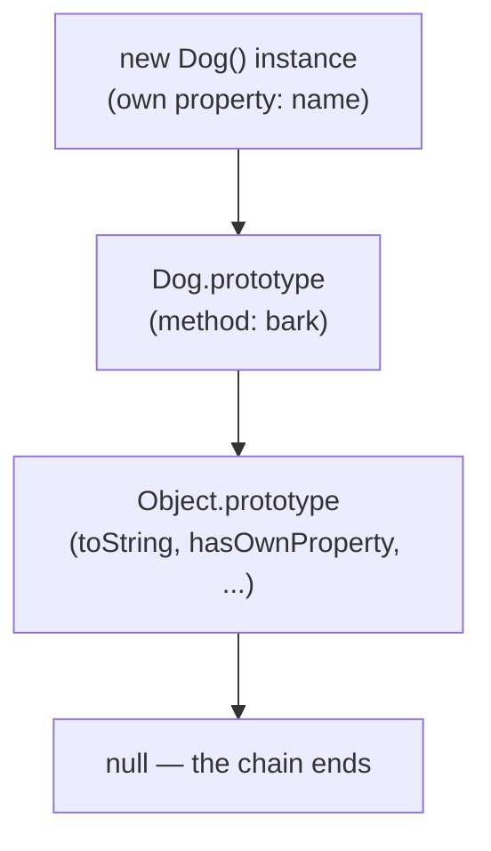
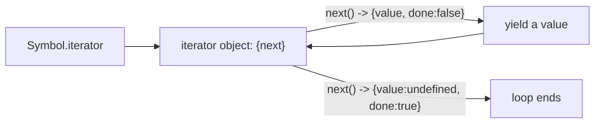
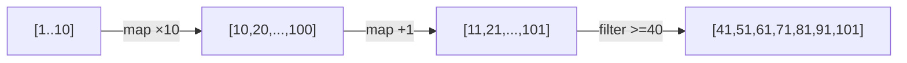

# JavaScript Objects, Arrays and Iteration

> [!summary] TL;DR
> Objects are key-value maps with a prototype chain; arrays are objects that are specialized for integer keys and carry a `length`. Most array methods either **mutate in place** or **return a new array** — knowing which is which, plus how to loop over either shape, is most of what you need day to day.

> [!abstract] Core idea
> - An object literal's keys can be read or written with `.dot` or `["bracket"]` notation; brackets are required for keys with spaces, computed names, and symbol keys.
> - Arrays are objects under the hood: `push`/`pop`/`splice`/`sort` mutate the original; `map`/`filter`/`slice`/`concat` return a new array and leave the original untouched.
> - `for...of` iterates values (arrays, strings, `Map`, `Set`); `for...in` iterates enumerable keys (plain objects); a plain object is not iterable with `for...of` at all.
> - `map`/`filter`/`reduce` chain into a readable pipeline, at the cost of one new array per step.

## 1. Why it exists

Programs need to model more than single values: a user has a name, an email and a login state together, and a list of orders needs to stay ordered and be searched, filtered and totalled. JavaScript gives you exactly two general-purpose shapes for this — the **object** (unordered key-value pairs) and the **array** (an ordered, integer-indexed list) — and a handful of ways to loop over either one.

A concrete case: a shopping cart is an array of `{ itemName, price }` objects. You need to add an item (`push`), remove one (`splice`), render only the ones in stock (`filter`), and get a total to show at checkout (`reduce`). All four are one-line array method calls once you know the shapes.

## 2. Mental model

An **object** is a labeled box of drawers: each drawer has a name (the key) and holds one value. A **array** is a special box of numbered drawers (`0`, `1`, `2`, …) that also keeps a running count of how many drawers are in use (`length`). Because an array *is* an object with numeric keys, every object operation (bracket access, `Object.keys`, `for...in`) technically works on an array too — but array methods exist because "ordered list of numbered items" has operations (`push`, `sort`, `map`) that an unordered bag of named drawers doesn't need.

## 3. How it works

### Objects: literals, access, and iteration

```js
const mySym = Symbol("key1");
const jsUser = {
  name: "Hitesh",
  "full name": "Hitesh Choudhary", // bracket-only key: contains a space
  [mySym]: "mykey",                // computed/symbol key: needs brackets to set AND read
  age: 18,
  greet() { return `Hello, ${this.name}`; }, // method shorthand; `this` = jsUser when called as jsUser.greet()
};

console.log(jsUser.name);          // dot notation
console.log(jsUser["full name"]);  // brackets: required, "full name" is not a valid identifier
console.log(jsUser[mySym]);        // brackets: required for any computed or symbol key
console.log(jsUser.greet());       // "Hello, Hitesh" — has a return, so it prints the string, not undefined
```

Optional chaining and nullish coalescing guard against missing data without a manual `if`:

```js
const city = jsUser.address?.city ?? "unknown"; // no address property: short-circuits to "unknown" instead of throwing
```

Iterating an object's own keys:

```js
for (const key in jsUser) {
  if (Object.hasOwn(jsUser, key)) console.log(key); // for...in also walks inherited keys; guard with hasOwn
}
for (const [key, value] of Object.entries(jsUser)) {
  console.log(key, ":-", value); // the usual way to loop key+value together
}
```

Destructuring, spread and shallow copy:

```js
const { name, age = 0, ...rest } = jsUser; // default for a missing key, `rest` collects what's left
const merged = { ...jsUser, email: "hitesh@example.com" }; // later keys win; this is a SHALLOW copy
```

`{ ...a, ...b }` and `Object.assign({}, a, b)` both copy only the top level: a nested object inside `a` is still shared by reference in the copy. For a true deep copy use `structuredClone(obj)`. `Object.freeze(obj)` is also shallow: it stops you reassigning `obj`'s own keys, but a nested object inside one of them can still be mutated.

A **getter**/**setter** looks like a plain property from the outside but runs code on read/write — useful for a computed or validated field without changing every call site:

```js
const account = {
  _balance: 0,
  get balance() { return this._balance; },           // read as account.balance, no ()
  set balance(v) { if (v >= 0) this._balance = v; },  // write as account.balance = 100, validated
};
```


`class` is syntax sugar over the same prototype mechanism objects already use:



A property lookup (`dogInstance.bark()`) checks the instance first, then walks this chain until it finds `bark` or reaches `null`. `Map` and `Set` exist alongside plain objects for cases a plain object handles badly: a `Map` accepts any key type (not just strings/symbols), preserves insertion order reliably, and has an O(1) `.size`; a plain object's keys are always coerced to strings, and `Object.keys(obj).length` is O(n) to compute.

### Arrays: creating, mutating vs non-mutating, and costs

```js
const empty = [];
const literal = [0, 1, 2, 3];
const fromIterable = Array.from("abc");  // ['a', 'b', 'c']
const sized = new Array(5);              // length 5, all holes — NOT five `undefined` values; avoid this constructor form
```

| Method | Mutates? | Returns | Typical cost |
| --- | --- | --- | --- |
| `push(x)` / `pop()` | yes | new length / removed item | O(1) |
| `unshift(x)` / `shift()` | yes | new length / removed item | O(n) — every other element re-indexes |
| `splice(i, n, ...items)` | yes | removed items | O(n) |
| `sort(cmp)` / `reverse()` | yes | the same array | O(n log n) / O(n) |
| `slice(a, b)` | no | new array | O(n) |
| `concat(...)` / `[...a, ...b]` | no | new array | O(n) |
| `map` / `filter` | no | new array | O(n) |
| `toSorted` / `toSpliced` (ES2023) | no | new array | O(n log n) / O(n) |

```js
const marvelHeros = ["thor", "ironman", "spiderman"];
const dcHeros = ["superman", "flash", "batman"];
const allHeros = [...marvelHeros, ...dcHeros];        // merge, non-mutating

const nested = [1, 2, [3, 4, [5, 6]]];
const flat = nested.flat(Infinity);                    // [1,2,3,4,5,6] — flatten any depth
```

`sort()` with no comparator sorts **lexicographically** (as strings), which is the single most-hit array bug in interviews:

```js
console.log([10, 2, 1].sort());              // [1, 10, 2] — "10" < "2" as strings
console.log([10, 2, 1].sort((a, b) => a - b)); // [1, 2, 10] — always pass a comparator for numbers
```

Searching: `indexOf`/`lastIndexOf` (strict equality, primitives only), `includes` (works with `NaN`, unlike `indexOf`), `find`/`findIndex` (first match by predicate), `at(-1)` (last element, no need for `arr[arr.length - 1]`).

Array destructuring pulls positional elements out by index, with its own defaults and a rest collector:

```js
const [first, second, ...rest] = [10, 20, 30, 40]; // first=10, second=20, rest=[30,40]
const [a = 1, b = 2] = [];                           // a=1, b=2 — defaults apply when the slot is missing
```

### Iteration: loops, for...of vs for...in, and the iterator protocol

```js
for (let i = 0; i <= 10; i++) { /* classic counting loop */ }

let i = 0;
while (i < 3) { i++; } // the condition variable must be declared and updated yourself

let score = 0;
do { score++; } while (score < 1); // body runs at least once, even if the condition starts false
```

`for...of` iterates **values** of anything iterable (arrays, strings, `Map`, `Set`); `for...in` iterates **enumerable keys**, including inherited ones, which is why it is normally used for plain objects and guarded with `Object.hasOwn`:

```js
const map = new Map([ ["IN", "India"], ["US", "United States"] ]);
for (const [key, value] of map) { /* "IN" "India", then "US" ... */ } // Map preserves insertion order and unique keys

for (const num of [1, 2, 3]) { /* for...of over an array: values */ }

const plainObject = { js: "javascript", cpp: "C++" };
// for (const x of plainObject) {}   // TypeError: plainObject is not iterable — plain objects don't implement Symbol.iterator
for (const key in plainObject) { /* "js", "cpp" — for...in over keys works */ }
```

`forEach` cannot `break` and silently ignores a returned/awaited promise — use a `for...of` with `break` or `for await...of` when either of those matters. Any of the `for` forms (but not `forEach`) support `break` (exit the loop entirely), `continue` (skip to the next iteration) and, for nested loops, a **label** to break or continue an outer loop by name:

```js
outer: for (const row of grid) {
  for (const cell of row) {
    if (cell === target) break outer; // exits BOTH loops, not just the inner one
  }
}
```



`for...of`, spreading (`[...iterable]`), and destructuring all work by calling `Symbol.iterator` on the right-hand side and pulling values from the returned iterator via `next()` until `done` is `true`. Generators (`function*`) are the easiest way to write a custom one.

### map / filter / reduce

```js
const books = [
  { title: "Book One", genre: "Fiction" },
  { title: "Book Three", genre: "History" },
  { title: "Book Seven", genre: "History" },
];
const historyBooks = books.filter((b) => b.genre === "History"); // returns only matches; never mutates books

const nums = [1, 2, 3, 4, 5, 6, 7, 8, 9, 10];
const result = nums
  .map((n) => n * 10)
  .map((n) => n + 1)
  .filter((n) => n >= 40);
```



Each arrow allocates a brand-new array — a 3-stage chain over `n` items does 3×n work and holds 2 intermediate arrays in memory before they're freed. `reduce` needs an initial value or it throws on an empty array:

```js
const shoppingCart = [
  { itemName: "js course", price: 2999 },
  { itemName: "py course", price: 999 },
];
const total = shoppingCart.reduce((acc, item) => acc + item.price, 0); // 0 is the required initial value
```

`map` differs from `forEach` in one way that trips people up: `map` **returns a new array** of the callback's results; `forEach` always returns `undefined` and exists only for its side effects. Related one-shot methods: `some`/`every` (boolean checks), `flatMap` (map then flatten one level).

## 4. Worked example

### Whiteboard version

The shopping-cart total, the simplest real use of `reduce`:

```js
const total = cart.reduce((sum, item) => sum + item.price, 0);
```

### Go comparison: generic map/filter/reduce helpers

JavaScript's array methods don't exist on Go slices, but Go generics (since 1.18) let you write the same three operations once and reuse them for any element type. Tested on Go 1.24:

```go
// Package mapfilter mirrors JavaScript's Array.prototype.map/filter/reduce
// using Go generics, to show the same idea with Go's standard library shape.
package mapfilter

// Map returns a new slice with f applied to every element, like Array.map.
// It never mutates in, matching JS's non-mutating map.
func Map[T, U any](in []T, f func(T) U) []U {
	out := make([]U, len(in))
	for i, v := range in {
		out[i] = f(v)
	}
	return out
}

// Filter returns a new slice with only the elements that satisfy pred,
// like Array.filter.
func Filter[T any](in []T, pred func(T) bool) []T {
	out := make([]T, 0, len(in))
	for _, v := range in {
		if pred(v) {
			out = append(out, v)
		}
	}
	return out
}

// Reduce folds in into a single value, like Array.reduce with an initial
// value. Go has no built-in equivalent to reduce-without-an-initial-value,
// which is also the case JS throws a TypeError for on an empty array.
func Reduce[T, A any](in []T, initial A, f func(acc A, cur T) A) A {
	acc := initial
	for _, v := range in {
		acc = f(acc, v)
	}
	return acc
}

type CartItem struct {
	Name  string
	Price int // paise, so a measured integer total has no float rounding
}

// CartTotal mirrors shoppingCart.reduce((acc, item) => acc + item.price, 0).
func CartTotal(items []CartItem) int {
	return Reduce(items, 0, func(acc int, it CartItem) int {
		return acc + it.Price
	})
}
```

```go
package mapfilter

import (
	"reflect"
	"testing"
)

func TestMapFilterChain(t *testing.T) {
	nums := []int{1, 2, 3, 4, 5, 6, 7, 8, 9, 10}
	times10 := Map(nums, func(n int) int { return n * 10 })
	plus1 := Map(times10, func(n int) int { return n + 1 })
	atLeast40 := Filter(plus1, func(n int) bool { return n >= 40 })

	want := []int{41, 51, 61, 71, 81, 91, 101}
	if !reflect.DeepEqual(atLeast40, want) {
		t.Fatalf("got %v, want %v", atLeast40, want)
	}
	// nums must be untouched: map/filter never mutate the input.
	if nums[0] != 1 {
		t.Fatalf("input slice was mutated: %v", nums)
	}
}

func TestCartTotal(t *testing.T) {
	items := []CartItem{
		{Name: "js course", Price: 2999},
		{Name: "py course", Price: 999},
		{Name: "mobile dev course", Price: 5999},
		{Name: "data science course", Price: 12999},
	}
	if got := CartTotal(items); got != 22996 {
		t.Fatalf("got %d, want 22996", got)
	}
}

func TestReduceSum(t *testing.T) {
	if got := Reduce([]int{1, 2, 3}, 0, func(a, c int) int { return a + c }); got != 6 {
		t.Fatalf("got %d, want 6", got)
	}
}
```

**Measured:** `go vet ./...` reports no issues and `go test -race ./...` passes all 3 tests (Go 1.24.4, darwin/arm64, 2026-11-04). The `[41,51,61,71,81,91,101]` result matches the mermaid pipeline diagram above exactly.

## 5. Variants and comparison

| Option | How it works | Use when | Cost |
| --- | --- | --- | --- |
| Plain object | Unordered string/symbol-keyed map with a prototype | Fixed, known shape (a record/struct) | Keys always coerced to string; O(n) `Object.keys` |
| `Map` | Ordered key-value store, any key type | Dynamic keys, frequent add/remove, need `.size` | Slightly more memory per entry than a plain object |
| Array | Ordered, integer-indexed list with `length` | Sequences you iterate, sort, or index numerically | `push`/`pop` O(1); `shift`/`unshift`/`splice` O(n) |
| `Set` | Unique-value collection, insertion-ordered | Deduplication, membership checks | O(1) average `has` |
| `for...of` | Pulls from the iterator protocol | Arrays, strings, `Map`, `Set`; need `break`/`await` | None beyond the iterator overhead |
| `for...in` | Walks enumerable keys, including inherited | Plain objects only, guarded by `Object.hasOwn` | Easy to misuse on arrays (iterates indices as strings, in arbitrary order for non-integer keys) |

## 6. Trade-offs and when not to use

- A `map`/`filter` chain is the most readable way to transform a list, but each stage allocates a full new array; for a single hot path over a huge array, one `for` loop doing everything at once avoids the intermediate allocations.
- `Object.freeze` and spread copies are shallow; relying on them for deep immutability is a common, hard-to-spot bug once objects nest two levels deep.
- `JSON.stringify`/`parse` drop or mangle things a plain object round-trip can't represent: `undefined` values and functions are omitted, `Date` becomes a string, `BigInt` throws.
- `for...in` on an array works but iterates string keys in implementation-defined order for non-index properties — never use it where you mean `for...of` or a classic indexed `for`.

## 7. In production

- **Real systems:** React and Redux rely on the "new array/object instead of mutate" pattern from `map`/`filter`/spread so they can detect changes by reference equality (`prevState === nextState` means "nothing changed") — see [[React State Management - Props, Context, Redux]].
- **Failure modes → fixes:**
  - A re-render loop or a missed update in a UI framework → usually an accidental in-place mutation (`arr.push(x)` then re-assigning the same reference) where the framework expected a new reference from `map`/spread.
  - `[10, 2, 1].sort()` silently misordering numeric data in a report → always pass a comparator for anything but strings.
  - A `TypeError: X is not iterable` in production logs → something tried `for...of` or spread on a plain object; fix with `Object.entries`/`Object.keys`.
- **What to monitor:** unexpected array growth from accidental closures retaining large arrays (see the Core note's closure section); JSON payload size when `Map`/`Set` get `JSON.stringify`'d (they serialize to `{}`, a frequent silent bug).

## 8. Deep dive

- **Prototype chain in practice.** `Object.keys`/`values`/`entries` only ever return **own** enumerable properties, never inherited ones — that's why they're usually safer than `for...in` for plain objects.
- **Sparse arrays.** `new Array(5)` and `delete arr[2]` both create **holes**: `map`/`forEach` skip holes entirely (they don't call the callback for them), while a `for` loop sees `undefined` at that index. `Array.from({ length: 5 })` fills holes with `undefined` instead, which is why it's preferred over `new Array(n)` when you need real values to iterate.
- **Map/Set vs object/array performance.** `Map` and `Set` are backed by hash tables with guaranteed insertion order and O(1) average add/lookup/delete, including when keys are added and removed repeatedly — a plain object used as a cache can degrade as V8 de-optimizes its internal representation after many shape changes.
- **Structural sharing.** Spread (`{ ...obj }`, `[...arr]`) only copies one level; this is why immutable-update libraries for nested state (Immer, Redux Toolkit) exist — they handle the "copy every level you change, share every level you don't" bookkeeping for you.

## 9. Interview questions

> [!question]- What's the difference between `map` and `forEach`?
> `map` returns a new array built from the callback's return values and never mutates the input; `forEach` always returns `undefined` and is used purely for its side effects. Chaining only works after `map` (`arr.map(...).filter(...)`), never after `forEach`.

> [!question]- Trap: what does `[10, 2, 1].sort()` return, and why?
> `[1, 10, 2]`. With no comparator, `sort()` converts every element to a string and compares lexicographically, so `"10"` sorts before `"2"`. Always pass a comparator (`(a, b) => a - b`) for numeric sorts.

> [!question]- Why does `for (const x of myPlainObject) {}` throw a `TypeError`?
> `for...of` calls `Symbol.iterator` on its target. Plain objects don't implement that protocol (arrays, strings, `Map` and `Set` do), so the object simply isn't iterable. Use `for...in`, or `Object.entries(obj)` with `for...of`.

> [!question]- `reduce` without an initial value throws on an empty array — why does that matter?
> `reduce` uses the first element as the accumulator if you omit the initial value, so an empty array has nothing to start from and throws a `TypeError`. Always pass an explicit initial value (`0` for a sum, `[]` for a collection) so the function is total over every input, including empty arrays.

> [!question]- Is `{ ...obj }` a deep copy?
> No, it's a shallow copy: top-level keys are copied, but any nested object or array inside `obj` is still the same reference in the copy. Mutating a nested value through the copy also changes the original. Use `structuredClone(obj)` for a real deep copy.

> [!question]- When would you reach for a `Map` instead of a plain object?
> When keys aren't strings/symbols you control (numbers, objects as keys), when you need guaranteed insertion order and a reliable `.size`, or when keys are added and removed often — a `Map` is built for that; a plain object used the same way can degrade in V8's internal object representation.

## 10. Cheat sheet

- `push`/`pop`/`splice`/`sort`/`reverse` mutate; `slice`/`concat`/`map`/`filter` return new arrays.
- `shift`/`unshift` are O(n); `push`/`pop` are O(1).
- `sort()` with no comparator is lexicographic — always pass one for numbers.
- `for...of` = values of an iterable; `for...in` = enumerable keys (objects, not arrays).
- A plain object is not iterable with `for...of`; convert first with `Object.entries`.
- `reduce` needs an initial value; omitting it throws on an empty array.
- Spread/`Object.assign`/`Object.freeze` are all shallow; use `structuredClone` for a deep copy.

## Links

- **Before this:** [[JavaScript Core - Types, Scope, Hoisting, Closures, this]]
- **Next:** [[DOM, Events and Timers]], [[JavaScript Async - Event Loop, Promises, async-await]]
- **Compare with:** [[Arrays, Slices and Maps (with internals)]] (Go's fixed-type, non-generic collections vs JS's dynamically typed ones)
