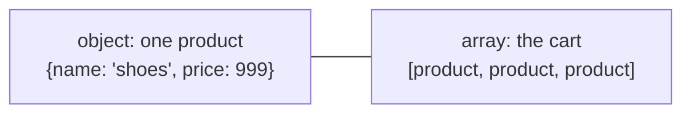
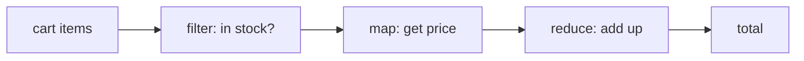
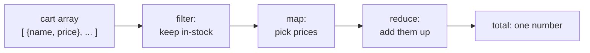
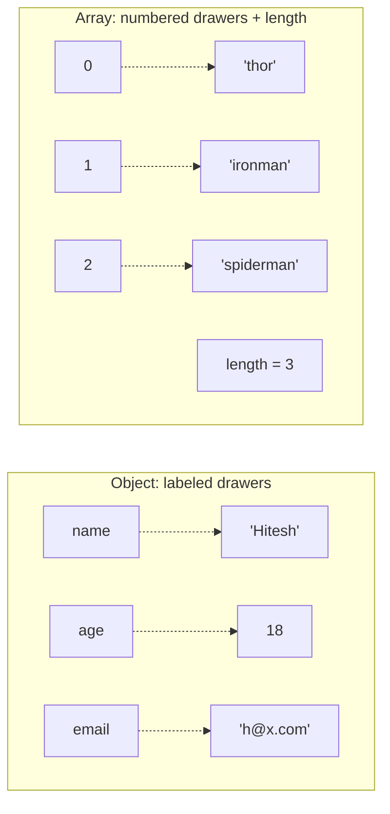
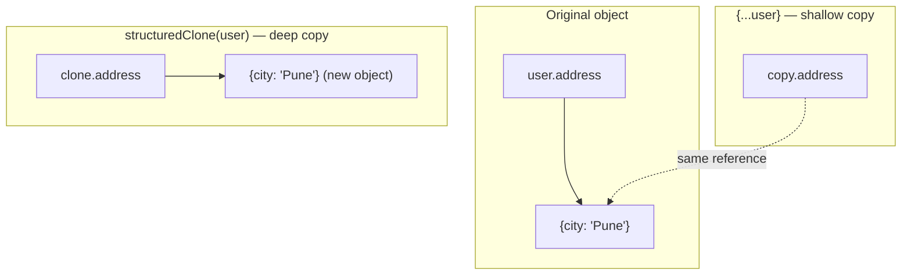
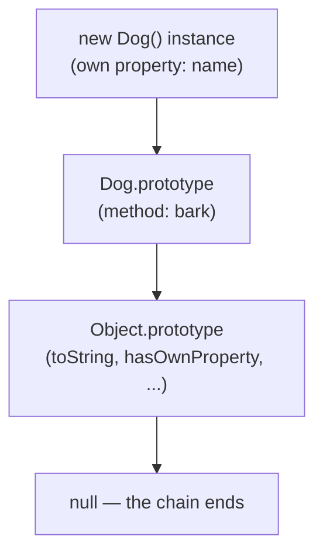
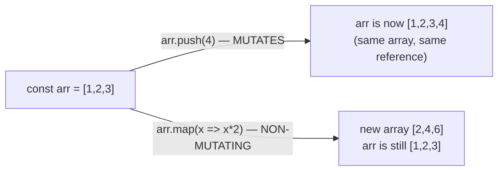
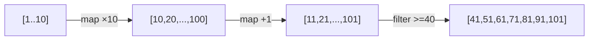
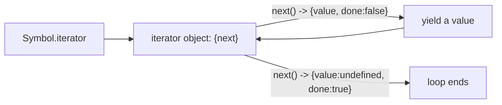

# JavaScript Objects, Arrays and Iteration

> [!summary] TL;DR
> Objects are key-value maps with a prototype chain; arrays are objects that are specialized for integer keys and carry a `length`. Most array methods either **mutate in place** or **return a new array** — knowing which is which, plus how to loop over either shape, is most of what you need day to day.

> [!abstract] Core idea
> - An object literal's keys can be read or written with `.dot` or `["bracket"]` notation; brackets are required for keys with spaces, computed names, and symbol keys.
> - Arrays are objects under the hood: `push`/`pop`/`splice`/`sort` mutate the original; `map`/`filter`/`slice`/`concat` return a new array and leave the original untouched.
> - `for...of` iterates values (arrays, strings, `Map`, `Set`); `for...in` iterates enumerable keys (plain objects); a plain object is not iterable with `for...of` at all.
> - `map`/`filter`/`reduce` chain into a readable pipeline, at the cost of one new array per step.

## Start here: the basics 🟢

> [!info] How to read this note (pick your level)
> - 🟢 **New to this?** Read "From zero" below, then sections 1, 2 and the cheat sheet (10). Stop there, that is a full first pass.
> - 🟡 **Know the basics?** Add section 3 (how it works) and 4 (worked example).
> - 🔴 **Interview / SDE-3 prep?** Add 7, 8 and 9. Headings are tagged 🟢🟡🔴 so you always know where you are.

**From zero, in 60 seconds** 🟢

Programs need to group data. An **object** groups named fields that belong together, like one product with a name and a price. An **array** is an ordered list of things, like the items in a shopping cart.



To work with a list you walk through it item by item. That walk is called **iterating**. JavaScript gives you loops for it, plus three shortcut methods: `map` (change every item), `filter` (keep some items), `reduce` (squash the list into one value).



One trap to know from day one: some methods change the original list, others quietly give you a new one. The rest of this note is just these 4 questions:
1. How do I store and read named fields (objects)?
2. How do I store and change a list (arrays), and which methods mutate?
3. How do `map`, `filter` and `reduce` work?
4. Which loop do I use for what?


**The problem in one story.**
You are building an online shop.
Each product has a name and a price that belong together.
The cart holds many products in the order the shopper added them.
At checkout you must show only in-stock items and add up the prices.
Objects hold "one thing with fields"; arrays hold "a list of things"; loops and array methods walk through them.

**Words you need first**

| Word | Plain meaning | Tiny example |
| --- | --- | --- |
| Value | Any piece of data JS can hold | `42`, `"hi"`, `true` |
| Key / property | A named slot inside an object | `user.name` |
| Index | The position number in an array, starting at 0 | `cart[0]` is the first item |
| Callback | A function you hand to another function to call for you | `nums.map(n => n * 2)` |
| Mutate | Change the original data in place | `arr.push(5)` changes `arr` |
| Iterate | Visit each item one at a time | `for (const x of arr) {...}` |
| Prototype | A backup object JS checks when a key is missing | `arr.map` comes from `Array.prototype` |

**Picture it**



**Analogy.** An object is a labelled filing cabinet (find a drawer by its name); an array is a numbered queue of people (find someone by position).
Where it breaks: a real queue cannot hold a gap, but a JS array can have holes, and an array is itself just an object with number-like keys.

**How the rest of this note builds up**

- First, why two shapes exist (section 1) and the mental model of drawers vs a numbered list (section 2).
- Then objects, arrays, mutating vs non-mutating methods, `map`/`filter`/`reduce`, and loops (section 3).
- Then a hand-traced cart pipeline (section 4) and comparisons with `Map`/`Set` (section 5).
- Finally the SDE-3 deep dive: trade-offs, production pitfalls and engine internals (sections 6-8).

> [!tip] Remember
> Objects are named fields, arrays are ordered lists; always know whether a method changes the original or returns a new one.

## 1. Why it exists 🟢

Programs need to model more than single values. A user has a name, an email and a login state together. A list of orders needs to stay ordered, and it needs to be searched, filtered and totalled.

JavaScript gives you exactly two general-purpose shapes for this.

- The **object**: unordered key-value pairs, for "a thing with named fields."
- The **array**: an ordered, integer-indexed list, for "a sequence of things."

A concrete case makes this real: a shopping cart is an array of `{ itemName, price }` objects. You need to add an item (`push`), remove one (`splice`), render only the ones in stock (`filter`), and get a total to show at checkout (`reduce`). All four are one-line array method calls once you know the shapes.

> [!tip] Remember
> Reach for an object when you have a fixed set of named fields. Reach for an array when you have an ordered sequence you'll loop over, sort, or index by position.

## 2. Mental model 🟢

An **object** is a labeled box of drawers: each drawer has a name (the key) and holds one value. You open a drawer by its label, not by its position.

An **array** is a special box of numbered drawers (`0`, `1`, `2`, …) that also keeps a running count of how many drawers are in use, called `length`.



Because an array *is* an object with numeric keys, every plain-object operation (bracket access, `Object.keys`, `for...in`) technically still works on an array. Array-specific methods (`push`, `sort`, `map`) exist on top of that, because "an ordered list of numbered items" needs operations that an unordered bag of named drawers never does.

> [!warning] Common mistake
> Treating an array like a general bag of named properties (`arr.total = 5`) works — JavaScript won't stop you — but it's invisible to `length`, `for...of`, and every array method. If you need named fields, use an object; don't bolt extra properties onto an array.

> [!tip] Remember
> An array is just an object that happens to use numbers as keys and tracks how many of them are "in use."

## 3. How it works 🟡

### Objects: literals, access, and iteration

**In plain words:** An object literal is written with `{ }`. Inside, each entry is a key and a value, separated by `:`. Most of the time you read and write a key with `.dot` notation; a few key shapes force you to use `["bracket"]` notation instead.

```js
const mySym = Symbol("key1");
const jsUser = {
  name: "Hitesh",
  "full name": "Hitesh Choudhary", // bracket-only key: contains a space
  [mySym]: "mykey",                // computed/symbol key: needs brackets to set AND read
  age: 18,
  greet() { return `Hello, ${this.name}`; }, // method shorthand; `this` = jsUser when called as jsUser.greet()
};

console.log(jsUser.name);          // dot notation
console.log(jsUser["full name"]);  // brackets: required, "full name" is not a valid identifier
console.log(jsUser[mySym]);        // brackets: required for any computed or symbol key
console.log(jsUser.greet());       // "Hello, Hitesh" — has a return, so it prints the string, not undefined
```

**Example:** `jsUser["full name"]` reads the drawer labeled `"full name"`. Dot notation can't spell that label, because `jsUser.full name` isn't valid JavaScript syntax — a property name reached with a dot must look like a variable name (no spaces).

**Why it matters:** Picking the wrong notation for a given key either throws a syntax error (dot notation on a reserved shape) or silently reads `undefined` (dot notation on a key that doesn't exist under that exact spelling).

Optional chaining and nullish coalescing guard against missing data without a manual `if`:

```js
const city = jsUser.address?.city ?? "unknown"; // no address property: short-circuits to "unknown" instead of throwing
```

**What happens if** `jsUser.address` is `undefined` and you write `jsUser.address.city` without `?.`? JavaScript throws `TypeError: Cannot read properties of undefined (reading 'city')` and the whole function call stops. The `?.` operator checks "is the thing on my left nullish?" before trying to read a property off it, and short-circuits to `undefined` instead of throwing.

Iterating an object's own keys:

```js
for (const key in jsUser) {
  if (Object.hasOwn(jsUser, key)) console.log(key); // for...in also walks inherited keys; guard with hasOwn
}
for (const [key, value] of Object.entries(jsUser)) {
  console.log(key, ":-", value); // the usual way to loop key+value together
}
```

> [!warning] Common mistake
> `for...in` walks **inherited** keys too (anything up the prototype chain), not just the object's own. Looping over a plain object without `Object.hasOwn` can silently pick up a method added to `Object.prototype` by a careless third-party library. `Object.entries`/`Object.keys`/`Object.values` only ever return **own** enumerable keys, which is why they're the usual safer default.

Destructuring, spread and shallow copy:

```js
const { name, age = 0, ...rest } = jsUser; // default for a missing key, `rest` collects what's left
const merged = { ...jsUser, email: "hitesh@example.com" }; // later keys win; this is a SHALLOW copy
```

**In plain words:** Destructuring pulls named fields out of an object into their own variables in one line, instead of writing `const name = jsUser.name` three separate times. Spread (`...`) copies every key from one object into a new one.

**Picture it:** a shallow copy duplicates the top-level drawers, but if a drawer holds another box (a nested object), both the original and the copy point at the *same* inner box.



**Example:** `const copy = { ...user }; copy.address.city = "Mumbai";` also changes `user.address.city`, because `copy.address` and `user.address` are the same reference. Only `structuredClone(user)` makes a brand-new nested object too.

**Why it matters:** A shallow copy that *looks* independent but secretly shares nested data is one of the most common silent state bugs in UI code — the parent thinks nothing changed because its own top-level reference is new, while a nested field quietly mutated underneath it.

`Object.freeze(obj)` is also shallow: it stops you reassigning `obj`'s own keys, but a nested object inside one of them can still be mutated.

A **getter**/**setter** looks like a plain property from the outside but runs code on read/write — useful for a computed or validated field without changing every call site:

```js
const account = {
  _balance: 0,
  get balance() { return this._balance; },           // read as account.balance, no ()
  set balance(v) { if (v >= 0) this._balance = v; },  // write as account.balance = 100, validated
};
```

`class` is syntax sugar over the same prototype mechanism objects already use:



**In plain words:** calling `dogInstance.bark()` doesn't require `bark` to live directly on `dogInstance`. JavaScript checks the instance first, and if the key isn't there, it walks up a chain of "fallback objects" until it finds `bark` or runs out of chain.

**An analogy:** this is like asking a junior employee a question — if they don't know the answer, they ask their manager, who asks *their* manager, and so on up the org chart, until someone answers or you reach the CEO (`null`) and get nothing.

The analogy breaks down because the chain is set once at creation (via the object's prototype), not re-negotiated every lookup.

`Map` and `Set` exist alongside plain objects for cases a plain object handles badly: a `Map` accepts any key type (not just strings/symbols), preserves insertion order reliably, and has an O(1) `.size`; a plain object's keys are always coerced to strings, and `Object.keys(obj).length` is O(n) to compute.

> [!tip] Remember
> Dot notation for ordinary names, brackets for anything computed, spaced, or symbol-keyed. Spread and `Object.assign` copy one level deep only — nested data is still shared.

### Arrays: creating, mutating vs non-mutating, and costs

**In plain words:** some array methods change the array itself and give back something small (the new length, the removed item). Others leave the original array untouched and hand back a brand-new array. Mixing up which is which is the single most common array bug.

```js
const empty = [];
const literal = [0, 1, 2, 3];
const fromIterable = Array.from("abc");  // ['a', 'b', 'c']
const sized = new Array(5);              // length 5, all holes — NOT five `undefined` values; avoid this constructor form
```

| Method | Mutates? | Returns | Typical cost |
| --- | --- | --- | --- |
| `push(x)` / `pop()` | yes | new length / removed item | O(1) |
| `unshift(x)` / `shift()` | yes | new length / removed item | O(n) — every other element re-indexes |
| `splice(i, n, ...items)` | yes | removed items | O(n) |
| `sort(cmp)` / `reverse()` | yes | the same array | O(n log n) / O(n) |
| `slice(a, b)` | no | new array | O(n) |
| `concat(...)` / `[...a, ...b]` | no | new array | O(n) |
| `map` / `filter` | no | new array | O(n) |
| `toSorted` / `toSpliced` (ES2023) | no | new array | O(n log n) / O(n) |

**Picture it:**



**Example:** after `const arr = [1,2,3]; const squared = arr.map(x => x * x);`, `arr` is still `[1, 2, 3]` and `squared` is a different array, `[1, 4, 9]`. After `arr.push(4)`, there is no new array — `arr` itself is now `[1,2,3,4]`, and any other variable that was pointing at the same array sees the change too.

**Why it matters:** React, Redux, and most modern UI frameworks detect "did anything change?" by checking whether the reference changed (`prevArr === nextArr`). Mutating in place keeps the same reference, so the framework concludes nothing changed and skips the re-render — even though the data did change. See [[React Fundamentals - Components, JSX, Props, State]] for exactly this failure mode.

```js
const marvelHeros = ["thor", "ironman", "spiderman"];
const dcHeros = ["superman", "flash", "batman"];
const allHeros = [...marvelHeros, ...dcHeros];        // merge, non-mutating

const nested = [1, 2, [3, 4, [5, 6]]];
const flat = nested.flat(Infinity);                    // [1,2,3,4,5,6] — flatten any depth
```

> [!warning] Common mistake
> `sort()` with no comparator sorts **lexicographically** (as strings), which is the single most-hit array bug in interviews:
> ```js
> console.log([10, 2, 1].sort());              // [1, 10, 2] — "10" < "2" as strings
> console.log([10, 2, 1].sort((a, b) => a - b)); // [1, 2, 10] — always pass a comparator for numbers
> ```
> Always pass `(a, b) => a - b` for a numeric ascending sort — never rely on the default.

Searching: `indexOf`/`lastIndexOf` (strict equality, primitives only), `includes` (works with `NaN`, unlike `indexOf`), `find`/`findIndex` (first match by predicate), `at(-1)` (last element, no need for `arr[arr.length - 1]`).

Array destructuring pulls positional elements out by index, with its own defaults and a rest collector:

```js
const [first, second, ...rest] = [10, 20, 30, 40]; // first=10, second=20, rest=[30,40]
const [a = 1, b = 2] = [];                           // a=1, b=2 — defaults apply when the slot is missing
```

> [!tip] Remember
> If the method's name describes an action on the array (`push`, `sort`, `splice`) it probably mutates. If it describes a transformation that produces a result (`map`, `filter`, `slice`) it probably doesn't. When unsure, check the table above.

### map / filter / reduce

**In plain words:** these three methods are how you turn one array into another without writing a manual loop. `map` transforms every element one-for-one. `filter` keeps only the elements that pass a test. `reduce` folds the whole array down into a single value.

**An analogy:** think of a factory conveyor belt. `map` is a machine that reshapes every item that passes by (every box gets a new label). `filter` is a sorting gate that only lets some boxes through.

`reduce` is the final bin at the end of the belt that combines everything into one output (a total weight, say).

The analogy breaks down because in JS each stage builds a whole new belt (array) before the next stage starts, rather than passing items through one at a time.

```js
const books = [
  { title: "Book One", genre: "Fiction" },
  { title: "Book Three", genre: "History" },
  { title: "Book Seven", genre: "History" },
];
const historyBooks = books.filter((b) => b.genre === "History"); // returns only matches; never mutates books

const nums = [1, 2, 3, 4, 5, 6, 7, 8, 9, 10];
const result = nums
  .map((n) => n * 10)
  .map((n) => n + 1)
  .filter((n) => n >= 40);
```

**Picture it:** tracing `nums` through each stage of the pipeline above, with the concrete numbers at every step:



**Example:** step by step, `3` becomes `3 * 10 = 30`, then `30 + 1 = 31`, then `31 >= 40` is false so `31` is dropped. `9` becomes `90`, then `91`, and `91 >= 40` is true so `91` survives into the final array. The full result is `[41,51,61,71,81,91,101]`.

Each arrow in the diagram allocates a brand-new array — a 3-stage chain over `n` items does 3×n work and holds 2 intermediate arrays in memory before they're freed.

**Why it matters:** this is readable and safe (nothing is mutated), but it isn't free. For a one-off transform over a huge array on a hot path, a single hand-written `for` loop that does all three steps in one pass avoids the two throwaway intermediate arrays — see [[#6. Trade-offs and when not to use]].

`reduce` needs an initial value or it throws on an empty array:

```js
const shoppingCart = [
  { itemName: "js course", price: 2999 },
  { itemName: "py course", price: 999 },
];
const total = shoppingCart.reduce((acc, item) => acc + item.price, 0); // 0 is the required initial value
```

**What happens if** you omit the `0`?

On a non-empty array, `reduce` quietly uses the *first element itself* as the starting accumulator instead of `0` — so `acc` starts as `{ itemName: "js course", price: 2999 }`, an object, and `acc + item.price` becomes nonsense string concatenation.

On an **empty** array with no initial value, there is no first element to fall back to, so `reduce` throws `TypeError: Reduce of empty array with no initial value`.

`map` differs from `forEach` in one way that trips people up: `map` **returns a new array** of the callback's results; `forEach` always returns `undefined` and exists only for its side effects. Related one-shot methods: `some`/`every` (boolean checks), `flatMap` (map then flatten one level).

> [!tip] Remember
> `map`/`filter`/`reduce` never mutate their input. Always give `reduce` an explicit initial value, even `0` or `[]`, so it's correct on an empty array too.

### Iteration: loops, for...of vs for...in, and the iterator protocol

**In plain words:** JavaScript has the usual counting loops (`for`, `while`, `do...while`), plus two loops specialized for going through a collection: `for...of` for values, `for...in` for keys.

```js
for (let i = 0; i <= 10; i++) { /* classic counting loop */ }

let i = 0;
while (i < 3) { i++; } // the condition variable must be declared and updated yourself

let score = 0;
do { score++; } while (score < 1); // body runs at least once, even if the condition starts false
```

`for...of` iterates **values** of anything iterable (arrays, strings, `Map`, `Set`); `for...in` iterates **enumerable keys**, including inherited ones, which is why it is normally used for plain objects and guarded with `Object.hasOwn`:

```js
const map = new Map([ ["IN", "India"], ["US", "United States"] ]);
for (const [key, value] of map) { /* "IN" "India", then "US" ... */ } // Map preserves insertion order and unique keys

for (const num of [1, 2, 3]) { /* for...of over an array: values */ }

const plainObject = { js: "javascript", cpp: "C++" };
// for (const x of plainObject) {}   // TypeError: plainObject is not iterable — plain objects don't implement Symbol.iterator
for (const key in plainObject) { /* "js", "cpp" — for...in over keys works */ }
```

`forEach` cannot `break` and silently ignores a returned/awaited promise — use a `for...of` with `break` or `for await...of` when either of those matters. Any of the `for` forms (but not `forEach`) support `break` (exit the loop entirely), `continue` (skip to the next iteration) and, for nested loops, a **label** to break or continue an outer loop by name:

```js
outer: for (const row of grid) {
  for (const cell of row) {
    if (cell === target) break outer; // exits BOTH loops, not just the inner one
  }
}
```

**Picture it:** every `for...of`, spread, and destructuring call works the same way under the hood, by repeatedly calling `next()` on an iterator object until it says it's done:



**Example:** `for (const x of [10, 20]) {}` calls `[10,20][Symbol.iterator]()` to get an iterator, then calls `.next()` to get `{value: 10, done: false}`, runs the loop body with `x = 10`, calls `.next()` again to get `{value: 20, done: false}`, runs the body again, then calls `.next()` a third time, gets `{value: undefined, done: true}`, and stops.

**Why it matters:** anything that implements this protocol — arrays, strings, `Map`, `Set`, or your own custom object — automatically works with `for...of`, spread, and destructuring. Generators (`function*`) are the easiest way to write a custom one, since each `yield` becomes one `next()` call's result.

> [!tip] Remember
> `for...of` = values of an iterable. `for...in` = enumerable keys of an object, including inherited ones — guard it with `Object.hasOwn` or prefer `Object.entries`.

## 4. Worked example 🟡

### Whiteboard version

The shopping-cart total, the simplest real use of `reduce`:

```js
const total = cart.reduce((sum, item) => sum + item.price, 0);
```

### Tracing the pipeline by hand

Picking three numbers from `[1..10]` and tracing them through `.map(×10).map(+1).filter(>=40)` from the diagram in section 3:

| Input `n` | After `×10` | After `+1` | `>= 40`? | In final array? |
| --- | --- | --- | --- | --- |
| 3 | 30 | 31 | no | no |
| 4 | 40 | 41 | yes | yes |
| 9 | 90 | 91 | yes | yes |

The first `.map` never looks at the others' results — each element is transformed independently — which is exactly why `map` can't `break` early or depend on a previous element's output. `filter` is the only stage that can drop an element, and it does so only after both `map` stages have already run on it.

Runnable Go version: [[JavaScript Objects, Arrays and Iteration - Go]]

## 5. Variants and comparison 🟡

| Option | How it works | Use when | Cost |
| --- | --- | --- | --- |
| Plain object | Unordered string/symbol-keyed map with a prototype | Fixed, known shape (a record/struct) | Keys always coerced to string; O(n) `Object.keys` |
| `Map` | Ordered key-value store, any key type | Dynamic keys, frequent add/remove, need `.size` | Slightly more memory per entry than a plain object |
| Array | Ordered, integer-indexed list with `length` | Sequences you iterate, sort, or index numerically | `push`/`pop` O(1); `shift`/`unshift`/`splice` O(n) |
| `Set` | Unique-value collection, insertion-ordered | Deduplication, membership checks | O(1) average `has` |
| `for...of` | Pulls from the iterator protocol | Arrays, strings, `Map`, `Set`; need `break`/`await` | None beyond the iterator overhead |
| `for...in` | Walks enumerable keys, including inherited | Plain objects only, guarded by `Object.hasOwn` | Easy to misuse on arrays (iterates indices as strings, in arbitrary order for non-integer keys) |

## 6. Trade-offs and when not to use 🟡

- A `map`/`filter` chain is the most readable way to transform a list, but each stage allocates a full new array; for a single hot path over a huge array, one `for` loop doing everything at once avoids the intermediate allocations.
- `Object.freeze` and spread copies are shallow; relying on them for deep immutability is a common, hard-to-spot bug once objects nest two levels deep.
- `JSON.stringify`/`parse` drop or mangle things a plain object round-trip can't represent: `undefined` values and functions are omitted, `Date` becomes a string, `BigInt` throws.
- `for...in` on an array works but iterates string keys in implementation-defined order for non-index properties — never use it where you mean `for...of` or a classic indexed `for`.

## 7. In production 🔴

- **Real systems:** React and Redux rely on the "new array/object instead of mutate" pattern from `map`/`filter`/spread so they can detect changes by reference equality (`prevState === nextState` means "nothing changed") — see [[React State Management - Props, Context, Redux]].
- **Failure modes → fixes:**
  - A re-render loop or a missed update in a UI framework → usually an accidental in-place mutation (`arr.push(x)` then re-assigning the same reference) where the framework expected a new reference from `map`/spread.
  - `[10, 2, 1].sort()` silently misordering numeric data in a report → always pass a comparator for anything but strings.
  - A `TypeError: X is not iterable` in production logs → something tried `for...of` or spread on a plain object; fix with `Object.entries`/`Object.keys`.
- **What to monitor:** unexpected array growth from accidental closures retaining large arrays (see the Core note's closure section); JSON payload size when `Map`/`Set` get `JSON.stringify`'d (they serialize to `{}`, a frequent silent bug).

## 8. Deep dive 🔴

- **Prototype chain in practice.** `Object.keys`/`values`/`entries` only ever return **own** enumerable properties, never inherited ones — that's why they're usually safer than `for...in` for plain objects.
- **Sparse arrays.** `new Array(5)` and `delete arr[2]` both create **holes**: `map`/`forEach` skip holes entirely (they don't call the callback for them), while a `for` loop sees `undefined` at that index. `Array.from({ length: 5 })` fills holes with `undefined` instead, which is why it's preferred over `new Array(n)` when you need real values to iterate.
- **Map/Set vs object/array performance.** `Map` and `Set` are backed by hash tables with guaranteed insertion order and O(1) average add/lookup/delete, including when keys are added and removed repeatedly — a plain object used as a cache can degrade as V8 de-optimizes its internal representation after many shape changes.
- **Structural sharing.** Spread (`{ ...obj }`, `[...arr]`) only copies one level; this is why immutable-update libraries for nested state (Immer, Redux Toolkit) exist — they handle the "copy every level you change, share every level you don't" bookkeeping for you.

## 9. Interview questions 🔴

> [!question]- What's the difference between `map` and `forEach`?
> `map` returns a new array built from the callback's return values and never mutates the input; `forEach` always returns `undefined` and is used purely for its side effects. Chaining only works after `map` (`arr.map(...).filter(...)`), never after `forEach`.

> [!question]- Trap: what does `[10, 2, 1].sort()` return, and why?
> `[1, 10, 2]`. With no comparator, `sort()` converts every element to a string and compares lexicographically, so `"10"` sorts before `"2"`. Always pass a comparator (`(a, b) => a - b`) for numeric sorts.

> [!question]- Why does `for (const x of myPlainObject) {}` throw a `TypeError`?
> `for...of` calls `Symbol.iterator` on its target. Plain objects don't implement that protocol (arrays, strings, `Map` and `Set` do), so the object simply isn't iterable. Use `for...in`, or `Object.entries(obj)` with `for...of`.

> [!question]- `reduce` without an initial value throws on an empty array — why does that matter?
> `reduce` uses the first element as the accumulator if you omit the initial value, so an empty array has nothing to start from and throws a `TypeError`. Always pass an explicit initial value (`0` for a sum, `[]` for a collection) so the function is total over every input, including empty arrays.

> [!question]- Is `{ ...obj }` a deep copy?
> No, it's a shallow copy: top-level keys are copied, but any nested object or array inside `obj` is still the same reference in the copy. Mutating a nested value through the copy also changes the original. Use `structuredClone(obj)` for a real deep copy.

> [!question]- When would you reach for a `Map` instead of a plain object?
> When keys aren't strings/symbols you control (numbers, objects as keys), when you need guaranteed insertion order and a reliable `.size`, or when keys are added and removed often — a `Map` is built for that; a plain object used the same way can degrade in V8's internal object representation.

## 10. Cheat sheet 🟢

- `push`/`pop`/`splice`/`sort`/`reverse` mutate; `slice`/`concat`/`map`/`filter` return new arrays.
- `shift`/`unshift` are O(n); `push`/`pop` are O(1).
- `sort()` with no comparator is lexicographic — always pass one for numbers.
- `for...of` = values of an iterable; `for...in` = enumerable keys (objects, not arrays).
- A plain object is not iterable with `for...of`; convert first with `Object.entries`.
- `reduce` needs an initial value; omitting it throws on an empty array.
- Spread/`Object.assign`/`Object.freeze` are all shallow; use `structuredClone` for a deep copy.

## Links

- **Before this:** [[JavaScript Core - Types, Scope, Hoisting, Closures, this]]
- **Next:** [[DOM, Events and Timers]], [[JavaScript Async - Event Loop, Promises, async-await]]
- **Compare with:** [[Arrays, Slices and Maps (with internals)]] (Go's fixed-type, non-generic collections vs JS's dynamically typed ones)
- **Go implementation:** [[JavaScript Objects, Arrays and Iteration - Go]]

### Watch on YouTube

- [map, filter & reduce 🙏 Namaste JavaScript Ep. 19 🔥](https://www.youtube.com/watch?v=zdp0zrpKzIE) · Akshay Saini · interview-style deep dive on the three core higher-order array methods
- [Map, Filter & Reduce EXPLAINED in JavaScript - It's EASY!](https://www.youtube.com/watch?v=8MoElay6dWU) · dcode · short, example-driven reinforcement of map/filter/reduce
