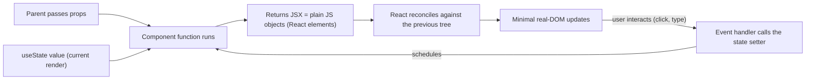
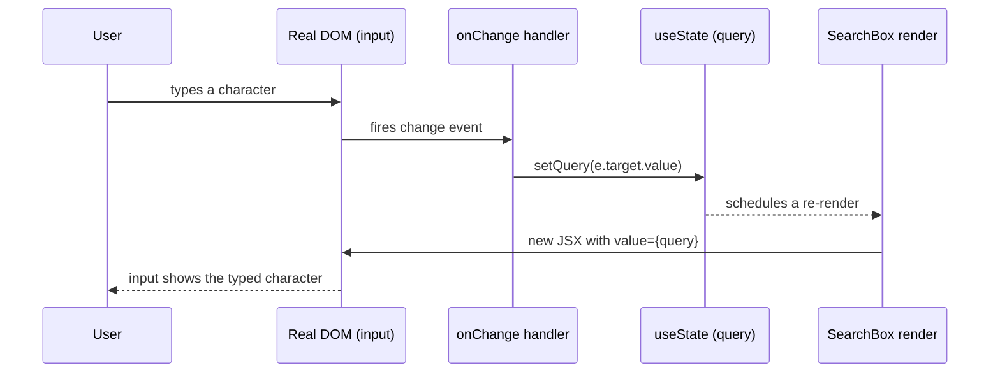

# React Fundamentals - Components, JSX, Props, State

> [!summary] TL;DR
> A React component is a JavaScript function that takes **props** (its inputs) and returns a description of UI, written in **JSX**. React re-runs that function whenever its **props** or its own **state** change, and updates the real page to match.

> [!abstract] Core idea
> - A component is just a function; it returns JSX (plain JavaScript objects under the hood), not real DOM nodes.
> - **Props** flow one way, parent to child, and are read-only inside the child.
> - **State** is a component's own memory across re-renders, changed only through its setter.
> - Calling the state setter schedules a re-render; it does not mutate anything immediately, and React batches multiple setter calls from one event into a single re-render.
> - Lists need a stable `key` per item so React can tell which item is which across renders.

## 1. Why it exists

Before component frameworks, updating a page meant hand-written `document.getElementById(...).innerHTML = ...` calls scattered across the codebase: every place that could change the DOM had to remember every other place that depended on the same data. A shopping cart badge that should update after three different actions (add, remove, checkout) needed three manual DOM-update call sites, each one a chance to forget and leave the UI stale.

React's answer: describe the UI as a pure function of data — `UI = f(props, state)` — and let React figure out which DOM nodes actually need to change. You write what the page should look like for the *current* data; React re-runs the function on every relevant change and reconciles the difference (see [[React Rendering - Virtual DOM, Reconciliation, Lifecycle]] for how that diffing works).

## 2. Mental model

A component is a function. Think of it like a spreadsheet formula cell: give it inputs (props), and it deterministically produces an output (the UI description) — every time the inputs change, the formula is just re-evaluated, you never "patch" the old answer by hand.

- **Props** are the function's parameters — passed in by the parent, read-only.
- **State** is a `let` variable that survives between calls to the same function, but one that only React is allowed to change, and only through its setter.
- **JSX** is syntax that compiles to plain function calls (`React.createElement(...)` historically, the `jsx()` runtime import today) — it is not HTML, and the browser never sees it directly.

## 3. How it works



JSX compiles to function calls, not HTML:

```jsx
const greeting = <h1 className="title">Hello, {name}</h1>;
```

compiles to (the modern automatic JSX runtime, since React 17):

```js
import { jsx as _jsx } from "react/jsx-runtime";
const greeting = _jsx("h1", { className: "title", children: `Hello, ${name}` });
```

That's why `class` becomes `className` (`class` is a reserved word in JS) and why you can put any JavaScript expression inside `{}` — it's just an argument to a function call, evaluated immediately when the component function runs.

### Components as functions of props and state

```jsx
function Greeting({ name }) {       // props arrive as a single object, usually destructured
  return <h1>Hello, {name}</h1>;
}

<Greeting name="Asha" />            // parent passes a prop; Greeting cannot change it
```

Props are **read-only** inside the child: `Greeting` must never do `name = "Bob"`. If a child needs to change something the parent owns, the parent passes a callback prop down, and the child calls that callback — the change still happens in the parent, which then re-renders with new props (see "Lifting state up" below).

### Conditional and list rendering

```jsx
function Status({ isLoggedIn }) {
  return isLoggedIn ? <WelcomeUser /> : <LoginForm />;
}

function UserList({ users }) {
  return (
    <ul>
      {users.map((u) => (
        <li key={u.id}>{u.name}</li>  // key: stable identity across renders, not an index
      ))}
    </ul>
  );
}
```

`key` must be stable and unique among siblings (a database id, not the array index) — see [[React Rendering - Virtual DOM, Reconciliation, Lifecycle]] for why an index key breaks state when the list is reordered or filtered.

### Optional chaining in JSX data access

A common pattern when a prop might not have loaded yet:

```jsx
function Profile({ user }) {
  const city = user?.address?.city ?? "Unknown city"; // undefined, not a crash, if user has no address
  return <p>{city}</p>;
}
```

### Code splitting with `lazy` and `Suspense`

`React.lazy` defers loading a component's code until it's first rendered; `<Suspense fallback>` shows a placeholder while that code (or any promise the component reads with `use`) is still loading:

```jsx
import { lazy, Suspense } from "react";

const SettingsPage = lazy(() => import("./SettingsPage")); // code for this route downloads on first use

function App() {
  return (
    <Suspense fallback={<p>Loading…</p>}>
      <SettingsPage />
    </Suspense>
  );
}
```

This is what lets a bundler split a route's code into its own chunk (see "Tooling, briefly" below) instead of shipping the whole app up front. Note that only `lazy` components and promises read via `use` can trigger a `Suspense` fallback — passing an ordinary Promise down as a prop does not suspend anything by itself.

## 4. Worked example

### Whiteboard version

The smallest possible stateful component: a counter.

```jsx
import { useState } from "react";

function Counter() {
  const [count, setCount] = useState(0);
  return <button onClick={() => setCount(count + 1)}>{count}</button>;
}
```

Clicking the button calls `setCount`, which schedules a re-render; React re-runs `Counter`, `count` is now the new value, and the button's text updates. `Counter` never touches the DOM directly.

### Controlled inputs and events

A form input whose value is driven by React state (a "controlled" input) rather than read from the DOM on demand:

```jsx
function SearchBox({ onSearch }) {
  const [query, setQuery] = useState("");

  function handleSubmit(e) {
    e.preventDefault();          // stop the native full-page form submit
    onSearch(query);             // call the parent's callback prop
  }

  return (
    <form onSubmit={handleSubmit}>
      <input
        value={query}                              // React state is the single source of truth
        onChange={(e) => setQuery(e.target.value)}  // every keystroke updates state
      />
      <button type="submit">Search</button>
    </form>
  );
}
```



### Lifting state up

Two siblings that need to share data store it in their common parent instead of passing it directly between each other:

```jsx
function Cart() {
  const [items, setItems] = useState([]);

  function addItem(item) {
    setItems((prev) => [...prev, item]); // functional update: build the new array from the latest prev
  }

  return (
    <>
      <ProductList onAdd={addItem} />   {/* child calls the callback prop to change the parent's state */}
      <CartBadge count={items.length} /> {/* sibling reads the same state via its own prop */}
    </>
  );
}
```

`ProductList` and `CartBadge` never talk to each other directly; both are driven by `Cart`'s state. This is "lifting state up": when two components need the same data, move it to their nearest common ancestor and pass it down as props.

### Batched updates (React 18+)

```jsx
function handleClick() {
  setCount((c) => c + 1);
  setFlag((f) => !f);
  // Since React 18, these two setter calls are batched into ONE re-render,
  // even outside event handlers (e.g. inside a setTimeout or a fetch .then).
  // Before React 18, only updates inside React event handlers were batched;
  // a setTimeout callback would have triggered two separate re-renders.
}
```

Use the **functional updater** form (`setCount((c) => c + 1)`) rather than `setCount(count + 1)` whenever the new value depends on the previous one — it always sees the latest pending state, even when several updates are batched together in the same render cycle.

### Data fetching pattern

A component typically renders a loading state immediately, fetches inside a `useEffect`, and re-renders once the data arrives; see [[React Hooks]] for the full pattern including the race-condition fix. In new code, a data-fetching library (TanStack Query, RTK Query) or a framework's built-in data layer (Next.js Server Components, React Router loaders) usually replaces this pattern — see [[React Routing and Rendering Strategies - CSR, SSR, SSG]].

## 5. Variants and comparison

| Approach | How it works | Use when | Cost |
| --- | --- | --- | --- |
| Function component + hooks | Plain function, `useState`/`useEffect` for state and effects | All new React code (React 16.8+) | None vs. classes; this is the only form React 19 continues to improve |
| Class component | `extends React.Component`, `this.state`, lifecycle methods | Legacy codebases only | More boilerplate, `this` binding bugs, no direct hook equivalent patterns |
| Controlled input | React state is the single source of truth for a form field's value | You need to validate, transform or react to every keystroke | A re-render per keystroke (usually negligible) |
| Uncontrolled input | DOM holds the value; read it via a ref when needed (e.g. on submit) | Simple forms, file inputs, third-party widgets | No per-keystroke React involvement, but harder to validate live |

## 6. Trade-offs and when not to use

- A component re-renders every time its state or props change, even if the resulting JSX would be identical; for most UI this is fast enough that optimizing it is premature (see [[React Hooks]] for when `useMemo`/`React.memo` actually pay off).
- Prop drilling (passing a prop through several layers that don't use it themselves) is fine for 2–3 levels; past that, consider Context or a store — covered in [[React State Management - Props, Context, Redux]].
- Controlled inputs cost a re-render per keystroke; for very large forms or a high-frequency input (e.g. a canvas drag), an uncontrolled input with a ref can be cheaper.
- This vault is backend-focused: treat this note as "enough to read and lightly modify a React codebase", not as full frontend-engineer depth — state management, styling systems and build tooling go only as deep as a backend engineer needs.

## 7. In production

- **Real systems:** React 19 is the current stable release (2024) and powers most large single-page apps and, via Next.js's App Router, server-rendered and hybrid apps with Server Components.
- **Failure modes → fixes:**
  - List reorders or filters and items lose their input focus/state → the `key` was the array index instead of a stable id; switch to a stable id.
  - A form field "won't update" on typing → the input has a `value` prop but no `onChange`, making it a read-only controlled input by accident.
  - A child mutates a prop object directly and the parent doesn't notice → props (and state) must be treated as immutable; update via the setter with a new object/array (`{...prev, field: x}`, `[...prev, item]`).
  - A fetch inside `useEffect` sets state after the component has moved on to a different id → use the `ignore` flag or `AbortController` pattern shown above.
- **What to monitor:** render count per component in dev tools (React DevTools Profiler) if a screen feels slow; client-side error rate from a boundary (error boundaries, covered in [[React Rendering - Virtual DOM, Reconciliation, Lifecycle]]).

## 8. Deep dive

- **JSX is not HTML.** Attributes are JS identifiers in camelCase (`className`, `htmlFor`, `onClick`), and `{}` embeds any expression, not just strings — including other JSX, which is how composition works (`<Layout><Page /></Layout>`).
- **`children` is just a prop.** `<Parent><Child /></Parent>` is sugar for passing `<Child />` as `props.children`; this is how generic wrapper components (layouts, modals) work without hardcoding what goes inside them.
- **State updates are not synchronous.** Reading `count` immediately after calling `setCount(count + 1)` in the same function body still shows the *old* value — the update is scheduled for the next render, not applied in place.
- **React 19 additions relevant here:** the `use` API (reads a Promise or Context inside render, conditionally), Actions and `useActionState` for form submissions with built-in pending/error state, and `ref` can now be passed as a plain prop to function components without `forwardRef`. These are extensions of the same props/state model, not a replacement for it.
- **Tooling, briefly:** `package.json` declares `dependencies` (shipped to the browser) vs `devDependencies` (build-time only, e.g. the bundler itself); a lockfile pins exact versions for reproducible installs. A bundler (Vite, webpack) turns your JSX/TS modules into the handful of files the browser actually loads, tree-shaking unused exports and splitting code at `React.lazy()` boundaries so a route's code only downloads when that route is visited.

## 9. Interview questions

> [!question]- What's the difference between props and state?
> Props are inputs passed down from a parent and are read-only inside the component that receives them. State is a component's own data, created with `useState` (or similar), that it can change itself, and changing it schedules a re-render.

> [!question]- Why does React want a stable `key` on list items, and why is the array index a bad choice?
> React uses `key` to match elements between the old and new render so it can reuse DOM nodes and component state for the same logical item. The index changes meaning when the list is reordered, filtered, or an item is removed, so React can match the wrong item to the wrong key and show stale state (e.g. a text input's typed value) on the wrong row.

> [!question]- Trap: if you call `setCount(count + 1)` twice in a row in the same handler, does the counter go up by 2?
> Not necessarily. Both calls close over the same `count` from this render, so both compute `count + 1` from the same starting value — the result is `+1`, not `+2`. Use the functional updater, `setCount(c => c + 1)` twice, to reliably get `+2`, since each call then sees the latest pending value.

> [!question]- What does React 18's automatic batching change?
> Before React 18, multiple state updates were only batched into one re-render inside React event handlers; updates inside a `setTimeout`, a Promise `.then`, or a raw DOM event listener each triggered their own re-render. Since React 18, batching applies everywhere by default, so several setter calls anywhere in one tick produce a single re-render.

> [!question]- Why can't a child component directly change a prop its parent passed it?
> Props are meant to be read-only so that data flow stays predictable (one-way, parent to child). If a child needs to cause a change, the parent passes a callback prop; the child calls it, the parent updates its own state, and React re-renders the child with the new prop value.

> [!question]- What is "lifting state up"?
> Moving state from a child component to its nearest common ancestor when two or more components need to share or stay in sync on that data, then passing the state and update functions back down as props.

## 10. Cheat sheet

- Component = function of `(props, state) → JSX`; React re-runs it on relevant changes.
- Props flow one way (parent → child) and are read-only in the child; state is owned and changed only by its component, via the setter.
- JSX compiles to function calls (`jsx(...)`), not HTML — that's why `className`, not `class`.
- Give list items a stable `key` (an id), never the array index, if the list can reorder or filter.
- State updates are scheduled, not immediate; use the functional updater when the new value depends on the old one.
- Since React 18, state updates are batched everywhere, not just inside React event handlers.
- Lift state to the nearest common ancestor when siblings need to share data.
- `children` is just a prop — composition, not a special syntax.

## Links

- **Before this:** [[JavaScript Objects, Arrays and Iteration]], [[DOM, Events and Timers]]
- **Next:** [[React Hooks]], [[React Rendering - Virtual DOM, Reconciliation, Lifecycle]]
- **Compare with:** [[React State Management - Props, Context, Redux]] (what to do once prop drilling stops scaling)
