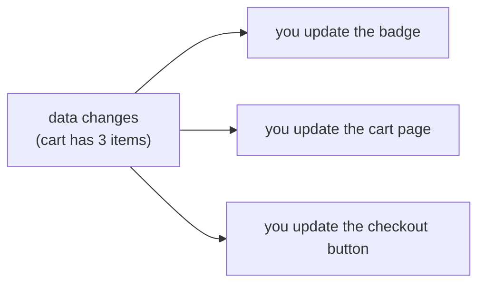
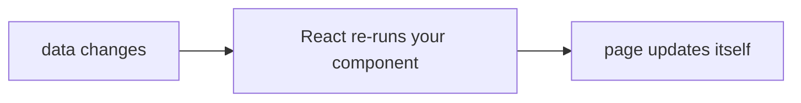
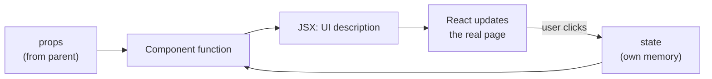
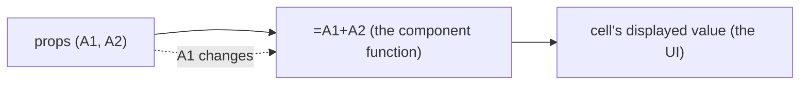
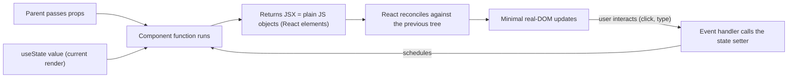
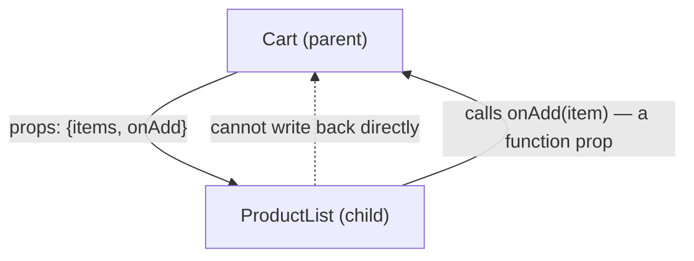
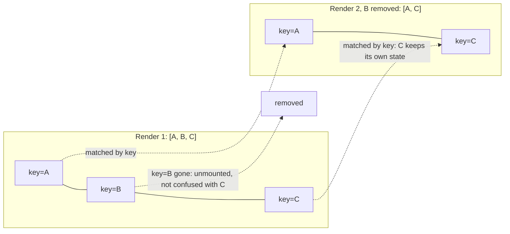
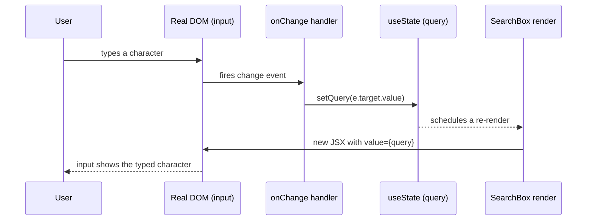
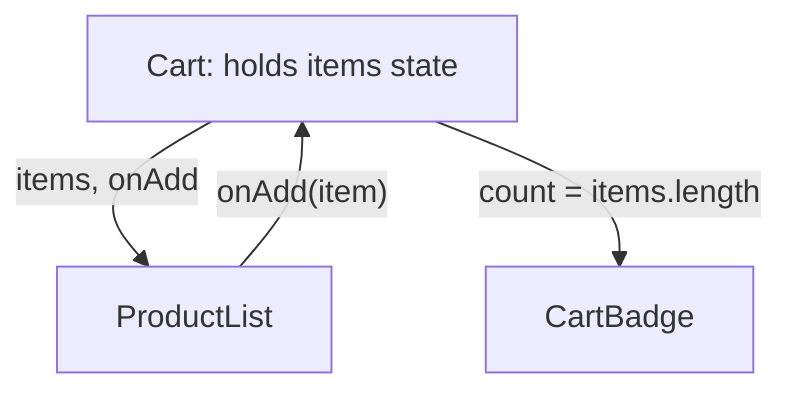
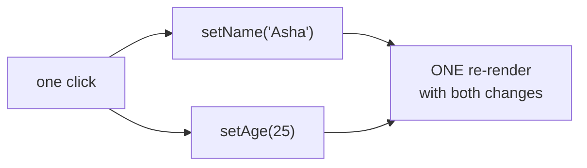

# React Fundamentals - Components, JSX, Props, State

> [!summary] TL;DR
> A React component is a JavaScript function that takes **props** (its inputs) and returns a description of UI, written in **JSX**. React re-runs that function whenever its **props** or its own **state** change, and updates the real page to match.

> [!abstract] Core idea
> - A component is just a function; it returns JSX (plain JavaScript objects under the hood), not real DOM nodes.
> - **Props** flow one way, parent to child, and are read-only inside the child.
> - **State** is a component's own memory across re-renders, changed only through its setter.
> - Calling the state setter schedules a re-render; it does not mutate anything immediately, and React batches multiple setter calls from one event into a single re-render.
> - Lists need a stable `key` per item so React can tell which item is which across renders.

## Start here: the basics 🟢

> [!info] How to read this note (pick your level)
> - 🟢 **New to this?** Read "From zero" below, then sections 1, 2 and the cheat sheet (10). Stop there, that is a full first pass.
> - 🟡 **Know the basics?** Add section 3 (how it works) and 4 (one click traced step by step).
> - 🔴 **Interview / SDE-3 prep?** Add 7, 8 and 9. Headings are tagged 🟢🟡🔴 so you always know where you are.

> [!note] Before this note
> - [[JavaScript Objects, Arrays and Iteration]]: objects hold named fields, `arr.map(...)` turns a list into a new list, and making a new array is different from changing the old one.
> - [[DOM, Events and Timers]]: the page is a live tree (the DOM) and a click runs an event handler function.

**From zero, in 60 seconds** 🟢

A web page is made of elements: buttons, text, images. Without React, when your data changes you must find each element and update it yourself, by hand, everywhere.



React flips this. You write a **component**: a small function that says "given this data, here is what this piece of the page looks like". The data a parent hands in is called **props**; the data the component remembers on its own is called **state**. When either changes, React re-runs your function and fixes the page for you.



The rest of this note is just these 4 questions:
1. What is a component and what is JSX really?
2. What are props and why can't a child change them?
3. What is state and what happens when I change it?
4. What exactly happens between a click and the page updating?


**The problem in one story.**
A shopping site shows a cart badge with "3 items".
The number must change when you add, remove or check out.
Updating the page by hand in each of those places is easy to forget.
React lets you say "the badge shows `count`" once, and it keeps the page in sync whenever `count` changes.

**Words you need first**

| Word | Plain meaning | Tiny example |
| --- | --- | --- |
| DOM | The browser's live tree of page elements | a `<button>` node you can click |
| Component | A function that returns a piece of UI | `function Badge() { ... }` |
| JSX | HTML-like syntax inside JavaScript | `<h1>Hello</h1>` in a `.jsx` file |
| Props | Inputs a parent passes to a child component | `<Badge count={3} />` |
| State | A component's own memory that survives re-renders | `const [n, setN] = useState(0)` |
| Render | React calling your component to get its UI description | clicking re-runs `Badge()` |
| Event handler | A function run when the user does something | `onClick={() => setN(n + 1)}` |
| Re-render | React running your component function again to get fresh UI | after `setN(1)`, `Badge()` runs again |
| Setter | The function `useState` gives you to change state | `setN` in `[n, setN]` |
| Hook | A built-in React function starting with `use` that adds a feature to a component | `useState`, `useEffect` |
| `key` | A unique label on each list item so React can tell items apart | `<li key={order.id}>` |
| Batching | React grouping several state changes into one re-render | two setters in one click, one repaint |
| Controlled input | A text box whose value comes from React state | `<input value={q} onChange={...}>` |

**Picture it**



**Analogy.** A component is a spreadsheet formula cell: change an input cell and the result recalculates by itself.
Where it breaks: a formula has no memory of its own, but a component can hold state between runs.

**How the rest of this note builds up**

- First, why React exists (section 1) and the "UI is a function of data" model (section 2).
- Then JSX, props and state, conditional and list rendering, and code splitting (section 3).
- Then one click traced step by step, controlled inputs, lifting state up and batching (section 4).
- Finally the SDE-3 view: variants, trade-offs, production practice and the deep dive (sections 5-8).

> [!tip] Remember
> Write what the UI should look like for the current props and state; React works out the page updates.

## 1. Why it exists 🟢

Before component frameworks, updating a page meant hand-written `document.getElementById(...).innerHTML = ...` calls scattered across the codebase. Every place that could change the DOM had to remember every other place that depended on the same data.

A shopping cart badge that should update after three different actions — add, remove, checkout — needed three separate manual DOM-update call sites. Each one was a chance to forget, and leave the badge showing a stale count.

React's answer: describe the UI as a **pure function** (same input always gives the same output, with no side effects) of data, `UI = f(props, state)`, and let React figure out which DOM nodes actually need to change. You write what the page should look like for the *current* data.

React re-runs the function on every relevant change and **reconciles** (compares the new UI description with the old one and changes only what differs) the difference (see [[React Rendering - Virtual DOM, Reconciliation, Lifecycle]] for how that diffing works).

> [!tip] Remember
> You describe the end result for the current data, not the sequence of DOM edits to get there — React works out the edits.

### Real-life example: the "ADD" button on a food app 🟢

On Swiggy or Zomato, each dish has an "ADD" button that turns into "− 1 +" once you tap it.
Each dish card is a component that gets the dish name and price as props.
The count on the card is state; tapping "+" calls the setter, and React re-runs the card to show 2.
The "View cart: 3 items" bar at the bottom needs the same counts, so that state is lifted up to a parent that holds the whole cart.
The menu list uses each dish's id as its `key`, so filtering to "Veg only" never mixes up the counts.

## Common beginner mistakes 🟢

- **Changing state directly** (`items.push(x)`) → React sees the same array and does not re-render → make a new array: `setItems([...items, x])`.
- **Reading state right after setting it** → `setCount(5); console.log(count)` still prints the old value → the new value shows up on the next render.
- **Using the array index as `key`** → after removing or reordering, inputs keep the wrong row's text → use a real id like `item.id`.
- **Writing `class` and `onclick` like HTML** → JSX wants `className` and `onClick` → use the camelCase JavaScript names.
- **Trying to change a prop inside the child** → props are read-only → ask the parent to change it by calling a function prop.

## Often confused 🟡

| These two | Props | State |
| --- | --- | --- |
| Who owns it | The parent | The component itself |
| Can the component change it? | No, read-only | Yes, only through its setter |
| Changing it causes a re-render? | Yes, when the parent passes a new value | Yes, when the setter is called |
| Example | `<Badge count={3} />` | `const [count, setCount] = useState(0)` |

## 2. Mental model 🟢

A component is a function. Think of it like a spreadsheet formula cell: give it inputs (props), and it deterministically produces an output (the UI description). Every time the inputs change, the formula is just re-evaluated — you never "patch" the old answer by hand.



- **Props** are the function's parameters — passed in by the parent, read-only.
- **State** is a `let` variable that survives between calls to the same function, but one that only React is allowed to change, and only through its setter.
- **JSX** is syntax that compiles to plain function calls (`React.createElement(...)` historically, the `jsx()` runtime import today) — it is not HTML, and the browser never sees it directly.

> [!warning] Common mistake
> Thinking of a component as something you "update" in place, the way you'd mutate a DOM element. A component re-*runs*, from scratch, every time — any value it needs across runs must live in state, a **ref** (a box from `useRef` that survives re-renders without causing one), or a prop, never in a plain local variable that resets every call.

> [!tip] Remember
> Component = pure function of `(props, state)`. If two renders get the same props and state, they produce the same JSX.

## 3. How it works 🟡

> 🟢 → 🟡 **You now know** that a component is a function that turns props and state into UI, and React re-runs it when they change. **Next we open the box**: what JSX turns into, how props travel, how lists and missing data are handled, and how code is loaded only when needed.



### JSX compiles to function calls, not HTML

**In plain words:** the angle-bracket syntax you write (`<h1>Hello</h1>`) is not HTML the browser understands directly. A build step translates it into an ordinary JavaScript function call before any of it ships to the browser.

**Step by step:**
1. You write `<h1 className="title">Hello, {name}</h1>` in a `.jsx` file.
2. A build tool (like Vite) rewrites it to `_jsx("h1", { className: "title", children: "Hello, " + name })`.
3. When the component runs, that call returns a small plain object: "an `h1` with these props".
4. React reads that object and creates or updates a real `<h1>` in the DOM.

```jsx
const greeting = <h1 className="title">Hello, {name}</h1>;
```

compiles to (the modern automatic JSX runtime, the helper React 17+ imports for you, since React 17):

```js
import { jsx as _jsx } from "react/jsx-runtime";
const greeting = _jsx("h1", { className: "title", children: `Hello, ${name}` });
```

**Example:** `<h1 className="title">` becomes a call `_jsx("h1", { className: "title", ... })` — a plain function call with a string tag name and a plain object of attributes. Nothing about this is HTML; it's just syntax sugar that's easier to read than nested function calls.

**Why it matters:** this is why `class` becomes `className` (`class` is a **reserved word** (a word the language keeps for itself) in JavaScript, so it can't be an object key the normal way without conflicting with the language) and why you can put any JavaScript expression inside `{}` — it's just an argument to a function call, evaluated immediately when the component function runs.

> [!warning] Common mistake
> Writing `<div class="box">` out of HTML habit. JSX attributes are JavaScript **identifiers** (names), not HTML attribute names — `class` → `className`, `for` → `htmlFor`, and event handlers are **camelCase** (joined words, each new word capitalised) (`onclick` → `onClick`).

### Components as functions of props and state

**In plain words:** a component receives one argument, an object of props, and returns JSX. The parent decides what goes in; the component can read it but never change it.

**Step by step:**
1. `Cart` holds the list of items in its state.
2. `Cart` renders `<ProductList items={items} onAdd={addItem} />`. Both are props.
3. `ProductList` shows the items. It cannot assign `items = ...`.
4. When the user taps "Add", `ProductList` calls `onAdd(item)`, a function `Cart` gave it.
5. `Cart` updates its own state, re-renders, and passes the new `items` down.

```jsx
function Greeting({ name }) {       // props arrive as a single object, usually destructured
  return <h1>Hello, {name}</h1>;
}

<Greeting name="Asha" />            // parent passes a prop; Greeting cannot change it
```

**Picture it:** props travel one way only, like water flowing downhill — parent to child, never the reverse:



**Why it matters:** props are **read-only** inside the child — `Greeting` must never do `name = "Bob"`. If a child needs to change something the parent owns, the parent passes a callback prop down, and the child calls that callback.

The change still happens in the parent, which then re-renders with new props (see "Lifting state up" below).

This one-way flow is what makes a large component tree's data predictable: you can always find where a value changes by looking at who owns the state, not by searching the whole tree for mutations.

> [!tip] Remember
> Data flows down as props; changes flow up as function calls the parent handed down.

### Conditional and list rendering

**In plain words:** JSX is just JavaScript, so showing or hiding something is a plain `if`/**ternary** (`cond ? a : b`), and rendering a list is just calling `.map()` and returning an array of elements.

**Step by step:**
1. `{isLoggedIn ? <Logout /> : <Login />}` shows one button or the other.
2. `{cart.length > 0 && <Checkout />}` shows the checkout only when the cart has items.
3. `orders.map(o => <li key={o.id}>{o.name}</li>)` turns 3 orders into 3 list items.
4. Next render, React matches each `li` with last time's by its `key`, so it can tell which item was removed or moved.

```jsx
function Status({ isLoggedIn }) {
  return isLoggedIn ? <WelcomeUser /> : <LoginForm />;
}

function UserList({ users }) {
  return (
    <ul>
      {users.map((u) => (
        <li key={u.id}>{u.name}</li>  // key: stable identity across renders, not an index
      ))}
    </ul>
  );
}
```

**Picture it:** `key` is how React matches an old render's list items to a new render's list items — by identity, not by position:



**Example:** with a stable id as the key, removing item `B` from `[A, B, C]` leaves React able to see that `A` and `C` are the *same* items as before — any internal state they held (like a focused input) survives.

If the key were the array *index* instead (`0, 1, 2`), after removing `B` the item now at index `1` (previously `C`, key `1`) is treated as "the same" element that used to be `B` at index `1` — and `C`'s state gets wrongly attached to what is now `C`'s row but was recognized as index `1`'s old identity.

**Why it matters:** this is one of the most common React bugs in practice — a list that reorders or filters and an input loses focus, or shows the wrong row's typed text, because the key was the index instead of a real id.

`key` must be stable and unique among siblings (a database id, not the array index) — see [[React Rendering - Virtual DOM, Reconciliation, Lifecycle]] for the full reconciliation mechanism this diagram summarizes.

> [!tip] Remember
> Use a real, stable id as `key`. The array index looks like it works until the list reorders, filters, or has an item removed from the middle.

### Optional chaining in JSX data access

**In plain words:** `?.` means "only keep going if this exists". It saves you from a crash when data has not loaded yet, like checking a door is there before walking through it.

**Step by step:**
1. First render: the profile has not loaded, so `user` is `null`.
2. `user?.address?.city` stops at `user`, gives `undefined`, and does not crash.
3. `?? "Unknown city"` swaps that `undefined` for a readable fallback.
4. Data arrives, the component re-renders, and the real city shows.

A common pattern when a prop might not have loaded yet:

```jsx
function Profile({ user }) {
  const city = user?.address?.city ?? "Unknown city"; // undefined, not a crash, if user has no address
  return <p>{city}</p>;
}
```

**What happens if** you write `user.address.city` without the `?.` guards, and `user` arrives as `null` on the first render before data loads? JavaScript throws immediately and the whole component crashes, which in React takes down the nearest **error boundary** (a wrapper component that catches crashes below it and shows a fallback) — not just that one line. The `?.`/`??` combination is the cheapest guard against exactly this "data hasn't arrived yet" render.

### Code splitting with `lazy` and `Suspense`

**In plain words:** `React.lazy` defers downloading a component's code until the moment it's first rendered. `<Suspense fallback>` shows a placeholder while that code (or any promise the component reads with `use`) is still loading.

**Step by step:**
1. You write `const Settings = lazy(() => import("./Settings"));`.
2. The app loads without the Settings code at all, so the first download is smaller.
3. The user opens Settings. React starts downloading that code.
4. While it downloads, `<Suspense fallback={<Spinner />}>` shows the spinner.
5. The code arrives and the real Settings page replaces the spinner.

```jsx
import { lazy, Suspense } from "react";

const SettingsPage = lazy(() => import("./SettingsPage")); // code for this route downloads on first use

function App() {
  return (
    <Suspense fallback={<p>Loading…</p>}>
      <SettingsPage />
    </Suspense>
  );
}
```

**Why it matters:** this is what lets a **bundler** (a build tool that packs your files for the browser) split a **route's** (one page's) code into its own **chunk** (a separate JS file) (see "Tooling, briefly" below) instead of shipping the whole app up front. Only `lazy` components and promises read via `use` can trigger a `Suspense` fallback — passing an ordinary Promise down as a prop does not suspend anything by itself.

## 4. Worked example 🟡

### Whiteboard version

The smallest possible stateful component: a counter.

```jsx
import { useState } from "react";

function Counter() {
  const [count, setCount] = useState(0);
  return <button onClick={() => setCount(count + 1)}>{count}</button>;
}
```

Clicking the button calls `setCount`, which schedules a re-render; React re-runs `Counter`, `count` is now the new value, and the button's text updates. `Counter` never touches the DOM directly.

### Tracing one click, step by step

1. The page shows the button with text `0` — this is the result of the first render, where `count` was `0`.
2. The user clicks the button. The browser fires a **native** (the browser's own, not React's) click event.
3. React's `onClick` handler runs: `() => setCount(count + 1)`, which calls `setCount(1)` (`count` was `0` in *this* render's closure).
4. React does **not** update the DOM yet. It marks `Counter` as needing a re-render and schedules that work.
5. React calls `Counter()` again. This time, `useState(0)` returns the *stored* value, `1`, not the initial `0` — the initial argument to `useState` is only used on the very first render.
6. `Counter` returns new JSX: `<button>{1}</button>`.
7. React compares this new JSX to the previous render's JSX, finds only the text content changed, and writes just that one text node to the real DOM.
8. The button now visibly shows `1`.

### Controlled inputs and events

**In plain words:** a controlled input is a text box whose contents React owns. Every keystroke goes into state first, and the box just shows whatever state says — like a cashier repeating your order back from their notepad, not from memory.

A form input whose value is driven by React state (a "controlled" input) rather than read from the DOM on demand:

```jsx
function SearchBox({ onSearch }) {
  const [query, setQuery] = useState("");

  function handleSubmit(e) {
    e.preventDefault();          // stop the native full-page form submit
    onSearch(query);             // call the parent's callback prop
  }

  return (
    <form onSubmit={handleSubmit}>
      <input
        value={query}                              // React state is the single source of truth
        onChange={(e) => setQuery(e.target.value)}  // every keystroke updates state
      />
      <button type="submit">Search</button>
    </form>
  );
}
```



**Why it matters:** because `value` is always set from state, React — not the browser — is the **single source of truth** (the one place the real value lives) for what the input shows. This is what makes it possible to validate, transform, or reject a keystroke before it ever appears (e.g. stripping non-digit characters from a phone number field).

### Lifting state up

**In plain words:** when two sibling components both need the same piece of data, that data moves up to their nearest common parent, which then passes it down to both as props.

```jsx
function Cart() {
  const [items, setItems] = useState([]);

  function addItem(item) {
    setItems((prev) => [...prev, item]); // functional update: build the new array from the latest prev
  }

  return (
    <>
      <ProductList onAdd={addItem} />   {/* child calls the callback prop to change the parent's state */}
      <CartBadge count={items.length} /> {/* sibling reads the same state via its own prop */}
    </>
  );
}
```

**An analogy:** this is like two departments in a company that both need the same budget number — instead of each guessing or copying a number that can drift out of sync, the number lives with their shared manager, and both departments read it from the same source whenever they need it.

The analogy breaks down because in React the "manager" (the parent component) is re-created on every render, not a long-lived object — only its *state* persists across those re-creations.

`ProductList` and `CartBadge` never talk to each other directly; both are driven by `Cart`'s state.



> [!tip] Remember
> Two components need the same data → move it to their nearest common ancestor, then pass it down. Don't try to sync two separate pieces of state.

### Batched updates (React 18+)

**In plain words:** if you change state twice in one click, React is smart enough to repaint the page once, not twice. That bundling is called batching.



```jsx
function handleClick() {
  setCount((c) => c + 1);
  setFlag((f) => !f);
  // Since React 18, these two setter calls are batched into ONE re-render,
  // even outside event handlers (e.g. inside a setTimeout or a fetch .then).
  // Before React 18, only updates inside React event handlers were batched;
  // a setTimeout callback would have triggered two separate re-renders.
}
```

Use the **functional updater** form (`setCount((c) => c + 1)`) rather than `setCount(count + 1)` whenever the new value depends on the previous one — it always sees the latest pending state, even when several updates are batched together in the same render cycle.

### Data fetching pattern

A component typically renders a loading state immediately, fetches inside a `useEffect`, and re-renders once the data arrives; see [[React Hooks]] for the full pattern including the race-condition fix.

In new code, a data-fetching library (TanStack Query, RTK Query: libraries that fetch, cache and refresh server data for you) or a framework's built-in data layer (Next.js Server Components, React Router loaders) usually replaces this pattern — see [[React Routing and Rendering Strategies - CSR, SSR, SSG]].

## 5. Variants and comparison 🟡

| Approach | How it works | Use when | Cost |
| --- | --- | --- | --- |
| Function component + hooks | Plain function, `useState`/`useEffect` for state and effects | All new React code (React 16.8+) | None vs. classes; this is the only form React 19 continues to improve |
| Class component | `extends React.Component`, `this.state`, lifecycle methods | Legacy codebases only | More boilerplate, `this` binding bugs, no direct hook equivalent patterns |
| Controlled input | React state is the single source of truth for a form field's value | You need to validate, transform or react to every keystroke | A re-render per keystroke (usually negligible) |
| Uncontrolled input | DOM holds the value; read it via a ref when needed (e.g. on submit) | Simple forms, file inputs, third-party widgets | No per-keystroke React involvement, but harder to validate live |

## 6. Trade-offs and when not to use 🟡

- A component re-renders every time its state or props change, even if the resulting JSX would be identical; for most UI this is fast enough that optimizing it is premature (see [[React Hooks]] for when `useMemo`/`React.memo` actually pay off).
- Prop drilling (passing a prop through several layers that don't use it themselves) is fine for 2–3 levels; past that, consider **Context** (React's way to share a value with all components below without passing props) or a **store** (one shared place for app-wide state, like Redux) — covered in [[React State Management - Props, Context, Redux]].
- Controlled inputs cost a re-render per keystroke; for very large forms or a high-frequency input (e.g. a canvas drag), an uncontrolled input with a ref can be cheaper.
- This vault is backend-focused: treat this note as "enough to read and lightly modify a React codebase", not as full frontend-engineer depth — state management, styling systems and build tooling go only as deep as a backend engineer needs.

## 7. In production 🔴

> 🟡 → 🔴 **You now know** components, JSX, props, state, keys, controlled inputs, lifting state and batching. **Next is the advanced part**: the bugs real React apps hit, how teams watch for them, and finer points like `children`, React 19 features and build tooling.

- **Real systems:** React 19 is the current stable release (2024) and powers most large **single-page apps** (sites that load once and then swap content with JS instead of loading new pages) and, via Next.js's App Router, server-rendered and hybrid apps with **Server Components** (components that run only on the server and send finished UI).
- **Failure modes → fixes:**
  - List reorders or filters and items lose their input focus/state → the `key` was the array index instead of a stable id; switch to a stable id.
  - A form field "won't update" on typing → the input has a `value` prop but no `onChange`, making it a read-only controlled input by accident.
  - A child mutates a prop object directly and the parent doesn't notice → props (and state) must be treated as immutable; update via the setter with a new object/array (`{...prev, field: x}`, `[...prev, item]`).
  - A fetch inside `useEffect` sets state after the component has moved on to a different id → use the `ignore` flag or `AbortController` pattern shown above.
- **What to monitor:** render count per component in dev tools (React DevTools Profiler, a browser add-on that records which components rendered and how long they took) if a screen feels slow; client-side error rate from a boundary (error boundaries, covered in [[React Rendering - Virtual DOM, Reconciliation, Lifecycle]]).

## 8. Deep dive 🔴

- **JSX is not HTML.** Attributes are JS identifiers in camelCase (`className`, `htmlFor`, `onClick`), and `{}` embeds any expression, not just strings — including other JSX, which is how composition works (`<Layout><Page /></Layout>`).
- **`children` is just a prop.** `<Parent><Child /></Parent>` is sugar for passing `<Child />` as `props.children`; this is how generic wrapper components (layouts, modals) work without hardcoding what goes inside them.
- **State updates are not synchronous.** Reading `count` immediately after calling `setCount(count + 1)` in the same function body still shows the *old* value — the update is scheduled for the next render, not applied in place.
- **React 19 additions relevant here:** the `use` API (reads a Promise or Context inside render, conditionally), Actions and `useActionState` for form submissions with built-in pending/error state, and `ref` can now be passed as a plain prop to function components without `forwardRef`. These are extensions of the same props/state model, not a replacement for it.
- **Tooling, briefly:** `package.json` declares `dependencies` (shipped to the browser) vs `devDependencies` (build-time only, e.g. the bundler itself); a lockfile pins exact versions for reproducible installs. A bundler (Vite, webpack) turns your JSX/TS modules into the handful of files the browser actually loads, **tree-shaking** (dropping code nobody imports) unused exports and splitting code at `React.lazy()` boundaries so a route's code only downloads when that route is visited.

## 9. Interview questions 🔴

> [!question]- What's the difference between props and state?
> Props are inputs passed down from a parent and are read-only inside the component that receives them. State is a component's own data, created with `useState` (or similar), that it can change itself, and changing it schedules a re-render.

> [!question]- Why does React want a stable `key` on list items, and why is the array index a bad choice?
> React uses `key` to match elements between the old and new render so it can reuse DOM nodes and component state for the same logical item. The index changes meaning when the list is reordered, filtered, or an item is removed, so React can match the wrong item to the wrong key and show stale state (e.g. a text input's typed value) on the wrong row.

> [!question]- Trap: if you call `setCount(count + 1)` twice in a row in the same handler, does the counter go up by 2?
> Not necessarily. Both calls close over the same `count` from this render, so both compute `count + 1` from the same starting value — the result is `+1`, not `+2`. Use the functional updater, `setCount(c => c + 1)` twice, to reliably get `+2`, since each call then sees the latest pending value.

> [!question]- What does React 18's automatic batching change?
> Before React 18, multiple state updates were only batched into one re-render inside React event handlers; updates inside a `setTimeout`, a Promise `.then`, or a raw DOM event listener each triggered their own re-render. Since React 18, batching applies everywhere by default, so several setter calls anywhere in one tick produce a single re-render.

> [!question]- Why can't a child component directly change a prop its parent passed it?
> Props are meant to be read-only so that data flow stays predictable (one-way, parent to child). If a child needs to cause a change, the parent passes a callback prop; the child calls it, the parent updates its own state, and React re-renders the child with the new prop value.

> [!question]- What is "lifting state up"?
> Moving state from a child component to its nearest common ancestor when two or more components need to share or stay in sync on that data, then passing the state and update functions back down as props.

## 10. Cheat sheet 🟢

- Component = function of `(props, state) → JSX`; React re-runs it on relevant changes.
- Props flow one way (parent → child) and are read-only in the child; state is owned and changed only by its component, via the setter.
- JSX compiles to function calls (`jsx(...)`), not HTML — that's why `className`, not `class`.
- Give list items a stable `key` (an id), never the array index, if the list can reorder or filter.
- State updates are scheduled, not immediate; use the functional updater when the new value depends on the old one.
- Since React 18, state updates are batched everywhere, not just inside React event handlers.
- Lift state to the nearest common ancestor when siblings need to share data.
- `children` is just a prop — composition, not a special syntax.

## Self-check 🟢🟡

> [!question]- Easy: what does a React component return?
> JSX: a description of what the UI should look like.

> [!question]- Easy: can a child component change the props it receives?
> No. Props are read-only; the child calls a function prop to ask the parent.

> [!question]- Easy: what do you call to change state from `const [n, setN] = useState(0)`?
> `setN`, for example `setN(1)` or `setN(old => old + 1)`.

> [!question]- Medium: `setCount(count + 1)` twice in one click. Count goes from 0 to?
> 1. Both calls use the same old `count`. Use `setCount(c => c + 1)` twice to get 2.

> [!question]- Medium: why is the array index a bad `key` for a list you can filter?
> After filtering, items shift positions, so React matches the wrong old item to each index and state lands on the wrong row.

> [!question]- Medium: two sibling components need the same cart count. Where should the state live?
> In their nearest common parent, which passes it down to both as props.

## Links

- **Before this:** [[JavaScript Objects, Arrays and Iteration]], [[DOM, Events and Timers]]
- **Next:** [[React Hooks]], [[React Rendering - Virtual DOM, Reconciliation, Lifecycle]]
- **Compare with:** [[React State Management - Props, Context, Redux]] (what to do once prop drilling stops scaling)

### Watch on YouTube

- [⚛️ React Components Explained! Props, State, useEffect & Composition (2025 Crash Course)](https://www.youtube.com/watch?v=qPtVIKgWzek) · Learn Web Dev with Norbert · up-to-date crash course on components, JSX, props and state
- [05 - Understanding React Components - What are States - What are Props - State vs. Props - Reactjs](https://www.youtube.com/watch?v=GgurJ_3y0Jg) · tapaScript by Tapas Adhikary · focused state-vs-props comparison, a common point of confusion
