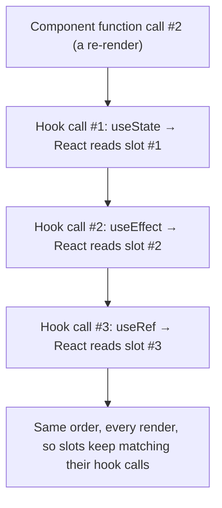
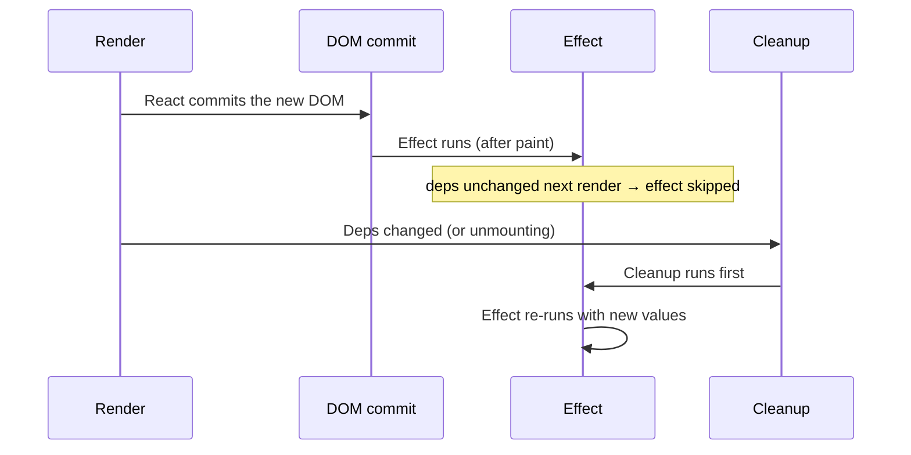

# React Hooks

> [!summary] TL;DR
> Hooks are plain functions, always starting with `use`, that let a function component hold state, run side effects, and reuse stateful logic without ever writing a class. React tracks each hook call by its **call order** within a component, so hooks must be called unconditionally, in the same order, on every render.

> [!abstract] Core idea
> - `useState` gives a component memory across renders; `useEffect` runs code after the DOM commits, and can clean up before the next run or on unmount.
> - React matches hook calls to their stored state by position in a fixed list, not by name — that's the entire reason for the rules of hooks.
> - `useMemo`/`useCallback` cache a computed value or function identity between renders; they help only when something expensive or a referential-equality check actually depends on it.
> - `useRef` holds a mutable value, or a DOM node reference, that survives renders without ever causing one itself.
> - Custom hooks are just functions that call other hooks, letting you extract and reuse logic across components.

## 1. Why it exists

A function component is, each render, just a function call: its local variables are thrown away when it returns. Before hooks (pre-React 16.8, 2019), the only way to keep data across renders — or to use the features that needed it, like lifecycle-based data fetching — was to convert the component to a class, with `this.state`, `this.setState`, and lifecycle methods like `componentDidMount`. Two unrelated concerns (say, a data subscription and a window-resize listener) ended up interleaved inside the same `componentDidMount`/`componentWillUnmount` pair, because a class only has one of each lifecycle method, not one per concern.

Hooks solve this by giving a *function* component access to React's internal per-component storage, without a class: `useState` hands you a slot of memory, `useEffect` hands you a slot for "run this after commit, clean up before the next one." Because they're just function calls, you can group one concern's state and effect together, and extract repeated logic into your own function (a custom hook) instead of threading it through class inheritance.

## 2. Mental model

Picture each component instance as owning a single ordered list of slots — one slot per hook call. On every render, React walks that same list from the top and hands the `n`-th slot's stored value to the `n`-th hook call in your function body, in order. This is also why **hooks can't be called conditionally**: if an `if` sometimes skips a `useState` call, the second hook's data would land in the first hook's slot on the next render, silently corrupting unrelated state.



## 3. How it works

### Rules of hooks, and why

1. Only call hooks at the top level of a component (or another hook) — never inside `if`, loops, or after an early `return`.
2. Only call hooks from React function components or custom hooks — not plain JS functions.

Both rules exist purely to keep the slot list's order identical across renders, since React has no way to identify a hook call except by its position.

### `useState`

```jsx
const [count, setCount] = useState(0);
setCount(count + 1);          // direct form: computed from the render's own `count`
setCount((c) => c + 1);       // functional form: always sees the latest pending value
```

State updates must be treated as immutable: build a new object/array rather than mutating the old one, or React's equality check (`Object.is`) won't notice a change and will skip the re-render:

```jsx
// Wrong: mutates the existing array, same reference, React sees "no change"
items.push(newItem); setItems(items);

// Right: a new array, so the reference changes
setItems((prev) => [...prev, newItem]);
```

### `useEffect`: dependency array and cleanup

```jsx
useEffect(() => {
  const id = setInterval(() => setTick((t) => t + 1), 1000);
  return () => clearInterval(id);   // cleanup: runs before the next effect, and on unmount
}, []);                             // dependency array: when to re-run the effect
```



The dependency array controls *when* the effect re-runs:

- **No array:** runs after every render — rarely what you want.
- **`[]`:** runs once after the first commit, cleans up once on unmount.
- **`[a, b]`:** runs after the first commit and again whenever `a` or `b` changes since the last render; cleanup runs before each re-run and on unmount.

A dependency you read inside the effect but omit from the array is a real bug, not a style nit: the effect closes over the *old* value from the render it was created in and keeps using it, which is the classic **stale-closure** bug:

```jsx
// Bug: effect captures the initial `count` (0) and never sees updates.
useEffect(() => {
  const id = setInterval(() => setCount(count + 1), 1000); // always "0 + 1"
  return () => clearInterval(id);
}, []); // missing `count` in deps

// Fix 1: add the dependency (restarts the interval every time count changes).
useEffect(() => {
  const id = setInterval(() => setCount(count + 1), 1000);
  return () => clearInterval(id);
}, [count]);

// Fix 2 (usually better here): functional update needs no dependency at all.
useEffect(() => {
  const id = setInterval(() => setCount((c) => c + 1), 1000);
  return () => clearInterval(id);
}, []);
```

Before reaching for an effect at all, ask "can this be computed during render instead?" — react.dev calls this "you might not need an effect." Deriving a value from props/state (e.g. a filtered list, a formatted string) belongs in the render body, not in an effect that calls `setState` right after rendering.

### `useLayoutEffect`

Same API as `useEffect`, but it runs synchronously after the DOM mutates and *before* the browser paints. Use it only when you must measure or mutate the DOM before the user sees a flicker (e.g. positioning a tooltip based on a just-rendered element's size); otherwise `useEffect` is preferred because it doesn't block painting.

## 4. Worked example

### Whiteboard version

The bare pattern: render a skeleton, fetch in an effect, re-render with data.

```jsx
function Price({ productId }) {
  const [price, setPrice] = useState(null);
  useEffect(() => {
    fetch(`/api/price/${productId}`).then((r) => r.json()).then((d) => setPrice(d.price));
  }, [productId]);
  return price === null ? <span>…</span> : <span>${price}</span>;
}
```

The full version below adds the race-condition fix, `useMemo`/`useCallback`, `useRef`, and a custom hook, plus a test for the stale-closure fix.

### Fixing the race condition with an `ignore` flag

```jsx
function Price({ productId }) {
  const [price, setPrice] = useState(null);

  useEffect(() => {
    let ignore = false;
    fetch(`/api/price/${productId}`)
      .then((r) => r.json())
      .then((d) => { if (!ignore) setPrice(d.price); }); // drop a late response for an old id
    return () => { ignore = true; };                     // runs before the next effect, or on unmount
  }, [productId]);

  return price === null ? <span>…</span> : <span>${price}</span>;
}
```

Without the `ignore` flag, switching `productId` quickly (fast tab clicks) can let an earlier, slower fetch resolve *after* a later, faster one, overwriting the correct price with a stale one. `AbortController` is the stronger version of the same fix: it also cancels the in-flight network request, not just its effect on state.

### `useMemo` and `useCallback`: when they actually help

```jsx
function ProductList({ products, query }) {
  // Helps: filtering thousands of rows on every keystroke of an unrelated input would be wasteful.
  const filtered = useMemo(
    () => products.filter((p) => p.name.includes(query)),
    [products, query]
  );

  // Helps: a stable function identity lets React.memo(Row) actually skip re-rendering rows.
  const handleSelect = useCallback((id) => console.log("selected", id), []);

  return filtered.map((p) => <Row key={p.id} product={p} onSelect={handleSelect} />);
}
```

Both hooks trade memory and a comparison of the dependency array for *skipping* work. They help when either:
- the computation is genuinely expensive (sorting/filtering a large list, not adding two numbers), or
- the cached value/function is passed to a `React.memo`-wrapped child or another hook's dependency array, where a **new** reference every render would defeat that optimization anyway.

Wrapping every value in `useMemo` "just in case" is premature optimization: computing `a + b` is cheaper than the memoization bookkeeping itself, and it adds a dependency array that can silently go stale just like `useEffect`'s. React 19's React Compiler automates much of this specific decision by inserting memoization where it actually pays off, reducing how often `useMemo`/`useCallback` need to be hand-written.

### `useRef`: DOM access and renderless mutable storage

```jsx
function AutoFocusInput() {
  const inputRef = useRef(null);
  useEffect(() => { inputRef.current.focus(); }, []); // imperative DOM access after mount
  return <input ref={inputRef} />;
}

function Stopwatch() {
  const [, forceTick] = useState(0);
  const startedAt = useRef(null); // a value that must persist, but changing it should NOT re-render

  function start() {
    startedAt.current = Date.now(); // mutating .current never triggers a re-render by itself
  }
  // ...
}
```

Use `useState` when the UI must visibly update when the value changes; use `useRef` when you need to remember something across renders (a timer id, a previous value, a DOM node) without that change itself causing a re-render.

### A custom hook: extracting the fetch pattern

Custom hooks are just functions, named `use...`, that call other hooks — this is how the race-condition-safe fetch above gets reused instead of copy-pasted:

```jsx
function useFetch(url) {
  const [data, setData] = useState(null);
  const [error, setError] = useState(null);

  useEffect(() => {
    let ignore = false;
    setData(null);
    setError(null);
    fetch(url)
      .then((r) => r.json())
      .then((d) => { if (!ignore) setData(d); })
      .catch((e) => { if (!ignore) setError(e); });
    return () => { ignore = true; };
  }, [url]);

  return { data, error };
}

function Price({ productId }) {
  const { data, error } = useFetch(`/api/price/${productId}`);
  if (error) return <span>error</span>;
  return data === null ? <span>…</span> : <span>${data.price}</span>;
}
```

`useFetch` follows the rules of hooks itself (it calls `useState`/`useEffect` unconditionally, at its own top level), which is exactly what lets a component call it just like a built-in hook.

## 5. Variants and comparison

| Hook | What it's for | Use when | Cost / gotcha |
| --- | --- | --- | --- |
| `useState` | A value the UI depends on | Any value that should trigger a re-render when it changes | Must be replaced immutably, not mutated |
| `useReducer` | State transitions via a reducer function and dispatched actions | Several related state fields that change together, or transition logic worth testing on its own | More ceremony than `useState` for simple cases |
| `useEffect` | Side effects after commit (subscriptions, fetches, timers, manual DOM work tied to an external system) | Syncing with something outside React | Needs a correct dependency array and cleanup, or it leaks or goes stale |
| `useLayoutEffect` | Same as `useEffect`, but before paint | Measuring/mutating the DOM before the user sees a flicker | Blocks painting; use sparingly |
| `useMemo` | Cache a computed value between renders | An expensive computation, or a value whose identity another memoized thing depends on | Comparing the dependency array itself costs something; don't wrap trivial computations |
| `useCallback` | Cache a function's identity between renders | Passing a callback to a `React.memo`-wrapped child, or into another hook's dependency array | Same cost profile as `useMemo`; it's `useMemo` specialized for functions |
| `useRef` | A mutable value, or a DOM node, that doesn't trigger renders | Timer ids, previous values, imperative DOM access | Reading `.current` during render (not in an effect/handler) is a footgun — it can read a stale value |
| `useContext` | Read a value provided higher in the tree | Avoiding prop drilling for cross-cutting values (theme, auth) | Every consumer re-renders when the context value changes, even if it only reads one field |

## 6. Trade-offs and when not to use

- Don't reach for `useMemo`/`useCallback` by default; profile first. The memoization itself has a cost (storing the previous dependency array and comparing it), and an incorrect dependency array makes the cache silently return a stale value instead of just being slow.
- `useEffect` is for synchronizing with something *outside* React (the DOM, a subscription, a timer, the network) — deriving UI state from props/state belongs in the render body, not in an effect that calls `setState` right after rendering (an extra render for no reason).
- `useReducer` adds a layer of indirection (action types, a reducer function) that isn't worth it for one or two independent booleans; reach for it once several state fields change together in response to the same events.
- Hooks don't fix prop drilling — `useContext` does, but every consumer re-renders on any change to the Context value; for anything beyond a handful of consumers or a frequently-changing value, see [[React State Management - Props, Context, Redux]].

## 7. In production

- **Real systems:** essentially all React code written since 2019 uses hooks; data-fetching libraries like TanStack Query and RTK Query are themselves built as custom hooks (`useQuery`, `useMutation`) wrapping exactly the fetch-in-an-effect-with-cleanup pattern shown above, plus caching and retries.
- **Failure modes → fixes:**
  - A counter or interval always increments by the same stale amount → stale closure from a missing dependency; add the dependency or switch to the functional updater form.
  - A fetch's result overwrites a newer one after fast navigation → missing cancellation; add the `ignore` flag or an `AbortController`.
  - "Rendered more hooks than during the previous render" error → a hook call was placed after an early `return` or inside a conditional; move it to the top level.
  - A `React.memo`-wrapped child still re-renders every time → a new inline object/array/function literal is passed as a prop every render (new reference each time); wrap it in `useMemo`/`useCallback`.
  - Effects seem to double-fire in development → React 18+ `StrictMode` intentionally mounts, unmounts, and remounts each component once in development to surface effects with missing or broken cleanup; it does not happen in production builds.
- **What to monitor:** number of unnecessary re-renders per interaction (React DevTools Profiler, "why did this render" flame graph); effect cleanup correctness is a code-review concern, not a runtime metric — missing cleanup usually shows up as a memory/listener leak over a long session instead.

## 8. Deep dive

- **Why call order, not names, identifies a hook.** React doesn't know the hooks are named `useState`/`useEffect`; it simply keeps, per component instance, a linked list of "hook records" and advances one node per hook call during render. This is a deliberate simplicity trade-off (no need to track hook identity by name or location) that makes the two rules of hooks non-negotiable rather than stylistic.
- **`useReducer` for complex state.**
  ```jsx
  function reducer(state, action) {
    switch (action.type) {
      case "increment": return { count: state.count + 1 };
      case "decrement": return { count: state.count - 1 };
      default: return state;
    }
  }
  const [state, dispatch] = useReducer(reducer, { count: 0 });
  dispatch({ type: "increment" });
  ```
  Prefer this over several related `useState` calls once the transitions themselves (not just the fields) are the thing worth naming and testing — the reducer function is plain data-in, data-out and can be unit-tested with no component involved.
- **Newer hooks (React 18–19), briefly:** `useTransition`/`useDeferredValue` mark an update as low-priority so urgent updates (typing) aren't blocked by expensive ones (re-filtering a big list); `useId` generates stable ids safe for server and client rendering; `use` reads a Promise or a Context value inside render (including conditionally, unlike other hooks, since it isn't tracked by the same slot-order mechanism); `useActionState` and `useOptimistic` pair with Actions to manage a form submission's pending/error/optimistic-result state without hand-written `useState` plumbing.
- **`StrictMode`'s double-invoke in development** exists specifically to catch exactly the bugs this note warns about: an effect without correct cleanup will visibly misbehave (e.g. a doubled subscription) in development, rather than only failing quietly in production under real remounts.

## 9. Interview questions

> [!question]- Why can't you call a hook inside an `if` statement?
> React identifies each hook call by its position in a fixed, ordered list for that component instance, not by name. If a conditional sometimes skips a hook call, every hook call after it shifts to the wrong slot on renders where the condition differs, corrupting unrelated state — hence "hooks must be called unconditionally, in the same order, every render."

> [!question]- What is a stale closure, and how do you fix it in `useEffect`?
> The effect function captures the variables in scope at the time *that render* created it; if it uses a value that's missing from the dependency array, it keeps using the value from whichever render it was created in, not the latest one. Fix it by adding the value to the dependency array (so the effect is recreated when it changes) or by using the functional state-updater form, which doesn't need to read the outer variable at all.

> [!question]- When does `useMemo` actually help, versus being premature optimization?
> It helps when the computation is genuinely expensive, or when a stable reference is needed because the value is a dependency of another memoized thing or a prop to a `React.memo`-wrapped child — a new reference every render would otherwise defeat that memoization. Wrapping a cheap computation (e.g. `a + b`) in `useMemo` costs more (storing and comparing the dependency array) than it saves.

> [!question]- Trap: does mutating a ref (`ref.current = x`) cause a re-render?
> No. `useRef` is explicitly for values that need to persist across renders without themselves triggering one — use `useState` instead if the UI needs to visibly reflect the new value.

> [!question]- What does `useEffect`'s cleanup function do, and when does it run?
> It runs right before the effect runs again (if a dependency changed) and once more when the component unmounts. It's where you undo whatever the effect set up: clear a timer, remove an event listener, abort a fetch, unsubscribe.

> [!question]- Why does React run effects twice in development under `StrictMode`?
> To surface effects with missing or incorrect cleanup by deliberately mounting, unmounting, and remounting each component once, simulating what would otherwise only show up later from real remounts in production (e.g. revisiting a cached route). It does not run twice in a production build.

> [!question]- When would you choose `useReducer` over several `useState` calls?
> When multiple state fields change together in response to the same events and the *transitions* themselves are complex enough to be worth naming and testing in isolation — a reducer is a plain function you can unit test without rendering anything, whereas scattered `useState` setters spread that logic across every event handler.

## 10. Cheat sheet

- Hooks are matched to state by call order, not name — never call one conditionally or after an early `return`.
- `useState`: replace values immutably; use the functional updater `(prev) => ...` when the new value depends on the old one.
- `useEffect`: `[]` runs once; `[a,b]` reruns when `a`/`b` change; a used-but-omitted dependency is a stale-closure bug, not a style issue.
- Fix fetch race conditions with an `ignore` flag or `AbortController` in the cleanup function.
- `useMemo`/`useCallback` help only for real cost or for keeping a reference stable for `React.memo`/a dependency array — don't apply by default.
- `useRef` persists a value across renders without ever causing one; good for DOM nodes, timers, "previous value" bookkeeping.
- `StrictMode`'s double-invoked effects in development are meant to expose a missing cleanup, not a bug in React.
- A custom hook is just a function starting with `use` that calls other hooks, following the same rules.

## Links

- **Before this:** [[React Fundamentals - Components, JSX, Props, State]], [[JavaScript Async - Event Loop, Promises, async-await]]
- **Next:** [[React Rendering - Virtual DOM, Reconciliation, Lifecycle]], [[React State Management - Props, Context, Redux]]
- **Compare with:** [[React State Management - Props, Context, Redux]] (`useContext` vs a dedicated store for cross-cutting state)
