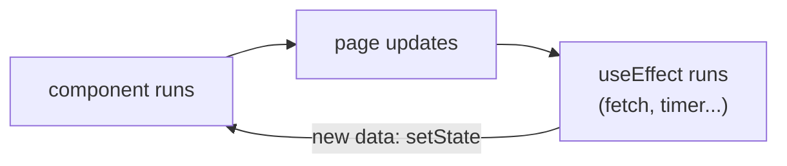
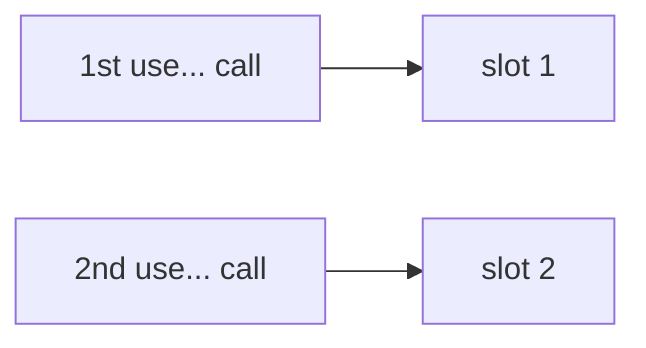
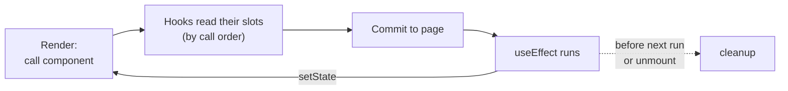
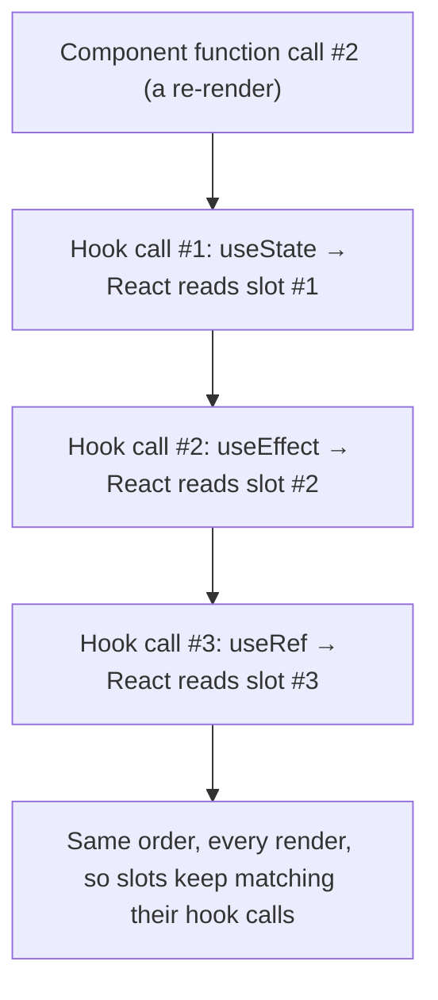
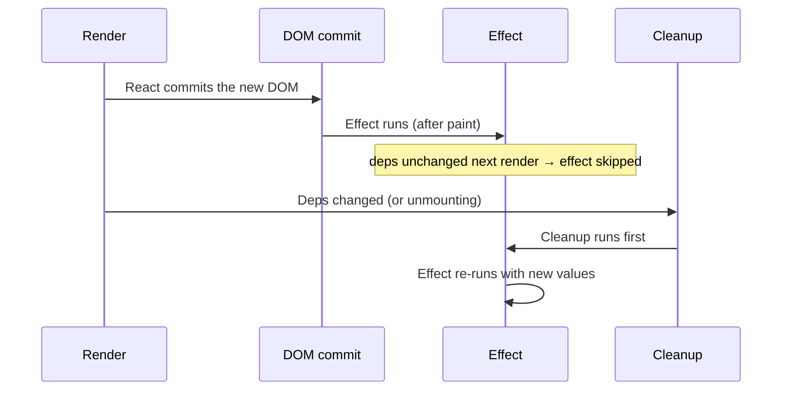
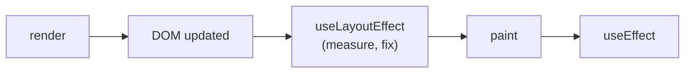
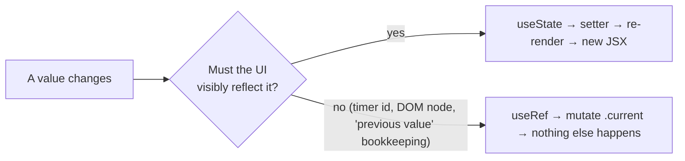
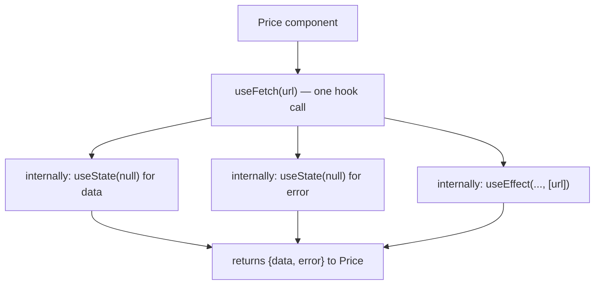

# React Hooks

> [!summary] TL;DR
> Hooks are plain functions, always starting with `use`, that let a function component hold state, run side effects, and reuse stateful logic without ever writing a class. React tracks each hook call by its **call order** within a component, so hooks must be called unconditionally, in the same order, on every render.

> [!abstract] Core idea
> - `useState` gives a component memory across renders; `useEffect` runs code after the DOM commits, and can clean up before the next run or on unmount.
> - React matches hook calls to their stored state by position in a fixed list, not by name — that's the entire reason for the rules of hooks.
> - `useMemo`/`useCallback` cache a computed value or function identity between renders; they help only when something expensive or a referential-equality check actually depends on it.
> - `useRef` holds a mutable value, or a DOM node reference, that survives renders without ever causing one itself.
> - Custom hooks are just functions that call other hooks, letting you extract and reuse logic across components.

## Start here: the basics 🟢

> [!info] How to read this note (pick your level)
> - 🟢 **New to this?** Read "From zero" below, then sections 1, 2 and the cheat sheet (10). Stop there, that is a full first pass.
> - 🟡 **Know the basics?** Add section 3 (the main hooks) and 4 (the fetch race traced and fixed).
> - 🔴 **Interview / SDE-3 prep?** Add 7, 8 and 9. Headings are tagged 🟢🟡🔴 so you always know where you are.

> [!note] Before this note
> - [[React Fundamentals - Components, JSX, Props, State]]: a component is a function React re-runs whenever its props or state change, and `useState` gives it a value plus a setter.
> - [[JavaScript Async - Event Loop, Promises, async-await]]: a `fetch` returns a promise that finishes later, so its answer can arrive after the user has moved on.

**From zero, in 60 seconds** 🟢

A React component is a function, and a function forgets everything when it finishes. But a counter needs to remember its number between clicks. **Hooks** are small helper functions, all starting with `use`, that give a component memory and other powers.

The two you will use most: `useState` remembers a value between runs, and `useEffect` runs code after the page updates — the right spot for things like fetching data or starting a timer (called a **side effect**).



One strange rule: React keeps each component's hook values in a numbered list, so you must call hooks in the same order every time — never inside an `if`.



The rest of this note is just these 4 questions:
1. Why must hooks be called in the same order every render?
2. How do `useState` and `useEffect` really work?
3. How do I fetch data without old answers overwriting new ones?
4. When do the caching hooks (`useMemo`, `useCallback`, `useRef`) actually help?


**The problem in one story.**
A product page shows a price fetched from a server.
A plain function forgets everything when it finishes, so it cannot remember the price between renders.
It also needs to start the fetch after the page shows, and stop it if the user leaves.
Hooks are small `use...` functions that give a component memory and a place for such "after render" work.

**Words you need first**

| Word | Plain meaning | Tiny example |
| --- | --- | --- |
| Component | A function that returns UI | `function Price() { ... }` |
| Render | React calling your component to get its UI | typing in a box re-runs it |
| State | Memory React keeps for a component | `useState(0)` |
| Side effect | Work that reaches outside the render: network, timers, DOM | `fetch('/price')` |
| Commit | The moment React writes changes to the real page | the new price text appears |
| Cleanup | Code that undoes an effect | `clearInterval(id)` |
| Closure | A function that remembers variables from where it was created | a callback still seeing an old `productId` |
| Dependency array | List of values that decide when an effect re-runs | `useEffect(fn, [productId])` |
| Unmount | React removing a component from the page | closing a popup unmounts it |
| Ref | A box from `useRef` that keeps a value without causing re-renders | `timerRef.current = id` |
| Memoize | Save a computed result and reuse it while inputs stay the same | `useMemo(() => sort(list), [list])` |
| Reference | Which exact object or function something is; a new one is made each render unless cached | `() => {}` is new every render |
| Stale closure | A callback still using an old value from an earlier render | an interval stuck at `count = 0` |
| Race condition | Two async jobs finish in an unlucky order and the wrong one wins | old price overwrites the new one |

**Picture it**



**Analogy.** Hooks are numbered lockers React keeps for each component: the first `use...` call opens locker 1, the second opens locker 2, every render.
Where it breaks: real lockers have names; hooks only have positions, which is why you must never call them inside an `if`.

**How the rest of this note builds up**

- First, why hooks replaced classes (section 1) and the "slots by call order" model (section 2).
- Then the rules of hooks, `useState`, `useEffect` with cleanup, and `useLayoutEffect` (section 3).
- Then a real fetch race traced and fixed, `useMemo`/`useCallback`, `useRef` and a custom hook (section 4).
- Finally the SDE-3 deep dive: variants, trade-offs, production pitfalls and internals (sections 5-8).

> [!tip] Remember
> Hooks give a function memory and effects, matched by call order, so call them the same way every render.

## 1. Why it exists 🟢

A function component is, each render, just a function call: its local variables are thrown away when it returns. Before hooks (pre-React 16.8, 2019), the only way to keep data across renders was to convert the component to a **class**, with `this.state`, `this.setState`, and lifecycle methods like `componentDidMount`.

That had a real cost. Two unrelated concerns — say, a data subscription and a window-resize listener — ended up interleaved inside the same `componentDidMount`/`componentWillUnmount` pair, because a class only has one of each lifecycle method, not one per concern.

Splitting them apart meant extracting a whole **higher-order component** (a function that takes a component and returns a wrapped one) or **render-prop** (a component that takes a function telling it what to draw) wrapper, both of which added a layer of indirection just to share logic.

Hooks solve this by giving a *function* component access to React's internal per-component storage, without a class. `useState` hands you a slot of memory.

`useEffect` hands you a slot for "run this after commit, clean up before the next one." Because they're just function calls, you can group one concern's state and effect together in one place, and extract repeated logic into your own function — a custom hook — instead of threading it through class inheritance.

> [!tip] Remember
> Hooks exist to give a plain function the one thing it was missing: memory across calls, without the ceremony of a class.

### Real-life example: the seat-hold timer 🟢

On BookMyShow, after you pick seats you see "Complete payment in 09:59", counting down.
The time left is `useState`; a `useEffect` starts a `setInterval` that ticks it down every second.
If you go back and leave the page, the effect's cleanup clears that interval, so it stops ticking in the background.
When you switch from one show time to another, an effect fetches that show's seat map, and an `ignore` flag makes sure a slow answer for the old show never replaces the new one.

## Common beginner mistakes 🟢

- **Calling a hook inside an `if`** → hook slots shift and state gets mixed up → call every hook at the top of the component; put the `if` inside the hook.
- **Leaving a used value out of the dependency array** → the effect keeps an old value (stale closure) → list every value the effect reads, or use the functional updater.
- **Starting a timer or listener with no cleanup** → it keeps running after the component is gone → `return () => clearInterval(id)` from the effect.
- **Using an effect to compute a value from props** → an extra render for nothing → compute it directly in the component body.
- **Wrapping everything in `useMemo`** → more work, not less, for cheap values → use it only for heavy work or to keep a reference stable for `React.memo`.

## Often confused 🟡

| These two | First one | Second one |
| --- | --- | --- |
| `useState` vs `useRef` | Changing it re-renders the screen | Changing it never re-renders |
| `useEffect` vs `useLayoutEffect` | Runs after the screen is painted | Runs before paint; blocks the screen until done |
| `useMemo` vs `useCallback` | Caches a value | Caches a function |
| `[]` vs no dependency array | Effect runs once after first render | Effect runs after every render |

## 2. Mental model 🟢

Picture each component instance as owning a single ordered list of slots — one slot per hook call. On every render, React walks that same list from the top and hands the `n`-th slot's stored value to the `n`-th hook call in your function body, in order.



**An analogy:** this is like a coat-check counter that hands you back your coat by the *ticket number* you were given, not by your name or your face.

If you hand in your coat first, then your bag, you must always collect coat-then-bag in that same order — if one visit you suddenly collect bag-then-coat, the counter can't tell and hands you the wrong item for that slot.

The analogy breaks down because a real coat-check has one ticket per item; React's "tickets" are just positions in a list, re-derived fresh from the order your code calls hooks in.

**Why it matters:** this is also why **hooks can't be called conditionally**. If an `if` sometimes skips a `useState` call, the second hook's data would land in the first hook's slot on the next render, silently corrupting unrelated state.

> [!warning] Common mistake
> Writing `if (condition) { const [x, setX] = useState(0); }`. This looks harmless but, on a render where `condition` is false, every hook call *after* this one shifts up by one slot — React has no way to know a hook was "skipped" rather than simply not yet reached.

## 3. How it works 🟡

> 🟢 → 🟡 **You now know** that hooks give a component memory and a place for "after render" work, and that React finds them by call order. **Next we open the box**: the two rules, how `useState` decides to re-render, how `useEffect` runs and cleans up, and when `useLayoutEffect` is needed.

### Rules of hooks, and why

**In plain words:** two rules, one reason. Always call hooks at the top of the component, never inside an `if` or loop, because React only knows each hook by its position in line — like a coat check that works by ticket number.

**Step by step:**
1. First render: `useState("")` (name) is call 1, `useState(0)` (age) is call 2. React stores "" in slot 1 and 0 in slot 2.
2. Next render, if every hook is called again in the same order, call 1 gets slot 1 and call 2 gets slot 2. All good.
3. Now suppose the name hook sits inside `if (showName)` and `showName` becomes false.
4. The age hook is now call 1, so React hands it slot 1: the name. Age now shows "".
5. Keeping every hook at the top level, with no `if` around it, prevents this.

1. Only call hooks at the top level of a component (or another hook) — never inside `if`, loops, or after an early `return`.
2. Only call hooks from React function components or custom hooks — not plain JS functions.

Both rules exist purely to keep the slot list's order identical across renders, since React has no way to identify a hook call except by its position.

> [!tip] Remember
> If you ever feel the urge to put a hook call inside a condition, put the condition *inside* the hook instead (e.g. inside `useEffect`'s body), not around the hook call itself.

### `useState`

**In plain words:** `useState` gives a component one piece of memory that survives between renders, plus a function to change it that also tells React "please re-render."

**Step by step:**
1. `const [items, setItems] = useState([])` gives an empty list on the first render.
2. You call `setItems([...items, "Dosa"])`. That makes a **new** array with Dosa in it.
3. React compares old and new with `Object.is` (are they the very same object?). They are different, so it re-renders.
4. On the re-render, `useState` returns the stored `["Dosa"]`, not the starting `[]`.
5. Had you done `items.push("Dosa"); setItems(items)`, the array would be the same object, and React would skip the re-render.

```jsx
const [count, setCount] = useState(0);
setCount(count + 1);          // direct form: computed from the render's own `count`
setCount((c) => c + 1);       // functional form: always sees the latest pending value
```

State updates must be treated as immutable: build a new object/array rather than mutating the old one, or React's equality check (`Object.is`, which asks "is it the very same object?") won't notice a change and will skip the re-render:

```jsx
// Wrong: mutates the existing array, same reference, React sees "no change"
items.push(newItem); setItems(items);

// Right: a new array, so the reference changes
setItems((prev) => [...prev, newItem]);
```

**What happens if** you call `items.push(newItem)` and then `setItems(items)`? `items` is still the exact same array reference as before the push — React's `Object.is(oldState, newState)` check sees two identical references and concludes nothing changed, so it skips the re-render entirely.

The array *is* mutated in memory, but the screen never updates to show it, because React was never told a change happened.

**Why it matters:** this is the single most common "my state update did nothing" bug, and it's invisible in a debugger print of `items` (which does show the new item) — only the un-rendered UI gives it away.

### `useEffect`: dependency array and cleanup

**In plain words:** `useEffect` lets you run code *after* React has already updated the real DOM — the right place for anything that reaches outside React itself, like starting a timer, subscribing to an external data source, or logging.

**Step by step:**
1. The component renders with `productId = 1` and React updates the page.
2. After the page is painted, React runs the effect: it starts a fetch for product 1.
3. The user picks product 2. React re-renders, sees `[productId]` changed from 1 to 2.
4. React runs the old effect's **cleanup** first (stop or ignore product 1), then runs the effect again for product 2.
5. When the component is removed from the page (unmounted), the cleanup runs one last time.

```jsx
useEffect(() => {
  const id = setInterval(() => setTick((t) => t + 1), 1000);
  return () => clearInterval(id);   // cleanup: runs before the next effect, and on unmount
}, []);                             // dependency array: when to re-run the effect
```

**Picture it:**



The dependency array controls *when* the effect re-runs:

- **No array:** runs after every render — rarely what you want.
- **`[]`:** runs once after the first commit, cleans up once on unmount.
- **`[a, b]`:** runs after the first commit and again whenever `a` or `b` changes since the last render; cleanup runs before each re-run and on unmount.

> [!warning] Common mistake
> A dependency you read inside the effect but omit from the array. This is a real bug, not a style nit: the effect closes over the *old* value from the render it was created in and keeps using it, which is the classic **stale-closure** bug:

```jsx
// Bug: effect captures the initial `count` (0) and never sees updates.
useEffect(() => {
  const id = setInterval(() => setCount(count + 1), 1000); // always "0 + 1"
  return () => clearInterval(id);
}, []); // missing `count` in deps

// Fix 1: add the dependency (restarts the interval every time count changes).
useEffect(() => {
  const id = setInterval(() => setCount(count + 1), 1000);
  return () => clearInterval(id);
}, [count]);

// Fix 2 (usually better here): functional update needs no dependency at all.
useEffect(() => {
  const id = setInterval(() => setCount((c) => c + 1), 1000);
  return () => clearInterval(id);
}, []);
```

**Example:** trace Fix 1 by hand. On the render where `count = 0`, the effect's closure captures `count = 0`.

One second later, `setCount(0 + 1)` fires, `count` becomes `1`, and because `count` changed, the dependency array `[count]` tells React to clean up the old interval and start a new effect — whose closure now captures `count = 1`.

Each tick, a brand-new interval is created with the current `count` baked in; this works, but restarts the timer on every tick, which is wasteful for something this simple.

**Picture it:** the buggy version's closure never changes, so every tick adds to the same frozen number; the fixed version either gets a fresh closure each time (Fix 1) or never needs to read the stale variable at all (Fix 2):

```mermaid
flowchart TD
    subgraph Bug["Bug: [] deps, reads count"]
        B1["closure captures count=0 forever"] --> B2["every tick: setCount(0+1)"]
        B2 --> B3["count stuck bouncing between 0 and 1"]
    end
    subgraph Fixed1["Fix 1: [count] deps"]
        F1["closure captures count=0"] --> F2["count becomes 1 → cleanup + new effect"]
        F2 --> F3["new closure captures count=1"] --> F4["correctly increments every tick"]
    end
    subgraph Fixed2["Fix 2: functional updater, [] deps"]
        G1["setCount(c => c+1) never reads outer count"] --> G2["always correct, no restart needed"]
    end
```



Before reaching for an effect at all, ask "can this be computed during render instead?" — react.dev calls this "you might not need an effect." Deriving a value from props/state (e.g. a filtered list, a formatted string) belongs in the render body, not in an effect that calls `setState` right after rendering.

> [!tip] Remember
> `useEffect` is for syncing with the outside world (DOM, timers, subscriptions, network) — not for computing a value you could just compute directly in the render body.

### `useLayoutEffect`

**In plain words:** same API as `useEffect`, but it runs synchronously (right away, holding everything else up) after the DOM mutates and *before* the browser paints the screen.

**Step by step:**
1. A tooltip renders below a button, at a guessed position.
2. `useLayoutEffect` runs before the screen is drawn and measures the tooltip: it would go off the right edge.
3. It moves the tooltip left.
4. Only now does the browser paint, so the user never sees it jump.



**Why it matters:** use it only when you must measure or mutate the DOM before the user sees a flicker (e.g. positioning a tooltip based on a just-rendered element's size); otherwise `useEffect` is preferred because it doesn't block painting, keeping the UI responsive.

## 4. Worked example 🟡

### Whiteboard version

The bare pattern: render a skeleton, fetch in an effect, re-render with data.

```jsx
function Price({ productId }) {
  const [price, setPrice] = useState(null);
  useEffect(() => {
    fetch(`/api/price/${productId}`).then((r) => r.json()).then((d) => setPrice(d.price));
  }, [productId]);
  return price === null ? <span>…</span> : <span>${price}</span>;
}
```

### Tracing a fast productId switch, step by step

Consider a user who switches `productId` from `1` to `2` quickly, before product `1`'s fetch has resolved:

1. Render with `productId=1`. `price` is `null`. The effect starts `fetch(/api/price/1)`.
2. The user switches tabs fast. React re-renders with `productId=2`.
3. Because the dependency `[productId]` changed, React runs cleanup for the *old* effect first, then starts the new effect: `fetch(/api/price/2)`.
4. Both network requests are now in flight: the slower product-1 request, and the newer product-2 request.
5. Suppose product-2's response arrives first (smaller payload, less network delay). `setPrice(productId2Price)` runs — the UI correctly shows product 2's price.
6. A moment later, product-1's slower response finally arrives. Its `.then` callback still runs and calls `setPrice(productId1Price)` — **overwriting the correct price with a stale one**, because nothing told that old callback it was superseded.

### Fixing the race condition with an `ignore` flag

```jsx
function Price({ productId }) {
  const [price, setPrice] = useState(null);

  useEffect(() => {
    let ignore = false;
    fetch(`/api/price/${productId}`)
      .then((r) => r.json())
      .then((d) => { if (!ignore) setPrice(d.price); }); // drop a late response for an old id
    return () => { ignore = true; };                     // runs before the next effect, or on unmount
  }, [productId]);

  return price === null ? <span>…</span> : <span>${price}</span>;
}
```

Replaying the same six steps with this fix: at step 3, the cleanup function from the *old* effect runs first and sets that closure's own `ignore` to `true`. At step 6, when product-1's late response arrives, its callback checks `ignore` — which is now `true` for that closure — and skips the `setPrice` call entirely.

`AbortController` is the stronger version of the same fix: it also cancels the in-flight network request, not just its effect on state.

> [!tip] Remember
> Any effect that sets state from an async result needs a way to tell a *stale* result "you're too late" — an `ignore` flag or an `AbortController`.

### `useMemo` and `useCallback`: when they actually help

**In plain words:** both hooks cache something between renders — `useMemo` caches a *value*, `useCallback` caches a *function's identity* — so that an expensive computation, or an unstable reference, doesn't redo unnecessary work on every render.

```jsx
function ProductList({ products, query }) {
  // Helps: filtering thousands of rows on every keystroke of an unrelated input would be wasteful.
  const filtered = useMemo(
    () => products.filter((p) => p.name.includes(query)),
    [products, query]
  );

  // Helps: a stable function identity lets React.memo(Row) actually skip re-rendering rows.
  const handleSelect = useCallback((id) => console.log("selected", id), []);

  return filtered.map((p) => <Row key={p.id} product={p} onSelect={handleSelect} />);
}
```

**Picture it:** the trade-off is "pay a small, fixed comparison cost every render" to "skip a potentially large recomputation" — it only wins when the right side of that scale is heavier:

| | Cost paid every render | Cost it saves |
| --- | --- | --- |
| No `useMemo` | — | — (but recomputes `filtered` from scratch every render) |
| `useMemo([products, query])` | compare 2 references (cheap) | re-filtering a large `products` array (can be expensive) |
| No `useCallback` | — | — (but `handleSelect` is a new function reference every render) |
| `useCallback([])` | compare 0 dependencies (trivial) | lets `React.memo(Row)` actually skip re-rendering every row |

**Why it matters:** both hooks trade memory and a comparison of the dependency array for *skipping* work. They help when either:
- the computation is genuinely expensive (sorting/filtering a large list, not adding two numbers), or
- the cached value/function is passed to a `React.memo`-wrapped child (`React.memo` makes a component skip re-rendering when its props are the same references as last time) or another hook's dependency array, where a **new** reference every render would defeat that optimization anyway.

> [!warning] Common mistake
> Wrapping every value in `useMemo` "just in case." Computing `a + b` is cheaper than the memoization bookkeeping itself, and it adds a dependency array that can silently go stale just like `useEffect`'s. React 19's React Compiler (a build-time tool that rewrites your components) automates much of this specific decision by inserting memoization where it actually pays off, reducing how often `useMemo`/`useCallback` need to be hand-written.

### `useRef`: DOM access and renderless mutable storage

**In plain words:** `useRef` is a pocket the component keeps between renders. You can put anything in it (a timer id, a DOM element), and changing it never repaints the screen.

```jsx
function AutoFocusInput() {
  const inputRef = useRef(null);
  useEffect(() => { inputRef.current.focus(); }, []); // imperative DOM access after mount
  return <input ref={inputRef} />;
}

function Stopwatch() {
  const [, forceTick] = useState(0);
  const startedAt = useRef(null); // a value that must persist, but changing it should NOT re-render

  function start() {
    startedAt.current = Date.now(); // mutating .current never triggers a re-render by itself
  }
  // ...
}
```

**Why it matters:** use `useState` when the UI must visibly update when the value changes; use `useRef` when you need to remember something across renders (a timer id, a previous value, a DOM node) without that change itself causing a re-render.

**Picture it:** the fork in the road is "does changing this value need to repaint the screen?" — a `useRef` write is a dead end for rendering, while a `useState` write always continues on to a re-render:



> [!warning] Common mistake
> Reading `ref.current` *during render* (not inside an effect or an event handler) to decide what to show. Since mutating a ref never triggers a re-render, the screen can silently fall out of sync with `.current`'s latest value — React has no way to know it should re-render just because a ref changed.

### A custom hook: extracting the fetch pattern

**In plain words:** a custom hook is just your own function named `useSomething` that bundles a few built-in hook calls, so two components can share the same logic instead of copy-pasting it.

Custom hooks are just functions, named `use...`, that call other hooks — this is how the race-condition-safe fetch above gets reused instead of copy-pasted:

```jsx
function useFetch(url) {
  const [data, setData] = useState(null);
  const [error, setError] = useState(null);

  useEffect(() => {
    let ignore = false;
    setData(null);
    setError(null);
    fetch(url)
      .then((r) => r.json())
      .then((d) => { if (!ignore) setData(d); })
      .catch((e) => { if (!ignore) setError(e); });
    return () => { ignore = true; };
  }, [url]);

  return { data, error };
}

function Price({ productId }) {
  const { data, error } = useFetch(`/api/price/${productId}`);
  if (error) return <span>error</span>;
  return data === null ? <span>…</span> : <span>${data.price}</span>;
}
```

`useFetch` follows the rules of hooks itself (it calls `useState`/`useEffect` unconditionally, at its own top level), which is exactly what lets a component call it just like a built-in hook.

**Picture it:** a custom hook is not a new kind of hook — it's a thin named wrapper around calls to the built-in ones, and it slots into the caller's own ordered hook list the same way any other hook call would:



> [!tip] Remember
> A custom hook buys you reuse, not new capability — it's the same `useState`/`useEffect` calls you'd write inline, just named and packaged so two components don't duplicate the same fetch-and-cleanup logic.

## 5. Variants and comparison 🟡

| Hook | What it's for | Use when | Cost / gotcha |
| --- | --- | --- | --- |
| `useState` | A value the UI depends on | Any value that should trigger a re-render when it changes | Must be replaced immutably, not mutated |
| `useReducer` | State transitions via a **reducer** function (takes the current state and an action, returns the next state) and **dispatched** (sent) actions | Several related state fields that change together, or transition logic worth testing on its own | More ceremony than `useState` for simple cases |
| `useEffect` | Side effects after commit (subscriptions, fetches, timers, manual DOM work tied to an external system) | Syncing with something outside React | Needs a correct dependency array and cleanup, or it leaks or goes stale |
| `useLayoutEffect` | Same as `useEffect`, but before paint | Measuring/mutating the DOM before the user sees a flicker | Blocks painting; use sparingly |
| `useMemo` | Cache a computed value between renders | An expensive computation, or a value whose identity another memoized thing depends on | Comparing the dependency array itself costs something; don't wrap trivial computations |
| `useCallback` | Cache a function's identity between renders | Passing a callback to a `React.memo`-wrapped child, or into another hook's dependency array | Same cost profile as `useMemo`; it's `useMemo` specialized for functions |
| `useRef` | A mutable value, or a DOM node, that doesn't trigger renders | Timer ids, previous values, **imperative** (direct "do this now", like `.focus()`) DOM access | Reading `.current` during render (not in an effect/handler) is a **footgun** (an easy way to hurt yourself) — it can read a stale value |
| `useContext` | Read a value provided higher in the tree | Avoiding **prop drilling** (passing a prop down through many layers that do not use it) for cross-cutting values (theme, auth) | Every consumer re-renders when the context value changes, even if it only reads one field |

## 6. Trade-offs and when not to use 🟡

- Don't reach for `useMemo`/`useCallback` by default; profile first. The memoization itself has a cost (storing the previous dependency array and comparing it), and an incorrect dependency array makes the cache silently return a stale value instead of just being slow.
- `useEffect` is for synchronizing with something *outside* React (the DOM, a subscription, a timer, the network) — deriving UI state from props/state belongs in the render body, not in an effect that calls `setState` right after rendering (an extra render for no reason).
- `useReducer` adds a layer of indirection (action types, a reducer function) that isn't worth it for one or two independent booleans; reach for it once several state fields change together in response to the same events.
- Hooks don't fix prop drilling — `useContext` does, but every consumer re-renders on any change to the Context value; for anything beyond a handful of consumers or a frequently-changing value, see [[React State Management - Props, Context, Redux]].

## 7. In production 🔴

> 🟡 → 🔴 **You now know** the main hooks, how effects clean up, how to stop a fetch race, and when caching hooks pay off. **Next is the advanced part**: how libraries build on hooks, the errors you will see in real apps, why `StrictMode` double-runs effects, and how React stores hooks inside.

- **Real systems:** essentially all React code written since 2019 uses hooks; data-fetching libraries like TanStack Query and RTK Query are themselves built as custom hooks (`useQuery`, `useMutation`) wrapping exactly the fetch-in-an-effect-with-cleanup pattern shown above, plus caching and retries.
- **Failure modes → fixes:**
  - A counter or interval always increments by the same stale amount → stale closure from a missing dependency; add the dependency or switch to the functional updater form.
  - A fetch's result overwrites a newer one after fast navigation → missing cancellation; add the `ignore` flag or an `AbortController`.
  - "Rendered more hooks than during the previous render" error → a hook call was placed after an early `return` or inside a conditional; move it to the top level.
  - A `React.memo`-wrapped child still re-renders every time → a new inline object/array/function literal is passed as a prop every render (new reference each time); wrap it in `useMemo`/`useCallback`.
  - Effects seem to double-fire in development → React 18+ `StrictMode` (a development-only checking wrapper) intentionally mounts, unmounts, and remounts each component once in development to surface effects with missing or broken cleanup; it does not happen in production builds.
- **What to monitor:** number of unnecessary re-renders per interaction (React DevTools Profiler, "why did this render" **flame graph**, a chart of nested bars showing where time went); effect cleanup correctness is a code-review concern, not a runtime metric — missing cleanup usually shows up as a memory/listener leak over a long session instead.

## 8. Deep dive 🔴

- **Why call order, not names, identifies a hook.** React doesn't know the hooks are named `useState`/`useEffect`; it simply keeps, per component instance, a **linked list** (items chained one after another, each pointing to the next) of "hook records" and advances one node per hook call during render. This is a deliberate simplicity trade-off (no need to track hook identity by name or location) that makes the two rules of hooks non-negotiable rather than stylistic.
- **`useReducer` for complex state.**
  ```jsx
  function reducer(state, action) {
    switch (action.type) {
      case "increment": return { count: state.count + 1 };
      case "decrement": return { count: state.count - 1 };
      default: return state;
    }
  }
  const [state, dispatch] = useReducer(reducer, { count: 0 });
  dispatch({ type: "increment" });
  ```
  Prefer this over several related `useState` calls once the transitions themselves (not just the fields) are the thing worth naming and testing — the reducer function is plain data-in, data-out and can be unit-tested with no component involved.
- **Newer hooks (React 18–19), briefly:** `useTransition`/`useDeferredValue` mark an update as low-priority so urgent updates (typing) aren't blocked by expensive ones (re-filtering a big list); `useId` generates stable ids safe for server and client rendering; `use` reads a Promise or a Context value inside render (including conditionally, unlike other hooks, since it isn't tracked by the same slot-order mechanism); `useActionState` and `useOptimistic` pair with Actions to manage a form submission's pending/error/optimistic-result state without hand-written `useState` plumbing.
- **`StrictMode`'s double-invoke in development** exists specifically to catch exactly the bugs this note warns about: an effect without correct cleanup will visibly misbehave (e.g. a doubled subscription) in development, rather than only failing quietly in production under real remounts.

## 9. Interview questions 🔴

> [!question]- Why can't you call a hook inside an `if` statement?
> React identifies each hook call by its position in a fixed, ordered list for that component instance, not by name. If a conditional sometimes skips a hook call, every hook call after it shifts to the wrong slot on renders where the condition differs, corrupting unrelated state — hence "hooks must be called unconditionally, in the same order, every render."

> [!question]- What is a stale closure, and how do you fix it in `useEffect`?
> The effect function captures the variables in scope at the time *that render* created it; if it uses a value that's missing from the dependency array, it keeps using the value from whichever render it was created in, not the latest one. Fix it by adding the value to the dependency array (so the effect is recreated when it changes) or by using the functional state-updater form, which doesn't need to read the outer variable at all.

> [!question]- When does `useMemo` actually help, versus being premature optimization?
> It helps when the computation is genuinely expensive, or when a stable reference is needed because the value is a dependency of another memoized thing or a prop to a `React.memo`-wrapped child — a new reference every render would otherwise defeat that memoization. Wrapping a cheap computation (e.g. `a + b`) in `useMemo` costs more (storing and comparing the dependency array) than it saves.

> [!question]- Trap: does mutating a ref (`ref.current = x`) cause a re-render?
> No. `useRef` is explicitly for values that need to persist across renders without themselves triggering one — use `useState` instead if the UI needs to visibly reflect the new value.

> [!question]- What does `useEffect`'s cleanup function do, and when does it run?
> It runs right before the effect runs again (if a dependency changed) and once more when the component unmounts. It's where you undo whatever the effect set up: clear a timer, remove an event listener, abort a fetch, unsubscribe.

> [!question]- Why does React run effects twice in development under `StrictMode`?
> To surface effects with missing or incorrect cleanup by deliberately mounting, unmounting, and remounting each component once, simulating what would otherwise only show up later from real remounts in production (e.g. revisiting a cached route). It does not run twice in a production build.

> [!question]- When would you choose `useReducer` over several `useState` calls?
> When multiple state fields change together in response to the same events and the *transitions* themselves are complex enough to be worth naming and testing in isolation — a reducer is a plain function you can unit test without rendering anything, whereas scattered `useState` setters spread that logic across every event handler.

## 10. Cheat sheet 🟢

- Hooks are matched to state by call order, not name — never call one conditionally or after an early `return`.
- `useState`: replace values immutably; use the functional updater `(prev) => ...` when the new value depends on the old one.
- `useEffect`: `[]` runs once; `[a,b]` reruns when `a`/`b` change; a used-but-omitted dependency is a stale-closure bug, not a style issue.
- Fix fetch race conditions with an `ignore` flag or `AbortController` in the cleanup function.
- `useMemo`/`useCallback` help only for real cost or for keeping a reference stable for `React.memo`/a dependency array — don't apply by default.
- `useRef` persists a value across renders without ever causing one; good for DOM nodes, timers, "previous value" bookkeeping.
- `StrictMode`'s double-invoked effects in development are meant to expose a missing cleanup, not a bug in React.
- A custom hook is just a function starting with `use` that calls other hooks, following the same rules.

## Self-check 🟢🟡

> [!question]- Easy: which hook gives a component memory that causes a re-render when it changes?
> `useState`.

> [!question]- Easy: when does `useEffect(fn, [])` run?
> Once, after the first render; its cleanup runs once when the component is removed.

> [!question]- Easy: where must hooks be called?
> At the top level of a component or custom hook, never inside `if`, loops or after an early `return`.

> [!question]- Medium: `items.push(x); setItems(items)` does not update the screen. Why?
> It is the same array object, so `Object.is` says nothing changed. Use `setItems([...items, x])`.

> [!question]- Medium: an interval inside `useEffect(..., [])` always shows `count + 1 = 1`. Fix?
> Use `setCount(c => c + 1)`, or add `count` to the dependency array.

> [!question]- Medium: fast switching between products shows the wrong price. What goes in the cleanup?
> Set an `ignore` flag (or call `abort()` on an `AbortController`) so the old fetch cannot call `setPrice`.

## Links

- **Before this:** [[React Fundamentals - Components, JSX, Props, State]], [[JavaScript Async - Event Loop, Promises, async-await]]
- **Next:** [[React Rendering - Virtual DOM, Reconciliation, Lifecycle]], [[React State Management - Props, Context, Redux]]
- **Compare with:** [[React State Management - Props, Context, Redux]] (`useContext` vs a dedicated store for cross-cutting state)

### Watch on YouTube

- [Basic React Hooks Crash Course (useState, useEffect, useMemo, useCallback) / WebDevSimplified](https://www.youtube.com/watch?v=qRkSWHbGkEU) · MasterDotDev · covers useState/useEffect plus useMemo/useCallback caching together
- [Intro to React Hooks with useState and useEffect](https://www.youtube.com/watch?v=P5p3vMeJ6LQ) · Steve Griffith - Prof3ssorSt3v3 · gentle intro to the two most-used hooks for beginners
