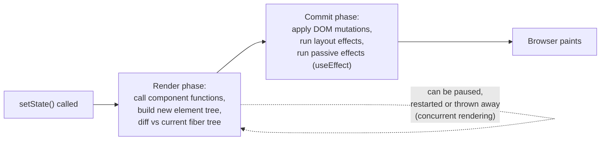
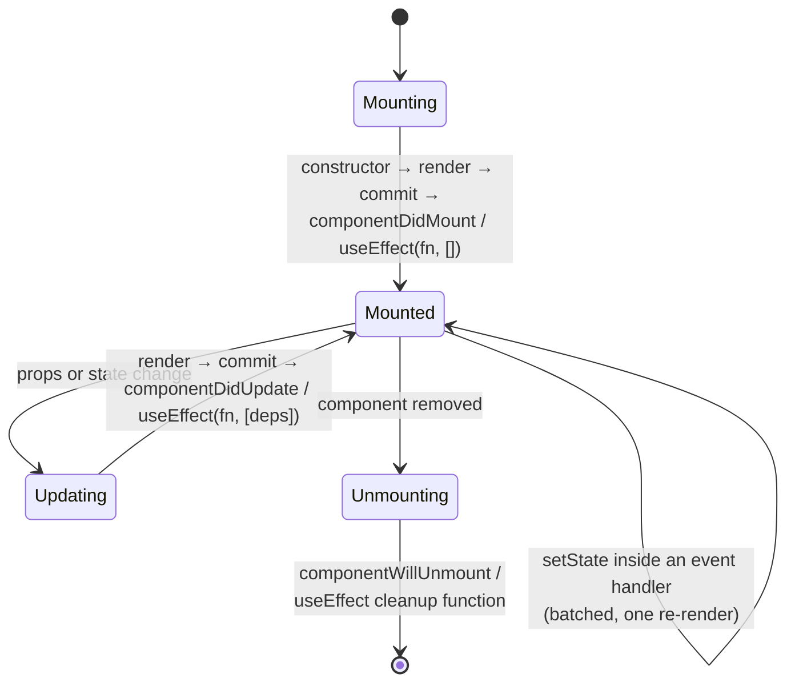

# React Rendering - Virtual DOM, Reconciliation, Lifecycle

> [!summary] TL;DR
> React keeps an in-memory description of the UI (the **virtual DOM**, a tree of plain JS objects), and on every state change it builds a new one, compares it to the previous one (**reconciliation**), and only touches the real browser DOM where something actually changed.

> [!abstract] Core idea
> - The virtual DOM does not make React "fast" by magic — real DOM writes are the expensive part either way. It buys **predictability**: you describe the UI for a given state, and React figures out the minimal patch.
> - Reconciliation walks the new and old trees together and uses heuristics (same type → update in place, different type → remount, `key` → identity inside a list) to decide what changed.
> - A component's life has three phases: **mount**, **update**, **unmount**. Hooks (`useEffect`, cleanup functions) are how function components hook into those phases; class lifecycle methods did the same job before hooks existed.
> - Since React 18, state updates are **batched** everywhere (not just inside event handlers), and rendering itself can be interrupted and resumed (**concurrent rendering**) so a big update doesn't freeze the page.

### Whiteboard version

```jsx
function Counter() {
  const [count, setCount] = useState(0);
  return <button onClick={() => setCount(count + 1)}>{count}</button>;
}
```

Click the button and the state changes 0 → 1. React does not mutate the DOM text node directly. It:

1. Calls `Counter()` again, producing a **new** React element tree: `<button>1</button>`.
2. Diffs it against the **previous** element tree: `<button>0</button>`.
3. Sees the same element type (`button`) with changed text, and issues exactly one DOM op: update that text node.

Nothing else on the page re-renders at the DOM level, even though in principle "the whole app" re-ran as JavaScript functions.

## 1. Why it exists

Before this model, UI libraries either mutated the DOM directly from scattered event handlers (jQuery-style — correct but hard to keep consistent as an app grows) or re-rendered the entire page on every change (simple but slow: full-page DOM rebuilds are visibly janky past a few hundred nodes).

React's answer: let you write the UI as a **pure function of state** (`UI = f(state)`) and let the library work out the cheapest way to get the real DOM from the old state's UI to the new state's UI. You never write "update the third list item's text" — you re-describe the whole subtree and trust the diff.

Concretely: re-rendering a 5,000-row table from scratch (destroy and recreate every `<tr>`) forces the browser to redo **layout** (a "reflow" — recomputing every element's size and position) and **paint** for all 5,000 rows. If only one row's data changed, reconciliation produces a diff with one DOM write, and only that row's box triggers reflow and repaint.

A component re-renders (its function runs again) for three reasons: its own state changed (`useState`/`useReducer` setter called), its parent re-rendered (children re-render by default, even with unchanged props, unless wrapped in `React.memo`), or it reads a context whose Provider got a new `value`. Only the first two necessarily touch the DOM; reconciliation is what decides whether a re-render actually produces a DOM write.

## 2. Mental model

Think of three trees, not two:

- **React elements** — the plain objects `{ type: 'button', props: { children: '1' } }` that `<button>1</button>` compiles to. Cheap to create, thrown away every render.
- **Fiber tree** — React's internal, persistent representation of your component tree (since React 16). Each fiber node remembers hooks state, the DOM node it owns, and its effects. This is what people loosely call "the virtual DOM" today.
- **Real DOM** — what the browser actually renders.

Every render produces a fresh element tree. React diffs it against the fiber tree from last time, updates the fiber tree in place where it can, and emits a minimal list of DOM mutations.

## 3. How it works



The **render phase** is pure: React calls your component functions, computes what should change, and must not touch the DOM or run side effects — which is why it is safe for React to pause, abandon, or redo this phase (that is what lets concurrent features exist at all). The **commit phase** is where DOM writes and effects happen, and it always runs to completion once started.

### Diffing heuristics

React does not do a general tree-diff (that is `O(n³)` for arbitrary trees). It uses two cheap heuristics instead, bringing the cost down to `O(n)`:

1. **Different element type at the same position → throw away the old subtree and mount a new one.** A `<div>` that becomes a `<span>` unmounts everything inside the old `<div>` (losing its state) and mounts fresh.
2. **Same type → update it in place**, and recurse into children by comparing them positionally — unless they have `key`s.

### Why list items need `key`

Without keys, React matches old and new children **by index**. Insert a new first item into `[A, B, C]` and, index-by-index, React sees "position 0 changed from A to NEW, position 1 changed from B to A, position 2 changed from C to B, position 3 is new (C)" — every existing DOM node gets patched with another item's data, and any per-item state (an open `<details>`, an uncontrolled `<input>`'s cursor) ends up attached to the wrong row.

```jsx
// Bad: index as key reintroduces the index problem key was meant to fix
items.map((item, i) => <Row key={i} data={item} />)

// Good: a stable identity that doesn't change when the list reorders
items.map((item) => <Row key={item.id} data={item} />)
```

With a stable `key`, React matches old and new children **by key**, so inserting at the front correctly shows "position 0 is new, everything else just moved" — one mount, zero wasted patches.

## 4. Worked example

### Lifecycle: class methods and their hook equivalents



| Class method | Hook equivalent | Purpose |
|---|---|---|
| `constructor` | `useState` initializer | set up initial state |
| `render` | the function body itself | describe the UI |
| `componentDidMount` | `useEffect(fn, [])` | run once after the first commit (fetch data, subscribe) |
| `componentDidUpdate` | `useEffect(fn, [dep1, dep2])` | run after commits where a dependency changed |
| `componentWillUnmount` | the function `fn` returns from `useEffect` | cleanup: cancel requests, remove listeners, clear timers |
| `shouldComponentUpdate` | `React.memo` (compares props) | skip a re-render when nothing relevant changed |
| `getDerivedStateFromProps` | compute the value directly in the render body, or `useMemo` | derive state from incoming props without a separate step |
| `getSnapshotBeforeUpdate` | `useLayoutEffect` reading the DOM before the browser paints | capture something (scroll position) before the DOM updates visually |
| `componentDidCatch` + `static getDerivedStateFromError` | no hook equivalent — still needs a class-based **error boundary** | catch render-time errors in a subtree and show a fallback |

```jsx
function Chat({ roomId }) {
  const [messages, setMessages] = useState([]);

  useEffect(() => {
    const controller = new AbortController();
    fetchMessages(roomId, { signal: controller.signal }).then(setMessages);
    const unsubscribe = subscribeToRoom(roomId, (m) =>
      setMessages((prev) => [...prev, m])
    );
    // Cleanup runs before the next effect (roomId changed) and on unmount.
    return () => {
      controller.abort();
      unsubscribe();
    };
  }, [roomId]); // re-run only when roomId changes

  return <MessageList items={messages} />;
}
```

If `roomId` changes, React runs the previous cleanup (abort the old fetch, unsubscribe from the old room) before running the effect again for the new room — a request race or a leaked subscription is exactly what's left out when this cleanup is forgotten.

Error boundaries still require a class, because the two lifecycle methods they need (`getDerivedStateFromError`, `componentDidCatch`) have no hook form as of React 19:

```jsx
class ErrorBoundary extends React.Component {
  state = { hasError: false };
  static getDerivedStateFromError() {
    return { hasError: true };
  }
  componentDidCatch(error, info) {
    logErrorToService(error, info);
  }
  render() {
    return this.state.hasError ? this.props.fallback : this.props.children;
  }
}
```

### React 18+: automatic batching and concurrent rendering

Before React 18, React only batched multiple `setState` calls inside its own event handlers; a `setState` inside a `fetch().then()` or a `setTimeout` callback triggered one re-render *per call*. Since React 18, batching applies everywhere:

```jsx
function handleClick() {
  setTimeout(() => {
    setCount((c) => c + 1); // before 18: re-render now
    setFlag((f) => !f);     // before 18: re-render now (2 total)
    // since 18: both updates are batched into one re-render
  }, 0);
}
```

Concurrent rendering lets React mark some updates as low priority so a high-priority one (typing in a box) isn't blocked behind a large re-render:

```jsx
const [query, setQuery] = useState('');
const [isPending, startTransition] = useTransition();

function onChange(e) {
  setQuery(e.target.value);       // urgent: keep the input responsive
  startTransition(() => {
    setResults(filterBigList(e.target.value)); // low priority: can be interrupted
  });
}
```

`useDeferredValue` does the same job from the consumer's side when you cannot wrap the producer's setter in `startTransition`.

## 5. Variants and comparison

| Approach | How it works | Use when | Cost |
|---|---|---|---|
| Virtual DOM diffing (React) | Diff element trees in JS, patch the real DOM | General-purpose UI with deep component trees and frequent targeted updates | Re-running component functions on every update; mitigated by `memo`/compiler |
| Fine-grained reactivity (Solid, Svelte) | Compile-time or signal-based tracking of exactly which DOM node depends on which value | You want to skip the "re-run the function, diff the tree" step entirely | More magic at build time; different mental model for state |
| Full re-render, no diffing (naive templating) | Re-build the DOM subtree from scratch on every change | Tiny pages, or a non-reactive library with no diffing step | Simple, but doesn't scale past small trees |
| `React.memo` / `useMemo` / React Compiler | Skip re-rendering a subtree, or re-computing a value, when inputs are referentially equal | A component or computation is provably unaffected by a parent re-render | Comparison cost; can backfire if props are new objects/functions every render |

## 6. Trade-offs and when not to use

- Re-rendering is cheap relative to the DOM write it might cause, but it is not free: large component trees with expensive render functions benefit from `memo`/`useMemo`, not from "the virtual DOM will handle it."
- The diff is a heuristic, not a true minimal edit script — a reordered list without keys, or a changed element type, forces more work than a human would choose.
- For a handful of static DOM nodes that almost never change, plain DOM APIs or a non-VDOM library add less overhead than React's render/commit machinery.
- The React Compiler (stable from React 19) auto-memoizes components that follow the rules of React, reducing — but not eliminating — the need to hand-write `memo`/`useMemo`/`useCallback`.

## 7. In production

- **Real systems:** every React 18/19 app (Next.js, Remix, CRA-successors like Vite); the Fiber architecture shipped in React 16 specifically to enable interruptible rendering for concurrent features.
- **Failure modes → fixes:**
  - List reorders scrambling input focus or animation state → add a stable `key`, never the array index, when the list can reorder or filter.
  - A component re-renders constantly and the app stutters → profile with React DevTools Profiler, find the state that's too high up the tree, move it down or memoize.
  - A subscription or timer keeps firing after a component is gone ("state update on an unmounted component") → return a cleanup function from the `useEffect` that created it.
  - Double effect firing in development → that's `StrictMode` intentionally mounting, unmounting and remounting once to surface missing cleanup; it does not happen in production builds.
- **What to monitor:** React DevTools Profiler flame graphs for render duration and re-render counts; Core Web Vitals (INP particularly, since it reflects render-blocking work from input to paint).

## 8. Deep dive

- **Fibers as a linked list, not a tree walk with the call stack.** Each fiber points to its child, sibling and return (parent), so React can pause work after any fiber and resume later without blowing the JS call stack recursing through a huge tree.
- **Lanes.** React 18 assigns each update a priority "lane" (discrete, continuous, default, transition, idle). A transition-lane update can be preempted by a discrete-lane one (a click), which is the mechanism behind `startTransition` staying responsive.
- **Batching is about commits, not renders.** "Batched" means React waits to flush DOM mutations and effects until it has processed all the synchronously-triggered state updates, producing one commit instead of several — it does not mean your component functions are called fewer times than state changes would otherwise imply.
- **`use()` and Suspense for data** (stable since React 19) let a component "read" a promise during render and suspend, handing the tree's nearest `<Suspense>` boundary a fallback to show — closing the gap between "fetch in an effect after mount" and declaratively suspending render itself. See [[React Routing and Rendering Strategies - CSR, SSR, SSG]] for how this interacts with Server Components.

## 9. Interview questions

> [!question]- Does the virtual DOM make React faster than directly manipulating the DOM?
> No — a hand-written, perfectly targeted DOM mutation is always at least as fast. The virtual DOM buys predictability: you write declarative code and React computes a decent diff for you, instead of you hand-tracking which DOM node needs which update.

> [!question]- Why does using the array index as a list `key` cause bugs?
> React matches old and new children by key. With the index as the key, inserting or removing an item shifts every subsequent item's "identity" by one position, so React reuses DOM nodes (and their internal state, like an uncontrolled input's value) for the wrong logical item. Use a stable ID from the data instead.

> [!question]- What's the difference between the render phase and the commit phase?
> The render phase calls your components and computes what should change; it is pure and can be paused, thrown away or restarted by React (which is what makes concurrent rendering possible). The commit phase applies DOM mutations and runs effects, and always runs to completion once it starts.

> [!question]- Why does a component render twice in development under `StrictMode`?
> `StrictMode` deliberately mounts, unmounts, and remounts a component once (and double-invokes some functions) in development only, to surface effects that don't clean up after themselves properly. It does not run twice in a production build.

> [!question]- Your component re-renders constantly and the UI stutters. Where do you start?
> Open React DevTools Profiler, record an interaction, and look at which components re-render and why. Common fixes: lift less state than you think (keep it close to where it's used), wrap expensive leaf components in `React.memo`, and make sure props passed down aren't new object/array/function literals on every render (or let the React Compiler handle that).

> [!question]- Trap: "componentDidMount and useEffect(fn, []) run at the exact same point in the lifecycle." True or false?
> False in subtle detail: `componentDidMount` runs synchronously right after the commit, while `useEffect` by default runs asynchronously after the browser has painted (it's a "passive" effect). If you need to measure or mutate the DOM *before* paint, use `useLayoutEffect`, not `useEffect`.

> [!question]- What problem do React 18's automatic batching and transitions each solve?
> Automatic batching reduces the number of re-renders when multiple state updates happen outside a React event handler (in a promise callback, `setTimeout`, or native event listener), collapsing them into one commit. Transitions solve a different problem: letting an expensive, non-urgent update (filtering a big list) be interrupted by an urgent one (keeping a text input responsive) instead of batching deciding priority for you.

## 10. Cheat sheet

- `UI = f(state)`: React re-runs your component function and diffs the result against the previous fiber tree; it does not mutate your JSX directly.
- Virtual DOM = predictability, not raw speed. The real DOM write still costs what it costs.
- Render phase: pure, interruptible. Commit phase: DOM writes + effects, atomic.
- Keys give list items identity across renders — always a stable ID, never the index, for lists that can reorder.
- Lifecycle: mount → update → unmount; hooks (`useEffect` + its cleanup function) replace class lifecycle methods except for error boundaries.
- React 18+: batching applies everywhere, and `startTransition`/`useDeferredValue` mark updates as low priority so urgent ones aren't blocked.
- `StrictMode`'s double-invoke in development is a leak detector, not a bug.

## Links

- **Before this:** [[React Fundamentals - Components, JSX, Props, State]], [[React Hooks]]
- **Next:** [[React State Management - Props, Context, Redux]]
- **Compare with:** [[React Routing and Rendering Strategies - CSR, SSR, SSG]] (how rendering strategy changes where this reconciliation happens)
