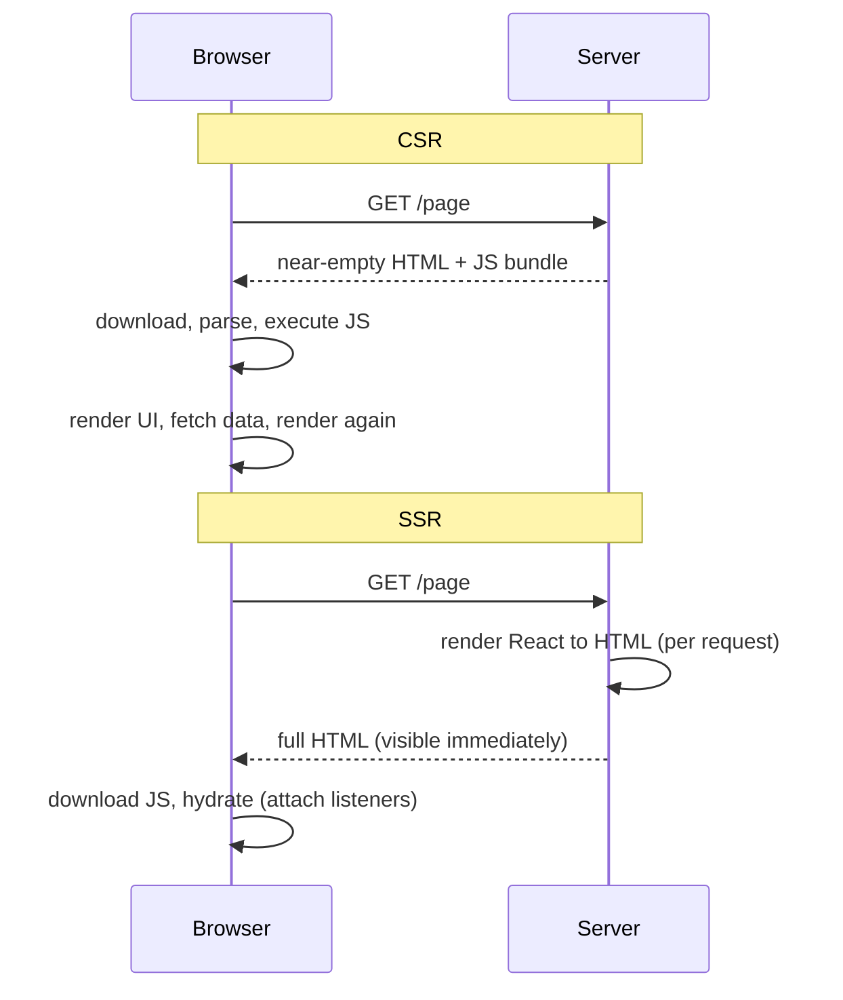
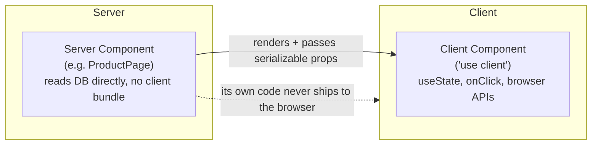

# React Routing and Rendering Strategies - CSR, SSR, SSG

> [!summary] TL;DR
> Client-side routing swaps which component renders without a full page reload. Separately, a page's HTML can be produced at four different times — on every request (SSR), once at build time (SSG), periodically after build (ISR), or entirely in the browser (CSR) — and that choice is independent of which router you use. React also lets a component run only on the server (**Server Components**) and send its already-rendered output to the browser.

> [!abstract] Core idea
> - A single-page app (SPA) loads once, then JavaScript swaps the visible component as the URL changes — no round trip to the server for the next page, but the *first* page load is relatively slow because the browser needs the JS bundle before anything renders.
> - **CSR** renders in the browser, **SSR** renders HTML per request on the server (then hydrates), **SSG** renders HTML once at build time, **ISR** regenerates static pages periodically without a full rebuild.
> - `lazy()` + `<Suspense>` split code by route so a user only downloads the JS for the page they're on — but `Suspense` needs something built to integrate with it (a lazy component, a resource with a `.read()`-style API, or the `use()` hook), not a bare `Promise` passed as a prop.
> - **React Server Components** run only on the server and never ship their code to the browser at all — a stricter, more granular version of "render on the server" than classic SSR.

### Whiteboard version

```jsx
const router = createBrowserRouter([
  { path: '/', element: <Home /> },
  { path: '/users/:id', element: <UserProfile /> },
]);

function App() {
  return <RouterProvider router={router} />;
}
```

Click a `<Link to="/users/42">`, and React Router intercepts the click, calls `history.pushState` (no network request, no page reload), matches `/users/:id`, and swaps in `<UserProfile>` with `id` read from `useParams()`. The URL bar updates; the server was never asked for `/users/42`.

## 1. Why it exists

Before client-side routing, every link click meant: browser requests a whole new HTML page, the connection round-trips, the browser throws away the current DOM and builds a new one, and any JS state (an open modal, scroll position, a form half-filled) is gone. For an app with frequent navigation (a dashboard, a chat app), that full reload is wasted work: the header, sidebar and CSS rarely change between pages.

Client-side routing keeps the JS app loaded and just swaps the part of the tree the URL maps to, using the browser's History API so the back/forward buttons and the URL bar still work correctly without a server round trip.

That solves navigation cost, but creates a different cost: the **first** visit still has to download, parse, and execute the JS bundle before anything meaningful shows up. The following rendering strategies are different answers to "when and where should the initial HTML actually get produced," orthogonal to routing itself.

## 2. Mental model

- **Routing** = "given this URL, which component tree do I show?" Can be done entirely client-side, or resolved at the server first.
- **Rendering strategy** = "when was the HTML for this page actually generated: never until the browser runs JS (CSR), fresh on every request (SSR), once ahead of time (SSG), or refreshed on a schedule (ISR)?"
- **Hydration** = taking server-rendered HTML that's already on the page and attaching React's event listeners and state to it, so it becomes interactive, without re-building the DOM from scratch.
- **Server Components** = components whose code and dependencies never reach the browser at all; they render on the server and send the result (not JS) down, composed alongside ordinary client components.

## 3. How it works

### Client-side vs server-side routing

```mermaid
flowchart TD
    subgraph client["Client-side routing"]
        U1[User clicks Link] --> H1["history.pushState(url)<br/>(no network request)"]
        H1 --> M1["Router matches URL to a route"]
        M1 --> R1["Swap component in place,<br/>run its loader for data"]
    end
    subgraph server["Server-side routing (classic MPA)"]
        U2[User clicks link] --> N2["Full HTTP request to server"]
        N2 --> M2["Server matches URL to a handler"]
        M2 --> R2["Server returns a full new HTML document"]
        R2 --> B2["Browser discards old DOM,<br/>builds new one from scratch"]
    end
```



**History API vs hash routing.** `createBrowserRouter` uses `pushState`/`popstate`, giving clean URLs (`/users/42`) — but the server must be configured to return the SPA's `index.html` for *any* path (a rewrite rule), since a direct request to `/users/42` would otherwise 404 on a static host that doesn't know that route. `createHashRouter` keeps the route after a `#` (`/#/users/42`); the browser never sends the part after `#` to the server, so hash routing works on static hosting with zero server configuration, at the cost of an uglier URL and historically worse SEO.

```jsx
// React Router v6.4+/v7: route objects, data loaders, nested layouts
const router = createBrowserRouter([
  {
    path: '/users/:id',
    element: <UserLayout />,
    loader: ({ params }) => fetchUser(params.id), // runs before the route renders
    children: [
      { path: 'posts', element: <UserPosts /> }, // renders inside <Outlet/>
    ],
  },
]);

function UserLayout() {
  const user = useLoaderData(); // data the loader already fetched
  return (
    <div>
      <h1>{user.name}</h1>
      <Outlet /> {/* nested route renders here */}
    </div>
  );
}
```

`createMemoryRouter` keeps history in memory instead of the URL bar — used in tests and non-browser environments, never in a deployed app.

### Protected routes and navigation

```jsx
function RequireAuth({ children }) {
  const { user } = useAuth();
  const location = useLocation();
  if (!user) {
    return <Navigate to="/login" state={{ from: location }} replace />;
  }
  return children;
}
```

```jsx
function LoginForm() {
  const navigate = useNavigate();
  async function onSubmit() {
    await login();
    navigate('/dashboard'); // programmatic navigation, no full reload
  }
}
```

### Code splitting with `lazy()` and `Suspense`

```jsx
const UserProfile = lazy(() => import('./UserProfile'));

function App() {
  return (
    <Suspense fallback={<Spinner />}>
      <UserProfile />
    </Suspense>
  );
}
```

`lazy()` returns a special component type that, the first time it's rendered, triggers the dynamic `import()` and tells the nearest `<Suspense>` to show its `fallback` until the module arrives. Paired with route-based splitting, each route's JS only downloads when a user actually navigates there, instead of in the initial bundle.

> [!warning] Suspense does not work on a bare Promise prop
> Passing a plain `Promise` as a prop (`<UserProfile dataPromise={fetch('/user')} />`) does **not** make `<Suspense>` show a fallback while it resolves. `Suspense` only reacts to a component that actually *suspends* — by throwing a promise internally, which is what `lazy()` does for code, and what a Suspense-integrated data source does for data. As of React 19, the supported way to suspend on a promise for data is the `use()` hook, which must be called during render, or a Suspense-enabled library (a cache-based query library) — not a Promise sitting inertly in props.

```jsx
// React 19: use() lets a component suspend on a promise during render
function UserProfile({ userPromise }) {
  const user = use(userPromise); // suspends until userPromise resolves
  return <h1>{user.name}</h1>;
}
```

The difference from the broken example above is that `use()` actively integrates the promise into render (and throws it to the Suspense boundary if it isn't settled yet); handing a plain `Promise` to a prop and expecting a `<div>{promise}</div>` to render its eventual value does nothing of the sort.

### CSR vs SSR vs SSG vs ISR



| Strategy | HTML generated | First paint | Data freshness | Typical use |
|---|---|---|---|---|
| **CSR** (client-side rendering) | In the browser, after JS loads | Slowest meaningful paint; fast subsequent navigation | Always current (fetched on demand) | Internal dashboards, apps behind a login where SEO doesn't matter |
| **SSR** (server-side rendering) | On the server, on every request | Fast first paint (HTML arrives ready); still waits to hydrate before fully interactive | Always current | Content that's personalized or changes often and needs SEO (e-commerce product pages, news) |
| **SSG** (static site generation) | Once, at build time | Fastest possible (served from a CDN, no render step on request) | Stale until the next build/deploy | Marketing pages, docs, blogs — content that doesn't change per request |
| **ISR** (incremental static regeneration) | At build time, then regenerated in the background on a timer or on demand | As fast as SSG for most requests | Eventually fresh, bounded by the revalidation interval | Large catalogs (product pages) too big to rebuild entirely on every deploy |

**Hydration** is the step after SSR/SSG where React attaches event handlers to the server-rendered DOM instead of rebuilding it: the page looks interactive before it actually is, and clicking too early can do nothing (or, in older setups, trigger a visible re-render if the client and server HTML don't match — a "hydration mismatch").

### React Server Components (conceptual)



In a framework that supports them (Next.js App Router), components are Server Components **by default**; adding `'use client'` at the top of a file opts a component (and its subtree) into being a Client Component. A Server Component can read a database or the filesystem directly and send only its rendered output (plus any Client Component "holes" it renders) to the browser — its own imports (an ORM, a markdown parser) never appear in the client JS bundle at all, which is a stronger guarantee than "SSR renders this once, but all the code still ships for hydration." The trade-off is a stricter model: Server Components can't use `useState`, `useEffect`, or browser-only APIs, since they never run in the browser.

## 4. Worked example

### Picking a strategy for a real app

A storefront has: a marketing homepage, a product catalog of 50,000 items, a cart (per-user, changes constantly), and an account dashboard.

- **Homepage** → SSG. Content changes maybe weekly; serve it from a CDN with no per-request render cost.
- **Product catalog pages** → ISR. 50,000 pages are too many to rebuild on every price change, but they don't need per-request freshness either — regenerate each page in the background every few minutes, or on demand when a price updates.
- **Cart and checkout** → SSR or CSR behind auth. Per-user, always fresh, not something a crawler needs to index — SSR for a fast first paint on checkout (where speed affects conversion), CSR is also defensible since it's never indexed.
- **Account dashboard** → CSR. Logged-in only, no SEO benefit, and the dashboard is visited repeatedly in one session, so the SPA navigation benefit (fast subsequent views) matters more than first-paint speed.

### Route-based code splitting end to end

```jsx
const routes = [
  { path: '/', element: withSuspense(lazy(() => import('./Home'))) },
  { path: '/catalog', element: withSuspense(lazy(() => import('./Catalog'))) },
  { path: '/account', element: withSuspense(lazy(() => import('./Account'))) },
];

function withSuspense(Component) {
  return (
    <Suspense fallback={<PageSkeleton />}>
      <Component />
    </Suspense>
  );
}
```

A user who only ever visits `/` never downloads `Catalog` or `Account`'s JavaScript — the bundler (Vite, webpack) emits each `lazy()`-wrapped import as its own chunk, fetched only when that route is reached.

## 5. Variants and comparison

| Strategy / tool | How it decides when to render | SEO | Time to first paint | Time to interactive |
|---|---|---|---|---|
| CSR | Entirely in the browser, after JS downloads | Poor without extra work (crawlers may not execute JS) | Slow | Slow (JS must load, then render) |
| SSR | Server renders HTML per request | Good | Fast | Medium (must hydrate after HTML arrives) |
| SSG | Rendered once at build time | Good | Fastest | Medium (still hydrates, but HTML is pre-built and cached) |
| ISR | SSG + scheduled/on-demand regeneration | Good | Fastest for cached pages | Medium |
| Streaming SSR | Server sends HTML in chunks as pieces finish rendering | Good | Fast (first chunk arrives quickly) | Can be progressive, piece by piece |
| Server Components | Server renders and never ships that component's JS at all | Good | Fast | Less JS to hydrate overall, since Server Component subtrees need no client-side re-render |

## 6. Trade-offs and when not to use

- CSR's "fast after the first load" only pays off for apps people stay in and navigate around; a one-off landing page visited once per session gets none of that benefit and all of the slow-first-paint cost.
- SSR adds server compute cost (render React on every request) and server complexity (the component must run in a Node-like environment, not just the browser) — not worth it for content that's genuinely static.
- ISR's staleness window is a real trade-off: a price change won't show up until the next regeneration unless you trigger on-demand revalidation for that specific change.
- Server Components require a framework that implements the RSC protocol (Next.js App Router is the mainstream option); they are not a drop-in feature of plain `create-react-app`-style client-only React.
- Hash routing avoids server configuration entirely but costs SEO and a visibly uglier URL — only worth it for a genuinely static host with no rewrite-rule option.

## 7. In production

- **Real systems:** Next.js (App Router: Server Components + streaming SSR; Pages Router: classic SSR/SSG/ISR), Remix (SSR-first, nested route loaders), Gatsby (SSG), Astro (mostly static with selective hydration — "islands").
- **Failure modes → fixes:**
  - Hydration mismatch (server HTML differs from the client's first render, often from `Date.now()` or `Math.random()` in render, or browser-only APIs touched during SSR) → make render deterministic between server and client, move non-deterministic reads into an effect.
  - A direct URL to a client-routed path 404s on a static host → add a server/CDN rewrite rule so unknown paths serve `index.html` (not needed with hash routing).
  - A `<Suspense>` boundary never resolves its fallback → check that the thing inside actually integrates with Suspense (lazy import, `use()`, a Suspense-enabled cache) rather than a bare unresolved Promise sitting in state or props.
  - Stale catalog pages after a price change under ISR → trigger on-demand revalidation for that specific page instead of waiting for the next timed regeneration.
- **What to monitor:** Core Web Vitals — LCP (largest contentful paint, hurt by slow SSR/CSR first paint), INP (hurt by a large hydration cost blocking the main thread), CLS; server render latency and error rate for SSR; cache hit ratio for SSG/ISR pages served from a CDN.

## 8. Deep dive

- **Streaming SSR and Suspense on the server.** A framework can start sending HTML for the parts of a page that are ready, wrap a slow part in `<Suspense>`, and stream in its HTML (plus a script that slots it into place) once the data arrives — so a slow data source for a sidebar doesn't block the whole page's first byte.
- **Selective/partial hydration.** Not every pixel of server-rendered HTML needs client-side JS attached. Astro's "islands" architecture hydrates only the components that are actually interactive (a like button) and leaves static markup (an article body) as plain HTML forever — a more aggressive version of what Server Components do at the framework level.
- **Why `createBrowserRouter`/`createHashRouter` are functions, not components.** They build and return a router object (route tree, matching logic, history integration); that object is then handed to `<RouterProvider router={router}>`, which is the actual React component that subscribes to it and renders the matched route. Treating `createBrowserRouter(...)` itself as JSX (`<createBrowserRouter />`) is a category error — it was never a component.
- **SEO and crawlers today.** Google's crawler does execute JavaScript for indexing, which softened CSR's historical SEO disadvantage, but render cost, inconsistent crawler behavior across search engines, and slower, later-indexed content still make SSR/SSG the safer default for anything that needs to rank reliably.

## 9. Interview questions

> [!question]- What's the actual difference between client-side and server-side routing?
> Client-side routing intercepts link clicks, updates the URL via the History API, and swaps components in the already-loaded app — no network round trip. Server-side (classic multi-page) routing sends a full HTTP request for every navigation and the server returns a brand-new HTML document, which the browser renders from scratch, discarding the old DOM and any client-side state.

> [!question]- Trap: does an SPA load faster than a traditional multi-page site?
> Not on the first visit — the SPA has to download and execute its JS bundle before rendering anything meaningful, which is typically slower than a server returning ready-to-paint HTML. The SPA's advantage is *subsequent* navigation within the app, which avoids a full page reload.

> [!question]- Why doesn't passing a Promise as a prop make `<Suspense>` show its fallback?
> `<Suspense>` only reacts to a component that actively suspends — by throwing a promise during render, which `lazy()` does for code-split components and the `use()` hook does for data. A plain `Promise` sitting inertly in props or state never throws anything, so Suspense has nothing to catch and never shows the fallback for it.

> [!question]- When would you choose ISR over plain SSR?
> When pages don't need per-request freshness but there are too many of them (or they're expensive enough to render) that rendering on every request would be wasteful — a large product catalog, for instance. ISR serves a cached static page for most requests and regenerates it periodically or on demand, trading a bounded staleness window for far lower server render cost.

> [!question]- What do React Server Components give you that classic SSR doesn't?
> Classic SSR renders the whole tree to HTML once, but all of that component's code still ships to the browser for hydration. A Server Component's code (and its server-only dependencies, like a database client) never reaches the browser bundle at all — only its rendered output and any Client Component "holes" do, which can meaningfully shrink the JS the client has to download and execute.

> [!question]- A static host serves `createBrowserRouter`-based app. Direct navigation to `/users/42` 404s, but clicking a `<Link>` to it works fine. Why, and what's the fix?
> Clicking the `<Link>` is pure client-side routing — no request to the server at all, so the server's lack of a `/users/42` route never matters. A direct browser navigation (typed URL, refresh, shared link) sends a real HTTP request for `/users/42`, and a static host with no rewrite rule has no file at that path, hence the 404. Fix: configure the host to serve `index.html` for any unmatched path (or switch to hash routing, which never sends the route to the server).

> [!question]- Your team argues CSR is simpler, SSR is faster to load, and Server Components solve everything — how do you frame the real decision?
> It's not one global choice — different routes in one app can use different strategies. Pick based on each page's needs: does it need SEO (rules out plain CSR), does content change per request or rarely (SSR vs SSG/ISR), does it need interactivity at all (a candidate for a Server Component with no client JS), and is the team's framework capable of mixing these per route (Next.js App Router is built for exactly that).

## 10. Cheat sheet

- Client-side routing = no network round trip per navigation; needs a server rewrite rule for direct URL hits (or use hash routing to avoid needing one).
- CSR: render in browser (slow first paint, fast after). SSR: render per request (fast first paint, server cost per request). SSG: render once at build (fastest, staleness until rebuild). ISR: SSG + scheduled/on-demand refresh.
- `lazy()` + `<Suspense>` split code by route/component; Suspense needs something that actually integrates with it (lazy import, `use()`, a Suspense-aware cache) — not a bare Promise.
- Hydration = attaching behavior to already-rendered server HTML, not rebuilding the DOM.
- Server Components run only on the server and never ship their code to the client; `'use client'` opts a subtree into client-side interactivity.
- `createBrowserRouter`/`createHashRouter` are functions returning a router object, handed to `<RouterProvider>` — never used as JSX themselves.
- Mix strategies per route: no single choice fits a whole app.

## Links

- **Before this:** [[React Fundamentals - Components, JSX, Props, State]], [[React Rendering - Virtual DOM, Reconciliation, Lifecycle]], [[React State Management - Props, Context, Redux]]
- **Next:** this is the last note in the Frontend learning path; from here, see [[07 Databases MOC]] or [[05 APIs MOC]] for the backend side of a full-stack request
- **Compare with:** [[How Browsers Load and Render a Page]] (the critical rendering path this sits on top of), [[CDN and Edge]] (where SSG/ISR output is typically served from)
