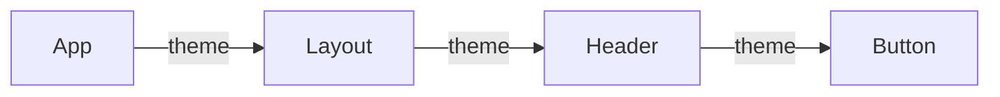
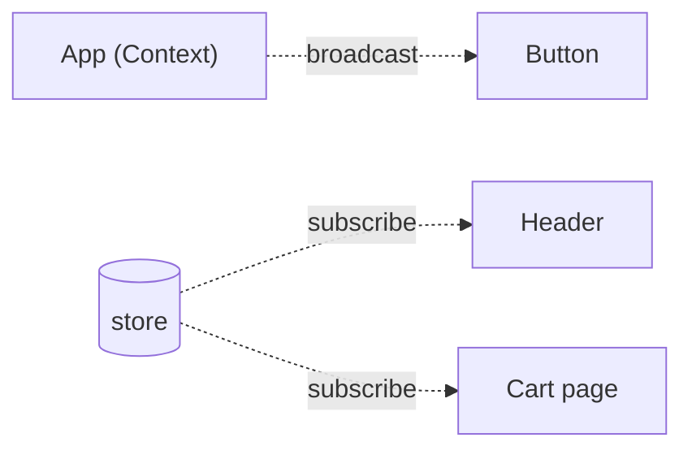
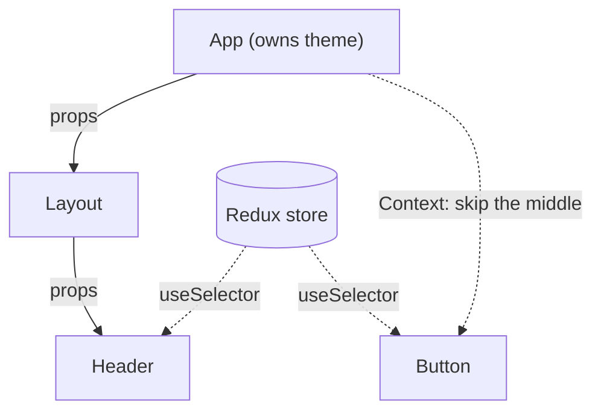
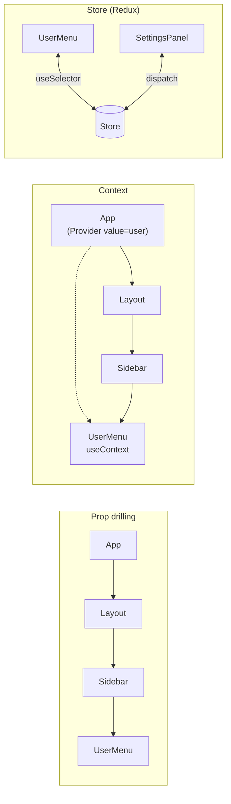
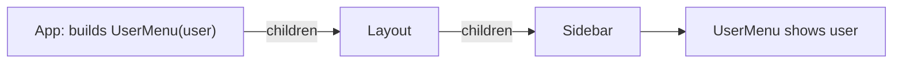
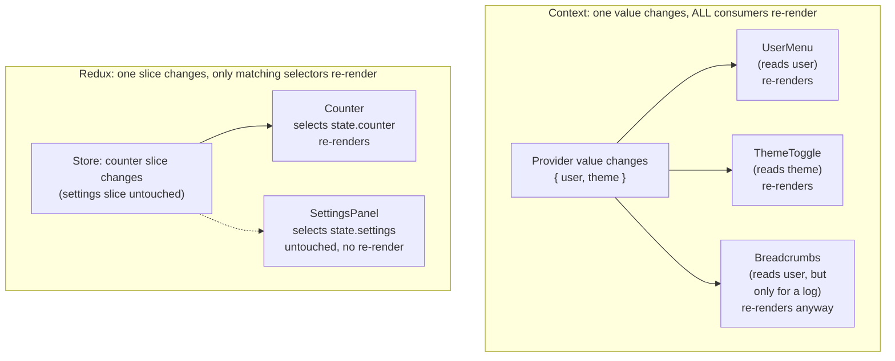
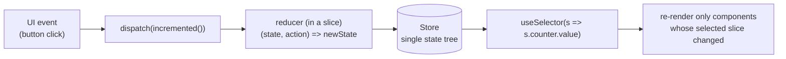
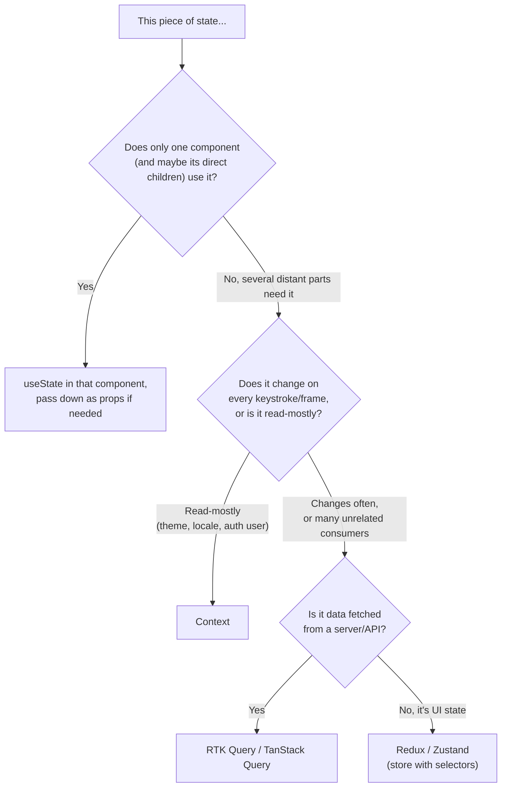
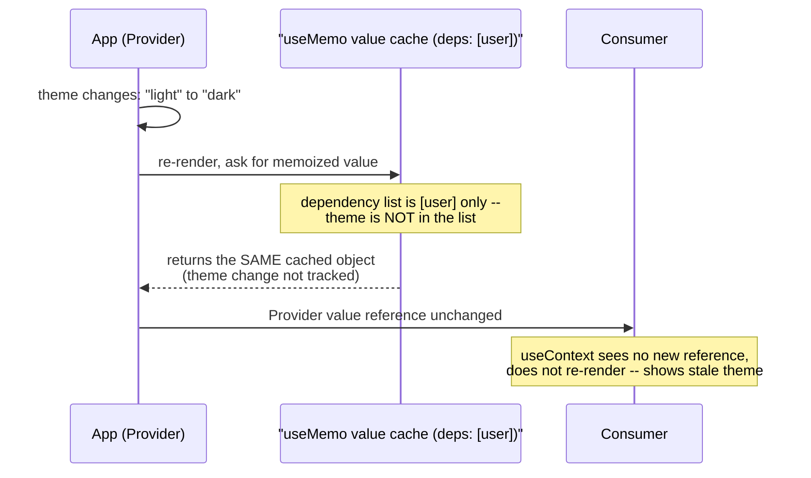

# React State Management - Props, Context, Redux

> [!summary] TL;DR
> Pass data down with **props** by default. Reach for **Context** only to avoid threading one value through many layers that don't use it, and reach for a store like **Redux** only when several unrelated parts of the app need to read and write the same state. Each option trades simplicity for reach, and most apps need less of this machinery than they assume.

> [!abstract] Core idea
> - Props flow one way, parent to child. **Prop drilling** — passing a prop through components that don't use it, just to reach one that does — is normal for 2–3 levels and becomes a smell beyond that.
> - **Context** solves the drilling problem, not the "this is global state" problem: any component that calls `useContext` re-renders whenever the Provider's `value` changes, even if only one field in that value changed.
> - The Context `defaultValue` (the argument to `createContext`) only applies to a component that renders with **no Provider above it at all** — it is not a fallback for "Provider rendered without a `value` prop," which instead gives you `undefined`.
> - **Redux** (and similar stores) exist for state genuinely shared across distant, unrelated parts of the UI — not as a replacement for `useState` on state that one component tree owns.

## Start here: the basics 🟢

> [!info] How to read this note (pick your level)
> - 🟢 **New to this?** Read "From zero" below, then sections 1, 2 and the cheat sheet (10). Stop there, that is a full first pass.
> - 🟡 **Know the basics?** Add section 3 (Context and its re-render cost) and 4 (Redux Toolkit and choosing a tool).
> - 🔴 **Interview / SDE-3 prep?** Add 7, 8 and 9. Headings are tagged 🟢🟡🔴 so you always know where you are.

> [!note] Before this note
> - [[React Fundamentals - Components, JSX, Props, State]]: props go from parent to child, state lives in one component, and shared state is lifted to a common parent.
> - [[React Rendering - Virtual DOM, Reconciliation, Lifecycle]]: when a component re-renders, its children re-render too unless something stops them.

**From zero, in 60 seconds** 🟢

Many parts of an app often need the same piece of data, like the current theme or the cart count. The default way to share it is **props**: the parent hands it to the child, who hands it to its child, like passing a note down a row of desks.



When the note passes through many people who never read it, that is called **prop drilling**, and it gets annoying. React gives two escape hatches. **Context** broadcasts a value so any component below can just grab it. A **store** (like Redux) is a shared box outside the tree that any component can read from or write to.



Each step up costs something, usually extra re-renders or extra code. The rest of this note is just these 4 questions:
1. When does prop drilling actually become a problem?
2. How does Context work, and why does it re-render everyone?
3. How does Redux work, and when is it worth it?
4. Where should fetched server data live?


**The problem in one story.**
Your app has a dark-mode switch in the settings page.
The header, sidebar and buttons all need to know the current theme.
Passing it by hand through every component in between is tedious.
React offers three ways to share data: props (hand it down), Context (broadcast it), or a store like Redux (one shared box everyone subscribes to).

**Words you need first**

| Word | Plain meaning | Tiny example |
| --- | --- | --- |
| Component tree | Components nested inside each other | `App > Layout > Header` |
| Props | Data a parent hands to its child | `<Header theme="dark" />` |
| State | Data a component owns and can change | `useState('dark')` |
| Re-render | React calling a component again to refresh its UI | the header redraws after a theme change |
| Prop drilling | Passing a prop through layers that do not use it | `Layout` passing `theme` it never reads |
| Store | One central object holding shared app state | a Redux store with `cart` and `user` |
| Selector | A function picking one slice of the store | `s => s.cart.count` |
| Context | React's way to share a value with every component below, without props | a `ThemeContext` |
| Provider | The component that supplies a Context value to everything inside it | `<ThemeContext.Provider value="dark">` |
| Consumer | A component that reads a Context with `useContext` | a button reading the theme |
| Action / dispatch | A small message saying what happened / sending it to the store | `dispatch({ type: "cart/added" })` |
| Reducer | A pure function: old state + action → new state | `(state, action) => newState` |
| Slice | One section of the store, with its own reducer | the `cart` slice |

**Picture it**



**Analogy.** Props are passing a note hand to hand; Context is a PA announcement to the whole floor; a store is a notice board where each person reads only their own section.
Where it breaks: a PA announcement makes everyone stop and listen, and Context really does re-render every consumer, even ones that do not care about the change.

**How the rest of this note builds up**

- First, why prop drilling hurts (section 1) and the mental model of three sharing tools (section 2).
- Then composition, the Context default-value rule, Context's re-render cost, and Redux Toolkit's data flow (section 3).
- Then async server data and choosing between props, Context and a store (section 4).
- Finally the SDE-3 deep dive: trade-offs, production patterns and the stale memoized Context bug (sections 5-8).

> [!tip] Remember
> Start with props; use Context to skip layers; use a store only when distant parts of the app share state that changes often.

### Whiteboard version

```jsx
const ThemeContext = createContext('light'); // default: used only with no Provider above

function App() {
  const [theme, setTheme] = useState('dark');
  return (
    <ThemeContext.Provider value={theme}>
      <Toolbar />
    </ThemeContext.Provider>
  );
}

function Toolbar() {
  return <ThemedButton />; // doesn't touch theme, just passes the tree through
}

function ThemedButton() {
  const theme = useContext(ThemeContext); // "dark" — read straight from the Provider, no prop drilling
  return <button className={theme}>Click</button>;
}
```

`Toolbar` never mentions `theme`. Without Context, `theme` would have to be an explicit prop on `Toolbar` purely so it can forward it to `ThemedButton` — that forwarding is prop drilling.

## 1. Why it exists 🟢

A counter owned by one component needs nothing but `useState`.

The moment two sibling components need to share and both update one piece of state, that state has to move up to their common ancestor (**lifting state up**) and come back down as props.

The more layers between the ancestor and the consumer, the more components end up receiving a prop they never read, just to pass it on.

```jsx
function App() {
  const [user, setUser] = useState(null);
  return <Layout user={user} />;
}
function Layout({ user }) {
  return <Sidebar user={user} />; // Layout never reads user
}
function Sidebar({ user }) {
  return <UserMenu user={user} />; // Sidebar never reads user either
}
function UserMenu({ user }) {
  return <span>{user?.name}</span>; // finally used, 3 levels down
}
```

For 2–3 levels this is fine and arguably clearer than an invisible global. Past that, every refactor of the middle layers risks breaking the chain, which is the actual problem prop drilling causes — not performance.

### Real-life example: Swiggy's cart and theme 🟢

On a food app like Swiggy, the cart count shows in the header, on the menu page and at checkout: three far-apart places, and it changes every time you tap "ADD". That suits a store with selectors, so only the parts showing the cart redraw.
Your chosen language and dark mode rarely change but are read everywhere, which suits Context.
A single dish card's "expanded" toggle is used only by that card, so plain `useState` is enough.
The restaurant list itself comes from the server, so a query library (like TanStack Query) caches and refreshes it.

## Common beginner mistakes 🟢

- **Putting everything in Redux from day one** → lots of extra code for state only one component uses → start with `useState` and props.
- **Passing a new object to a Provider each render** (`value={{ user, theme }}`) → every consumer re-renders every time → wrap it in `useMemo` or split the Context.
- **Mixing a fast-changing value into a Context with slow ones** → typing in a search box re-renders the whole app → keep fast values local or in a store.
- **Forgetting the Provider's `value` prop** → consumers get `undefined`, not the default → always pass `value`.
- **Storing API responses in Redux by hand** → you rebuild caching and refetching badly → use RTK Query or TanStack Query.

## Often confused 🟡

| These two | Context | Redux store |
| --- | --- | --- |
| What it solves | Skipping layers when passing a value down | Sharing changing state across far-apart parts of the app |
| Who re-renders on a change | Every consumer of that Context | Only components whose selected slice changed |
| Best for | Theme, language, logged-in user | Cart, filters, app-wide UI state that changes often |
| Extra code | Very little | More (slices, actions), though Redux Toolkit cuts it down |

## 2. Mental model 🟢

- **Props** = function arguments. Explicit, typed, traceable by reading the component that renders you.
- **Composition (`children`)** = pass a rendered element down instead of data, so the component accepting `children` doesn't need to know what's inside it. Often removes the need for Context entirely.
- **Context** = a value broadcast to every **descendant** (any component nested below) of a Provider, read with a hook, skipping the middle layers. Think of it as "ambient" (in the air around you) — not traceable by reading props alone.
- **A store (Redux, Zustand, a smaller and simpler store library)** = state that lives outside any component, with an explicit, structured way to read it (`useSelector`) and change it (`dispatch`), independent of where in the tree you are.

## 3. How it works 🟡

> 🟢 → 🟡 **You now know** the three ways to share data: props, Context and a store. **Next we open the box**: a trick that often removes the need for Context, the Context default-value trap, and exactly why Context re-renders more than a store does.



Context's dotted line shows the actual data path: it skips `Layout` and `Sidebar` entirely, but they're still re-rendered if they sit between the Provider and the consumer, because React re-renders every component in a subtree whose parent re-rendered unless something (`memo`) stops it — Context doesn't change that rule, it only changes who can *read* the value.

### Composition as an alternative to Context

**In plain words:** sometimes you can skip Context entirely by building the inner component at the top (where the data lives) and passing the finished piece down as `children`, like mailing a sealed parcel through couriers who never open it.

**Step by step:**
1. `App` has `user`. Deep inside, `UserMenu` needs it. `Layout` and `Sidebar` sit in between and do not care.
2. Instead of passing `user` to `Layout` then `Sidebar`, `App` builds `<UserMenu user={user} />` itself.
3. `App` passes that finished element as `children`: `<Layout><Sidebar>{menu}</Sidebar></Layout>`.
4. `Layout` and `Sidebar` just place `{children}` where it belongs. They never see `user`.



Before reaching for Context, check whether passing `children` solves the drilling:

```jsx
// Instead of threading `user` through Layout and Sidebar...
function App() {
  return (
    <Layout>
      <Sidebar>
        <UserMenu user={user} />
      </Sidebar>
    </Layout>
  );
}
function Layout({ children }) { return <div className="layout">{children}</div>; }
function Sidebar({ children }) { return <aside>{children}</aside>; }
```

`Layout` and `Sidebar` never see `user` at all — `UserMenu` is constructed once, at the top, with the prop it needs, and simply slotted in.

### The Context default-value rule

**In plain words:** the default you give `createContext` only kicks in when there is no Provider above at all. A Provider that forgot its `value` prop hands out `undefined`, not the default — a classic gotcha.

**Step by step:**
1. `const ThemeContext = createContext('light');` sets the default to `'light'`.
2. A button with **no** `ThemeContext.Provider` anywhere above it reads `'light'`.
3. A button under `<ThemeContext.Provider value="dark">` reads `'dark'`.
4. A button under `<ThemeContext.Provider>` with the `value` left out reads `undefined`, not `'light'`.

```jsx
const ThemeContext = createContext('light');

// Case 1: no Provider anywhere above this component
function A() {
  return useContext(ThemeContext); // "light" — the default IS used
}

// Case 2: a Provider exists, but its value prop is omitted
function B() {
  return (
    <ThemeContext.Provider>
      <C />
    </ThemeContext.Provider>
  );
}
function C() {
  return useContext(ThemeContext); // undefined — the default is NOT used
}
```

The default argument to `createContext` is a fallback for "there is no Provider in the tree at all," most useful so components can be tested or used in isolation. It is not a fallback for a Provider that forgot to pass `value` — that is a bug, and it silently returns `undefined` instead of the default.

### Context's re-render cost

**In plain words:** Context and a store like Redux solve a similar-sounding problem ("let a distant component read some shared state") in opposite ways when it comes to re-rendering.

**Step by step:**
1. `AppContext` holds `{ user, theme }`. `UserMenu` reads only `user`; `ThemeToggle` reads only `theme`.
2. The theme changes to dark. The Provider gets a new `{ user, theme }` object.
3. React sees a new object, so **both** `UserMenu` and `ThemeToggle` re-render, even though `user` did not change.
4. In Redux, `UserMenu` uses `useSelector(s => s.user)`. The user part did not change, so `UserMenu` is left alone.

Context is like a single office-wide announcement over the PA system — everyone within earshot stops what they're doing to listen, even if the announcement wasn't relevant to them.

A store with selectors is like each person subscribing only to the specific notice board they care about.

Every component that calls `useContext(SomeContext)` re-renders whenever that Provider's `value` changes — by reference, not by deep comparison. Two common mistakes make this worse than it needs to be:

**Picture it:**



**Example:** `AppContext` broadcasts `{ user, theme }`. `theme` changes from `"light"` to `"dark"`. Every component reading `useContext(AppContext)` — including `UserMenu`, which only ever reads `user` and never looks at `theme` — re-renders, because the *value object as a whole* got a new reference.

In the Redux version, `SettingsPanel`'s `useSelector(s => s.settings)` simply isn't called again, because the `settings` slice of the store object didn't change.

**Why it matters:** In a small app this difference is invisible. In a large one — a dashboard with many widgets reading one shared Context — a single frequently-changing field (a live search query, a **websocket** tick, meaning a push message from the server over a held-open connection) dragged into that same Context object means *every* consumer re-renders on *every* tick, even widgets with nothing to do with that field.

> [!warning] Common mistake
> Putting a frequently-changing value (something that updates many times a second) into the same Context object as rarely-changing values (theme, locale). Split them, or the fast-changing field drags every consumer of the slow-changing ones along with it.

> [!tip] Remember
> Context broadcasts to everyone who's listening; a store with selectors only wakes up the listeners whose specific slice actually changed.

```jsx
// Bad: a new object every render, so every consumer re-renders every time
// App re-renders, even if user and theme didn't change.
<AppContext.Provider value={{ user, theme }}>

// Better: memoize the value so its reference only changes when user or theme do
const value = useMemo(() => ({ user, theme }), [user, theme]);
<AppContext.Provider value={value}>
```

And splitting one Context into several narrower ones means a component that only needs `theme` doesn't re-render when `user` changes:

```jsx
<UserContext.Provider value={user}>
  <ThemeContext.Provider value={theme}>
    <App />
  </ThemeContext.Provider>
</UserContext.Provider>
```

## 4. Worked example 🟡

### Redux Toolkit: the data flow

**In plain words:** Redux is a loop: a click dispatches an action (a small message), a reducer (a pure function) computes the new state, the store saves it, and only the components reading that slice redraw.



```jsx
import { createSlice, configureStore } from '@reduxjs/toolkit';

const counterSlice = createSlice({
  name: 'counter',
  initialState: { value: 0 },
  reducers: {
    incremented: (state) => {
      state.value += 1; // Immer under the hood: looks mutable, stays immutable
    },
    addedBy: (state, action) => {
      state.value += action.payload;
    },
  },
});

export const { incremented, addedBy } = counterSlice.actions;
export const store = configureStore({ reducer: { counter: counterSlice.reducer } });
```

```jsx
function Counter() {
  const value = useSelector((state) => state.counter.value);
  const dispatch = useDispatch();
  return (
    <button onClick={() => dispatch(incremented())}>{value}</button>
  );
}
```

`useSelector` only re-renders `Counter` when the specific slice it reads (`state.counter.value`) changes — a sibling component selecting `state.settings` is untouched, which is the opposite of the "any change re-renders every consumer" behaviour plain Context has with one big object.

Reducers in Redux must stay **pure**: no side effects, no random values, no mutating arguments directly (Redux Toolkit's `createSlice` uses **Immer** (a library that lets you write "change this" code but quietly makes a new copy) so code that *looks* like direct mutation — `state.value += 1` — actually produces a new, **structurally-shared** state object (the unchanged parts are reused, not copied) behind the scenes).

This purity is what makes **time-travel debugging** (stepping backward and forward through past app states) in Redux DevTools possible: every past state is just the result of replaying actions.

### Async state and server data

**In plain words:** data fetched from a server is its own kind of state. Query libraries handle the loading, caching and retry chores for you, so you do not hand-write that plumbing in Redux or Context.

Fetched data (a list of orders, a user's profile) is a different kind of state from UI state (`isModalOpen`), and forcing it through hand-written reducers duplicates work a data-fetching library already does well: caching, retries, **de-duplication** (merging identical requests made at the same time into one), background **refetch** (quietly asking the server again to stay fresh).

```jsx
// RTK Query: generates hooks from an endpoint description
const api = createApi({
  baseQuery: fetchBaseQuery({ baseUrl: '/api' }),
  endpoints: (builder) => ({
    getOrders: builder.query({ query: () => 'orders' }),
  }),
});
export const { useGetOrdersQuery } = api;

function OrderList() {
  const { data, isLoading, error } = useGetOrdersQuery();
  if (isLoading) return <Spinner />;
  if (error) return <ErrorBanner error={error} />;
  return <ul>{data.map((o) => <li key={o.id}>{o.total}</li>)}</ul>;
}
```

TanStack Query solves the same problem without requiring a Redux store at all.

### Choosing between props, Context and a store

**In plain words:** Most state-management confusion comes from reaching for a bigger tool than the problem needs. Asking three questions in order — who owns this state, how far does it need to travel, and does it change often — picks the right tool almost every time.

**Picture it:**



**Example:** A shopping cart's item count needs to show up in the header, the cart page and a checkout summary — three distant, unrelated parts of the tree, and it changes often as items are added.

That combination (distant + changes often) points at a store with selectors, not Context, so adding an item only re-renders the few components actually reading the cart slice.

**Why it matters:** Picking Context for frequently-changing, widely-read state (like the cart example) silently makes every consumer re-render on every add-to-cart click — a performance bug that's invisible in development with a small cart and only shows up as the app grows.

> [!tip] Remember
> Default to props. Reach for Context only for widely-read, rarely-changing values. Reach for a store only when state is both widely-read *and* frequently-changing, or shared across genuinely unrelated parts of the app.

## 5. Variants and comparison 🟡

| Option | How it works | Use when | Cost |
|---|---|---|---|
| Props (+ composition via `children`) | Explicit data passed down the tree, or elements slotted in | Default for everything; always reach for this first | None beyond the drilling itself at 2–3 levels |
| Lifting state up | Move state to the nearest common ancestor of the components that share it | Two or more siblings need the same state | Ancestor re-renders on every change |
| Context (`createContext` + `useContext`) | Broadcast a value to every descendant of a Provider | Avoiding drilling a value through many layers that don't use it (theme, locale, auth user) | Every consumer re-renders on any change to the value's reference; split contexts or memoize to limit it |
| Redux / Redux Toolkit | A single external store, pure reducers, `dispatch`/`useSelector` | State shared across distant, unrelated parts of the app; need for time-travel debugging, middleware, strict action auditing | **Boilerplate** (repetitive setup code) (much reduced by RTK); a dependency and a learning curve |
| Zustand / Jotai (lightweight stores) | A small external store or **atom** graph (many tiny independent pieces of state), no boilerplate reducers | Want Redux's "outside the tree" benefit without the ceremony | Less tooling/ecosystem than Redux; smaller community conventions |
| RTK Query / TanStack Query | A cache keyed by query, with built-in loading/error/refetch state | Server data (anything fetched over the network) | Another dependency; learning its cache-invalidation model |

## 6. Trade-offs and when not to use 🟡

- Don't add Context or a store for state that only one component (or its direct children via props) ever reads — that's just `useState`, and wrapping it in machinery adds re-render surface and indirection for no benefit.
- Don't put server data (API responses) into Redux/Context by hand if a query library is available — you'll end up re-implementing caching, request de-duplication and refetch-on-focus badly.
- Context is the wrong tool for state that changes on every keystroke or every frame (a text field's live value, animation progress) read by many components — the re-render blast radius gets expensive. A store with selectors, or keeping that state local, scales better.
- A large Redux store for a small app is itself a cost: every contributor now has to learn the slice/action/selector convention to make a one-line change.

## 7. In production 🔴

> 🟡 → 🔴 **You now know** when to use props, Context, a store or a query library, and why Context re-renders more. **Next is the advanced part**: a quiet "stale value" bug from `useMemo`, the failures teams hit in production, and how Immer and middleware work inside Redux.

### Why a memoized Context value still looks "stale" when done wrong

**In plain words:** A common bug report is "I updated the Context value, but my component still shows the old data."

The cause is almost always that the *dependency list* passed to `useMemo` is missing the field that actually changed, so `useMemo` keeps returning its old cached object.

The Provider re-rendered, but the `value` it handed out never actually changed reference.

**Picture it:**



**Example:** `useMemo(() => ({ user, theme }), [user])` was written while `theme` didn't exist yet, and never updated when `theme` was added to the value object. Every `theme` change from then on is silently swallowed: the Provider itself re-renders fine, but the memoized `value` object it hands to `.Provider value={value}` keeps the old reference, so no consumer sees the change.

**Why it matters:** This failure mode is quiet — no error, no warning, just "stale" UI — and it is specifically caused by the fix for *one* problem (re-render storms from a fresh object every render) creating a *different* problem (a dependency list that's gone out of sync with the object it's memoizing).

> [!warning] Common mistake
> Memoizing a Context value with `useMemo` and then adding a new field to that object later, without adding it to the dependency array too. The object is now memoized against the wrong inputs.

- **Real systems:** Redux Toolkit is the default recommended Redux setup since 2019 and is standard in large React codebases (e-commerce carts, dashboards with many independent widgets reading shared data); Context is used in nearly every app for theme/locale/auth, rarely for frequently-changing data; TanStack Query and RTK Query are standard for server-state caching in production apps.
- **Failure modes → fixes:**
  - "Changing one field in my Context value re-renders the whole app" → split the context, or memoize the value, or move the frequently-changing field to a store with selectors.
  - "My component shows stale data after a Provider updates" → check that the Provider's `value` is actually new (not the same object reference, which React treats as "unchanged" for some optimizations) and that you're not reading from a stale closure.
  - "Redux state update doesn't show up in the UI" → a reducer that mutates `state` directly (outside Immer's `createSlice` convention) breaks the reference-equality check `useSelector` relies on to know something changed.
  - "Context default value showed up unexpectedly" → a Provider further up is missing, or its `value` prop was accidentally omitted (which gives `undefined`, not the default — check for `undefined` specifically, since that's the actual symptom).
- **What to monitor:** React DevTools Profiler for re-render counts per Context consumer; Redux DevTools for action volume and payload size in high-traffic components.

## 8. Deep dive 🔴

- **Context does not memoize for you.** `useContext` subscribes a component to the nearest Provider above it; when that Provider re-renders with a new `value` (by reference), every subscriber re-renders, full stop, regardless of whether the specific field the subscriber reads changed. Redux avoids this by having `useSelector` do its own equality check per selector, so a store with ten slices lets ten different components each re-render only for their own slice.
- **Why `state.value += 1` is legal inside `createSlice` but illegal in plain Redux.** Redux Toolkit wraps reducers in Immer's `produce`. Writes you make to the draft are recorded and replayed against the real previous state to produce a new, structurally-shared object — so other parts of the state tree that didn't change keep the same object reference, which is exactly what reference-equality checks (`useSelector`, `React.memo`) rely on to skip work.
- **Middleware** (code that runs on every action before it reaches the reducer) sits between `dispatch` and the reducer: `redux-thunk` (included by default in RTK) lets an action creator be a function that dispatches other actions after an async operation; logging middleware can record every action for replay debugging.
- **When Redux is overkill:** if nothing outside one component subtree needs the state, and no middleware/time-travel/strict-auditing requirement exists, `useState` plus prop passing (or Context for read-mostly values) does the job with far less code.

## 9. Interview questions 🔴

> [!question]- When does prop drilling actually become a problem worth fixing?
> Not at 2–3 levels — that's normal and explicit, which is a readability advantage over an invisible global. It becomes worth fixing when many unrelated components in between have to accept and forward a prop they never use, making refactors of the middle layers risk breaking the chain.

> [!question]- Trap: if a `<Context.Provider>` is rendered without a `value` prop, does a consumer see the `createContext` default value?
> No — it sees `undefined`. The default argument to `createContext` only applies when a component has **no Provider at all** above it in the tree. A Provider that's present but missing its `value` prop gives `undefined`, not the default.

> [!question]- Why can one Context update cause more re-renders than expected?
> Any component calling `useContext` on that context re-renders whenever the Provider's `value` reference changes, even if the specific field that component reads didn't change. Passing a fresh object literal as `value` on every render makes this happen on every single Provider re-render; memoizing the value or splitting into narrower contexts limits the blast radius.

> [!question]- Is Redux a replacement for `useState`?
> No. Redux is for state genuinely shared across distant, unrelated parts of the UI, with a need for predictable, centrally-dispatched updates. Local UI state that one component owns (a form field, a toggle) should stay in `useState` — pushing everything into Redux adds boilerplate and indirection without benefit.

> [!question]- How does `useSelector` avoid re-rendering every component on every Redux state change?
> It runs the selector function against the store and compares the result to the last result (by reference, by default) before deciding to re-render that component. A component selecting `state.counter.value` doesn't re-render when `state.settings` changes, because its selector's result didn't change.

> [!question]- What does Redux Toolkit's `createSlice` actually do with `state.value += 1`?
> It uses Immer: the `state` your reducer receives is a **proxy** (a stand-in object that records what you do to it) ("draft"). Writes to it are tracked, and Immer produces a brand-new, immutable state object with just the changed parts replaced — so the mutation-looking code is still produces immutable updates, which is required for both Redux's rules and for reference-equality-based re-render skipping to work.

> [!question]- You have a dashboard where five independent widgets each fetch their own data from the same API. Context, Redux, or neither?
> Likely neither, in the Redux/Context sense for the data itself: this is server state, best handled by TanStack Query or RTK Query, which cache per query key and handle refetching/deduplication. Reach for Context only if there's UI state (a shared filter, a selected date range) that several widgets need to read and set together.

## 10. Cheat sheet 🟢

- Default to props; lift state to the nearest shared ancestor when siblings need it.
- Prop drilling through 2–3 layers is fine; beyond that, consider composition (`children`) or Context.
- Context default value applies only with **no Provider above**; a Provider missing `value` gives `undefined`, not the default.
- Every `useContext` consumer re-renders on any `value` reference change — memoize the value, or split into narrower contexts.
- Redux/RTK is for state shared across distant, unrelated UI, not a `useState` replacement.
- `useSelector` re-renders a component only when its own selected slice changes — Context can't do that by itself.
- Server data (fetched from an API) belongs in RTK Query/TanStack Query, not hand-rolled into Redux or Context.

## Self-check 🟢🟡

> [!question]- Easy: what is prop drilling?
> Passing a prop through components that do not use it, just so it reaches a deeper one.

> [!question]- Easy: which is the default tool for sharing data with a child?
> Props.

> [!question]- Easy: which tool fits a theme read by almost every component that rarely changes?
> Context.

> [!question]- Medium: a Provider is rendered without `value`. What does `useContext` return?
> `undefined`. The `createContext` default is used only when there is no Provider above at all.

> [!question]- Medium: why can Redux re-render fewer components than Context for the same change?
> `useSelector` compares each component's selected slice and skips components whose slice did not change; Context re-renders every consumer on a new value.

> [!question]- Medium: where should a list of orders fetched from an API live?
> In a query library cache (RTK Query or TanStack Query), not hand-written Redux or Context.

## Links

- **Before this:** [[React Fundamentals - Components, JSX, Props, State]], [[React Hooks]], [[React Rendering - Virtual DOM, Reconciliation, Lifecycle]]
- **Next:** [[React Routing and Rendering Strategies - CSR, SSR, SSG]]
- **Compare with:** [[React Routing and Rendering Strategies - CSR, SSR, SSG]] (where shared state lives across route changes)

### Watch on YouTube

- [React State Management: Redux vs Zustand vs Context API vs MobX (Beginner's Guide)](https://www.youtube.com/watch?v=6yhmDOrjA-w) · CodeLucky · compares Context vs Redux and when to reach for each
- [🔴 React Context API Crash Course / Context API vs Redux 🚀](https://www.youtube.com/watch?v=HcMlkGD9dlA) · Milon27 · hands-on crash course contrasting Context with Redux
