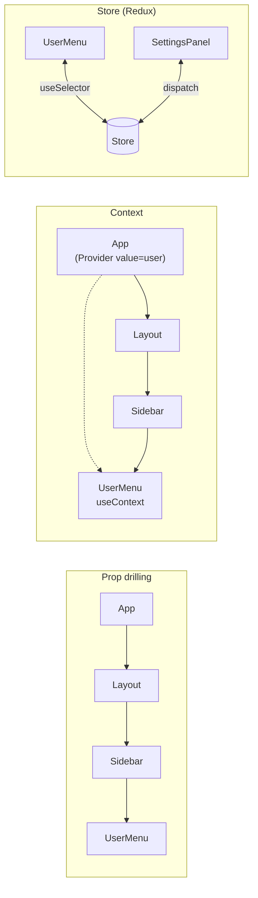
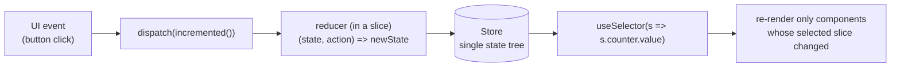

# React State Management - Props, Context, Redux

> [!summary] TL;DR
> Pass data down with **props** by default. Reach for **Context** only to avoid threading one value through many layers that don't use it, and reach for a store like **Redux** only when several unrelated parts of the app need to read and write the same state. Each option trades simplicity for reach, and most apps need less of this machinery than they assume.

> [!abstract] Core idea
> - Props flow one way, parent to child. **Prop drilling** — passing a prop through components that don't use it, just to reach one that does — is normal for 2–3 levels and becomes a smell beyond that.
> - **Context** solves the drilling problem, not the "this is global state" problem: any component that calls `useContext` re-renders whenever the Provider's `value` changes, even if only one field in that value changed.
> - The Context `defaultValue` (the argument to `createContext`) only applies to a component that renders with **no Provider above it at all** — it is not a fallback for "Provider rendered without a `value` prop," which instead gives you `undefined`.
> - **Redux** (and similar stores) exist for state genuinely shared across distant, unrelated parts of the UI — not as a replacement for `useState` on state that one component tree owns.

### Whiteboard version

```jsx
const ThemeContext = createContext('light'); // default: used only with no Provider above

function App() {
  const [theme, setTheme] = useState('dark');
  return (
    <ThemeContext.Provider value={theme}>
      <Toolbar />
    </ThemeContext.Provider>
  );
}

function Toolbar() {
  return <ThemedButton />; // doesn't touch theme, just passes the tree through
}

function ThemedButton() {
  const theme = useContext(ThemeContext); // "dark" — read straight from the Provider, no prop drilling
  return <button className={theme}>Click</button>;
}
```

`Toolbar` never mentions `theme`. Without Context, `theme` would have to be an explicit prop on `Toolbar` purely so it can forward it to `ThemedButton` — that forwarding is prop drilling.

## 1. Why it exists

A counter owned by one component needs nothing but `useState`. The moment two sibling components need to share and both update one piece of state, that state has to move up to their common ancestor (**lifting state up**) and come back down as props — and the more layers between the ancestor and the consumer, the more components end up receiving a prop they never read, just to pass it on.

```jsx
function App() {
  const [user, setUser] = useState(null);
  return <Layout user={user} />;
}
function Layout({ user }) {
  return <Sidebar user={user} />; // Layout never reads user
}
function Sidebar({ user }) {
  return <UserMenu user={user} />; // Sidebar never reads user either
}
function UserMenu({ user }) {
  return <span>{user?.name}</span>; // finally used, 3 levels down
}
```

For 2–3 levels this is fine and arguably clearer than an invisible global. Past that, every refactor of the middle layers risks breaking the chain, which is the actual problem prop drilling causes — not performance.

## 2. Mental model

- **Props** = function arguments. Explicit, typed, traceable by reading the component that renders you.
- **Composition (`children`)** = pass a rendered element down instead of data, so the component accepting `children` doesn't need to know what's inside it. Often removes the need for Context entirely.
- **Context** = a value broadcast to every descendant of a Provider, read with a hook, skipping the middle layers. Think of it as "ambient" — not traceable by reading props alone.
- **A store (Redux, Zustand)** = state that lives outside any component, with an explicit, structured way to read it (`useSelector`) and change it (`dispatch`), independent of where in the tree you are.

## 3. How it works



Context's dotted line shows the actual data path: it skips `Layout` and `Sidebar` entirely, but they're still re-rendered if they sit between the Provider and the consumer, because React re-renders every component in a subtree whose parent re-rendered unless something (`memo`) stops it — Context doesn't change that rule, it only changes who can *read* the value.

### Composition as an alternative to Context

Before reaching for Context, check whether passing `children` solves the drilling:

```jsx
// Instead of threading `user` through Layout and Sidebar...
function App() {
  return (
    <Layout>
      <Sidebar>
        <UserMenu user={user} />
      </Sidebar>
    </Layout>
  );
}
function Layout({ children }) { return <div className="layout">{children}</div>; }
function Sidebar({ children }) { return <aside>{children}</aside>; }
```

`Layout` and `Sidebar` never see `user` at all — `UserMenu` is constructed once, at the top, with the prop it needs, and simply slotted in.

### The Context default-value rule

```jsx
const ThemeContext = createContext('light');

// Case 1: no Provider anywhere above this component
function A() {
  return useContext(ThemeContext); // "light" — the default IS used
}

// Case 2: a Provider exists, but its value prop is omitted
function B() {
  return (
    <ThemeContext.Provider>
      <C />
    </ThemeContext.Provider>
  );
}
function C() {
  return useContext(ThemeContext); // undefined — the default is NOT used
}
```

The default argument to `createContext` is a fallback for "there is no Provider in the tree at all," most useful so components can be tested or used in isolation. It is not a fallback for a Provider that forgot to pass `value` — that is a bug, and it silently returns `undefined` instead of the default.

### Context's re-render cost

Every component that calls `useContext(SomeContext)` re-renders whenever that Provider's `value` changes — by reference, not by deep comparison. Two common mistakes make this worse than it needs to be:

```jsx
// Bad: a new object every render, so every consumer re-renders every time
// App re-renders, even if user and theme didn't change.
<AppContext.Provider value={{ user, theme }}>

// Better: memoize the value so its reference only changes when user or theme do
const value = useMemo(() => ({ user, theme }), [user, theme]);
<AppContext.Provider value={value}>
```

And splitting one Context into several narrower ones means a component that only needs `theme` doesn't re-render when `user` changes:

```jsx
<UserContext.Provider value={user}>
  <ThemeContext.Provider value={theme}>
    <App />
  </ThemeContext.Provider>
</UserContext.Provider>
```

## 4. Worked example

### Redux Toolkit: the data flow



```jsx
import { createSlice, configureStore } from '@reduxjs/toolkit';

const counterSlice = createSlice({
  name: 'counter',
  initialState: { value: 0 },
  reducers: {
    incremented: (state) => {
      state.value += 1; // Immer under the hood: looks mutable, stays immutable
    },
    addedBy: (state, action) => {
      state.value += action.payload;
    },
  },
});

export const { incremented, addedBy } = counterSlice.actions;
export const store = configureStore({ reducer: { counter: counterSlice.reducer } });
```

```jsx
function Counter() {
  const value = useSelector((state) => state.counter.value);
  const dispatch = useDispatch();
  return (
    <button onClick={() => dispatch(incremented())}>{value}</button>
  );
}
```

`useSelector` only re-renders `Counter` when the specific slice it reads (`state.counter.value`) changes — a sibling component selecting `state.settings` is untouched, which is the opposite of the "any change re-renders every consumer" behaviour plain Context has with one big object.

Reducers in Redux must stay **pure**: no side effects, no random values, no mutating arguments directly (Redux Toolkit's `createSlice` uses Immer so code that *looks* like direct mutation — `state.value += 1` — actually produces a new, structurally-shared state object behind the scenes). This purity is what makes time-travel debugging in Redux DevTools possible: every past state is just the result of replaying actions.

### Async state and server data

Fetched data (a list of orders, a user's profile) is a different kind of state from UI state (`isModalOpen`), and forcing it through hand-written reducers duplicates work a data-fetching library already does well: caching, retries, de-duplication, background refetch.

```jsx
// RTK Query: generates hooks from an endpoint description
const api = createApi({
  baseQuery: fetchBaseQuery({ baseUrl: '/api' }),
  endpoints: (builder) => ({
    getOrders: builder.query({ query: () => 'orders' }),
  }),
});
export const { useGetOrdersQuery } = api;

function OrderList() {
  const { data, isLoading, error } = useGetOrdersQuery();
  if (isLoading) return <Spinner />;
  if (error) return <ErrorBanner error={error} />;
  return <ul>{data.map((o) => <li key={o.id}>{o.total}</li>)}</ul>;
}
```

TanStack Query solves the same problem without requiring a Redux store at all.

## 5. Variants and comparison

| Option | How it works | Use when | Cost |
|---|---|---|---|
| Props (+ composition via `children`) | Explicit data passed down the tree, or elements slotted in | Default for everything; always reach for this first | None beyond the drilling itself at 2–3 levels |
| Lifting state up | Move state to the nearest common ancestor of the components that share it | Two or more siblings need the same state | Ancestor re-renders on every change |
| Context (`createContext` + `useContext`) | Broadcast a value to every descendant of a Provider | Avoiding drilling a value through many layers that don't use it (theme, locale, auth user) | Every consumer re-renders on any change to the value's reference; split contexts or memoize to limit it |
| Redux / Redux Toolkit | A single external store, pure reducers, `dispatch`/`useSelector` | State shared across distant, unrelated parts of the app; need for time-travel debugging, middleware, strict action auditing | Boilerplate (much reduced by RTK); a dependency and a learning curve |
| Zustand / Jotai (lightweight stores) | A small external store or atom graph, no boilerplate reducers | Want Redux's "outside the tree" benefit without the ceremony | Less tooling/ecosystem than Redux; smaller community conventions |
| RTK Query / TanStack Query | A cache keyed by query, with built-in loading/error/refetch state | Server data (anything fetched over the network) | Another dependency; learning its cache-invalidation model |

## 6. Trade-offs and when not to use

- Don't add Context or a store for state that only one component (or its direct children via props) ever reads — that's just `useState`, and wrapping it in machinery adds re-render surface and indirection for no benefit.
- Don't put server data (API responses) into Redux/Context by hand if a query library is available — you'll end up re-implementing caching, request de-duplication and refetch-on-focus badly.
- Context is the wrong tool for state that changes on every keystroke or every frame (a text field's live value, animation progress) read by many components — the re-render blast radius gets expensive. A store with selectors, or keeping that state local, scales better.
- A large Redux store for a small app is itself a cost: every contributor now has to learn the slice/action/selector convention to make a one-line change.

## 7. In production

- **Real systems:** Redux Toolkit is the default recommended Redux setup since 2019 and is standard in large React codebases (e-commerce carts, dashboards with many independent widgets reading shared data); Context is used in nearly every app for theme/locale/auth, rarely for frequently-changing data; TanStack Query and RTK Query are standard for server-state caching in production apps.
- **Failure modes → fixes:**
  - "Changing one field in my Context value re-renders the whole app" → split the context, or memoize the value, or move the frequently-changing field to a store with selectors.
  - "My component shows stale data after a Provider updates" → check that the Provider's `value` is actually new (not the same object reference, which React treats as "unchanged" for some optimizations) and that you're not reading from a stale closure.
  - "Redux state update doesn't show up in the UI" → a reducer that mutates `state` directly (outside Immer's `createSlice` convention) breaks the reference-equality check `useSelector` relies on to know something changed.
  - "Context default value showed up unexpectedly" → a Provider further up is missing, or its `value` prop was accidentally omitted (which gives `undefined`, not the default — check for `undefined` specifically, since that's the actual symptom).
- **What to monitor:** React DevTools Profiler for re-render counts per Context consumer; Redux DevTools for action volume and payload size in high-traffic components.

## 8. Deep dive

- **Context does not memoize for you.** `useContext` subscribes a component to the nearest Provider above it; when that Provider re-renders with a new `value` (by reference), every subscriber re-renders, full stop, regardless of whether the specific field the subscriber reads changed. Redux avoids this by having `useSelector` do its own equality check per selector, so a store with ten slices lets ten different components each re-render only for their own slice.
- **Why `state.value += 1` is legal inside `createSlice` but illegal in plain Redux.** Redux Toolkit wraps reducers in Immer's `produce`. Writes you make to the draft are recorded and replayed against the real previous state to produce a new, structurally-shared object — so other parts of the state tree that didn't change keep the same object reference, which is exactly what reference-equality checks (`useSelector`, `React.memo`) rely on to skip work.
- **Middleware** sits between `dispatch` and the reducer: `redux-thunk` (included by default in RTK) lets an action creator be a function that dispatches other actions after an async operation; logging middleware can record every action for replay debugging.
- **When Redux is overkill:** if nothing outside one component subtree needs the state, and no middleware/time-travel/strict-auditing requirement exists, `useState` plus prop passing (or Context for read-mostly values) does the job with far less code.

## 9. Interview questions

> [!question]- When does prop drilling actually become a problem worth fixing?
> Not at 2–3 levels — that's normal and explicit, which is a readability advantage over an invisible global. It becomes worth fixing when many unrelated components in between have to accept and forward a prop they never use, making refactors of the middle layers risk breaking the chain.

> [!question]- Trap: if a `<Context.Provider>` is rendered without a `value` prop, does a consumer see the `createContext` default value?
> No — it sees `undefined`. The default argument to `createContext` only applies when a component has **no Provider at all** above it in the tree. A Provider that's present but missing its `value` prop gives `undefined`, not the default.

> [!question]- Why can one Context update cause more re-renders than expected?
> Any component calling `useContext` on that context re-renders whenever the Provider's `value` reference changes, even if the specific field that component reads didn't change. Passing a fresh object literal as `value` on every render makes this happen on every single Provider re-render; memoizing the value or splitting into narrower contexts limits the blast radius.

> [!question]- Is Redux a replacement for `useState`?
> No. Redux is for state genuinely shared across distant, unrelated parts of the UI, with a need for predictable, centrally-dispatched updates. Local UI state that one component owns (a form field, a toggle) should stay in `useState` — pushing everything into Redux adds boilerplate and indirection without benefit.

> [!question]- How does `useSelector` avoid re-rendering every component on every Redux state change?
> It runs the selector function against the store and compares the result to the last result (by reference, by default) before deciding to re-render that component. A component selecting `state.counter.value` doesn't re-render when `state.settings` changes, because its selector's result didn't change.

> [!question]- What does Redux Toolkit's `createSlice` actually do with `state.value += 1`?
> It uses Immer: the `state` your reducer receives is a proxy ("draft"). Writes to it are tracked, and Immer produces a brand-new, immutable state object with just the changed parts replaced — so the mutation-looking code is still produces immutable updates, which is required for both Redux's rules and for reference-equality-based re-render skipping to work.

> [!question]- You have a dashboard where five independent widgets each fetch their own data from the same API. Context, Redux, or neither?
> Likely neither, in the Redux/Context sense for the data itself: this is server state, best handled by TanStack Query or RTK Query, which cache per query key and handle refetching/deduplication. Reach for Context only if there's UI state (a shared filter, a selected date range) that several widgets need to read and set together.

## 10. Cheat sheet

- Default to props; lift state to the nearest shared ancestor when siblings need it.
- Prop drilling through 2–3 layers is fine; beyond that, consider composition (`children`) or Context.
- Context default value applies only with **no Provider above**; a Provider missing `value` gives `undefined`, not the default.
- Every `useContext` consumer re-renders on any `value` reference change — memoize the value, or split into narrower contexts.
- Redux/RTK is for state shared across distant, unrelated UI, not a `useState` replacement.
- `useSelector` re-renders a component only when its own selected slice changes — Context can't do that by itself.
- Server data (fetched from an API) belongs in RTK Query/TanStack Query, not hand-rolled into Redux or Context.

## Links

- **Before this:** [[React Fundamentals - Components, JSX, Props, State]], [[React Hooks]], [[React Rendering - Virtual DOM, Reconciliation, Lifecycle]]
- **Next:** [[React Routing and Rendering Strategies - CSR, SSR, SSG]]
- **Compare with:** [[React Routing and Rendering Strategies - CSR, SSR, SSG]] (where shared state lives across route changes)
