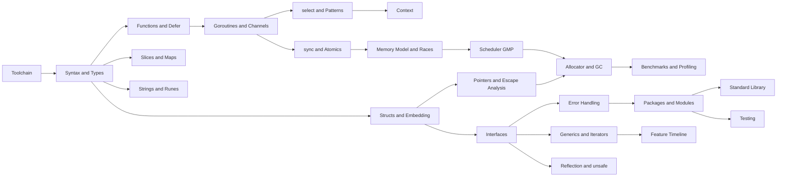

# 04 Go Language MOC

> [!summary] What this folder covers
> After this folder you can write idiomatic Go, reason about its concurrency and memory model, and explain how the runtime schedules goroutines and collects garbage.

## Before and after

- **Before this:** [[01 CS Fundamentals MOC]]
- **After this:** [[06 Backend Engineering in Go MOC]] · [[17 LLD MOC]]

## Learning path

Back to [[Home]].

1. [[Go Toolchain, Tooling and Debugging]] · basic. How to build, run, vet and debug Go code before writing any.
2. [[Syntax, Types and Control Flow]] · basic. The core language: declarations, zero values, types and loops.
3. [[Functions, Closures, Defer, Panic and Recover]] · basic. Functions as values and Go's cleanup and failure mechanics.
4. [[Arrays, Slices and Maps (with internals)]] · basic. The built-in containers and the aliasing traps in them.
5. [[Strings, Bytes, Runes and Unicode]] · basic. Why a string is bytes, and how to iterate it correctly.
6. [[Structs, Methods and Embedding]] · basic. Composition instead of inheritance.
7. [[Pointers, Values and Escape Analysis]] · intermediate. When a value lives on the stack or the heap.
8. [[Interfaces]] · intermediate. Implicit satisfaction and the nil-interface trap.
9. [[Error Handling]] · intermediate. Errors as values, wrapping, `errors.Is` and `errors.As`.
10. [[Packages, Modules and Dependency Management]] · intermediate. How `go.mod`, versions and visibility work.
11. [[Standard Library Essentials (time, io, files, encoding)]] · intermediate. The packages every service uses.
12. [[Testing in Go]] · intermediate. The `testing` package mechanics.
13. [[Goroutines and Channels]] · intermediate. Cheap concurrency and communication by channels.
14. [[select and Concurrency Patterns]] · intermediate. Pipelines, fan-out, worker pools and timeouts.
15. [[sync Primitives and Atomics]] · intermediate. Mutexes, WaitGroups, Once and atomics in Go.
16. [[Context Package]] · intermediate. Cancellation and deadlines across call chains.
17. [[Generics and Iterators]] · intermediate. Type parameters, constraints and range-over-func.
18. [[Memory Model and Data Races]] · advanced. Happens-before and the race detector.
19. [[Reflection and unsafe]] · advanced. Runtime type inspection and its costs.
20. [[Runtime - Goroutine Scheduler (GMP)]] · advanced. How Gs, Ms and Ps share OS threads.
21. [[Runtime - Memory Allocator and Garbage Collector]] · advanced. Size classes, tri-color marking and GOGC.
22. [[Benchmarks, Profiling and Tracing]] · intermediate. Measuring before optimizing with pprof and trace.
23. [[Modern Go Feature Timeline (1.18-1.25)]] · intermediate. What changed in each recent release.

## Concept map

## Interview focus

- How do goroutines differ from OS threads, and how does the GMP scheduler run them? See [[Runtime - Goroutine Scheduler (GMP)]].
- How do `context.Context` cancellation and deadlines propagate? See [[Context Package]].
- What happens when you send on a closed or nil channel, and how does `select` choose? See [[Goroutines and Channels]] and [[select and Concurrency Patterns]].
- How would you build a worker pool with bounded concurrency and timeouts? See [[select and Concurrency Patterns]].
- What is a data race, and what does the Go memory model guarantee? See [[Memory Model and Data Races]].
- How does Go's garbage collector work, and what does GOGC tune? See [[Runtime - Memory Allocator and Garbage Collector]].
- Why can an interface holding a nil pointer be non-nil? See [[Interfaces]]. How do `errors.Is` and `errors.As` work? See [[Error Handling]].
- Why does ranging over a string yield runes rather than bytes? See [[Strings, Bytes, Runes and Unicode]].
- How does `append` share or reallocate a slice's backing array? See [[Arrays, Slices and Maps (with internals)]].
- More traps are collected in [[Go Interview Questions and Traps]].

## Sources worth reading

- The Go Programming Language Specification: https://go.dev/ref/spec
- Effective Go: https://go.dev/doc/effective_go
- The Go Memory Model: https://go.dev/ref/mem
- A Guide to the Go Garbage Collector: https://go.dev/doc/gc-guide
- The Go Blog (release notes and deep dives): https://go.dev/blog
- *100 Go Mistakes and How to Avoid Them* by Teiva Harsanyi
