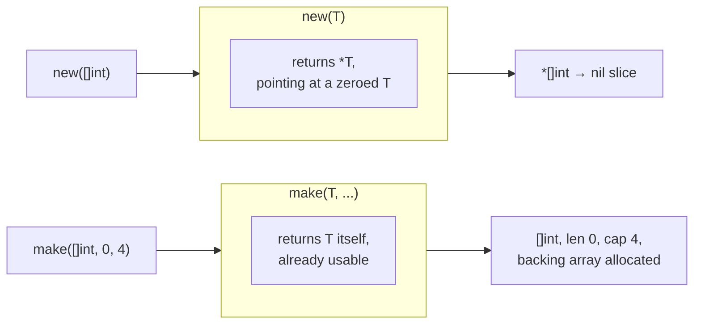
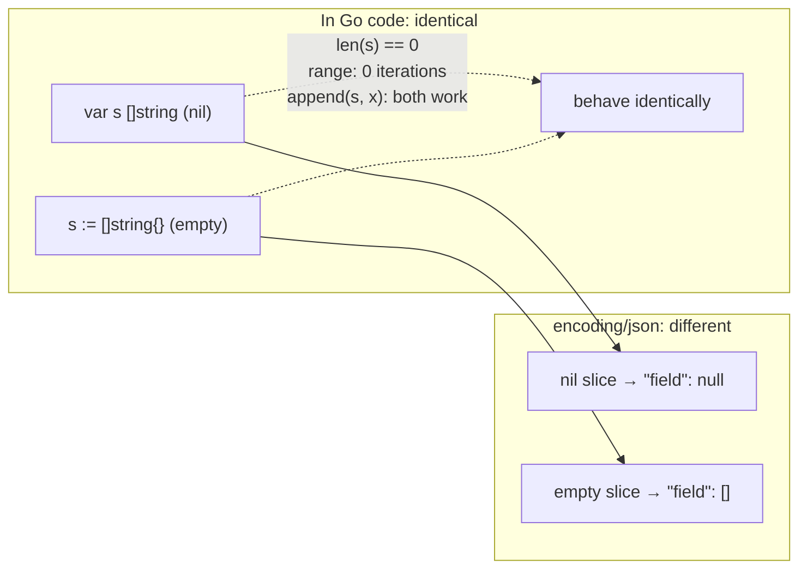
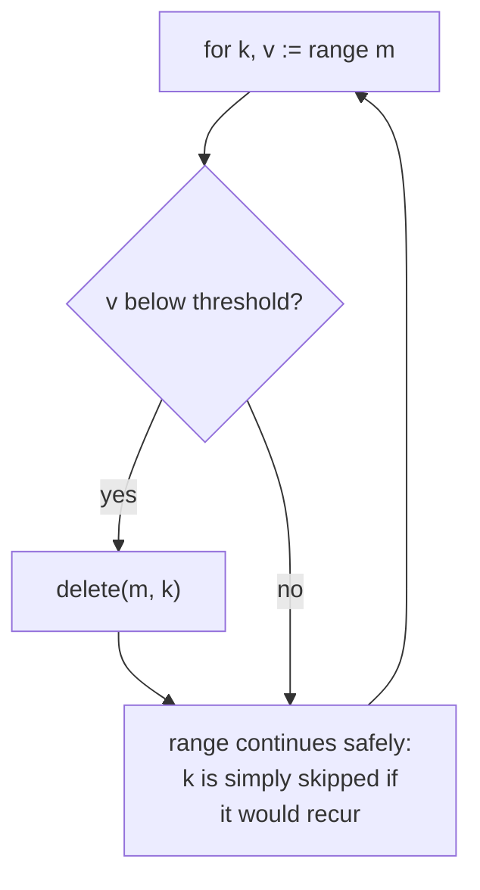

# Arrays, Slices and Maps (with internals)

> [!summary] TL;DR
> This note covers the Go-specific API and semantics of arrays, slices and maps — `make` vs `new`, `nil` vs empty, the `slices` and `maps` standard-library packages, and the parts of map behaviour the language spec itself guarantees. The data-structure mechanics (the slice header and its growth, and hash-table internals) live in [[Arrays and Dynamic Arrays (Go Slices)]] and [[Hash Tables and Go Maps]] — read those first if the words "slice header" or "load factor" aren't already familiar.

> [!abstract] Core idea
> - `make` allocates a usable slice, map or channel; `new` just zeros memory and almost never shows up in real slice/map code.
> - A `nil` slice and an empty (`[]T{}`) slice behave the same in Go code, but encode differently as JSON (`null` vs `[]`) — the one place the distinction routinely matters.
> - The `slices` and `maps` standard-library packages (Go 1.21+) replace most hand-written loops over containers: `Sort`, `BinarySearch`, `Insert`, `Compact`, `Clone`, `Equal`, `DeleteFunc`.
> - Go's map spec guarantees: comma-ok tells "absent" from "present, zero value"; `range` order over a map is deliberately randomized, not merely unspecified; deleting the current key mid-`range` is safe; map values aren't addressable; writing to a `nil` map panics, reading one does not; concurrent writes crash the process outright.
> - A map only ever grows. `clear(m)` empties it without releasing that growth, which is exactly what a map you plan to refill wants.

## 1. Why it exists

A billing service builds a nightly report: a `map[string]int` counting invoices per status, and a `[]Invoice` of ones that need a retry. Two bugs show up in code review:

```go
var retries []Invoice // nil: fine so far
for _, inv := range invoices {
	if inv.NeedsRetry() {
		retries = append(retries, inv) // appending to nil is fine, this isn't the bug
	}
}
json.NewEncoder(w).Encode(response{Retries: retries}) // bug: if retries is nil, this sends "retries": null
```

The frontend expects `"retries": []` when there is nothing to retry, and crashes on `null`. The slice itself was never wrong — `nil` and `[]Invoice{}` behave identically everywhere in Go code, including `len()`, `range`, and `append` — but `encoding/json` treats them differently on the wire, and that's the one place this distinction has a real, visible cost.

```go
var counts map[string]int
counts["paid"]++ // bug: "assignment to entry in nil map" — counts was never make()'d
```

Both bugs come from the same root cause: Go's zero value for a slice or map (`nil`) is deliberately usable for *reading* (`len`, `range`, a map lookup) but not always for *writing* — a nil slice can be appended to (append allocates a backing array on first use), but a nil map panics the instant you try to write through it. Knowing exactly which operations are safe on a zero-value container, and where Go's own API quietly tells `nil` apart from "empty", is what this note covers.

## 2. Mental model

Treat `nil` for a slice or map as "I haven't allocated storage yet," not as "this variable is broken." Reading from it behaves exactly like reading from an allocated-but-empty one. Writing is where the two containers diverge: `append` on a nil slice silently allocates on demand (the slice header starts as `{nil, 0, 0}` and `append` treats `cap == 0` as "time to allocate," same as any other out-of-room append); indexing into a nil map to *write* has nothing to allocate into and panics instead of guessing.

The `slices` and `maps` packages are the standard library admitting that most code written against a slice or map was re-deriving the same ten operations by hand (sort, search, dedupe, clone, equality-check) — they are thin, generic, well-tested wrappers, not a different way of thinking about the containers.

## 3. How it works

### `make` vs `new`



`new(T)` allocates zeroed storage for one `T` and returns `*T` — for `T = []int`, that's a pointer to a `nil` slice, rarely what anyone wants. `make` is the allocator that actually knows how to build a usable slice (optionally with a length and capacity), map (optionally with a capacity hint), or channel (optionally buffered); it returns the container itself, not a pointer to it. In practice, `new` shows up for scalar types and structs (`new(bytes.Buffer)`), essentially never for slices, maps or channels — those three always go through `make` or a composite literal.

```go
var s []int               // nil slice: len 0, cap 0 — zero value, no allocation yet
m := make(map[string]int)  // the only way to get a writable map — a nil map panics on write
sl := make([]int, 0, 4)    // make WITH a capacity hint: len 0, cap 4, backing array allocated now
```

### nil vs empty: same in Go, different on the wire



**Measured** (Go 1.24.4, `encoding/json`, a struct with one `nil` and one empty `[]string` field, both tagged plainly with no `omitempty`):

```json
{"nil":null,"empty":[]}
```

If `omitempty` is added to the tag, **both** forms are dropped from the output — `omitempty` treats a zero-length slice (nil or not) as "empty" and omits the field entirely, which is a separate decision from the nil-vs-`[]` one above. Pick deliberately: `omitempty` to drop an empty list from the payload, a plain tag with a non-nil default (`[]T{}`) to always send `[]` instead of risking `null`.

### copy and slices.Clone

```go
dst := make([]int, 2)
n := copy(dst, []int{1, 2, 3}) // n == 2: copy() moves min(len(dst), len(src)) elements, never grows dst
```

`copy` is the bounded, no-surprise-reallocation primitive: it never allocates and never grows `dst`, which is exactly why it is the right tool for copying into a pre-sized buffer. To get an independent copy of a whole slice without pre-sizing anything yourself, `slices.Clone` (Go 1.21+) is `make` + `copy` in one call — and the one to reach for instead of a bare re-slice when you need to stop aliasing a big backing array (see the "aliasing-leak trap" in [[Arrays and Dynamic Arrays (Go Slices)]]).

### The `slices` package: Sort, BinarySearch, Insert, Compact

```go
func SortedUnique(nums []int) []int {
	slices.Sort(nums)        // in place, pdqsort under the hood
	return slices.Compact(nums) // removes adjacent duplicates in place, returns the shortened slice
}

idx, found := slices.BinarySearch(sorted, target) // requires sorted input; idx is the insertion point either way
sorted = slices.Insert(sorted, idx, v)            // shifts everything at/after idx right by one
```

`slices.Compact` only removes **adjacent** duplicates — it assumes the input is sorted (or that equal elements are already next to each other); running it on unsorted data silently leaves non-adjacent duplicates in place. `slices.Delete(s, i, j)` removes elements `[i:j)` and explicitly zeroes the vacated tail slots it shifted away from — not just an optimisation detail, but the reason `slices.Delete` is the safe choice over a hand-rolled `append(s[:i], s[j:]...)` when the element type holds pointers or interfaces: zeroing lets the garbage collector reclaim whatever those tail elements pointed to, instead of the old values lingering, unreachable from the live slice but still referenced in the backing array (the GC scans backing arrays by length actually used in some paths, but relying on that rather than on an explicit zeroing is the fragile choice).

### Maps: comma-ok, capacity hints, delete during range

```go
counts := make(map[string]int, len(statuses)) // capacity hint: sized up front, fewer resizes while filling
for _, s := range statuses {
	counts[s]++ // a missing key already reads as 0 — no comma-ok needed just to increment
}

value, present := m[key] // comma-ok: tells "absent" apart from "present with the zero value"
```

A bare `m[key]` read is enough when you only need the value (a missing key already gives you the zero value for free); comma-ok exists for the cases where "missing" and "present but zero" must be told apart — a counter that needs to distinguish "never seen" from "seen zero times isn't actually possible for a counter, but a boolean flag defaulting to false is a real example," or a cache that must tell "not cached" from "cached a false/0/empty-string result."

**`for k, v := range m` visits entries in a randomized order, on purpose.** The Go spec leaves map iteration order unspecified, and the runtime goes further than just "unspecified": it deliberately starts each `range` at a random bucket/group and a random offset within it, specifically so code cannot come to depend on any particular order — including insertion order — surviving between runs, between map resizes, or even between two `range` statements over the same map value in the same program. Code that needs a stable order must sort the keys explicitly (`slices.Sort` over `maps.Keys(m)` collected into a slice) rather than relying on `range`.



The Go spec explicitly permits deleting the entry for the **current** key during a `range` over that same map — it is well-defined and safe, unlike mutating a slice's length while ranging over it. Adding a new key during the same range is the one thing the spec leaves unspecified: the new key may or may not be produced by later iterations.

### Sets: `map[T]struct{}`

```go
type StringSet map[string]struct{}

func NewStringSet(items ...string) StringSet {
	s := make(StringSet, len(items))
	for _, it := range items {
		s[it] = struct{}{}
	}
	return s
}

func (s StringSet) Has(item string) bool {
	_, ok := s[item]
	return ok
}
```

Go has no built-in set type. `struct{}` is the zero-size type — a `map[string]struct{}` stores only the keys, not a wasted value byte per entry — and membership is the same comma-ok check as any other map lookup.

### The `maps` package: Clone, Equal, DeleteFunc

```go
clone := maps.Clone(counts)                              // independent copy, like slices.Clone for slices
maps.Equal(a, b)                                          // true iff same keys, same values, including types that use == for comparison
maps.DeleteFunc(counts, func(_ string, v int) bool { return v == 0 }) // removes every entry the predicate matches
```

These (Go 1.21+) replace the hand-written loops every codebase used to carry for "copy a map," "are these two maps the same," and "remove entries matching a condition." `maps.Keys` and `maps.Values` (Go 1.23+) return `iter.Seq[K]` / `iter.Seq[V]` range-over-func iterators rather than slices — see [[Generics and Iterators]] for the `iter.Seq` mechanics themselves.

### `clear()`: maps grow, but never shrink on their own

```go
clear(m) // removes every entry; keeps the map's already-grown backing storage
```

A Go map's backing storage only ever grows to accommodate more entries — deleting entries (even all of them) does not return that memory to the allocator. `clear(m)` (Go 1.21+) is the fast path for "empty this map and keep using it": it drops every entry in roughly one pass without walking through `delete` one key at a time, and it deliberately keeps the map's existing capacity rather than discarding it, which is exactly right for a map a request handler plans to refill on the next call. If the map grew to an unusually large size for one unusual request and genuinely needs to shrink, the only way is to replace it: `m = make(map[K]V, normalSize)`, letting the old one be garbage collected.

### Concurrent writes, map value addressability (spec guarantees, not internals)

These two rules are guaranteed by the language, not accidents of the current implementation — see [[Hash Tables and Go Maps]] for why the runtime enforces the first one this way and how Swiss Tables are laid out internally:

- **Concurrent map writes crash the process.** A write racing another write (or a write racing a read) on the same map triggers `fatal error: concurrent map writes` — a hard runtime crash, not a `panic`, and `recover()` cannot catch it.
- **Map values aren't addressable.** `m["k"].Field = x` for a struct-valued map does not compile (`cannot assign to struct field m["k"].Field`); read the value out, mutate the copy, write it back — or store `map[K]*V` instead.

**Measured** (Go 1.24.4, darwin/arm64, four goroutines writing the same map 100,000 times each, no `-race` flag so the runtime's own check — not the race detector — is what fires). As with any crash across concurrent goroutines, the specific goroutine number varies run to run (observed values included 18 and 34); only the error text and the general shape of the trace are representative:

```text
fatal error: concurrent map writes

goroutine N [running]:
internal/runtime/maps.fatal({0x10248e70e?, 0x0?})
	.../runtime/panic.go:1058 +0x20
main.main.func1(0x1)
	.../cmd/concurrentmapwrite/main.go:18 +0x80
```

A `defer func() { recover() }()` placed inside the writing goroutine has no effect on this crash — `fatal error` bypasses `panic`/`recover` entirely, specifically so a data race in map internals cannot be silently swallowed in production. Guard a shared map with a `sync.Mutex`/`sync.RWMutex`, shard it, or use `sync.Map` for its two specific patterns — see [[sync Primitives and Atomics]].

## 4. Worked example

### Whiteboard version

The nil-vs-empty distinction in the one place it actually bites:

```go
package wb

type Response struct {
	Retries []string `json:"retries"`
}

func NoRetriesNeeded() Response {
	return Response{Retries: []string{}} // deliberately non-nil: encodes as "retries": [], not null
}
```

The full version below adds `make` vs `new`, the `slices`/`maps` package helpers, comma-ok, delete-during-range, and tests for every claim above.

### Full version

Tested on Go 1.24.4 (darwin/arm64); `go vet` and `go test -race` both pass.

```go
// MakeVsNew shows the three forms side by side. new(T) returns *T pointing
// at a zeroed T and is almost never used for slices/maps/channels in
// practice. make is the one that actually allocates a *usable* slice, map
// or channel.
func MakeVsNew() (nilSlice []int, usableSlice []int, nilMap map[string]int, usableMap map[string]int) {
	var s []int               // nil slice: len 0, cap 0, usable for append and read, not index-assign beyond len
	m := make(map[string]int) // the only way to get a writable map; a nil map panics on write
	sl := make([]int, 0, 4)   // make with a capacity hint: len 0, cap 4
	return s, sl, nil, m
}

// Payload has two slice fields to show the nil-vs-empty distinction surface
// in JSON, the most common place it actually bites.
type Payload struct {
	Nil   []string `json:"nil"`
	Empty []string `json:"empty"`
}

func MarshalNilVsEmpty() ([]byte, error) {
	p := Payload{Nil: nil, Empty: []string{}}
	return json.Marshal(p)
}

// RemoveBelow deletes every entry whose value is below min, while ranging
// over the map being modified — explicitly safe per the Go spec.
func RemoveBelow(m map[string]int, min int) {
	for k, v := range m {
		if v < min {
			delete(m, k)
		}
	}
}

// ResetAndReuse empties m in place with the clear builtin. clear(m)
// removes every entry but does NOT shrink the map's backing storage.
func ResetAndReuse(m map[string]int) {
	clear(m)
}
```

The tests that prove the nil-vs-empty JSON encoding, the nil-map panic, and that delete-during-range is safe:

```go
func TestNilMapWritePanics(t *testing.T) {
	defer func() {
		if r := recover(); r == nil {
			t.Fatal("expected a panic writing to a nil map")
		}
	}()
	var m map[string]int
	m["x"] = 1 // must panic: "assignment to entry in nil map"
}

func TestMarshalNilVsEmptySlice(t *testing.T) {
	data, err := MarshalNilVsEmpty()
	if err != nil {
		t.Fatalf("Marshal: %v", err)
	}
	var round map[string]json.RawMessage
	if err := json.Unmarshal(data, &round); err != nil {
		t.Fatalf("Unmarshal: %v", err)
	}
	if string(round["nil"]) != "null" {
		t.Fatalf(`"nil" field = %s, want null`, round["nil"])
	}
	if string(round["empty"]) != "[]" {
		t.Fatalf(`"empty" field = %s, want []`, round["empty"])
	}
}

func TestRemoveBelowDeletesDuringRangeSafely(t *testing.T) {
	m := map[string]int{"a": 1, "b": 5, "c": 2, "d": 9}
	RemoveBelow(m, 3)
	want := map[string]int{"b": 5, "d": 9}
	if !reflect.DeepEqual(m, want) {
		t.Fatalf("RemoveBelow left %v, want %v", m, want)
	}
}

func TestResetAndReuseEmptiesWithoutReallocating(t *testing.T) {
	m := make(map[string]int, 100)
	for i := 0; i < 50; i++ {
		m[string(rune('a'+i%26))+string(rune('0'+i%10))] = i
	}
	ResetAndReuse(m)
	if len(m) != 0 {
		t.Fatalf("len(m) = %d, want 0 after clear(m)", len(m))
	}
	m["fresh"] = 1
	if m["fresh"] != 1 {
		t.Fatal("map should remain writable after clear(m)")
	}
}
```

**Measured** (Go 1.24.4, darwin/arm64, `go vet ./...` then `go test ./... -race`): all four tests above pass — the nil-map panic, the nil-vs-empty JSON round trip, delete-during-range, and `clear` leaving the map writable. The concurrent-write crash is a process-level `fatal error`, not an assertion `go test` can make (the process exits before any test could report a result), so it was checked separately by building and running the small helper program shown above.

## 5. Variants and comparison

| Container | How it works | Use when | Cost |
| --- | --- | --- | --- |
| `[N]T` array | Fixed size, value semantics (copying it copies all `N` elements) | Size is fixed and small, or value semantics are wanted | `O(1)` access; `O(N)` copy |
| `[]T` slice | Header over a growable backing array | The default ordered collection | `O(1)` access/append (amortised) |
| `map[K]V` | Hash table, `K` must be `comparable` | Key-value lookup with no ordering requirement | Average `O(1)` get/put/delete |
| `map[T]struct{}` | A map used as a set | Membership testing, deduplication | Same as `map[K]V`, zero-size values |
| `slices`/`maps` package helpers | Generic functions over `[]T` / `map[K]V` | Sort, search, clone, equality-check, delete-matching | Same cost as the equivalent hand-written loop, less code, fewer bugs |
| Sorted slice + `slices.BinarySearch` | No hashing, keeps order | Need range queries or sorted iteration alongside lookup | `O(log n)` lookup, `O(n)` insert (shifts) |

## 6. Trade-offs and when not to use

- `comparable` is required for any type used as a map key — a struct with a slice, map, or function field cannot be a key; use a string or int derived from the struct instead, or restructure the key.
- A map (even emptied with `clear`) keeps its grown backing storage; a long-lived map that spikes to millions of entries once and then goes back to dozens holds that memory until replaced with a fresh `make`. Measure before assuming `clear` alone is enough for a memory-sensitive long-lived map.
- `slices.Compact` only removes adjacent duplicates — call `slices.Sort` first, or it silently leaves non-adjacent duplicates untouched.
- Returning a `nil` slice or map from an API that other teams consume as JSON is a frequent source of client-side null-pointer bugs; default to `[]T{}` / documented `omitempty` behaviour at a service boundary rather than relying on callers to handle both.

## 7. In production

- **Real systems:** the `slices` and `maps` packages (stable since Go 1.21) are used throughout the standard library itself (`net/http`, `encoding/json` internals) in place of the hand-rolled loops that predate them; `sync.Map` backs read-mostly caches in several standard-library and widely used third-party packages for exactly the read-once-write-many pattern it targets.
- **Failure modes → fixes:**
	- A JSON API returns `null` for an empty list, breaking a frontend that calls `.map()` on it unconditionally → default to a non-nil empty slice at the response-building boundary, or document and test the `null` contract explicitly.
	- A long-lived map grows huge once (a burst, a bad input) and stays huge → periodically rebuild it with `make(map[K]V, typicalSize)` instead of relying on `clear` to shrink it.
	- `fatal error: concurrent map writes` in production → a map reachable from more than one goroutine without a mutex, `sync.Map`, or sharding; this crash cannot be recovered, so it must be prevented, not caught.
	- A struct field held inside a map silently "doesn't update" → map values aren't addressable; the code was mutating a temporary copy, not the stored value. Store pointers, or read-modify-write the whole value.
- **What to monitor:** allocation counts and GC pause frequency for services that build large slices/maps per request without capacity hints (`make(..., n)`); a growth in heap size that doesn't track request volume can point at a map that only ever grows and is never rebuilt.

## 8. Deep dive

- **Why `make`'s capacity hint matters for maps, not just slices.** `make(map[K]V, n)` tells the runtime roughly how many entries to expect, letting it size the initial Swiss Table groups close to their final count instead of growing (and rehashing) through several intermediate sizes as entries are added one at a time — the same amortised-cost argument as slice growth, applied to maps. See [[Hash Tables and Go Maps]] for the Swiss Table layout this hint is sizing.
- **Why reading a nil map is safe but writing isn't.** A lookup on a nil map has a well-defined answer (the zero value, `ok == false`) without needing any storage at all — there's nothing to find, so nothing to allocate. A write has no such out: there is no backing storage to write into, and Go chose to panic loudly rather than silently allocate on first write (which `append` does do for slices) — partly because a map write that must allocate is a heavier, less predictable operation than a slice append, and partly for symmetry with "an uninitialized map is a programmer error to write to."
- **`omitempty` vs the nil/empty JSON difference are two separate levers.** `omitempty` decides whether the field appears in the output *at all* (any zero-length slice/map, nil or not, is treated as empty and dropped); the plain-tag nil-vs-`[]` behaviour decides what gets written *when the field does appear*. Getting both right for an API contract means choosing deliberately, not assuming one implies the other.
- **`DeleteFunc` and `Compact` share a pattern:** both `slices.DeleteFunc`/`slices.Compact` and `maps.DeleteFunc` walk their container once, moving or skipping entries in place, and return/leave a shortened result — the same "compact in place" strategy the runtime itself uses internally when deleting map entries, rather than the allocate-a-new-container-and-copy strategy `slices.Insert` sometimes needs.

## 9. Interview questions

> [!question]- What's the actual difference between `make([]int, 0, 4)` and `new([]int)`?
> `make` returns a usable, non-nil slice with length 0 and capacity 4 — a backing array is already allocated. `new([]int)` returns a `*[]int` pointing at a zeroed slice header, which is `nil` — you'd have to dereference it and then still `make` or append to get anything usable. In practice `new` is essentially never used for slices, maps or channels.

> [!question]- Trap: is a `nil` slice different from an empty slice in Go?
> Not in ordinary Go code — `len()`, `range`, and `append` all behave identically on both. The one place they differ is `encoding/json`: a `nil` slice marshals to `null`, a non-nil empty slice marshals to `[]`. An API that needs to guarantee `[]` for "no items" must construct a non-nil empty slice deliberately, not rely on a `nil` one happening to look the same in Go.

> [!question]- Why does writing to a `nil` map panic, but reading from one doesn't?
> Reading has a well-defined, zero-cost answer without any storage (the zero value, with `ok == false` from comma-ok) — there's nothing to allocate. Writing has no backing storage to write into at all, and Go panics explicitly (`assignment to entry in nil map`) rather than silently allocating on first write, unlike a slice's `append`, which does allocate for you.

> [!question]- Is it safe to delete a map entry while ranging over that same map?
> Yes, for the entry at the **current** key — the Go spec explicitly permits it, and the deleted key is simply skipped if iteration would otherwise have reached it. Adding a new key during the same range is different: whether it appears in later iterations is unspecified, so don't rely on it.

> [!question]- Why does `map[T]struct{}` beat `map[T]bool` for a set?
> `struct{}` has zero size, so the map only stores keys — no per-entry value byte at all. `map[T]bool` works identically for membership testing (`if v, ok := m[k]; ok` still works, as does the simpler `if m[k]`), but it wastes a byte per entry and, worse, lets a bug set a key's value to `false` while the key is still present, which reads as "member, but false" instead of "not a member" if checked with a bare `if m[k]` instead of comma-ok.

> [!question]- What happens to a map's memory after you `delete` every entry from it, or call `clear(m)`?
> Nothing shrinks. A Go map's backing storage only grows; deleting entries (one at a time or via `clear`) frees the entries but keeps the map's already-allocated capacity, so the map is ready to be refilled without regrowing. If a map genuinely needs to release that memory — because of one unusually large spike — the only way is to replace it with a freshly `make`'d map and let the old one be garbage collected.

## 10. Cheat sheet

- `make` allocates a usable slice/map/channel; `new` returns a pointer to zeroed memory and is rarely used for these three types.
- `nil` and empty behave the same in Go code; `encoding/json` is the one place they diverge (`null` vs `[]`). `omitempty` is a separate decision about whether the field appears at all.
- `copy(dst, src)` never grows `dst`; `slices.Clone` is `make`+`copy` for "give me an independent copy."
- `slices.Sort`/`BinarySearch`/`Insert`/`Compact`/`Delete` and `maps.Clone`/`Equal`/`DeleteFunc` (Go 1.21+) replace most hand-written container loops.
- Comma-ok (`v, ok := m[k]`) tells "absent" from "present with the zero value" — a bare `m[k]` already gives you the zero value for a missing key.
- Deleting the current key during a `range` over a map is explicitly safe; adding a new key during that same range is not specified.
- Writing to a `nil` map panics; reading from one returns the zero value with `ok == false`. Concurrent writes to any map crash the process (`fatal error`), uncatchable by `recover`.
- `clear(m)` empties a map fast but keeps its grown capacity; replace the map with a fresh `make` to actually shrink memory.

## Links

- **Before this:** [[Syntax, Types and Control Flow]], [[Arrays and Dynamic Arrays (Go Slices)]], [[Hash Tables and Go Maps]]
- **Next:** [[Functions, Closures, Defer, Panic and Recover]], [[Generics and Iterators]]
- **Compare with:** [[sync Primitives and Atomics]] (making a shared map safe for concurrent writers), [[Pointers, Values and Escape Analysis]] (whether `make`'s backing storage lands on the stack or the heap)
