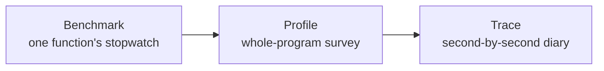
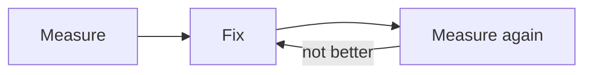
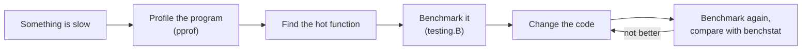
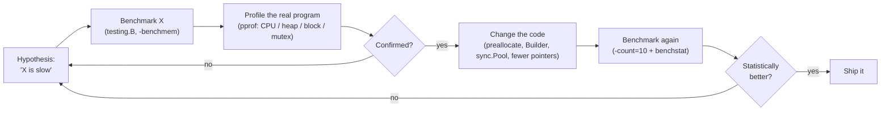
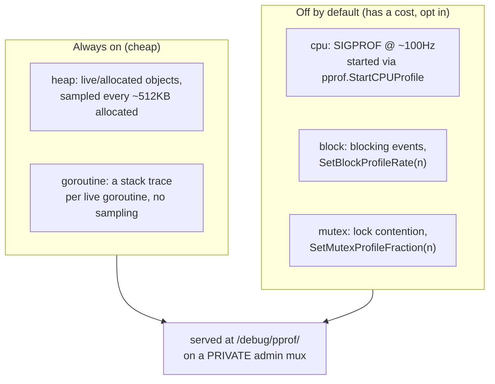

# Benchmarks, Profiling and Tracing

> [!summary] TL;DR
> A **benchmark** (`testing.B`) measures how long one function takes and how much it allocates, in isolation and repeatably. A **profile** (`pprof`) measures where a whole running program spends CPU, memory, or time blocked, by sampling.
>
> A **trace** (`runtime/trace`) records what every goroutine did, second by second, with no sampling gaps — far more detail, and far more overhead, so it runs for seconds, not continuously.
>
> The three answer different questions: "is this function fast?", "where does the program's time go?", and "what happened, in order, during this one slow second?"

> [!abstract] Core idea
> - Never guess where the time goes. Benchmark the suspect function, profile the whole program to find the real bottleneck, then benchmark again to prove the fix worked.
> - `testing.B` with `for b.Loop()` (Go 1.24) is the modern loop shape; `-benchmem` adds allocation counts, and `-count=10` plus `benchstat` turns noisy single runs into a statistically sound comparison.
> - CPU, heap, goroutine, block and mutex are five different pprof profile *types*, each sampled differently and each answering a different question — "heap" alone has two modes (`inuse` vs `alloc`) that are easy to confuse.
> - `net/http/pprof` must never be mounted on a public mux: it is a live read (and, via `/debug/pprof/trace`, a live CPU-attaching) endpoint into your process.

## Start here: the basics 🟢

> [!info] How to read this note (pick your level)
> - 🟢 **New to this?** Read "From zero" below, then sections 1, 2 and the cheat sheet (10). That is a full first pass.
> - 🟡 **Know the basics?** Add section 3 (how the tools work) and 4 (the full measured example).
> - 🔴 **Interview / SDE-3 prep?** Add 7, 8 and 9. Headings are tagged 🟢🟡🔴 so you always know where you are.

**From zero, in 60 seconds** 🟢

Your program feels slow. The worst thing you can do is guess why.

Go gives you three measuring tools, from narrow to wide. A **benchmark** is a stopwatch for one function: run it thousands of times, report the average. A **profile** is a quick survey of the whole running program: every few milliseconds it asks "which function is running right now?" and tallies the answers. A **trace** is a full diary: every single thing every goroutine did, in order.



The workflow is always the same loop: profile to find the truly slow part, change it, benchmark to prove the change helped.



The rest of this note is just these 4 questions:
1. How do I write a trustworthy benchmark (`b.Loop`, `-benchmem`, `benchstat`)?
2. Which of the five profile types answers which question?
3. How do I read a real profile without being fooled (idle noise, `inuse` vs `alloc`)?
4. When do I reach for a full trace, PGO, or production profiling?

**The problem in one story.**
Your web service got slow after a deploy.
You could guess which function is slow and rewrite it, but guesses are often wrong.
Instead you time the suspect code (a benchmark), ask the running program where its time really goes (a profile), and watch what every goroutine did second by second (a trace).
Then you fix the real culprit and time it again to prove it helped.

**Words you need first**

| Word | Plain meaning | Tiny example |
| --- | --- | --- |
| Benchmark | Code that runs a function many times and reports time per run | `func BenchmarkX(b *testing.B)` |
| ns/op | Nanoseconds per operation (one call) | `1200 ns/op` |
| Allocation | Asking the runtime for heap memory; costs time and GC work | `allocs/op` from `-benchmem` |
| Garbage collector (GC) | Runtime part that frees memory nobody uses | Pauses and CPU spent cleaning up |
| Profile | A sampled record of where CPU or memory went | `cpu.prof` read by `go tool pprof` |
| Sampling | Checking "what is running now?" every few ms instead of timing everything | CPU profile samples 100 times/sec |
| Trace | A full timeline of goroutine events | `go tool trace trace.out` |
| p99 latency | The time 99% of requests finish under | p99 = 250 ms |

**Picture it**



**Analogy.** A doctor does not guess: they take your temperature (benchmark), run a scan (profile), and record a heart monitor over time (trace).
Where it breaks: a scan of a patient sleeping says little about running; a profile of an idle program says little about load.

**How the rest of this note builds up**

- First, why measuring beats guessing (section 1) and the benchmark / profile / trace split (section 2).
- Then how `testing.B`, `b.Loop()`, `-benchmem` and `benchstat` work, and the five pprof profile types (section 3).
- Then a full worked example: a slow string concat measured, profiled, fixed and re-measured (section 4).
- Finally the SDE-3 deep dive: sampling internals, `inuse` vs `alloc` heap modes, PGO, the trace FlightRecorder, and safe production profiling (sections 5-8).

> [!tip] Remember
> Profile to find the slow part, benchmark to prove the fix; never trust a guess.

## 1. Why it exists 🟢

A service's p99 latency jumps after a deploy. The two wrong ways to respond are guessing ("it's probably the database") and reading the diff line by line hoping to spot the slow part.

The right way is to ask the running process itself: a CPU profile answers "which function is actually burning cycles right now," a heap profile answers "what is actually still on the heap, and who allocated it," and a trace answers "what was every goroutine doing in the exact second p99 spiked." None of that requires adding `time.Now()` calls everywhere or pattern-matching the code.

`go tool pprof` and `go tool trace` read a profile the running Go process already knows how to produce.

Benchmarks exist for the step before that: proving a change actually helps, with numbers, before it ships. "I rewrote this with a `sync.Pool` and it feels faster" is not evidence; `benchstat old.txt new.txt` showing a statistically significant delta is.

## 2. Mental model 🟢

Think of three different instruments for three different questions, in increasing order of detail and overhead:

- **Benchmark** = a stopwatch on one function, run thousands of times to average out noise. It tells you nothing about the rest of the program.
- **Profile** = a camera taking rapid snapshots of the *whole* program (which function is running right now, on every sampling tick) and tallying up what it saw. Statistical, low overhead, safe to run continuously in production.
- **Trace** = a flight recorder logging *every* event (goroutine starts running, blocks on a channel, GC starts) with a timestamp, no sampling gaps. Complete, high overhead, run for a few seconds to debug one specific incident.

The optimization loop ties all three together, in order: form a hypothesis, benchmark the suspect in isolation, profile the whole program to confirm (or rule out) the hypothesis, change the code, benchmark again to prove it helped.

## 3. How it works 🟡

### The optimization loop

**In plain words:** never trust a guess or a single number — measure, change, measure again, like a before/after photo for code.



Skipping the profile step is the most common mistake: a benchmark proves *a* function got faster, never that it was the program's actual bottleneck.

### The five pprof profile types, and how each is triggered

**In plain words:** pprof is five different cameras: two always-on cheap ones (heap, goroutine) and three you switch on when needed because they cost something (CPU, block, mutex).



`heap` and `goroutine` cost almost nothing and are always available; `cpu`, `block` and `mutex` each add measurable overhead while active, which is why they are off until a handler or test explicitly turns them on.

## 4. Worked example 🟡

The full code lives in a scratch module (`scratch/profiling`), compiles, passes `go vet`, and its tests pass under `go test -race` on Go 1.24.4.

### Whiteboard version

```go
func BenchmarkConcat(b *testing.B) {
    b.ReportAllocs()
    for b.Loop() { // Go 1.24: replaces "for i := 0; i < b.N; i++"
        _ = ConcatPlus(100)
    }
}
```

`b.Loop()` runs the body until the benchmark framework has enough samples, the same job the classic `for i := 0; i < b.N; i++` loop did.

But it also tells the compiler the loop count is not statically known, which blocks the compiler from proving the loop's result is unused and eliminating it, something a classic `b.N` loop occasionally allowed for a pure function whose result was only discarded with `_ =`.

`b.Loop()` also folds in what `b.ResetTimer()` used to do by hand: any setup code placed before the `for b.Loop()` line — building a large input slice, opening a file — runs with the timer and allocation counters off, and they start only once the loop begins, with no explicit call needed.

The classic `b.N` style still needs that explicit call: `b.ResetTimer()` right after expensive setup, or `b.StopTimer()`/`b.StartTimer()` bracketing a one-off cost paid again inside the loop body, so that setup cost is never charged to the measured operation.

The full version below adds sub-benchmarks, `-benchmem`, and the pprof/trace workflow that reads the program these benchmarks exercise.

### Three implementations, benchmarked with sub-benchmarks and `-benchmem`

**In plain words:** three ways to build the same string — naive `+=`, a growable buffer, and a reused buffer — raced against each other with allocation counting on.

```go
// ConcatPlus builds a comma-separated string of 0..n-1 with plain string
// concatenation. Every += reallocates a new backing array, because Go
// strings are immutable.
func ConcatPlus(n int) string {
    s := ""
    for i := 0; i < n; i++ {
        if i > 0 {
            s += ","
        }
        s += strconv.Itoa(i)
    }
    return s
}

// ConcatBuilder grows one backing buffer geometrically instead.
func ConcatBuilder(n int) string {
    var b strings.Builder
    b.Grow(n * 4)
    for i := 0; i < n; i++ {
        if i > 0 {
            b.WriteByte(',')
        }
        b.WriteString(strconv.Itoa(i))
    }
    return b.String()
}

var builderPool = sync.Pool{New: func() any { return new(strings.Builder) }}

// ConcatPool reuses a strings.Builder across calls via sync.Pool, amortizing
// the backing-array allocation across many calls on a hot path.
func ConcatPool(n int) string {
    b := builderPool.Get().(*strings.Builder)
    b.Reset()
    defer builderPool.Put(b)
    b.Grow(n * 4)
    for i := 0; i < n; i++ {
        if i > 0 {
            b.WriteByte(',')
        }
        b.WriteString(strconv.Itoa(i))
    }
    return b.String()
}
```

```go
var sizes = []int{10, 100, 1000}

func BenchmarkConcatPlus(b *testing.B) {
    for _, n := range sizes {
        b.Run(itoaForTest(n), func(b *testing.B) {
            b.ReportAllocs()
            for b.Loop() {
                _ = ConcatPlus(n)
            }
        })
    }
}
// BenchmarkConcatBuilder and BenchmarkConcatPool are identical, calling
// their own function.
```

**Measured:** `go test -bench=. -benchmem -count=5 .` (Go 1.24.4, darwin/arm64, Apple M4, 2026-11-07), mean of 5 runs at `n=1000`:

| Implementation | ns/op (mean of 5) | B/op | allocs/op |
| --- | --- | --- | --- |
| `ConcatPlus` | ≈524,500 (range 329,793–695,411) | 4,060,112–4,060,134 | 2,900–2,901 |
| `ConcatBuilder` | ≈13,729 | 6,976 | 901 |
| `ConcatPool` | ≈13,095 | 6,978 | 901 |

Three things jump out. First, `ConcatPlus` is roughly **38× slower** and allocates roughly **580× the bytes** of the other two at `n=1000`, because every `+=` reallocates and copies the whole string so far — O(n²) total work for n appends.

Second, `ConcatBuilder` and `ConcatPool` tie here: the allocations left are from `strconv.Itoa` itself (one string per number, which `b.Grow` cannot prevent), not from the builder's backing array — `sync.Pool` only amortizes the one allocation it actually controls.

Third, `ConcatPlus`'s own run-to-run range (329,793 to 695,411 ns/op) is wide enough that **a single run is not trustworthy evidence**; this is exactly what `-count=10` plus `benchstat` exists to fix.

### `-count` and `benchstat`: why one run isn't enough

**In plain words:** one timing is a coin flip; ten timings plus a statistics tool tell you whether the improvement is real or just noise.

```bash
go test -bench=. -benchmem -count=10 . > new.txt
# after making a change:
go test -bench=. -benchmem -count=10 . > new2.txt
benchstat new.txt new2.txt
```

*Representative output (benchstat format, built by hand from the measured means above — `benchstat` itself was not run in this environment):*

```text
             │   new.txt    │               new2.txt                │
             │    sec/op    │   sec/op     vs base                  │
ConcatPlus-10   524.5µ ± 35%    13.7µ ± 8%   -97.39% (p=0.000 n=10)
```

`benchstat` runs a Mann-Whitney U test across the `-count` runs of each file and reports whether the difference is statistically significant (the `p=0.000` above), not just "the second mean is lower" — a single run's ±35% spread on `ConcatPlus` shows why that distinction matters: a single pair of runs could show an improvement purely from noise.

### Reading a CPU profile: `go tool pprof -top` and `-list`

**In plain words:** `-top` is the leaderboard of who burned the CPU; `-list` zooms into one function and shows the cost line by line.

```bash
go test -bench=BenchmarkConcatPlus/1000 -benchtime=2s -cpuprofile=cpu.prof -run=^$ .
go tool pprof -top -nodecount=5 cpu.prof
```

**Measured** (Go 1.24.4, darwin/arm64, 2026-11-07):

```text
Duration: 2.60s, Total samples = 3670ms (140.98%)
      flat  flat%   sum%        cum   cum%
     740ms 20.16% 20.16%      740ms 20.16%  runtime.pthread_cond_signal
     680ms 18.53% 38.69%      680ms 18.53%  runtime.usleep
     510ms 13.90% 52.59%      510ms 13.90%  runtime.pthread_cond_wait
     410ms 11.17% 63.76%      410ms 11.17%  runtime.kevent
     290ms  7.90% 82.56%      290ms  7.90%  runtime.madvise
```

This is a genuinely useful (and genuinely confusing, the first time you see it) real profile: the top five entries are **runtime scheduler and GC-worker overhead**, not `ConcatPlus` itself.

`ConcatPlus` allocates ~4MB per call, so at `n=1000` the garbage collector runs constantly (`runtime.madvise`, `runtime.scanobject` return memory and scan live objects), and the Go runtime's background OS threads spend real wall-clock time parking and waking (`pthread_cond_signal`/`usleep`/`kevent`) — all of that is sampled right alongside the function under test, on a benchmark machine with cores to spare.

`flat` is time charged to that exact function; `cum` adds in everything it called. Filtering down to the code itself:

```bash
go tool pprof -list=ConcatPlus cpu.prof
```

```text
ROUTINE profiling.ConcatPlus
         0      180ms (flat, cum)  4.90% of Total
         .          .     15:	for i := 0; i < n; i++ {
         .          .     16:		if i > 0 {
         .       80ms     17:			s += ","
         .          .     18:		}
         .      100ms     19:		s += strconv.Itoa(i)
         .          .     20:	}
```

`-list` attributes samples to source lines: the two `+=` lines account for all 180ms (4.9% of the whole profile) actually spent inside `ConcatPlus`, confirming the hypothesis.

The rest of the profile is GC and scheduler overhead this allocation pattern is *causing*, which is itself the finding: the fix is not "make the loop faster," it's "stop allocating 4MB per call."

### Heap profiling: `inuse` vs `alloc`

**In plain words:** `alloc` is everything you ever bought; `inuse` is what is still in your house right now. Mixing them up is the classic memory-profile mistake.

```bash
go tool pprof -top -sample_index=alloc_space mem.prof   # total ever allocated
go tool pprof -top -sample_index=inuse_space mem.prof   # still live right now
```

**Measured** (same run, Go 1.24.4):

```text
# alloc_space
   20.57GB 99.92% 99.92%    20.59GB   100%  profiling.ConcatPlus
# inuse_space
    1026kB 66.71% 66.71%     1026kB 66.71%  runtime.allocm
  512.02kB 33.29%   100%   512.02kB 33.29%  runtime.gcBgMarkWorker
```

This is the pitfall the audit flagged by name: `alloc_space` says `ConcatPlus` allocated 20.57GB **over the life of the whole benchmark run** (thousands of 4MB calls, all later freed) — a huge, correct number that says nothing about the live heap right now.

`inuse_space`, captured at one instant, shows almost none of it: the strings were all already garbage-collected, and what remains live is unrelated runtime bookkeeping.

Reading `alloc_space` as "current memory usage" is the single most common heap-profile misreading; `alloc_space` answers "what is allocating the most, over time" (a GC-pressure question), `inuse_space` answers "what is actually resident right now" (a memory-leak question).

### `net/http/pprof` on a private admin mux

**In plain words:** pprof over HTTP is a window into your live process — put it on a private door, never the public entrance.

```go
// NewAdminMux returns a ServeMux carrying only pprof, meant to be served
// on a private port — never on the application's public mux or on
// http.DefaultServeMux. Importing net/http/pprof blank registers these
// same handlers onto DefaultServeMux as a side effect, which is exactly
// the mistake this function avoids.
func NewAdminMux() *http.ServeMux {
    mux := http.NewServeMux()
    mux.HandleFunc("/debug/pprof/", pprof.Index)
    mux.HandleFunc("/debug/pprof/cmdline", pprof.Cmdline)
    mux.HandleFunc("/debug/pprof/profile", pprof.Profile) // CPU, ?seconds=N
    mux.HandleFunc("/debug/pprof/symbol", pprof.Symbol)
    mux.HandleFunc("/debug/pprof/trace", pprof.Trace) // ?seconds=N
    mux.Handle("/debug/pprof/heap", pprof.Handler("heap"))
    mux.Handle("/debug/pprof/goroutine", pprof.Handler("goroutine"))
    mux.Handle("/debug/pprof/block", pprof.Handler("block"))
    mux.Handle("/debug/pprof/mutex", pprof.Handler("mutex"))
    mux.Handle("/debug/pprof/allocs", pprof.Handler("allocs"))
    return mux
}
```

```go
func TestAdminMuxServesPprofNotDefaultMux(t *testing.T) {
    mux := NewAdminMux()
    srv := httptest.NewServer(mux)
    defer srv.Close()
    resp, _ := http.Get(srv.URL + "/debug/pprof/")
    if resp.StatusCode != http.StatusOK {
        t.Fatalf("status = %d, want 200", resp.StatusCode)
    }
    if mux == http.DefaultServeMux {
        t.Fatalf("NewAdminMux must never return http.DefaultServeMux")
    }
}
```

**Measured:** PASS — the mux serves pprof and is provably not `http.DefaultServeMux`. In a real service this mux is served on a port that never leaves the cluster (a sidecar or a loopback-only listener); `go tool pprof http://admin-host:6060/debug/pprof/profile?seconds=30` pulls a live CPU profile over that connection exactly like the file-based workflow above.

### Mutex and block profiling: proving contention is real

**In plain words:** when goroutines queue up for the same lock, these profiles show the queue — but you must switch them on first.

```go
type Counter struct {
    mu sync.Mutex
    n  int
}

func (c *Counter) Add(delta int) {
    c.mu.Lock()
    defer c.mu.Unlock()
    c.n += delta
}

func HammerCounter(c *Counter, goroutines, incrementsEach int) {
    var wg sync.WaitGroup
    wg.Add(goroutines)
    for g := 0; g < goroutines; g++ {
        go func() {
            defer wg.Done()
            for i := 0; i < incrementsEach; i++ {
                c.Add(1)
            }
        }()
    }
    wg.Wait()
}
```

```go
func TestMutexAndBlockProfilesCaptureContention(t *testing.T) {
    runtime.SetMutexProfileFraction(1) // sample every contention event
    defer runtime.SetMutexProfileFraction(0)
    runtime.SetBlockProfileRate(1) // sample every blocking event (ns)
    defer runtime.SetBlockProfileRate(0)

    c := &Counter{}
    HammerCounter(c, 50, 2000)

    var mutexBuf, blockBuf bytes.Buffer
    pprof.Lookup("mutex").WriteTo(&mutexBuf, 1)
    pprof.Lookup("block").WriteTo(&blockBuf, 1)
    if mutexBuf.Len() == 0 || blockBuf.Len() == 0 {
        t.Fatalf("expected non-empty mutex/block profiles under contention")
    }
}
```

**Measured:** `go test -race -run TestMutexAndBlockProfilesCaptureContention -v` — PASS, both profiles non-empty: 50 goroutines sharing one `sync.Mutex` reliably produces sampled contention. `SetMutexProfileFraction`/`SetBlockProfileRate` are both **off (0) by default** because sampling every lock acquisition or blocking event has real cost — turn them on for a diagnostic window, not permanently.

### `go tool trace`: the complete timeline

**In plain words:** a trace is the CCTV footage of your program — every goroutine, every pause, in order — too heavy to run all day, perfect for a few seconds.

```go
f, _ := os.Create("trace.out")
trace.Start(f)
HammerCounter(&Counter{}, 50, 2000)
trace.Stop()
```

```bash
go tool trace -pprof=sync trace.out > sync.pprof   # extract a pprof profile FROM the trace
go tool pprof -top sync.pprof
```

**Measured** (Go 1.24.4, 2026-11-07):

```text
Type: delay
      flat  flat%   sum%        cum   cum%
   87.59ms 93.46% 93.46%    87.59ms 93.46%  sync.(*Mutex).Lock
    6.13ms  6.54%   100%     6.13ms  6.54%  sync.(*WaitGroup).Wait
```

`go tool trace -pprof=sync|net|syscall|sched` turns the complete event timeline into a pprof-style delay profile for one category — here confirming 87.59ms of total goroutine time spent waiting on `Counter.mu`, matching the contention `HammerCounter` was built to cause.

The same `trace.out` opened as `go tool trace trace.out` (without `-pprof`) gives the full interactive timeline in a browser: a per-goroutine Gantt chart, GC phases overlaid, and network/syscall blocking — the view to reach for when a profile says "something is slow" and you need to see *when*, relative to everything else, not just *how much*.

### PGO (profile-guided optimization, Go 1.21+)

**In plain words:** hand the compiler a profile from real traffic and it optimizes harder exactly where the profile says it matters.

```bash
cp cpu.prof default.pgo   # go build picks this up automatically from the main package's directory
go build -pgo=auto ./...  # -pgo=auto is the default since Go 1.21
```

**Documented** (Go 1.21 release notes): a `default.pgo` file in the main package's directory is used automatically; the compiler raises the inlining budget for functions that the profile shows are called from hot call sites, so a function just over the normal inlining cost limit can still be inlined at its hot call sites specifically.

A bigger binary in those spots, in exchange for skipping a call's overhead exactly where it is measured to matter.

**Measured attempt:** copying this package's own `cpu.prof` to `default.pgo` and rebuilding with `-gcflags="-m=2 -d=pgodebug=1"` did confirm the profile was loaded (`hot-callsite-thres-from-CDF=0.189…` printed), but `ConcatPlus` still reported `cannot inline ConcatPlus: function too complex: cost 93 exceeds budget 80`.

This profile's call edge into `ConcatPlus` (from a benchmark's reflection-driven call, not a normal hot call site) did not cross PGO's hot-call-site threshold.

That is itself the practical lesson: PGO only helps call sites the profile actually shows as hot and frequent; a profile collected from the wrong workload (or, as here, a synthetic microbenchmark rather than representative production traffic) buys nothing.

Collect `default.pgo` from a CPU profile pulled from real production traffic (`go tool pprof` against `/debug/pprof/profile`), not from an ad hoc benchmark.

## 5. Variants and comparison 🟡

| Tool | What it measures | Overhead | Use when |
| --- | --- | --- | --- |
| `testing.B` benchmark | One function's time and allocations, isolated | None (not production code) | Proving a specific function is fast, before and after a change |
| CPU profile | Where the whole program's CPU time goes, sampled at ~100Hz | Low (a few percent) | "What is slow right now" in a running process |
| Heap profile (`inuse`) | What is live on the heap at one instant | Very low (always on) | Hunting a memory leak or unexpectedly large live set |
| Heap profile (`alloc`) | Everything ever allocated since start, by call site | Very low (always on) | Finding the biggest allocation source, for GC-pressure tuning |
| Goroutine profile | A stack trace per live goroutine | Very low | A goroutine leak, or a deadlock snapshot |
| Block / mutex profile | Time blocked on channels/locks, or lock contention | Noticeable while sampling at rate 1 | Diagnosing contention once a CPU profile shows idle time instead of busy time |
| `go tool trace` | A complete, ordered event timeline across all goroutines | High; run for seconds, not continuously | Understanding *when*, relative to GC/scheduling/other goroutines, something went wrong |
| Continuous profiling (Pyroscope, Google Cloud Profiler, Parca) | CPU/heap profiles sampled automatically, always, in production, over time | Low (designed for always-on) | Finding when a regression started, across deploys, without reproducing it locally |

## 6. Trade-offs and when not to use 🟡

- A benchmark proves a function is fast in isolation; it does not prove the function is the bottleneck in the real program. Always close the loop with a profile of the actual service.
- A single benchmark run is not evidence of a real improvement — the `ConcatPlus` spread above (329,793 to 695,411 ns/op) shows ordinary run-to-run noise can dwarf a modest win. Use `-count=10` and `benchstat`, not eyeballing one number.
- CPU, block and mutex profiling all cost real overhead while active; leaving `SetMutexProfileFraction`/`SetBlockProfileRate` permanently on in production (rather than toggled for a diagnostic window, or sampled at a low fraction continuously) adds latency to every request.
- `go tool trace` is the most expensive of the three and the least suited to "always on" — it records every event, so its own file size and overhead grow with how busy the program is. Capture a few seconds around a known bad window, not a whole day.
- `net/http/pprof`'s handlers accept query parameters that make the *server* do work (`?seconds=30` blocks that request for 30 seconds running a CPU profile) — exposing this publicly is both an information leak and a trivially cheap way to tie up a goroutine and a listener slot.

## 7. In production 🔴

- **Real systems:** Go's own `net/http/pprof` is how most Go services expose profiling; Pyroscope, Google Cloud Profiler and Parca all continuously pull CPU and heap profiles from fleets of instances (via `net/http/pprof` or an SDK) and let you diff "this deploy" against "last week" without reproducing anything locally.

  `benchstat` is the standard tool behind most Go performance PRs that claim a measured improvement.
- **Failure modes → fixes:**
  - `net/http/pprof` mounted on the same mux as the public API → anyone can pull a CPU profile (or worse, trigger a 30-second one) over the internet; serve it on a private listener only.
  - A heap profile read as "this is current memory usage" when it was `alloc_space`, not `inuse_space` → always check `-sample_index` before drawing a conclusion.
  - A benchmark's result silently optimized away because nothing observable used it → assign to a package-level variable, or rely on `for b.Loop()` (Go 1.24), which the compiler cannot prove is a fixed, eliminable iteration count.
  - Shipping `-race` builds to production "to catch races in the wild" → the race detector's 5–10× overhead is for CI and canaries, not steady-state production traffic.
- **What to monitor:** CPU and heap profile deltas between deploys in a continuous profiler; p99 latency alongside a block/mutex profile sampled at a low, always-on fraction, so contention is visible without waiting for an incident; goroutine count over time (a slow leak shows up in the goroutine profile's count long before it OOMs).

## 8. Deep dive 🔴

**Why CPU profiling is sampling, not instrumentation.** `pprof.StartCPUProfile` arranges for the OS to deliver a `SIGPROF` signal to the process roughly 100 times per second; on each signal, the runtime records the stack of whatever goroutine the signal landed on.

Over thousands of samples, the fraction landing in a given function converges on the fraction of CPU time it actually used.

This is why a CPU profile needs the program to run for a meaningful duration (seconds, not milliseconds) to be statistically trustworthy, and why a profile of a mostly-idle program (like the noisy top-10 list above, dominated by sleeping scheduler threads) tells you about idle time, not hot code.

**Why the heap profile is also sampling, by default.** `runtime.MemProfileRate` (default 512KB) means roughly one allocation is sampled for every 512KB allocated, then scaled back up statistically — not every single allocation is recorded, which keeps the always-on cost low enough to leave on permanently.

Setting it to `1` records every allocation, at a real cost, useful for a short diagnostic run but not for production.

**Why PGO's threshold is a CDF, not a flat count.** The compiler ranks call edges by sample count and only treats edges within a cumulative percentage of total samples (the "hot-callsite-thres-from-CDF" value printed above) as hot.

A function called a million times but accounting for 0.1% of total CPU is not "hot" by this measure, while a function called rarely but accounting for 20% of CPU time is.

This is also why a profile collected from an unrepresentative workload (a microbenchmark instead of production traffic) can fail to mark the right call edges hot, exactly as this note's own PGO attempt did.

**`go tool trace`'s FlightRecorder (Go 1.25).** Tracing continuously is normally too expensive to leave on, which is the usual argument for sampling profiles instead.

`runtime/trace.FlightRecorder` (Go 1.25) changes that trade-off for traces specifically: it keeps only a rolling, bounded window of the most recent trace data in memory, and a program can dump that window to a file only when something interesting just happened (an error, a latency spike), getting a detailed trace of "the seconds leading up to the bad thing" without paying full tracing overhead at all other times.

**This is documented from the Go 1.25 release notes; it was not run here** (the environment's Go toolchain is 1.24.4) — verify the exact API against the 1.25 docs before shipping code against it.

**Typical fixes a profile points you toward.** Preallocate slices and maps with a size hint (`make([]T, 0, n)`) when the final size is knowable, to avoid repeated doubling and copying; use `strings.Builder` instead of `+=` in a loop, as measured above; pool reusable buffers with `sync.Pool` on a hot path that allocates the same shape repeatedly.

But measure first, since (as this note's own benchmark showed) pooling a `strings.Builder` bought nothing once `strconv.Itoa`'s own per-call allocation dominated; prefer fewer, flatter pointer indirections in hot structs to reduce GC scan time; and batch small allocations into one larger one where the access pattern allows it.

## 9. Interview questions 🔴

> [!question]- What's the difference between a benchmark, a CPU profile, and a trace?
> A benchmark times one function in isolation, repeatably. A CPU profile samples the whole running program (~100Hz) to find which functions actually consume CPU. A trace records every goroutine event with a timestamp and no sampling gap — complete but expensive, so it is captured for seconds around an incident, not continuously.

> [!question]- Trap: you read a heap profile's `alloc_space` and conclude the process is using 20GB of memory right now. What's wrong?
> `alloc_space` is cumulative — everything ever allocated since the profile started, including memory long since freed. The live, current heap is `inuse_space`. Confusing the two is the most common heap-profile misreading; this note's own measured example shows `ConcatPlus` at 20.57GB `alloc_space` but only ~1MB `inuse_space` moments later.

> [!question]- Why are block and mutex profiling off by default, and how do you turn them on?
> Sampling every blocking event or lock acquisition has a real, continuous cost. `runtime.SetBlockProfileRate(n)` and `runtime.SetMutexProfileFraction(n)` turn them on (rate/fraction of 1 samples everything), meant to be toggled for a diagnostic window rather than left on permanently in steady-state production.

> [!question]- Why must `net/http/pprof` never be mounted on the public mux?
> Its handlers read live process state (`heap`, `goroutine`) and some can make the server do real work on request — `?seconds=30` on the CPU profile endpoint blocks that handler doing a 30-second profile. Exposed publicly, that is both an information leak about your process internals and a cheap way to tie up server resources.

> [!question]- What does `-count=10` plus `benchstat` give you that a single `go test -bench` run doesn't?
> Statistical confidence. A single run can show an "improvement" that is pure noise — this note's own `ConcatPlus` benchmark ranged from 329,793 to 695,411 ns/op across 5 runs. `benchstat` runs a significance test across `-count` runs of each version and reports a p-value, so a claimed speedup is backed by more than one lucky run.

> [!question]- When does profile-guided optimization (PGO) actually help, and when does it do nothing?
> It helps call sites the profile shows as genuinely hot, raising the compiler's inline budget specifically there.
>
> It does nothing for a profile that doesn't reflect real traffic patterns — collecting `default.pgo` from an ad hoc microbenchmark, as this note's own worked example did, can fail to cross PGO's hot-call-site threshold even for a function that clearly dominates that one benchmark.

> [!question]- Your CPU profile's top entries are all `runtime.usleep`, `runtime.pthread_cond_wait`, and similar. What does that tell you?
> The program was mostly idle during the capture — those are the Go runtime's scheduler and GC worker threads parking and waking, not application code.
>
> It means either the profiled workload didn't generate enough load, or the real bottleneck is elsewhere (I/O wait, a dependency) and not CPU-bound at all; a block or mutex profile, or widening the capture window, is the next step rather than trying to "optimize" idle-thread overhead.

## 10. Cheat sheet 🟢

- Benchmark (`testing.B`, `b.Loop()`, Go 1.24) → is this function fast? Profile (`pprof`) → where does the whole program's time go? Trace (`runtime/trace`) → what happened, in order, across all goroutines?
- `-benchmem` adds B/op and allocs/op; `-count=10` plus `benchstat` turns noisy runs into a significance-tested comparison.
- Five pprof types: CPU (sampled, ~100Hz), heap (`inuse` = live now, `alloc` = ever allocated — do not confuse them), goroutine (always cheap), block/mutex (off by default, real cost while sampling).
- `go tool pprof -top` ranks functions; `-list=Func` attributes cost to source lines; `-diff_base=old.prof` compares two profiles directly.
- Serve `net/http/pprof` only on a private admin mux — never the public mux or `http.DefaultServeMux`.
- `go tool trace -pprof=sync|net|syscall|sched` extracts a pprof-style profile from a full trace; the same file opened without `-pprof` gives the interactive timeline.
- PGO (`default.pgo`, Go 1.21+, `-pgo=auto` by default) only helps call sites the profile shows as genuinely hot — collect it from real traffic, not a microbenchmark.
- Typical fixes once a profile confirms the bottleneck: preallocate, `strings.Builder` over `+=`, `sync.Pool` for repeated same-shape allocations (measure — it isn't always the win), flatter structs to cut GC scan time.
- `runtime/trace.FlightRecorder` (Go 1.25, documented) keeps a rolling trace window and dumps it only on demand, for always-on-capable incident tracing.

## Links

- **Before this:** [[Go Toolchain, Tooling and Debugging]], [[Runtime - Goroutine Scheduler (GMP)]]
- **Next:** [[Runtime - Memory Allocator and Garbage Collector]], [[Observability in Go Services]]
- **Compare with:** [[Load and Performance Testing]] (load-generation tools — wrk2, k6, h2load, ghz — that drive the traffic this note's profiling techniques then analyze)

### Watch on YouTube

- [Go Profiling Tutorial: Find Performance Bottlenecks with pprof (Complete Guide 2025)](https://www.youtube.com/watch?v=ZEWtoJsiAgs) · CodeLucky · complete modern walkthrough of pprof CPU/heap profiling
