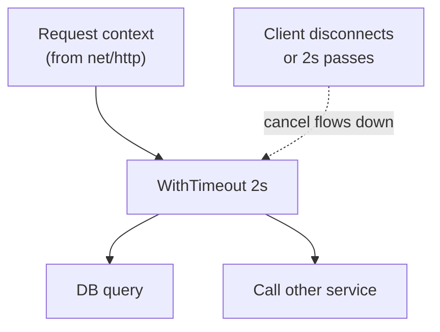
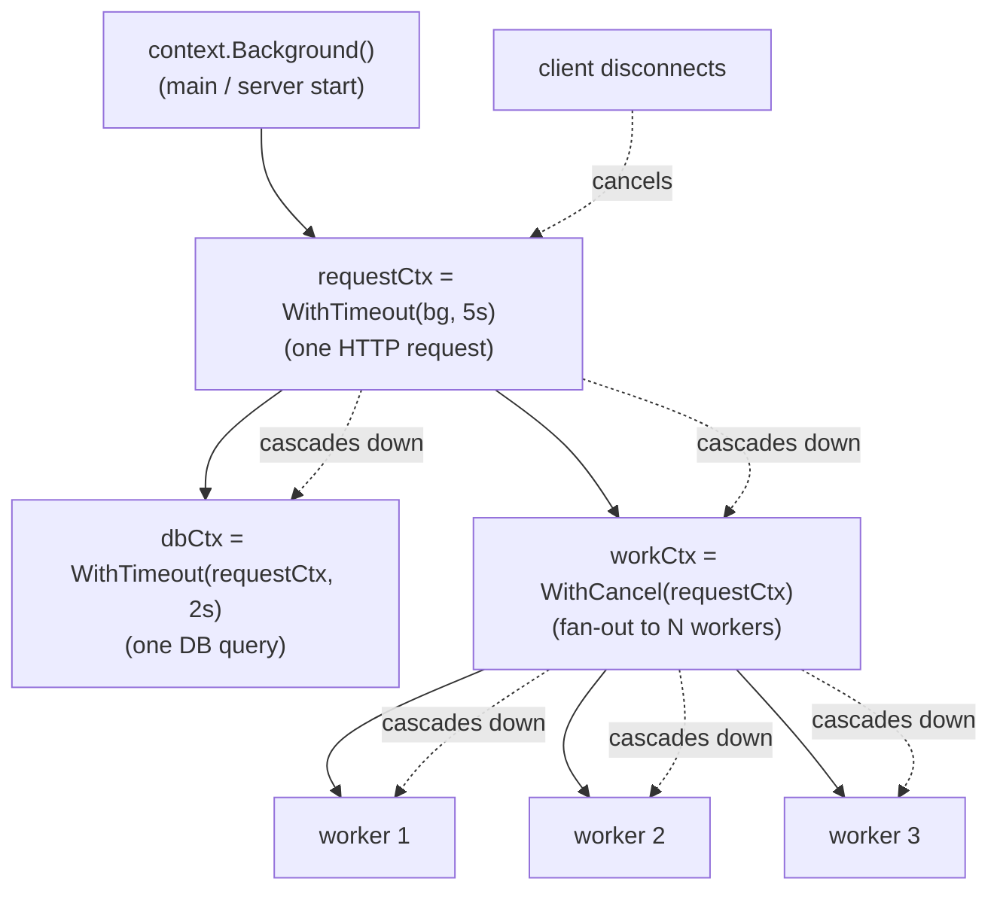
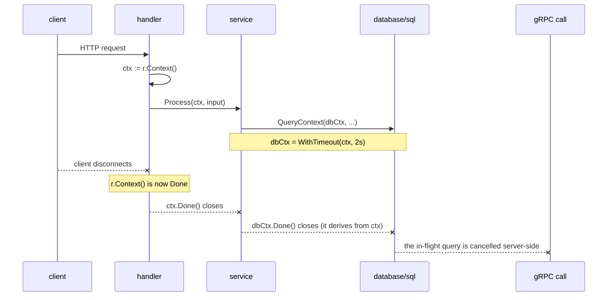

# Context Package

> [!summary] TL;DR
> A `context.Context` carries three things across a chain of function calls: a **deadline or cancellation signal**, request-scoped **values**, and nothing else — it is not a place to pass ordinary parameters. Every function that does I/O or might run for a while should take a `ctx context.Context` as its first parameter and give up early when `ctx.Done()` fires.

> [!abstract] Core idea
> - `Context` is immutable: `WithCancel`/`WithTimeout`/`WithDeadline`/`WithValue` each return a **new** child context wrapping the parent; they never mutate it.
> - Cancellation only flows **down** the tree a parent built: canceling a parent cancels every descendant; canceling a child never touches its parent or siblings.
> - `ctx.Err()` is nil while a context is still active, `context.Canceled` once something canceled it directly, and `context.DeadlineExceeded` once its deadline passed on its own.
> - `defer cancel()` right after every `With...` call that returns one — skipping it leaks the context's internal timer or goroutine, and `go vet` has a dedicated check for exactly this.
> - Classic mistake: stashing request data in `context.Value` that isn't actually request-scoped (a `*sql.DB`, a logger, a feature-flag service) — those are dependencies, and belong in a struct field, injected explicitly.

## Start here: the basics

**The problem in one story.**
A user opens a page, your server starts a slow database query, and the user closes the tab.
Without a signal, the server keeps working on an answer nobody will read.
`context.Context` is that signal: one value handed down every call that says "stop now" or "you have 2 seconds".
It can also carry a small tag, like a request ID, along the way.

**Words you need first**

| Word | Plain meaning | Tiny example |
| --- | --- | --- |
| Goroutine | A lightweight thread run by the Go runtime | `go work()` |
| Channel | A pipe goroutines use to send values or signals | `<-ctx.Done()` waits on one |
| Cancellation | Telling running work to stop early | Client disconnects, query stops |
| Deadline / timeout | A time after which work should give up | `WithTimeout(ctx, 2*time.Second)` |
| Parent / child context | A new context built on top of an older one | `child, cancel := context.WithCancel(parent)` |
| Request-scoped | Belongs to one request only | A request ID |
| Leak | Something left running or held after it is no longer needed | A timer never stopped |

**Picture it**



**Analogy.** A manager hands each team a walkie-talkie; when the manager says "stop", every team below hears it.
Where it breaks: a real team can choose to ignore the radio; in Go, work stops only if the code actually checks `ctx.Done()` or passes `ctx` on.

**How the rest of this note builds up**

- First, why Go needed one standard cancellation value (section 1) and the tree mental model (section 2).
- Then how `Done`, `Err`, `WithCancel`, `WithTimeout`, `WithValue` and `defer cancel()` work (section 3).
- Then a worked HTTP example with tests (section 4) and comparisons with other approaches (sections 5-6).
- Finally the SDE-3 deep dive: `context.Cause`, `WithoutCancel`, `AfterFunc`, goroutine propagation and production pitfalls (sections 7-8).

> [!tip] Remember
> Pass `ctx` first, call `defer cancel()`, check `ctx.Done()`; cancellation only flows down.

## 1. Why it exists

A handler for `GET /orders/{id}` calls a repository, which runs a query against Postgres, which the database driver sends over a TCP connection.

If the client closes the connection after 2 seconds — a mobile client on a flaky network, a load balancer's own timeout, a user who navigated away — nothing *automatically* stops the Postgres query still running on the server's behalf.

Without a shared cancellation signal, the handler goroutine, the repository call, and the in-flight query all keep running to completion for a result nobody will ever read, burning a database connection, a goroutine, and CPU time for work that is already pointless.

`context.Context` is the standard library's answer: one value, threaded through every layer of a call chain, that any layer can use to ask "should I still be doing this?" and that the outermost layer (an HTTP server, a gRPC server, a cron job) can cancel once, with every layer underneath finding out at once.

The same mechanism carries **deadlines** (stop this whole chain by 14:02:05.000, not just "when told to") and a small amount of **request-scoped metadata** (a request ID to put in every log line downstream) that needs to reach deeply nested calls without becoming a parameter on every function signature in between.

## 2. Mental model

A `Context` is a **chain of walkie-talkies handed down a command chain**, not a bag of parameters.

The field commander (the HTTP handler) holds the master radio; every unit under them (the repository call, the outbound HTTP call, the background goroutine) gets a radio that is a clone of the commander's, sometimes with its own shorter battery (a tighter deadline) attached.

If the commander calls "abort" on the master radio, every clone hears it immediately.

If one unit's own radio battery dies (that unit's own deadline passes) or that unit shouts "abort" into its own radio, only that unit and anything *under* it hears it — command and every sibling unit is unaffected.

`context.Background()` is the master radio switched on with nothing yet attached: the context a `main()` or a top-level server loop starts with. `context.TODO()` is "I know this call should take a context, I have not wired it through yet" — a placeholder for code under construction, never a long-term choice.

## 3. How it works

### The Context interface and immutability

```go
type Context interface {
    Deadline() (deadline time.Time, ok bool)
    Done() <-chan struct{}
    Err() error
    Value(key any) any
}
```

`Done()` returns a channel that is closed exactly once, when the context is canceled or its deadline passes — closing is the one event every layer can `select` on without needing to know *why* it happened.

`Err()` explains why, once `Done()` has fired: `nil` before that, `context.Canceled` if something called the context's own `cancel` function, `context.DeadlineExceeded` if its deadline simply arrived.

`WithCancel`, `WithTimeout`, `WithDeadline`, and `WithValue` never change the `Context` they are given — each one builds and returns a brand-new child value that wraps the parent, which is why passing `ctx` around by value everywhere is safe: nobody downstream can retroactively change what an upstream caller sees.

### The cancellation tree



Canceling `requestCtx` (because the client disconnected, or `ServeHTTP` returned) cascades to `dbCtx` and `workCtx` and every worker beneath them, all at once — that is the entire point of building a tree instead of passing one flat context everywhere.

The reverse is never true: canceling `workCtx` on its own (say, because the fan-out finished early) has zero effect on `dbCtx`, `requestCtx`, or `Background()`.

A child's own deadline passing (`dbCtx`'s 2s elapsing before `requestCtx`'s 5s) only ends `dbCtx` and whatever is under it — `requestCtx` is untouched and keeps running on its own budget.

### A deadline flowing through a request



`r.Context()` is canceled by `net/http` itself the moment the client disconnects, or the instant the handler's `ServeHTTP` returns — whichever comes first — so a handler that fires a goroutine after returning must not assume `r.Context()` is still alive by the time that goroutine runs (`context.WithoutCancel`, below, is the fix).

On the client side, the equivalent is `http.NewRequestWithContext(ctx, ...)`: the outbound call is torn down the moment `ctx` ends, mid-request if necessary.

`database/sql`'s `*Context` methods (`QueryContext`, `ExecContext`, ...) and a gRPC client both forward the context's deadline to the server side — gRPC literally sends the remaining time as a `grpc-timeout` header, which the server enforces on its own context.

**Deadline budgets should shrink as they go down, never reset**: giving `dbCtx` its own fresh 5 seconds instead of deriving it from the 2 seconds left on the parent means a slow DB call can blow through the request's real deadline while technically honoring its own.

### Constructors

| Constructor | Ends when | Typical use |
| ----------- | --------- | ----------- |
| `WithCancel(parent)` | `cancel()` is called | Fan-out you want to stop early, e.g. on the first error |
| `WithTimeout(parent, d)` | `d` elapses, or `cancel()` is called | A bounded step: one DB query, one outbound HTTP call |
| `WithDeadline(parent, t)` | wall-clock time `t` arrives, or `cancel()` is called | A shared absolute deadline across several steps that should all stop at the same instant |
| `WithCancelCause(parent)` | `cancel(err)` is called | Fan-out where callers need to know *why* it stopped, via `context.Cause(ctx)` |
| `WithDeadlineCause(parent, t, err)` / `WithTimeoutCause(parent, d, err)` | wall-clock time `t` arrives / `d` elapses, or `cancel()` is called | Like `WithDeadline`/`WithTimeout`, but `context.Cause(ctx)` reports `err` specifically when *this* context's own deadline is what ended it — not when a manual `cancel()` call ends it: the returned plain `CancelFunc` does not set the cause, so a manual cancel still leaves `Cause` reporting `context.Canceled` |
| `WithValue(parent, key, val)` | never on its own; inherits the parent's lifetime | Attaching request-scoped data (request ID, principal) for downstream reads |

Every constructor that returns a `cancel` function (`WithCancel`, `WithTimeout`, `WithDeadline`, `WithCancelCause`, `WithDeadlineCause`, `WithTimeoutCause`) must have that function called on every path, normally with `defer cancel()` right after the call — not calling it leaks the context's internal timer (for the deadline/timeout variants) or its parent-cancellation goroutine (for `WithCancel`/`WithCancelCause`) until the parent itself ends.

`go vet`'s `lostcancel` analyzer is built specifically to catch "a cancel function from `context.With...` is not called on some path" — this note's own Go code had to satisfy it (see "Worked example").

## 4. Worked example

### Whiteboard version

The shape every long-running call follows: select on the work finishing or the context ending, whichever comes first.

```go
package ctxpkg

import (
    "context"
    "time"
)

// SlowOp simulates work that takes d unless ctx ends first.
func SlowOp(ctx context.Context, d time.Duration) error {
    select {
    case <-time.After(d):
        return nil
    case <-ctx.Done():
        return ctx.Err() // Canceled or DeadlineExceeded
    }
}
```

```go
func TestSlowOpReturnsDeadlineExceeded(t *testing.T) {
    ctx, cancel := context.WithTimeout(context.Background(), 10*time.Millisecond)
    defer cancel()
    err := SlowOp(ctx, 100*time.Millisecond)
    if !errors.Is(err, context.DeadlineExceeded) {
        t.Fatalf("got %v, want context.DeadlineExceeded", err)
    }
}
```

The sections below build out the rest of the note's "must cover" list, each with its own test. All code compiles and passes `go vet` (including `lostcancel`) and `go test -race` on Go 1.24.4.

### Typed context keys and values

```go
// ctxKey is an unexported type: it cannot collide with a key another
// package defines, even if both packages pick the same underlying string.
type ctxKey int

const requestIDKey ctxKey = iota

// WithRequestID derives a child context carrying id. It never mutates
// ctx: it returns a new one wrapping it.
func WithRequestID(ctx context.Context, id string) context.Context {
    return context.WithValue(ctx, requestIDKey, id)
}

// RequestIDFromContext is the ONLY way callers should read the value: a
// typed accessor, never a raw ctx.Value(key) at the call site.
func RequestIDFromContext(ctx context.Context) (string, bool) {
    id, ok := ctx.Value(requestIDKey).(string)
    return id, ok
}
```

`context.Value` exists for request-scoped data that genuinely crosses API boundaries you do not control (a request ID picked up by middleware and read deep inside a logging call).

Never for a dependency such as a `*sql.DB` or a logger, which should be a constructor parameter or a struct field so its absence is a compile error, not a runtime nil-assertion panic.

### The cancellation tree, proven by test

```go
type RequestTree struct {
    Root       context.Context
    RootCancel context.CancelFunc
    DBCtx      context.Context
    DBCancel   context.CancelFunc
    WorkCtx    context.Context
    WorkCancel context.CancelFunc
}

// NewRequestTree mirrors a real budget: the whole request gets
// requestBudget, and one DB call inside it gets its own, shorter
// dbBudget, so a slow DB call cannot eat the entire request budget.
func NewRequestTree(requestBudget, dbBudget time.Duration) *RequestTree {
    root, rootCancel := context.WithTimeout(context.Background(), requestBudget)
    dbCtx, dbCancel := context.WithTimeout(root, dbBudget)
    workCtx, workCancel := context.WithCancel(root)
    return &RequestTree{
        Root: root, RootCancel: rootCancel,
        DBCtx: dbCtx, DBCancel: dbCancel,
        WorkCtx: workCtx, WorkCancel: workCancel,
    }
}
```

```go
func TestCancellingRootCancelsEveryDescendant(t *testing.T) {
    rt := NewRequestTree(time.Hour, time.Hour)
    defer rt.DBCancel()
    defer rt.WorkCancel()
    rt.RootCancel()
    select {
    case <-rt.DBCtx.Done():
    case <-time.After(time.Second):
        t.Fatal("dbCtx was not canceled when root was canceled")
    }
    select {
    case <-rt.WorkCtx.Done():
    case <-time.After(time.Second):
        t.Fatal("workCtx was not canceled when root was canceled")
    }
}

func TestCancellingAChildNeverCancelsTheParent(t *testing.T) {
    rt := NewRequestTree(time.Hour, time.Hour)
    defer rt.RootCancel()
    defer rt.DBCancel()
    rt.WorkCancel()
    select {
    case <-rt.Root.Done():
        t.Fatal("root must not be canceled by a child's cancel")
    default:
    }
}
```

A third test, `TestDBDeadlineIsShorterThanRequestDeadline`, builds the tree with a 1-hour request budget but a 50ms DB budget, runs `SlowOp(rt.DBCtx, time.Second)`, and asserts it returns `context.DeadlineExceeded` while `rt.Root` is still open — proving the child's own, shorter deadline ends it independently of the parent's much longer one.

### Checking context in a CPU-bound loop

A loop with no channel operations and no I/O never notices `ctx.Done()` on its own — it has to check explicitly, and checking on every single iteration can cost more than the work itself, so a real loop checks periodically:

```go
// SumUntilCancelled is CPU-bound: the only way it notices cancellation is
// by checking ctx itself, every 1024 iterations to keep overhead low.
func SumUntilCancelled(ctx context.Context, n int) (sum int64, err error) {
    for i := 0; i < n; i++ {
        if i%1024 == 0 {
            select {
            case <-ctx.Done():
                return sum, ctx.Err()
            default:
            }
        }
        sum += int64(i)
    }
    return sum, nil
}
```

`TestSumUntilCancelledStopsEarlyOnCancel` cancels the context before calling `SumUntilCancelled` with `n = 1_000_000` and asserts it returns immediately with `sum == 0` and `err == context.Canceled` — the very first periodic check catches an already-canceled context before a single unit of work runs.

### WithCancelCause and context.Cause

```go
var ErrRateLimited = errors.New("upstream: rate limited, backing off")

// FanOutWithCause runs n workers and stops all of them the moment any one
// returns an error, using context.WithCancelCause (Go 1.20) so the OTHER
// workers' ctx.Err() still reports context.Canceled, but
// context.Cause(ctx) reports WHY: the real error, not just "canceled".
func FanOutWithCause(n int, work func(i int) error) (ctx context.Context, cause error) {
    ctx, cancel := context.WithCancelCause(context.Background())
    results := make(chan error, n)
    for i := 0; i < n; i++ {
        i := i
        go func() { results <- work(i) }()
    }
    var firstErr error
    for i := 0; i < n; i++ {
        if err := <-results; err != nil && firstErr == nil {
            firstErr = err
            cancel(err) // context.Cause(ctx) will return exactly this err
        }
    }
    // Only the FIRST call to cancel sets the cause, so calling it again
    // here is a harmless no-op when a worker already failed, and is what
    // stops every other worker's ctx when none did; it also satisfies
    // go vet's lostcancel check by making cancel reachable unconditionally.
    cancel(nil)
    return ctx, context.Cause(ctx)
}
```

```go
func TestFanOutWithCauseReportsTheRealError(t *testing.T) {
    ctx, cause := FanOutWithCause(5, func(i int) error {
        if i == 2 {
            return ErrRateLimited
        }
        return nil
    })
    if !errors.Is(cause, ErrRateLimited) {
        t.Fatalf("context.Cause = %v, want ErrRateLimited", cause)
    }
    if !errors.Is(ctx.Err(), context.Canceled) {
        t.Fatalf("ctx.Err() = %v, want context.Canceled", ctx.Err())
    }
}
```

`ctx.Err()` stays the generic `context.Canceled` no matter what caused the cancellation — `context.Cause(ctx)` (Go 1.21) is the only way to recover the specific reason, and it is exactly `ErrRateLimited` here even though four of the five workers never saw an error themselves. `TestFanOutWithCauseNilCauseStillReportsCanceled` confirms the other direction: calling `cancel(nil)` when nothing failed still makes `context.Cause(ctx)` report `context.Canceled`, matching `ctx.Err()`.

### AfterFunc and WithoutCancel

```go
// WatchForCancel registers f to run in its own goroutine the moment ctx
// is canceled or its deadline passes (context.AfterFunc, Go 1.21). The
// returned stop func, like a timer's Stop, cancels the registration.
func WatchForCancel(ctx context.Context, f func()) (stop func() bool) {
    return context.AfterFunc(ctx, f)
}

// AuditAfterResponse starts background work that must finish (write an
// audit log) even after the HTTP handler returns and its request ctx is
// canceled. context.WithoutCancel (Go 1.21) keeps the VALUES (request
// id, principal) but detaches from cancellation and the deadline.
func AuditAfterResponse(ctx context.Context, write func(ctx context.Context)) {
    detached := context.WithoutCancel(ctx)
    go write(detached)
}
```

```go
func TestAuditAfterResponseSurvivesRequestCancel(t *testing.T) {
    ctx, cancel := context.WithCancel(context.Background())
    ctx = WithRequestID(ctx, "req-42")
    var wg sync.WaitGroup
    var gotID string
    var gotErr error
    wg.Add(1)
    AuditAfterResponse(ctx, func(detached context.Context) {
        defer wg.Done()
        gotID, _ = RequestIDFromContext(detached)
        gotErr = detached.Err()
    })
    cancel() // the "client disconnected"
    wg.Wait()
    if gotID != "req-42" {
        t.Fatalf("got request id %q, want req-42: values must survive WithoutCancel", gotID)
    }
    if gotErr != nil {
        t.Fatalf("got %v, want nil: WithoutCancel must not be canceled by the parent", gotErr)
    }
}
```

The audit write keeps its request ID (a value) but is immune to the parent's cancellation — this is the fire-and-forget pattern a handler needs for genuinely detached work, paired with its own timeout so it cannot run forever: `write(ctx, ...)` should itself wrap `detached` in a fresh `WithTimeout` before doing real I/O.

`WatchForCancel`'s own tests confirm both halves of `AfterFunc`: the callback runs once the context is canceled, and calling `stop()` before that happens prevents a late run — `stop()` returning `true` means it genuinely stopped the registration before it fired, the same contract as `time.Timer.Stop`.

**Measured:** `go test -race -v ./...` in the scratch module (Go 1.24.4, 2026-11-07) — 13 tests across `whiteboard_test.go`, `tree_test.go`, `worker_test.go`, `cause_test.go`, and `afterfunc_test.go`: 13/13 PASS, 0 race warnings, `go vet ./...` clean (including `lostcancel`).

## 5. Variants and comparison

| Constructor | Signals | Carries a value? | Typical caller |
| ----------- | ------- | ----------------- | --------------- |
| `WithCancel` | Manual cancel only | No | Fan-out you may need to stop early |
| `WithTimeout` / `WithDeadline` | Manual cancel, or time runs out | No | Any single bounded operation (query, HTTP call) |
| `WithCancelCause` | Manual cancel with a reason | No (the reason, via `Cause`, not a value) | Fan-out where the caller needs to know *why* |
| `WithDeadlineCause` / `WithTimeoutCause` | Deadline/timeout with a reason, or manual cancel (no reason set) | No (the reason, via `Cause`, only when the deadline itself fires) | A bounded step whose own timeout should read as a specific error, e.g. `ErrUpstreamSlow`, instead of a bare `DeadlineExceeded` |
| `WithValue` | Inherits the parent's signal | Yes, one key-value pair | Request ID, principal, trace ID |
| `WithoutCancel` | Never (detached) | Inherits the parent's values | Work that must outlive the request |
| `t.Context()` (testing, Go 1.24) | Canceled when the test ends | No | Tests that need a ctx without building one by hand |

## 6. Trade-offs and when not to use

- `context.Value` is not a dependency-injection container. Reading `db := ctx.Value(dbKey).(*sql.DB)` hides a real dependency behind a runtime type assertion that can panic, and makes the function's actual requirements invisible from its signature. Pass dependencies explicitly.
- A context's deadline is a *budget*, not a retry mechanism — `DeadlineExceeded` just means stop; any retry policy sits above this, with its own understanding of whether the operation is safe to retry.
- Storing a `context.Context` in a struct field (instead of passing it as the first parameter of every method) hides which operations are cancellable and makes it easy to reuse a stale or already-canceled context across calls that should each get a fresh one.
- For a CPU-bound loop with no I/O at all, checking `ctx.Done()` adds real overhead; checking every iteration on a tight loop can dominate the loop's own cost, hence checking periodically (shown above) rather than on every step.

## 7. In production

- **Real systems:** every `net/http` handler is handed a request-scoped context via `r.Context()`; `database/sql`'s `*Context` methods and every maintained Postgres/MySQL driver honor it; gRPC propagates a context's deadline across the wire as the `grpc-timeout` header and enforces it server-side; Kubernetes' own controllers and client-go thread a context through every API call for clean shutdown.
- **Failure modes → fixes:**
  - A handler occasionally logs "context deadline exceeded" under normal load, not just during incidents → the deadline budget given to a slow dependency (DB, downstream HTTP call) is tighter than that dependency's own p99 latency; measure the dependency's real latency and either widen the budget or add a fallback.
  - A goroutine started from a handler keeps running long after the response was sent, holding a connection or a lock → it was handed the request's own `ctx` instead of `context.WithoutCancel(ctx)` plus its own timeout, so it got canceled with the request about the right time but anything coordinating with it had already given up.
  - `go vet` flags "the cancel function returned by context.WithTimeout should be called, not discarded" → a `With...` call's `cancel` was never called on some path; add `defer cancel()` immediately after the call, not conditionally later.
  - A background job started with `context.Background()` deep inside a request-handling call never respects the request's own cancellation → it should have derived from the request's `ctx` (or explicitly `WithoutCancel(ctx)` if it must survive the request, with its own bound).
- **What to monitor:** rate of `context.DeadlineExceeded` vs `context.Canceled` in error logs, broken down by dependency — a rising `DeadlineExceeded` rate against one dependency is a latency regression, not a client-cancellation trend; goroutines started with `WithoutCancel` should have their own metrics (count in flight, age) since nothing else will time them out for you.

## 8. Deep dive

- **What `ctx.Err()` actually encodes.** `Err()` returns exactly one of three states: `nil` (context still open), `context.Canceled` (something called this context's own `cancel`, or an ancestor's), or `context.DeadlineExceeded` (this context's own deadline, or an ancestor's shorter one, passed).

  A context derived with `WithTimeout` from an already-canceled parent is itself immediately canceled — children inherit whichever ended first between their own deadline and their parent's end state.
- **`context.Cause` vs `ctx.Err()`.** Before Go 1.20's `WithCancelCause`, every context in a cancellation tree could only ever say "Canceled" or "DeadlineExceeded" — never *why*, in cases where "why" mattered (which of five fan-out workers failed; this note's `FanOutWithCause`).

  `Cause` walks up to find the first ancestor that was canceled with an explicit, non-nil cause; if none was, it falls back to `Err()`'s own value.
- **Propagation into goroutines is manual.** A context is just a value — nothing automatically passes it from a handler into a goroutine the handler starts; that goroutine must be written to take a `ctx context.Context` parameter and actually check it, the same as any other function.

  "Forgot to pass ctx into the goroutine" is a distinct bug from "passed it but never checked `Done()`", and both produce the same symptom: a goroutine that outlives the request indefinitely.
- **`r.Context()`'s exact lifetime.** `net/http` cancels a request's context either when the underlying connection closes (client disconnect, including due to a proxy or load-balancer timeout) or the instant the registered `Handler`'s `ServeHTTP` method returns — whichever happens first.

  A handler that hands off work to a goroutine and then returns has already started that race: by the time the goroutine runs, `r.Context()` may already be done, which is exactly why fire-and-forget work needs `context.WithoutCancel` plus its own timeout rather than reusing `r.Context()` verbatim.
- **Testing with context.** `t.Context()` (Go 1.24) returns a context tied to the test's own lifetime, canceled automatically when the test completes — convenient for tests that need *some* context without constructing `context.Background()` by hand.

  Tests that specifically exercise cancellation behavior (like every test in this note's worked example) still build their own `WithCancel`/`WithTimeout` contexts explicitly, since the behavior under test is the cancellation itself.

## 9. Interview questions

> [!question]- What three things does a Context carry, and what should never go in it?
> A cancellation signal (`Done()`/`Err()`), a deadline, and a small number of request-scoped values (request ID, principal, trace ID). Ordinary parameters and real dependencies (a `*sql.DB`, a logger, a config struct) should never be smuggled in through `Value` — they belong in the function signature or a struct field.

> [!question]- A parent context is canceled. What happens to its children? What happens to its parent?
> Every descendant context is canceled too, cascading down the whole subtree at once. The parent itself, and any sibling branch, is completely unaffected — cancellation only ever flows downward through the tree a `With...` call built.

> [!question]- Trap: your handler's background goroutine is supposed to keep working after the response is sent, but it stops almost immediately. Why?
> It was handed `r.Context()` directly. `net/http` cancels that context as soon as `ServeHTTP` returns (or the client disconnects), so any goroutine still holding it gets canceled at roughly the same moment the handler finishes — use `context.WithoutCancel(ctx)` plus the goroutine's own timeout instead.

> [!question]- What is the difference between `ctx.Err()` and `context.Cause(ctx)`?
> `ctx.Err()` only ever reports the generic `context.Canceled` or `context.DeadlineExceeded`. `context.Cause(ctx)` (Go 1.21, built on `WithCancelCause`) walks up to the nearest ancestor canceled with an explicit non-nil cause and returns that specific error — useful when several independent reasons could have triggered the same cancellation.

> [!question]- Why does `go vet` warn about a discarded `cancel` function, and what does skipping `defer cancel()` actually leak?
> `WithTimeout`/`WithDeadline` start an internal timer, and `WithCancel` starts machinery watching the parent for cancellation; calling `cancel` releases both immediately. Skipping it means that timer or goroutine lives until the *parent* context ends instead — in a long-lived parent (like a server's lifetime), that is a real, accumulating leak.
>
> `go vet`'s `lostcancel` analyzer flags a `cancel` that is not reachable on every path.

> [!question]- Should a CPU-bound loop with no channel operations check `ctx.Done()` on every iteration?
> Usually not — a `select` on every iteration of a tight loop can cost more than the loop body itself. Check periodically (every N iterations, picked so the worst-case reaction time is acceptable) instead of on every single step.

> [!question]- You store `*sql.DB` in the context so every layer can "just grab it from ctx". What's wrong with this?
> It hides a real dependency behind `ctx.Value(key).(*sql.DB)`, which can panic at runtime if the key is ever missing, and makes every function's actual requirements invisible from its signature — a reviewer (or `go doc`) cannot tell what a function needs without reading its body. Pass the `*sql.DB` explicitly, as a parameter or a struct field built once in `main`.

## 10. Cheat sheet

- `ctx` is always the first parameter, never a struct field; `context.Context` is immutable, every `With...` call returns a new child.
- Cancellation only flows down the tree a `With...` call built: parent cancels children, never the reverse.
- `defer cancel()` immediately after every `With...` call that returns one; `go vet`'s `lostcancel` catches the ones you miss.
- `ctx.Err()`: `nil` while open, `context.Canceled` on manual cancel, `context.DeadlineExceeded` once a deadline passed.
- `context.Cause(ctx)` (1.21) recovers the specific reason behind a `WithCancelCause` cancellation; `ctx.Err()` alone cannot.
- `context.WithoutCancel` (1.21) keeps values, drops cancellation — use it for fire-and-forget work, paired with its own timeout.
- `context.AfterFunc` (1.21) runs a callback on cancellation without a hand-written watcher goroutine; its `stop` cancels the registration.
- Shrink deadline budgets as they go down a call chain; never hand a slow dependency a fresh, unrelated deadline of its own.

## Links

- **Before this:** [[Goroutines and Channels]], [[select and Concurrency Patterns]]
- **Next:** [[Error Handling]], [[Standard Library Essentials (time, io, files, encoding)]]
- **Compare with:** [[sync Primitives and Atomics]] (a `Mutex`/`atomic` protects shared memory; a `Context` coordinates when work should stop)

### Watch on YouTube

- [Understanding Go Context - Everything You Need to Know](https://www.youtube.com/watch?v=_zKkEp6edYI) · Matthew Sanabria · thorough single-video coverage of cancellation, deadlines and values
- [Go Context Package: Cancellation, Timeouts & Concurrent Programming](https://www.youtube.com/watch?v=ljiLd2QsEvA) · CodeLucky · focused tutorial on context with concurrency examples
