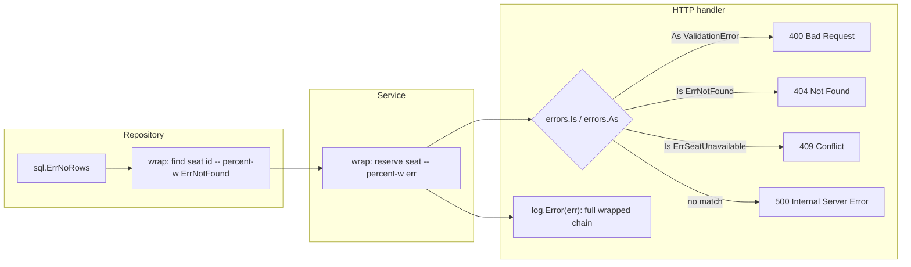
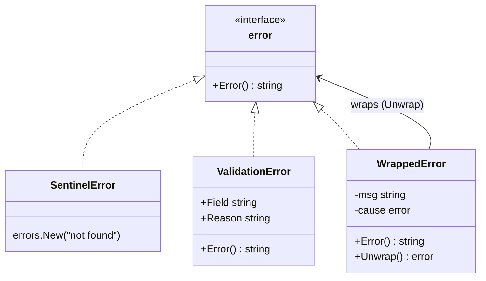
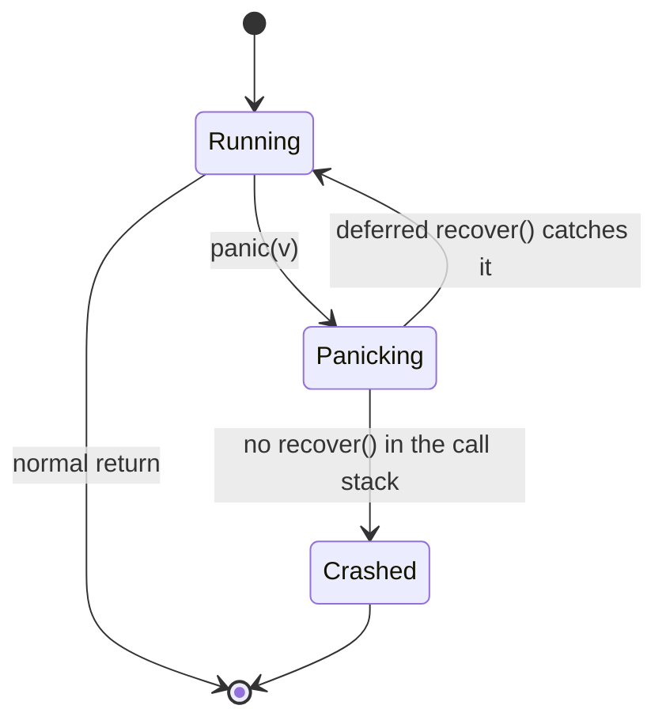

# Error Handling

> [!summary] TL;DR
> In Go, an error is just an ordinary value that satisfies a one-method interface. Functions return it as their last result, callers check it with `if err != nil`, and `fmt.Errorf("...: %w", err)` lets you add context while keeping the original error inspectable with `errors.Is` and `errors.As`.

> [!abstract] Core idea
> - An `error` is any value with an `Error() string` method; there are no exceptions, so every failure path is visible in a function's signature.
> - `%w` in `fmt.Errorf` wraps an error inside another, building a chain that `errors.Is` (identity) and `errors.As` (type) can walk.
> - Three shapes cover almost everything: **sentinel** (`var ErrNotFound = errors.New(...)`), **typed** (`type ValidationError struct{...}`), and **wrapped** (context added on top of either).
> - `panic` is reserved for programmer bugs the caller cannot be expected to handle (nil map write, index out of range); recoverable business failures are always errors.
> - Map errors to a transport (HTTP, gRPC) status only at the outermost boundary — the domain and service layers never import `net/http`.

## 1. Why it exists

A function in Go can fail in an ordinary, expected way (a row does not exist, input is invalid) or in a way the caller cannot plan for (a nil pointer dereference). Go's designers chose to make the first kind an ordinary return value, not a thrown exception, so that:

- The compiler forces you to look at every return site: `invoice, err := repo.Find(id)` makes `err` a real variable you either check or explicitly discard with `_`.
- A function's signature tells you which calls can fail. `func Find(id string) (Invoice, error)` says so directly; nothing is hidden in a `try`/`catch` block three call frames up.
- Control flow stays linear. There is no stack unwinding to reason about, and no risk of an exception silently skipping a `defer`-equivalent cleanup step the way a half-written `finally` block can.

The cost of this design shows up when a team skips the middle step. A handler that does

```go
if err != nil {
    log.Println(err)
    http.Error(w, "internal error", 500)
    return
}
```

for every error collapses three very different situations — "the client sent a bad seat ID" (should be 400), "the seat is already taken" (should be 409), and "the database is down" (should be 503) — into the same 500 response and the same flat log line. The client cannot retry correctly, and an on-call engineer reading the log cannot tell a real outage from routine bad input without re-reading the whole call stack. The fix is not more logging; it is giving errors enough structure (sentinel, typed, wrapped) that the boundary can tell them apart without parsing strings.

## 2. Mental model

Think of an error as a **small, inspectable value**, not a signal. Everything in this note rests on one interface from the standard library:

```go
type error interface {
    Error() string
}
```

Any type with that one method satisfies it — a plain string wrapper from `errors.New`, a struct with fields, or a wrapped error that points at another one. Because `error` is just an interface, `errors.Is` and `errors.As` are not special compiler magic: they are ordinary functions that call an optional `Unwrap() error` (or `Unwrap() []error`) method in a loop, walking from the outermost wrap down to the original cause — the same way you would walk a singly linked list.

By convention, an error string is lowercase and has no trailing punctuation, because it is almost always printed after other context (`fmt.Errorf("reserve seat: %w", err)` reads badly as `"reserve seat: Seat Unavailable."`). The idiomatic shape for the wrapping operation itself is `"<op>: %w"` — a short, lowercase description of what was being attempted, a colon, and the wrapped cause — which is what every `fmt.Errorf` call in this note follows.

## 3. How it works

### The three shapes

| Shape | Declared as | Caller checks with | Carries |
| --- | --- | --- | --- |
| Sentinel | `var ErrNotFound = errors.New("not found")` | `errors.Is(err, ErrNotFound)` | nothing beyond identity |
| Typed | `type ValidationError struct{ Field, Reason string }` | `errors.As(err, &ve)` | structured data (which field, why) |
| Wrapped | `fmt.Errorf("op: %w", err)` | `errors.Is`/`errors.As` still see through it | one line of context per layer |

A sentinel error becomes part of your package's exported API the moment you export it: removing `ErrNotFound` or changing what triggers it is a breaking change for every caller that does `errors.Is(err, mypkg.ErrNotFound)`. Keep the sentinel set small and intentional.

### Wrapping and unwrapping

`fmt.Errorf` with `%w` returns a value whose `Unwrap() error` returns the wrapped error. Since Go 1.20, a single `fmt.Errorf` call can wrap more than one error with multiple `%w` verbs, producing an `Unwrap() []error` instead:

```go
err := fmt.Errorf("process order: %w and %w", errA, errB)
```

`errors.Is(err, target)` walks the chain (unwrapping one or many at each step) and reports whether `target` appears anywhere in it — by `==` for comparable sentinels, or by a custom `Is(error) bool` method if the error type defines one. `errors.As(err, &target)` walks the same chain looking for the first error whose **type** matches `target`'s type, and if found, assigns it through the pointer. Using `%v` instead of `%w` prints the same text but severs the chain: `errors.Is`/`errors.As` can no longer see the original error.

### errors.Join

`errors.Join(errs...)` (Go 1.20) combines a slice of errors into one value whose `Error()` prints each on its own line and whose `Unwrap() []error` exposes the originals, so both `errors.Is` and `errors.As` still look inside. It is the right tool when you want to report every problem at once — for example, validating every field of a form instead of stopping at the first bad one — rather than wrapping, which chains a single cause through layers.





### panic, recover, and the typed-nil trap

`panic` stops normal execution and unwinds the call stack, running deferred functions as it goes, until something calls `recover` inside a `defer` or the program crashes. Reserve it for programmer errors: a nil map write, an out-of-bounds index, an invariant your own code violated. Never use it for a seat that is already booked or a field that failed validation — those are errors, because the caller is expected to handle them.



A `recover` at a goroutine or HTTP-handler boundary converts an unexpected panic into an ordinary `error` so one bad request cannot take down the whole process — but it should be a safety net, not a substitute for returning real errors from functions that can fail predictably.

The **typed-nil trap**: a function that returns a concrete pointer type (`*MyError`) through a named result or directly assigned to an `error` variable can produce a non-nil interface even when the pointer itself is `nil`. An interface value is `nil` only when **both** its dynamic type and its dynamic value are nil; `(*MyError)(nil)` stored in an `error` variable has a non-nil type, so `err != nil` is true even though there is "no error" in the pointer sense. The fix is to never return a concrete error-implementing pointer type directly as `error` — return the interface type, or the literal `nil`.

## 4. Worked example

### Whiteboard version

The bare shape: a sentinel error, a wrap, and the two functions that read it back.

```go
package wb

import (
	"errors"
	"fmt"
)

var ErrNotFound = errors.New("not found")

func find(id string) error {
	return fmt.Errorf("find %s: %w", id, ErrNotFound)
}

func handle(id string) {
	if err := find(id); errors.Is(err, ErrNotFound) {
		fmt.Println("404:", err)
	}
}
```

The full version below adds a typed error, an HTTP mapping function kept separate from the domain code, `errors.Join`, the typed-nil trap and its fix, a named-result close error, panic recovery at a boundary, and collecting errors from goroutines with `errgroup`. It compiles and passes `go vet` and `go test -race` on Go 1.24.4.

```go
// Package errdemo is the tested source for the Error Handling note's code blocks.
package errdemo

import (
	"errors"
	"fmt"
	"net/http"
)

// Sentinel errors: exported values the caller compares with errors.Is.
// Exporting one is a small API contract — removing it is a breaking change.
var (
	ErrNotFound        = errors.New("not found")
	ErrSeatUnavailable = errors.New("seat unavailable")
)

// ValidationError is a typed error: it carries data the caller can extract
// with errors.As instead of parsing a message string.
type ValidationError struct {
	Field  string
	Reason string
}

func (e *ValidationError) Error() string {
	return fmt.Sprintf("invalid %s: %s", e.Field, e.Reason)
}

// Repo is the lowest layer: it returns sentinel and typed errors with no
// knowledge of HTTP.
type Repo struct {
	seats map[string]bool
}

func NewRepo() *Repo { return &Repo{seats: make(map[string]bool)} }

func (r *Repo) Lock(showID, seatID string) error {
	if seatID == "" {
		return &ValidationError{Field: "seat_id", Reason: "required"}
	}
	if r.seats[seatID] {
		// Wrap: keep the sentinel checkable, add context for the log line.
		return fmt.Errorf("lock seat %s on show %s: %w", seatID, showID, ErrSeatUnavailable)
	}
	r.seats[seatID] = true
	return nil
}

func (r *Repo) Find(seatID string) error {
	if !r.seats[seatID] {
		return fmt.Errorf("find seat %s: %w", seatID, ErrNotFound)
	}
	return nil
}

// Service is the middle layer: it adds its own context on top of the
// repository's error without discarding the wrapped chain.
type Service struct {
	repo *Repo
}

func NewService(repo *Repo) *Service { return &Service{repo: repo} }

func (s *Service) ReserveSeat(showID, seatID string) error {
	if err := s.repo.Lock(showID, seatID); err != nil {
		return fmt.Errorf("reserve seat: %w", err)
	}
	return nil
}

// HTTPStatus maps a domain error to a status code. This is the only place
// in the call chain that knows about net/http; Repo and Service do not
// import it.
func HTTPStatus(err error) int {
	var ve *ValidationError
	switch {
	case err == nil:
		return http.StatusOK
	case errors.As(err, &ve):
		return http.StatusBadRequest
	case errors.Is(err, ErrNotFound):
		return http.StatusNotFound
	case errors.Is(err, ErrSeatUnavailable):
		return http.StatusConflict
	default:
		return http.StatusInternalServerError
	}
}

// ValidateSeats returns every problem at once with errors.Join (Go 1.20+),
// instead of stopping at the first bad field.
func ValidateSeats(seatIDs []string) error {
	var errs []error
	for i, id := range seatIDs {
		if id == "" {
			errs = append(errs, fmt.Errorf("seat %d: %w", i, &ValidationError{Field: "seat_id", Reason: "required"}))
		}
	}
	return errors.Join(errs...) // nil if errs is empty
}
```

The typed-nil trap, and its fix, in isolation:

```go
// typedNilError is a pointer error type used to demonstrate the typed-nil
// trap. Production code should never return this shape.
type typedNilError struct{ msg string }

func (e *typedNilError) Error() string { return e.msg }

// riskyLookup is written the WRONG way on purpose: it returns a concrete
// *typedNilError, not the error interface.
func riskyLookup(ok bool) *typedNilError {
	if ok {
		return nil
	}
	return &typedNilError{msg: "lookup failed"}
}

// TypedNilAsInterface reproduces the trap: a nil concrete pointer, once
// stored in an `error` interface variable, is a non-nil interface.
func TypedNilAsInterface(ok bool) error {
	var err error = riskyLookup(ok) // interface now holds (type=*typedNilError, value=nil)
	return err
}

// SafeLookup is the fix: return the interface type and the literal nil,
// never a concrete pointer type.
func SafeLookup(ok bool) error {
	if ok {
		return nil
	}
	return &typedNilError{msg: "lookup failed"}
}
```

Closing errors on writes, with a named result so a failed `Close` is never silently dropped:

```go
type namedCloser struct{ failClose bool }

func (c *namedCloser) Write(p []byte) (int, error) { return len(p), nil }

func (c *namedCloser) Close() error {
	if c.failClose {
		return errors.New("flush failed")
	}
	return nil
}

// WriteAndClose writes data then closes c, surfacing a Close error even
// though Write already succeeded.
func WriteAndClose(c *namedCloser, data []byte) (err error) {
	if _, werr := c.Write(data); werr != nil {
		return fmt.Errorf("write: %w", werr)
	}
	defer func() {
		if cerr := c.Close(); cerr != nil && err == nil {
			err = fmt.Errorf("close: %w", cerr)
		}
	}()
	return nil
}
```

Recovering a panic at a boundary (a worker boundary here; an HTTP middleware uses the same shape):

```go
func SafeHandler(work func()) (err error) {
	defer func() {
		if r := recover(); r != nil {
			err = fmt.Errorf("recovered panic: %v", r)
		}
	}()
	work()
	return nil
}
```

Collecting errors from goroutines with `golang.org/x/sync/errgroup` instead of an ad-hoc error channel — `g.Wait()` returns the first non-nil error and cancels the shared context for the rest:

```go
func FetchAll(ctx context.Context, ids []string, fetch func(ctx context.Context, id string) error) error {
	g, ctx := errgroup.WithContext(ctx)
	for _, id := range ids {
		id := id // pre-1.22 capture habit; harmless and still correct on 1.22+
		g.Go(func() error {
			if err := fetch(ctx, id); err != nil {
				return fmt.Errorf("fetch %s: %w", id, err)
			}
			return nil
		})
	}
	return g.Wait()
}
```

Representative tests (the full suite is 11 cases across sentinel/typed/wrapped checks, `errors.Join`, the typed-nil trap, the named-result close, panic recovery, and `errgroup`):

```go
func TestSentinelWrappedAndIs(t *testing.T) {
	repo := NewRepo()
	svc := NewService(repo)
	_ = svc.ReserveSeat("show-1", "A7")
	err := svc.ReserveSeat("show-1", "A7") // same seat again: should collide
	if !errors.Is(err, ErrSeatUnavailable) {
		t.Fatalf("errors.Is(err, ErrSeatUnavailable) = false through two wraps; err = %v", err)
	}
}

func TestTypedNilTrap(t *testing.T) {
	err := TypedNilAsInterface(true)
	if err == nil {
		t.Fatal("want the typed-nil trap to produce a non-nil interface (that is the trap)")
	}
	if err := SafeLookup(true); err != nil {
		t.Fatalf("SafeLookup(true) = %v, want nil", err)
	}
}
```

**Measured output (Go 1.24.4, `go test -race -v ./...`, 2026-11-07):**

```text
=== RUN   TestSentinelWrappedAndIs
--- PASS: TestSentinelWrappedAndIs (0.00s)
=== RUN   TestTypedErrorAs
--- PASS: TestTypedErrorAs (0.00s)
=== RUN   TestNotFoundIs
--- PASS: TestNotFoundIs (0.00s)
=== RUN   TestHTTPStatusMapping
--- PASS: TestHTTPStatusMapping (0.00s)
=== RUN   TestErrorsJoinCollectsAll
--- PASS: TestErrorsJoinCollectsAll (0.00s)
=== RUN   TestErrorsJoinNilWhenNoErrors
--- PASS: TestErrorsJoinNilWhenNoErrors (0.00s)
=== RUN   TestTypedNilTrap
--- PASS: TestTypedNilTrap (0.00s)
=== RUN   TestWriteAndCloseSurfacesCloseError
--- PASS: TestWriteAndCloseSurfacesCloseError (0.00s)
=== RUN   TestSafeHandlerRecoversPanic
--- PASS: TestSafeHandlerRecoversPanic (0.00s)
=== RUN   TestFetchAllReturnsFirstError
--- PASS: TestFetchAllReturnsFirstError (0.00s)
=== RUN   TestFetchAllSucceeds
--- PASS: TestFetchAllSucceeds (0.00s)
PASS
ok  	scratch/g3/errdemo	3.533s
```

`go vet ./...` reports nothing.

## 5. Variants and comparison

| Shape | How it works | Use when | Cost |
| --- | --- | --- | --- |
| Sentinel (`errors.New`) | A single exported value compared by identity | A fixed, nameable condition with no extra data (`io.EOF`, `sql.ErrNoRows`) | Exported sentinels are part of your API forever |
| Typed (`type X struct{...}`) | A struct implementing `Error()`, matched by type with `errors.As` | The caller needs structured data (which field, which limit) | One type per distinct shape of data; more code than a sentinel |
| Wrapped (`%w`) | Adds one line of context per layer, keeps the chain walkable | Every layer that is not the one deciding how to react | Each wrap concatenates a string; very deep chains get verbose logs |
| `errors.Join` | Combines independent errors into one value with `Unwrap() []error` | Reporting every validation failure instead of the first one | `errors.Is`/`errors.As` must check the whole tree, not a single path |
| `panic`/`recover` | Unwinds the stack; a deferred `recover` stops it | Programmer bugs only (nil deref, invariant violated), recovered at a boundary as a last resort | Breaks the "errors are visible in signatures" guarantee if overused for business logic |

## 6. Trade-offs and when not to use

- Wrapping every error at every layer produces long, repetitive log lines (`"reserve seat: lock seat A7 on show 42: seat unavailable"`). Wrap when you add real information (an ID, an operation name), not out of habit.
- `errors.As` requires the exact pointer or value type you declared; renaming or restructuring a typed error is a breaking change for every caller using `errors.As` on it, the same as a sentinel.
- `errors.Join`'s `Error()` string is multi-line and not meant for a single HTTP error message; map it to a list of field errors at the boundary instead of returning its raw text.
- For a single, simple internal tool with one caller and no API boundary, plain `if err != nil { return err }` with no wrapping is often enough — add structure only once something downstream needs to distinguish error kinds.

## 7. In production

- **Real systems:** the Go standard library itself uses all three shapes — `io.EOF` (sentinel), `*url.Error` and `*json.UnmarshalTypeError` (typed), and `fmt.Errorf("%w")` wrapping throughout `os`, `net`, and `encoding/json`. `database/sql` returns the sentinel `sql.ErrNoRows`, which is exactly what repo layers wrap into a domain `ErrNotFound` in the diagram above.
- **Failure modes → fixes:**
  - Logging an error and also returning it up the stack, so it gets logged again at every layer → log once, at the boundary that handles it; everywhere else, wrap and return.
  - Returning raw driver errors (`pq: duplicate key value violates unique constraint ...`) to API clients → map to a domain sentinel or typed error before it leaves the repository.
  - A goroutine's panic crashing the whole process because nothing recovers it → recover at each goroutine's entry point (or use `errgroup`, which does not, by itself, recover panics — add your own recover inside `g.Go`'s function if goroutines can panic).
  - The typed-nil trap shipping a "successful" response that is actually an error → never return a concrete error-implementing pointer type as `error`; `go vet`'s `nilness` analysis and some linters (e.g. `nilerr`) catch some but not all cases, so review functions that return named pointer-typed errors directly.
- **What to monitor:** rate of each mapped HTTP status (a spike in 500s vs 400s tells you whether it is your backend or your clients), the sentinel or type behind each 5xx in logs (not just "internal error"), and panics recovered per minute (any sustained rate above zero is a bug, not noise).

## 8. Deep dive

- **Why `errors.Is` and not `==` after wrapping.** `fmt.Errorf("...: %w", err)` returns a new value every time; comparing that new value to `ErrNotFound` with `==` is always false. `errors.Is` instead calls `Unwrap()` in a loop and compares each link, so it sees through any number of wraps. A custom `Is(target error) bool` method lets a type define its own equivalence (for example, treating any `*MyError` with the same code as equal) instead of relying on `==`.
- **Why `errors.As` needs a pointer to a pointer for pointer-receiver errors.** `var ve *ValidationError; errors.As(err, &ve)` passes `*(*ValidationError)` so `errors.As` can assign through it. Passing `ve` (not `&ve`) compiles only if `ve` is already addressable as an `any`-boxed pointer target — in practice, always pass `&ve`.
- **Multiple `%w` and the join tree.** Since Go 1.20, `fmt.Errorf` accepts more than one `%w` verb, producing an error whose `Unwrap() []error` returns all wrapped errors; `errors.Join` builds the same shape directly from a slice. Both `errors.Is` and `errors.As` do a depth-first walk over this tree, so a target nested inside one branch of a joined error is still found.
- **The transport boundary rule, restated precisely.** `HTTPStatus` above takes an `error` and returns an `int`; nothing else in the package imports `net/http`. This keeps the domain testable without an HTTP server and makes the mapping reusable for a gRPC status mapper (`codes.NotFound` instead of `http.StatusNotFound`) without touching the domain code at all. The concrete status-and-body shape (problem+json, error codes) is covered in [[API Error Handling]]; wiring it into a real handler is in [[Building REST Endpoints]].
- **`recover` only works one level up.** `recover()` only stops a panic if it is called directly inside a deferred function in the **same goroutine** where the panic happened. A `recover` in the function that started a goroutine does not catch a panic inside that goroutine — each goroutine that can panic needs its own recovery, which is why worker pools and `errgroup`-based fan-out usually wrap each unit of work in a small recover-to-error helper like `SafeHandler` above.

## 9. Interview questions

> [!question]- Why does Go use returned errors instead of exceptions?
> So every call site that can fail shows it in the function signature and the compiler-visible `if err != nil` check, instead of a `try`/`catch` written (or forgotten) somewhere up the stack. It also keeps control flow linear: there is no stack unwinding to reason about for an ordinary, expected failure.

> [!question]- What is the difference between `errors.Is` and `errors.As`?
> `errors.Is(err, target)` walks the wrap chain checking identity — "is this error (or one it wraps) equal to this specific sentinel value?" `errors.As(err, &target)` walks the same chain checking type — "is there an error of this type anywhere in the chain, and if so, give it to me." Use `Is` for sentinels, `As` for typed errors that carry data.

> [!question]- What is the typed-nil trap, and how do you avoid it?
> A function that returns a concrete pointer type (`*MyError`) assigned to an `error` variable can produce a non-nil interface even when the pointer is `nil`, because an interface is nil only when both its type and value are nil. Avoid it by never returning a concrete error-implementing pointer type directly as `error` — return the interface, or the literal `nil`.

> [!question]- When should you use `panic` instead of returning an error?
> Only for programmer bugs the caller cannot reasonably be expected to handle — a broken invariant, a nil map write, code that should be unreachable. Any failure a caller might legitimately want to check and react to (not found, invalid input, a conflict) is an error, never a panic.

> [!question]- What does `errors.Join` give you that wrapping with `%w` does not?
> Wrapping chains a single cause through layers, one `Unwrap() error` at a time. `errors.Join` combines several independent errors into one value with `Unwrap() []error`, so you can report every problem — every invalid field in a form, every failed item in a batch — in one return instead of stopping at the first one.

> [!question]- Your handler logs `err` and also returns it to the caller, who logs it again. What is wrong?
> The same failure gets logged twice (or more, at every layer that re-logs instead of just re-wrapping), making logs noisy and harder to correlate. Handle an error once, at the boundary that decides what to do with it: everywhere below that, wrap and return; at the boundary, log the full chain once and map it to a response.

> [!question]- Trap: does `fmt.Errorf("%v", err)` still let `errors.Is` see the wrapped error?
> No. `%v` only formats the text; it does not call `Unwrap()`. Only `%w` produces a value whose `Unwrap()` method exposes the original error, which is what `errors.Is` and `errors.As` rely on. A log line built with `%v` reads the same to a human but is invisible to error-chain inspection.

## 10. Cheat sheet

- `error` is an interface with one method, `Error() string` — nothing more.
- Sentinel → `errors.Is`. Typed → `errors.As`. Both still work through any number of `%w` wraps.
- `%w` keeps the chain walkable; `%v` does not.
- `errors.Join` (1.20+) combines independent errors into a tree both `Is` and `As` can search.
- Never return a concrete pointer error type directly as `error` — the typed-nil trap.
- `panic` is for programmer bugs; recover it only at a boundary (goroutine, HTTP handler), and convert it to an error there.
- Map to HTTP/gRPC status only at the outermost boundary; the domain and service layers stay transport-agnostic.
- Handle an error once — log at the boundary, wrap-and-return everywhere else.

## Links
- **Before this:** [[Functions, Closures, Defer, Panic and Recover]], [[Interfaces]]
- **Next:** [[Packages, Modules and Dependency Management]], [[Building REST Endpoints]]
- **Compare with:** [[API Error Handling]] (the HTTP status/body contract this note's `HTTPStatus` function feeds), [[Go Interview Questions and Traps]] (the nil-interface trap restated alongside other Go gotchas)
