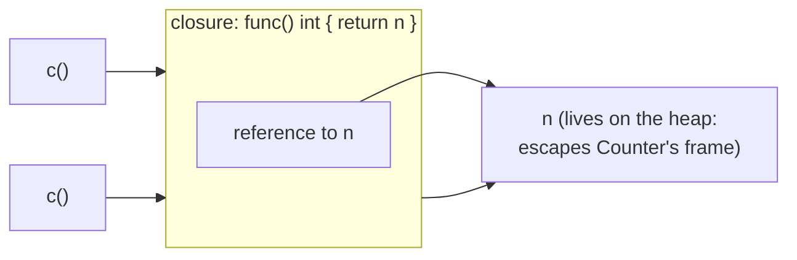
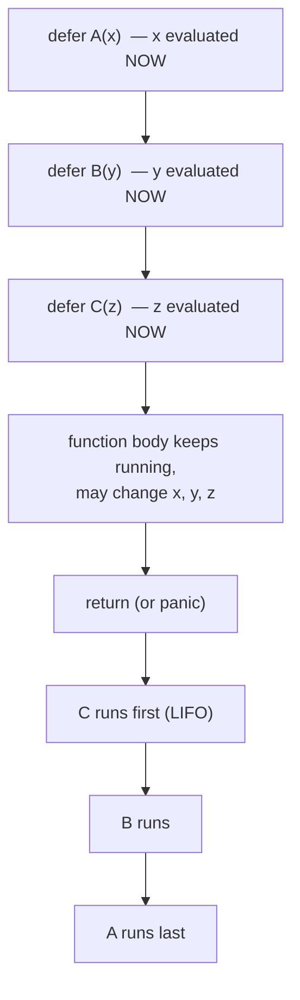
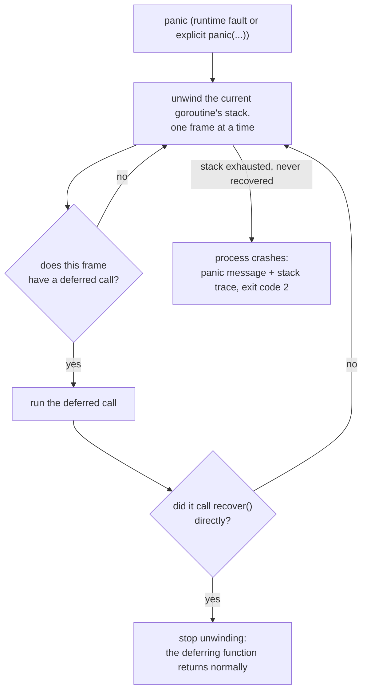
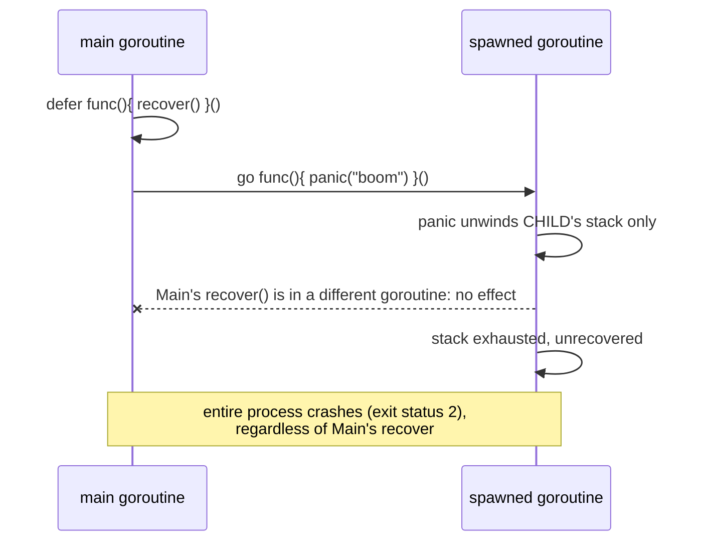

# Functions, Closures, Defer, Panic and Recover

> [!summary] TL;DR
> A Go function can return multiple values, accept a variable number of arguments, and be passed around as a value because functions are first-class. `defer` schedules a call to run when the surrounding function returns, in reverse order of how the defers were registered. `panic` stops normal execution for an unrecoverable condition, and `recover` — called directly inside a deferred function, in the same goroutine — is the only way to stop a panic from propagating.

> [!abstract] Core idea
> - Functions are values: you can assign them to variables, pass them as arguments, and return them from other functions. A **closure** is a function value that reads or writes variables from outside its own body.
> - `defer f(x)` evaluates `x` immediately but runs `f` later, when the enclosing function returns; several defers run **LIFO** (last deferred, first run).
> - `panic` is for bugs, not expected failures: a nil map write, an out-of-range index, or a deliberate `panic(...)` for a condition the caller cannot be expected to handle.
> - `recover()` only has an effect when called directly inside a deferred function in the **same goroutine** that panicked; a panic in a goroutine you spawned cannot be recovered by anyone else and kills the whole process.
> - `os.Exit` and `log.Fatal` end the process immediately and skip every pending deferred call — they are not a controlled return.

## 1. Why it exists

A payment handler opens a file, needs to make sure it closes no matter how the function exits, and needs to tell a genuine write failure apart from a failure to close:

```go
func writeReceipt(path string, data []byte) error {
	f, err := os.Create(path)
	if err != nil {
		return err
	}
	_, err = f.Write(data)
	if err != nil {
		f.Close() // the file still needs closing, but we're already returning the write error
		return err
	}
	return f.Close() // this duplicate close call is the only path that reports a close failure
}
```

Every exit path needs its own `f.Close()`, and adding a third branch (say, a flush step) means adding a third copy of the cleanup. `defer` collapses this to one line, written next to where the resource was acquired, that fires on **every** return path including a `panic`:

```go
func writeReceipt(path string, data []byte) (err error) {
	f, cerr := os.Create(path)
	if cerr != nil {
		return cerr
	}
	defer func() {
		if cerr := f.Close(); cerr != nil && err == nil {
			err = cerr
		}
	}()
	_, err = f.Write(data)
	return err
}
```

This is also where `panic` and `recover` earn their place: a bug deep in a request handler (a nil pointer dereference, say) must not take down every other in-flight request on the same server. `net/http` recovers panics per-request for exactly this reason — see [[Error Handling]] for where panic fits next to ordinary error values.

## 2. Mental model

A function value is a box you can hand around like any other value — an `int` or a `string` — except that calling it runs code. A **closure** is that box with a few variables from its birthplace taped to the outside: every copy of the closure that shares those variables sees the same taped-on state, the same way two slices can share one backing array (see [[Arrays, Slices and Maps (with internals)]]).

`defer` is a to-do list pinned to the function: each `defer` statement adds one item to the top of the list, evaluating that item's arguments right now, and the whole list runs from the top down — most-recently-added first — the instant the function is about to return, whether that return is a plain `return`, falling off the end, or a `panic` unwinding through it.

`panic` and `recover` are not Go's version of try/catch. A `panic` always unwinds the current goroutine's stack, running every deferred call as it goes, until either a deferred call invokes `recover()` (which stops the unwind and lets the function that deferred it return normally) or the stack runs out (which crashes the program and prints a stack trace). There is no "catch nearby and keep going from the same line" — once a function has panicked, that function is already on its way out.

## 3. How it works

### Functions as values, multiple and named results

```go
func divmod(a, b int) (q, r int) { // named results: q and r start at their zero values, 0 and 0
	q, r = a/b, a%b
	return // "naked" return: sends back the current values of q and r
}

var op func(int, int) (int, int) = divmod // a function is a value with a type: func(int, int) (int, int)
```

Named results exist for two reasons: self-documentation (`divmod`'s signature tells you which result is which), and so a deferred function can read or rewrite them before the caller sees them — exactly what the `writeReceipt` example above needs for its close error.

### Variadics alias the caller's slice

```go
func Sum(nums ...int) int { ... }

nums := []int{1, 2, 3}
Sum(nums...)       // nums inside Sum IS the caller's backing array, not a copy
Sum(1, 2, 3)       // this form allocates a fresh backing array for the variadic parameter
```

`f(s...)` passes the slice header itself; `f(1, 2, 3)` builds a new slice. A function that writes through a variadic parameter received via `s...` is writing into the caller's memory — the same aliasing rule as any other slice (see [[Arrays, Slices and Maps (with internals)]]).

### Closures capture variables, not values



```go
func Counter() func() int {
	n := 0
	return func() int {
		n++
		return n
	}
}
```

`n` is declared inside `Counter`, but the returned closure keeps a live reference to it, so `n` outlives `Counter`'s own call — the compiler's escape analysis puts it on the heap instead of `Counter`'s stack frame (see [[Pointers, Values and Escape Analysis]]). Every call to the same closure value shares that one `n`; a second call to `Counter()` creates a brand-new, independent `n`.

**The classic loop-variable trap, and why Go 1.22 fixed it.** Before Go 1.22, a `for` loop had exactly one `i` variable, reused every iteration, so closures created inside the loop all captured the *same* variable and all saw its final value once the loop ended:

```go
// Pre-1.22 behaviour (only with a go.mod "go" directive below 1.22):
var fns []func() int
for i := 0; i < 3; i++ {
	fns = append(fns, func() int { return i })
}
// fns[0](), fns[1](), fns[2]() all returned 3 — the loop's final i.
```

Since Go 1.22 (and unconditionally in this Go 1.24 module), each iteration gets its **own** `i`, so the closures capture 0, 1 and 2 as intended. The change is controlled by the module's `go` directive, so vendored code built with an older directive keeps the old behaviour — check `go.mod` before assuming which rule applies.

A function value that is called repeatedly by a `for ... range` loop is exactly what Go 1.23's **range-over-func** feature standardised: `range` over a function of type `func(yield func(V) bool)` (or `func(yield func(K, V) bool)`) calls that function once per iteration, feeding each value through `yield`, and stops as soon as `yield` returns `false` — see [[Generics and Iterators]] for how the standard library's `iter.Seq` and `iter.Seq2` build on this.

### Recursion has no tail-call optimisation

```go
func Factorial(n int) int {
	if n <= 1 {
		return 1
	}
	return n * Factorial(n-1) // the multiplication after the call means this can't be a tail call anyway
}
```

Go does not perform tail-call optimisation, so every recursive call keeps its own stack frame alive until it returns — including genuine tail calls, which some other languages would collapse into a loop. A goroutine's stack starts small and grows automatically (see [[Process Memory Layout - Stack vs Heap]]), so deep-but-finite recursion usually just works, but recursion with no bound that scales with untrusted input is a real way to exhaust memory; rewrite it as an explicit loop with a stack/slice if the depth is attacker-influenced.

### defer: LIFO order, and argument evaluation time



Two rules, both visible in `DeferOrder` below:

```go
func DeferOrder() (order []int) {
	for i := 0; i < 3; i++ {
		defer func(n int) {
			order = append(order, n)
		}(i)
	}
	return
}
// DeferOrder() == []int{2, 1, 0}: the defers ran in reverse of how they were added.
```

`i` is passed as the parameter `n`, so each deferred call captures the value `i` had **at the moment the `defer` statement ran** — not whatever `i` becomes later. This is why `defer f(x)` behaves differently from `defer func() { f(x) }()`: the first freezes `x` now; the second would read whatever `x` is when the closure finally runs (which, for a loop variable before Go 1.22, could be every closure reading the same final value — the same trap as in the closures section above).

```go
func DeferArgEvalTime(record func(int)) int {
	x := 1
	defer record(x) // x's value, 1, is captured right now
	x = 2
	return x
}
// DeferArgEvalTime(record) returns 2; record is called with 1.
```

### defer inside a loop holds resources open

```go
// Anti-pattern: every file stays open until processAll itself returns,
// not until each iteration finishes — with enough files this exhausts the
// process's file descriptor limit.
func processAll(paths []string) error {
	for _, p := range paths {
		f, err := os.Open(p)
		if err != nil {
			return err
		}
		defer f.Close() // accumulates: none of these run until processAll returns
		if err := process(f); err != nil {
			return err
		}
	}
	return nil
}
```

The fix is to give each iteration its own function scope, so each `defer` runs at the end of that one iteration instead of piling up:

```go
func processAll(paths []string) error {
	for _, p := range paths {
		if err := processOne(p); err != nil {
			return err
		}
	}
	return nil
}

func processOne(p string) error {
	f, err := os.Open(p)
	if err != nil {
		return err
	}
	defer f.Close() // runs when processOne returns, i.e. once per path
	return process(f)
}
```

### Runtime panics vs explicit panics, and recover's one rule



A **runtime panic** happens on its own: indexing past a slice's length, dereferencing a nil pointer, a type assertion that doesn't hold, dividing an integer by zero, or writing to a nil map. An **explicit panic** is a deliberate `panic(v)` call for a condition the function's author decided the caller cannot reasonably recover from (a broken invariant, not a normal failure — normal, expected failures are `error` values; see [[Error Handling]]).

`recover()` only stops a panic when it is called **directly inside a function that was deferred** in the same goroutine that is currently panicking. Calling `recover()` from an ordinary (non-deferred) function call, or from a different goroutine, always returns `nil` and does nothing:

```go
func SafeDivide(a, b int) (result int, err error) {
	defer func() {
		if r := recover(); r != nil { // runs during the unwind; recover() has an effect here
			err = fmt.Errorf("safe divide recovered: %v", r)
		}
	}()
	result = a / b // panics: "runtime error: integer divide by zero" when b == 0
	return
}
```

**Re-panicking an unrecognised value.** A recover handler that was only built to turn *expected* panics into errors should let anything else keep propagating, instead of silently absorbing a bug it doesn't understand:

```go
func RecoverTyped(f func()) (err error) {
	defer func() {
		if r := recover(); r != nil {
			if e, ok := r.(error); ok {
				err = e
				return
			}
			panic(r) // re-panic: this recover wasn't built to handle non-error panic values
		}
	}()
	f()
	return nil
}
```

The same idea applies to `http.ErrAbortHandler`: `net/http`'s own per-request recover treats this one sentinel specially and does **not** log it, because a handler panics with it on purpose to abort a response without noise (for example, after the client disconnected mid-stream). Custom recover middleware should check `errors.Is(err, http.ErrAbortHandler)` (wrapped as an error, or compared directly if the raw value was a panic) and re-panic it rather than swallow it — see the recover middleware in [[Middleware]].

### recover cannot cross a goroutine boundary



**Measured** (Go 1.24.4, darwin/arm64, running the helper program below). The goroutine number the runtime assigns is not stable across runs (re-running the same binary printed `goroutine 17`, `goroutine 17`, `goroutine 17`, then `goroutine 5`), so only the shape of the trace is representative, not that specific number:

```text
panic: boom in a child goroutine

goroutine N [running]:
main.main.func1.2()
	.../cmd/goroutinepanic/main.go:14 +0x58
created by main.main.func1 in goroutine 1
	.../cmd/goroutinepanic/main.go:12 +0x78
exit status 2
```

```go
func main() {
	done := make(chan struct{})
	func() {
		defer func() {
			recover() // USELESS: the panic below happens in a different goroutine
		}()
		go func() {
			defer close(done)
			panic("boom in a child goroutine")
		}()
	}()
	<-done
}
```

A `recover()` anywhere in `main`'s goroutine cannot stop a panic raised inside a goroutine `main` spawned — only a `defer`+`recover()` placed directly inside that spawned goroutine's own call stack can. This is why every goroutine a server spawns per request (background work, fan-out workers) needs its **own** recover, not just one at the top of the handler; see [[Goroutines and Channels]].

### init(), os.Exit and log.Fatal skip defers

```go
func init() {
	// runs before main(), in file-name order within a package, after all
	// imported packages' init funcs have already run. Side effects here
	// (opening a connection, reading a file) make a package's import
	// alone have consequences — keep init() to pure setup (registering a
	// codec, computing a constant) and avoid anything that can fail.
}

func main() {
	defer fmt.Println("this line never prints")
	os.Exit(3) // terminates the process immediately; no deferred call anywhere runs
}
```

**Measured** (Go 1.24.4, darwin/arm64, built and run directly so the exit code is visible): the process exits with status `3` and never prints the deferred line. `log.Fatal` and `log.Fatalf` call `os.Exit(1)` internally after logging, so they have the exact same effect — skip any cleanup you need to run, and prefer returning an error up to `main` (which can defer-cleanup, then call `os.Exit`) over calling `log.Fatal` deep inside a library function.

There is also `runtime.Goexit`, which terminates only the calling goroutine — running its deferred calls as it goes, like a panic that is never printed and never recovered — without taking down the rest of the process; `t.FailNow()` in the `testing` package is implemented with it.

## 4. Worked example

### Whiteboard version

The two rules that matter most, with nothing else going on:

```go
package wb

func Demo() (order []int, x int) {
	defer func() { order = append(order, 1) }() // added second, runs first
	defer func() { order = append(order, 2) }() // added first... wait, see below
	x = 10
	return
}
```

Read top to bottom, `defer` statements execute in the order they are *written*, but they *run* in the opposite order at return time — so `Demo()` returns `order == []int{2, 1}` (whichever defer statement physically executed last in the source runs first), `x == 10`. The full version below adds argument-evaluation timing, the panic/recover path, and tests for each claim.

### Full version

Tested on Go 1.24.4 (darwin/arm64); `go vet` and `go test -race` both pass.

```go
// Sum takes a variadic slice. Calling Sum(nums...) with an existing slice
// does NOT copy it: nums inside Sum is the exact same backing array as the
// caller's slice.
func Sum(nums ...int) int {
	total := 0
	for _, n := range nums {
		total += n
	}
	return total
}

// Counter returns a closure that captures its own private n by reference:
// each call to the returned function sees and mutates the same n.
func Counter() func() int {
	n := 0
	return func() int {
		n++
		return n
	}
}

// ZeroFirst writes through a variadic parameter received via nums...: a call
// like ZeroFirst(existing...) mutates existing[0] in the caller, because the
// variadic parameter aliases the caller's backing array instead of copying it.
func ZeroFirst(nums ...int) {
	if len(nums) > 0 {
		nums[0] = 0
	}
}

// DeferOrder shows defer's two defining rules in one function: deferred
// calls run LIFO, and each one's arguments were evaluated when its "defer"
// statement ran, not when the call later executes.
func DeferOrder() (order []int) {
	for i := 0; i < 3; i++ {
		defer func(n int) {
			order = append(order, n)
		}(i)
	}
	return
}

// SafeDivide turns the runtime panic from integer division by zero into an
// ordinary error, using recover inside a deferred function.
func SafeDivide(a, b int) (result int, err error) {
	defer func() {
		if r := recover(); r != nil {
			err = fmt.Errorf("safe divide recovered: %v", r)
		}
	}()
	result = a / b
	return
}
```

The tests that prove the aliasing, ordering, argument-timing and recover claims:

```go
func TestZeroFirstAliasesCallersSlice(t *testing.T) {
	nums := []int{7, 8, 9}
	ZeroFirst(nums...) // ZeroFirst sets nums[0] = 0 through its variadic parameter
	if nums[0] != 0 {
		t.Fatalf("nums[0] = %d, want 0: variadic call should alias the caller's backing array", nums[0])
	}
}

func TestDeferOrderIsLIFO(t *testing.T) {
	got := DeferOrder()
	want := []int{2, 1, 0}
	for i := range want {
		if got[i] != want[i] {
			t.Fatalf("DeferOrder() = %v, want %v (deferred calls run in reverse order)", got, want)
		}
	}
}

func TestSafeDivideRecoversFromPanic(t *testing.T) {
	if _, err := SafeDivide(10, 0); err == nil {
		t.Fatal("SafeDivide(10, 0) returned nil error, want the recovered panic as an error")
	}
	if result, err := SafeDivide(10, 2); err != nil || result != 5 {
		t.Fatalf("SafeDivide(10, 2) = %d, %v, want 5, nil", result, err)
	}
}
```

**Measured** (Go 1.24.4, darwin/arm64, `go vet ./...` then `go test ./... -race`): all three tests above pass. The goroutine-panic and `os.Exit` behaviours from section 3 are process-level effects (a crash, a specific exit code) rather than assertions a `go test` run can make, so they were checked separately by building and running the two small helper programs shown there, not by `go test`.

## 5. Variants and comparison

| Mechanism | How it works | Use when | Cost |
| --- | --- | --- | --- |
| Ordinary `error` return | Caller checks `if err != nil` | Any expected, plannable failure (not found, invalid input, timeout) | None beyond the check itself |
| `defer` + named result | A deferred func mutates the named return before the caller sees it | Guaranteed cleanup, or converting a close/flush failure into the function's error | A closure allocation per call (usually optimised away by open-coded defers, Go 1.14+) |
| `panic` / `recover` at a function boundary | Unwind until a deferred `recover()` stops it | A library needs to turn an internal panic into an `error` at its own public boundary (e.g. `regexp.MustCompile` callers, a parser) | Stack unwinding cost; only safe in the same goroutine |
| `panic` / `recover` per HTTP request | Middleware recovers around each handler call | Stop one broken request from taking down the server | A per-goroutine deferred recover already paid for by the server's goroutine-per-request model |
| `runtime.Goexit` | Unwinds and runs defers for the current goroutine only, without a panic value | Stopping one goroutine early while still running its cleanup (`testing.T.FailNow`) | Rarely used directly outside the `testing` package |
| `os.Exit` / `log.Fatal` | Ends the process immediately | A command-line tool reporting a fatal, unrecoverable startup error | Skips every deferred call — no cleanup, no running `TestMain` teardown, no flushed buffers |

## 6. Trade-offs and when not to use

- `panic`/`recover` is not a general control-flow tool. Using it to return a value from deep in a call stack (instead of threading an `error` or a result through normal returns) makes the code harder to follow and easy to get wrong across goroutines.
- A deferred closure allocates (historically; open-coded defers since Go 1.14 remove this cost for simple, non-loop defers in a function with at most 8 defer sites). A `defer` inside a hot loop that runs millions of times is still worth measuring with a benchmark before assuming it is free — see [[Go Toolchain, Tooling and Debugging]] for `pprof`.
- `defer` runs at function-return time, not at the end of a block. `defer` inside a `for` loop or inside an `if` that is entered many times accumulates work (and holds resources, as in the file-descriptor example above) until the whole function returns — extract a helper function when a resource must be released per-iteration.
- Named results used only to avoid typing a type twice (not for a deferred mutation or documentation value) make a signature harder to read at a glance; use them when a defer needs to touch the result, not as a default style.

## 7. In production

- **Real systems:** `net/http`'s `Server` recovers a panicking handler per request by default (so one broken handler returns a 500-with-dropped-connection to that one client, not a crashed process) — this is why "return 500 without crashing the process" needs no middleware at all for a panic in the handler's own goroutine; middleware only improves on the default by logging the panic, capturing the stack, and sending a clean response before headers are written. `database/sql`'s `Rows` and `*os.File` lean on the defer-named-result idiom internally to surface close errors without panicking.
- **Failure modes → fixes:**
	- A recover middleware that never logs the panic or its stack trace → always `log` or record `string(debug.Stack())` inside the recover branch; a silently swallowed panic is a production incident with no trail.
	- A recover middleware that writes a response after the handler already wrote part of one → guard with `http.ResponseController` or a wrapping `ResponseWriter` that tracks whether headers were sent, and skip `WriteHeader` if so (writing twice logs "superfluous response.WriteHeader" and sends a mangled body).
	- A goroutine spawned per request panics with no recover of its own → the whole process dies, taking down every other in-flight request; always wrap goroutine bodies the handler spawns in their own `defer`+`recover`, or use `errgroup.Group` (recovers nothing by default, but centralises error handling — recover must still be explicit per goroutine).
	- A library function calls `log.Fatal` on a recoverable error → it can never be recovered or tested by its caller, because the process exits before any caller's `defer` or `recover` runs; library code should return an `error` and let `main` decide whether a failure is fatal.
- **What to monitor:** a panic-recovery counter and the recovered value/stack logged at `error` level per occurrence; a sudden rise points at a code path hitting a runtime fault (nil deref, index out of range) that `error` returns were not built to catch.

## 8. Deep dive

- **Open-coded defers (Go 1.14+).** For a function with at most 8 `defer` statements, none of them inside a loop, the compiler inlines the deferred calls directly into the function's exit paths instead of pushing them onto a runtime-managed defer linked list — this made `defer` roughly as cheap as a direct call in the common case, removing the main historical reason to avoid `defer` on a hot path. A `defer` inside a loop (an unknown number of defers at compile time) always falls back to the slower, heap-tracked path.
- **`panic` while already panicking.** A deferred function that itself panics while unwinding from an earlier panic replaces the panic value the runtime will report (both are printed, but only the newest is what a bare `recover()` in a further-out defer would see) and continues unwinding from there — a second panic does not "cancel" the first, it chains onto it.
- **`recover()`'s placement is checked structurally, not just "inside a defer".** `recover()` only works when it is called directly by the deferred function itself; calling it one level deeper (a helper function the deferred function calls, which itself calls `recover()`) returns `nil`. This is why every recover idiom looks like `defer func() { if r := recover(); r != nil { ... } }()` with the call inline, never `defer cleanup()` where `cleanup` contains the `recover()`.
- **Method values vs method expressions.** `v.Method` (a *method value*) is a function value with `v` already bound as the receiver — `f := v.Method; f()` is `v.Method()`. `T.Method` (a *method expression*) takes the receiver as its first explicit argument — `f := T.Method; f(v)` is also `v.Method()`. The difference matters when passing a method somewhere that expects a plain function: a method value needs no receiver argument from the caller, a method expression does.
- **`init()` ordering across files and packages.** Within one package, `init()` functions run in the order their files are compiled (alphabetical by filename for the same package, in practice — the spec guarantees only that each file's own inits run in the order they appear in that file); across packages, every imported package's `init()`s complete before the importing package's own run, transitively, following the import graph. A test suite or server that depends on side effects happening in a specific cross-file order is relying on an ordering the spec does not fully pin down — move that logic into an explicit, ordered setup function instead.

## 9. Interview questions

> [!question]- What exactly does `defer f(x)` guarantee, and what does it not guarantee?
> It guarantees `f` runs when the surrounding function returns (normally or via panic), using the value `x` had at the moment the `defer` statement executed. It does not guarantee anything about *when* during a panic's unwind other code outside this function's own defers runs, and it does not delay the evaluation of `x` — only the call to `f`.

> [!question]- Trap: three `defer fmt.Println(i)` calls inside a loop that mutates `i` by reference via a closure — what prints, and does it depend on the Go version?
> If each defer closes over the shared loop variable (`defer func() { fmt.Println(i) }()` rather than passing `i` as a parameter), the answer depends on the module's Go version: before 1.22, all three print the loop's final value of `i`, because there was only one `i` shared by every iteration; from 1.22 onward, each iteration gets its own `i`, so they print 0, 1, 2. Passing `i` as an argument (`defer fmt.Println(i)`) sidesteps the question entirely, because the argument is evaluated immediately regardless of Go version.

> [!question]- Why can't a `recover()` in your request handler stop a panic from a goroutine the handler spawned?
> `recover()` only has an effect inside a deferred function running in the same goroutine that is currently panicking. A goroutine the handler spawned panics on its own call stack; the handler's `defer`+`recover()` lives on a different stack entirely and never sees it. The spawned goroutine's panic unwinds to the top of its own stack, finds no recover, and crashes the whole process — regardless of what the handler does.

> [!question]- When should a function `panic` instead of returning an `error`?
> When the condition reflects a bug the caller cannot be expected to handle at runtime — a broken invariant, a programmer error like calling a function with a nil receiver that was documented as required, or a `Must*`-style constructor meant to fail fast at startup (`regexp.MustCompile`). An expected, plannable failure (bad user input, a missing row, a network timeout) is always an `error`.

> [!question]- What does `os.Exit` skip that a normal `return` from `main` does not?
> Every pending `defer` in every function on the call stack, including `main`'s own. `log.Fatal` has the same effect, because it calls `os.Exit(1)` after logging. Any cleanup that must run on exit — flushing a buffer, closing a file, running test teardown — needs to happen before the `os.Exit` call, not rely on a defer further up the stack.

> [!question]- What is the difference between a method value and a method expression?
> `v.Method` is a method *value*: the receiver `v` is already bound, so calling it needs no receiver argument (`f := v.Method; f()`). `T.Method` is a method *expression*: the receiver becomes the function's first parameter (`f := T.Method; f(v)`). Both ultimately call the same method; they differ in whether the receiver is baked in or passed explicitly.

> [!question]- A function that receives a slice via a variadic parameter (`f(s...)`) modifies element 0. Does the caller see the change?
> Yes. `f(s...)` passes the slice header itself, which still points at the caller's backing array — the same aliasing as passing a slice directly. Only the literal multi-argument form (`f(1, 2, 3)`) builds a fresh backing array for the variadic parameter.

## 10. Cheat sheet

- Functions are values: assign them, pass them, return them. A closure is a function value with variables from its birthplace attached by reference.
- `f(s...)` aliases the caller's slice; `f(1, 2, 3)` does not.
- Since Go 1.22, each `for` loop iteration gets its own copy of the loop variable — the classic "closures all see the final `i`" bug needs a pre-1.22 `go.mod` directive to reproduce.
- `defer` runs LIFO at function return; its arguments are evaluated when the `defer` statement runs, not when the call later executes.
- `defer` + a named result is the idiom for surfacing a close/flush error without clobbering an earlier one.
- `panic` is for bugs and broken invariants; `error` is for expected failures. `recover()` only works called directly inside a deferred function, in the same goroutine that panicked.
- A panic in a goroutine you spawned can only be recovered inside that same goroutine — give every spawned goroutine its own recover, or it takes the whole process down.
- `os.Exit` and `log.Fatal` skip every pending `defer`; keep real cleanup out of code paths that call them.

## Links

- **Before this:** [[Syntax, Types and Control Flow]]
- **Next:** [[Error Handling]], [[Interfaces]]
- **Compare with:** [[Goroutines and Channels]] (why recover is per-goroutine), [[Arrays, Slices and Maps (with internals)]] (the same aliasing rule that applies to variadic slices)
