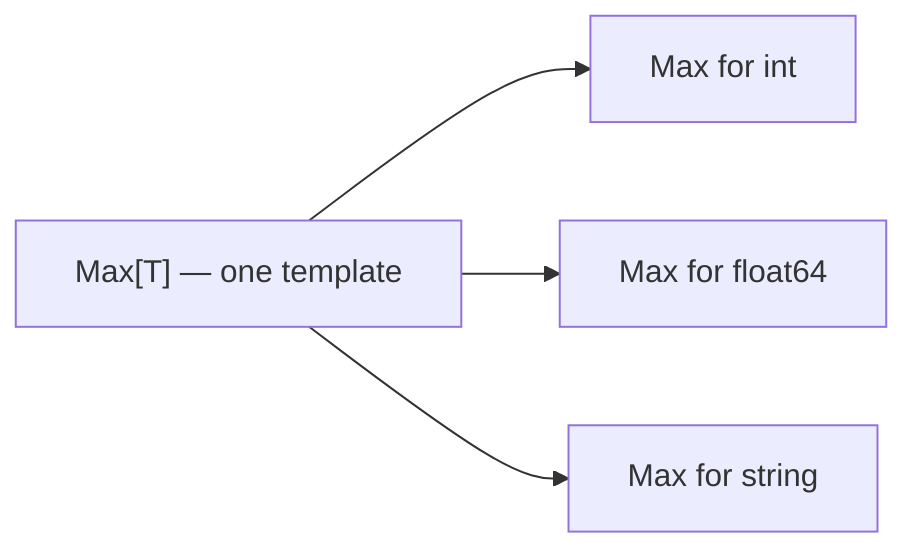
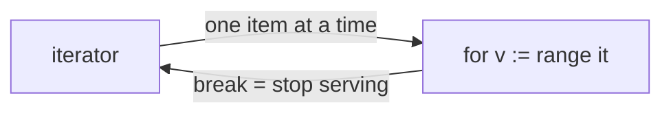
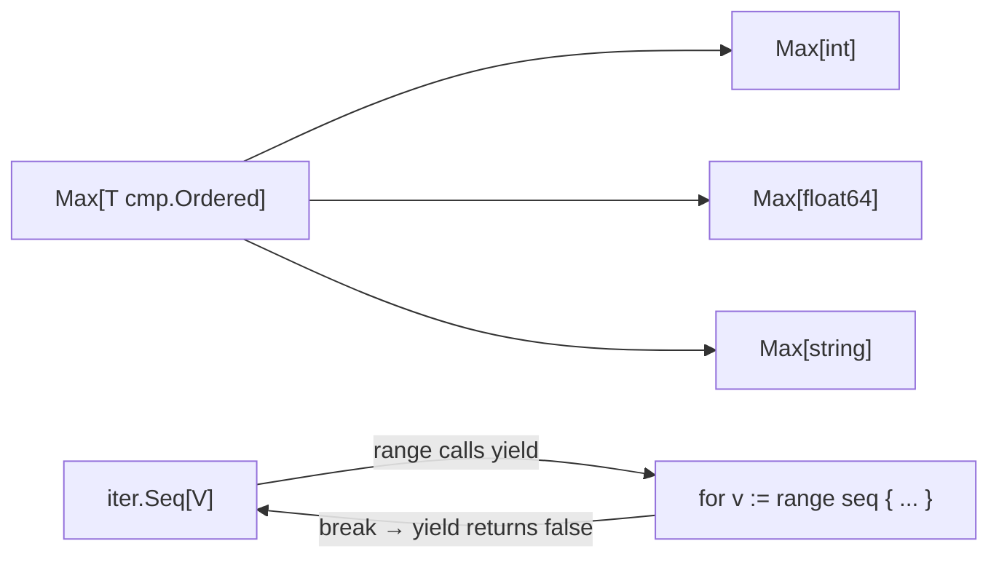
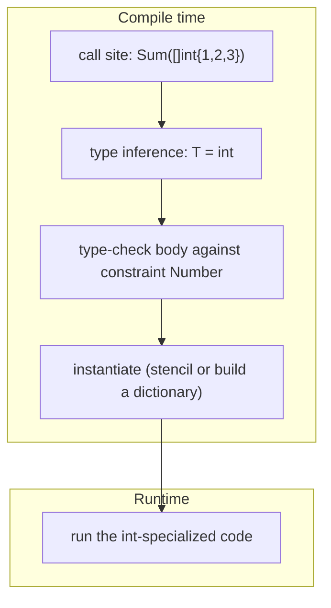
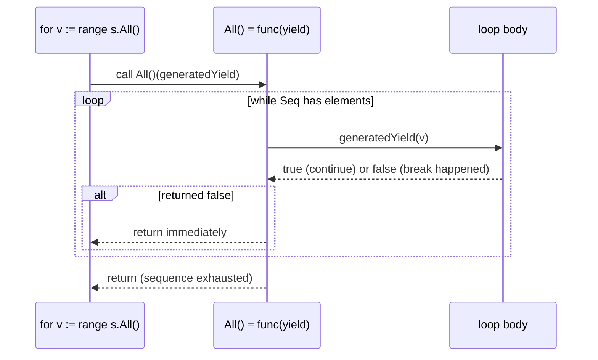
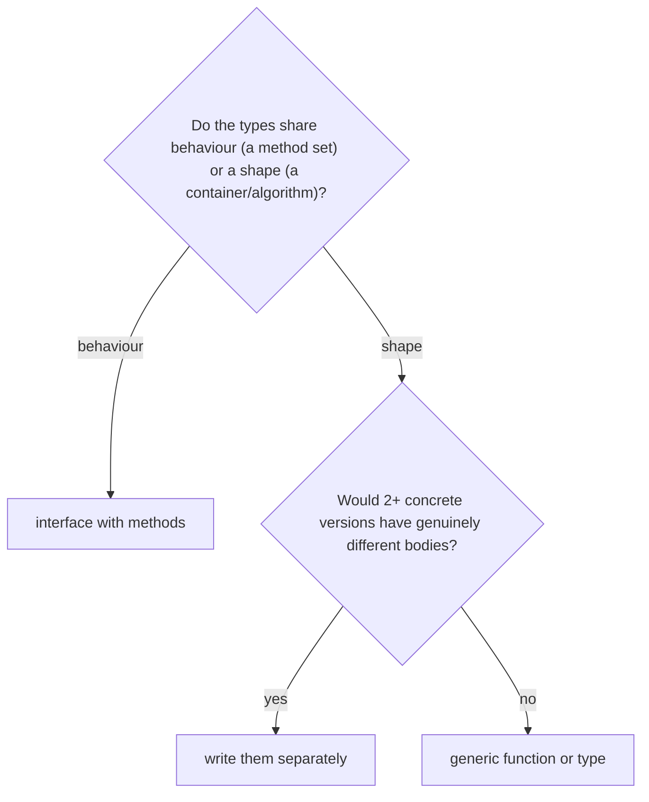

# Generics and Iterators

> [!summary] TL;DR
> Generics (Go 1.18) let a function or type work over many concrete types while the compiler still checks every operation at compile time, using **type parameters** written in square brackets and **constraints** that say which operations are allowed.
>
> Iterators (Go 1.23) are an ordinary function shape, `func(yield func(V) bool)`, that a plain `for range` loop can drive directly, which is how `slices`, `maps` and your own types expose lazy, early-exitable sequences without allocating a slice first.

> [!abstract] Core idea
> - A type parameter is a placeholder type, `func Max[T cmp.Ordered](a, b T) T`; the compiler fills it in at each call site and checks the body against the constraint, not against `any`.
> - A constraint is just an interface: `comparable` for map keys, `cmp.Ordered` for `<`/`>`, or a custom union like `~int | ~float64`.
> - An iterator is a function that takes a `yield` callback and calls it once per element; `range` over that function calls it for you and turns `break` into `yield` returning `false`.
> - `iter.Seq[V]` and `iter.Seq2[K, V]` are just names for those function shapes, so your own iterator and the standard library's compose for free.

## Start here: the basics 🟢

> [!info] How to read this note (pick your level)
> - 🟢 **New to this?** Read "From zero" below, then sections 1, 2 and the cheat sheet (10). That is a full first pass.
> - 🟡 **Know the basics?** Add section 3 (how it works) and 4 (worked example).
> - 🔴 **Interview / SDE-3 prep?** Add 7, 8 and 9. Headings are tagged 🟢🟡🔴 so you always know where you are.

**From zero, in 60 seconds** 🟢

You write a `Max` function for ints. Then you need one for floats. Then strings. Same code three times.

**Generics** fix that: you write `Max` once with a blank where the type goes, and the compiler fills in the blank for each caller. The blank is called a **type parameter**, and a **constraint** is the rule saying which types are allowed in it (for `Max`: only types that support `<`).



Iterators solve a different problem: walking a big (or endless) sequence one item at a time, stopping whenever you like. In Go an **iterator** is just a function that hands your loop one value at a time, and a plain `for range` can drive it.



The rest of this note is just these 4 questions:
1. How do type parameters and constraints work (`comparable`, `cmp.Ordered`, `~int`)?
2. How does `for range` over a function actually work (`yield`)?
3. When do generics beat interfaces or copy-paste — and when not?
4. How does the compiler build generic code (stenciling vs dictionaries)?

**The problem in one story.**
You write `MaxInt`, then need `MaxFloat`, then `MaxString`: three copies of the same code.
Generics let you write `Max` once with a placeholder type that Go fills in for each call.
Iterators solve a second problem: walking through a big or endless sequence one item at a time, and stopping whenever you like, with a plain `for range` loop.

**Words you need first**

| Word | Plain meaning | Tiny example |
| --- | --- | --- |
| Type | The kind of a value | `int`, `string`, `[]User` |
| Type parameter | A placeholder type filled in at the call | `func Max[T cmp.Ordered](a, b T) T` |
| Interface | A set of rules a type must meet | `comparable`, `fmt.Stringer` |
| Constraint | The interface that limits what `T` can be | `cmp.Ordered` allows `<` |
| Instantiation | The compiler making a concrete version for one type | `Max[int]` |
| Callback | A function you hand over to be called later | `yield(v)` |
| Lazy | Producing values only when asked | Read lines one by one, not all at once |

**Picture it**



**Analogy.** A generic function is a cookie cutter: one shape, any dough that fits the rules.
An iterator is a waiter bringing dishes one at a time until you say "enough".
Where it breaks: a cutter only works on dough the constraint allows; Go will not compile `Max` on a type without `<`.

**How the rest of this note builds up**

- First, why generics (1.18) and iterators (1.23) were added (section 1) and their mental models (section 2).
- Then type parameters, constraints, unions with `~`, `iter.Seq` and `range` over functions (section 3).
- Then a worked example combining both, with tests (section 4), and comparisons (sections 5-6).
- Finally the SDE-3 deep dive: stenciling vs dictionaries, generic type aliases, and production use (sections 7-8).

> [!tip] Remember
> Generics = one function for many types under a constraint; iterators = a function that calls `yield` per item until you stop.

## 1. Why it exists 🟢

Before Go 1.18, a container that worked for any type either gave up type safety (`[]interface{}`, with a type assertion and a possible panic on every read) or was copy-pasted per type (`IntSet`, `StringSet`, `UserSet`, …). A cache keyed by `string` could not be reused for a cache keyed by `int64` without copying the whole file.

Generics close that gap: one `LRU[K comparable, V any]` type serves every key and value type, and the compiler rejects `cache.Put(42, "x")` on an `LRU[string, int]` at compile time, not with a runtime panic.

Iterators close a different gap.

Before Go 1.23, "give me a lazy, early-exitable sequence of my own type" meant either materializing a `[]T` (memory for every element, even if the caller only wants the first three) or hand-writing a `Next() (T, bool)` cursor type and asking every caller to drive it in a `for cursor.Next() { ... }` loop instead of plain `range`.

Range-over-func lets your own types plug into the same `for range` syntax as a slice or a channel.

## 2. Mental model 🟢

A generic function is a **template that the compiler fills in and type-checks per call site**, not a function that accepts `any` and figures it out at runtime. `Max[int]` and `Max[string]` are different compiled instantiations (or share one shape via a dictionary — see the deep dive); neither one ever sees a value of the other's type.

A constraint is a **list of what you're allowed to do with T**, expressed as an interface. `any` means "nothing but assignment and passing around." `comparable` means "`==` and `!=` work, so T can be a map key." `cmp.Ordered` means "`<`, `<=`, `>`, `>=` work."

An iterator is a **function that calls your loop body for you**. `for v := range seq` where `seq` has type `func(func(V) bool)` desugars, roughly, to `seq(func(v V) bool { <loop body>; return true })`, with `break` turning the generated callback's return into `false`.

`iter.Seq[V]` is the standard library's name for exactly that function type — it exists so iterator-returning functions have one documented signature to agree on, not a new language mechanism.

## 3. How it works 🟡

### Whiteboard version

**In plain words:** one `Sum` for every number type — the constraint is the guest list saying which types may come in.

```go
// A constraint is an interface restricting what T can be.
type Number interface {
    ~int | ~int64 | ~float64 // ~ means "or any named type with this underlying type"
}

func Sum[T Number](xs []T) T {
    var total T // the zero value of whichever T this call instantiates
    for _, x := range xs {
        total += x // legal only because Number promises +
    }
    return total
}
```

`Sum([]int{1, 2, 3})` and `Sum([]float64{1.5, 2.5})` both compile from this one definition; `Sum([]string{"a"})` fails at compile time because `string` has no `Number` instance.

A constraint can also require methods instead of operators — an ordinary interface with a method set, used in the `[T Constraint]` position:

```go
type Stringer interface {
    String() string
}

// Join works on any T that implements String(), compile-time checked —
// no `any` + type assertion, and no risk of a missing-method panic.
func Join[T Stringer](xs []T, sep string) string {
    parts := make([]string, len(xs))
    for i, x := range xs {
        parts[i] = x.String()
    }
    return strings.Join(parts, sep)
}
```

`Number` and `Stringer` are the same language mechanism — a constraint is just an interface — but `Number` restricts T to types with certain *operators* (`~int | ~float64 | ...`) while `Stringer` restricts T to types with a certain *method*. A constraint can mix both operator unions and method requirements in one interface.

### The mechanism, step by step

**In plain words:** the compiler guesses the type from your arguments, checks the body against the rules, then builds (or shares) a concrete version — all before the program runs.



- **Type inference** fills in `T` from the argument types so most calls need no explicit `Sum[int](xs)`; explicit instantiation is only needed when the compiler has nothing to infer from, such as `zeroValue[int]()` with no arguments.
- **Type-checking** happens once against the constraint's method/operator set, so the compiler catches `Sum([]bool{...})` before anything runs.
- **Instantiation** is the compiler's choice of implementation strategy: stencil out a fully specialized copy of the function per concrete type (fast, more binary size) or build one generic implementation plus a runtime "dictionary" of the type's operations (smaller binary, a little slower).

  Go's compiler mixes both (GC-shape stenciling): types that share a GC shape, such as all one-word pointer types, can share a stencil.

### Range-over-func, step by step

**In plain words:** the loop body becomes a callback the iterator calls once per item; `break` tells the iterator 'stop serving'.



Exactly one rule drives correctness: **the iterator must stop calling `yield` the first time `yield` returns `false`.** Ignore that and a `break` in the caller's loop does not actually stop the work underneath — the measured `TestRangeOverFuncEarlyBreak` test below exists specifically to catch that bug.

## 4. Worked example 🟡

The full code lives in a scratch module (`scratch/generics`), compiles, passes `go vet`, and its tests pass under `go test -race` on Go 1.24.4.

### A generic type, with `comparable` and `any`

**In plain words:** a container type can take type parameters too — this `Set` works for any key type that supports `==`.

```go
// Set is a generic type: K is restricted to comparable because it is a map
// key. Methods on a generic type cannot introduce their own type parameters,
// so Set has none beyond the ones on the type itself.
type Set[K comparable] struct {
    m map[K]struct{}
}

func NewSet[K comparable](vs ...K) *Set[K] {
    s := &Set[K]{m: make(map[K]struct{}, len(vs))}
    for _, v := range vs {
        s.m[v] = struct{}{}
    }
    return s
}

func (s *Set[K]) Add(v K)      { s.m[v] = struct{}{} }
func (s *Set[K]) Has(v K) bool { _, ok := s.m[v]; return ok }
func (s *Set[K]) Len() int     { return len(s.m) }
```

### A generic type alias (Go 1.24)

**In plain words:** since Go 1.24 you can give a short nickname to one filled-in version of a generic type, and the nickname is the exact same type.

Before 1.24, a type alias (`type A = B`) could not itself take type parameters, so you could not write a short name for one instantiation of a generic type. Go 1.24 lifts that:

```go
// StringSet is a generic type alias (Go 1.24): an alias can itself take type
// parameters, so StringSet is interchangeable with Set[string] everywhere,
// including in generic code that is itself parameterized.
type StringSet = Set[string]

// Pair is a second generic alias, aliasing an anonymous struct type.
type Pair[A, B any] = struct {
    First  A
    Second B
}
```

`StringSet` is not a new type — it is the identical type `Set[string]`, so a `StringSet` and a `*Set[string]` are interchangeable with no conversion, which plain generic types never allow between different instantiations.

### A range-over-func iterator (Go 1.23)

**In plain words:** to make your own type loopable, return a function that calls `yield` per element and stops the moment `yield` says false.

```go
// All returns an iter.Seq[K]: a range-over-func iterator. iter.Seq[K] is
// just a documented name for func(func(K) bool).
func (s *Set[K]) All() iter.Seq[K] {
    return func(yield func(K) bool) {
        for v := range s.m {
            if !yield(v) {
                return // the consumer broke out of the range; stop early
            }
        }
    }
}
```

```go
func TestRangeOverFuncEarlyBreak(t *testing.T) {
    s := NewSet(1, 2, 3, 4, 5)
    seen := 0
    for range s.All() {
        seen++
        if seen == 2 {
            break // this break makes yield return false inside All()
        }
    }
    if seen != 2 {
        t.Fatalf("seen = %d, want 2 (early break must stop the iterator)", seen)
    }
}
```

**Measured:** `go test -race -run TestRangeOverFuncEarlyBreak -v ./...` (Go 1.24.4, 2026-11-07) — PASS, `seen` is exactly `2`, confirming the iterator actually stops instead of running to completion in the background.

### `iter.Pull`: turning push into pull

**In plain words:** `range` pushes values at you; `iter.Pull` flips it so you ask for the next value yourself — rare, costs a goroutine, and you must call `stop()`.

Most code should use `range`. `iter.Pull` exists for the rare case where you cannot write a `for range` loop — for example, stepping two iterators forward in lockstep to merge them:

```go
// FirstTwo uses iter.Pull (Go 1.23) to turn a push-style iter.Seq[K] into a
// pull-style (next, stop) pair.
func FirstTwo[K comparable](s *Set[K]) (K, K, bool) {
    next, stop := iter.Pull(s.All())
    defer stop() // always call stop: it lets the iterator's goroutine exit
    a, ok := next()
    if !ok {
        var zero K
        return zero, zero, false
    }
    b, ok := next()
    if !ok {
        var zero K
        return a, zero, false
    }
    return a, b, true
}
```

`iter.Pull` runs the `iter.Seq` on a background goroutine and blocks it on a channel between calls to `next()`. `defer stop()` is not optional: skipping it leaks that goroutine until the sequence happens to finish on its own.

### Standard library iterator helpers (`slices`, `maps`, `strings`)

**In plain words:** the standard library already speaks iterator — keys of a map, sorted collection, splitting a string — without building a throwaway slice first.

```go
m := map[string]int{"x": 1, "y": 2, "z": 3}
keys := slices.Sorted(maps.Keys(m)) // maps.Keys(m) is an iter.Seq[string]

nums := slices.Collect(func(yield func(int) bool) { // build a []int from any iter.Seq[int]
    for _, p := range strings.Split("1,2,3", ",") {
        n, _ := strconv.Atoi(p)
        if !yield(n) {
            return
        }
    }
})

var parts []string
for p := range strings.SplitSeq("a-b-c", "-") { // Go 1.24: split without allocating []string
    parts = append(parts, p)
}
```

`slices.Sorted` and `slices.Collect` (package `slices`, Go 1.23) turn any `iter.Seq` into a sorted or plain slice; `maps.Keys`/`maps.Values` (package `maps`, Go 1.23) expose a map's contents as iterators instead of requiring a full `for k, v := range m` copy; `strings.SplitSeq` (Go 1.24) avoids allocating the `[]string` that `strings.Split` must build. All three are tested in `TestIteratorHelpers`.

### `var zero T` and a generic cache

**In plain words:** generic code cannot write `nil` for 'nothing' because T might be a plain number — `var zero T` is the universal empty value.

```go
// zeroValue shows the idiom used when a generic function must hand back
// "nothing" for an arbitrary type parameter — you cannot write a literal
// `nil` because V might not be a pointer, slice, map, chan, func or interface.
func zeroValue[V any]() V {
    var zero V
    return zero
}

type LRU[K comparable, V any] struct {
    cap   int
    order []K
    data  map[K]V
}
```

The full `LRU` (`Get`/`Put`/eviction) and its test `TestLRU` are in the scratch module; it evicts the least-recently-touched key once the capacity is exceeded, exactly like a production response cache keyed by request ID.

**Measured:** `go vet ./...` and `go test -race -v ./...` in `scratch/generics` (Go 1.24.4) — 8 tests, all PASS, 0 vet diagnostics.

## 5. Variants and comparison 🟡

| Option | How it works | Use when | Cost |
| --- | --- | --- | --- |
| `any` + type assertion | One function/type, runtime `.(T)` checks | A true grab-bag (e.g. `encoding/json` internals, `fmt.Println`) | Runtime panic risk; no compile-time safety |
| Copy-paste per type | A separate `IntSet`, `StringSet`, … | One-off, never reused, or the types genuinely behave differently | Code duplication; drift between copies |
| Interface with methods | `type Adder interface { Add(int) }` | The types share *behaviour*, not just a container shape | Dynamic dispatch (one indirect call), no zero-cost specialization |
| Generics | `Set[K comparable]`, `Sum[T Number]` | The types share a *shape* (container, algorithm) with no behavioural difference | Compile-time only; some binary-size/compile-time cost; constraints can get verbose |
| Materialized `[]T` | Build the whole slice up front | The caller needs random access or will consume all of it anyway | O(n) memory even if only the first few elements are used |
| `iter.Seq[T]` iterator | `func(yield func(T) bool)`, lazy | The caller may stop early, or the source is unbounded/expensive per element | None of the up-front memory; slightly more code than a plain slice |

## 6. Trade-offs and when not to use 🟡

- Do not reach for generics just to avoid writing two functions; if the two versions would have unrelated bodies, a generic signature forcing a shared shape onto them is the wrong abstraction — copy-paste or an interface is clearer. This guidance carries over unchanged from the old generics note.
- Deep constraint hierarchies (`~T1 | ~T2`, nested interfaces) read worse than the duplication they replace; stop generalizing once the constraint is harder to read than two concrete functions.
- Generic code can be slower to compile and, with the dictionary-passing instantiation strategy, carries a small runtime indirection that a hand-written monomorphic function does not pay — profile before assuming generics are free.
- A range-over-func iterator is not a drop-in replacement everywhere: you cannot index into it, take its length without consuming it, or use it with two-value range-over-channel-style select statements. Reach for a slice or a channel when the caller genuinely needs those.

## 7. In production 🔴

- **Real systems:** `golang.org/x/exp/slices` shipped generic slice helpers before they moved into the standard `slices` package (Go 1.21); the standard `maps`, `slices` and `cmp` packages are generic throughout; `iter.Seq` powers `maps.Keys/Values`, `slices.All/Values/Collect/Sorted`, and database/sql's planned iterator-based scanning.
- **Failure modes → fixes:**
  - An iterator that keeps calling `yield` after it returned `false` silently does extra work in the background (or, worse, mutates shared state after the caller thinks it stopped) → always check `yield`'s return value and return immediately.
  - `iter.Pull` without `defer stop()` → goroutine leak; catch it with the `goleak` package in tests.
  - Choosing dictionary-based instantiation for a hot-path generic function → an extra indirect call per operation shows up in a CPU profile as time in the dictionary-passing wrapper; the fix is usually to drop generics on that one hot path, not to fight the compiler's heuristic.
- **What to monitor:** binary size growth after adding generic code to a widely-instantiated function (many concrete types × stenciling); CPU profile share spent in dictionary-passing paths for generic hot paths.

## 8. Deep dive 🔴

**Why `Max[T cmp.Ordered]` and not a hand-rolled constraint?** `cmp.Ordered` (package `cmp`, Go 1.21) is a union of every built-in ordered type (`int`, `int64`, `float64`, `string`, …), maintained by the standard library so your code does not drift from it as new numeric types are added.

**Stenciling vs dictionaries.** The Go compiler specializes (stencils) a generic function per set of type arguments that share a "GC shape" — roughly, the same size and the same pointer/non-pointer layout.

`Sum[int]` and `Sum[int64]` share one stencil (both are 8-byte, non-pointer words); `Sum[MyBoxedFloat]`, if it had a different layout, would not.

Within one GC shape, the compiler passes a runtime **dictionary** — a small table of the type's size, alignment and method/operator implementations — instead of generating a full copy per concrete type, trading a little runtime indirection for a smaller binary.

**Methods cannot add type parameters.** `func (s *Set[K]) Transform[V any]() *Set[V]` is illegal — only free functions and the type declaration itself can introduce new type parameters; a method is stuck with the type parameters its receiver already has. The usual workaround is a free function, `func Transform[K, V comparable](s *Set[K], f func(K) V) *Set[V]`.

**Choosing generics vs interfaces vs duplication, concretely:**



## 9. Interview questions 🔴

> [!question]- What is a type constraint, concretely?
> It is an interface used in the `[T Constraint]` position: `comparable` allows `==`/`!=` (map keys), `cmp.Ordered` allows `<`/`<=`/`>`/`>=`, and a custom union such as `~int | ~float64` allows arithmetic on any type whose underlying type is one of those.

> [!question]- Why does `~int` appear instead of just `int` in a constraint?
> `~int` means "any type whose underlying type is `int`," so a named type like `type UserID int` still satisfies the constraint. Plain `int` in a union would only match the literal type `int`, rejecting `UserID` even though it behaves identically.

> [!question]- Trap: can a method on a generic type declare its own type parameter?
> No. `func (s *Set[K]) Map[V any](f func(K) V) *Set[V]` does not compile — only the type declaration and free functions can introduce type parameters. The fix is a free function that takes `*Set[K]` as an argument.

> [!question]- What exactly does `iter.Seq[V]` mean, and why does a plain `for range` work on it?
> `iter.Seq[V]` is `func(func(V) bool)` — a function that takes a `yield` callback and calls it once per element, stopping if `yield` returns `false`. Since Go 1.23, `for v := range f` is legal when `f` has exactly that shape; the compiler generates the `yield` callback from your loop body and wires `break` to returning `false`.

> [!question]- Why does Go 1.24 add generic type aliases, and what breaks without them?
> Before 1.24, `type A = B[T]` with its own type parameter `T` was illegal, so you could not give a short, interchangeable name to one instantiation of a generic type, or write a generic alias for a struct literal shape.
>
> Without it, every caller had to spell out the full instantiation (`Set[string]`) everywhere, with no way to swap the underlying generic type later without touching every call site.

> [!question]- When should you prefer `iter.Pull` over a plain `for range` on an `iter.Seq`?
> Only when you cannot structure the consumer as a simple loop body — merging two sorted sequences step by step, or driving an iterator from inside a `select`. It costs a background goroutine and a channel handoff per element, so it is slower than `range` and `defer stop()` is mandatory to avoid leaking that goroutine.

> [!question]- Generics vs an interface with methods: how do you choose?
> Use an interface when types share *behaviour* you call through method dispatch (a `Writer`, a `Repository`). Use generics when types share a *shape* — the same container or algorithm — with no behavioural difference, like a `Set[K]` or `Sum[T Number]`. If you would still write two different-bodied functions per type, neither applies: write them separately.

## 10. Cheat sheet 🟢

- `func F[T Constraint](...)`: the compiler infers `T` from arguments when it can, type-checks the body against the constraint, and instantiates (stencil or dictionary) per GC shape.
- `comparable` → map keys and `==`; `cmp.Ordered` → `<`/`>`; `~T` in a union → named types with that underlying type count too.
- A generic type's methods cannot add their own type parameters — use a free function instead.
- `var zero T` is how a generic function builds "nothing" for an arbitrary `T`.
- Go 1.24 generic type aliases (`type A = B[T]`) let you alias one instantiation, including anonymous struct shapes like `Pair[A, B]`.
- An iterator is just `func(yield func(V) bool)`; `for range` on it works since Go 1.23, and the iterator must stop calling `yield` once it returns `false`.
- `iter.Pull` converts push (`range`) to pull (`next()`/`stop()`) for the rare case you cannot use a loop; always `defer stop()`.
- `slices.Collect`, `slices.Sorted`, `maps.Keys`/`Values`, and `strings.SplitSeq` (1.24) are the standard library's own iterator producers and consumers.
- Do not use generics just to avoid writing two functions; use them when the types genuinely share a shape.

## Links

- **Before this:** [[Functions, Closures, Defer, Panic and Recover]], [[Interfaces]], [[Hash Tables and Go Maps]]
- **Next:** [[Reflection and unsafe]], [[Modern Go Feature Timeline (1.18-1.25)]]
- **Compare with:** [[Arrays, Slices and Maps (with internals)]] (the concrete, non-generic container types these abstract over)

### Watch on YouTube

- [Go Generics Complete Tutorial Master Type Parameters Constraints in Go 1.18+](https://www.youtube.com/watch?v=EBE8Z2pxH7g) · CodeLucky · full tutorial on type parameters and constraints
