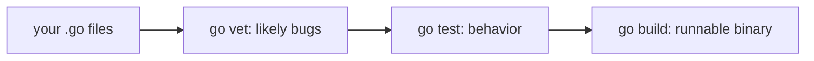
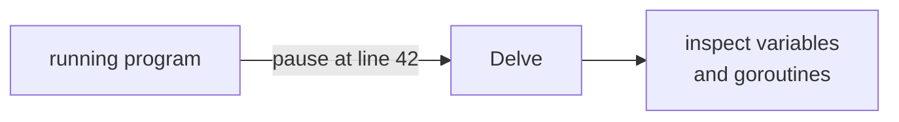
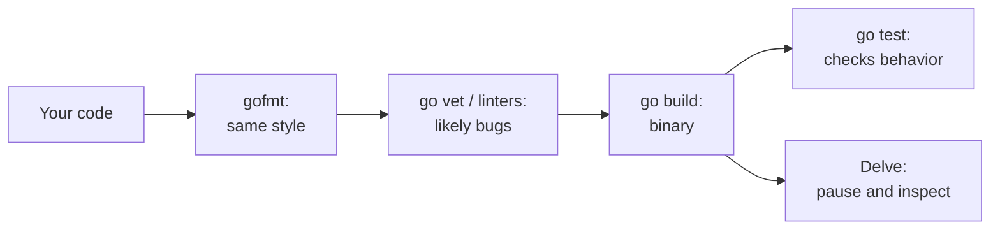
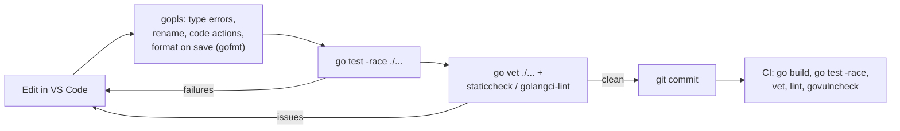
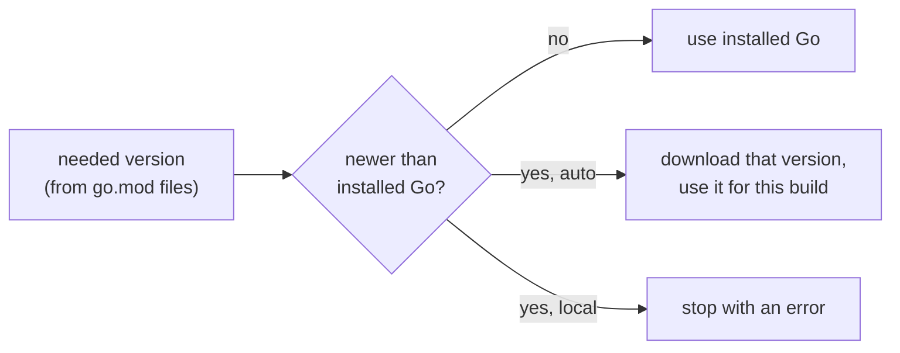
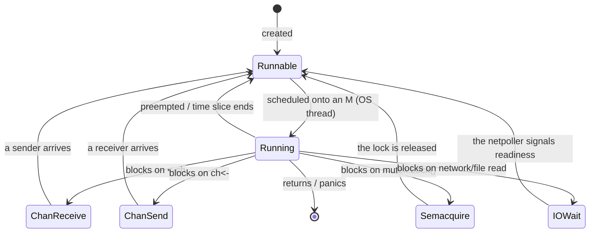

# Go Toolchain, Tooling and Debugging

> [!summary] TL;DR
> `go` is one binary that builds, tests, formats and documents your code; `go vet`, `staticcheck` and `golangci-lint` catch mistakes `go build` lets through; and Delve is the debugger that lets you stop a running goroutine and look inside it.

> [!abstract] Core idea
> - `go build/run/test/vet/fmt` cover the daily loop; everything else (linters, debugger, profiler) plugs into that loop.
> - `go vet` and linters catch bugs that compile fine, such as a wrong `Printf` verb or a copied mutex.
> - `GOOS`/`GOARCH` let you build a Linux binary from a Mac without installing Linux.
> - `GOTOOLCHAIN` can download and switch to a newer Go version automatically when a dependency needs it.
> - Delve runs your program under a debugger so you can stop it at a breakpoint and read its goroutines and variables directly, instead of guessing from `fmt.Println`.

## Start here: the basics 🟢

> [!info] How to read this note (pick your level)
> - 🟢 **New to this?** Read "From zero" below, then sections 1, 2 and the cheat sheet (10). That is a full first pass.
> - 🟡 **Know the basics?** Add section 3 (the commands and flags) and 4 (worked example).
> - 🔴 **Interview / SDE-3 prep?** Add 7, 8 and 9. Headings are tagged 🟢🟡🔴 so you always know where you are.

> [!note] Before this note
> - Nothing. This note starts from zero. It helps if you can open a terminal and type a command, but no Go knowledge is needed.

**From zero, in 60 seconds** 🟢

You write Go code in a text file. Something has to turn it into a program the computer can run. That something is the **compiler**, and in Go you reach it through one command: `go`.

The same `go` command also runs your tests, formats your code so everyone's files look the same, and checks for likely mistakes.



Why the extra checks? Because code can be perfectly legal Go and still wrong — like a sentence with perfect grammar that says the opposite of what you meant. The compiler only checks grammar; `go vet` and tests check meaning.

When a bug only shows up while the program runs, you use a **debugger** called Delve: it pauses the live program at a line you pick so you can look at the real values inside.



The rest of this note is just these 4 questions:
1. Which commands make up the daily loop (`run`, `build`, `test`, `vet`, `fmt`)?
2. Which build flags matter (`-race`, `-ldflags -X`, `GOOS`/`GOARCH`)?
3. How do versions and tools stay pinned (`GOTOOLCHAIN`, `go.mod tool`)?
4. How do I look inside a running or crashed program (Delve, panics, `SIGQUIT`)?

**The problem in one story.**
You write some Go code and it compiles with no errors.
You ship it, and a log line prints `%!d(string=alice)` instead of a user ID.
The compiler only checked that the code was legal, not that it made sense.
The Go toolchain is the kit of commands that catches these mistakes, formats your code, builds it for other machines, and lets you pause a running program to look inside.

**Words you need first**

| Word | Plain meaning | Tiny example |
| --- | --- | --- |
| Compiler | Turns source code into a program the machine can run | `go build` makes a binary |
| Binary | The single runnable file the compiler produces | `./server` |
| Linter | A tool that reads code and flags likely mistakes | `go vet` spotting a wrong `%d` |
| Cross-compile | Build a program for a different OS or CPU than yours | Linux binary built on a Mac |
| Debugger | Runs your program so you can pause it and inspect values | Delve (`dlv`) stopping at line 42 |
| Stack trace | The list of function calls active when something crashed | `main.handler` → `main.parse` |
| Goroutine | A lightweight task Go runs concurrently | `go worker()` |
| Module / `go.mod` | A Go project with a file listing its name, Go version and the libraries it uses | `module toolchaindemo` |
| CI (continuous integration) | A server that builds and tests every code change automatically | GitHub Actions running `go test` |
| Data race | Two goroutines touch the same memory at once, at least one writing, with no lock | two handlers doing `count++` |
| cgo | Go's bridge for calling C code; needs a C compiler | `import "C"` |
| Statically linked | The binary carries everything it needs; no extra system libraries required | runs in an empty container |
| Signal | A short message the operating system sends to a running program | `SIGQUIT` from `kill -QUIT` |
| Breakpoint | A line where the debugger pauses the program | `break invoice.go:42` |

**Picture it**



**Analogy.** Writing code is like writing an essay: the compiler is a grammar check, `go vet` is a teacher spotting sentences that are grammatical but wrong, `gofmt` is the house style guide, and Delve is pausing a video to study one frame.
Where it breaks: a teacher reads all of it; `go vet` only knows a fixed list of patterns, so it misses bugs outside them.

**How the rest of this note builds up**

- First, why tooling exists (section 1) and the "rings around your code" mental model (section 2).
- Then the daily commands, `go vet`, build flags, cross-compiling and `GOTOOLCHAIN` (section 3).
- Then Delve, reading panics and goroutine dumps, and `govulncheck`, with a worked example (sections 3-4).
- Finally the SDE-3 deep dive: production practice, why vet is separate from the compiler, and `-ldflags -X` details (sections 6-8).

> [!tip] Remember
> Compiling proves the code is legal; `go vet`, tests and the debugger prove it does what you meant.

## 1. Why it exists 🟢

A Go program can compile cleanly and still be wrong. `fmt.Sprintf("name=%d", name)` where `name` is a `string` compiles without a single error or warning from the compiler. The bug only shows up at runtime, as `%!d(string=...)` in your logs, or worse, in a log line nobody reads until a customer complains.

`go vet` catches exactly this, before the code ever runs:

```text
$ go vet ./...
# toolchaindemo/vetdemo
vetdemo/bad.go:7:2: fmt.Sprintf format %d has arg name of wrong type string
vetdemo/bad.go:7:13: result of fmt.Sprintf call not used
```
*(measured: `go vet ./...`, Go 1.24.4, darwin/arm64, 2026-11-07; vet reports two issues on this one line — the wrong verb, and separately that the formatted string is thrown away — because nothing in the function ever uses the call's return value)*

The toolchain is the set of commands and tools around the compiler that catch this class of bug, keep a codebase formatted the same way across every contributor, let you cross-compile for a container's (a packaged, isolated app with its own small Linux) OS/architecture, and let you step into a running program instead of debugging by print statement.

### Real-life example 🟢

A food-delivery company's backend team writes Go on MacBooks, but the servers run Linux on ARM chips in the cloud. One engineer types `GOOS=linux GOARCH=arm64 go build` on a Mac and gets a server-ready binary in seconds. Every pull request runs `go vet`, `go test -race` and `golangci-lint` in CI, so a wrong `%d` or a copied lock never reaches users. When the "track my order" service freezes one evening, the on-call engineer sends it `SIGQUIT`, reads the goroutine dump, and sees every request stuck waiting on the same database call.

## 2. Mental model 🟢

Think of three rings around your code, each one catching problems the ring before it cannot:

1. **The compiler** checks that the code is valid Go: types match, every variable is used, every import is used. It does not check *intent*.
2. **`go vet` and linters** check that the code does what it looks like it does: the `Printf` verb matches the argument type, a `sync.Mutex` was not copied by value, a loop variable was not captured by mistake. These are mistakes that compile but are still wrong.
3. **Style tools** (`gofmt`, `goimports`) make every Go file in the world look the same, so code review is about logic, not spacing.

The debugger is a fourth, separate tool: it does not check code, it inspects a *running* program, pausing it at a line you chose and showing you the real state of its goroutines, stack and variables.

## Common beginner mistakes 🟢

- **Thinking "it compiles" means "it works"** → the compiler checks grammar, not meaning (`%d` with a string compiles) → run `go vet ./...` and your tests before every commit.
- **Trusting `(cached)` test results after changing something outside Go files** → `go test` may reuse an old pass → add `-count=1` to force a real run.
- **Building for Linux with cgo still on** → the binary may need C libraries the container does not have → set `CGO_ENABLED=0` for container builds.
- **Using `-ldflags "-X main.version=..."` on a `const`** → nothing happens, silently → make `version` a package-level `var` of type `string`.
- **Debugging a busy production server with Delve** → a breakpoint pauses every goroutine and every user waits → debug a local copy or a server taken out of traffic.

## 3. How it works 🟡

> 🟢 → 🟡 **You now know** the three rings (compiler, vet/linters, formatters) and that Delve pauses a live program. **Next we open the box**: the real commands and flags, how Go switches its own version, how tools get pinned, and how to read a crash or a hung program. Each subsection starts with a short step-by-step walk.

### The inner dev loop

**Step by step:**
1. You type in VS Code; `gopls` (Go's language server: the helper that feeds your editor errors and suggestions) flags a type error right away and formats the file when you save.
2. Before committing, you run `go vet`, `go test -race` and a linter on your machine.
3. You open a pull request (a request to merge your change); CI runs the same checks plus `govulncheck`.
4. Only if all of that passes does the change get merged.



- **Editor (gopls):** runs continuously as you type. Catches type errors and unused imports immediately, offers rename-across-files and quick fixes, and formats on save.
- **Pre-commit / local:** `go test -race`, `go vet`, a linter. Fast enough to run before every commit.
- **CI:** the same commands, plus `govulncheck` and often a slower, stricter linter config, run on every pull request.

### Installing and upgrading Go

**Step by step:**
1. Download the archive for your OS from go.dev/dl and install it. The `go` on your `PATH` (the list of folders your terminal searches for commands) is now the new version.
2. Need a second version too? Run `go install golang.org/dl/go1.25.0@latest`.
3. Run `go1.25.0 download` once to fetch the real toolchain.
4. Now `go1.25.0 build` uses 1.25.0, while plain `go` stays as it was.

The official installer (go.dev/dl) replaces the whole toolchain in place: download the archive for your OS/arch, and a new `go` on `PATH` is the only change — no separate updater, no package-manager-specific quirks to track across machines (though `brew install go`, `apt install golang-go` and similar work too, each on its own upgrade cadence).

To keep more than one version side by side instead of replacing the default, install a specific release as its own binary:

```bash
go install golang.org/dl/go1.25.0@latest   # fetches a small wrapper binary named go1.25.0
go1.25.0 download                           # that wrapper then downloads the real 1.25.0 toolchain
go1.25.0 build ./...                        # run it explicitly, alongside your main `go`
```

This is also the difference the trap question below turns on: the `GOTOOLCHAIN=auto` download described next fetches a toolchain into the module cache and execs it for one build only, while `go install golang.org/dl/go1.x@latest` is what actually puts a new version on `PATH` for you to run directly.

### The core commands

**In plain words:** these ten commands are the whole daily toolbox — run, build, test, check, format — all behind the one `go` binary.

**Step by step:**
1. `go run ./cmd/api` compiles and runs the program once, then throws the binary away.
2. `go build ./cmd/api` writes the binary to disk so you can ship it.
3. `go test ./...` runs every test in every package (`./...` means "this folder and all below").
4. A test package that has not changed prints `(cached)`; `-count=1` forces a fresh run.

```bash
go run ./cmd/api        # compile + execute, discards the binary
go build ./cmd/api      # compile, write a binary (defaults to module/package name)
go install ./cmd/api    # compile, write the binary into $GOBIN (or $GOPATH/bin), for a tool you run by name
go test ./...           # run tests in every package under the current dir
go test -race ./...     # same, instrumented to catch data races (slower, use in CI)
go vet ./...            # static analysis for likely bugs (see below)
go fmt ./...            # rewrite files to the canonical Go style (gofmt)
go generate ./...       # run //go:generate directives (stringer, mockgen, sqlc, protoc)
go doc fmt.Sprintf      # print the doc comment for a symbol, without a browser
go env GOOS GOARCH      # print toolchain configuration variables
go clean -testcache     # drop the cached pass/fail results tests reuse by default
```

`go test` caches results keyed by inputs; a package whose test files, source and build flags have not changed since the last green run prints `(cached)` instead of re-running. Pass `-count=1` to force a real run — this is the Go-specific flag for "don't trust the cache", distinct from `clean`.

### `go vet` and linters: three different jobs

**In plain words:** vet is the free built-in spell-check; staticcheck is a stricter editor; golangci-lint is the folder that runs them all with one command.

**Step by step:**
1. `go vet ./...` runs Go's own small set of checks, such as `printf` and `copylocks`.
2. `staticcheck ./...` adds many more rules, like spotting dead code or deprecated functions.
3. `golangci-lint run` runs vet, staticcheck and others together from one `.golangci.yml` file.
4. CI runs that one command on every pull request.

| Tool | Catches | Runs |
| --- | --- | --- |
| `go vet` | A fixed set of analyzers shipped with Go: bad `Printf` verbs, copying a `sync.Mutex` by value, `context.WithCancel` whose cancel func is dropped (`lostcancel`), a `t.Run` closure that never calls its argument | `go vet ./...`, and automatically before `go test` |
| `staticcheck` | A much larger, opinionated rule set: dead code, deprecated API use, simplifiable expressions, a `fmt.Errorf` that should be `errors.New` | `staticcheck ./...` (separate install) |
| `golangci-lint` | A runner that wires up `vet`, `staticcheck` and dozens more linters behind one config file (`.golangci.yml`), so CI calls one command | `golangci-lint run` |

`go vet` analyzers worth knowing by name: `printf` (format verb vs argument type), `copylocks` (a struct holding a `sync.Mutex` passed by value instead of `*T`), `lostcancel` (a `context.CancelFunc` from `WithCancel`/`WithTimeout` that is never called, which leaks the context's internal goroutine until its parent is cancelled), and `tests` (a test helper or `TestMain` with a wrong signature).

### Build flags that matter day to day

**In plain words:** flags change what kind of binary you get — race-checked, path-stripped, version-stamped, or built with extra files switched on.

**Step by step:**
1. `-race` adds checking code around every memory access, so data races are reported while the program runs.
2. `-trimpath` removes your laptop's folder names from the binary, so two machines produce the same output (a reproducible build).
3. `-ldflags "-X main.version=1.2.3"` writes `1.2.3` into the `version` variable at build time.
4. `-tags` switches on files marked with a build tag, for example test-only or OS-only code.

```bash
go build -race ./cmd/api                      # instrumented binary: catches data races, 5-10x slower, more memory
go build -trimpath ./cmd/api                  # strip local file paths from the binary (reproducible builds)
go build -ldflags "-X main.version=1.2.3" .   # inject a value into a string var at link time, no recompile of logic
go build -tags integration ./...              # compile files guarded by //go:build integration
go build -gcflags=-m ./...                    # print the compiler's escape-analysis decisions (stack vs heap)
```

`-ldflags -X` only works on a package-level `var` of type `string` (not `const`, and not through an interface); it is how `go build -ldflags "-X main.version=..."` stamps a release version into a binary without touching source.

```text
$ go build -ldflags "-X main.version=1.2.3" -o bin/invoiceops .
$ ./bin/invoiceops
invoiceops 1.2.3: total=8499 cents
```
*(measured: Go 1.24.4, darwin/arm64, 2026-11-07)*

### Cross-compiling with GOOS/GOARCH

**In plain words:** two environment variables let your Mac produce a Linux binary — no Linux machine needed, because the Go compiler carries its own tools.

**Step by step:**
1. Set `GOOS=linux` (target operating system) and `GOARCH=arm64` (target chip).
2. Set `CGO_ENABLED=0` so no C compiler is needed.
3. Run `go build -o bin/invoiceops-linux-arm64 .` on your Mac.
4. `file` on the result says "ELF ... ARM aarch64 ... statically linked": a Linux ARM program that runs on its own.

The Go compiler is already a cross-compiler: it never shells out to (starts) a platform C toolchain unless cgo is enabled, so setting two environment variables is enough to build for a different OS and CPU architecture from your own machine.

```bash
GOOS=linux GOARCH=arm64 CGO_ENABLED=0 go build -o bin/invoiceops-linux-arm64 .
```

```text
$ file bin/invoiceops-linux-arm64
bin/invoiceops-linux-arm64: ELF 64-bit LSB executable, ARM aarch64, ... statically linked ...
```
*(measured: cross-compiled on darwin/arm64 to GOOS=linux GOARCH=arm64, Go 1.24.4, 2026-11-07)*

`CGO_ENABLED=0` matters for container images: with cgo off, the binary is statically linked and needs no C runtime, so it runs in a `FROM scratch` or `distroless` image (container images that contain almost nothing except your binary).

With cgo on (the default when a C toolchain is present and you're not cross-compiling), the binary dynamically links `libc` (loads the system's C library when it starts), and cross-compiling it needs a matching C cross-toolchain, which is why most Dockerfiles building Go set `CGO_ENABLED=0` explicitly.

### GOTOOLCHAIN: the Go version can switch itself

**In plain words:** since Go 1.21, the `go` command can fetch a newer Go just for one build if a dependency demands it — your installed version stays put.

**Step by step:**
1. You have Go 1.24.4 installed.
2. You add a library whose `go.mod` says `go 1.26.0`.
3. With `GOTOOLCHAIN=auto` (the default), `go` downloads Go 1.26 into its cache and runs the build with it.
4. Your installed Go is still 1.24.4. With `GOTOOLCHAIN=local` it would refuse and fail instead.



Since Go 1.21, the `go` command is not fixed to whatever version is on your `PATH`. Each module's `go.mod` names a minimum Go version, and if a dependency requires a newer one, `GOTOOLCHAIN=auto` (the default) downloads and runs that newer version for this build only, leaving your installed `go` untouched:

```text
$ go get -tool golang.org/x/tools/cmd/stringer
go: golang.org/x/tools@v0.52.0 requires go >= 1.26.0; switching to go1.26.10
go: upgraded go 1.24.4 => 1.26.0
```
*(measured: ran from a Go 1.24.4 install, 2026-11-07; the project's go.mod now reads `go 1.26.0` and a `golang.org/x/tools@v0.52.0` dependency was added)*

`go env GOTOOLCHAIN` shows the current policy: `auto` (default: download newer toolchains as needed), `local` (never download; fail instead), or a pinned version like `go1.24.4` (always use exactly that one, downloading it if missing). CI pipelines that must not reach the network during a build set `GOTOOLCHAIN=local` and bake in the exact version they test against.

### Pinning tool dependencies with `go.mod`'s `tool` directive (Go 1.24)

**In plain words:** code-generation tools now get pinned in `go.mod` like any other dependency, so every machine runs the exact same version.

**Step by step:**
1. `go get -tool golang.org/x/tools/cmd/stringer` adds a `tool` line to `go.mod` and records the exact version.
2. `go.sum` stores a checksum (a fingerprint) so nobody can swap in a different copy.
3. `go tool stringer ...` runs that exact version on every laptop and CI machine.

Before 1.24, pinning a code-generation tool's version meant a separate `tools.go` file with blank imports, a workaround everyone copied without understanding. Go 1.24 added `go get -tool` and a `tool` line in `go.mod` itself:

```text
module toolchaindemo

go 1.26.0

tool golang.org/x/tools/cmd/stringer

require (
	golang.org/x/tools v0.52.0 // indirect
	...
)
```
*(this is the go.mod produced by the `go get -tool` run above; the same mechanism pins stringer, mockgen or sqlc at an exact version per module)*

`go tool stringer ...` then runs that exact pinned version, and `go mod tidy` keeps it in `go.sum` like any other dependency, so `go generate` is reproducible across every machine and CI runner without a separate install step.

### go generate

**Step by step:**
1. You write a comment like `//go:generate stringer -type=InvoiceStatus` above your code.
2. You run `go generate ./...`; it runs that command and writes a new `.go` file.
3. You commit the generated file. `go build` never runs `go generate` for you.
4. CI runs `go generate` again and fails if the output differs from what was committed.

`//go:generate` directives are comments that `go generate` executes literally; the compiler ignores them completely. The common ones: `stringer -type=InvoiceStatus` writes a `String()` method for an enum (a fixed set of named values, like `Draft`, `Sent`, `Paid`) (by hand in the worked example below, since `stringer` needs a network install); `mockgen` writes mock implementations (fake versions that record calls) of an interface for tests; `sqlc generate` turns annotated SQL files into typed Go query functions.

None of this runs automatically — `go build` never invokes `go:generate` — so generated files are committed, and CI should run `go generate ./... && git diff --exit-code` to catch a stale generated file.

### gopls in the editor

**Step by step:**
1. VS Code starts `gopls` in the background when you open a Go folder.
2. As you type, `gopls` reports errors and `go vet` warnings inline.
3. Right-click → Rename asks `gopls` to rename a name everywhere it is used, and only there.
4. On save, it formats the file and fixes the import list.

`gopls` is the language server VS Code's Go extension talks to. It gives you jump-to-definition, find-references, rename-across-files (safer than a text search-and-replace, because it understands shadowing, where an inner variable hides an outer one with the same name, and scope), format-and-organize-imports on save, and inline diagnostics from `go vet` as you type — the same analyzers `go vet ./...` runs from the command line, shown before you even save the file.

### Reading stdlib source and `go doc`

```bash
go doc fmt.Sprintf          # the doc comment, no browser needed
go doc -src fmt.Sprintf     # the doc comment plus the actual source
echo $(go env GOROOT)/src   # where the standard library's source lives locally
```

`pkg.go.dev` is the same documentation rendered as a public, linkable website — useful for browsing a package's full API or an unfamiliar third-party module in a browser, including past versions, where `go doc` only shows what is on disk right now for the module you're standing in.

A repeatable way to read an unfamiliar package (worth doing for `net/http`, `context`, `database/sql`, `encoding/json`, `sync`, `time`):

1. Start from its exported API in `go doc`.
2. Open the type whose name the package centers on, and read its doc comment.
3. Find where it implements the interfaces you already know (`io.Reader`, `error`).
4. Trace one call on its happy path.
5. Then trace what happens when it returns an error.

Finish by running a five-line experiment against the real package rather than trusting your read of it. Reading `net/http.Server.Shutdown`'s source this way is the fastest way to actually understand graceful shutdown, rather than repeating the shape of it from a blog post (see [[Graceful Shutdown and Health Checks]], which is where that pattern is used).

### Debugging with Delve

**In plain words:** Delve runs your program on a leash — stop it at a line, read any variable, list every goroutine and what each is stuck on.

**Step by step:**
1. `dlv debug ./cmd/api` builds your program with debug info and starts it paused.
2. `break invoice.go:42` sets a breakpoint; `continue` runs until that line.
3. `print inv` shows a variable's real value; `goroutines` lists every goroutine and where it is.
4. `next` runs one line at a time; `continue` lets it run on.

Delve (`dlv`) is a debugger built for Go: it understands goroutines, channels and the Go runtime's calling convention (how a function call passes arguments and results), which a generic debugger like `gdb` does not.

```bash
dlv debug ./cmd/api              # build with debug info and start under the debugger
dlv test ./internal/invoice      # same, for a test binary
dlv attach 12345                 # attach to an already-running process by PID
```

Inside a `dlv` session:

```text
(dlv) break invoice.go:42
(dlv) continue
(dlv) print req
(dlv) goroutines          # list every goroutine and what it's blocked on
(dlv) goroutine 7 bt      # stack trace for one specific goroutine
(dlv) next / step / continue
```

VS Code's Go extension wraps this in a `launch.json` entry (`"type": "go", "mode": "debug"`), so breakpoints are set by clicking the gutter instead of typing `break file:line`. In a container, `dlv debug --headless --listen=:2345 --api-version=2` starts a debug server the editor attaches to remotely — the usual way to debug a service running inside Kubernetes (the system that runs and restarts containers across many machines).

### Reading panics, stack traces and goroutine dumps

**In plain words:** a panic printout is a breadcrumb trail: which goroutine, what state it was in, and which line created it — learn to read it top to bottom.

**Step by step:**
1. Read the first line: what went wrong (`index out of range [3] with length 3`).
2. Read the goroutine line: its number and state (`[running]`).
3. Read the frames top down: the top one is where it crashed, with file and line.
4. For a goroutine started with `go f()`, the `created by` line at the bottom says who started it.
5. For a hung process, `kill -QUIT <pid>` prints this for every goroutine.

A panic's output names the crashing goroutine, its state, and a frame-by-frame stack:

```text
panic: runtime error: index out of range [3] with length 3

goroutine 1 [running]:
main.sumCents(...)
	/app/main.go:21 +0x1a4
main.main()
	/app/main.go:11 +0x38
```
*(verified shape: `go run` on a function that indexes past the end of a 3-element slice; checked against an actual run)*

`[running]` is the goroutine's state (others: `[chan receive]`, `[select]`, `[IO wait]`, `[semacquire]` for a blocked mutex); `+0x1a4` is a program-counter offset (the position of the exact machine instruction inside the function), useful mainly for matching two reports of the same crash, not for reading by hand.

Goroutine 1 (the one `main` runs on) never gets a `created by` footer, because nothing but the runtime started it; a goroutine launched with `go f()` does get one, naming the function and line that ran the `go` statement — often the most useful line for finding *why* that goroutine exists at all:

```text
goroutine 3 [chan receive]:
main.worker(...)
	/app/worker.go:14
created by main.main in goroutine 1
	/app/main.go:9 +0x5c
```
*(verified shape: `go run` with `GOTRACEBACK=all`, Go 1.24.4, 2026-11-07)*

A goroutine's state field in a dump or `dlv goroutines` output moves through a small set of states:



A process that is stuck rather than crashed can still be inspected: sending `SIGQUIT` (`kill -QUIT <pid>`, or Ctrl-\ in a foreground terminal) makes Go print every goroutine's stack and then exit — the single fastest way to answer "what is this hung process actually doing" in production.

`GOTRACEBACK=all` (the default for a crash) or `=system` controls how much of that dump includes runtime-internal goroutines.

`GODEBUG` is a single environment variable carrying multiple comma-separated settings that change runtime behaviour or print diagnostics: `GODEBUG=gctrace=1` prints one line per garbage-collection cycle; `GODEBUG=schedtrace=1000` prints scheduler state every 1000ms; `GODEBUG=http2debug=1` traces HTTP/2 frames. These are opt-in and meant for a one-off investigation, not for always-on production logging.

### govulncheck

**Step by step:**
1. `govulncheck ./...` reads your `go.mod` to list every library and version you use.
2. It checks them against Go's list of known security holes.
3. For each hit, it checks whether your code actually calls the broken function.
4. It reports only those reachable ones, so you fix what matters first.

`govulncheck ./...` cross-references your dependencies against Go's vulnerability database, but goes one step further than most vulnerability scanners: it reports a finding only if your code actually calls the vulnerable function, which cuts the usual flood of "vulnerable dependency, irrelevant to you" noise down to findings worth acting on.

## 4. Worked example 🟡

### Whiteboard version

The three commands you run before every commit, in order, on a package with one real bug:

```bash
go vet ./...        # fmt.Sprintf("name=%d", name) where name is a string: caught here
go test -race ./...
go build ./...
```

The full version below is the fixed package plus the build, cross-compile and version-injection steps shown as real output above.

**What this code does, in plain words:** the small `invoiceops` program after the `%d` bug is fixed. It has a `version` variable (default `"dev"`) that `-ldflags -X` can overwrite at build time, a `main` that prints it, and `sumCents`, which adds up invoice amounts in cents and returns an error for a negative amount. The second block is its test file, run with `-race`.

```go
package main

import (
	"fmt"
	"log"
)

// version is overwritten at build time with -ldflags "-X main.version=...".
var version = "dev"

func main() {
	total, err := sumCents([]int64{1000, 2500, 4999})
	if err != nil {
		log.Fatalf("sumCents: %v", err)
	}
	fmt.Printf("invoiceops %s: total=%d cents\n", version, total)
}

// sumCents adds a slice of minor-unit amounts, rejecting negative values.
func sumCents(cents []int64) (int64, error) {
	var total int64
	for _, c := range cents {
		if c < 0 {
			return 0, fmt.Errorf("negative amount: %d", c)
		}
		total += c
	}
	return total, nil
}
```

```go
package main

import "testing"

func TestSumCents(t *testing.T) {
	got, err := sumCents([]int64{1000, 2500, 4999})
	if err != nil {
		t.Fatalf("unexpected error: %v", err)
	}
	if got != 8499 {
		t.Fatalf("got %d, want 8499", got)
	}
}

func TestSumCentsRejectsNegative(t *testing.T) {
	_, err := sumCents([]int64{100, -1})
	if err == nil {
		t.Fatal("want error for negative amount, got nil")
	}
}
```

```text
$ go test -race -v ./...
=== RUN   TestSumCents
--- PASS: TestSumCents (0.00s)
=== RUN   TestSumCentsRejectsNegative
--- PASS: TestSumCentsRejectsNegative (0.00s)
PASS
ok  	toolchaindemo	2.605s
```
*(measured: `go test -race -v ./...`, Go 1.24.4, darwin/arm64, 2026-11-07)*

## 5. Variants and comparison 🟡

| Option | How it works | Use when | Cost |
| --- | --- | --- | --- |
| `go vet` | Fixed analyzer set shipped with Go | Always, in every CI run; it is free and fast | Catches a narrow, high-confidence set of bugs |
| `staticcheck` | Larger rule set, separate install | You want more than vet catches and can tune a config | Slower; occasional false positives on generated or unusual code |
| `golangci-lint` | Runs vet + staticcheck + many more behind one config | A team wants one command and one config file in CI | Config drift between projects if `.golangci.yml` isn't shared |
| Delve (`dlv`) | Real debugger: breakpoints, stepping, goroutine inspection | A bug needs live state, not just logs | Must run locally or attach remotely; slower than reading logs for simple bugs |
| `fmt.Println` / logging | Print statements at suspected points | A quick, single-threaded, reproducible bug | Doesn't scale to concurrent or production-only bugs; noisy to remove |
| `GODEBUG` / `SIGQUIT` dump | Runtime prints its own state on a signal or env var | A process is stuck or you need GC/scheduler timing | One-shot; not continuous monitoring |

## 6. Trade-offs and when not to use 🟡

- `-race` finds real data races but costs 5-10x the CPU and memory of a normal build; run it in CI and locally for suspect packages, not as your only `go build` in production.
- A linter with every rule enabled produces noise that gets ignored; start from a small `golangci-lint` config (vet + staticcheck + a handful more) and add rules deliberately.
- `GOTOOLCHAIN=auto` is convenient locally but means a build can silently download and use a different Go version than the one you tested with; pin `GOTOOLCHAIN` to an exact version in CI.
- Attaching Delve to a production process pauses every goroutine while stopped at a breakpoint; never do it on a live, traffic-serving instance — attach in a replica pulled out of rotation, or use it against a local repro instead.

## 7. In production 🔴

> 🟡 → 🔴 **You now know** the daily commands, vet and linters, build flags, cross-compiling, `GOTOOLCHAIN`, the `tool` directive, Delve and how to read a crash dump. **Next is the advanced part**: how teams wire this into CI, what breaks in real pipelines, and why the tools are built the way they are (vet vs compiler, `-X`, the race detector's cost).


- **Real systems:** `golangci-lint` in CI is close to universal in Go shops; `govulncheck` is run in CI by projects tracking CVEs (publicly numbered security holes) against their dependency tree; Delve backs the debug adapter in VS Code, GoLand and Neovim alike.
- **Failure modes → fixes:**
	- A build passes locally but fails in CI with a different Go version → pin `GOTOOLCHAIN` and the `go` directive in `go.mod` instead of trusting whatever's on each machine's `PATH`.
	- `go vet` passes but a data race ships to production → the race detector only catches races that actually execute during the run; add `-race` to CI's test run, not just `go vet`.
	- A generated file (mocks, stringer output) goes stale after an interface changes → run `go generate ./...` in CI and fail the build on any resulting diff.
- **What to monitor:** CI build and test duration (a slow inner loop gets skipped locally); `govulncheck` findings on dependency bumps; whether `-race` is actually part of the CI test command, not just available.

## 8. Deep dive 🔴

- **Why vet is separate from the compiler.** The compiler's job is "is this valid Go", a yes/no question with no false positives allowed, because a false positive would break every build using a legal pattern.

  `go vet`'s analyzers are allowed occasional false positives because they are advisory, not blocking by default — which is also why `go vet` runs automatically before `go test` but a vet failure does not stop `go build`.
- **Why `-ldflags -X` only works on `var`, never `const`.** A `const` is substituted at compile time into every place it's used, so there is no single memory location left to overwrite at link time.

  A package-level `var string` has one address in the resulting binary that the linker can patch after compilation but before the final executable is written — the entire mechanism depends on that one addressable, mutable location existing.
- **How `GOTOOLCHAIN=auto` decides what to download.** It compares the `go` line in your own `go.mod` and the `go` lines of every dependency's `go.mod`; if any requires a higher minimum than your installed `go`, it downloads and execs that exact version as a subprocess (cached under `$GOPATH/pkg/mod/golang.org/toolchain@<version>`), leaving the originally installed `go` binary completely unchanged on disk.
- **Why the race detector is 5-10x slower.** It instruments (adds checking code around) every memory access and synchronization operation to record a vector clock (a per-goroutine counter list that tracks which events each goroutine has "seen") per goroutine, so it can detect "goroutine A wrote X, goroutine B read X, with no happens-before edge (a lock, channel or other sync step that orders the two) between them" — a check that costs real CPU and memory on every read and write, not just occasionally.

## 9. Interview questions 🔴

> [!question]- Your code compiles and passes review, but still has a bug `go vet` would have caught. Why wasn't it caught, and how do you make sure it never ships again?
> Either `go vet` wasn't run at all (no CI step), or it ran only locally where a developer can ignore its output. The fix is to make `go vet ./...` (or a linter that includes it) a blocking CI step, not an optional local habit.

> [!question]- What's the difference between `go build -race` and `go vet`'s `copylocks` check?
> `copylocks` is static: it flags a `sync.Mutex` copied by value just by reading the code, with no execution needed. `-race` is dynamic: it instruments a running binary and only reports races that the actual test run exercises, so it can miss a race in an untested code path.
>
> They catch overlapping but different things — static structural mistakes versus actually-observed concurrent access.

> [!question]- Trap: if `GOTOOLCHAIN=auto` downloads a newer Go version for a build, does that change what's installed on my machine?
> No. It downloads a toolchain into Go's module cache and execs it as a subprocess for that build only; the `go` binary on your `PATH` is untouched. Only `go install golang.org/dl/go1.x@latest` plus running that installer actually installs a new version on `PATH`.

> [!question]- Why does `-ldflags "-X main.version=..."` require a `var`, and what happens if you try it on a `const`?
> The `go build` command silently does nothing: `-X` patches the value at a specific address in the compiled binary, and a `const` has no address because the compiler inlines its value everywhere it's used at compile time.
>
> There is no error; the binary just keeps the default value, which is a common source of "my version injection isn't working" confusion.

> [!question]- A service is unresponsive in production, with no crash and no useful logs. What's the fastest way to see what it's actually doing, without restarting it?
> Send it `SIGQUIT`. Go prints every goroutine's current stack trace and state (`running`, `chan receive`, `semacquire`, etc.) to stderr, then the process exits. That single dump usually shows the blocked call (a DB query, a channel send with no receiver) directly, faster than adding logging and redeploying.

> [!question]- When would you reach for `staticcheck` or `golangci-lint` instead of just `go vet`?
> `go vet`'s analyzer set is small and conservative by design, so it misses dead code, deprecated API usage and many simplifications. Reach for `staticcheck` (or `golangci-lint`, which wraps it) when the team wants that broader net; keep `go vet` as the non-negotiable minimum everyone runs regardless.

> [!question]- What does `go generate` actually run, and does `go build` ever trigger it automatically?
> It scans for `//go:generate` comments and runs the exact shell command written in each one — `go build` never looks at these comments and never runs them on its own. If a `//go:generate stringer ...` comment exists but nobody runs `go generate`, the generated file is simply whatever was last committed, possibly stale.

## 10. Cheat sheet 🟢

- `go run/build/install/test/vet/fmt/generate/doc/env/clean` is the full daily command set; `go test` caches passes, `-count=1` forces a real rerun.
- `go vet` catches bad `Printf` verbs, copied mutexes, lost cancel funcs; `staticcheck`/`golangci-lint` catch far more, at the cost of a separate install and occasional false positives.
- `-race` finds data races but costs 5-10x; `-ldflags -X` patches a `var string` (never `const`) at link time; `GOOS`/`GOARCH` + `CGO_ENABLED=0` cross-compiles a static binary.
- `GOTOOLCHAIN=auto` downloads a newer Go per-module as needed without touching your installed `go`; pin it in CI with an exact version or `local`.
- Go 1.24's `go.mod` `tool` directive plus `go get -tool` pins codegen tool versions without the old `tools.go` blank-import trick.
- Delve (`dlv debug/test/attach`) is Go's debugger: breakpoints, `goroutines`, per-goroutine stack traces; VS Code's debug UI drives it under the hood.
- `SIGQUIT` dumps every goroutine's stack from a running process; `GODEBUG=gctrace=1`/`schedtrace=...` trace GC and scheduler behaviour.
- `govulncheck ./...` reports only vulnerabilities your code actually reaches, cutting dependency-scan noise.

## Self-check 🟢🟡

🟢 Easy

> [!question]- Which command catches `fmt.Sprintf("%d", name)` when `name` is a string?
> `go vet ./...`. The compiler accepts it.

> [!question]- How do you build a Linux ARM binary on a Mac?
> `GOOS=linux GOARCH=arm64 CGO_ENABLED=0 go build`.

> [!question]- Which tool lets you pause a running Go program at a line and read its variables?
> Delve (`dlv`).

🟡 Medium

> [!question]- `go test` prints `(cached)` but you just changed an environment file the tests read. What do you run?
> `go test -count=1 ./...` to skip the cache.

> [!question]- A dependency needs Go 1.26 and you have 1.24. What does `GOTOOLCHAIN=auto` do, and what should CI use?
> It downloads 1.26 and uses it for that build only. CI should pin an exact version or use `local` so builds never change silently.

> [!question]- A production service hangs with no logs. How do you see what every goroutine is doing?
> Send `SIGQUIT` (`kill -QUIT <pid>`). Go prints every goroutine's stack, then exits.

## Links

- **Before this:** none — this is the entry point for the folder.
- **Next:** [[Syntax, Types and Control Flow]], [[Testing in Go]]
- **Compare with:** [[Benchmarks, Profiling and Tracing]] (pprof and tracing go deeper on performance tools than this note's brief mention), [[Go Interview Questions and Traps]]

### Watch on YouTube

- [Go (Golang) Debugging with Delve](https://www.youtube.com/watch?v=a1SneuI65O0) · Golang Cafe · practical intro to debugging Go programs with Delve
- [Hands on debugging with Delve](https://www.youtube.com/watch?v=iQZHMic9dWk) · source{d} · hands-on demo of real Delve debugging sessions
