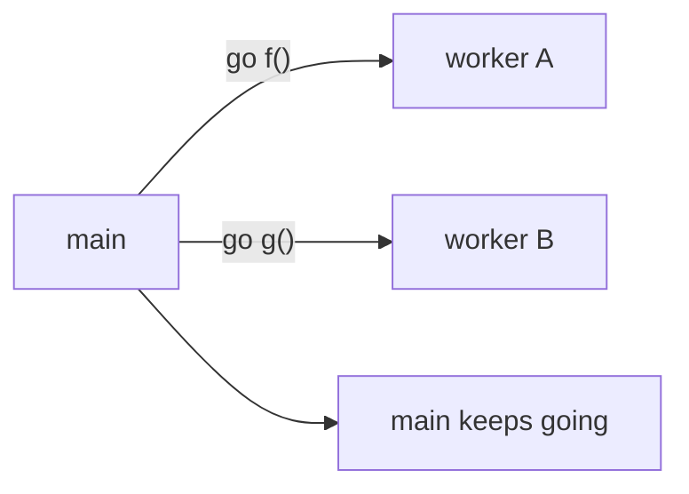
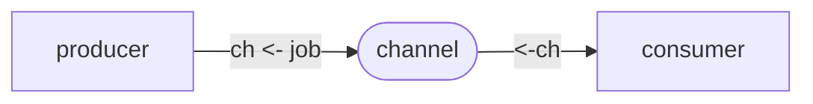
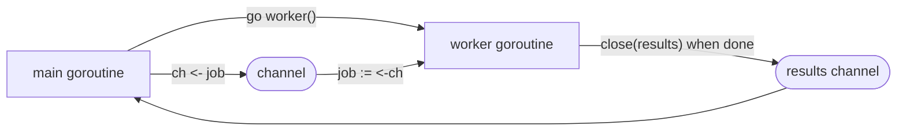
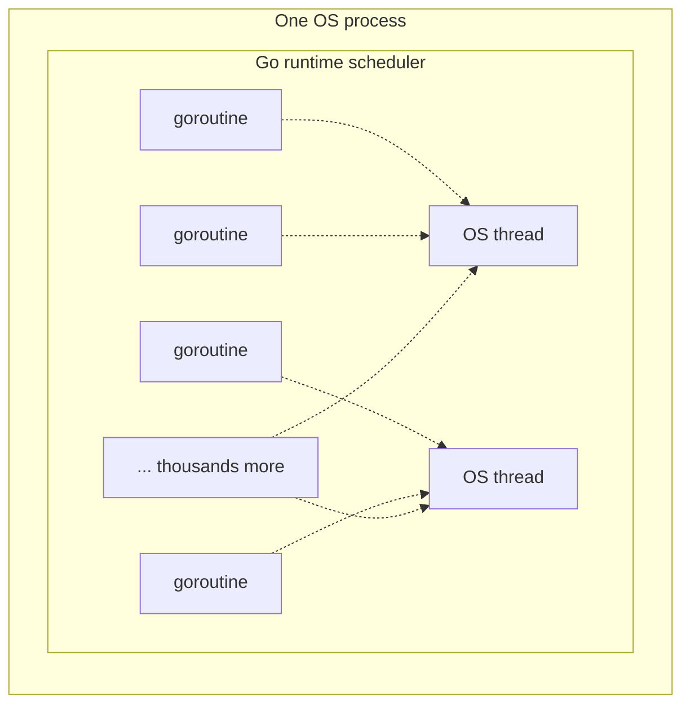
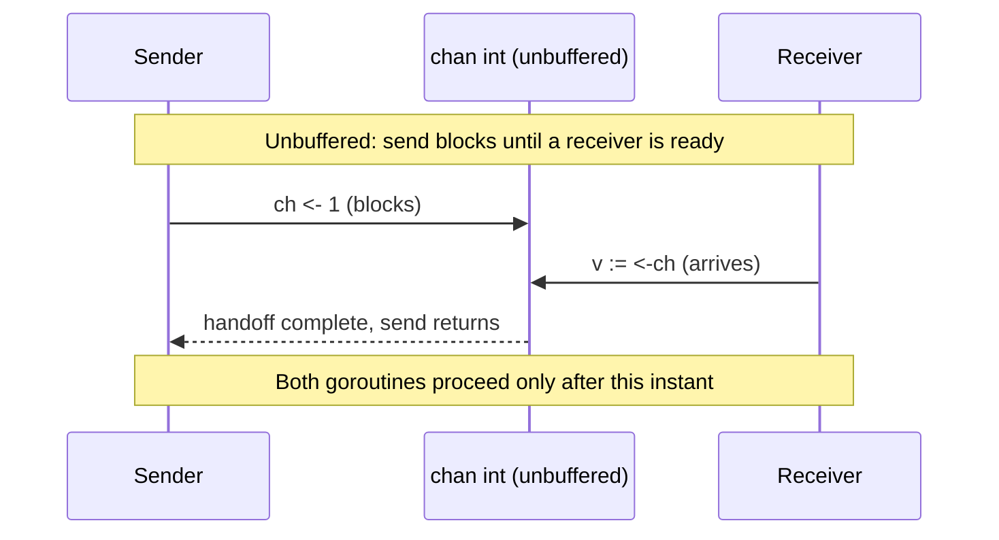
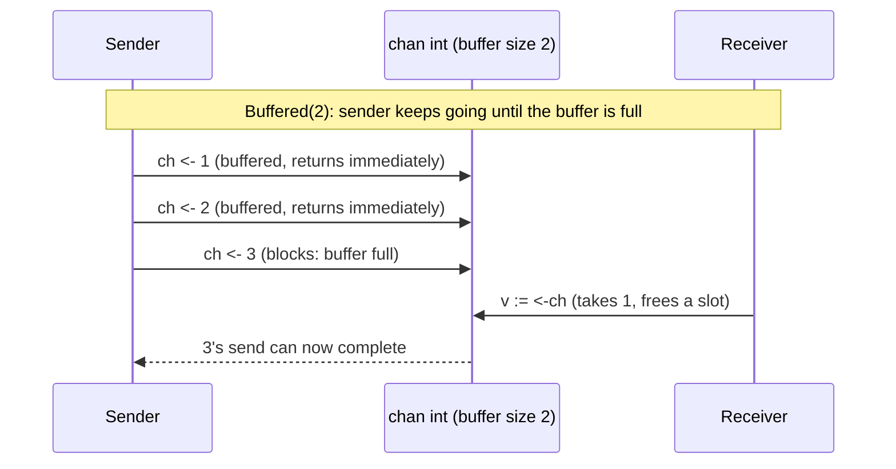

# Goroutines and Channels

> [!summary] TL;DR
> A goroutine is a function running concurrently with its caller, scheduled by the Go runtime onto a small pool of OS threads instead of getting one thread each. A channel is a typed pipe that lets one goroutine hand a value to another, and its send/receive operations double as the synchronization between them.

> [!abstract] Core idea
> - `go f()` starts `f` running concurrently; the caller does not wait for it.
> - A channel send and the matching receive happen-before each other: they are how goroutines pass both data and permission to proceed.
> - Unbuffered means "wait for a receiver"; buffered means "queue up to N, then wait".
> - Only the sender closes a channel, and only when every sender agrees no more values are coming.
> - If you cannot say who closes a channel, or what makes a goroutine stop, you have a leak waiting to happen.

## Start here: the basics 🟢

> [!info] How to read this note (pick your level)
> - 🟢 **New to this?** Read "From zero" below, then sections 1, 2 and the cheat sheet (10). That is a full first pass.
> - 🟡 **Know the basics?** Add section 3 (how it works) and 4 (worked example).
> - 🔴 **Interview / SDE-3 prep?** Add 7, 8 and 9. Headings are tagged 🟢🟡🔴 so you always know where you are.

**From zero, in 60 seconds** 🟢

Normally a program does one thing at a time, top to bottom. But a server must handle thousands of users at once.

Go's answer is the **goroutine**: a tiny worker you start with one word, `go`. Write `go doWork()` and `doWork` runs alongside your code instead of making it wait. Goroutines are so cheap you can have tens of thousands at once.



Workers need a safe way to pass things to each other. That is a **channel**: a typed pipe. One goroutine puts a value in, another takes it out, and the handoff itself keeps them in step.



Two rules prevent most disasters: know how every goroutine you start will stop, and let only the sender close a channel.

The rest of this note is just these 4 questions:
1. How do `go`, WaitGroup, buffered and unbuffered channels behave?
2. What are the close rules, and what happens on closed or nil channels?
3. How do goroutines leak, and how do you find the leaks?
4. When is a channel the right tool, and when is a mutex simpler?

**The problem in one story.**
A restaurant has one waiter who takes an order, walks to the kitchen, waits for the food, and only then serves the next table.
Everyone else waits a long time.
Hire many waiters, and you need a way for them to pass orders to the kitchen without shouting over each other.
In Go, the waiters are goroutines and the order slips passed between them are channels.

**Words you need first**

| Word | Plain meaning | Tiny example |
| --- | --- | --- |
| Concurrent | Several tasks in progress during the same period | Serving two tables at once |
| Goroutine | A cheap task Go runs alongside other code | `go sendEmail(order)` |
| OS thread | The operating system's unit of running code; heavier than a goroutine | Linux default stack 8 MiB |
| Channel | A typed pipe that carries values between goroutines | `ch := make(chan int)` |
| Block | Pause until something happens | A receive waits until a value arrives |
| Buffer | Small queue inside a channel | `make(chan int, 3)` holds 3 values |
| Deadlock | Every task is waiting on another, so nothing moves | Sending on a channel nobody reads |
| Leak | A goroutine that waits forever and never ends | A worker stuck on a never-closed channel |

**Picture it**



**Analogy.** Goroutines are coworkers; a channel is a conveyor belt between them. An unbuffered belt needs someone at the other end right now; a buffered belt can hold a few items before the sender has to wait.
Where it breaks: a real belt does not care who stops it; in Go only the sender should `close` a channel, and closing it twice crashes the program.

**How the rest of this note builds up**

- First, why goroutines exist (section 1) and the coworker/conveyor-belt model (section 2).
- Then the `go` statement, unbuffered vs. buffered channels, direction types and `close` (section 3).
- Then deadlocks, ownership, leaks and fire-and-forget traps, plus a worked example (sections 3-4).
- Finally the SDE-3 deep dive: what really synchronizes under the memory model, stack growth, and production failure modes (sections 6-8).

> [!tip] Remember
> Start a goroutine only when you know how it stops, and let only the sender close the channel.

## 1. Why it exists 🟢

A web server handling 10,000 concurrent requests cannot afford an OS thread per request: a thread's stack defaults to 8 MiB on Linux, so 10,000 threads would need about 80 GiB of stack space alone, plus the kernel's per-thread scheduling overhead.

A goroutine's stack starts at 2 KiB (`runtime/stack.go: stackMin = 2048`, verified in the Go 1.24 source) and grows and shrinks as needed, so the same 10,000 concurrent requests cost around 20 MiB of stack, not 80 GiB.

The second problem is coordination. If request handling spawns a goroutine to send a confirmation email, something has to hand the email goroutine its data, know when it is done, and decide what happens if the main handler returns first.

Channels are Go's answer: a typed pipe through which one goroutine gives data to another, with the handoff itself acting as the synchronization point.

## 2. Mental model 🟢

A goroutine is a **function call that runs alongside the caller** instead of blocking it. `go sendEmail(order)` is like handing a task to a coworker and continuing your own work, instead of doing the task yourself and making everyone wait.

A channel is a **conveyor belt between two workers**, sized either for instant handoff (unbuffered: the receiver must be standing there) or for a small queue (buffered: a short line can build up before anyone blocks).

The only wrinkle: whoever puts items on the belt is the one who tells everyone else "no more items are coming" (`close`), and only once.

## 3. How it works 🟡

### The `go` statement

**In plain words:** `go f()` hands the task to a new worker and walks away — nothing waits for it, and nothing hears it fail, unless you build that yourself.

```go
go sendEmail(order) // starts a new goroutine; the call returns no value here
```

`sendEmail(order)` is evaluated and started, and the `go` statement itself returns immediately. There is no handle, no return value, and no way to `go vet`-check that someone eventually "joins" it. Two facts follow directly from this:

- If `main` (or whichever goroutine started it) returns, the process exits immediately and every other goroutine is killed mid-flight, finished or not.
- Nothing waits for the goroutine unless you build that waiting yourself, with a `sync.WaitGroup` or a channel.

```go
var wg sync.WaitGroup
wg.Add(1) // Add happens BEFORE the goroutine starts, never inside it
go func() {
    defer wg.Done()
    sendEmail(order)
}()
wg.Wait() // blocks until every Add has a matching Done
```

Calling `Add` inside the new goroutine is a classic race: `Wait()` on the calling goroutine can run before the new goroutine gets scheduled and calls `Add`, so `Wait` returns immediately having counted zero outstanding goroutines.

`wg.Go(f)` (new in Go 1.25) does the `Add(1)` / goroutine-start / `Done()` sequence atomically and removes this foot-gun; it does not exist in Go 1.24, so 1.24 code uses `Add` before `go` as shown above.

Full mechanics of `WaitGroup`, `Once`, `Mutex` and the atomic types are in [[sync Primitives and Atomics]].

### Goroutines are not OS threads

**In plain words:** the Go runtime packs thousands of goroutines onto a handful of real threads, the way one bus carries many passengers.

The Go runtime multiplexes many goroutines onto a much smaller number of OS threads (the **M:N scheduler**: G goroutines, M OS threads, P logical processors — previewed here, detailed in [[Runtime - Goroutine Scheduler (GMP)]]).

A goroutine that blocks on a channel or a mutex parks cheaply inside the Go runtime; it does not tie up an OS thread the way a thread blocked in the kernel would.



### Unbuffered vs. buffered: two different promises

**In plain words:** an unbuffered channel is a hand-to-hand pass — both sides must be there; a buffered one is a short shelf that holds a few items first.





`make(chan int)` is unbuffered: a synchronous handoff where the send and the matching receive are one event with two sides. `make(chan int, 4)` is buffered with capacity 4: a send only blocks once 4 unreceived values are already queued.

Buffering decouples the sender's and receiver's pace up to that limit; it does not remove the need for someone to receive eventually.

### Directional channel types

**In plain words:** you can mark a channel parameter as send-only or receive-only, and the compiler then stops anyone using it the wrong way round.

A function signature that only sends or only receives documents the contract and lets the compiler enforce it:

```go
func produce(out chan<- int)  // out: send-only from this function's view
func consume(in <-chan int)   // in: receive-only from this function's view
```

Passing a bidirectional `chan int` into either parameter is allowed (it narrows); passing a `<-chan int` where `chan<- int` is required is a compile error.

### Close semantics

**In plain words:** `close` means 'no more values are coming'. Reading a closed channel is fine (you get leftovers, then zeros); sending to one, or closing it twice, crashes.

```mermaid
stateDiagram-v2
    [*] --> Open: make(chan T) or make(chan T, n)
    Open --> Open: send (blocks if unbuffered/full); receive (blocks if empty)
    Open --> Closed: close(ch)
    Closed --> Closed: receive returns (zero value, false) once drained
    Closed --> Panic: send on it
    Closed --> Panic: close it again
    Nil --> Nil: send or receive blocks forever (never panics, never proceeds)
```



| Operation | Open, has values | Open, empty | Closed, buffer drained | Closed, still has values | Nil channel |
| --- | --- | --- | --- | --- | --- |
| Receive `v, ok := <-ch` | returns a value, `ok=true` | blocks | returns zero value, `ok=false` | returns the next buffered value, `ok=true` | blocks forever |
| Send `ch <- v` | succeeds (or blocks if unbuffered/full) | blocks until a receiver | **panics**: "send on closed channel" | panics | blocks forever |
| `close(ch)` | succeeds | succeeds | **panics**: "close of closed channel" | succeeds | **panics**: "close of nil channel" |

The verified rule that matters most: **only the sender closes a channel, and only once**. A receiver that closes a channel it did not own risks a concurrent send racing the close.

If several goroutines send on the same channel, none of them should close it individually; instead, a separate coordinator closes it once every sender is known to be done (commonly with a `sync.WaitGroup`, shown in [[select and Concurrency Patterns]]).

A **nil channel** (a `chan T` variable that was never assigned with `make`) blocks forever on both send and receive. That looks useless until you put it inside a `select`: a nil channel's `case` is never ready, so assigning `nil` to a channel variable is a standard trick for disabling exactly one `select` arm — see [[select and Concurrency Patterns]].

### `for range` over a channel

```go
for v := range ch { // ends automatically once ch is closed AND drained
    process(v)
}
```

This is the idiomatic consumer loop: it needs no explicit `ok` check, and it is impossible to read a zero value by mistake, because the loop body simply never runs for the "closed and empty" state.

### Deadlock detection has a narrow trigger

**In plain words:** Go only yells 'deadlock!' when every single goroutine is stuck; one stuck goroutine in a busy server stays silent and invisible.

The Go runtime detects a deadlock only when **every** goroutine in the process is blocked at once, and then it crashes the whole program: `fatal error: all goroutines are asleep - deadlock!`.

A single stuck goroutine inside a busy server never triggers this — the other goroutines keep serving requests, and the stuck one just sits there forever, invisible until someone notices rising goroutine counts or a stalled handler.

```go
jobs := make(chan Job)   // unbuffered
jobs <- Job{ID: "1"}     // blocks: no one is receiving yet, and main is the only goroutine
job := <-jobs            // never reached
```

Running this standalone (`main` as the only goroutine) does trigger the detector, because main itself is the one and only blocked goroutine. The fix is either `make(chan Job, 1)` (buffer absorbs one send with nobody receiving yet) or starting a receiver on another goroutine before the send.

### Ownership pattern

**In plain words:** whoever makes the channel writes to it and closes it; everyone else only reads. Return it receive-only and the compiler polices this for you.

The clearest rule for who creates, writes to and closes a channel: **the function that creates the channel owns it**, writes to it, and is the only one that closes it. It returns the channel typed as receive-only so the compiler enforces "callers only consume":

```go
func Generate(ctx context.Context, n int) <-chan int {
    out := make(chan int)
    go func() {
        defer close(out) // the owner closes; receivers never do
        for i := 0; i < n; i++ {
            select {
            case out <- i:
            case <-ctx.Done():
                return // stop early: the consumer went away
            }
        }
    }()
    return out
}
```

This "generator" shape also gives request/response semantics for free: a caller that wants a single reply passes a `chan T` of its own and the callee sends exactly one value, which the caller is the only reader of.

### Goroutine leaks

**In plain words:** a leak is a worker waiting forever for something that will never come — the three usual shapes are a send nobody receives, a channel nobody closes, and a loop that ignores cancel.

A goroutine leak is a goroutine that will never finish, holding its stack and anything it references alive for the life of the process. Three recurring shapes:

1. **Blocked send after the receiver gave up.** A goroutine does `done <- result` on an unbuffered channel, but the only reader returned early (for example, after a timeout). Nobody will ever receive, so the sender blocks forever. Fix: buffer the channel by 1, so the lone send always succeeds even with no reader:
   ```go
   done := make(chan int, 1) // capacity 1: this send can never block
   go func() { done <- work() }()
   ```
2. **A forgotten consumer.** A fan-out starts N worker goroutines reading from a shared input channel, but the code that should close that channel (or signal completion) is never reached on some path — the workers range forever.
3. **Missing `ctx.Done()` case.** A worker loop only has a `case v := <-jobs:` and no `case <-ctx.Done(): return`, so cancelling the context does nothing to the goroutine, which keeps waiting on `jobs` even after its caller stopped caring.

Detecting leaks: the goroutine count in `runtime.NumGoroutine()` (and the Prometheus Go collector's `go_goroutines` metric) climbing without bound in production; `go.uber.org/goleak`'s `VerifyTestMain` failing a test package in CI if any goroutine it started is still alive when the tests finish — far cheaper than finding the leak in production.

### Fire-and-forget from a request handler

**In plain words:** work launched from a handler dies with the request unless you deliberately detach it and give it its own time limit.

`go sendEmail(order)` launched straight from an HTTP handler is a trap: the handler's `context.Context` is cancelled the moment the handler returns (`r.Context()` is tied to the request's lifetime — see [[Context Package]]), so `sendEmail` can be cut off mid-flight with no error reported to anyone.

The fix detaches the value-carrying parts of the context while dropping its cancellation, and gives the detached work its own bound:

```go
go func() {
    ctx, cancel := context.WithTimeout(context.WithoutCancel(r.Context()), 5*time.Second)
    defer cancel()
    sendEmail(ctx, order) // keeps request-scoped values (trace id), not its cancellation
}()
```

`context.WithoutCancel` is covered fully in [[Context Package]]; the point here is that detaching is a deliberate choice, not the accidental side effect of launching a goroutine from inside a handler.

### Channels vs. a mutex

**In plain words:** a channel moves data between workers; a mutex lets workers share one piece of data. Moving → channel. Sharing → mutex.

A channel moves **ownership** of data from one goroutine to another; a mutex lets multiple goroutines **share** one piece of state safely. Guarding a `map[string]int` that many goroutines read and write is a mutex problem — adding channels and `select` statements to serialize access to a struct is usually harder to reason about than one `sync.Mutex`.

Channels earn their keep when work or data genuinely needs to move between goroutines: a pipeline stage, a worker pool's job queue, a cancellation signal. The full decision table lives in [[Concurrency for LLD]].

## 4. Worked example 🟡

### Whiteboard version

```go
package wb

func Generate(n int) <-chan int {
    out := make(chan int)
    go func() {
        defer close(out)
        for i := 0; i < n; i++ {
            out <- i
        }
    }()
    return out
}
```

The full version below adds cancellation, a fan-out helper, and a leak-free "send with timeout" shape, tested under the race detector.

```go
package channels

import (
    "context"
    "sync"
)

// Generate is the ownership pattern: the function that creates a channel is
// the only one allowed to write to it and close it. Callers only receive.
func Generate(ctx context.Context, n int) <-chan int {
    out := make(chan int)
    go func() {
        defer close(out)
        for i := 0; i < n; i++ {
            select {
            case out <- i:
            case <-ctx.Done():
                return
            }
        }
    }()
    return out
}

// FanOut runs work across workers goroutines and merges their results onto
// one channel, closing it only after every worker has finished.
func FanOut(ctx context.Context, items []int, workers int, work func(int) int) <-chan int {
    in := make(chan int)
    results := make(chan int)

    go func() {
        defer close(in)
        for _, it := range items {
            select {
            case in <- it:
            case <-ctx.Done():
                return
            }
        }
    }()

    var wg sync.WaitGroup
    for i := 0; i < workers; i++ {
        wg.Add(1)
        go func() {
            defer wg.Done()
            for v := range in {
                select {
                case results <- work(v):
                case <-ctx.Done():
                    return
                }
            }
        }()
    }

    go func() {
        wg.Wait()
        close(results)
    }()

    return results
}

// SendWithTimeout is the fix for the classic leak: a goroutine blocked
// forever on an unbuffered send because the receiver gave up and left.
func SendWithTimeout(v int, work func(int) int) <-chan int {
    done := make(chan int, 1) // capacity 1: the lone send always succeeds
    go func() {
        done <- work(v)
    }()
    return done
}
```

The tests that prove the behaviors described above: ownership draining fully, cancellation actually stopping the goroutine, the full close-semantics matrix (including the two panics), and the nil-channel block.

```go
func TestGenerate_StopsEarlyOnCancel(t *testing.T) {
    ctx, cancel := context.WithCancel(context.Background())
    out := Generate(ctx, 1_000_000)
    <-out    // take one value
    cancel() // then walk away
    select {
    case _, ok := <-out:
        _ = ok
    case <-time.After(time.Second):
        t.Fatal("generator did not stop after cancel: goroutine leak")
    }
}

func TestClosedChannel_ReceiveReturnsZeroValue(t *testing.T) {
    ch := make(chan int, 1)
    ch <- 7
    close(ch)
    v, ok := <-ch // 7, true: the buffered value is still delivered
    if v != 7 || !ok {
        t.Fatalf("got %d, %v; want 7, true", v, ok)
    }
    v, ok = <-ch // 0, false: drained and closed
    if v != 0 || ok {
        t.Fatalf("got %d, %v; want 0, false", v, ok)
    }
}

func TestSendOnClosedChannel_Panics(t *testing.T) {
    defer func() {
        if recover() == nil {
            t.Fatal("want a panic sending on a closed channel")
        }
    }()
    ch := make(chan int)
    close(ch)
    ch <- 1
}

func TestNilChannel_BlocksForever(t *testing.T) {
    var ch chan int
    select {
    case <-ch:
        t.Fatal("receive from a nil channel must never succeed")
    case <-time.After(20 * time.Millisecond):
        // expected
    }
}
```

**Measured:** `go vet ./...` clean; `go test -race -v ./...` — `ok example.com/goroutines 1.483s`, all 4 tests passed (Go 1.24.4, Apple Silicon, 2026-11-07).

## 5. Variants and comparison 🟡

| Shape | How it works | Use when | Cost |
| --- | --- | --- | --- |
| Unbuffered channel | Send blocks until a receiver takes the value | You want the handoff itself to be the synchronization point | Sender and receiver must both be ready; easy to deadlock if one side is missing |
| Buffered channel (small, fixed N) | Send only blocks once N unreceived values are queued | Smoothing a bursty producer against a steadier consumer | Still blocks eventually; picking N by guesswork hides backpressure instead of handling it |
| `WaitGroup` | Counter of outstanding goroutines; `Wait()` blocks until it hits zero | You just need "all of these finished", no results to collect | No way to get an error or a value back; that needs a channel too |
| Ownership (generator) channel | One goroutine creates, writes and closes; others only receive | Any producer/consumer relationship | Requires discipline: a second accidental sender will panic the receiver eventually |
| `context.Context` cancellation | A `Done()` channel closed by `cancel()`, observed in a `select` | Stopping a tree of goroutines together, with a reason (`ctx.Err()`) | Only a signal, not a transport — pair with channels or shared memory for actual data |

## 6. Trade-offs and when not to use 🟡

- A goroutine is cheap to start but not free: each one holds at least a 2 KiB stack, a bit of scheduler bookkeeping, and anything it closes over. Spawning one per item of an unbounded input (one per row of a 10-million-row query) can still exhaust memory; bound it (see the worker pool in [[select and Concurrency Patterns]]).
- Channels add real complexity once you have more than two or three of them feeding into each other with multiple `select` statements. A single `sync.Mutex` around a plain struct is often easier to reason about and to prove correct — see the decision table in [[Concurrency for LLD]].
- `go f()` with no `WaitGroup`, no channel and no logged error is invisible to tests and to the caller: if `f` panics, the whole process crashes (a panic in a goroutine is not recoverable by any other goroutine), and if it silently fails, nobody is told. Treat "fire and forget" as a deliberate, documented decision, not a default.

## 7. In production 🔴

- **Real systems:** HTTP servers (one goroutine per accepted connection via `net/http`'s internal model, not literally per request under HTTP/2 multiplexing); database connection pools that hand work to worker goroutines; `io.Copy`-style streaming pipelines; graceful shutdown that fans a `context.Context`'s cancellation out to every in-flight goroutine.
- **Failure modes → fixes:**
  - Goroutine count climbs steadily under normal traffic → a leak from one of the three shapes above; check `go_goroutines`, then look for a `select` missing a `ctx.Done()` case.
  - A handler occasionally hangs past its timeout → a goroutine it started is blocked on an unbuffered send with no receiver; buffer the channel or add a `select` with the context.
  - The whole process crashes with "fatal error: all goroutines are asleep - deadlock!" → every goroutine is blocked; dump stacks (`SIGQUIT` or `/debug/pprof/goroutine?debug=2`) to see exactly where.
- **What to monitor:** `runtime.NumGoroutine()` / the Prometheus Go collector's `go_goroutines` gauge, watched for a trend rather than an absolute number; `goleak.VerifyTestMain` wired into `TestMain` for every package with goroutines, so a leak fails CI instead of showing up as a slow memory climb in production.

## 8. Deep dive 🔴

- **What actually synchronizes.** Under the Go memory model, a send on a channel happens-before the corresponding receive completes, and (for an unbuffered channel) the receive happens-before the send returns. For a buffered channel of capacity C, the k-th receive happens-before the (k+C)-th send completes — the buffer behaves like a capacity-C semaphore.

  This is why "pass data through a channel" is a correct way to publish a value to another goroutine without a separate mutex: the happens-before edge covers everything written before the send. Full treatment, including `Mutex` and `atomic`, is [[Memory Model and Data Races]].
- **Stack growth.** A new goroutine starts with a 2 KiB stack (verified: `runtime/stack.go`, `stackMin = 2048`). When a function call would overflow it, the runtime allocates a new, larger stack (roughly double), copies the old one over — rewriting any pointers into the stack — and frees the old one.

  This copying is why goroutine stacks can start tiny without a fixed worst-case reservation, and why a pointer into another goroutine's stack is never safe to keep.
- **`go vet`'s limits here.** A directional channel-type violation is caught by the compiler itself, not `go vet` — it is a plain type error.

  What `go vet` actually adds for concurrency code is its `copylocks` check: passing or assigning a `sync.Mutex` or `sync.WaitGroup` by value (instead of by pointer) copies its internal state, which silently breaks the lock, and `go vet` flags that copy.

  Neither the compiler nor `go vet` catches goroutine leaks or who-closes-what; `go.uber.org/goleak` and the race detector cover those, different and non-overlapping gaps, which is why production code runs both in CI.
- **Why `main` returning kills everything.** The Go runtime has no concept of "wait for all goroutines before exiting" by default — `main` returning is `os.Exit(0)` for the whole process.

  Any cleanup that must run (flushing a log buffer, finishing an in-flight write) has to be waited on explicitly before `main` returns, typically with a `WaitGroup` or a bounded shutdown `context.Context`.

## 9. Interview questions 🔴

> [!question]- What happens when you receive from a channel that is closed but still has buffered values in it?
> You get the next buffered value with `ok=true`, in the order it was sent — close does not discard what is already queued. Only once the buffer is empty does a receive start returning the zero value with `ok=false`.

> [!question]- Trap: is it safe to close a channel from the receiver side once you are done reading?
> No. Closing is a sender-side responsibility. If a sender tries to send after a receiver closed the channel, that send panics with "send on closed channel". The rule is: whoever writes to a channel decides when writing is finished and closes it; readers never close.

> [!question]- Your server process has 50,000 goroutines and climbing. How do you find the leak?
> Pull a goroutine profile (`/debug/pprof/goroutine?debug=2` or `go tool pprof`) and look for many goroutines parked at the same line — that line is where they are stuck, usually a channel send or receive with no corresponding counterpart. Cross-check with `goleak` in tests to catch the same shape before it reaches production.

> [!question]- Why does a nil channel block forever instead of panicking, and when is that useful?
> It is a deliberate design choice: a nil channel's send and receive both block permanently, so inside a `select`, a nil channel's case is never the one chosen. Assigning `nil` to a channel variable is the standard way to disable exactly one `select` arm at runtime, for example to stop retrying a timer after the first success.

> [!question]- You wrote `wg.Add(1)` inside the goroutine instead of before `go func(){...}()`. What can go wrong?
> `Wait()` on the calling goroutine can execute before the scheduler ever runs the new goroutine's `Add(1)`, so `Wait` sees zero outstanding work and returns immediately — the caller proceeds as if everything finished when nothing has even started.
>
> Always call `Add` on the goroutine that will call `Wait`, before starting the new goroutine (or use `wg.Go` on Go 1.25+, which does both atomically).

> [!question]- Does Go's runtime deadlock detector catch every deadlock in a long-running server?
> No — it only fires when literally every goroutine in the process is blocked simultaneously. In a server handling many requests, one goroutine stuck forever on a channel just sits there invisibly while the rest of the server keeps working; you will only notice it through a rising goroutine count or a request that never completes, not a crash.

> [!question]- When would you reach for channels instead of a mutex?
> When ownership of data needs to move between goroutines — a pipeline stage handing processed items to the next stage, or a cancellation signal fanning out to many workers via `ctx.Done()`.
>
> When multiple goroutines need to read and write the *same* shared state, a mutex is usually simpler and easier to verify than an equivalent built from channels and `select`.

## 10. Cheat sheet 🟢

- `go f()` starts `f` concurrently and returns immediately; nothing waits for it unless you add a `WaitGroup` or a channel.
- Unbuffered = synchronous handoff; buffered(N) = queue up to N before blocking.
- Only the sender closes a channel, only once; receivers never close.
- Closed + drained → receive returns zero value, `ok=false`; send or close on an already-closed channel panics; nil channel blocks forever on both.
- `wg.Add(1)` before `go`, never inside the goroutine (`wg.Go` from Go 1.25 does this atomically).
- Ownership pattern: the creator of a channel writes to it and closes it; return it as `<-chan T` to enforce that at compile time.
- Leaks come from three shapes: a blocked send nobody will ever receive, a forgotten consumer, or a missing `ctx.Done()` case — watch `go_goroutines` and run `goleak` in CI.
- Runtime deadlock detection only fires when *every* goroutine is blocked; it will not catch one stuck goroutine in a live server.

## Links

- **Before this:** [[Functions, Closures, Defer, Panic and Recover]], [[Process Memory Layout - Stack vs Heap]]
- **Next:** [[select and Concurrency Patterns]], [[sync Primitives and Atomics]], [[Context Package]]
- **Compare with:** [[Concurrency for LLD]] (where invariants live and the channels-vs-mutex decision), [[Processes, Threads and Context Switching]] (OS threads vs. goroutines)

### Watch on YouTube

- [Master Go Channels in 15 Minutes: Goroutines & Concurrency Made Simple for Beginners](https://www.youtube.com/watch?v=WGxJmhGBpuU) · JA Asuquo · 15-min visual intro to goroutines + channels
- [Go Class: 23 CSP, Goroutines, and Channels](https://www.youtube.com/watch?v=zJd7Dvg3XCk) · Matt KØDVB · deeper dive into CSP theory behind Go's concurrency model
