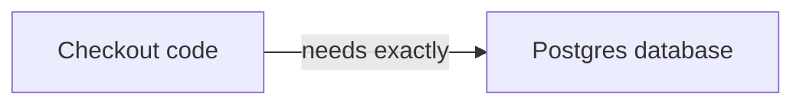
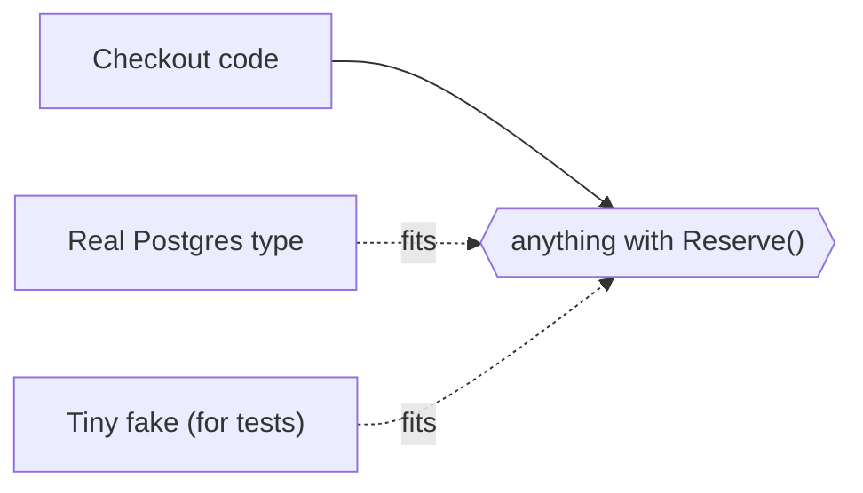
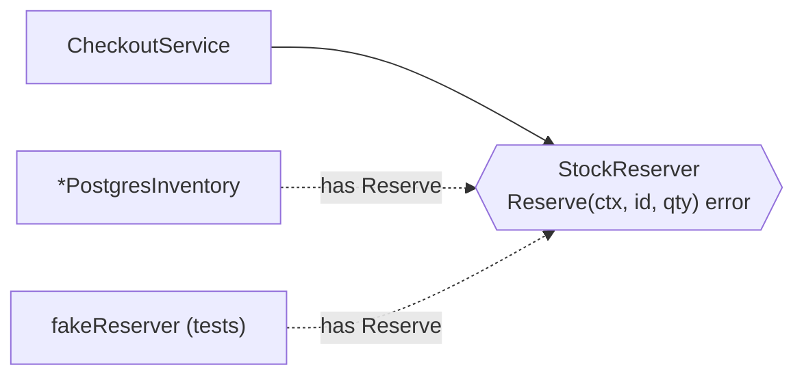
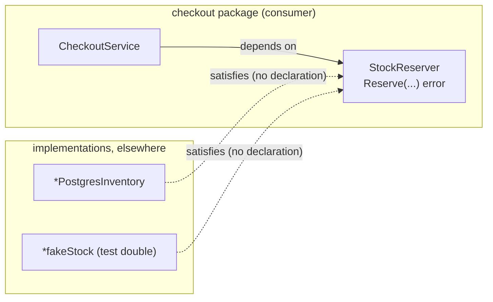
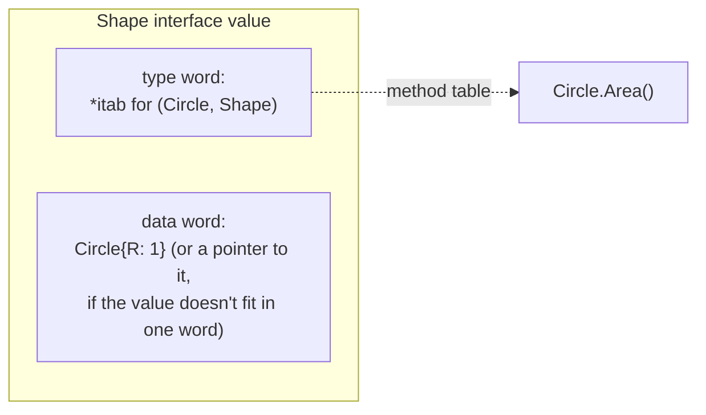
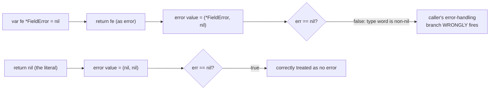

# Interfaces

> [!summary] TL;DR
> An interface is a named set of method signatures. Any type that has those methods satisfies the interface automatically — there is no `implements` keyword. Underneath, an interface value is always a two-word pair: a pointer describing the concrete type, and a pointer (or small value) holding the data.

> [!abstract] Core idea
> - Satisfaction is structural and implicit: if a type has the methods, it satisfies the interface, with no declaration linking the two.
> - An interface value is a `(type, data)` pair. A concrete nil pointer, once stored in that pair, makes a non-nil interface — the classic `err != nil` surprise.
> - Keep interfaces small and declare them next to the code that calls them (the consumer), not next to the implementation.
> - `any` is justified when the shape of the data is genuinely unknown until runtime; when you know the type ahead of time, use it directly or use a generic constraint instead.

## Start here: the basics 🟢

> [!info] How to read this note (pick your level)
> - 🟢 **New to this?** Read "From zero" below, then sections 1, 2 and the cheat sheet (10). Stop there, that is a full first pass.
> - 🟡 **Know the basics?** Add section 3 (how it works), 4 (worked example) and 5-6.
> - 🔴 **Interview / SDE-3 prep?** Add 7, 8 and 9. Headings are tagged 🟢🟡🔴 so you always know where you are.

> [!note] Before this note
> - [[Structs, Methods and Embedding]]: a struct groups fields, and a method is a function attached to a type, like `func (c Circle) Area() float64`.
> - [[Pointers, Values and Escape Analysis]]: `*T` is a pointer to a `T`, a pointer can be `nil`, and a method with a `*T` receiver belongs to the pointer, not the plain value.

**From zero, in 60 seconds** 🟢

You write a checkout function. It needs to save stock in a database.

If you write "this function needs a Postgres database", you are stuck: tests now need a real database too.



Instead you say what you need by **behaviour**: "give me anything that can Reserve stock". That list of required abilities is an **interface**.

Now the real database fits, and a tiny fake fits in tests. Go checks the fit for you, automatically — a type that has the listed methods just fits, no extra declaration (that is called **satisfying** the interface).



That is the whole idea. The rest of this note is just four questions:
1. How does Go decide a type "fits"? (implicit satisfaction)
2. What is an interface value made of inside? (a two-part pair)
3. What are the traps? (the nil trap, mainly)
4. When should you NOT use one? (pollution, hot loops, generics instead)

**The problem in one story.**
A phone charger works with any wall socket, because the socket only cares about the shape of the plug.
Your checkout code should work the same way: it needs "something that can reserve stock", not "this exact Postgres class".
Then tests can plug in a fake, and production can plug in the real database.
A Go interface is that socket shape.

**Words you need first**

| Word | Plain meaning | Tiny example |
| --- | --- | --- |
| Type | The kind of a value | `int`, `string`, `*PostgresInventory` |
| Method | A function attached to a type | `func (c Circle) Area() float64` |
| Concrete type | A real type with data, not an interface | `Circle`, `*os.File` |
| Interface | A list of methods a value must have | `type Shape interface{ Area() float64 }` |
| Satisfy | A type has every method the interface lists | `Circle` satisfies `Shape` |
| Nil | "Points at nothing" | `var p *Circle = nil` |
| Fake | A small test stand-in for a real dependency | `fakeReserver` returning `nil` |
| Method set | The full list of methods a type has; this decides which interfaces it fits | `*PostgresInventory` has `Reserve` |
| Dynamic dispatch | Picking which method to run at runtime, based on what is inside the interface | `s.Area()` runs `Circle.Area` |
| itab | A small table Go builds once per (type, interface) pair, holding the method addresses | the "which methods" half of an interface value |
| Type assertion | Asking an interface "is a `Circle` inside?" and getting it out | `c, ok := s.(Circle)` |
| Inlining | The compiler copying a small function's body into its caller to skip the call | not possible through an interface call |
| Consumer | The code that calls the interface's methods (not the code that implements them) | `CheckoutService` |

**Picture it**



**Analogy.** An interface is a wall socket: any plug with the right pins fits, with no paperwork.
Where it breaks: a real socket either has power or not, but a Go interface holding a nil pointer still counts as "something is plugged in" (`err != nil` is true).

**How the rest of this note builds up**

- First, why interfaces exist (section 1) and the socket mental model (section 2).
- Then implicit satisfaction, "accept interfaces, return structs", and the `(type, data)` pair inside every interface value (section 3).
- Then nil-interface traps, type assertions, `any`, generics vs. interfaces and interface pollution, with a full example and benchmark (sections 3-4).
- Finally the SDE-3 deep dive: itabs, inlining cost, PGO devirtualization and generics internals (sections 6-8).

> [!tip] Remember
> Ask for the smallest set of methods you need, declared where you use them; Go checks the fit for you.

## 1. Why it exists 🟢

A checkout service needs to reserve stock before charging a card. Writing it directly against `*PostgresInventory` works until a test needs to run without a real database, or until the team swaps Postgres (a popular SQL database) for a cache-backed store — at which point every caller of the concrete type needs to change, and every test needs a running database.

An interface breaks that coupling: `CheckoutService` depends on a `StockReserver` — a single method, `Reserve(ctx, productID, qty) error` — instead of on `*PostgresInventory` and its dozen other methods. In production, a real `*PostgresInventory` satisfies it.

In tests, a five-line fake satisfies it too, because Go checks the method set, not a declared relationship. Neither `*PostgresInventory` nor the fake ever writes the word `StockReserver` anywhere in their own code.

## 2. Mental model 🟢

Think of an interface as a **socket**, not a blueprint. A wall socket doesn't care what brand of device you plug in — it only cares that the plug has the right pins in the right places.

Any type whose methods line up with the interface's "pins" fits, with no registration required. Go's compiler checks the fit at compile time by comparing method signatures, not by looking for a `type X implements Y` declaration, because Go has no such declaration.

An interface **variable**, though, is not the plugged-in device itself — it's a small adapter that remembers two things: which kind of device is plugged in (its concrete type), and where that device actually is (its data). That adapter is always the same fixed size, two machine words (a word is 8 bytes on a 64-bit computer), no matter how large or small the plugged-in device is.

## 3. How it works 🟡

> 🟢 → 🟡 **You now know** that an interface lists the methods you need, and any type with those methods fits automatically. **Next we open the box**: where to declare interfaces, the two-part value hiding inside every interface variable, the nil trap that follows from it, and how to get the concrete type back out.

### Implicit satisfaction and small, consumer-side interfaces

**In plain words:** you never write "X implements Y" in Go; if the type has the methods, it already fits — like a plug that just has the right pins.

```go
// Declared next to checkout — the CONSUMER — not next to inventory.
type StockReserver interface {
    Reserve(ctx context.Context, productID string, qty int) error
}

type PostgresInventory struct{ /* ... many fields ... */ }

// PostgresInventory never mentions StockReserver. It satisfies it purely
// by having a matching Reserve method.
func (p *PostgresInventory) Reserve(ctx context.Context, productID string, qty int) error {
    /* ... */
    return nil
}
```

`io.Reader` (one method, `Read([]byte) (int, error)`) and `fmt.Stringer` (one method, `String() string`) are the standard library's own proof that one- or two-method interfaces are the norm, not a simplification for teaching. A rule of thumb: if you can't name an interface's purpose in under five words ("something that reserves stock," "something that reads bytes"), it's trying to do too much.



### Accept interfaces, return structs

A constructor takes the interface it needs and hands back a concrete type:

```go
func NewCheckoutService(stock StockReserver) *CheckoutService {
    return &CheckoutService{stock: stock}
}
```

Accepting an interface lets the caller supply any satisfying type, real or fake. Returning a concrete `*CheckoutService` (not an interface) lets callers see its full, specific API and lets the compiler devirtualize (turn an interface call back into a direct call) calls *on* `CheckoutService` itself — you only pay the interface's indirection cost at the one boundary that needs flexibility, not throughout the call chain.

### Compile-time assertion

**In plain words:** one throwaway line that makes the build fail early if a type stops fitting the interface — a smoke alarm for drift.

```go
var _ StockReserver = (*PostgresInventory)(nil)
```

This line does nothing at runtime — `_` discards the value. Its only job is to fail the **build** the moment `PostgresInventory`'s methods drift away from what `StockReserver` requires, catching the mismatch at the implementation site instead of at some distant call site.

### The interface value: a `(type, data)` pair

**In plain words:** an interface variable is a small two-slot box: one slot remembers WHAT kind of thing is inside, the other WHERE its data lives.

An interface variable is always two machine words, regardless of what's stored in it: **measured** with `unsafe.Sizeof` (Go 1.24.4, darwin/arm64 — 8-byte words):

```go
var s Shape = Circle{R: 1}
unsafe.Sizeof(s) // 16 bytes: two 8-byte words, always, for any interface type
```



The type word points at an **itab** — a small table built once per (concrete type, interface type) pair, holding the concrete type's identity and a pointer to each method the interface requires.

Calling `s.Area()` through the interface means: follow the type word to the itab, look up `Area`'s slot, call that function pointer with the data word as the receiver.

That extra hop is the entire cost of dynamic dispatch — there's no reflection (inspecting types at runtime) and no map lookup involved.

### Nil interface vs. typed nil

**In plain words:** the box can hold "a pointer that points at nothing" — the box itself is not empty, so `err != nil` still says yes. This is Go's most famous trap.

Because an interface value is a `(type, data)` pair, it is nil only when **both** halves are nil. A concrete nil pointer, once assigned to an interface variable, produces the pair `(*FieldError, nil)` — non-nil as an interface, even though the pointer half is nil:

```go
type FieldError struct{ Field string }

func (e *FieldError) Error() string { return "invalid field: " + e.Field }

func Describe() error {
    var fe *FieldError // nil *FieldError
    return fe           // packs (*FieldError, nil) into the error interface
}
```

```go
err := Describe()
err == nil        // false! the pair is (*FieldError, nil), not (nil, nil)
fe, ok := err.(*FieldError)
ok && fe == nil   // true: a typed nil is hiding inside a non-nil interface
```



**Fix:** only ever `return nil` literally for an interface-typed result; never return a concrete pointer variable that might itself be nil. A full catalogue of this and eight other Go traps, each with a runnable test, lives in [[Go Interview Questions and Traps]] — this note explains the mechanism; that one is the interview-facing drill.

### Type assertion (comma-ok) and type switches

**In plain words:** assertions are how you open the box and ask "is a Circle in here?" — the comma-ok form asks politely, the one-result form panics if it guessed wrong.

A **type assertion** recovers the concrete type behind an interface value. The two-result ("comma-ok") form never panics — it reports failure instead:

```go
c, ok := shapeVal.(Circle) // ok == false if shapeVal does not hold a Circle
```

The single-result form (`c := shapeVal.(Circle)`) panics on a mismatch — use it only when you've already established the type must match.

A **type switch** branches on the dynamic type directly:

```go
switch v := s.(type) {
case Circle:
    return fmt.Sprintf("circle r=%.1f area=%.2f", v.R, v.Area())
case Square:
    return fmt.Sprintf("square side=%.1f area=%.2f", v.Side, v.Area())
default:
    return fmt.Sprintf("unknown shape, area=%.2f", v.Area())
}
```

Each `case` rebinds `v` to that case's concrete type inside its own block — `v.R` is valid in the `Circle` case because `v` is a `Circle` there, not a `Shape`.

### Interface embedding

An interface can embed other interfaces; the result requires every embedded method:

```go
type Reader interface{ Read(ctx context.Context, id string) (string, error) }
type Writer interface{ Save(ctx context.Context, v string) error }

type ReadWriter interface {
    Reader
    Writer
}
```

Any type implementing both `Read` and `Save` satisfies `ReadWriter` automatically — there's no extra declaration on the implementing type's side, the same implicit-satisfaction rule as always, just checked against the union of methods.

### `any`, and when it's justified

`any` (the Go 1.18 alias for `interface{}`) satisfies every type, which is exactly why it throws away all compile-time type checking.

It is justified when the shape of the data is genuinely unknown until runtime — decoding arbitrary JSON, for example, where a value might be a string, a number, an object, or an array, and the caller must branch on which:

```go
func DecodeLoose(v any) string {
    switch v.(type) {
    case nil:
        return "null"
    case string:
        return "string"
    case map[string]any:
        return "object"
    // ...
    }
}
```

It is **not** justified when you already know the type at the call site and just want to avoid writing it down — that's what a concrete parameter type, or a generic type constraint, is for:

```go
type Number interface{ ~int | ~int64 | ~float64 }

func Sum[T Number](xs []T) T {
    var total T
    for _, x := range xs {
        total += x
    }
    return total
}
```

`Sum` works for any numeric type the caller already knows, with the compiler checking every call site — `any` would compile too, but it would defer every type error to a runtime panic instead of a build failure.

### Interfaces vs. generics

**In plain words:** interface = different types BEHAVE differently; generic = same logic, just a different type filled in. Pick by what varies.

| | Interfaces | Generics |
|---|---|---|
| What varies | **behaviour** — different types do different things for the same method call | the **algorithm is identical**, only the type changes |
| Dispatch | at runtime, through the itab | at compile time, via stenciling or a dictionary (see [[Generics and Iterators]]) |
| Example | `StockReserver` — Postgres and a fake behave differently | `Sum[T]`, `LRU[K, V]` — the logic is the same for every `T` |

A repository interface varies in *behaviour* (a real DB call vs. an in-memory fake): that's an interface. An LRU cache's eviction logic is the *same* no matter whether it stores `string` or `Invoice`: that's a generic.

### Interface pollution

The anti-pattern (a common but harmful habit) carried over wholesale from Java: an `IOrderService` interface with exactly one implementation, `OrderServiceImpl`, created "for testability" before any second implementation or any test fake actually exists.

It adds a layer of indirection, a naming collision (`I`-prefixes and `Impl`-suffixes are not idiomatic Go), and zero benefit until there's a real second shape — a fake, a second backend — that needs it.

Declare the interface when a consumer actually needs one, sized to exactly what that consumer calls.

## 4. Worked example 🟡

### Whiteboard version

The two things an interviewer checks first: implicit satisfaction, and the compile-time assertion that catches drift.

```go
type Greeter interface{ Greet() string }

type Service struct{ name string }

func (s *Service) Greet() string { return "hello, " + s.name }

var _ Greeter = (*Service)(nil) // compiles only if *Service still has Greet()
```

### Full example

One scratch module (`go 1.24`), `go vet`-clean, passing under `go test -race`:

```text
$ go vet ./...
$ go test -race ./...
ok      interfaces      1.4s
```

Consumer-side interface, a real implementation, and a test fake:

**What this code does, in plain words:** `StockReserver` lists the one method checkout needs. `PostgresInventory` (here just a map standing in for a database) has that method, so it fits, and the `var _` line makes the build fail if it ever stops fitting. `CheckoutService.Buy` only talks to the interface. `fakeStock` also has `Reserve`, counts how often it was called, and is what the test plugs in.

```go
type StockReserver interface {
    Reserve(ctx context.Context, productID string, qty int) error
}

type PostgresInventory struct{ reserved map[string]int }

func (p *PostgresInventory) Reserve(ctx context.Context, productID string, qty int) error {
    if p.reserved == nil {
        p.reserved = map[string]int{}
    }
    p.reserved[productID] += qty
    return nil
}

var _ StockReserver = (*PostgresInventory)(nil)

type CheckoutService struct{ stock StockReserver }

func NewCheckoutService(stock StockReserver) *CheckoutService {
    return &CheckoutService{stock: stock}
}

func (s *CheckoutService) Buy(ctx context.Context, productID string, qty int) error {
    return s.stock.Reserve(ctx, productID, qty)
}

type fakeStock struct{ calls int }

func (f *fakeStock) Reserve(ctx context.Context, productID string, qty int) error {
    f.calls++
    return nil
}
```

```go
func TestConsumerSideInterfaceWithFake(t *testing.T) {
    fake := &fakeStock{}
    svc := NewCheckoutService(fake) // the real *PostgresInventory would also work
    if err := svc.Buy(context.Background(), "sku-1", 2); err != nil {
        t.Fatalf("Buy() = %v", err)
    }
    if fake.calls != 1 {
        t.Fatalf("expected the fake to record 1 call, got %d", fake.calls)
    }
}

func TestRealImplementationSatisfiesTheSameInterface(t *testing.T) {
    inv := &PostgresInventory{}
    svc := NewCheckoutService(inv)
    if err := svc.Buy(context.Background(), "sku-2", 5); err != nil {
        t.Fatalf("Buy() = %v", err)
    }
    if inv.reserved["sku-2"] != 5 {
        t.Fatalf("expected inventory to record the reservation, got %v", inv.reserved)
    }
}
```

Nil interface vs. typed nil:

**What this code does, in plain words:** `Describe` returns a `*FieldError` variable that is `nil`, through a result of type `error`. The caller gets an `error` that is not `nil`, because the type half is filled in. `describeFixed` returns a plain `nil`, which really is nil. `alwaysOKValidator` is a normal type whose `Validate` returns `nil` correctly.

```go
type Validator interface{ Validate() error }

type FieldError struct{ Field string }

func (e *FieldError) Error() string { return "invalid field: " + e.Field }

type alwaysOKValidator struct{}

func (alwaysOKValidator) Validate() error { return nil }

type nilPointerAsError struct{}

func (nilPointerAsError) Describe() error {
    var fe *FieldError // nil *FieldError
    return fe           // BUG: packs (*FieldError, nil) into the error interface
}

func describeFixed() error { return nil } // untyped nil: truly nil interface
```

```go
func TestNilInterfaceVsTypedNil(t *testing.T) {
    var ok Validator = alwaysOKValidator{}
    if ok.Validate() != nil {
        t.Fatal("expected a truly nil error from a passing validator")
    }

    buggy := nilPointerAsError{}
    err := buggy.Describe()
    if err == nil {
        t.Fatal("expected the trap: a nil *FieldError boxed in an error is a NON-nil interface")
    }
    fe, isFieldErr := err.(*FieldError)
    if !isFieldErr || fe != nil {
        t.Fatalf("expected a typed nil *FieldError inside the interface, got %#v", err)
    }

    if describeFixed() != nil {
        t.Fatal("expected the fixed version, returning the literal nil, to be truly nil")
    }
}
```

Type assertion (comma-ok) and a type switch:

**What this code does, in plain words:** two shapes, `Circle` and `Square`, both have `Area()`, so both fit `Shape`. The code then opens a `Shape` to ask which one is inside, once with comma-ok (`c, ok := s.(Circle)`) and once with a `switch` on the type.

```go
type Shape interface{ Area() float64 }
type Circle struct{ R float64 }
type Square struct{ Side float64 }

func (c Circle) Area() float64 { return 3.14159 * c.R * c.R }
func (s Square) Area() float64 { return s.Side * s.Side }

func describeShape(s Shape) string {
    switch v := s.(type) {
    case Circle:
        return fmt.Sprintf("circle r=%.1f area=%.2f", v.R, v.Area())
    case Square:
        return fmt.Sprintf("square side=%.1f area=%.2f", v.Side, v.Area())
    default:
        return fmt.Sprintf("unknown shape, area=%.2f", v.Area())
    }
}

func assertCircle(s Shape) (Circle, bool) {
    c, ok := s.(Circle)
    return c, ok
}
```

```go
func TestTypeSwitchAndCommaOkAssertion(t *testing.T) {
    shapes := []Shape{Circle{R: 2}, Square{Side: 3}}
    got := []string{describeShape(shapes[0]), describeShape(shapes[1])}
    want := []string{"circle r=2.0 area=12.57", "square side=3.0 area=9.00"}
    for i := range want {
        if got[i] != want[i] {
            t.Fatalf("describeShape(%d) = %q, want %q", i, got[i], want[i])
        }
    }

    if c, ok := assertCircle(Circle{R: 1}); !ok || c.R != 1 {
        t.Fatalf("assertCircle on a Circle: ok=%v c=%+v", ok, c)
    }
    if _, ok := assertCircle(Square{Side: 1}); ok {
        t.Fatal("assertCircle on a Square must report ok=false, not panic")
    }
}
```

Interface embedding, generics vs. `any`, and the measured interface header size:

**What this code does, in plain words:** `ReadWriter` is built from two small interfaces, `Reader` and `Writer`; `memStore` has both methods, so it fits all three. `Sum[T Number]` shows the generic way to accept "any number type" with compile-time checks instead of `any`. `interfaceHeaderSize` returns the size of an interface value: 16 bytes.

```go
type Reader interface {
    Read(ctx context.Context, id string) (string, error)
}
type Writer interface{ Save(ctx context.Context, v string) error }

type ReadWriter interface {
    Reader
    Writer
}

type memStore struct{ data map[string]string }

func (m *memStore) Read(ctx context.Context, id string) (string, error) { return m.data[id], nil }
func (m *memStore) Save(ctx context.Context, v string) error {
    if m.data == nil {
        m.data = map[string]string{}
    }
    m.data[v] = v
    return nil
}

var _ ReadWriter = (*memStore)(nil)

type Number interface{ ~int | ~int64 | ~float64 }

func Sum[T Number](xs []T) T {
    var total T
    for _, x := range xs {
        total += x
    }
    return total
}

func interfaceHeaderSize() uintptr {
    var s Shape = Circle{R: 1}
    return unsafe.Sizeof(s)
}
```

```go
func TestInterfaceEmbedding(t *testing.T) {
    var rw ReadWriter = &memStore{}
    if err := rw.Save(context.Background(), "x"); err != nil {
        t.Fatalf("Save() = %v", err)
    }
    v, err := rw.Read(context.Background(), "x")
    if err != nil || v != "x" {
        t.Fatalf("Read() = (%q, %v)", v, err)
    }
}

func TestGenericsVsAny(t *testing.T) {
    if got := Sum([]int{1, 2, 3}); got != 6 {
        t.Fatalf("Sum(ints) = %d, want 6", got)
    }
    if got := Sum([]float64{1.5, 2.5}); got != 4.0 {
        t.Fatalf("Sum(floats) = %v, want 4.0", got)
    }
}

func TestInterfaceValueIsTwoWords(t *testing.T) {
    var p uintptr
    wantSize := 2 * unsafe.Sizeof(p) // two machine words
    if got := interfaceHeaderSize(); got != wantSize {
        t.Fatalf("interface header size = %d, want %d", got, wantSize)
    }
}
```

**Measured:** dynamic dispatch cost through an interface vs. a direct call (Go 1.24.4, darwin/arm64, Apple M4, `go test -bench=. -benchmem`):

```go
type Adder interface{ Add(a, b int) int }
type ConcreteAdder struct{}

func (ConcreteAdder) Add(a, b int) int { return a + b }

//go:noinline
func addDirect(a, b int) int { return a + b }

//go:noinline
func addViaInterface(ad Adder, a, b int) int { return ad.Add(a, b) }
```

```text
$ go test -bench=. -benchmem -run=^$ ./...
BenchmarkAddDirect-10          1000000000    1.000 ns/op   0 B/op   0 allocs/op
BenchmarkAddViaInterface-10     888754476    1.347 ns/op   0 B/op   0 allocs/op
```

The interface call costs about 35% more per call here — the itab lookup and indirect call — with no extra allocation, because `ConcreteAdder` is a zero-size value that fits directly in the interface's data word.

A larger concrete type, or one captured by a pointer, would add an allocation on top of this dispatch cost if it has to escape (see [[Pointers, Values and Escape Analysis]]).

## 5. Variants and comparison 🟡

| Form | How it works | Use when | Cost |
| --- | --- | --- | --- |
| Small, consumer-side interface | 1–3 methods, declared where it's called | decoupling a dependency for testing or for a real alternate implementation | one itab lookup + indirect call per method call |
| `any` | matches every type, no compile-time checking | the data's shape is genuinely unknown until runtime (loose JSON, a generic logger argument) | runtime type assertions/switches to recover any structure |
| Generic type parameter | the algorithm is fixed, only the type varies | the SAME logic across many types (containers, `Sum`, `Map`/`Filter`) | compiled per instantiation (stenciling) or via a runtime dictionary; see [[Generics and Iterators]] |
| Interface embedding | union of required methods | a role genuinely needs both sets of behaviour (`io.ReadWriter`) | same per-method dispatch cost as any interface |
| One-off `IX`/`XImpl` pair | an interface with exactly one implementation, created preemptively | almost never — add the interface when a second shape actually exists | indirection with no present benefit; interface pollution |

## 6. Trade-offs and when not to use 🟡

- An interface you declare "just in case" before any second implementation or test fake exists is pure overhead: an extra hop on every call, and a layer of indirection a reader has to look through to find the real logic. Add the interface when a concrete second need shows up.
- Dynamic dispatch defeats inlining: the compiler generally cannot inline a call made through an interface, because it doesn't know the concrete type until runtime.

  A hot inner loop calling a method millions of times per second may be measurably faster against a concrete type (see the benchmark above); profile before reaching for an interface purely on principle in such a loop.
- `any` throws away the compiler's help entirely. Every `any` parameter is a promise you're keeping in your head instead of letting `go build` check it — reach for a generic constraint first if the set of valid types is actually fixed.

## 7. In production 🔴

> 🟡 → 🔴 **You now know** implicit satisfaction, consumer-side interfaces, the `(type, data)` pair, the nil trap, assertions, embedding, and when to use `any` or generics instead. **Next is the advanced part**: how interfaces shape real Go services, the review comments they trigger, and the compiler details (itabs, PGO devirtualization) interviewers ask about.


- **Real systems:** `io.Reader`/`io.Writer` are the standard library's own proof of small, decoupling interfaces working at scale — nearly every I/O type in Go satisfies them without ever importing `io`.

  Repository interfaces at the consumer side (`checkout` declaring `StockReserver`, not `inventory` declaring it) are the standard Go layering for services over a database; see [[Transactions and the Repository Pattern]] in `06 Backend Engineering in Go` for the full pattern in a service.
- **Failure modes → fixes:**
  - An `if err != nil` branch never fires even though the callee clearly "failed" → a concrete nil pointer was returned through an `error`-typed result → audit every `return someConcretePointer` where the result type is an interface; only ever `return nil` literally.
  - A one-method interface grows a tenth method over a year, "just in case" → callers now depend on nine methods they never call → split it, or accept that the consumer-side interface should stay exactly as small as what that one consumer uses.
  - A team migrating from Java ships `IOrderService`/`OrderServiceImpl` pairs everywhere → reviewers flag it in every PR → point to this note and to [[OOP in Go - Structs, Interfaces, Embedding]] for the idiomatic alternative.
- **What to monitor:** nothing runtime-specific; this is a design-time and code-review concern. PGO profiles (below) are the one place dispatch cost becomes an observable, measurable signal.

## 8. Deep dive 🔴

- **The itab in more detail.** An itab is built once per distinct `(concrete type, interface type)` pair the first time that combination is needed, then reused — it is not rebuilt on every assignment.

  It holds the concrete type's `*rtype` (the runtime's description of a type) (for type assertions and reflection) and a slice of function pointers, one per method the interface requires, in the interface's declared method order.

  A method call `s.Area()` through an interface compiles to: load the itab pointer from `s`, index into its function-pointer slice, call that pointer with `s`'s data word as the receiver.
- **PGO devirtualization (Go 1.21+).** With profile-guided optimization (the compiler using a CPU profile from real traffic to decide what to speed up) enabled (a `default.pgo` file in the main package, built from a production CPU profile), the compiler can look at a call site through an interface and see that one concrete type accounts for the overwhelming majority of calls there in practice.

  It then emits a direct, inlinable call for that common case with a fallback to the normal indirect call for anything else — recovering much of the direct-call performance at exactly the call sites profiling shows are hot, without giving up the interface's flexibility in the source code.

  This is a profile-driven, automatic optimization; it does not change what the code means, only how fast the compiled binary runs the common path.
- **Interfaces vs. generics, mechanically.** A generic function is either:
  - "stenciled" (the compiler emits a separate specialized copy per concrete type argument, trading binary size for speed and inlinability), or
  - compiled once against a runtime "dictionary" describing the type's operations (trading a small per-call dictionary lookup for a smaller binary).

  Which strategy Go's compiler picks is an implementation detail that can change between versions, but either way the dispatch is resolved far more cheaply than an interface's itab lookup, because the compiler knows far more about the concrete type at compile time.
- **Why embedding promotes but doesn't override polymorphically.** An interface embedding another interface is purely a textual union of method sets at compile time — there's no runtime relationship between `Reader` and `ReadWriter` the way there would be between a superclass and subclass.

  A type satisfying `ReadWriter` is simply a type whose method set happens to be a superset of both; `Reader` and `Writer` never "know" `ReadWriter` exists.

## 9. Interview questions 🔴

> [!question]- What does "interfaces are satisfied implicitly" actually mean?
> A type satisfies an interface purely by having the right methods with the right signatures — there is no `implements` keyword and no declared link between the type and the interface. The compiler checks this structurally, at every point an interface value is assigned or passed, not just once at a declaration site.

> [!question]- Why is an interface value never smaller or larger than two words, no matter what's stored in it?
> Because an interface value is a fixed `(type, data)` pair: one word for the type descriptor (the itab), one word for the data — either the concrete value directly, if it fits in a word and is a pointer-like type, or a pointer to it otherwise.
>
> A `Circle{R: 1}` and a `*VeryLargeStruct` both occupy exactly two words as an interface value; the size difference lives in what the data word points at, not in the interface header itself.

> [!question]- A function returns `error`, and the caller's `if err != nil` fires even though nothing went wrong. What's the mechanism?
> The function returned a concrete pointer variable (e.g., `*FieldError`) that happened to be nil, through a result declared as the `error` interface. The resulting interface value is `(*FieldError, nil)` — non-nil as an interface, because only the data half is nil, not the type half. Fix: only ever `return nil` literally for an interface-typed result.

> [!question]- When should an interface embed other interfaces instead of declaring its own methods directly?
> When a role genuinely needs the union of two (or more) separately useful capabilities — `io.ReadWriter` needing both `Read` and `Write` is the standard-library example. It's purely a method-set union at compile time; there's no runtime relationship created between the embedded interfaces and the one embedding them.

> [!question]- Your reviewer says a new interface with one implementation is "interface pollution." What are they objecting to, and when would the same interface be fine?
> They're objecting to adding indirection (and a layer to read through) before there's any real second shape — a test fake, an alternate backend — that needs it. The same interface is fine, even welcome, the moment a second implementation or a fake genuinely exists; declare it at that point, sized to exactly what its consumer calls.

> [!question]- When do you reach for a generic type parameter instead of an interface?
> When the algorithm is identical across types and only the type itself varies — a cache, a stack, a `Sum` function. An interface is for when *behaviour* varies between implementations (a real repository vs. a test fake); a generic is for when the logic is the same and you just don't want to duplicate it per type.

## 10. Cheat sheet 🟢

- Satisfaction is structural and implicit: have the methods, satisfy the interface — no declared relationship needed.
- Keep interfaces small (1–3 methods) and declare them at the consumer, next to the code that calls them, not next to the implementation.
- `var _ I = (*T)(nil)` is a free, compile-time-only check that a type keeps satisfying an interface.
- An interface value is always two words: a type/itab word and a data word — measured at 16 bytes on a 64-bit build, regardless of the concrete type's size.
- Nil trap: a concrete nil pointer boxed into an interface is a non-nil interface. Only `return nil` literally for interface-typed results.
- Comma-ok assertions (`v, ok := x.(T)`) never panic; the single-result form does. Type switches rebind the variable to each case's concrete type.
- `any` is for genuinely unknown shapes at runtime; a generic constraint is for a fixed set of types sharing one algorithm.
- Dynamic dispatch costs one itab lookup plus an indirect call per method call — measured ~35% slower than a direct call for a trivial method; PGO (Go 1.21+) can devirtualize the dominant concrete type at a hot call site automatically.
- Interface pollution: an `IX`/`XImpl` pair with one implementation and no present need. Add the interface when a real second shape exists.

## Self-check 🟢🟡

🟢 Easy

> [!question]- How does a Go type say it implements an interface?
> It does not. If it has all the methods, it fits automatically.

> [!question]- Where should you usually declare an interface: next to the code that uses it, or next to the type that implements it?
> Next to the code that uses it (the consumer).

> [!question]- What does `var _ StockReserver = (*PostgresInventory)(nil)` do at runtime?
> Nothing. It only makes the build fail if the type stops fitting.

🟡 Medium

> [!question]- How big is any interface value on a 64-bit machine, and what are its two parts?
> 16 bytes: a type word (pointing at the itab) and a data word.

> [!question]- `var fe *FieldError; var err error = fe`. Is `err == nil`?
> No. The type half is `*FieldError`, so the interface is not nil even though the pointer is.

> [!question]- What is the difference between `c := s.(Circle)` and `c, ok := s.(Circle)` when `s` holds a `Square`?
> The first panics. The second sets `ok = false` and `c` to the zero `Circle`.

## Links

- **Before this:** [[Structs, Methods and Embedding]], [[Pointers, Values and Escape Analysis]]
- **Next:** [[Error Handling]], [[Generics and Iterators]]
- **Compare with:** [[Go Interview Questions and Traps]] (the nil-interface trap as a drill), [[OOP in Go - Structs, Interfaces, Embedding]] (the same mechanics applied to LLD-style class design)

### Watch on YouTube

- [Go Tutorial (Golang) 28 - Interfaces in Golang](https://www.youtube.com/watch?v=VBWdxvauGWU) · ProgrammingKnowledge · clear walkthrough of implicit interface satisfaction basics
- [interfaces advanced - go tutorial for beginners - part 13](https://www.youtube.com/watch?v=RsCV0d56w70) · Thomas Langhorst · covers interface values and type assertions beyond the basics
