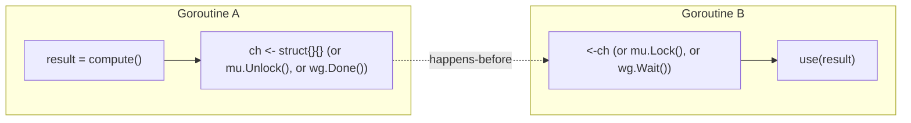
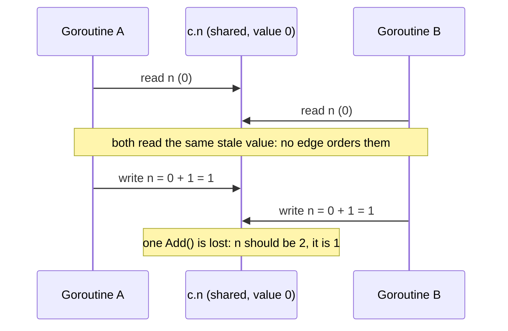

# Memory Model and Data Races

> [!summary] TL;DR
> Without an explicit synchronization point, Go makes no promise that one goroutine's write becomes visible to another goroutine's read, even for something as simple as a `bool`. The **happens-before** relation names the operations (channel ops, mutex Unlock/Lock, `sync.Once`, `WaitGroup`, sequentially-consistent atomics) that create that guarantee; anything shared without one of them is a **data race**, which is undefined behavior, not just an unlikely bad value.

> [!abstract] Core idea
> - Compilers and CPUs reorder and cache memory accesses for speed; happens-before edges are the only thing that stops a reordering from being observable.
> - A data race is a concurrent, unsynchronized read and write (or write and write) of the same memory location where at least one is a write — regardless of whether it ever visibly corrupts a value.
> - `go test -race` (ThreadSanitizer) catches races on code paths it actually executes; it proves races exist, it never proves their absence.
> - "It hasn't crashed in production" is not evidence of safety — that is the benign-race myth, and the compiler is free to change its mind on the next build.

## 1. Why it exists

A single CPU core already reorders its own instructions and keeps values in registers and store buffers rather than main memory; compilers reorder and cache loads across statements too, as long as the reordering is invisible to that one goroutine running alone. None of that is wrong on a single thread — the compiler and CPU only promise that *a single goroutine* sees its own operations in program order.

The problem appears the moment two goroutines touch the same variable. Goroutine A might set `ready = true` and expect goroutine B to see it, but without a synchronization point the compiler is free to keep `ready` in a CPU register inside A's loop and never write it back to memory at all, and even if it does write it back, the CPU's cache coherence protocol gives no ordering guarantee relative to any *other* write A made first. Go's memory model exists to draw a line: these specific operations create a cross-goroutine ordering guarantee, and nothing else does.

## 2. Mental model

Think of each goroutine as operating on its own private, possibly-stale view of memory, with writes trickling out to a shared store at the compiler and hardware's convenience. A **happens-before edge** is a guarantee that "everything goroutine A did before this point is visible to goroutine B after that point" — a one-way bridge between the two private views, built by a specific synchronizing operation (not by proximity in time, and not by "it usually works").

If there is no bridge between a write and a read of the same variable from different goroutines, the read is allowed to see garbage, an old value, a value from the middle of a multi-word write, or — in the formal model — nothing coherent at all. The race detector's job is to notice when code reads or writes a location with no such bridge connecting it to a concurrent access.

## 3. How it works

### Whiteboard version

```go
// Unsafe: no happens-before edge between the writer and the reader.
var ready bool
var result int

go func() {
    result = compute()
    ready = true // plain write: no synchronization
}()

for !ready { // plain read: may never observe the write above
}
use(result) // even if ready becomes visible, result might not be
```

Nothing here is a syntax error, and on many machines it "usually" appears to work — which is exactly the trap. The fix is to replace the plain `bool` handoff with one of the synchronizing operations below.

### The happens-before relation



The Go memory model names a specific, short list of operations that create this edge. The must-know ones:

| Synchronizing operation | The happens-before edge it creates |
| --- | --- |
| `go` statement | The `go` statement happens-before the new goroutine starts running |
| Channel send | A send on a channel happens-before the corresponding receive completes |
| Channel receive | A receive from an unbuffered channel happens-before the corresponding send completes (the handoff is symmetric) |
| Channel close | A close happens-before a receive that returns the zero value because the channel is closed |
| Buffered channel capacity | The k-th receive on a channel of capacity C happens-before the (k+C)-th send completes — the buffer behaves like a counting semaphore |
| `Mutex`/`RWMutex` | Unlock happens-before the next successful Lock on the same mutex |
| `sync.Once.Do` | The function passed to the first `Do` happens-before any `Do` call returns, for any goroutine |
| `sync.WaitGroup` | Every `Done()` call happens-before the matching `Wait()` call returns |
| `atomic.*` operations | Since the Go 1.19 memory-model revision, atomics are **sequentially consistent**: all goroutines agree on one global total order of atomic operations on a location |

One easy-to-miss omission: **a goroutine's exit guarantees nothing.** Nothing in the model says that everything a goroutine did happens-before the main goroutine observes that it has exited (there is no implicit join); you must synchronize explicitly, with a channel or a `WaitGroup`.

### Why atomics changed in Go 1.19

Before the 2022 memory-model revision, Go's model said less than the implementation actually provided, leaving atomics in an awkward, under-specified state. Go 1.19 adopted the same sequential-consistency guarantee that C++'s `memory_order_seq_cst` and Java's `volatile` give: every goroutine observes atomic operations on a given location in one single, agreed-upon order, so you can reason about atomic counters and flags the same way you reason about a mutex-protected value, without a separate mental model for "the atomics version."

## 4. Worked example

Code from a scratch module (`scratch/memmodel`); it compiles, passes `go vet`, and its tests pass under `go test -race` on Go 1.24.4.

### Channel handoff: safe because of the send/receive edge

```go
// PublishWithChannel safely publishes a value built in one goroutine to a
// reader in another. The unbuffered channel send happens-before the
// corresponding receive completes, so every field the writer set before the
// send is visible after the receiver's <-ch returns.
func PublishWithChannel(build func() int) int {
    ch := make(chan int)
    go func() {
        v := build()
        ch <- v // send happens-before the receive below returns
    }()
    return <-ch
}
```

### Mutex and sequentially-consistent atomics: both race-free

```go
type Counter struct {
    mu sync.Mutex
    n  int
}

func (c *Counter) Add(d int) {
    c.mu.Lock()
    defer c.mu.Unlock()
    c.n += d
}

type AtomicCounter struct {
    n atomic.Int64
}

func (c *AtomicCounter) Add(d int64) { c.n.Add(d) }
```

```go
func TestCounterMutexIsRaceFree(t *testing.T) {
    c := &Counter{}
    var wg sync.WaitGroup
    for i := 0; i < 100; i++ {
        wg.Add(1)
        go func() {
            defer wg.Done()
            c.Add(1)
        }()
    }
    wg.Wait()
    if got := c.Value(); got != 100 {
        t.Fatalf("Counter.Value() = %d, want 100 (mutex must not lose updates)", got)
    }
}
```

**Measured:** `go test -race -v ./...` in `scratch/memmodel` (Go 1.24.4, 2026-11-07) — `TestCounterMutexIsRaceFree`, `TestAtomicCounterIsRaceFree`, `TestOnceInitRunsExactlyOnce`, `TestWaitGroupHandoff`, `TestPublishWithChannel`: 5/5 PASS, 0 race warnings.

### The data race itself: a lost update with no happens-before edge



With a `Mutex` or an `atomic.Int64`, B's read-modify-write cannot start until A's Unlock (or A's atomic Add has committed in the global order), so this interleaving is impossible — that ordering is exactly what "Unlock happens-before the next Lock" and sequential consistency buy you.

### The data race, and what the race detector actually prints

```go
// RacyCounter has NO synchronization. Concurrent calls to Add race on n.
type RacyCounter struct {
    n int
}

func (c *RacyCounter) Add(d int) { c.n += d } // read-modify-write, not atomic
func (c *RacyCounter) Value() int { return c.n }
```

```go
func TestRaceDetectorCatchesRacyCounter(t *testing.T) {
    c := &RacyCounter{}
    var wg sync.WaitGroup
    for i := 0; i < 100; i++ {
        wg.Add(1)
        go func() {
            defer wg.Done()
            c.Add(1)
        }()
    }
    wg.Wait()
    t.Logf("RacyCounter.Value() = %d (want 100; lower means lost updates)", c.Value())
}
```

**Measured** (`go test -tags race_demo -race -run TestRaceDetectorCatchesRacyCounter -v .`, Go 1.24.4, 2026-11-07), real output, trimmed to one of the two race reports it printed:

```text
==================
WARNING: DATA RACE
Read at 0x00c000112248 by goroutine 7:
  scratch/memmodel.(*RacyCounter).Add()
      memmodel.go:76 +0x7c
  scratch/memmodel.TestRaceDetectorCatchesRacyCounter.func1()
      racedemo_test.go:17 +0x78

Previous write at 0x00c000112248 by goroutine 8:
  scratch/memmodel.(*RacyCounter).Add()
      memmodel.go:76 +0x8c
  scratch/memmodel.TestRaceDetectorCatchesRacyCounter.func1()
      racedemo_test.go:17 +0x78
==================
    racedemo_test.go:21: RacyCounter.Value() = 93 (want 100; lower means lost updates)
    testing.go:1490: race detected during execution of test
--- FAIL: TestRaceDetectorCatchesRacyCounter (0.00s)
FAIL
```

Two things worth noticing in this real run: the detector reported **two separate race pairs** (one shown above) from the same hundred-goroutine fan-out, and the final counter came out `93`, not `100` — seven of the hundred `Add(1)` calls were lost to the unsynchronized read-modify-write. Re-running the same binary a few more times produces a different wrong count each time (94, 90, and so on), never a crash and never an error return — just a silently lower number. That variability *is* the benign-race myth in miniature: **the race detector flags the unsynchronized access itself, not a specific wrong answer**, because there is no specific wrong answer — the access is undefined behavior, and the exact number of lost updates depends on the scheduler's mood on a given run. A race that happens to land on the right number some run is not a counterexample; it is the same undefined behavior producing a different, equally unprincipled result. This test is kept behind a `race_demo` build tag specifically so it never runs as part of the normal `go test -race ./...` suite, which must stay green.

### `sync.Once` and `WaitGroup` edges

```go
type OnceInit struct {
    once  sync.Once
    value int
}

func (o *OnceInit) Get(compute func() int) int {
    o.once.Do(func() {
        o.value = compute()
    })
    return o.value
}
```

`TestOnceInitRunsExactlyOnce` fires 50 concurrent `Get` calls and asserts `compute` ran exactly once and every caller — including ones that arrive after the first `Do` already returned — observes the same computed value, which is only guaranteed because `Once.Do`'s happens-before edge covers every caller, not just the one that won the race to run first.

```go
func WaitGroupHandoff(n int) []int {
    var wg sync.WaitGroup
    results := make([]int, n)
    for i := 0; i < n; i++ {
        wg.Add(1)
        go func(i int) {
            defer wg.Done()
            results[i] = i * i // distinct index per goroutine: no race on results
        }(i)
    }
    wg.Wait()
    return results
}
```

Each goroutine writes a distinct slice index, so there is no race on `results` itself, but without `wg.Wait()` there would be no guarantee the writes are even visible yet when the function returns — `Done()` happens-before the matching `Wait()` returns is what makes reading `results` afterward safe.

## 5. Variants and comparison

| Primitive | What it synchronizes | Use when | Cost |
| --- | --- | --- | --- |
| Channel send/receive | A value handoff plus everything before it | Passing ownership of data between goroutines, pipelines, fan-out/fan-in | One scheduling handoff; unbuffered blocks until both sides are ready |
| `Mutex`/`RWMutex` | A critical section around shared state | Multiple fields must be updated together, or the invariant spans more than one word | Lock/unlock overhead; contention serializes goroutines |
| `atomic.*` | A single word (int, pointer, bool) | A counter, flag, or single-word pointer swap, nothing more | Cheaper than a mutex under contention; cannot protect multi-field invariants |
| `sync.Once` | A one-time initialization | Lazy singleton setup, config loaded on first use | One atomic check after the first call; negligible |
| `sync.WaitGroup` | "All of these finished" | Fan-out work where the caller waits for everyone, not for a value | Cheap; carries no data, only completion |
| No synchronization | Nothing | Never, for shared mutable state — only for data owned by exactly one goroutine | Undefined behavior the moment it is shared |

## 6. Trade-offs and when not to use

- A mutex protects an **invariant spanning multiple fields or steps** (check-then-act); an atomic protects **one word**. Reaching for several independent atomics to approximate a multi-field invariant reintroduces races between the individual atomic operations themselves.
- Busy-waiting on a plain flag (`for !done {}`) is not just wasteful, it may be an outright data race with no happens-before edge, so the loop is not even guaranteed to terminate — the compiler is allowed to hoist the read out of the loop entirely since, from its single-goroutine view, nothing in the loop body changes `done`.
- The race detector roughly doubles memory use and multiplies CPU time by 2-20x (measured by the Go team's own documentation for ThreadSanitizer-based tooling), so it is normally run in CI and on a canary fraction of traffic, not on every production instance all the time.
- Over-synchronizing (a mutex around a value only ever touched by one goroutine) adds pure overhead and signals confusion about ownership; prefer the "owner goroutine" pattern (see [[Goroutines and Channels]]) when a value genuinely belongs to one goroutine at a time.

## 7. In production

- **Real systems:** Go's own standard library races were a major motivation for shipping a built-in detector (`go test -race`, `go build -race`) rather than leaving it to third-party tools; most production Go services run `-race` in CI and on a small canary deployment because of its runtime cost, and treat any CI race report as a release blocker, not a flaky test.
- **Failure modes → fixes:**
  - Concurrent writes to a Go map (not just reads racing writes) → the runtime calls `fatalerror` and crashes the whole process immediately, by design — a map has its own internal invariants a race can corrupt past recovery, so this is one of the few races Go refuses to let through silently even without `-race`. Fix: a mutex, `sync.Map`, or sharded maps with a lock per shard.
  - A shared `error` variable written by multiple goroutines in a fan-out → race; use `errgroup.Group` (package `golang.org/x/sync/errgroup`), which synchronizes the stored error for you.
  - Lazy initialization guarded by a plain `if x == nil { x = compute() }` check from multiple goroutines → a race on `x` (and potentially a torn read of a multi-word interface or slice header) → `sync.Once` or `sync.OnceValue` (Go 1.21).
  - Reading request data from a goroutine spawned by an HTTP handler after the handler has already returned → a race against the server reusing or discarding that request's buffers; copy anything you need before the handler returns, or take `context.WithoutCancel` plus an explicit timeout if the work must outlive the request.
  - Double-checked locking written by hand (check without the lock, lock, check again, write) → the first, lock-free check is a race on the field being checked; it needs to be an atomic load or the whole pattern needs to go through `sync.Once`.
- **The five general fixes for a race**, in order of preference: confinement (only one goroutine ever touches the value — no synchronization needed because there is no sharing); pass ownership through a channel instead of sharing a pointer; a mutex around the invariant; an atomic for a single word; or make the value immutable after construction (safe to share read-only with no synchronization, as long as nothing ever mutates it post-publish).
- **What to monitor:** CI must fail on any `-race` report, with zero tolerance — there is no such thing as an acceptable rate of detected races. Track whether canary instances running `-race` builds show meaningfully different latency/CPU so the overhead stays bounded. Use the Go `goroutine` profile and `goleak` in tests to catch leaked goroutines left over from races on shutdown signals.

## 8. Deep dive

**Torn reads of multi-word values.** A Go `string`, `slice` and `interface` value are each more than one machine word (string: pointer + length; slice: pointer + length + capacity; interface: type word + data word). A race on one of these is not "you might read a slightly stale int" — it is a window where a reader can observe, for example, the *new* pointer paired with the *old* length, producing a slice header that points past the end of its own backing array. That can corrupt memory or crash the process, not just return a wrong-but-harmless value. This is why "benign races" on anything bigger than a single aligned machine word are categorically more dangerous than a torn single-word read.

**"No out-of-thin-air values."** Even though a racing read is allowed to see a stale or inconsistent value, the Go memory model explicitly rules out a read observing a value that was never written by any goroutine, by any ordering. In practice this guarantee matters far less than "do not write racy code in the first place" — it is a backstop for how wild an implementation's behavior is allowed to be, not a safety net you should ever rely on.

**What ThreadSanitizer actually does.** `go test -race` instruments every memory access and goroutine-creation/synchronization event, then uses vector clocks to detect when two accesses to the same location, from different goroutines, have no happens-before edge between them, with at least one being a write. It only sees paths your tests actually execute, under the specific scheduling the runtime happens to choose that run — a race can exist in code for years before `-race` happens to catch it, and a test suite with poor coverage of concurrent code paths gives false confidence. The cost (documented by the Go team as roughly 5-10x memory and 2-20x CPU) is why it runs in CI and canaries rather than on every production replica permanently.

**The benign-race myth, precisely stated.** "It's a race, but the variable is just a flag/counter and the worst case is a stale read, so it's fine" is wrong for three independent reasons: the compiler can legally hoist, cache, or eliminate the racy access entirely in a future build (nothing contractually stops it, because the program is undefined the moment a race occurs); the hardware's behavior under a race is architecture-dependent, so "works on my amd64 laptop" says nothing about arm64 or about a future CPU generation; and some "simple" shared values (interfaces, slices, strings, maps) are not single machine words, so the "worst case" is not actually a stale read but a torn, inconsistent value. Treat every data race as a bug regardless of whether this run's measured output looks fine — the `TestRaceDetectorCatchesRacyCounter` run above is a concrete demonstration: the detector fired, and the counter came out wrong (`93`, not `100`), but a race is just as much a bug on a run where the number happens to land on `100`, because nothing about the language guarantees it will land there again.

## 9. Interview questions

> [!question]- What exactly is a data race, by Go's definition?
> A concurrent read and write, or write and write, of the same memory location from different goroutines with no happens-before edge between them, where at least one access is a write. It is undefined behavior in the language spec's sense, not merely "a possible wrong value."

> [!question]- Name four operations that create a happens-before edge, and one that does not.
> Channel send/receive, `Mutex` Unlock before the next Lock, `sync.Once.Do`, and `WaitGroup` Done before the matching Wait all create edges. A goroutine simply exiting creates no edge at all — there is no implicit join, so nothing it did is guaranteed visible to any other goroutine without separate synchronization.

> [!question]- Trap: "the race detector didn't report anything, so this code has no races." True or false?
> False. `go test -race` only instruments the code paths and goroutine interleavings a given run actually exercises. It proves the presence of a race when it fires; it never proves the absence of one. Weak test coverage of concurrent paths, or a scheduling interleaving the detector's run didn't happen to hit, both let races through undetected.

> [!question]- Why are atomics in Go 1.19+ described as "sequentially consistent," and why does that matter?
> It means every goroutine agrees on one single global order of atomic operations on a location — the same strength C++'s `memory_order_seq_cst` and Java's `volatile` provide. It matters because it lets you reason about atomic counters and flags with the same intuition as a mutex-protected value, instead of a separate, weaker mental model for "the atomics version" of the code.

> [!question]- Why does a plain `bool` busy-wait loop (`for !done {}`) risk never terminating, not just being slow?
> Without a happens-before edge connecting the write of `done` to the read, the compiler's single-goroutine view of the loop sees `done` never changing inside it and may legally hoist the read out of the loop or keep it cached in a register, so the loop can spin forever even though another goroutine did write `true` to the variable in memory.

> [!question]- Why does Go crash the whole process on a concurrent map write instead of just corrupting data quietly?
> Go's built-in map has internal invariants (bucket layout, growth state) that a concurrent write can corrupt in ways the runtime cannot safely continue past, so it deliberately calls `fatalerror` and aborts rather than risk silent data corruption. This check runs even without `-race`, unlike ordinary data races on your own variables.

> [!question]- What makes a race on a `string`, `slice` or `interface` value worse than a race on an `int`?
> Those types are multiple machine words (pointer+length, pointer+length+capacity, or type-word+data-word). A race can produce a torn value — for example a new pointer paired with an old length — which is not merely stale, it can be internally inconsistent and crash or corrupt memory, unlike a torn read of one aligned machine word.

## 10. Cheat sheet

- No happens-before edge ⇒ no visibility guarantee, period — "it usually works" is not evidence.
- Happens-before edges: `go` statement → goroutine start; channel send ↔ receive; `Unlock` → next `Lock`; `Once.Do` → every `Do` return; `Done` → matching `Wait`; atomics are sequentially consistent (Go 1.19+).
- A goroutine exiting creates no implicit happens-before edge with anyone.
- A data race is undefined behavior the instant it occurs, regardless of whether this run's output looks correct.
- `go test -race` (ThreadSanitizer) proves races exist; it never proves their absence — coverage-dependent, 5-10x memory, 2-20x CPU.
- Concurrent writes to a Go map crash the process immediately, by design, even without `-race`.
- Torn multi-word values (string, slice, interface) under a race can corrupt memory, not just read stale.
- Mutex for a multi-field invariant; atomic for one word; never a busy-wait on a plain flag.

## Links

- **Before this:** [[Goroutines and Channels]], [[sync Primitives and Atomics]]
- **Next:** [[Runtime - Goroutine Scheduler (GMP)]], [[Benchmarks, Profiling and Tracing]]
- **Compare with:** [[Concurrency Primitives - Mutex, Semaphore, Atomics]] (the OS/hardware theory this note's Go-specific guarantees build on)
