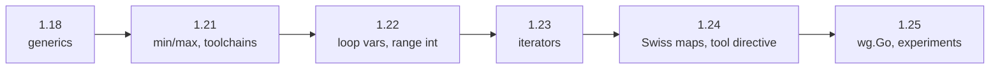
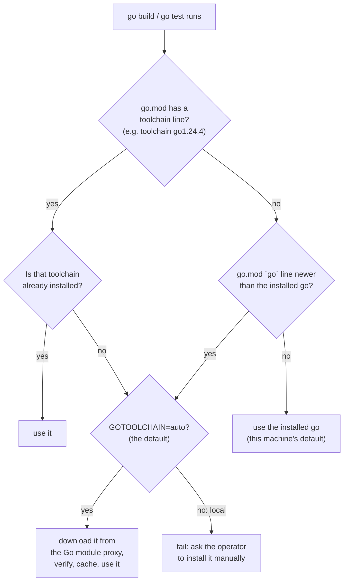
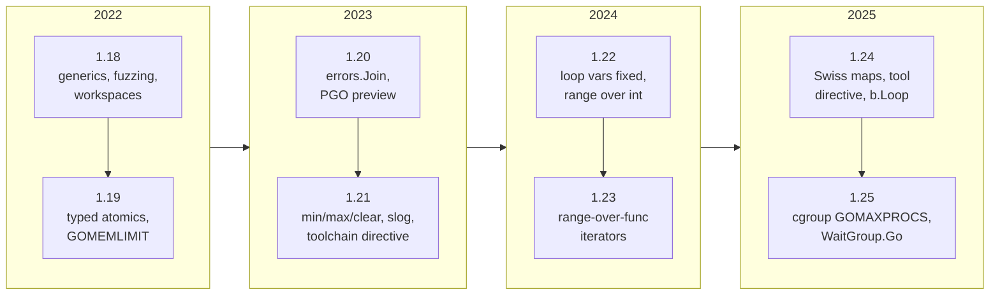

# Modern Go Feature Timeline (1.18-1.25)

> [!summary] TL;DR
> Go ships one feature release every six months, and each one adds language, standard-library, runtime and tooling changes while keeping old code compiling. This note lists what a backend developer needs from 1.18 (generics) through 1.25, release by release, and points to the note that owns each feature in depth.

> [!abstract] Core idea
> - Go 1 compatibility means old source keeps compiling forever; new features are additive, gated by the `go` line in `go.mod`.
> - Six features changed daily backend code the most: generics (1.18), per-iteration loop variables (1.22), range-over-func iterators (1.23), the Swiss Tables map rewrite (1.24), and the toolchain/tool directives (1.21/1.24) that made builds reproducible.
> - `GOTOOLCHAIN` (since 1.21) lets `go build` auto-download the exact toolchain a module asks for, so a team can pin a newer language version without every machine upgrading by hand.
> - A feature behind `GOEXPERIMENT` (PGO before 1.21, `json/v2` and the Green Tea GC as they shipped in 1.25) is not the default and can still change shape before it ships; do not depend on it in production code. Green Tea GC has since become the 1.26 default - see the note on `GOEXPERIMENT` items in section 3.

## Start here: the basics

**The problem in one story.**
You open a Go codebase and see `for i := range 5` and a `tool` line in `go.mod`.
You learned Go a few years ago and have never seen either.
Go adds features every six months, and old code keeps working, so a codebase mixes old and new styles.
This note is the map of what arrived when, so unfamiliar code stops being a mystery.

**Words you need first**

| Word | Plain meaning | Tiny example |
| --- | --- | --- |
| Release | A numbered version of Go | Go 1.22 (February 2024) |
| `go.mod` | The file that names your module and its Go version | `go 1.24` line |
| Toolchain | The `go` command plus compiler and standard library | Go 1.24.4 installed on your laptop |
| Standard library | Packages shipped with Go itself | `slices`, `net/http` |
| Generics | Writing code once for many types | `func Max[T cmp.Ordered](a, b T) T` |
| Backward compatible | Old code still compiles on new Go | Go 1.0 code builds on Go 1.25 |
| Experiment | A feature that ships turned off, opt-in only | `GOEXPERIMENT=jsonv2` |

**Picture it**



**Analogy.** Go is like layers of rock: each release adds a thin layer on top, and the lower layers are never dug out. The `go` line in `go.mod` says how high up the layers your code may reach.
Where it breaks: rock layers never change once laid, but experiments can still change shape or be dropped before they become default.

**How the rest of this note builds up**

- First, why a timeline matters (section 1) and the strata-plus-experiments model (section 2).
- Then release-by-release changes and how `go.mod` picks a toolchain (section 3).
- Then tested code for the key features (section 4).
- Finally the SDE-3 view: trade-offs, production upgrade practice, `GODEBUG` defaults and preview vs. GA vs. experiment (sections 6-8).

> [!tip] Remember
> The `go` line in `go.mod` decides which features and defaults you get; experiments are never something to ship on.

## 1. Why it exists

Go has released on a fixed six-month cadence since 1.18 (February and August each year, documented in the release history).

A backend team that last paid attention around Go 1.18 will see code using `for i := range 5`, `sync.OnceFunc`, `slices.Sort`, or a `tool` line in `go.mod` and have no idea which of those need a newer compiler, which are stable, and which are still experiments that can disappear.

The practical cost shows up in two places:

- **Code review confusion.** A reviewer flags `for i := range n` as "didn't you mean `range arr`?" when it is ordinary Go 1.22+ syntax, or approves code that quietly relies on an experiment (`GOEXPERIMENT=jsonv2`) that is not on in CI.
- **Toolchain drift.** A `go.mod` with `go 1.24` fails to build on a CI runner whose `go` binary is 1.21, with an error that looks unrelated to the actual missing feature.

This note is the map: what shipped in each release since 1.18, so you can read unfamiliar code, choose features deliberately, and know what a `go.mod` version line actually buys you. It does not re-teach any feature in depth - each item links to the 04 or 06 note that owns it.

## 2. Mental model

Picture Go's standard library and language as **strata**: each six-month release adds a thin layer on top of the last one, and the layers below never get removed or broken.

The `go` directive in `go.mod` (for example `go 1.24`) is a line drawn through the strata: it tells the compiler "you may use language features up to this layer," which is how `for i := range n` (1.22) can be a hard compile error in a module still declaring `go 1.20`.

A second idea sits next to the strata: **experiments**. A few features ship behind `GOEXPERIMENT=name` before they are the default - PGO was one in 1.20, `json/v2` and a new garbage collector ("Green Tea") are two in 1.25. They are real, built-in code, but off by default and not yet promised to stay the same shape.

## 3. How it works

### Release-by-release, filtered for backend relevance

Each release is tagged with the note that teaches the feature itself; this note only says what shipped and when.

**Go 1.18 (March 2022)**
- Generics: type parameters on functions and types, constraints as interfaces. See [[Generics and Iterators]].
- Native fuzzing (`go test -fuzz`). See [[Testing in Go]].
- Workspaces (`go work`), for developing across multiple modules at once. See [[Packages, Modules and Dependency Management]].

**Go 1.19 (August 2022)**
- Typed atomics: `atomic.Int64`, `atomic.Bool`, `atomic.Pointer[T]`, replacing `atomic.AddInt64(&x, 1)` on a plain field. See [[sync Primitives and Atomics]].
- `GOMEMLIMIT`: a soft memory cap the garbage collector paces against, alongside `GOGC`. See [[Runtime - Memory Allocator and Garbage Collector]].
- A documentation revision to the Go memory model, formalizing happens-before rules (no new APIs). See [[Memory Model and Data Races]].

**Go 1.20 (February 2023)**
- `errors.Join` and `fmt.Errorf` wrapping more than one `%w` verb in one error. See [[Error Handling]].
- `context.WithCancelCause` (and later `context.Cause`), carrying *why* a context was cancelled. See [[Context Package]].
- `http.ResponseController`, a per-request escape hatch for deadlines, flushing and hijacking that works through middleware wrappers. Owned by [[HTTP Server Fundamentals (net-http)]].
- `go build -cover`, coverage instrumentation for whole binaries, not just `go test`. See [[Testing in Go]].
- Profile-guided optimization (PGO) as a preview, opt-in via `GOEXPERIMENT=pgo`. See [[Benchmarks, Profiling and Tracing]].

**Go 1.21 (August 2023)**
- Builtins `min`, `max`, `clear` - no import needed.
- `log/slog`, the standard structured logger. Owned by [[Observability in Go Services]].
- The `slices`, `maps` and `cmp` packages promoted from `golang.org/x/exp` into the standard library. See [[Arrays, Slices and Maps (with internals)]] and [[Generics and Iterators]].
- `context.WithoutCancel` and `context.AfterFunc`. See [[Context Package]].
- `sync.OnceFunc`, `OnceValue`, `OnceValues` - a lazy-init helper beyond `sync.Once.Do`. See [[sync Primitives and Atomics]].
- PGO reached general availability (on by default when `default.pgo` is present). See [[Benchmarks, Profiling and Tracing]].
- The `go.mod` **toolchain** directive and `GOTOOLCHAIN`: a module can require a specific Go version, and `go` auto-downloads it. See [[Packages, Modules and Dependency Management]] and the toolchain diagram below.

**Go 1.22 (February 2024)**
- Per-iteration loop variables: `for i := range s` now gives every iteration its own `i`, instead of one `i` shared and mutated across the whole loop. This is the single most interview-relevant fix on this list; see the worked example below.
- `for range n` where `n` is an integer, counting `0` to `n-1`.
- `net/http.ServeMux` method and wildcard patterns (`"POST /orders/{id}"`), with automatic `405 Method Not Allowed` and an `Allow` header. Owned by [[HTTP Server Fundamentals (net-http)]].
- `math/rand/v2`, a cleaner, faster non-cryptographic RNG API. See [[Standard Library Essentials (time, io, files, encoding)]].
- `database/sql.Null[T]`, a generic replacement for `sql.NullString`, `sql.NullInt64`, and so on. Owned by [[Database Access (database-sql, pgx, sqlc)]].
- The server-side minimum TLS version rose to TLS 1.2. Owned by [[TLS, HTTPS and HTTP2 in Go Servers]].

**Go 1.23 (August 2024)**
- Range-over-func iterators: a function can be the operand of `for range`, using `iter.Seq[V]` / `iter.Seq2[K, V]`; `maps.Keys`, `maps.Values` and `slices.Sorted` moved onto this shape. See [[Generics and Iterators]].
- Timer and ticker changes: an unreferenced, unstopped `time.Timer`/`time.Ticker` can now be garbage collected instead of leaking until it fires. Owned by [[select and Concurrency Patterns]].
- The `unique` package, for interning comparable values.
- `http.Request.Pattern`, exposing the matched `ServeMux` route for access logs. Owned by [[Observability in Go Services]].

**Go 1.24 (February 2025)**
- Generic type aliases: `type Alias[T any] = Underlying[T]` may itself take type parameters. See the worked example below and [[Generics and Iterators]].
- The built-in `map` implementation switched to Swiss Tables (grouped, SIMD-friendly buckets) for lower memory use and faster lookups. Owned by [[Arrays, Slices and Maps (with internals)]].
- The `go.mod` **tool** directive (`go get -tool`), pinning developer tool versions (`stringer`, `mockgen`, …) the same way dependencies are pinned. Owned by [[Go Toolchain, Tooling and Debugging]].
- `testing.B.Loop`, a benchmark loop shape where the framework owns iteration count and timer start/stop, replacing the manual `for i := 0; i < b.N; i++`. See the worked example below and [[Benchmarks, Profiling and Tracing]].
- `testing.T.Context()`, a context cancelled when the test ends. Owned by [[Testing in Go]].
- `os.Root`, a directory handle that confines file operations (including symlink resolution) under one root - the standard-library answer to path traversal. Owned by [[OWASP API Security Top 10]].
- `omitzero` as a `encoding/json` struct tag option (distinct from `omitempty`: it omits a field only when it is the type's zero value, which matters for structs like `time.Time`). Owned by [[Request Decoding, Validation and DTOs]].
- `crypto/rand.Text()`, a convenience generator for random tokens. Owned by [[OWASP API Security Top 10]].
- `runtime.AddCleanup` (a safer, per-object successor to `runtime.SetFinalizer`) and weak pointers (`weak.Pointer[T]`). Owned by [[Runtime - Memory Allocator and Garbage Collector]].
- `net/http.Protocols`, letting a server opt into HTTP/2 over cleartext (h2c) without the `x/net/http2/h2c` package. Owned by [[TLS, HTTPS and HTTP2 in Go Servers]].

**Go 1.25 (August 2025)**
- `GOMAXPROCS` became container-aware by default: it now tracks the cgroup CPU quota (previously you needed `uber-go/automaxprocs`). Owned by [[Runtime - Goroutine Scheduler (GMP)]].
- `testing/synctest` reached general availability (no `GOEXPERIMENT` flag needed), for deterministic tests of code built on fake time. Owned by [[Testing in Go]].
- `(*sync.WaitGroup).Go(f)`, a helper that runs `f` in a new goroutine and calls `Add(1)`/`Done()` around it for you. Owned by [[sync Primitives and Atomics]] and [[Goroutines and Channels]].
- `net/http.CrossOriginProtection`, a standard-library middleware that rejects cross-origin state-changing requests by default (a built-in CSRF defense for browser-facing APIs).

  It decides from the `Sec-Fetch-Site` header first: `same-origin` or no header at all is allowed, `cross-site` or `same-site` is rejected (two hosts on the same registrable domain, like `tools.example.com` and `til.example.com`, are "same-site" but not "same-origin," so that case is still blocked).

  If `Sec-Fetch-Site` is absent, it falls back to comparing the `Origin` header against the request's `Host` and rejects a mismatch; a request with neither header is allowed through, since that is either a same-origin request or a non-browser client.

  Safe methods (`GET`, `HEAD`, `OPTIONS`) are always allowed regardless. Owned by [[CSRF, XSS and Security Headers]].
- `runtime/trace.FlightRecorder`, an always-on ring buffer of recent execution trace data you can dump on demand (for example, right after a latency spike) instead of trace-logging continuously.

  It takes an explicit `FlightRecorderConfig{MinAge, MaxBytes}`; leaving `MaxBytes` at its zero value means the maximum size is implementation-defined rather than a fixed documented constant.

  So size it explicitly (the Go team's own introduction uses a few hundred milliseconds of `MinAge` and roughly a megabyte of `MaxBytes` as a starting point, then suggests sizing `MinAge` to about twice the time window you need to capture) instead of assuming a specific default.

  Owned by [[Benchmarks, Profiling and Tracing]].
- Two **experiments** as Go 1.25 shipped, both opt-in via `GOEXPERIMENT` and neither the default: `encoding/json/v2` (`jsonv2`), a redesigned JSON API; and "Green Tea," a reworked garbage collector aimed at lower CPU overhead.

  Owned by [[Request Decoding, Validation and DTOs]] and [[Runtime - Memory Allocator and Garbage Collector]] respectively. As of Go 1.26, Green Tea GC left experimental status and is on by default (with an opt-out `GOEXPERIMENT=nogreenteagc` that the Go team has said will itself be removed in 1.27); `encoding/json/v2` remains behind `GOEXPERIMENT=jsonv2` and has not shipped as a default.

  `verify:` re-check both flags' status against the release notes current at read time, since this can keep moving after 1.26.

### How `go.mod` picks a toolchain

Since the 1.21 toolchain directive, three things decide which `go` binary actually builds your code:



This is why a module can declare `go 1.24` and build correctly on a laptop that only ever ran `go install go1.21`: the `go` command bootstraps the newer release itself the first time, the same way `go mod download` fetches a dependency.

### A visual timeline



## 4. Worked example

### Whiteboard version

The one change every backend developer should internalize first: before Go 1.22, a `for` loop reused one variable for every iteration, so a goroutine (or any closure) started inside the loop without copying the variable could see the *last* value instead of its own.

```go
// Pre-1.22 bug shape (do not write this against a go.mod with go >= 1.22;
// it is shown only to name the historical trap).
for i := 0; i < 3; i++ {
    go func() { fmt.Println(i) }() // all three could print "3"
}

// Since Go 1.22, each iteration gets its own i, so this is already correct:
for i := 0; i < 3; i++ {
    go func() { fmt.Println(i) }() // prints 0, 1, 2, in some order
}
```

The full test below proves the 1.22 behavior directly, by writing into a per-index slot from inside a goroutine with no manual `i := i` shadow, and checking that every slot was written exactly once.

### Tested features, Go 1.24

The file below compiles and its tests pass under `go test -race` on Go 1.24.4. It groups the features most likely to show up in review or an interview: per-iteration loop variables, `range` over an int, the `min`/`max`/`clear` builtins, `errors.Join` plus multi-`%w`, a hand-written `iter.Seq` iterator, a generic type alias, a typed atomic, and `sync.OnceValue`.

```go
// Package timeline demonstrates language and stdlib features added between
// Go 1.18 and Go 1.24, for the "Modern Go Feature Timeline" note.
package timeline

import (
	"errors"
	"fmt"
	"iter"
	"sync"
	"sync/atomic"
)

// RangeOverInt (Go 1.22): range accepts an integer and counts 0..n-1.
func RangeOverInt(n int) []int {
	out := make([]int, 0, n)
	for i := range n {
		out = append(out, i)
	}
	return out
}

// MinMaxClear (Go 1.21): min, max and clear are builtins, no package import.
func MinMaxClear() (lo, hi int, cleared map[string]int) {
	lo = min(7, 3, 9)
	hi = max(7, 3, 9)
	m := map[string]int{"a": 1, "b": 2}
	clear(m) // empties the map in place; len(m) == 0 afterwards
	return lo, hi, m
}

// WrapBoth (Go 1.20): fmt.Errorf can wrap more than one error with %w.
func WrapBoth(validation, cleanup error) error {
	return fmt.Errorf("save failed: %w, %w", validation, cleanup)
}

// JoinErrors (Go 1.20): errors.Join combines independent errors into one
// error that unwraps to all of them.
func JoinErrors(errs ...error) error {
	return errors.Join(errs...)
}

// Countdown (Go 1.23): a hand-written iter.Seq, the range-over-func contract.
// yield is the loop body; returning false from it must stop production.
func Countdown(from int) iter.Seq[int] {
	return func(yield func(int) bool) {
		for i := from; i > 0; i-- {
			if !yield(i) {
				return
			}
		}
	}
}

// Pair is a plain generic type (generics themselves shipped in 1.18).
type Pair[A, B any] struct {
	First  A
	Second B
}

// StringPair is a generic type ALIAS (Go 1.24): aliases may now take their
// own type parameters, naming a specialization of Pair without creating a
// distinct (less compatible) type.
type StringPair[B any] = Pair[string, B]

// Counter wraps a typed atomic (Go 1.19), so there is no way to accidentally
// read or write the field without going through the atomic operations.
type Counter struct {
	n atomic.Int64
}

func (c *Counter) Inc() int64  { return c.n.Add(1) }
func (c *Counter) Load() int64 { return c.n.Load() }

// configOnce demonstrates sync.OnceValue (Go 1.21): the function underneath
// runs exactly once, even under concurrent callers, and every caller sees
// the same returned value.
var configOnce = sync.OnceValue(func() string {
	return "loaded-config"
})

func LoadConfig() string { return configOnce() }
```

```go
package timeline

import (
	"database/sql"
	"errors"
	"slices"
	"sync"
	"sync/atomic"
	"testing"
)

func TestRangeOverInt(t *testing.T) {
	got := RangeOverInt(4)
	want := []int{0, 1, 2, 3}
	if !slices.Equal(got, want) {
		t.Fatalf("RangeOverInt(4) = %v, want %v", got, want)
	}
}

func TestMinMaxClear(t *testing.T) {
	lo, hi, m := MinMaxClear()
	if lo != 3 || hi != 9 {
		t.Fatalf("min/max = %d/%d, want 3/9", lo, hi)
	}
	if len(m) != 0 {
		t.Fatalf("clear(m) left len=%d, want 0", len(m))
	}
}

// TestPerIterationLoopVariable proves the Go 1.22 semantics: each iteration
// gets its own copy of the range variable, so goroutines started inside the
// loop (with no explicit `i := i` shadow) each capture a distinct value
// instead of racing on one shared variable.
func TestPerIterationLoopVariable(t *testing.T) {
	const n = 20
	seen := make([]int32, n)
	var wg sync.WaitGroup
	for i := 0; i < n; i++ {
		wg.Add(1)
		go func() {
			defer wg.Done()
			atomic.AddInt32(&seen[i], 1) // pre-1.22 this read a racing shared i
		}()
	}
	wg.Wait()
	for i, v := range seen {
		if v != 1 {
			t.Fatalf("slot %d got %d writes, want exactly 1 (loop var was shared)", i, v)
		}
	}
}

func TestWrapBothAndJoin(t *testing.T) {
	errA := errors.New("validation failed")
	errB := errors.New("cleanup failed")

	wrapped := WrapBoth(errA, errB)
	if !errors.Is(wrapped, errA) || !errors.Is(wrapped, errB) {
		t.Fatalf("fmt.Errorf with two %%w did not wrap both errors: %v", wrapped)
	}

	joined := JoinErrors(errA, errB, nil) // Join drops nils
	if !errors.Is(joined, errA) || !errors.Is(joined, errB) {
		t.Fatalf("errors.Join did not satisfy errors.Is for both members: %v", joined)
	}
}

func TestCountdownIterator(t *testing.T) {
	var got []int
	for v := range Countdown(3) {
		got = append(got, v)
	}
	if !slices.Equal(got, []int{3, 2, 1}) {
		t.Fatalf("Countdown(3) = %v, want [3 2 1]", got)
	}

	got = got[:0]
	for v := range Countdown(5) {
		got = append(got, v)
		if v == 3 {
			break // break makes the implicit yield return false
		}
	}
	if !slices.Equal(got, []int{5, 4, 3}) {
		t.Fatalf("early break = %v, want [5 4 3]", got)
	}
}

func TestGenericTypeAlias(t *testing.T) {
	// StringPair[int] and Pair[string, int] are the SAME type - that is
	// what "alias" means - so both literal and field access work directly.
	var p StringPair[int] = Pair[string, int]{First: "age", Second: 30}
	if p.First != "age" || p.Second != 30 {
		t.Fatalf("StringPair[int] round-trip failed: %+v", p)
	}
}

func TestTypedAtomicCounter(t *testing.T) {
	var c Counter
	var wg sync.WaitGroup
	for i := 0; i < 100; i++ {
		wg.Add(1)
		go func() {
			defer wg.Done()
			c.Inc()
		}()
	}
	wg.Wait()
	if got := c.Load(); got != 100 {
		t.Fatalf("Counter.Load() = %d, want 100", got)
	}
}

func TestOnceValue(t *testing.T) {
	var wg sync.WaitGroup
	results := make([]string, 10)
	for i := range results {
		wg.Add(1)
		go func(i int) {
			defer wg.Done()
			results[i] = LoadConfig()
		}(i)
	}
	wg.Wait()
	for i, r := range results {
		if r != "loaded-config" {
			t.Fatalf("caller %d got %q", i, r)
		}
	}
}

// TestNullGeneric checks that sql.Null[T] (Go 1.22) compiles and round-trips
// a value, with no real database connection needed.
func TestNullGeneric(t *testing.T) {
	var n sql.Null[int64]
	if n.Valid {
		t.Fatalf("zero value Null[int64] should be invalid")
	}
	n = sql.Null[int64]{V: 42, Valid: true}
	if !n.Valid || n.V != 42 {
		t.Fatalf("Null[int64] round-trip failed: %+v", n)
	}
}

// BenchmarkCounterInc shows the Go 1.24 b.Loop shape: the framework decides
// the iteration count and starts/stops the timer around the loop, so setup
// code above it is never counted.
func BenchmarkCounterInc(b *testing.B) {
	var c Counter
	for b.Loop() {
		c.Inc()
	}
}
```

**Measured:** `go test -race ./...` - 9 tests, all pass, Go 1.24.4, darwin/arm64 (2026-11-07):

```text
=== RUN   TestRangeOverInt
--- PASS: TestRangeOverInt (0.00s)
=== RUN   TestMinMaxClear
--- PASS: TestMinMaxClear (0.00s)
=== RUN   TestPerIterationLoopVariable
--- PASS: TestPerIterationLoopVariable (0.00s)
=== RUN   TestWrapBothAndJoin
--- PASS: TestWrapBothAndJoin (0.00s)
=== RUN   TestCountdownIterator
--- PASS: TestCountdownIterator (0.00s)
=== RUN   TestGenericTypeAlias
--- PASS: TestGenericTypeAlias (0.00s)
=== RUN   TestTypedAtomicCounter
--- PASS: TestTypedAtomicCounter (0.00s)
=== RUN   TestOnceValue
--- PASS: TestOnceValue (0.00s)
=== RUN   TestNullGeneric
--- PASS: TestNullGeneric (0.00s)
PASS
ok  	timeline	1.435s
```

**Measured:** `go test -bench=. -benchtime=1000x -run=^$` (Apple M4, Go 1.24.4, 2026-11-07):

```text
BenchmarkCounterInc-10    	    1000	         2.750 ns/op
```

## 5. Variants and comparison

| Feature | Before | Since | What actually changed |
| --- | --- | --- | --- |
| Loop variable scope | One `i` shared across all iterations; closures needed `i := i` | 1.22 | Each iteration gets its own copy; the old shadow trick is now a harmless no-op |
| Counting a range | `for i := 0; i < n; i++` | 1.22 | `for i := range n` is equivalent and more idiomatic for "just count" loops |
| Iterating keys/values with control flow | Collect into a slice first, or write a custom loop | 1.23 | `for k := range maps.Keys(m)` and similar, via `iter.Seq`/`iter.Seq2` |
| Null database columns | `sql.NullString`, `sql.NullInt64`, one type per Go type | 1.22 | `sql.Null[T]` generic, one type for any scalar |
| Generic specialization | A new named type (`type StringPair[B any] struct{ Pair[string,B] }`), or no alias at all | 1.24 | A generic type alias (`type StringPair[B any] = Pair[string, B]`) - same type, zero conversion cost |
| JSON zero-value fields | `omitempty` (drops any "empty" value: `0`, `""`, empty `time.Time`, empty slice) | 1.24 adds `omitzero` | `omitzero` drops only the type's exact zero value, so a non-zero-but-"empty-looking" struct still encodes |
| Container-aware CPU limits | `uber-go/automaxprocs` read the cgroup quota and called `runtime.GOMAXPROCS` | 1.25 default | The runtime does this itself; the third-party package becomes redundant (safe to remove once on 1.25) |
| Benchmark loop | `for i := 0; i < b.N; i++ { ... }`, manual `b.ResetTimer()` | 1.24 adds `b.Loop()` | The framework manages iteration count and timing; setup before the loop is never measured |

## 6. Trade-offs and when not to use

- **Do not ship on an experiment.** `GOEXPERIMENT=jsonv2` and `GOEXPERIMENT=greenteagc`, both introduced in 1.25, were real but not the default, not covered by the Go 1 compatibility promise the same way stable features are, and able to change behavior release to release.

  Green Tea GC has since become the default as of Go 1.26 and no longer needs the flag; `jsonv2` has not. Treat any still-experimental flag as a trial in a non-critical service, not a default for new code.
- **A newer `go.mod` version is a one-way door for your users.** Raising the `go` line to use range-over-func (1.23) means every consumer of your module now needs a toolchain that understands it; a library aimed at wide reuse stays conservative, a leaf service does not need to.
- **`GOTOOLCHAIN=auto` downloads code from the network at build time.** In an air-gapped or strict supply-chain environment, pin `GOTOOLCHAIN=local` and manage the installed `go` version explicitly instead.
- **Newness is not a reason to adopt.** `sync.OnceValue` is strictly nicer than a hand-rolled `sync.Once` + variable, but a service that already has the old pattern everywhere does not need a mechanical rewrite; use the new form going forward.

## 7. In production

- **Real systems:** large Go codebases (the Go toolchain's own module proxy, Kubernetes, most cloud-native backend services) track feature releases roughly one or two versions behind the latest, pinned via CI's `go.mod` + `toolchain` line, with `govulncheck` and Renovate/Dependabot opening the upgrade PRs automatically.
- **Failure modes → fixes:**
	- CI fails with a toolchain-version error because the runner's cached `go` predates the module's `go` line → either let `GOTOOLCHAIN=auto` download the right one (needs network egress from CI) or bump the runner's preinstalled Go.
	- A reviewer rejects correct 1.22+ code as a bug (shared loop variable) → point to this note's worked example; the fix was in the language, not the code.
	- A service silently depends on an experiment flag set locally by one developer (`GOEXPERIMENT=jsonv2`) but not in the production build → experiments must be set in the build pipeline, never only on a laptop; prefer not depending on them until GA.
- **What to monitor:** the gap between the `go` line in `go.mod` and the toolchain actually running in production (a version-skew check in CI), and `govulncheck` results tied to the installed toolchain and dependency versions.

## 8. Deep dive

- **Language-version gating is per-module, not per-binary.** The `go` directive sets the language version the compiler accepts for that module's own source. A binary can link packages from modules declaring different `go` lines; each package is checked against its own module's directive, not the main module's.
- **`GODEBUG` defaults move forward with the `go` line, not with the installed toolchain.** Go changes a runtime default (for example, TLS or `http2` behavior) by flipping a `GODEBUG` setting's default value, but it only takes effect for modules whose `go` line is new enough.

  This is how the project avoids breaking old code the instant you install a new `go` binary.

  The full table of which setting flipped in which release lives at `go.dev/doc/godebug` - check it before assuming a default changed under you.
- **A toolchain download is content-addressed and verified, the same way a dependency is.** `GOTOOLCHAIN=auto` fetches the toolchain archive from the configured `GOPROXY`, which serves it with the same checksum-database backing as module downloads, so a compromised mirror cannot silently swap in a different `go` binary without failing verification.
- **"Preview," "GA," and "experiment" are three different promises.** PGO was explicitly a *preview* in 1.20 (opt-in, expected to stabilize) and reached GA in 1.21 (on by default given `default.pgo`). An *experiment* (`json/v2`, Green Tea GC in 1.25) carries no promise of landing in its current shape at all - some experiments are later redesigned or dropped.

  Read a release's own notes for which word it uses, rather than assuming "it's in the binary" means "it's safe to depend on."
- `verify:` whether `encoding/json/v2` has left experimental status in a release after 1.26 (Green Tea GC already has, as of 1.26 - see section 3) - this note was written against the Go 1.25 release as shipped in August 2025, with a 1.26 status check added afterward.

## 9. Interview questions

> [!question]- What exactly changed with loop variables in Go 1.22, and what bug does it fix?
> Before 1.22, a `for` loop declared one variable and reused it every iteration, so a closure or goroutine created inside the loop without an explicit `i := i` copy could observe a later (often the final) value once the loop moved on.
>
> Since 1.22, each iteration gets its own variable, so the closure captures that iteration's value automatically. The `TestPerIterationLoopVariable` test above proves it directly.

> [!question]- What is `GOTOOLCHAIN`, and why does it matter for CI?
> It is the Go 1.21+ mechanism that lets a module's `go.mod` declare a minimum (or exact, via a `toolchain` line) Go version; when the installed `go` is older, the `go` command can auto-download the right one from the module proxy.
>
> It matters for CI because a runner with an older cached Go binary will either auto-upgrade (if `GOTOOLCHAIN=auto` and the network is reachable) or fail with a version error that is really a missing-toolchain problem, not a code problem.

> [!question]- Trap: is `for i := range n` (an int) the same as `for i := range someSlice`?
> No - they look alike but mean different things. `range n` on an integer (Go 1.22) counts `0` to `n-1` with no underlying collection. `range someSlice` iterates the slice's elements. Passing a slice's `len()` to the first form is a common idiom, but the two aren't interchangeable: `range n` never touches a collection at all.

> [!question]- What does a range-over-func iterator (`iter.Seq[T]`) actually look like under the hood, and what must the function do if the loop breaks?
> An `iter.Seq[T]` is `func(yield func(T) bool)`. The iterator calls `yield` with each value; `yield` returns `true` to keep going or `false` when the consuming loop stopped (via `break`, `return`, or a panic). A correct iterator must stop producing values as soon as `yield` returns `false` - continuing afterward can corrupt the loop or leak work.

> [!question]- What is the difference between a generic type and a generic type alias (Go 1.24)?
> `type Box[T any] struct{ V T }` defines a brand-new named type parameterized by `T`.
>
> `type IntBox = Box[int]` (pre-1.24, no type parameters allowed on the alias itself) or `type NamedBox[T any] = Box[T]` (1.24, the alias itself can now be generic) both just give an existing type another name - the alias and its target are identical types with identical method sets and no conversion needed between them.

> [!question]- Why might a team deliberately choose NOT to adopt `encoding/json/v2` as soon as it is available in Go 1.25?
> It ships behind `GOEXPERIMENT=jsonv2` and is explicitly not the default or API-stable yet; adopting it means both opting into a flag that is off in a stock toolchain (so CI, local dev and production must all agree to set it) and accepting that its behavior or API can still change before it is promoted out of experimental status.

> [!question]- A service on `go 1.20` can't compile a file using `min`/`max`/`clear`. Is the fix to upgrade the installed `go` binary?
> Only partly. Those builtins need the *module* to declare `go 1.21` or later in `go.mod` - the compiler gates language-level features by that line, independent of how new the installed `go` binary is.
>
> If the installed toolchain is already 1.21+ but `go.mod` still says `go 1.20`, raising the `go` line (and re-running `go mod tidy`) is the actual fix; if the installed binary is older still, `GOTOOLCHAIN=auto` (or a manual upgrade) handles that half.

> [!question]- What does `b.Loop()` (Go 1.24) fix compared to the classic `for i := 0; i < b.N; i++` benchmark shape?
> With the classic shape, any setup code written before the loop runs only once but can still be counted if the author forgets `b.ResetTimer()`, and the compiler can sometimes eliminate work inside the loop if its result is never used.
>
> `b.Loop()` has the framework own the iteration count and the timer window directly, and keeps each iteration's result alive long enough to prevent dead-code elimination, so a benchmark is correct by construction instead of by careful manual bookkeeping.

## 10. Cheat sheet

- Go ships a feature release every six months (Go 1 compatibility: nothing old breaks).
- The `go` line in `go.mod` gates which *language* features compile - not the same thing as the installed `go` binary's version.
- `GOTOOLCHAIN` (1.21+) can auto-download the exact toolchain a module asks for; set `GOTOOLCHAIN=local` to forbid that in locked-down environments.
- 1.22 fixed shared loop variables and added `range` over an int - the two most common "wait, is this new?" moments in review.
- 1.23 added range-over-func iterators (`iter.Seq`/`iter.Seq2`); 1.24 made generic aliases possible and rewrote the map internals (Swiss Tables).
- `b.Loop()` (1.24) is the benchmark shape to write now; the old `b.N` loop still compiles but is the legacy form.
- 1.25's container-aware `GOMAXPROCS` removes the need for `uber-go/automaxprocs` on a cgroup-limited host.
- An item behind `GOEXPERIMENT` (PGO pre-1.21, `json/v2` and Green Tea GC as introduced in 1.25) is not a default and not API-stable yet - treat it as a trial, not a dependency. Green Tea GC became the 1.26 default; `json/v2` has not (check its current status before relying on it).

## Links

- **Before this:** [[Syntax, Types and Control Flow]], [[Generics and Iterators]]
- **Next:** [[Go Toolchain, Tooling and Debugging]], [[Packages, Modules and Dependency Management]]
- **Compare with:** [[Benchmarks, Profiling and Tracing]] (what to do with `b.Loop` and PGO once you know they exist), [[Runtime - Goroutine Scheduler (GMP)]] (what container-aware `GOMAXPROCS` actually changes at runtime)

### Watch on YouTube

- [Going through the Go 1.24 Release Notes](https://www.youtube.com/watch?v=h5Sxe-gcS_I) · Code With Cypert · walkthrough of the newest release's language/runtime/tooling changes
- [Golang 1.23 What is new?](https://www.youtube.com/watch?v=EL4hg73mT2A) · Mario Carrion · covers range-over-func iterators and other 1.23 additions
