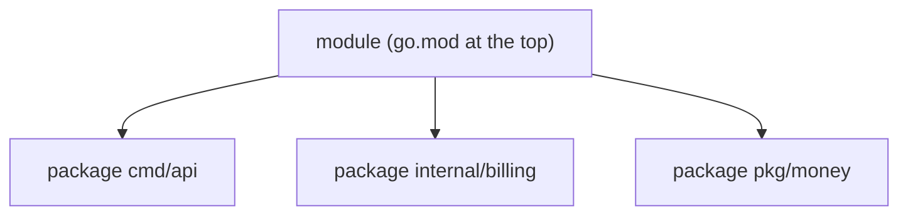
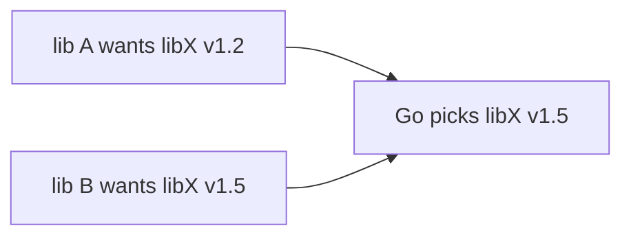
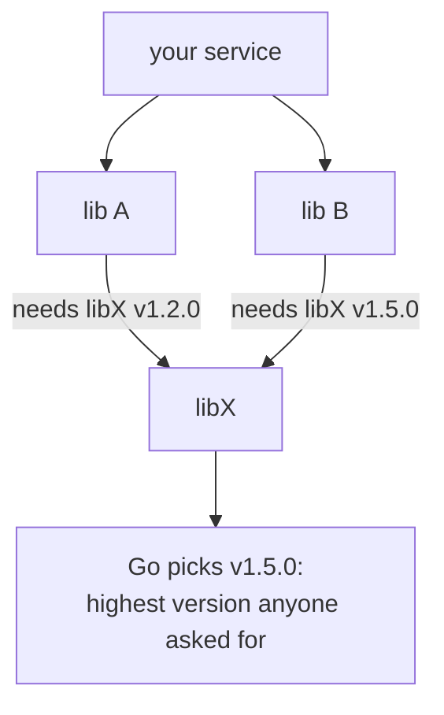
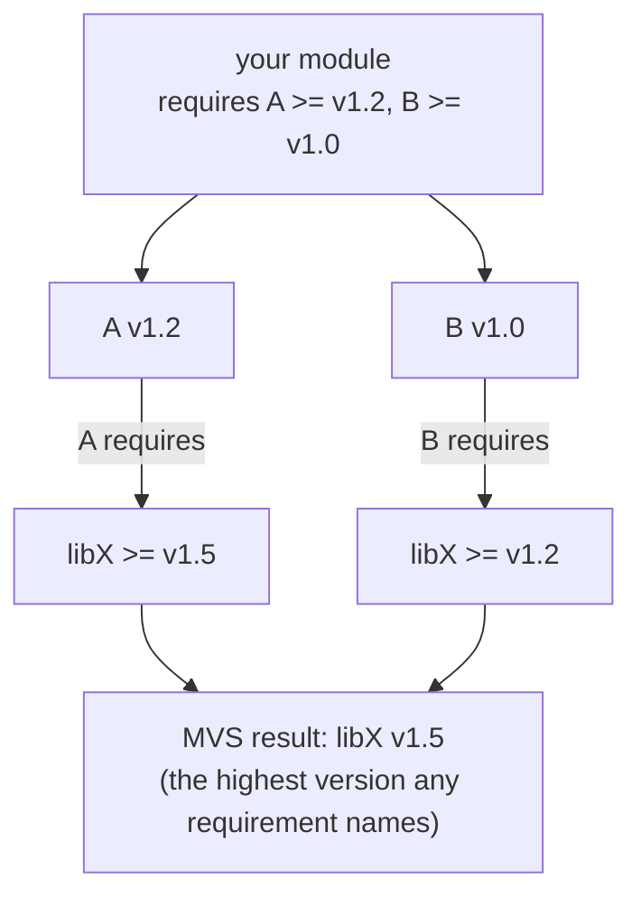
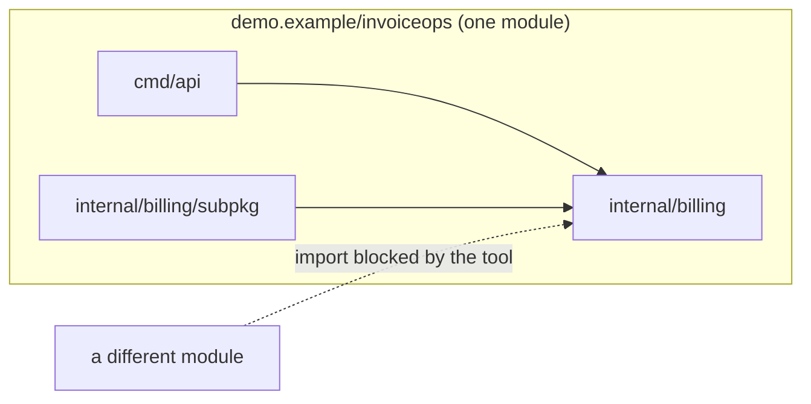

# Packages, Modules and Dependency Management

> [!summary] TL;DR
> A **package** is a folder of `.go` files that share one name and compile together. A **module** is a versioned collection of packages described by a `go.mod` file — the unit `go get`, `go.sum`, and the rest of the toolchain reason about. One repository is normally one module; a module can contain many packages.

> [!abstract] Core idea
> - `go.mod` names the module, its minimum Go version, and its direct dependencies; `go.sum` pins the exact bytes of every version ever downloaded, so a build is reproducible without a separate lockfile.
> - Go picks dependency versions with **Minimal Version Selection (MVS)**: for each module in the graph, take the highest version *any* requirement asks for — never the newest version that exists.
> - A breaking v2+ release changes its **import path** (`.../v2`), so old and new major versions can be imported side by side without conflict.
> - `internal/` is enforced by the `go` command's package loader, not a convention: only code inside the directory tree rooted at `internal`'s parent may import it, and the build refuses anything else before the compiler ever runs.
> - `go work` lets you build and test several modules together from local source, without editing any `go.mod` to point at a local path.

## Start here: the basics 🟢

> [!info] How to read this note (pick your level)
> - 🟢 **New to this?** Read "From zero" below, then sections 1, 2 and the cheat sheet (10). Stop there, that is a full first pass.
> - 🟡 **Know the basics?** Add section 3 (go.mod, MVS, internal/) and 4 (worked example) and 5.
> - 🔴 **Interview / SDE-3 prep?** Add 6, 7, 8 and 9. Headings are tagged 🟢🟡🔴 so you always know where you are.

**From zero, in 60 seconds** 🟢

Your Go code lives in folders. One folder of `.go` files that build together is a **package**.

Your whole project — all its packages plus a file called `go.mod` — is a **module**. The module is what gets a version number and gets downloaded by others.



Your project also uses other people's modules — **dependencies**. Two of them may ask for different versions of the same third library. Go settles it with one simple rule: take the highest version anyone asked for, never anything newer.



A second file, `go.sum`, stores fingerprints of every download, so your teammate's build gets exactly the same bytes as yours.

That is the whole game. The rest of this note is just four questions:
1. What goes in `go.mod`, line by line?
2. How does Go pick versions? (MVS)
3. How do big breaking versions (v2) coexist with v1?
4. What are `internal/`, workspaces and vendoring for?

**The problem in one story.**
Your service uses two libraries, and both use a third library, but they ask for different versions of it.
Your teammate builds the project a month later and gets different code than you did.
Something must decide which version wins and record it so every build is identical.
In Go, packages organize code and modules (`go.mod`, `go.sum`) handle versions.

**Words you need first**

| Word | Plain meaning | Tiny example |
| --- | --- | --- |
| Package | A folder of `.go` files compiled together | `package checkout` |
| Import | Use another package's code | `import "net/http"` |
| Exported | Visible outside its package (starts with a capital letter) | `Reserve` yes, `reserve` no |
| Module | A versioned bundle of packages with one `go.mod` | `module example.com/shop` |
| Dependency | Code your code needs from someone else | `github.com/google/uuid` |
| Version (semver) | `vMAJOR.MINOR.PATCH`; MAJOR changes break callers | `v1.5.0` → `v2.0.0` |
| Checksum | A fingerprint proving downloaded bytes did not change | lines in `go.sum` |

**Picture it**



**Analogy.** Packages are rooms in a house; a module is the whole house with an address and a version number, and `go.sum` is the sealed inspection report.
Where it breaks: a house has one owner, but one module can be imported by thousands of others, each asking for a different minimum version.

**How the rest of this note builds up**

- First, why modules replaced `GOPATH` and the diamond dependency (section 1), then packages vs. modules (section 2).
- Then `go.mod` directives, `go.sum` and the checksum database, Minimal Version Selection, `/v2` import paths and `internal/` (section 3).
- Then a worked multi-module example and workspaces (section 4).
- Finally the SDE-3 deep dive: MVS vs. SAT solvers, workspaces vs. `replace`, and production practice (sections 6-8).

> [!tip] Remember
> `go.mod` says what you need, `go.sum` proves what you got, and Go picks the lowest version that satisfies everyone.

## 1. Why it exists 🟢

Before modules (pre-Go 1.11, `GOPATH` mode), every import had to live under a single global `$GOPATH/src` tree, with no per-project version: two projects needing different versions of the same library could not both build from the same machine.

Modules fix this by making the dependency set, and its exact versions, a property of the project itself — recorded in `go.mod`, checked into version control, and reproducible on any machine or CI runner with the same Go toolchain.

The deeper problem modules solve is the **diamond dependency**: your service imports package `A` and package `B`; `A` requires `libX@v1.2.0`; `B` requires `libX@v1.5.0`. Some ecosystems resolve this by installing both versions side by side (larger binaries, subtle bugs if the two copies' types leak into each other) or by picking "the newest requested" and hoping it is backward compatible.

Go's answer, Minimal Version Selection, is covered in section 3: it deterministically picks `v1.5.0` — the minimum version that satisfies every requirement in the graph — and the same inputs always produce the same answer, with no solver, no newest-compatible heuristic, and no lockfile needed.

## 2. Mental model 🟢

Picture your codebase as two layers:

- **Packages** are the compilation unit. Every `.go` file in a directory declares the same `package name` at the top; `go build` compiles one package at a time, and a package's exported identifiers (capitalized) are visible to any other package that imports it.
- **Modules** are the versioning and distribution unit, one layer up. A module is one `go.mod` file plus every package in the directory tree below it (until a nested `go.mod` starts a new module). `go get example.com/foo@v1.2.0` fetches a module, not a package; a module usually ships many packages (`encoding/json`, `encoding/xml`, … are all packages inside the single `std` module).

A repository is normally one module at its root. A monorepo *can* hold multiple modules, but a module cannot itself contain another module in a subdirectory without `go` tooling treating the subdirectory as a separate, independent module — see the workspace section below for why you sometimes want exactly that.

## 3. How it works 🟡

### Package naming and init order

- A package name is short, lowercase, and singular (`http`, not `httpUtils`); the import path's last segment should match it.
- Within one package, every file's top-level `var` initializers run first (in dependency order among themselves, then file order), then every `func init()` runs (in the order its file was presented to the compiler), then `main` (if this is the `main` package).

  Across packages, Go initializes each imported package fully before initializing the package that imports it — so `init` order follows the import graph, not source order.

### go.mod directives

**In plain words:** `go.mod` is a short shopping-and-rules file: who am I, which Go version do I need, what do I depend on, and any special overrides.

```text
module demo.example/invoiceops

go 1.24

require (
    golang.org/x/sync v0.8.0
    example.com/legacy-pricing v1.3.0
)

replace example.com/legacy-pricing => ../legacy-pricing

exclude example.com/broken-dep v1.0.1

retract v1.2.0 // published by mistake, missing migration

tool golang.org/x/tools/cmd/stringer
```

| Directive | Meaning |
| --- | --- |
| `module` | This module's own import path — every package under it is addressed as `<module path>/<subdir>`. |
| `go` | The minimum Go version the module's syntax and stdlib APIs require, treated as a hard minimum since Go 1.21: with the default `GOTOOLCHAIN=auto`, an older local toolchain downloads and switches to a toolchain new enough to satisfy it; only with `GOTOOLCHAIN=local` does the build fail outright instead. |
| `toolchain` | Pins an exact Go toolchain version to download and use for this module, independent of what is installed system-wide. |
| `require` | A direct or indirect dependency and the minimum version this module needs. |
| `replace` | Redirects an import to a different source — a local directory (for day-to-day local development across repos) or a fork. A `replace` to a local path is a local override and should not reach a published module others depend on. |
| `exclude` | Removes one specific version from consideration, forcing MVS to pick a different one. |
| `retract` | Published by the module's own author to mark a version as broken, without deleting it — `go get -u` and `go list -m -u` warn about retracted versions. |
| `tool` (Go 1.24) | Declares a tool dependency (a `main` package meant to be `go run` or `go tool`-invoked, like a code generator) so its version is tracked in `go.mod` alongside library dependencies, instead of a separate `tools.go` convention. |

### go.sum and the checksum database

**In plain words:** `go.sum` is the receipt with fingerprints — if a download's bytes differ from the fingerprint, the build refuses it.

`go.sum` records a cryptographic hash of every module version your build has ever downloaded — both its source tree and its `go.mod` file — so a later build with the same `go.mod` reproduces bit-for-bit identical dependencies, and a tampered or corrupted download is detected and rejected.

The hashes are cross-checked against the public **checksum database** (`sum.golang.org`, via `GOSUMDB`) the first time any machine sees a given version, so an attacker who compromises one proxy cannot silently serve a different artifact for a version everyone else already verified.

Both the download and the checksum check go through a **module proxy**, controlled by `GOPROXY` (default `https://proxy.golang.org,direct`): `go` asks the proxy for a module version's zip and `go.mod` file instead of talking to the VCS host directly, falling through the comma-separated list — `direct` means "clone the repository yourself" — until one source answers.

`GOPROXY=off` forbids any network fetch, forcing the build to use only what is already in the local module cache or a `vendor/` directory.

### Minimal Version Selection (MVS)

**In plain words:** Go never "upgrades for you". It takes the highest version anyone in your dependency tree explicitly asked for, and stops there — one deterministic answer, no lockfile needed.

Given a module and its full dependency graph, Go computes, for every module that appears anywhere in the graph, the **highest version requested by any requirement** — not the newest version published. That is the version used.

The algorithm is a graph walk, not a constraint solver: there is one deterministic answer, computed without backtracking, which is why Go needs no separate lockfile the way `package-lock.json` or `Pipfile.lock` exist to pin down an otherwise nondeterministic solver's choice.



`go mod tidy` then prunes the `require` list down to the modules your code actually imports (direct or indirect) at the versions MVS selected, and adds any missing entries; `go mod graph` prints the raw requirement edges MVS walks.

`go get` takes the same version syntax everywhere: `go get example.com/foo@v1.2.0` pins an exact version, `go get example.com/foo@latest` takes the newest tagged release (ignoring what MVS would otherwise pick), and `go get example.com/foo@none` removes the requirement entirely, dropping it and anything it alone pulled in.

Run `go get -u` to move every direct and indirect dependency forward to its latest minor/patch release in one step.

### Semantic import versioning

**In plain words:** a breaking release gets a new import path ending in `/v2`, so old and new can live in the same build like two differently named libraries.

Go encodes a module's major version **in its import path** from v2 onward: `example.com/mylib` is implicitly v0 or v1, but a v2 release becomes `example.com/mylib/v2`.

This means v1 and v2 of the same library have different import paths and so can be imported side by side in the same build — a diamond where one dependency needs the old API and another needs the new one is not a conflict, because they are, as far as the compiler and MVS are concerned, different modules.

A dependency not yet tagged with a release version resolves to a **pseudo-version** such as `v0.0.0-20261001120000-abc123def456`, encoding a timestamp and commit hash so an untagged commit is still addressable and reproducible.

### The internal/ rule, precisely

**In plain words:** anything under a folder named `internal` is private to your module — the Go tool itself blocks outsiders from importing it.

A package under a path containing a directory literally named `internal` may be imported only by packages rooted at the directory **one level above** that `internal` directory (and anything further down inside it).

`demo.example/invoiceops/internal/billing` can be imported by `demo.example/invoiceops/cmd/api` or any other package under `demo.example/invoiceops/...`, but not by a different module entirely, nor even by a sibling module in the same repository that does not share that parent path.

This is enforced by the `go` command itself at build time, not by convention or code review.



## 4. Worked example 🟡

### Whiteboard version

The smallest module: one `go.mod`, one package that imports nothing outside the standard library.

```text
module demo.example/hello

go 1.24
```

```go
package main

import "fmt"

func main() { fmt.Println("hello") }
```

### Full example

A two-package module shaped like a tiny slice of the InvoiceOps service: `cmd/api` wires dependencies, `internal/billing` holds logic nothing outside the module may import. It compiles and passes `go vet` and `go test -race` on Go 1.24.4.

```go
// Package billing is internal/billing: only code inside the
// demo.example/invoiceops module tree may import it. go build/vet enforce
// this at compile time; there is no runtime check.
package billing

import "fmt"

type Invoice struct {
	ID          string
	AmountCents int64
}

func (i Invoice) String() string {
	return fmt.Sprintf("invoice %s: %d cents", i.ID, i.AmountCents)
}

// Total sums a batch of invoices.
func Total(invoices []Invoice) int64 {
	var sum int64
	for _, inv := range invoices {
		sum += inv.AmountCents
	}
	return sum
}
```

```go
// Command api wires dependencies: main.go is the only place that imports
// every feature package.
package main

import (
	"fmt"

	"demo.example/invoiceops/internal/billing"
)

func main() {
	invoices := []billing.Invoice{
		{ID: "inv-1", AmountCents: 1999},
		{ID: "inv-2", AmountCents: 4500},
	}
	fmt.Println(billing.Total(invoices))
}
```

```go
package billing

import "testing"

func TestTotal(t *testing.T) {
	invoices := []Invoice{
		{ID: "inv-1", AmountCents: 1999},
		{ID: "inv-2", AmountCents: 4500},
	}
	if got, want := Total(invoices), int64(6499); got != want {
		t.Fatalf("Total() = %d, want %d", got, want)
	}
}

func TestTotalEmpty(t *testing.T) {
	if got := Total(nil); got != 0 {
		t.Fatalf("Total(nil) = %d, want 0", got)
	}
}
```

**Measured output (Go 1.24.4, 2026-11-07):**

```text
$ go vet ./...
$ go test -race -v ./...
=== RUN   TestTotal
--- PASS: TestTotal (0.00s)
=== RUN   TestTotalEmpty
--- PASS: TestTotalEmpty (0.00s)
PASS
ok  	demo.example/invoiceops/internal/billing	1.511s

$ go run ./cmd/api
6499
```

A second, separate module in the same working tree depends on `golang.org/x/sync` (used for the `errgroup` pattern in [[Error Handling]]). Its real `go.mod`, `go.sum`, and the commands that inspect MVS's choice:

```text
module scratch/g3

go 1.24

require golang.org/x/sync v0.8.0
```

```text
golang.org/x/sync v0.8.0 h1:3NFvSEYkUoMifnESzZl15y791HH1qU2xm6eCJU5ZPXQ=
golang.org/x/sync v0.8.0/go.mod h1:Czt+wKu1gCyEFDUtn0jG5QVvpJ6rzVqr5aXyt9drQfk=
```

```text
$ go mod graph
scratch/g3 go@1.24
scratch/g3 golang.org/x/sync@v0.8.0
go@1.24 toolchain@go1.24

$ go list -m all
scratch/g3
golang.org/x/sync v0.8.0

$ go mod why golang.org/x/sync/errgroup
# golang.org/x/sync/errgroup
scratch/g3/errdemo
golang.org/x/sync/errgroup
```

`go mod why` prints the actual **import path**, not just the module, that pulled the dependency in — here, the one package (`errgroup`) that `scratch/g3/errdemo` imports, which is why `go mod tidy` kept the requirement.

### Workspaces

**In plain words:** a workspace is a local-only "pretend these repos are one project" file, so you can edit a library and its consumer together without touching either go.mod.

`go work` lets the two modules above be built and tested together from local source, as if they were one tree, without adding a `replace` directive to either `go.mod` (which would also affect anyone who later depends on them). The real, measured result of running it against this note's two scratch modules:

```text
$ go work init . ../invoiceops
$ cat go.work
go 1.24.4

use (
	.
	../invoiceops
)

$ go env GOWORK
/path/to/scratch/g3/go.work

$ go build ./...
```

`go.work` is local, usually `.gitignore`d, and never required by a consumer of either module — it exists purely to let you edit several modules at once (for example, a library and the service that depends on it) and see changes to one picked up by the other immediately, without publishing a version or writing a `replace`.

## 5. Variants and comparison 🟡

| Approach | How it works | Use when | Cost |
| --- | --- | --- | --- |
| Modules (default since Go 1.16) | `go.mod` + `go.sum`, MVS-resolved versions | Essentially always | None beyond the files themselves |
| `replace` to a local path | Redirects an import to a filesystem path | Developing a library and its consumer together, briefly | Must never ship in a module others depend on; easy to forget and commit |
| `go work` (workspaces, 1.18+) | A `go.work` file listing several local modules to build together | The same local-development problem as `replace`, done properly | Local-only file; does not change either module's own `go.mod` |
| Vendoring (`go mod vendor`) | Copies all dependency source into a `vendor/` directory, committed to the repo | Builds must work with zero network access, or you want dependency source reviewable in the same PR | Repo size grows with every dependency; must stay in sync with `go.mod` (`go mod vendor` regenerates it) |
| `GOPRIVATE` / `GONOSUMDB` | Tells `go get` to skip the public proxy and checksum database for matching module paths | Private, internal-only modules not published anywhere public | You are responsible for the integrity checks the public checksum database would otherwise provide |
| `GOPROXY` | Picks which module proxy (or `direct`, or `off`) serves downloads and checksum lookups | Almost always left at its default; overridden to point at a company-run proxy, or set to `off` for a fully offline build | A misconfigured proxy list can silently stall or fail every `go get` |

## 6. Trade-offs and when not to use 🔴

- MVS intentionally never picks a version newer than every requirement demands, even if a newer, better version exists — you must `go get -u` deliberately to move forward. This avoids silent breakage from an unreviewed transitive upgrade, at the cost of needing to run upgrades yourself.
- A `replace` directive pointing at a local path is invisible to MVS entirely — it bypasses version selection, which is exactly the point for local development, but it also means CI and other developers must have that local path too, or the build fails. Never let a local `replace` reach a release.
- Vendoring trades disk space and repo size for build reproducibility without any network or proxy dependency — rarely worth it unless your environment genuinely cannot reach a proxy (an air-gapped build server, strict supply-chain policy).
- Splitting a repository into many small modules (rather than many packages inside one module) adds real overhead: each module needs its own `go.mod`, its own versioning discipline, and cross-module changes need either a workspace or a round trip through a published version.

  Default to one module per repository unless you specifically need independent versioning or release cadence for a piece of it.

## 7. In production 🔴

- **Real systems:** the Go standard library is itself one module (`std`) containing hundreds of packages, versioned together with the Go release. `golang.org/x/*` packages (`x/sync`, `x/tools`, `x/net`) are separate modules with their own release cadence, which is why this note pins `golang.org/x/sync v0.8.0` explicitly rather than depending on whatever the toolchain ships.
- **Failure modes → fixes:**
  - `go.mod` and the actual imports drift apart (a dependency removed from code but still required, or used but not listed) → run `go mod tidy` in CI and fail the build if it changes anything.
  - A private company module leaking to the public proxy or checksum database → set `GOPRIVATE=github.com/yourorg/*` (or the narrower `GONOSUMDB`/`GOFLAGS=-mod=mod` combination) so `go get` fetches directly from your VCS and skips `sum.golang.org` for those paths.
  - A dependency ships a known CVE and nobody notices until an audit → run `govulncheck ./...` in CI; it checks not just whether a vulnerable version is required, but whether your code actually calls the vulnerable function, cutting false positives.
  - A `replace` to a local path accidentally committed and merged → a linter or CI step that fails on any `replace` directive pointing outside the repository's own module cache, run before merge.
- **What to monitor:** `go list -m -u all` run periodically to see which dependencies have newer versions available; `govulncheck` results over time; `go.sum` diffs in code review (a dependency's hash should never change for a version you already had).

## 8. Deep dive 🔴

- **MVS versus a SAT-style solver.** Package managers that resolve to "the newest version satisfying every constraint" (npm, pip's newer resolvers) run a constraint solver that can, in principle, backtrack and may produce different results depending on resolution order or solver version.

  MVS instead computes a single highest-requested-version per module directly from the requirement graph — no backtracking, no solver, and the same `go.mod` files always produce the same build list, which is also why Go needs no separate lockfile.
- **Why `go.sum` still matters with MVS being deterministic.** Determinism of *which version* is picked does not guarantee the *bytes* of that version have not changed upstream (a tag force-pushed, a proxy compromised). `go.sum`'s hashes, backed by the append-only public checksum database, catch that independently of version selection.
- **Pseudo-versions in detail.** `vX.0.0-yyyymmddhhmmss-abcdef123456` is how Go addresses a commit with no semver tag: the timestamp orders it relative to tagged releases for MVS purposes, and the 12-character prefix of the commit hash pins the exact source. `go get module@commit-or-branch` generates one automatically.
- **`retract` is self-service, not enforcement.** A module author adds a `retract` directive and republishes; `go get` and `go list -m -u` then warn anyone who depends on the retracted version, but nothing stops an already-pinned `go.sum` from continuing to build against it — retraction is advisory, not a takedown.
- **Workspaces versus `replace`, mechanically.** A `go.work` file is read only by the `go` command invoked from within (or below) the directory that contains it; it never travels with either module and never affects a `go build` run from outside the workspace or by a downstream consumer.

  A `replace` directive, by contrast, lives inside a `go.mod` and does affect anyone who depends on that module unless it is a `replace` of something already required only as a test-only or main-module-only dependency — which is why workspaces are the preferred way to develop two local modules against each other.

## 9. Interview questions 🔴

> [!question]- What is the difference between a package and a module?
> A package is a directory of `.go` files sharing one `package` name — the unit the compiler builds. A module is a `go.mod`-rooted tree of one or more packages — the unit versioned, fetched, and recorded in `go.sum`. One repository is usually one module containing many packages.

> [!question]- Explain Minimal Version Selection in one sentence, and say why Go needs no lockfile.
> For every module anywhere in the dependency graph, MVS picks the highest version any requirement in the graph names — never the newest version that exists — which is a deterministic graph walk with one answer, so there is nothing a separate lockfile would need to pin down.

> [!question]- How does Go handle a dependency needing v1 of a library while another dependency needs v2?
> Starting at v2, a module's major version is part of its import path (`.../v2`), so v1 and v2 are, as far as the toolchain is concerned, different modules that can both be imported and linked into the same binary without conflict.

> [!question]- What exactly does the `internal/` directory enforce, and who enforces it?
> Only code rooted at the directory one level above an `internal` folder (and anything inside that subtree) may import a package under `internal/`. The `go` command's package loader checks this before the compiler runs — it is a toolchain-enforced rule, not a lint or a convention.

> [!question]- When would you reach for `go work` instead of a `replace` directive?
> When developing two or more local modules together and you want changes in one picked up by the other immediately, without editing either module's own `go.mod` — a workspace is local-only and never affects anyone who later depends on either module, whereas a `replace` left in a published `go.mod` redirects every consumer's build.

> [!question]- Trap: your CI build is slower every month even though `go.mod` hasn't changed. What's a likely module-related cause?
> `go.mod`'s `require` list can silently drift from what the code actually imports — unused indirect dependencies pile up, or `go mod tidy` was never run after a refactor — each one still resolved and downloaded.
>
> Running `go mod tidy` in CI and failing on any diff catches this; it is unrelated to MVS itself being slow, since MVS's graph walk is cheap.

## 10. Cheat sheet 🟢

- Package = compilation unit (one folder, one `package` name). Module = `go.mod`-rooted versioning unit (often many packages).
- MVS picks the highest version any requirement asks for, never the newest that exists — no lockfile needed.
- `go.sum` pins exact bytes per version, cross-checked against `sum.golang.org` (`GOSUMDB`).
- v2+ changes the import path (`/v2`); that's how two majors coexist in one build.
- `internal/` is compiler-enforced: only the tree above it may import it.
- `replace` to a local path never belongs in a published `go.mod`; use `go work` for local multi-module development instead.
- `GOPRIVATE` (and `GONOSUMDB`) skip the public proxy/checksum DB for your own private module paths.
- Run `go mod tidy` and `govulncheck ./...` in CI.

## Links
- **Before this:** [[Go Toolchain, Tooling and Debugging]], [[Syntax, Types and Control Flow]]
- **Next:** [[Service Project Layout and Wiring]], [[Standard Library Essentials (time, io, files, encoding)]]
- **Compare with:** [[Error Handling]] (the `errgroup` dependency used above), [[Containerizing Go Services]] (building a reproducible image from a pinned `go.sum`)

### Watch on YouTube

- [Go (Golang) Modules Tutorial](https://www.youtube.com/watch?v=AJxKKmzRTUY) · Golang Cafe · practical go.mod/go.sum and dependency management walkthrough
- [Go Modules Explained / Mastering Dependency Management in Go](https://www.youtube.com/watch?v=-qh4qi4_Vpg) · Code & Learn · explainer on module versioning and dependency resolution
