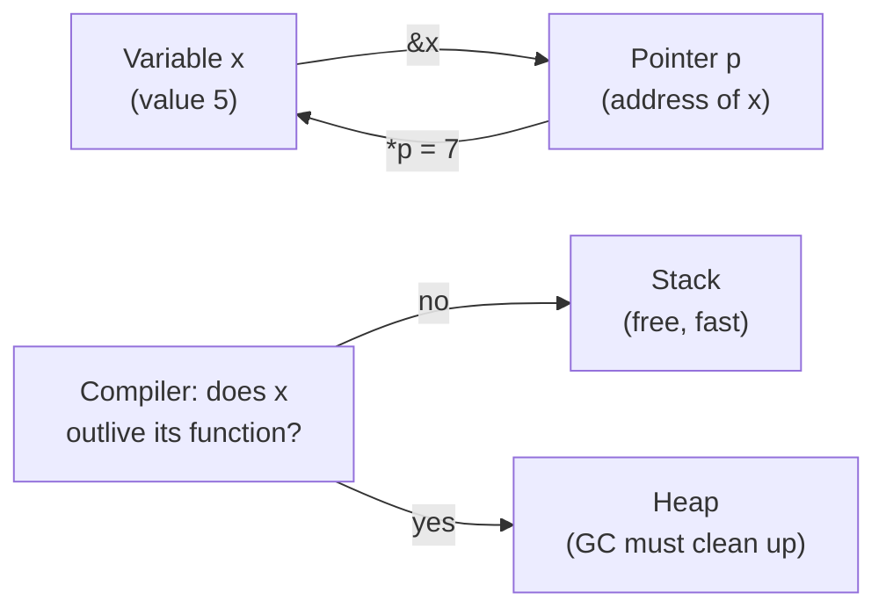
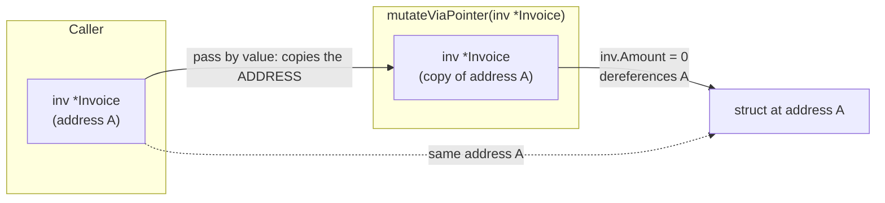
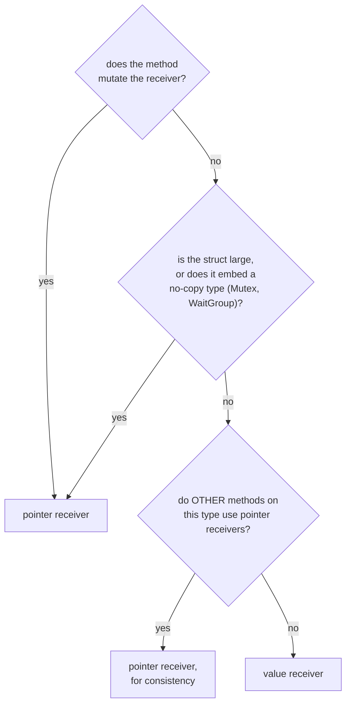
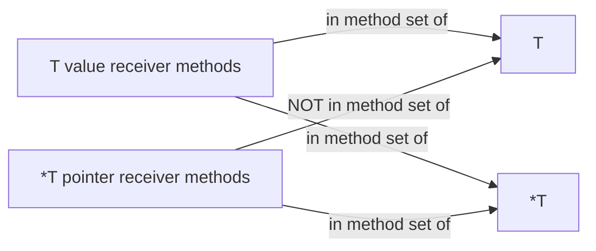
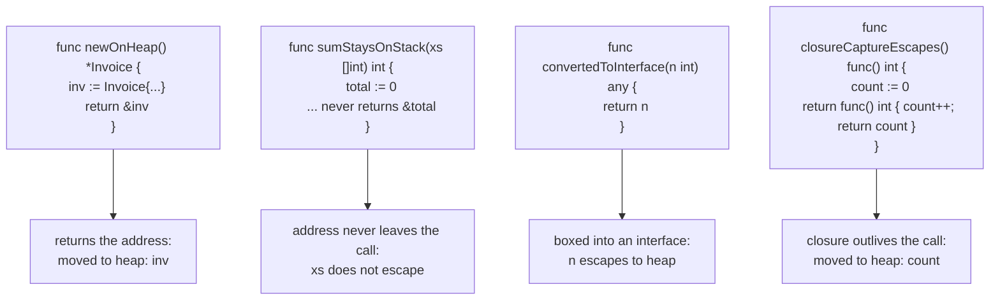

# Pointers, Values and Escape Analysis

> [!summary] TL;DR
> Go passes everything by value, including pointers — a pointer is just a value that holds an address. A pointer lets a function reach back into the caller's data instead of working on a copy. Whether a given value ends up on the stack (fast, freed automatically) or the heap (tracked by the garbage collector) is decided for you by the compiler's **escape analysis**, not by whether you wrote `&`.

> [!abstract] Core idea
> - Everything is copied on every assignment and function call — including pointers themselves, and the length/capacity/pointer **headers** of slices and maps.
> - A pointer receiver can mutate the caller's data and avoid a copy; a value receiver always works on a copy.
> - A value's address can only "escape" to the heap if the compiler cannot prove it stays inside the current function's stack frame — returning it, closing over it, or boxing it into an interface are the common ways that happens.
> - Classic trap: a `T` value does not satisfy an interface whose methods have `*T` receivers, because those methods aren't in `T`'s method set at all.

## Start here: the basics

**The problem in one story.**
You lend a friend a photocopy of your notes. They scribble on it, and your original stays clean.
If you lend them the notebook itself, their scribbles show up in your copy.
Go passes copies by default; a pointer is how you hand over "the notebook itself".
And where that notebook is stored (a short-lived desk or a long-term shelf) is decided by the compiler.

**Words you need first**

| Word | Plain meaning | Tiny example |
| --- | --- | --- |
| Value | The actual data, copied when passed | `x := 5; y := x` gives `y` its own 5 |
| Pointer | A variable holding the address of another variable | `p := &x` |
| Dereference | Follow a pointer to the data it points at | `*p = 7` changes `x` |
| Stack | Per-function scratch memory, freed when the function returns | Locals in a short helper |
| Heap | Shared memory that lives until the garbage collector frees it | Data returned by pointer |
| Escape analysis | Compiler check: "can this stay on the stack?" | `return &x` makes `x` escape |
| Receiver | The value a method is called on | `func (u *User) Rename()` |
| `nil` | A pointer that points at nothing | `var p *int` is `nil` |

**Picture it**



**Analogy.** A value is a photocopy; a pointer is a house address written on a slip of paper.
Where it breaks: you choose where to build a house, but in Go the compiler, not you, chooses stack or heap.

**How the rest of this note builds up**

- First, why pointers exist and a mental model of boxes and slips (sections 1-2).
- Then `&`, `*`, pass-by-value, pointer vs value receivers, method sets and nil (section 3).
- Then a worked example reading `-gcflags=-m` escape output, plus comparisons and trade-offs (sections 4-6).
- Finally the SDE-3 deep dive: allocation cost in production, escape analysis limits, interview questions (sections 7-9).

> [!tip] Remember
> Go always copies; a pointer copies an address, and the compiler decides whether the data lives on the stack or the heap.

## 1. Why it exists

A payment service has a function that marks an invoice paid:

```go
func markPaid(inv Invoice) {
    inv.Amount = 0 // mutates a COPY
}
```

Every call to `markPaid` copies the whole `Invoice` struct, mutates the copy, and the caller's original is untouched — the change silently vanishes. The fix is a pointer: `func markPaid(inv *Invoice)` lets the function reach back into the caller's actual struct through its address instead of a copy.

The same question — copy or point at it? — comes up constantly: method receivers, function parameters, struct fields that model "this value may be absent." Each choice has a real memory cost, because a pointer that escapes a function's stack frame forces the compiler to allocate it on the heap, where the garbage collector must later scan and reclaim it.

**Measured** on this note's benchmark (Go 1.24.4, darwin/arm64, Apple M4): copying a two-field, 16-byte struct by value costs 1.0 ns/op and 0 allocations; returning the same struct via a heap-escaping pointer costs 8.0 ns/op and one 16-byte allocation.

Getting pointer vs. value right is not a style preference — it is a measurable allocation decision.

## 2. Mental model

A variable is a **labeled box**. `&x` gives you the box's street address, written on a slip of paper (the pointer); `*p` walks to that address and opens the box. Copying a pointer copies the slip of paper, not the box — both slips now point at the same box, so writing through either one changes what's inside it.

**Where a box lives is not up to you.** Every function call gets a fresh stack frame — a shelf that's torn down the instant the function returns. If you hand out a slip of paper to a box on that shelf and the function returns, the shelf is gone and the slip points at nothing.

So whenever the compiler can prove a box's address might be read after the function returns, it quietly puts the box on the **heap** instead — a shared warehouse that stays around until nothing points at it any more, which the garbage collector decides by scanning for addresses still in use.

You write `&x`; the compiler decides where `x` actually lives.

## 3. How it works

### `&` and `*`, `new` vs `&T{}`

- `&x` takes the address of an addressable value `x`, producing a `*T`.
- `*p` dereferences a pointer, reading or writing the value it points at.
- `new(T)` allocates a zeroed `T` and returns `*T` — rarely used directly in idiomatic Go.
- `&T{...}` is the idiomatic form: build the value with a (possibly keyed) composite literal, then take its address in one expression.

```go
var inv Invoice
p1 := &inv               // address of an existing variable
p2 := new(Invoice)        // *Invoice pointing at a zeroed Invoice
p3 := &Invoice{ID: "x"}   // build + take address in one step: the idiomatic form
```

### Everything is pass-by-value — including pointers, slice headers and map headers

A function parameter always receives a **copy** of whatever was passed: a copy of an `int`, a copy of a `*T` (the address value, not the pointee), a copy of a slice's 3-word header (pointer, length, capacity), a copy of a map's internal pointer.

Reassigning the *parameter* inside the function — `inv = &Invoice{...}`, `s = append(s, x)` without returning `s` — never affects the caller's variable, because the caller's variable was never touched, only its copy was.



Mutating `*inv` inside the callee reaches the caller's struct because both pointers hold the same address. Reassigning the local `inv` variable itself (`inv = &Invoice{...}`) only repoints the callee's copy of the address — the caller's pointer still points at the original struct.

### Pointer vs. value receivers

Use a **pointer receiver** when:
- the method must mutate the receiver (`Inc()` incrementing a counter);
- the struct is large enough that copying it on every call is wasteful (measured below: a 16-byte copy is free, but a struct holding a `[256]byte` buffer is not);
- the struct must never be copied at all, because it holds a `sync.Mutex`, `sync.WaitGroup` or similar "no-copy" type — `go vet`'s `copylocks` check flags exactly this;
- consistency matters: if *any* method on a type needs a pointer receiver, give all of its methods pointer receivers, so callers never have to remember which methods mutate and which don't.

Use a **value receiver** when the type is small, immutable in spirit (a `time.Duration`, a 2-field coordinate), and no method ever needs to mutate it.



### Method sets and addressability

A type's **method set** is which methods you can call on it directly. The rule: `T`'s method set contains only the methods declared with a `T` (value) receiver. `*T`'s method set contains **both** — value-receiver and pointer-receiver methods. A pointer-receiver method is never in a plain `T`'s method set.

This matters most for interface satisfaction: if `Greeter` requires `Greet()` and `Greet` is declared on `*Service`, then `*Service` satisfies `Greeter` but a bare `Service` value does not — even though you can write `svc.Greet()` directly in code, because the compiler automatically inserts `(&svc).Greet()` **when `svc` is addressable**.

A map value is not addressable (`m["a"].Greet()` does not compile, because there's no stable memory location to take the address of — the map could rehash and move it), so a pointer-receiver method is unreachable on `m["a"]` even though it is on a local variable of the same type.



### Nil pointers

Dereferencing a nil pointer (`*p` or `p.Field`) panics with `runtime error: invalid memory address or nil pointer dereference`. But **calling a method on a nil pointer does not panic by itself** — the method only panics if its body actually dereferences the nil receiver.

This makes "nil means empty" a deliberate, idiomatic pattern for recursive structures like linked lists: `(*IntList)(nil).Len()` can validly return `0` without ever dereferencing `nil`.

### `&s[i]` and append reallocation

`&s[i]` points directly into a slice's backing array. That pointer stays valid only as long as the backing array does. If a later `append` on the same slice needs more capacity than the array has, Go allocates a **new** array, copies the elements over, and the old pointer silently keeps pointing at the **old**, now-detached array — no error, just two copies of the data that no longer agree.

### Optional values: pointer vs. zero value vs. a documented "unset" flag

Three ways to say "this field might not have a value," each with a real trade-off:

| Representation | Meaning of absence | Risk |
|---|---|---|
| `*int`, nil | nil is unambiguously "not set" | one more heap allocation per non-nil value; nil-check required before deref |
| plain `int`, zero value | `0` means "not set" | ambiguous the moment `0` is itself a valid, distinct value |
| `sql.Null[T]` (Go 1.22) / a paired `bool` flag | explicit `Valid`/`Set` bit alongside the value | an extra field to keep in sync, but no allocation and no ambiguity |

`sql.Null[T]` (the generic replacement for `sql.NullString`, `sql.NullInt64`, etc., added in Go 1.22) is the standard-library form of the third row: a `T` plus a `Valid bool`, used directly with `database/sql` scans for nullable columns.

### Stack vs. heap and escape analysis

The compiler's **escape analysis** decides, per variable, whether its address can ever be read after the current function returns. If it can, the variable "escapes" to the heap; otherwise it stays on the stack, which costs nothing to allocate or free (the stack pointer just moves). Run it yourself with `go build -gcflags=-m` (Go 1.24.4, darwin/arm64) — **measured output**:

```text
$ go build -gcflags=-m ./...
./main.go:139:16: leaking param: id
./main.go:140:2: moved to heap: inv
./main.go:146:22: xs does not escape
./main.go:159:9: n escapes to heap
./main.go:166:2: moved to heap: count
./main.go:167:9: func literal escapes to heap
```

Four escape triggers, each matching one line above:



- **Returned pointers.** `newOnHeap` returns `&inv`: the caller can read `inv` long after `newOnHeap`'s stack frame is gone, so `inv` must live on the heap.
- **Conversion to an interface.** `convertedToInterface(n int) any` boxes `n`: an `any`/interface value is a `(type, data)` pair, and the compiler generally cannot prove the boxed data's lifetime is bounded, so it escapes. (Small, provably-scoped cases can sometimes avoid this; always re-check with `-gcflags=-m` rather than assuming.)
- **Closures.** A closure that captures a variable by reference (`count` above) can be called again after the enclosing function returns, so the captured variable must outlive that function's stack frame.
- **Sizes unknown at compile time.** `make([]T, n)` where `n` is not a compile-time constant forces a heap allocation, because the compiler cannot reserve a fixed amount of stack space for an unknown size.

By contrast, `sumStaysOnStack` never lets `total`'s address leave the function, so the compiler proves it's safe on the stack: "xs does not escape."

### Cost model: heap allocation + GC scan vs. copying small structs

A stack allocation is free: the stack pointer moves and nothing more happens. A heap allocation has three costs a copy doesn't: the allocator must find free space (and may trigger a GC assist if the heap is under pressure), the object must be scanned by the garbage collector on every mark pass until it's unreachable, and the memory isn't reclaimed until the next GC cycle actually runs.

Copying a small, pointer-free struct is just a `memmove` of a few bytes — almost always cheaper than a heap allocation, until the struct is large enough that the copy itself dominates.

### Copying structs that hold locks

A `sync.Mutex`, once used, must never be copied: a copy starts in whatever lock state the original happened to be in, and the two copies' internal state immediately diverges from reality. `go vet`'s `copylocks` analyzer flags this — passing such a struct by value, or taking it as a value receiver, or assigning it with `:=` all count as copies.

The fix is always the same: give the type a pointer receiver on every method, and pass `*T` everywhere.

### The pointer-to-interface anti-pattern

An interface value is already a 2-word descriptor: a pointer to the concrete type's method table, and a pointer (or small value) to the data. Wrapping that in a pointer (`*io.Reader` instead of `io.Reader`) adds an extra indirection without adding any capability — you cannot do anything through `*io.Reader` that you couldn't do by holding the `io.Reader` value directly, and it breaks the common idiom of checking `r == nil` directly on the interface.

Hold interface values directly; reserve pointers for concrete types.

### No pointer arithmetic outside `unsafe`

Go has no `p + 1`, no pointer subtraction, no casting an arbitrary integer to a pointer in ordinary code — `*T` only supports `&`, `*`, and passing/returning the pointer itself. The `unsafe` package exists specifically to break this rule when you genuinely need to (see [[Runtime - Memory Allocator and Garbage Collector]] for where that shows up), and using it opts a package out of the memory-safety guarantees the rest of Go relies on.

## 4. Worked example

### Whiteboard version

The minimum that demonstrates the headline rule — a pointer receiver mutates the caller's value, a value receiver does not:

```go
type Counter struct{ n int }

func (c *Counter) Inc()      { c.n++ }      // pointer receiver: mutates
func (c Counter) Value() int { return c.n } // value receiver: reads a copy

c := Counter{}
c.Inc()            // compiler rewrites this to (&c).Inc() because c is addressable
c.Inc()
c.Value() // 2
```

### Full example

All code below is one scratch module (`go 1.24`), `go vet`-clean, and passing under `go test -race`.

```text
$ go vet ./...
$ go test -race ./...
ok      pointers        1.4s
```

```go
// Invoice is a plain value type used to show struct copying.
type Invoice struct {
    ID     string
    Amount int64
}

func mutateCopy(inv Invoice) { inv.Amount = 0 } // mutates a COPY; caller sees no change

func mutateViaPointer(inv *Invoice) { inv.Amount = 0 } // mutates through the pointer

// reassignPointer takes a copy of the POINTER itself: reassigning it never
// changes what the caller's pointer points to.
func reassignPointer(inv *Invoice) {
    inv = &Invoice{ID: "new", Amount: 999}
}

func appendHeaderCopy(s []int) { s = append(s, 99) } // s's header is a local copy
```

```go
func TestEverythingIsPassByValue(t *testing.T) {
    inv := Invoice{ID: "a", Amount: 100}
    mutateCopy(inv)
    if inv.Amount != 100 {
        t.Fatalf("value receiver/arg must not mutate caller: got %d", inv.Amount)
    }

    mutateViaPointer(&inv)
    if inv.Amount != 0 {
        t.Fatalf("pointer arg must mutate caller: got %d", inv.Amount)
    }

    inv2 := Invoice{ID: "b", Amount: 50}
    p := &inv2
    reassignPointer(p)
    if p.ID != "b" || p.Amount != 50 {
        t.Fatalf("reassigning the pointer PARAMETER must not change the caller's pointer target: got %+v", *p)
    }

    s := []int{1, 2, 3}
    appendHeaderCopy(s)
    if len(s) != 3 {
        t.Fatalf("append inside the callee must not grow the caller's header: len=%d", len(s))
    }
}
```

Method sets and addressability, including the two cases that must **not** compile (left as comments, since the surrounding file would fail to build otherwise):

```go
type Greeter interface{ Greet() string }

type Service struct{ name string }

// Greet has a POINTER receiver: only *Service is in Greeter's method set.
func (s *Service) Greet() string { return "hello, " + s.name }

var _ Greeter = (*Service)(nil) // compile-time check: *Service satisfies Greeter

func TestMethodSetsAndAddressability(t *testing.T) {
    svc := &Service{name: "ptr"}
    var g Greeter = svc
    if g.Greet() != "hello, ptr" {
        t.Fatalf("Greet() = %q", g.Greet())
    }

    // The following do NOT compile, by design:
    //   var _ Greeter = Service{name: "value"} // Service has no Greet method, only *Service does
    //   m := map[string]Service{"a": {name: "x"}}
    //   m["a"].Greet() // map elements are not addressable: cannot call a pointer-receiver method
}
```

Nil receiver as a deliberate pattern, and a deref that does panic:

```go
type IntList struct {
    val  int
    next *IntList
}

// Len is deliberately callable on a nil receiver: nil means "empty list".
func (l *IntList) Len() int {
    if l == nil {
        return 0
    }
    return 1 + l.next.Len()
}

func (l *IntList) Push(v int) *IntList { return &IntList{val: v, next: l} }

func derefNilPanics() int {
    var l *IntList
    return l.val // field access on a nil pointer: panics
}

func TestNilReceiverDeliberatePattern(t *testing.T) {
    var empty *IntList
    if got := empty.Len(); got != 0 {
        t.Fatalf("Len() on nil receiver = %d, want 0", got)
    }
    l := empty.Push(1).Push(2).Push(3)
    if got := l.Len(); got != 3 {
        t.Fatalf("Len() = %d, want 3", got)
    }
}

func TestDerefNilPointerPanics(t *testing.T) {
    defer func() {
        if recover() == nil {
            t.Fatal("expected a panic dereferencing a nil pointer")
        }
    }()
    _ = derefNilPanics()
}
```

`&s[i]` aliasing, and the moment `append` detaches it:

```go
func takeAddressOfElement(s []int, i int) *int { return &s[i] }

func TestAddressOfSliceElementAndAppendReallocation(t *testing.T) {
    base := make([]int, 2, 2) // len=2, cap=2: zero spare capacity
    base[0], base[1] = 10, 20

    p := takeAddressOfElement(base, 0)
    grown := append(base, 30) // cap exhausted: must reallocate
    grown[0] = 999

    if *p == 999 {
        t.Fatal("expected p to still point at the OLD array after reallocation")
    }
}

func TestAddressOfSliceElementSharesWithoutReallocation(t *testing.T) {
    base := make([]int, 2, 4) // len=2, cap=4: 2 slots of spare capacity
    base[0], base[1] = 10, 20

    p := takeAddressOfElement(base, 0)
    grown := append(base, 30) // fits in spare capacity: reuses base's array
    grown[0] = 999

    if *p != 999 {
        t.Fatalf("expected p to alias the shared array: *p = %d", *p)
    }
}
```

The four escaping/non-escaping functions behind the `-gcflags=-m` output shown in section 3:

```go
func newOnHeap(id string, amount int64) *Invoice {
    inv := Invoice{ID: id, Amount: amount}
    return &inv // escapes: the caller can still read it
}

func sumStaysOnStack(xs []int) int {
    total := 0
    for _, x := range xs {
        total += x
    }
    return total // total's address never leaves: stays on the stack
}

func convertedToInterface(n int) any {
    return n // boxed into an interface: escapes
}

func closureCaptureEscapes() func() int {
    count := 0
    return func() int {
        count++
        return count
    } // count is captured by the returned closure: escapes
}
```

**Measured:** copying a small struct by value versus allocating the same struct on the heap through a pointer (Go 1.24.4, darwin/arm64, Apple M4, `go test -bench=. -benchmem`):

```go
type Small struct{ A, B int64 }

//go:noinline
func sumByValueNoInline(s Small) int64 { return s.A + s.B }

//go:noinline
func newSmallOnHeap(a, b int64) *Small {
    s := &Small{A: a, B: b}
    return s // escapes: the caller gets the pointer
}

func BenchmarkCopySmallStruct(b *testing.B) {
    s := Small{A: 1, B: 2}
    var sink int64
    for b.Loop() {
        sink = sumByValueNoInline(s)
    }
    _ = sink
}

func BenchmarkHeapAllocateSmallStruct(b *testing.B) {
    var sink *Small
    for b.Loop() {
        sink = newSmallOnHeap(1, 2)
    }
    _ = sink
}
```

```text
$ go test -bench=. -benchmem -run=^$ ./...
goos: darwin
goarch: arm64
pkg: pointers
cpu: Apple M4
BenchmarkCopySmallStruct-10            1000000000     1.000 ns/op     0 B/op   0 allocs/op
BenchmarkHeapAllocateSmallStruct-10     153189044     7.983 ns/op    16 B/op   1 allocs/op
```

For a 16-byte struct, the heap-allocating version is about 8× slower and costs one allocation the GC must later reclaim. The gap grows with allocation pressure under concurrent load, where allocator and GC contention both scale with allocation *count*, not just size.

## 5. Variants and comparison

| Form | How it works | Use when | Cost |
| --- | --- | --- | --- |
| Value receiver / value parameter | callee gets a full copy | small, immutable-in-spirit types; no method needs to mutate | copy cost scales with struct size; free for small structs |
| Pointer receiver / pointer parameter | callee gets a copy of the address, same underlying data | mutation needed, large struct, or a no-copy type (Mutex, WaitGroup) | one allocation if the value also escapes; GC must scan it while reachable |
| `*T` field for "optional" | nil means absent, unambiguous | the zero value of `T` is itself a valid, distinct value | heap allocation per non-nil value; nil-check required |
| zero value for "optional" | `0`/`""`/`false` means absent | the zero value is never itself a meaningful value | silently wrong the day it is |
| `sql.Null[T]` / explicit `bool` flag | value + explicit presence bit | database rows with nullable columns, or any field needing both | no allocation, no ambiguity, one extra field to keep in sync |
| Interface value held directly | 2-word (type, data) descriptor | always, for interface-typed fields and variables | cheap to copy already; wrapping in `*Interface` adds nothing |

## 6. Trade-offs and when not to use

- Pointers everywhere "to be safe" defeats the purpose: it forces more heap allocations, more GC scanning, and makes it harder to reason about who can mutate what. Default to values for small, read-mostly data; reach for pointers when you have a concrete reason (mutation, size, a no-copy type).
- Escape analysis is a compiler heuristic, not a hard guarantee — a value that "obviously" looks stack-safe can still escape through an indirect path (a slice of interfaces, a function passed as a callback that the compiler can't fully inline and analyze). Don't reason from intuition alone; run `-gcflags=-m` on the function that matters.
- The pointer-vs-value cost only matters in allocation-heavy or hot-path code. For a request handled once per HTTP call, the difference between 1 ns and 8 ns is not where your latency budget goes — profile before optimizing (see [[Benchmarks, Profiling and Tracing]]).

## 7. In production

- **Real systems:** `*sql.DB` and `*sql.Tx` are shared handle types passed by pointer everywhere — copying them would be meaningless, since they wrap an internal connection pool. Request/response DTOs are usually passed by value if small (no mutation needed past decode), while service and repository structs holding dependencies (logger, DB handle, config) are passed and stored as pointers so there's exactly one instance per process.
- **Failure modes → fixes:**
  - A struct embedding `sync.Mutex` gets copied (by value receiver, by `:=`, or by value parameter) → `go vet` flags it with `copylocks`; switch every method to a pointer receiver and pass `*T`.
  - Code holds `&s[i]` across an `append` on the same slice → the pointer silently detaches from the live data after a reallocation → copy the value out instead of holding a long-lived pointer into a growing slice, or pre-allocate capacity you know you won't exceed.
  - A hot path unexpectedly shows heap allocations in a profile → check `-gcflags=-m` for an unintended escape (often: a value getting boxed into an `any`/interface, or captured by a closure that outlives the call) → restructure to avoid the box, or accept the cost if it's genuinely needed.
- **What to monitor:** allocations per operation (`go test -bench -benchmem`, `pprof`'s heap profile) for any function on a hot path; `go vet`'s `copylocks` findings in CI.

## 8. Deep dive

- **Escape analysis is whole-function, interprocedural within limits.** The compiler can "see through" small, inlined calls (as shown by the `can inline` lines in the `-gcflags=-m` output above) and decide a value doesn't escape even when it's passed to another function, as long as that function is inlined or its own analysis proves the pointer doesn't leak further. Across a non-inlined call boundary, the compiler must assume the worst unless the callee's own escape analysis (also visible via `-m`) says otherwise — this is why `//go:noinline` was needed in the benchmark above: without it, the compiler would inline `newSmallOnHeap` and might prove the allocation unnecessary, hiding the exact cost being measured.
- **`go build -gcflags="-m -m"`** (doubled) gives more detail on *why* a value escaped, which matters once the single `-m` output says "escapes to heap" without explaining which specific use triggered it.
- **Interfaces and escape analysis interact non-trivially.** A method call through an interface value is a dynamic dispatch the compiler usually cannot inline or fully analyze, so arguments passed through an interface call tend to escape more often than the same code called on a concrete type directly — one more reason "accept interfaces, return structs" (see [[Interfaces]]) is about more than just testability.
- **Method sets through embedding.** An embedded type's methods are promoted into the outer type's method set at the same pointer/value rule: if `Base` has a pointer-receiver method and `Outer` embeds `Base` by value, that method is promoted only into `*Outer`'s method set, not `Outer`'s — because reaching `Base`'s pointer receiver requires the address of the embedded `Base` field, which in turn requires the address of `Outer` itself.

## 9. Interview questions

> [!question]- Does Go have pass-by-reference?
> No. Every call copies its arguments, full stop. A pointer argument copies the *address*, which is why writing through it reaches the caller's data — but reassigning the pointer parameter itself never affects the caller's pointer variable, because that variable was never touched.

> [!question]- When do you choose a pointer receiver over a value receiver?
> When the method must mutate the receiver, when the struct is large enough that copying it is wasteful, or when the struct holds a no-copy type like `sync.Mutex`. If any method on a type needs a pointer receiver, give all of that type's methods pointer receivers for consistency.

> [!question]- Trap: a type has a method with a pointer receiver, but a reviewer insists the value type "clearly has that method." Why does assigning the value type to the interface still fail to compile?
> A pointer-receiver method lives only in `*T`'s method set, never in `T`'s. The compiler auto-takes `&x` for you when calling `x.Method()` directly and `x` is addressable, which hides the distinction in ordinary code — but assigning a bare `T` value to an interface variable that requires that method has no addressable `x` to take `&` of at that point, so it fails outright.

> [!question]- Why can't you call a pointer-receiver method on a map value, like `m["a"].Greet()`?
> Map elements are not addressable — the map's internal layout can rehash and move entries at any time, so there is no stable address the compiler could hand to a pointer receiver. Copy the value out (`v := m["a"]`) first, or store `*T` in the map instead of `T`.

> [!question]- What decides whether a variable is allocated on the stack or the heap in Go?
> The compiler's escape analysis, not the presence of `&` in your source. If the compiler can prove a value's address never needs to be valid after the function returns, it stays on the stack; if the address is returned, closed over, boxed into an interface, or otherwise provably reachable afterward, it escapes to the heap. Check with `go build -gcflags=-m`.

> [!question]- You see `go vet` flag `copylocks` on a struct that embeds `sync.Mutex`. What's actually wrong, and what's the fix?
> Copying a `sync.Mutex` after it has been used copies whatever lock state it happens to be in at that instant, and the copy and original then diverge from the real lock state — this produces broken mutual exclusion, not a compile error. Fix: give every method on that type a pointer receiver, and never pass the struct by value.

> [!question]- Why is wrapping an interface in a pointer (`*io.Reader` instead of `io.Reader`) considered an anti-pattern?
> An interface value is already a two-word `(type, data)` pair — copying it is already cheap, and it already supports a direct `== nil` check. A pointer to it adds one more indirection and breaks that nil check's usual meaning, without adding any capability you didn't already have through the interface value itself.

## 10. Cheat sheet

- Everything is pass-by-value, including pointers, and including slice/map headers — reassigning a parameter never changes the caller's variable.
- Pointer receiver: mutation, large struct, or a no-copy type (`sync.Mutex`, `sync.WaitGroup`). Value receiver: small, read-only. Stay consistent across one type's methods.
- `T`'s method set excludes `*T`-receiver methods; `*T`'s method set includes both. Map elements aren't addressable, so pointer-receiver methods are unreachable on them directly.
- Dereferencing nil panics; calling a method on a nil receiver does not, unless the method body itself dereferences it — a valid, deliberate pattern for "nil means empty."
- `&s[i]` aliases the backing array only until an `append` needs to reallocate; after that it silently points at stale data.
- Pick one optional-value encoding per field: nil pointer (unambiguous absence, costs an allocation), zero value (only if the zero is never meaningful), or an explicit presence flag / `sql.Null[T]` (no allocation, no ambiguity).
- Escape analysis (`go build -gcflags=-m`) decides stack vs. heap: returned pointers, interface boxing, and closures over local variables are the common triggers.
- Measured: copying a 16-byte struct is ~1 ns and 0 allocations; heap-allocating the same struct through a pointer is ~8 ns and 1 allocation the GC must later scan and reclaim.

## Links

- **Before this:** [[Syntax, Types and Control Flow]], [[Structs, Methods and Embedding]], [[Process Memory Layout - Stack vs Heap]]
- **Next:** [[Interfaces]], [[Runtime - Memory Allocator and Garbage Collector]]
- **Compare with:** [[Arrays and Dynamic Arrays (Go Slices)]] (slice headers and `append` reallocation in full), [[Concurrency Primitives - Mutex, Semaphore, Atomics]] (why no-copy types exist)

### Watch on YouTube

- [Understanding Allocations: the Stack and the Heap - GopherCon SG 2019](https://www.youtube.com/watch?v=ZMZpH4yT7M0) · Singapore Gophers · conference-level deep dive on stack vs heap and escape analysis
- [Escape Analysis in Go — Stack vs Heap & How the Compiler Decides](https://www.youtube.com/watch?v=Ff2qB4XySOk) · nihonsensei · focused explainer on how the compiler decides stack vs heap
