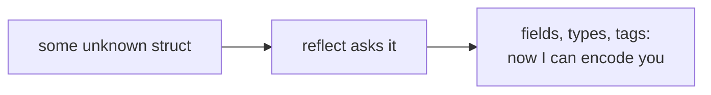
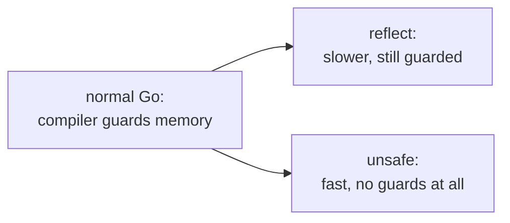
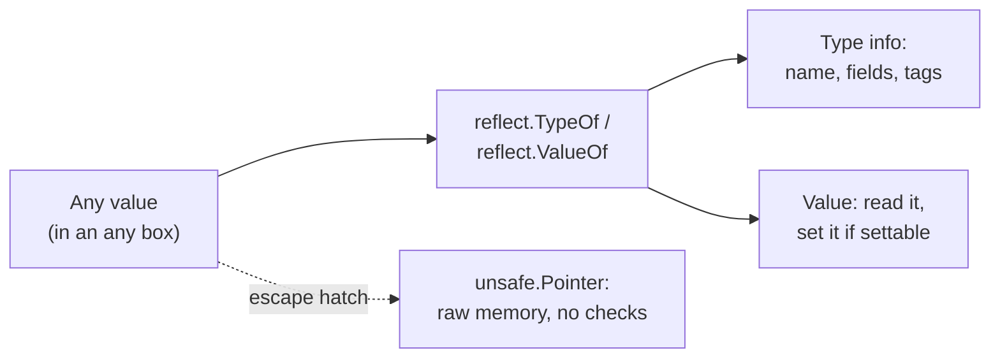
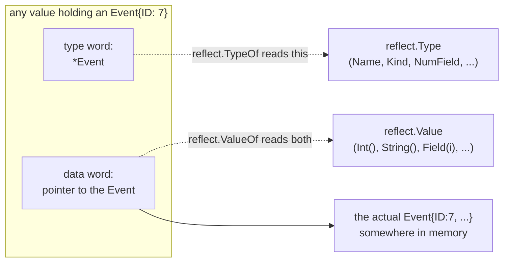
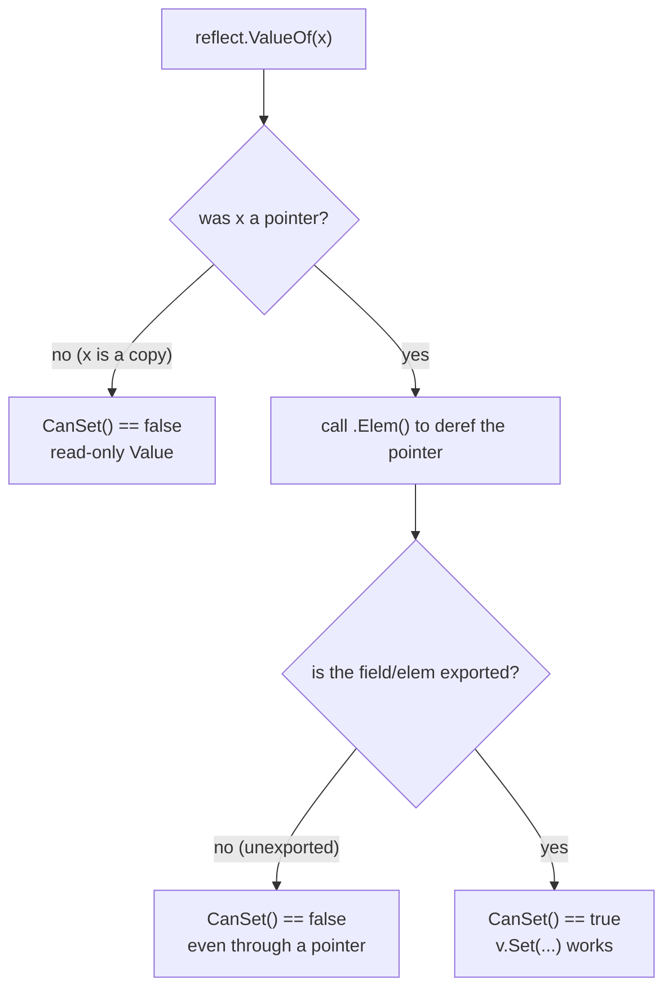
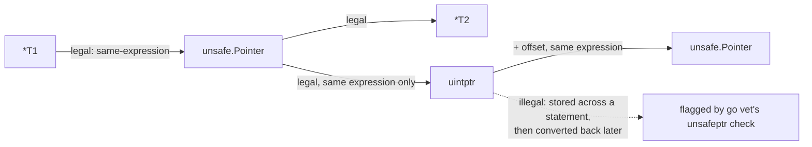

# Reflection and unsafe

> [!summary] TL;DR
> Reflection (package `reflect`) lets code inspect and mutate values whose concrete type is only known at run time — reading struct tags, walking fields, calling methods by name — at the cost of losing compile-time type checking and most of the compiler's optimizations. `unsafe` lets code step around Go's type system and memory-safety guarantees entirely — reinterpreting bytes as a string with no copy, computing a struct field's byte offset — at the cost of every guarantee the garbage collector and the compiler otherwise give you.

> [!abstract] Core idea
> - Every `any` (interface) value is two words under the hood: a **type word** (which concrete type this is) and a **data word** (a pointer to the actual value). `reflect.TypeOf` reads the type word; `reflect.ValueOf` reads both.
> - `Kind()` is "which of the ~25 built-in shapes is this" (`Struct`, `Slice`, `Int64`, …); `Type()` is the full named type (`main.Event`, `[]string`). Two different named types can share one `Kind`.
> - A `reflect.Value` is only **settable** when it was reached by dereferencing a pointer (`reflect.ValueOf(&x).Elem()`) — a `Value` built straight from a copy, like `reflect.ValueOf(x)`, can be read but never written.
> - `unsafe.Pointer` is the only type that can convert between `*T` and `uintptr`; the conversion back to a pointer must happen in the same expression as the arithmetic, because the garbage collector can move or scan memory between statements and a bare `uintptr` is invisible to it.

## Start here: the basics 🟢

> [!info] How to read this note (pick your level)
> - 🟢 **New to this?** Read "From zero" below, then sections 1, 2 and the cheat sheet (10). Stop there, that is a full first pass.
> - 🟡 **Know the basics?** Add section 3 (the rules) and 4 (worked examples) and 5.
> - 🔴 **Interview / SDE-3 prep?** Add 6, 7, 8 and 9. Headings are tagged 🟢🟡🔴 so you always know where you are.

> [!note] Before this note
> - [[Interfaces]]: an interface value (including `any`) holds two things: which concrete type is inside, and the data itself.
> - [[Structs, Methods and Embedding]]: a struct has fields, fields starting with a capital letter are exported (visible outside the package), and a field can carry a tag like `` `json:"name"` ``.

**From zero, in 60 seconds** 🟢

Normally your code knows every type at compile time. But a library like the JSON encoder must handle structs invented long after it was written.

**Reflection** is how code asks a value at run time: "what type are you, what fields do you have, what do your labels say?"



It is safe but slow — every question is answered while the program runs, instead of being baked in by the compiler.

**unsafe** is the opposite tool: it skips all of Go's type checks and touches raw memory directly. Fast, but every safety rule becomes your personal responsibility.



The rest of this note is just four questions:
1. How do `reflect.Type` and `reflect.Value` work?
2. When can reflection WRITE a value? (settability)
3. What are the only legal `unsafe.Pointer` moves?
4. When is either one actually worth it in production?

**The problem in one story.**
You write a function that must save any struct to JSON: users, orders, products.
You can't write one function per type, because you don't even know the types yet.
Reflection lets code ask at run time: "what type is this, what fields does it have, what are their tags?"
`unsafe` goes further: it lets you skip Go's type checks and touch raw memory, at your own risk.

**Words you need first**

| Word | Plain meaning | Tiny example |
| --- | --- | --- |
| Type | The kind of a value, known to the compiler | `int`, `User`, `[]string` |
| `interface{}` / `any` | A box that can hold a value of any type | `var v any = 42` |
| Reflection | Inspecting types and values while the program runs | `reflect.TypeOf(v)` gives `int` |
| Struct tag | A text label on a struct field, read by libraries | `` `json:"name"` `` |
| Settable | A reflected value you are allowed to change | Needs a pointer plus `.Elem()` |
| `unsafe.Pointer` | A pointer with no type, which bypasses safety checks | Reading a struct's raw bytes |
| Garbage collector (GC) | Runtime part that frees unused memory | Can move stacks, so raw addresses go stale |
| Kind | The basic built-in shape of a type | `reflect.Struct`, `reflect.Int64` |
| Exported | Visible outside its package because the name starts with a capital letter | `Status` yes, `status` no |
| `uintptr` | A plain whole number big enough to hold a memory address; the GC does not treat it as a pointer | `uintptr(p) + 8` |
| Codegen | A tool that writes type-specific Go code for you before you build | `easyjson`, `sqlc` |
| Alignment / padding | Fields must start at addresses that are multiples of their size; the compiler adds empty bytes to make that true | an `int64` starts at a multiple of 8 |
| cgo | Go's bridge for calling C code | `import "C"` |

**Picture it**



**Analogy.** Reflection is an X-ray of a sealed parcel: you see what's inside without the label telling you.
`unsafe` is cutting the parcel open with a knife. Where it breaks: an X-ray never changes the parcel, but reflection can also set values.

**How the rest of this note builds up**

- First, why reflection exists (encoding/json, ORMs) and the Type/Value mental model (sections 1-2).
- Then the rules: settability and `unsafe.Pointer`'s valid conversions (section 3).
- Then worked examples: reading tags, setting fields, failure modes (section 4).
- Finally the SDE-3 deep dive: cost vs code generation and generics, production use, interview questions (sections 5-9).

> [!tip] Remember
> Reflection reads types at run time and is slow but safe; `unsafe` is fast but every rule is on you.

## 1. Why it exists 🟢

`encoding/json` must encode (turn into JSON text) `Invoice`, `User`, and any other exported struct a caller defines, in a library written before any of those types existed. There is no way to write `func encode(i Invoice) string` in advance for a type the library has never heard of — the only way to read "whatever fields this struct has, and what their JSON tags say to rename them to" is to ask the type itself, at run time.

That is reflection: `reflect.ValueOf(v).Type().Field(i).Tag.Get("json")` reads a field's tag with no compile-time knowledge of what field it is.

`unsafe` solves an unrelated problem: converting between two in-memory representations without the compiler's usual copy. A function that parses a large file into lines wants to hand each line to its caller as a `string` without copying every byte out of the `[]byte` it already read into memory — ordinarily impossible, because Go treats `string` and `[]byte` as different, independently-owned memory.

`unsafe.String` reinterprets the same bytes as a `string` with zero bytes copied, at the cost of a promise the compiler cannot check: that the underlying bytes will never be mutated again, because callers everywhere assume a `string` is immutable.

## 2. Mental model 🟢

An interface value — which is what `reflect.ValueOf` always receives, since its parameter type is `any` — is two machine words (a word is 8 bytes on a 64-bit machine), not one:



`reflect.TypeOf` only ever needs the type word: it answers "what shape is this", with no data. `reflect.ValueOf` needs both words, because it must also answer "and what is this instance's data" — `v.Int()`, `v.Field(2).String()`, and so on all read through the data word.

**Kind vs Type**, concretely: `type UserID int64` has `Kind() == reflect.Int64` (it is built from `int64` underneath) but `Type().Name() == "UserID"` (its own declared name). Code that only checks `Kind` treats `UserID` and a plain `int64` identically; code that needs the declared name reads `Type()`.

## 3. How it works 🟡

> 🟢 → 🟡 **You now know** that reflection asks a value about its type at run time, and `unsafe` skips Go's safety checks to touch raw memory. **Next we open the box**: what a small reflection function looks like, the one rule for when reflection may write a value, and the short list of legal `unsafe.Pointer` moves.

### Whiteboard version

```go
func Describe(v any) {
    t := reflect.TypeOf(v)
    val := reflect.ValueOf(v)
    fmt.Println(t.Name(), val.Kind()) // e.g. "Event struct"
    for i := 0; i < t.NumField(); i++ {
        f := t.Field(i)
        fmt.Println(" ", f.Name, f.Tag.Get("json"))
    }
}
```

This reads a struct's shape and tags. It cannot write anything: `val` here was built from a plain `any` parameter, which is a copy, so none of its fields are settable. The full version below adds the pointer indirection that makes writing possible, plus the unsafe half of the topic.

### Settability: the one rule that trips everyone up

**In plain words:** reflection can only change the original if you handed it a pointer to the original. Hand it a copy and it refuses to write, on purpose.



`reflect.ValueOf(someStruct)` copies `someStruct` into the `any` parameter the same way passing it to any other function would, so writing through that `Value` would only mutate the copy — the reflect package refuses it outright rather than silently doing nothing useful.

`reflect.ValueOf(&someStruct).Elem()` instead holds a `Value` that knows it was reached through a pointer, so writes go to the original. Unexported fields stay unsettable either way: reflection cannot bypass Go's own exportedness rule, by design — see `TestSetViaPointer`'s two failure cases below.

### `unsafe.Pointer`'s valid conversions

**In plain words:** `unsafe.Pointer` is a typeless address. A short official list says which conversions are allowed; the big rule is never park an address in a plain integer across statements, because the garbage collector cannot see it there.

`unsafe.Pointer` is deliberately narrow: the compiler only allows converting *to* and *from* it in [specific patterns](https://pkg.go.dev/unsafe#Pointer) (`*T1 → unsafe.Pointer → *T2`, `unsafe.Pointer → uintptr → arithmetic → unsafe.Pointer` in one expression, and a few more). Anything else is a compile error, and `go vet`'s `unsafeptr` analyzer flags the one pattern that *does* compile but is still wrong:



The reason a stored `uintptr` is unsafe: it is just an integer to the garbage collector, carrying no information that it used to be a pointer. If a GC cycle or a goroutine's stack growth moves the object between the `uintptr` conversion and a later use, the integer now points at garbage or at someone else's data.

Keeping the arithmetic and the conversion back to `unsafe.Pointer` in one expression means no GC safepoint (a moment where the runtime may pause your goroutine to do GC or stack work) can land in between.

## 4. Worked example 🟡

The full code lives in a scratch module (`scratch/reflectunsafe`), compiles, passes `go vet`, and its tests pass under `go test -race` on Go 1.24.4.

### Reading struct tags and iterating fields

**In plain words:** this is the loop every JSON encoder runs — walk the fields, skip the private ones, read each field's label.

```go
// TagsOf prints the "json" struct tag for every exported field of v, using
// reflection. v must be a struct or a pointer to one.
func TagsOf(v any) map[string]string {
    rv := reflect.ValueOf(v)
    if rv.Kind() == reflect.Ptr {
        rv = rv.Elem()
    }
    rt := rv.Type()

    out := make(map[string]string, rt.NumField())
    for i := 0; i < rt.NumField(); i++ {
        f := rt.Field(i)
        if !f.IsExported() {
            continue
        }
        if tag, ok := f.Tag.Lookup("json"); ok {
            out[f.Name] = tag
        }
    }
    return out
}
```

`f.IsExported()` and the `ok` from `Tag.Lookup` both matter: an unexported field has no business being serialized, and a field with no `json` tag at all should not report an empty string as if it had one. `Structs, Methods and Embedding` covers the tag *syntax* (`` `json:"status" db:"status"` ``); this is the API that reads it back.

### Settability, the pointer-and-`Elem()` pattern, and its two failure modes

**What this code does, in plain words:** `SetViaPointer(&req, "Status", "paid")` checks it got a real pointer, follows it with `Elem()`, finds the field by name, checks the field can be set (it must be exported) and that the new value has the right type, then sets it. Each check that fails returns an error instead of panicking. The test tries one good case and the two failure cases.

```go
// SetViaPointer sets a struct field by name through a pointer. This is the
// shape every settable reflect.Value needs: ValueOf(ptr).Elem().
func SetViaPointer(ptr any, field string, value any) error {
    rv := reflect.ValueOf(ptr)
    if rv.Kind() != reflect.Ptr || rv.IsNil() {
        return fmt.Errorf("SetViaPointer: need a non-nil pointer, got %T", ptr)
    }
    elem := rv.Elem()
    fv := elem.FieldByName(field)
    if !fv.IsValid() {
        return fmt.Errorf("SetViaPointer: no field %q", field)
    }
    if !fv.CanSet() {
        return fmt.Errorf("SetViaPointer: field %q is not settable (unexported?)", field)
    }
    rvVal := reflect.ValueOf(value)
    if !rvVal.Type().AssignableTo(fv.Type()) {
        return fmt.Errorf("SetViaPointer: %s is not assignable to field %q of type %s", rvVal.Type(), field, fv.Type())
    }
    fv.Set(rvVal)
    return nil
}
```

```go
func TestSetViaPointer(t *testing.T) {
    r := &Request{Status: "pending"}
    if err := SetViaPointer(r, "Status", "paid"); err != nil {
        t.Fatalf("SetViaPointer: %v", err)
    }
    if r.Status != "paid" {
        t.Fatalf("Status = %q, want paid", r.Status)
    }

    // Trap: a non-pointer Value is never settable.
    err := SetViaPointer(*r, "Status", "refunded")
    if err == nil {
        t.Fatalf("SetViaPointer on a value (not a pointer) must fail")
    }

    // Trap: an unexported field is never settable, even through a pointer.
    err = SetViaPointer(r, "hidden", "z")
    if err == nil {
        t.Fatalf("SetViaPointer on an unexported field must fail")
    }
}
```

**Measured:** `go test -race -run TestSetViaPointer -v` (Go 1.24.4, 2026-11-07) — PASS, both trap cases correctly return an error instead of silently doing nothing.

### `reflect.DeepEqual`'s nil-vs-empty-slice pitfall

```go
func TestDeepEqualNilVsEmptySlice(t *testing.T) {
    var nilSlice []int
    emptySlice := []int{}

    if reflect.DeepEqual(nilSlice, emptySlice) {
        t.Fatalf("DeepEqual(nil, []int{}) = true; want false (this is the documented pitfall)")
    }
    if len(nilSlice) != len(emptySlice) {
        t.Fatalf("len must agree even though DeepEqual disagrees")
    }
}
```

**Measured:** PASS — `reflect.DeepEqual` treats a `nil` slice and a zero-length non-nil slice as unequal, even though both have length 0 and iterate zero times, because `DeepEqual` compares the slice header's nilness before it compares contents.

This is exactly the gotcha behind "my test asserts `DeepEqual(got, []Invoice{})` and it fails even though both are empty" — `got` came back `nil` (no `make`, no `append`), not `[]Invoice{}`.

### Why reflection is slower than codegen

**What this code does, in plain words:** two functions turn the same `Event` into the same text. `EncodeReflect` discovers the fields at run time with `reflect`, like `encoding/json` does. `EncodeDirect` reads `e.ID`, `e.Name` and so on directly, the way generated code would. The benchmark below compares them.

```go
// EncodeReflect discovers Event's fields with reflection at call time — the
// way encoding/json's default path works for a type it has not seen before.
func EncodeReflect(e Event) string {
    rv := reflect.ValueOf(e)
    rt := rv.Type()
    out := ""
    for i := 0; i < rt.NumField(); i++ {
        f := rv.Field(i)
        switch f.Kind() {
        case reflect.Int64:
            out += rt.Field(i).Name + "=" + itoa(f.Int())
        // ...
        }
    }
    return out
}

// EncodeDirect does the identical job with no reflection — the shape a
// codegen tool (easyjson, protoc-gen-go) produces instead.
func EncodeDirect(e Event) string {
    return "ID=" + itoa(e.ID) + ",Name=" + e.Name + ",Score=" + ftoa(e.Score)
}
```

**Measured:** `go test -bench=. -benchmem -count=3` (Go 1.24.4, darwin/arm64, Apple M4, 2026-11-07):

| Benchmark | ns/op | B/op | allocs/op |
| --- | --- | --- | --- |
| `EncodeReflect` | 157–177 | 88 | 6 |
| `EncodeDirect` | 52–61 | 36 | 2 |

The reflection path is about 3× slower and allocates 3× more per call. Every `f.Kind()` switch, every `rt.Field(i)` lookup, and `reflect.ValueOf(e)` itself (boxing `e` into an interface) cost real work the compiler cannot inline away, because the field being read is not known until run time.

This is the whole reason `encoding/json` ships a `Marshaler` escape hatch and why wire-format-heavy services often reach for a codegen tool once the reflection path shows up in a CPU profile (see [[Benchmarks, Profiling and Tracing]]).

### `unsafe`: struct layout and zero-copy conversions

**In plain words:** two real uses of `unsafe` — measuring exactly how a struct sits in memory, and relabelling the same bytes as a string without copying them.

**What this code does, in plain words:** `HeaderLayout` asks `unsafe` for the size of a `Header` struct, its alignment, and the byte position (offset) of each field. The test checks the answers on a 64-bit Mac: 16 bytes in total, with `Version` tucked into the gap after `Flag`. The second block, `BytesToStringNoCopy` and `StringToBytesNoCopy`, relabels the same bytes as the other type without copying, guarding against an empty input first.

```go
type Header struct {
    ID      int64
    Flag    bool
    Version int32
}

func HeaderLayout() Layout {
    var h Header
    return Layout{
        Size:       unsafe.Sizeof(h),
        Align:      unsafe.Alignof(h),
        OffsetID:   unsafe.Offsetof(h.ID),
        OffsetFlag: unsafe.Offsetof(h.Flag),
        OffsetVer:  unsafe.Offsetof(h.Version),
    }
}
```

```go
func TestHeaderLayout(t *testing.T) {
    l := HeaderLayout()
    if l.OffsetID != 0 {
        t.Fatalf("OffsetID = %d, want 0", l.OffsetID)
    }
    // Flag directly follows the 8-byte ID.
    if l.OffsetFlag != 8 {
        t.Fatalf("OffsetFlag = %d, want 8", l.OffsetFlag)
    }
}
```

**Measured:** PASS on darwin/arm64 (Go 1.24.4) — `Header` is 16 bytes, 8-byte aligned; `Version` (an `int32`) is placed right after the `bool`, inside the padding the compiler already owed `int64`-alignment, rather than growing the struct further.

This is exactly why "put your `bool` fields together and your 8-byte fields together" shrinks structs: the compiler cannot reorder your fields for you, but it does insert padding to keep each field aligned to its own size.

```go
// BytesToStringNoCopy reinterprets b's bytes as a string with zero copying.
// The caller must not mutate b afterward.
func BytesToStringNoCopy(b []byte) string {
    if len(b) == 0 {
        return ""
    }
    return unsafe.String(&b[0], len(b))
}

// StringToBytesNoCopy reinterprets s's bytes as a []byte with zero copying.
// The returned slice must never be written to.
func StringToBytesNoCopy(s string) []byte {
    if len(s) == 0 {
        return nil
    }
    return unsafe.Slice(unsafe.StringData(s), len(s))
}
```

`unsafe.String` and `unsafe.Slice` (both **since Go 1.20**) replace an older idiom that reinterpreted a slice header's three words (`unsafe.Pointer` + len + cap) by hand with `reflect.SliceHeader`; the new functions do the same zero-copy reinterpretation without needing to know the internal header layout at all, and `go vet` understands them.

**Measured:** `go test -race -run TestBytesStringRoundTripNoCopy -v` — PASS, including the empty-input guard (`len(b) == 0`) that avoids `&b[0]` panicking on an empty slice.

**Measured:** `go vet ./...` and `go test -race -v ./...` in `scratch/reflectunsafe` (Go 1.24.4) — 8 tests, all PASS, 0 vet diagnostics.

## 5. Variants and comparison 🟡

| Option | How it works | Use when | Cost |
| --- | --- | --- | --- |
| Reflection (`reflect`) | Discover fields/methods/tags at run time via `Type`/`Value` | The type is unknown at compile time (generic serializers, ORMs: libraries that map structs to database tables, validators, DI containers: tools that build and wire your objects for you) | 2–5× slower than direct code, extra allocations, panics on a wrong `Kind` assumption |
| Codegen (easyjson, `protoc-gen-go`, sqlc) | A tool generates type-specific code ahead of time | The type set is known at build time and the hot path matters | Build-step complexity; generated code to keep in sync |
| Generics (`[T any]`) | Compiler specializes per type at compile time | The operation is the same shape across types, known at compile time | None of reflection's runtime cost; see [[Generics and Iterators]] |
| Type switch over a closed interface | `switch v := x.(type) { case A: ...; case B: ... }` | A small, known, closed set of concrete types | Fast, but every new type needs a new `case` |
| `unsafe` zero-copy | Reinterpret existing bytes with no copy | Parsing hot paths where a copy would dominate the profile | No compiler-checked safety; a broken invariant (mutating "immutable" bytes) corrupts silently |
| cgo call | Go calls into C code | You need a C library with no Go equivalent | Each call crosses into C-runtime calling convention; see Deep dive |

## 6. Trade-offs and when not to use 🔴

> 🟡 → 🔴 **You now know** how `Type` and `Value` work, the settability rule, the legal `unsafe.Pointer` moves, and measured proof that reflection costs about 3×. **Next is the advanced part**: when not to use either tool, how real libraries use them in production, and the low-level reasons behind the costs and the `uintptr` danger.


- Reflection trades compile-time type errors for run-time panics: `v.Int()` on a `Value` whose `Kind()` is `String` panics, something a type switch or generics would have caught (or made impossible) at compile time.
- Reach for reflection only when the type truly is not known until run time. If you are writing `if v.Kind() == reflect.Struct && v.Type() == reflect.TypeOf(Invoice{})`, you already know the type — use a type assertion or a type switch instead.
- `unsafe` is not just "fast but risky" — it can be **not portable**. `unsafe.Sizeof`/`Alignof`/`Offsetof` results depend on `GOARCH` (32-bit vs 64-bit pointers) and on the exact Go version's struct-layout decisions; code that hardcodes an offset it measured once can silently break on a new architecture or compiler release.
- `unsafe.Pointer` arithmetic that reads past a struct's declared fields, or that assumes a standard-library type's internal layout (for example the shape of a map bucket), breaks the moment that internal layout changes — which has happened across Go releases (see the map internals in [[Arrays, Slices and Maps (with internals)]]) with no notice, because `unsafe` code is explicitly exempted from the Go 1 compatibility promise.
- Prefer `unsafe.String`/`unsafe.Slice` over raw `unsafe.Pointer` arithmetic whenever the goal is just "reinterpret these bytes": they are vet-checked and self-documenting about what they convert.

## 7. In production 🔴

- **Real systems:** `encoding/json`'s default path, `database/sql`'s `Scan` into struct fields via driver-specific reflection helpers, `go-playground/validator` and most ORMs (gorm) read struct tags with reflection; `google.golang.org/protobuf`'s (Protocol Buffers: a compact binary data format) reflection-based `protoreflect` API powers generic proto tooling (dynamicpb) even though generated messages use direct field access on the hot path; `strings.Builder` and `bytes.Buffer`'s internal `String()`/`Bytes()` conversions use the `unsafe.String`/`unsafe.Slice` pattern to avoid a copy on every call.
- **Failure modes → fixes:**
  - A reflection-based decoder panics on an unexpected `Kind` in production because an input type changed shape → wrap the reflection walk in a `defer recover()` at the boundary, and add a table-driven test per supported `Kind`.
  - `reflect.DeepEqual(got, []Invoice{})` fails in a test because `got` is `nil`, not an empty slice → either assert on `len` instead of `DeepEqual`, or initialize the slice with `make([]Invoice, 0)` at the one place it is built.
  - Code built an `unsafe.Pointer` offset into a standard-library struct it does not own, and a Go upgrade silently corrupts it → never do this; if the standard library doesn't expose an accessor, the data is not meant to be read this way.
  - A `[]byte` handed to `unsafe.String` gets mutated later by an unrelated part of the code, corrupting every `string` built from it → treat the `[]byte` as consumed the moment it crosses that line; never keep a mutable reference to the same backing array afterward.
- **What to monitor:** panic/recover counts tagged by decoder or validator (a spike means a type assumption broke); `go vet`'s `unsafeptr` findings in CI, not just locally; `CGO_ENABLED` and binary size/dynamic-link dependencies when `unsafe`-adjacent cgo code is in the build.

## 8. Deep dive 🔴

**Why reflection cannot be as fast as direct code, structurally.** Every `reflect.ValueOf(x)` call boxes `x` into an interface (if it was not one already) — a heap allocation when `x` does not already fit in a word and escape analysis cannot prove otherwise (see [[Pointers, Values and Escape Analysis]]).

Every subsequent `.Field(i)`, `.Kind()`, and type-specific accessor (`.Int()`, `.String()`) is a function call through `reflect`'s internal `rtype`/`abi.Type` metadata, not a direct memory offset the compiler computed at build time — none of it can be inlined, because which field and which accessor to call is a run-time decision.

The benchmark above (3× slower, 3× the allocations, for a 3-field struct) is the compounding of exactly these costs; the gap grows, not shrinks, on larger structs.

**The six valid `unsafe.Pointer` conversion patterns**, named precisely because the compiler enforces only these: `*T1 → unsafe.Pointer → *T2` (reinterpret a pointer's pointee type); `unsafe.Pointer → uintptr` for printing or hashing (the resulting uintptr must not be converted back into a pointer); `unsafe.Pointer → uintptr → arithmetic → unsafe.Pointer`, all in one expression (the pattern `AdvancePointer` uses); a `uintptr` returned by `syscall.Syscall` representing a pointer, converted back immediately; `reflect.Value.Pointer()`/`UnsafeAddr()` results, used the same way; and converting a `unsafe.Pointer` to and from a `reflect.Value` via `reflect.NewAt`.

Anything outside these six is either a compile error or, worse, legal Go that `go vet -unsafeptr` exists specifically to flag.

**`uintptr` hazards in depth.** A `uintptr` is just an integer — the runtime's garbage collector does not scan it, trace it, or know it ever pointed at a live object. Go's garbage collector and goroutine stack growth can both relocate objects (stacks are copied on growth; the GC itself does not currently move the heap, but nothing in the language spec promises it never will).

If code stores a `uintptr` derived from a pointer, does something else, and converts it back to a pointer later, the object it pointed to may have moved or been collected in between, so the conversion yields garbage.

Keeping the conversion and the arithmetic inside a single expression — `unsafe.Pointer(uintptr(p) + offset)` — guarantees no safepoint can land between the two conversions, because the compiler treats that whole expression as one atomic unit for this purpose.

`runtime.KeepAlive(p)` is the matching tool when a pointer must stay alive past its last normal use, so the GC does not collect what it points to while `unsafe`-derived data about it is still in use.

**cgo call cost and its static-linking impact.** A cgo call does not run like a normal Go function call: the calling goroutine must switch from the Go calling convention and its segmented/growable stack to the C calling convention on a fixed-size stack, which historically meant locking the calling goroutine to its OS thread (`M`) for the duration of the call so the Go scheduler does not try to run other goroutines on a stack a C function is using.

This has measurably more overhead than a plain Go function call — commonly cited at tens of nanoseconds of fixed overhead per call, which matters if cgo is on a hot path called millions of times, not if it wraps a single expensive operation like a compression library call. Separately, `CGO_ENABLED=1` (the default when a C toolchain is present) means packages like `net` and `os/user` prefer the cgo-based resolver, which dynamically links libc — so a binary built with cgo enabled is not a fully static binary even with `-extldflags -static` unless you explicitly set `CGO_ENABLED=0`, which is why minimal container images (`FROM scratch`) typically build Go binaries with cgo disabled.

## 9. Interview questions 🔴

> [!question]- What is the difference between `reflect.Type` and `reflect.Value`?
> `Type` describes the shape — name, kind, fields, methods — with no data. `Value` carries both the type information and a handle to one specific instance's data, so only `Value` can read or write an actual field's contents.

> [!question]- When is a `reflect.Value` settable, and why does `reflect.ValueOf(x)` alone never work for writing?
> Only when it was reached through a pointer: `reflect.ValueOf(&x).Elem()`. `reflect.ValueOf(x)` receives `x` as a copy (the same as passing it to any function), so writing through that `Value` would only mutate the copy — reflect refuses it with `CanSet() == false` instead of silently doing nothing.

> [!question]- Trap: why does `reflect.DeepEqual(nilSlice, []int{})` return `false`?
> `DeepEqual` compares the slice header's nilness before comparing contents, so a `nil` slice and a zero-length non-nil slice are "different" even though both have length 0. This breaks naive tests that build an expected empty slice with `[]T{}` and compare it to a function that returns `nil` for "no results."

> [!question]- Why is a reflection-based encoder slower than a codegen'd one?
> Reflection resolves which field and which type-specific accessor to call at run time, so none of it can be inlined, and boxing a value into `reflect.ValueOf` can allocate. Measured on a 3-field struct: about 3× the time and 3× the allocations per call versus hand-written field access (`EncodeReflect` vs `EncodeDirect` above).

> [!question]- Trap: is this a legal use of `unsafe.Pointer`? `p := unsafe.Pointer(x); n := uintptr(p); /* ... other code ... */ q := unsafe.Pointer(n + 8)`
> No. Converting `unsafe.Pointer` to `uintptr` and back to `unsafe.Pointer` is only legal within one expression. Storing the `uintptr` across other statements lets a GC safepoint or stack-copy land in between, after which `n` may no longer correspond to a live object's address. `go vet`'s `unsafeptr` analyzer is built to catch exactly this.

> [!question]- What do `unsafe.String` and `unsafe.Slice` buy you over a normal conversion?
> A normal `string(b)` or `[]byte(s)` conversion copies every byte, because Go treats the two types as independently owned. `unsafe.String`/`unsafe.Slice` (Go 1.20) reinterpret the same backing bytes with zero copies — at the cost of a promise the compiler cannot check: the bytes must never be mutated afterward, since every `string` elsewhere in the program assumes immutability.

> [!question]- Why would a minimal container image build a Go binary with `CGO_ENABLED=0`?
> With cgo enabled, packages like `net` and `os/user` prefer a cgo-based resolver that dynamically links libc, so the binary is not fully static and needs a compatible libc at runtime (absent in a `scratch` image). `CGO_ENABLED=0` forces the pure-Go resolver and a statically linked binary.

## 10. Cheat sheet 🟢

- `reflect.TypeOf` reads the type word of an interface value; `reflect.ValueOf` reads both the type and data words.
- `Kind()` is the built-in shape (`Struct`, `Int64`, …); `Type()` is the declared type name. Two types can share a `Kind`.
- Settable only via `reflect.ValueOf(&x).Elem()`, and never for unexported fields — reflection cannot bypass exportedness.
- `reflect.DeepEqual(nil, []T{})` is `false`: it checks nilness before contents.
- Reflection is slower (measured: ~3× here) because field/accessor resolution happens at run time and cannot be inlined — profile before assuming it matters.
- `unsafe.Pointer` conversions to/from `uintptr` are legal only within one expression; a stored `uintptr` is just an integer to the GC.
- `unsafe.Sizeof`/`Alignof`/`Offsetof` are platform- and version-specific facts, not portable constants.
- `unsafe.String`/`unsafe.Slice` (Go 1.20) do zero-copy `[]byte ↔ string` reinterpretation; the caller must never mutate the source afterward.
- `go vet`'s `unsafeptr` analyzer exists specifically to catch the uintptr-stored-across-statements mistake.
- cgo calls cost real per-call overhead and typically force dynamic linking against libc unless `CGO_ENABLED=0`.

## Self-check 🟢🟡

🟢 Easy

> [!question]- What does reflection let code do?
> Look at a value's type, fields and tags while the program runs, even for types the code has never seen.

> [!question]- Which standard library package uses reflection to read `json:"..."` tags?
> `encoding/json`.

> [!question]- Is `unsafe` checked by the compiler for memory safety?
> No. Every safety rule becomes your responsibility.

🟡 Medium

> [!question]- Why does `reflect.ValueOf(x).Field(0).SetString("a")` panic, and how do you fix it?
> The value is a copy, so it is not settable. Use `reflect.ValueOf(&x).Elem()`.

> [!question]- `type UserID int64`. What are its `Kind()` and its type name?
> `Kind()` is `reflect.Int64`; the type name is `UserID`.

> [!question]- Why must `unsafe.Pointer(uintptr(p) + 8)` be written in one expression?
> A `uintptr` stored in a variable is just a number to the GC; if memory moves between statements, it points at the wrong place.

## Links

- **Before this:** [[Interfaces]], [[Structs, Methods and Embedding]], [[Generics and Iterators]]
- **Next:** [[Benchmarks, Profiling and Tracing]], [[Runtime - Memory Allocator and Garbage Collector]]
- **Compare with:** [[Generics and Iterators]] (compile-time polymorphism vs reflection's run-time one), [[Arrays, Slices and Maps (with internals)]] (why hardcoding unsafe offsets into map internals breaks across Go versions)

### Watch on YouTube

- [Go Class: 33 Reflection](https://www.youtube.com/watch?v=T2fqLam1iuk) · Matt KØDVB · thorough walkthrough of reflect.Type/reflect.Value mechanics
- [Go Unsafe Package: Unleash Low-Level Power (But Beware!) ⚠️](https://www.youtube.com/watch?v=1WG2zyOWTkQ) · CodeLucky · intro to unsafe.Pointer and its risks
