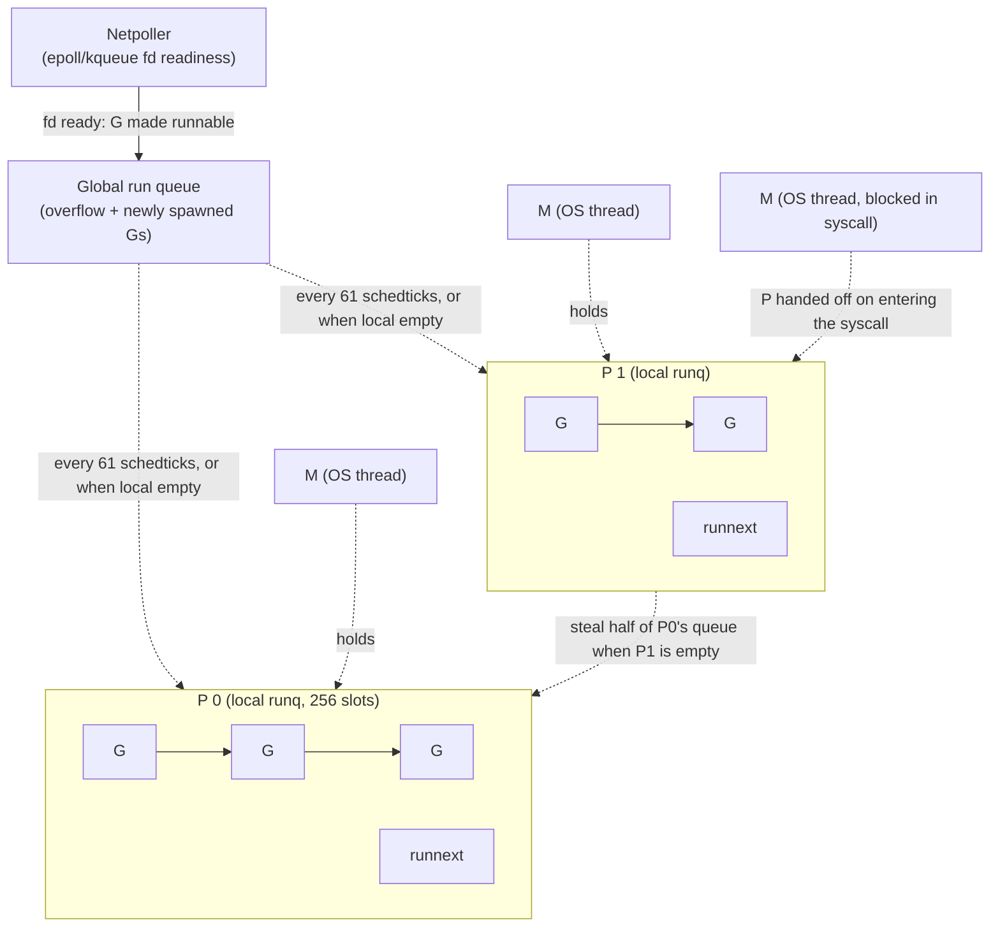
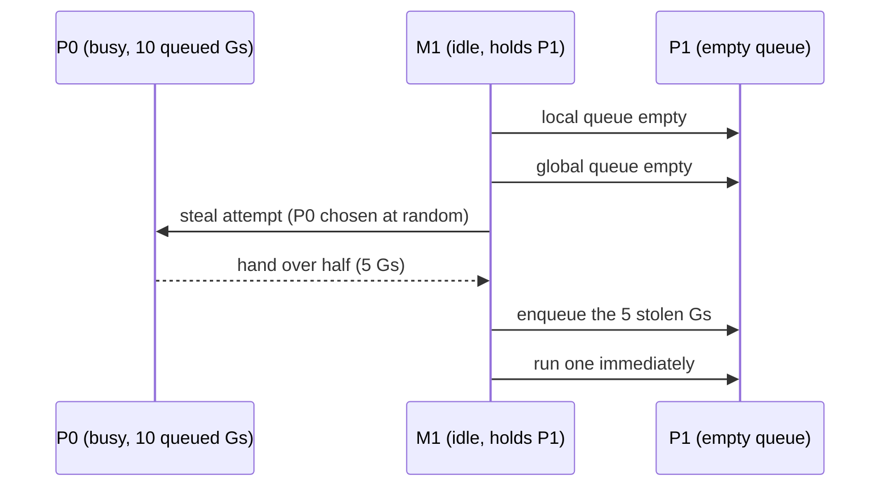
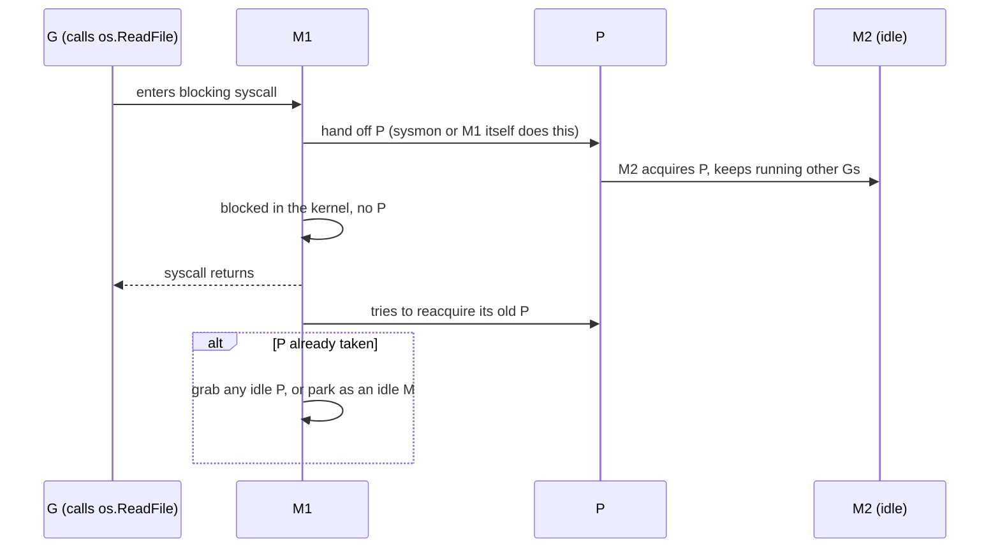

# Runtime - Goroutine Scheduler (GMP)

> [!summary] TL;DR
> Go runs many goroutines on few OS threads by scheduling them itself. **G** (goroutine), **M** (OS thread, "machine"), and **P** (processor: the right to run Go code and a local queue of runnable Gs) are the three objects the scheduler juggles to keep exactly `GOMAXPROCS` Ms actively running Go code at once, however many goroutines or blocking calls are in flight.

> [!abstract] Core idea
> - A **G** is a goroutine: a function, its stack, and its saved registers. Cheap to create, cheap to park.
> - An **M** is an OS thread. Only an M that holds a **P** may run Go code.
> - A **P** is a scheduling context: exactly `GOMAXPROCS` of them exist. Each owns a local run queue of Gs and is what makes an M's work-stealing and memory caches local instead of globally contended.
> - When a G blocks on a syscall, its M keeps the G but hands the **P** to another M (or a freshly started one), so the P is never idle just because one M is stuck.
> - Idle Ps **steal** half the runnable Gs from a busy P's queue instead of sitting empty.

## 1. Why it exists

A server handling 50,000 concurrent connections cannot give each one an OS thread: each thread needs a multi-KB-to-MB stack and costs microseconds to context-switch, and the kernel scheduler knows nothing about which threads are "really" blocked on a channel versus a socket. Pre-2012 Go (and plain OS-thread concurrency in C, Java before virtual threads, or Python threads) pays that cost per connection.

Go instead starts a goroutine for a 2 KB stack and schedules **M goroutines onto N OS threads** (M:N scheduling) itself, in user space, where it has information the kernel doesn't: that a goroutine blocked on `ch <- v` or a mutex is not doing anything the OS needs to schedule around. A Go process on an 8-core machine typically runs with 8 OS threads actively executing Go code (`GOMAXPROCS = 8`) no matter whether it has 10 goroutines or 500,000 of them.

## 2. Mental model

Picture a kitchen with a fixed number of chef's stations (**P**, one per CPU core) and a pool of chefs (**M**, OS threads) that can stand at a station. Orders (**G**, goroutines) pile up in a queue in front of each station. A chef at a station cooks one order at a time from that station's queue; when a chef has to step out to answer the phone (a blocking syscall), they hand their station to another chef so the station never sits idle. A chef with an empty queue walks over and grabs half the orders waiting at a busy station instead of standing around.

## 3. How it works

### The three objects

| Object | What it is | How many exist |
| --- | --- | --- |
| **G** | A goroutine: a function call, its growable stack (starts at 2 KB), and saved PC/SP | As many as `go` statements are live |
| **M** | An OS thread (`pthread`/`clone` underneath) | Grows on demand, capped by `debug.SetMaxThreads` (default 10,000) |
| **P** | A scheduling context: local run queue (256 slots) + `runnext` (one fast-path slot) + a slice of the per-P memory caches ([[Runtime - Memory Allocator and Garbage Collector]]) | Exactly `runtime.GOMAXPROCS(0)`, fixed until changed |

Only a G-M-P triple (an M holding a P, running a G) executes Go code. An M without a P cannot run Go code; it can only be blocked in a syscall or parked waiting for work.



### Local and global run queues

Each P owns a **local run queue**: a fixed 256-slot ring buffer plus one `runnext` slot that holds the single G most likely to run next (usually the goroutine a `chan` send or `go` statement just made runnable, so it gets cache-warm, low-latency scheduling). An M looks in this order when picking a G to run:

1. Its P's `runnext`, then its P's local queue.
2. Every 61st scheduling tick, the **global run queue** first, for fairness, so a P that only ever has local work can't starve goroutines sitting in the global queue forever.
3. The global run queue when the local queue is empty.
4. The netpoller, non-blocking, for any newly ready network Gs.
5. **Work stealing**: pick a random other P and take half of its local queue.

The global queue is also where an overfull local queue spills: adding past 256 local slots moves half the local queue (that half, shuffled) to the global queue in one batch.

### Work stealing



An M that finds no work anywhere enters a brief **spinning** state (looking without parking, to avoid the latency of a wake-up) before parking on a semaphore. The runtime limits the number of spinning Ms to roughly half the number of busy Ps, not the full `GOMAXPROCS`, to avoid burning CPU looking for work that isn't there when parallelism is low relative to a high `GOMAXPROCS`.

### Blocking syscall handoff

A goroutine calling a blocking syscall (reading a regular file, `exec`-ing a subprocess, cgo) parks its M inside the kernel for the syscall's duration. If the scheduler did nothing else, that P would sit idle for however long the syscall takes. Instead, **entering** a blocking syscall hands the M's P to another M (an idle one, or a newly created one) so that P keeps running other Gs immediately:



A background thread, **sysmon**, also retakes a P from an M that has been in a syscall "too long" (roughly 20 μs plus some backoff) even if the M itself never explicitly hands it off, so a slow syscall can't starve the P indefinitely.

This is why one blocking syscall never stalls other goroutines, but it is also why syscall-heavy code (many short-lived subprocesses, cgo calls, or blocking file I/O) can balloon the thread count: each concurrently blocked syscall needs its own M. **Network** I/O does not pay this cost at all, because `net` sockets are set non-blocking and registered with the OS's async I/O facility (epoll on Linux, kqueue on Darwin/BSD) through Go's netpoller; see [[I-O Models - Blocking, epoll, io_uring and the Go Netpoller]] for that mechanism. A goroutine doing `conn.Read` parks on the netpoller and releases its P immediately, with no extra M needed; the netpoller wakes it (`goready`) once the fd is readable.

### Parking: gopark and goready

A goroutine blocked on a channel, a mutex, or the netpoller doesn't spin or hold any resource: the scheduler calls `gopark`, which records why it's parked, detaches it from its M/P, and lets that M run something else. Whatever unblocks it (`ch <- v`, `Unlock`, an epoll event) calls `goready`, which puts the G back on a run queue. No OS thread is tied up while a goroutine waits — the thread serves other work in the meantime.

### GOMAXPROCS

`runtime.GOMAXPROCS(n)` sets the P count; `runtime.GOMAXPROCS(0)` reads it without changing it. It defaults to `runtime.NumCPU()`, the number of logical CPUs the OS reports. Inside a Linux container with a CPU quota (a Kubernetes `resources.limits.cpu: "2"`), `NumCPU()` historically reported the **host's** core count, not the quota, so a pod limited to 2 CPUs would see `GOMAXPROCS=32` on a 32-core node, over-schedule, and burn its quota as throttling instead of throughput. Uber's `automaxprocs` library fixed this by reading the cgroup quota and calling `runtime.GOMAXPROCS` at startup. **Since Go 1.25**, the runtime does this itself: `GOMAXPROCS` is derived from the cgroup CPU limit automatically and is updated at runtime if the limit changes, making `automaxprocs` unnecessary on 1.25+ (verify: confirm this on your exact container runtime before dropping the library from an existing service).

Raising `GOMAXPROCS` above the core count does not add real parallelism; it adds more Ps than cores, so Ms fight over the same CPUs and context-switch more, which helps only if goroutines spend real time blocked on something the scheduler doesn't already handle for you (rare, since locks/channels/network already yield the P).

### Preemption

Early Go (pre-1.14) was **cooperatively** scheduled: a goroutine only yielded at specific points — a function call prologue, a channel operation, an allocation. A goroutine running a tight loop with no function calls (`for { x++ }`) could hold its P and starve every other goroutine on it, including the garbage collector's stop-the-world phase, indefinitely.

**Since Go 1.14**, the runtime adds **asynchronous preemption**: `sysmon` notices a G has run for more than ~10 ms and sends it a signal (`SIGURG` on Unix) that the runtime's signal handler turns into a safe-point check, forcibly suspending the G so its P can run something else. This closed the long-standing "tight loop blocks GC forever" class of bugs, though it is still not instantaneous and is not a substitute for goroutines that actually check `ctx.Done()`.

### Stacks

A new goroutine's stack starts at **2 KB** and grows by **copying** to a larger array (doubling, roughly) when it overflows, with every pointer into the old stack rewritten to point at the new one; it never grows by chaining segments. This is why goroutines are cheap enough to start in the thousands, but also why a pointer *into* a goroutine's stack from outside it is unsafe in principle — the runtime only gets away with it because it controls every such pointer itself (and `go vet`'s `unsafeptr` check, plus the ban on taking a stack address across a channel, exist partly to keep user code from doing the same).

### Observing the scheduler

`GODEBUG=schedtrace=20` prints one line every 20 ms:

```text
SCHED 0ms: gomaxprocs=2 idleprocs=1 threads=2 spinningthreads=0 needspinning=0 idlethreads=0 runqueue=0 [0 0]
SCHED 24ms: gomaxprocs=2 idleprocs=1 threads=22 spinningthreads=0 needspinning=0 idlethreads=0 runqueue=0 [0 0]
SCHED 51ms: gomaxprocs=2 idleprocs=2 threads=22 spinningthreads=0 needspinning=0 idlethreads=1 runqueue=0 [0 0]
```

**Measured output** (go1.24.4 darwin/arm64, Apple M4, `GOMAXPROCS=2 GODEBUG=schedtrace=20 ./demo`) from a program that starts 20 goroutines, each running `exec.Command("sleep", "0.05").Run()` — a real blocking syscall (fork/exec/`wait4`), not a channel or timer wait. `gomaxprocs` stays pinned at 2 throughout, but `threads` grows from 2 to 22: one native OS thread per concurrently blocked syscall, exactly the handoff behaviour described above. `runqueue=0` and the trailing `[0 0]` (each P's local queue length) because this workload has no CPU-bound backlog — every G is either running `exec` or already finished.

Add `scheddetail=1` for a per-P, per-M breakdown (status, what each P/M/G is doing); use it sparingly, it's verbose. `go tool trace` ([[Benchmarks, Profiling and Tracing]]) draws the same information as a per-P timeline you can zoom into, which reads far more easily than a schedtrace log for anything beyond "is the thread count sane".

## 4. Worked example

### Whiteboard version

```go
package wsize

import "runtime"

// CPUWorkers returns how many goroutines a CPU-bound pool should run.
func CPUWorkers() int {
	return runtime.GOMAXPROCS(0)
}
```

For CPU-bound work, more goroutines than `GOMAXPROCS` only adds context-switch overhead: there are only that many Ps to run them on. For I/O-bound work (goroutines mostly parked on the network or a channel), the right pool size is unrelated to `GOMAXPROCS` — it is set by the external system's concurrency limit (a database's connection cap, a downstream API's rate limit), because a parked goroutine holds no P.

The full version below clamps the result and is the version that is tested.

```go
// Package wsize sizes CPU-bound worker pools to the scheduler's P count.
package wsize

import "runtime"

// CPUWorkers returns how many goroutines a CPU-bound pool should run:
// GOMAXPROCS (the number of Ps, and so the number of goroutines that can
// run Go code at once), clamped to [1, max] when max > 0.
//
// I/O-bound pools should NOT use this: a goroutine blocked in the netpoller
// or parked on a channel holds no P, so an I/O-bound pool can run far more
// goroutines than GOMAXPROCS.
func CPUWorkers(max int) int {
	n := runtime.GOMAXPROCS(0) // 0 reads the current setting without changing it
	if n < 1 {
		n = 1
	}
	if max > 0 && n > max {
		return max
	}
	return n
}
```

```go
package wsize

import (
	"runtime"
	"testing"
)

func TestCPUWorkersMatchesGOMAXPROCS(t *testing.T) {
	old := runtime.GOMAXPROCS(4)
	defer runtime.GOMAXPROCS(old)

	if got := CPUWorkers(0); got != 4 {
		t.Fatalf("CPUWorkers(0) = %d, want 4", got)
	}
}

func TestCPUWorkersClampsToMax(t *testing.T) {
	old := runtime.GOMAXPROCS(8)
	defer runtime.GOMAXPROCS(old)

	if got := CPUWorkers(2); got != 2 {
		t.Fatalf("CPUWorkers(2) = %d, want 2 (clamped)", got)
	}
}
```

Ran with `go vet ./...` (clean) and `go test -race ./...` (go1.24.4 darwin/arm64): **PASS**, 3 tests, including the clamp and the `max` above `GOMAXPROCS` cases.

The schedtrace demo program used for the measured output above:

```go
package main

import (
	"os/exec"
	"sync"
)

// Each goroutine runs a real blocking syscall (fork+exec+wait4 via "sleep 0.05").
// With GOMAXPROCS=2, the scheduler must hand each blocked M's P to another M,
// so the OS thread count ("threads=" in GODEBUG=schedtrace) grows past 2.
func main() {
	var wg sync.WaitGroup
	for i := 0; i < 20; i++ {
		wg.Add(1)
		go func() {
			defer wg.Done()
			_ = exec.Command("sleep", "0.05").Run()
		}()
	}
	wg.Wait()
}
```

## 5. Variants and comparison

| Model | How scheduling works | Use when | Cost |
| --- | --- | --- | --- |
| Go's GMP (M:N) | Runtime multiplexes many Gs onto `GOMAXPROCS` Ms; blocking syscalls hand off the P | Default for everything in Go; high-concurrency I/O and mixed workloads | Runtime complexity hidden from you; some scheduling latency (not real-time) |
| OS thread-per-request (Java pre-virtual-threads, classic C servers) | Kernel schedules one thread per connection | Simple mental model, CPU-bound work with few concurrent units | MB-scale stack per thread; kernel context-switch cost; thread-count ceilings |
| Single-threaded event loop (Node.js, Python `asyncio`) | One thread runs an event loop; "concurrency" is callback/coroutine interleaving, no parallelism without extra processes | I/O-bound work where you accept no CPU parallelism in one process | A single slow callback blocks everything; needs clustering for multi-core |
| Green threads / virtual threads (Java 21+, Erlang processes) | M:N like Go's, scheduled in-language or VM-managed | Same niche as Go's model, different language ecosystem | Similar trade-offs; maturity and tooling vary by platform |

## 6. Trade-offs and when not to use

- The scheduler is **not real-time**: a goroutine can wait a few milliseconds for a P even when "ready", so Go is a poor fit for hard-deadline control loops.
- `GOMAXPROCS` is about **Go-code parallelism**, not I/O concurrency — raising it doesn't let you handle more concurrent connections; goroutine count and channel/queue design do that.
- Blocking syscalls (not network I/O) scale the thread count linearly with concurrently blocked calls; thousands of concurrent `exec.Command` calls or blocking cgo can create thousands of OS threads and hit `debug.SetMaxThreads` (default 10,000), which crashes the process. Bound that concurrency with a semaphore.
- If your workload is purely CPU-bound batch computation with no I/O and no concurrency requirement at all, a single goroutine with no scheduling overhead is simpler and exactly as fast.

## 7. In production

- **Real systems:** every Go network service (Kubernetes's own control plane, Docker's dockerd, Prometheus, CockroachDB's Go layer, most gRPC services) runs on this scheduler without any application code touching it directly; `automaxprocs` (used by countless containerized Go services pre-1.25) exists purely to correct `GOMAXPROCS` for cgroup limits.
- **Failure modes → fixes:**
  - Thread explosion from concurrently blocked syscalls (subprocess fan-out, blocking cgo) → bound concurrency with a semaphore or worker pool; watch `threads=` in schedtrace or `runtime.NumGoroutine()`/`debug.Stack()` dumps.
  - `GOMAXPROCS` wrong inside a CPU-limited container (pre-1.25, no `automaxprocs`) → CPU throttling under load that looks like "the service got slower for no reason"; set `automaxprocs` or upgrade.
  - A tight loop with no function calls starving other goroutines pre-1.14 → fixed by async preemption in 1.14+; still verify with `go tool trace` if a service shows mysterious multi-millisecond scheduling gaps.
  - Oversized worker pools for CPU-bound work (e.g. `100 * NumCPU` goroutines doing matrix math) → more context switching, no more throughput; size to `GOMAXPROCS`.
- **What to monitor:** `runtime.NumGoroutine()` (a steadily rising count across requests is a goroutine leak), the scheduling-latency runtime metric (`/sched/latencies:seconds` via `runtime/metrics`), and GC pause and CPU-throttling metrics in containers.

## 8. Deep dive

- **`runnext` and anti-starvation.** The single `runnext` slot gives a just-woken goroutine (a channel receiver, say) a chance to run on the same P with low latency and no queue traversal — valuable for request/response-shaped code. But a P that only ever serves its own `runnext` could in principle starve the global queue, which is exactly why the scheduler forces a global-queue check every 61 ticks regardless of local queue state.
- **Why stealing takes half, not one.** Taking a single G at a time from a victim would need many steal operations to rebalance a lopsided load and would thrash the victim's queue under contention; taking half amortizes the cost of the (lock-protected) steal operation across more rebalanced work.
- **`sysmon`.** A special M with no P, running a loop roughly every 10–20 ms, that does the housekeeping no single P-bound M is positioned to do: retake Ps from long blocking syscalls, trigger async preemption for goroutines that have run too long, and wake the GC's background sweeper/scavenger on schedule.
- **cgo and `LockOSThread`.** A goroutine that calls into C via cgo pins its G to its M for the duration (C stacks and TLS assume a fixed OS thread), so a blocking C call behaves like a blocking syscall for scheduling purposes — the P is handed off, but the specific M is now unavailable for other Gs until the C call returns. `runtime.LockOSThread` does the same deliberately, for cases like `setns` or thread-local GPU contexts that require a fixed OS thread.
- **Why this matters for pool sizing.** `database/sql`'s connection pool, HTTP client transports, and custom worker pools all implicitly answer "how many things run at once" — but that number should track the *actual* bottleneck (CPU cores for CPU work, a downstream service's capacity for I/O work), not an arbitrary constant, and GMP is why those two kinds of limits are different numbers in Go.

## 9. Interview questions

> [!question]- What do G, M, and P each stand for, and which one is the scarce resource?
> G = goroutine, M = OS thread, P = processor (a scheduling context holding a local run queue and letting an M run Go code). P is the scarce, fixed resource — there are exactly `GOMAXPROCS` of them. Ms and Gs can both be created far more freely.

> [!question]- You set `GOMAXPROCS=100` on a 4-core machine to "handle more requests". Does it help?
> No, for CPU-bound work: only 4 Ps can ever map to the 4 real cores, so adding Ps past the core count just adds scheduling and cache contention. It can occasionally help marginally if some work is blocked in ways the scheduler can't already hand off (rare), but the right first move for "handle more requests" is almost always better I/O concurrency, not a bigger GOMAXPROCS.

> [!question]- A goroutine calls a blocking syscall. What happens to its P?
> The runtime hands the P to another M (idle, or newly spawned) so the P keeps running other goroutines immediately; the original M stays blocked in the kernel with the G until the syscall returns, then tries to reacquire a P (its old one if available, else any idle one, else it parks).

> [!question]- Why doesn't reading from a `net.Conn` cause the same thread growth as a file read or `exec.Command`?
> Network sockets are non-blocking and registered with the OS's async I/O facility through Go's netpoller; a goroutine waiting on one parks (`gopark`) and releases its P with no new M needed, and the netpoller's `goready` call wakes it when the fd is ready. Regular blocking syscalls (file I/O, `exec`, blocking cgo) have no such integration, so each one in flight needs its own OS thread.

> [!question]- Before Go 1.14, what could go wrong with a goroutine running `for { x++ }` and no function calls?
> Scheduling was purely cooperative, yielding only at call/allocation/channel safe-points. A tight loop with none of those never yielded its P, so it could starve every other goroutine on that P — including the ones the garbage collector needs to run to complete a GC cycle — indefinitely.

> [!question]- Interview trap: "Goroutines are scheduled by the OS, just more lightweight than threads." True or false?
> False. The OS schedules **M**s (OS threads); Go's own runtime scheduler decides which **G** runs on which M, in user space, with no kernel involvement in that decision. That's precisely what lets it be cheaper and smarter about blocking than OS thread scheduling.

> [!question]- What's wrong with starting 10,000 goroutines that each call a slow external binary via `os/exec`?
> Each concurrently blocked `exec.Command` needs its own OS thread (a real blocking syscall, not network I/O), so this can spin up thousands of Ms and risks hitting `debug.SetMaxThreads` (10,000 by default), which crashes the process. Bound the concurrency with a semaphore or a fixed-size worker pool instead.

## 10. Cheat sheet

- G = goroutine, M = OS thread, P = scheduling context; only `GOMAXPROCS` Ps exist, and only an M holding a P runs Go code.
- Local run queue (256 slots + `runnext`) per P; global queue for overflow and fairness (checked every 61 ticks); idle Ps steal half a busy P's queue.
- Blocking syscall → P handed to another M; network I/O → parks on the netpoller instead, no extra thread needed.
- Preemption is cooperative at call/alloc/channel points, **plus async signal-based preemption since Go 1.14** for tight loops with no safe points.
- Goroutine stacks start at 2 KB and grow by copying, not chaining.
- `GOMAXPROCS` defaults to `NumCPU()`; wrong inside a CPU-limited container pre-1.25 (use `automaxprocs`); **container-aware automatically since Go 1.25**.
- Size CPU-bound pools to `GOMAXPROCS`; size I/O-bound pools to the downstream system's real capacity limit instead.
- Observe with `GODEBUG=schedtrace=<ms>` (add `scheddetail=1` for per-P/M detail) or `go tool trace`.

## Links

- **Before this:** [[Goroutines and Channels]], [[Processes, Threads and Context Switching]], [[I-O Models - Blocking, epoll, io_uring and the Go Netpoller]]
- **Next:** [[Runtime - Memory Allocator and Garbage Collector]], [[Benchmarks, Profiling and Tracing]]
- **Compare with:** [[sync Primitives and Atomics]] (what actually parks a goroutine), [[select and Concurrency Patterns]] (sizing worker pools in practice)
