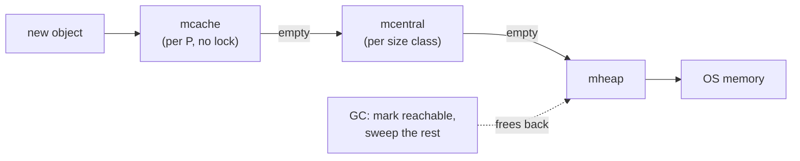
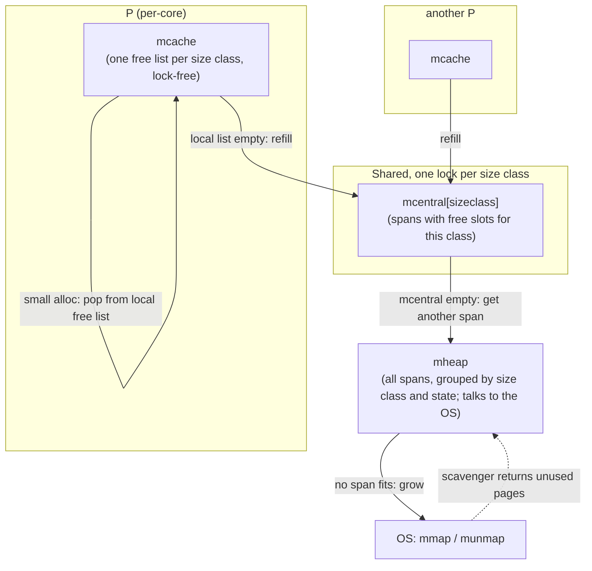
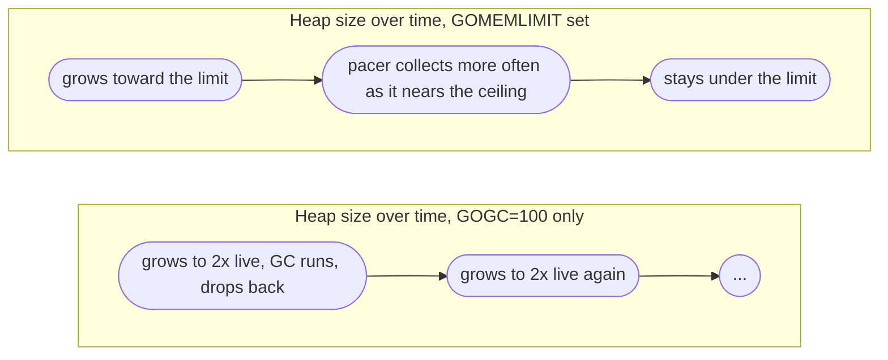

# Runtime - Memory Allocator and Garbage Collector

> [!summary] TL;DR
> Go allocates heap objects through a per-core cache (`mcache`) backed by shared pools (`mcentral`, `mheap`), sized into classes so most allocations never need a lock. A background **concurrent, tri-color, non-moving** garbage collector reclaims objects nothing points to any more, running alongside your goroutines instead of freezing the whole program. `GOGC` and `GOMEMLIMIT` are the two knobs that decide how often it runs.

> [!abstract] Core idea
> - Small objects come from **size classes** (~68 of them); an allocation rounds up to the nearest class, which bounds fragmentation and lets same-size objects share bookkeeping.
> - Each P has an `mcache` (no lock needed); it refills from a shared `mcentral` per size class, which refills from `mheap`, the central map of all memory.
> - The GC marks live objects **concurrently**, while your program keeps running, using a **write barrier** to stay correct as pointers change mid-mark.
> - `GOGC` says "run again once live memory has grown by this percent"; `GOMEMLIMIT` says "never let the heap exceed this absolute size" — most services should set both.
> - GC cost tracks **live, pointer-containing data**, not total garbage: pointer-free bytes (most byte slices, strings) are nearly free to scan.

## Start here: the basics

**The problem in one story.**
In an office, people keep taking new sheets of paper and leaving old ones on their desks.
Someone must hand out paper quickly and, now and then, collect sheets nobody needs anymore.
If collection stops the whole office, everyone waits; if it never happens, the office fills up.
Go's allocator hands out memory; its garbage collector cleans up while the program keeps working.

**Words you need first**

| Word | Plain meaning | Tiny example |
| --- | --- | --- |
| Allocation | Asking for a piece of memory | `make([]byte, 1024)` |
| Heap | Memory that lives beyond one function call | A `*User` returned from a function |
| Garbage | Memory no variable can reach anymore | A slice nobody points to |
| Garbage collector (GC) | Runtime part that finds and frees garbage | Runs automatically in the background |
| Mark and sweep | Mark everything reachable, then free the rest | Start from globals and stacks |
| Stop-the-world (STW) | A short pause of all goroutines | Usually well under 1ms in Go |
| `GOGC` | How much the heap may grow before the next GC | `GOGC=100` = grow 100% |
| `GOMEMLIMIT` | A soft cap on total Go memory | `GOMEMLIMIT=1GiB` |

**Picture it**



**Analogy.** The allocator is a stationery cupboard with a small tray on each desk; the GC is a cleaner who tags papers still in use and bins the rest during the workday.
Where it breaks: a real cleaner can't watch you move papers mid-cleanup; Go needs a write barrier to notice pointer changes during marking.

**How the rest of this note builds up**

- First, why Go manages memory for you and the mental model (sections 1-2).
- Then the allocator path (mcache, mcentral, mheap), tri-color marking, write barrier and the pacer (section 3).
- Then a worked example measuring allocations and GC, plus comparisons and trade-offs (sections 4-6).
- Finally the SDE-3 deep dive: tuning `GOGC`/`GOMEMLIMIT` in production, why pointers cost more than bytes, interview questions (sections 7-9).

> [!tip] Remember
> Go allocates fast from per-P caches and collects concurrently; fewer allocations and fewer pointers mean less GC work.

## 1. Why it exists

Manual memory management (C's `malloc`/`free`) requires knowing exactly when nobody needs an object any more. A function that returns a pointer to a struct it allocated, stored by its caller in three different data structures, cannot know — in general — whether it is safe to free, without tracking every reference.

Get it wrong by freeing too early and you get a use-after-free; get it wrong by never freeing and you leak.

Go's answer is twofold: the compiler's **escape analysis** decides, per variable, whether it can live safely on the stack — freed automatically when its function returns, no GC involved — or whether it must go on the heap because a reference to it outlives the function (see [[Pointers, Values and Escape Analysis]]).

For whatever does end up on the heap, the **garbage collector** tracks reachability from a set of roots (goroutine stacks, globals) and frees anything unreachable, so application code never calls `free`.

## 2. Mental model

Think of the allocator as a warehouse with bins of fixed-size boxes (size classes): asking for an 18-byte box gets you a 24-byte bin, because the warehouse only stocks a fixed set of sizes — simpler shelving, and a next-door bin of the same size is immediately reusable for the next same-sized request.

The garbage collector is a (mostly) separate crew that, every so often, walks the warehouse starting from the loading docks (goroutine stacks and globals) and the boxes they directly hold, following every box's own outgoing labels transitively, marking every box it reaches as "in use", and then recycling anything unmarked.

Crucially, that crew does its walk **while the warehouse keeps operating**, not during a shutdown — it just has to coordinate carefully with whoever is actively relabeling boxes mid-walk (the write barrier).

## 3. How it works

### The allocator: mcache → mcentral → mheap



A small object (≤32 KB) is allocated by rounding its size up to the nearest of **~68 size classes** (8, 16, 24, 32, 48, 64, … bytes) and taking a free slot from the current P's `mcache` for that class — no lock, because each P owns its `mcache` alone.

When a class's local free list empties, the P refills a batch from the shared `mcentral` for that class (one lock per class, so contention is spread across classes, not global), and `mcentral` in turn asks `mheap` for another **span** (a multiple of 8 KB of same-class memory) when it runs out.

A **large object** (>32 KB) skips size classes and goes straight to `mheap`, which finds or creates a span sized to fit it exactly.

A special **tiny allocator** packs multiple sub-16-byte, pointer-free objects (e.g. small strings, individual `int8`/`bool` values that escape) into one 16-byte block, because a separate size-class slot per tiny object would waste more on bookkeeping than the object itself.

Whether an allocation happens at all, and where, is decided at compile time by **escape analysis** (`go build -gcflags=-m` prints its decisions): a value that provably never outlives its function and is never captured by reference stays on the stack, costing nothing once the function returns.

That recap belongs to [[Pointers, Values and Escape Analysis]]; this note starts from "it escaped to the heap."

### Returning memory to the OS

Freed spans aren't handed back to the OS immediately — a background **scavenger** periodically `madvise`s pages that have stayed free for a while back to the OS, which is why a Go process's heap size (what `GODEBUG=gctrace` reports) and its resident set size (what the OS reports, e.g. via `top`) diverge: RSS lags heap shrinkage until the scavenger catches up.

### The garbage collector: concurrent tri-color mark-sweep

Go's GC is **non-moving** (objects never relocate, so no pointer ever needs rewriting after allocation — unlike Java's or the .NET CLR's compacting collectors) and **non-generational** (it doesn't special-case young objects; every live object is re-walked every cycle). It uses the classic **tri-color abstraction**:

- **White**: not yet proven reachable (candidate garbage).
- **Grey**: reachable, but its own pointers haven't been scanned yet.
- **Black**: reachable, and every pointer it holds has been scanned.

A cycle starts with everything white, roots pushed on as grey, and proceeds by picking a grey object, scanning its pointers (marking what it points to grey if it was white), and marking the object itself black — until no grey remains. Anything still white is unreachable and gets swept.

```mermaid
stateDiagram-v2
    [*] --> Off: GC idle, mutator runs normally
    Off --> SweepTermination: heap goal reached (pacer trigger)
    SweepTermination --> ConcurrentMark: STW #1 (brief): finish last cycle's sweep, enable write barrier
    ConcurrentMark --> ConcurrentMark: mutator runs; background mark workers (about 25% of GOMAXPROCS) scan grey objects; mutator allocations trigger mark assists
    ConcurrentMark --> MarkTermination: no grey objects remain
    MarkTermination --> MarkTermination: STW #2 (brief): finish marking, disable write barrier, compute next heap goal
    MarkTermination --> ConcurrentSweep: mutator runs; sweep reclaims white spans lazily, as allocations need them
    ConcurrentSweep --> Off: fully swept
```



Only the two **stop-the-world** pauses (sweep termination, mark termination) actually halt every goroutine, and both are designed to be sub-millisecond regardless of heap size — they do fixed, small amounts of bookkeeping, not proportional-to-heap-size work. Everything in between (the bulk of the cycle) runs **concurrently** with your program: dedicated background mark worker goroutines use roughly 25% of `GOMAXPROCS`, and if the mutator allocates faster than those workers can keep the mark phase ahead of it, the allocating goroutine itself is drafted into marking (a **mark assist**) to throttle it down rather than let the heap balloon past its goal.

### The write barrier

Marking concurrently with a running program creates a real hazard: a goroutine could move the only reference to a white object from an already-scanned (black) object into an unscanned (grey) one, then the mark phase could finish believing the white object is garbage, and sweep would free a reachable object.

Go's **write barrier** — a few extra instructions the compiler inserts around every pointer write during the concurrent mark phase — prevents this, by shading the object being pointed to grey whenever a pointer to it is written, which guarantees the invariant "no black object points to a white object" holds throughout marking (Dijkstra's insertion barrier, specifically).

The write barrier is compiled in only while a GC cycle's mark phase is active; it costs nothing between cycles.

### The pacer: GOGC and GOMEMLIMIT

The **pacer** decides when the next cycle starts, aiming for a heap goal:

```text
heap goal = live heap size × (1 + GOGC / 100)
```

`GOGC=100` (the default) means "let the heap roughly double from its last live size before collecting again" — trading memory for less CPU spent collecting. `GOGC=400` collects a quarter as often, using roughly 4x the live heap in peak memory, for services with memory to spare and a CPU-bound hot path.

`GOGC=off` disables the goal-based trigger entirely (used only alongside `GOMEMLIMIT`, see below).

Since **Go 1.19**, `GOMEMLIMIT` sets a **soft, absolute** ceiling (e.g. `GOMEMLIMIT=900MiB`) on total runtime-managed memory. The pacer runs extra GC cycles, beyond what `GOGC` alone would trigger, if the heap is approaching that limit — a safety net against OOM-killing, especially in a container with a hard memory limit, where "double the live heap" can simply exceed the container's quota regardless of `GOGC`.

The common container pattern is `GOGC=off` with `GOMEMLIMIT` set to ~90% of the container's memory limit: let the heap grow freely up to near the ceiling (minimizing GC CPU) and let `GOMEMLIMIT` alone decide when to collect. Pure `GOMEMLIMIT` with no margin risks GC thrashing (collecting almost continuously once near the limit, since every small allocation re-triggers the check) or an OOM kill if a short spike outpaces collection — the ~10% margin, plus leaving `GOGC` at its default alongside `GOMEMLIMIT` for services less confident in the limit, exists for exactly that reason.



### Cost model: why pointers matter more than bytes

GC work is proportional to the number of **pointers in live objects**, not to the number of bytes or the amount of garbage. A `[]byte` holding 10 MB of pointer-free data costs the scanner nothing beyond noting "this span has no pointers, skip it" (the runtime tracks per-span pointer bitmaps precisely so it can skip pointer-free spans entirely).

A `map[string]*Record` holding 10 MB of boxed pointers makes the collector walk every single pointer, every cycle. This is the single biggest lever for GC-bound services: prefer value types and pointer-free data (byte slices, numeric slices, flat structs) over pointer-heavy structures (maps of pointers, linked lists, interface-boxed values) wherever the access pattern allows it.

### Finalizers, cleanups, and weak pointers (Go 1.24)

`runtime.SetFinalizer` lets an object run cleanup code just before it's collected, but it has sharp edges: it delays collection by at least one extra GC cycle, never runs at all if the object is part of a reference cycle the finalizer itself would need to break, and runs on an arbitrary goroutine.

**Since Go 1.24**, `runtime.AddCleanup` replaces most finalizer use cases with a safer primitive: a cleanup function attached to an object (not the object's whole type), which doesn't keep the object reachable and may run concurrently with the object's own last use, and multiple cleanups can be attached without interfering with each other.

Go 1.24 also added `weak.Pointer[T]`: a pointer that doesn't itself keep its target alive, useful for caches that should let unreferenced entries be collected rather than pin them forever.

### Observing the GC

`GODEBUG=gctrace=1` prints one line per cycle:

```text
gc 1 @0.000s 5%: 0.017+0.090+0.002 ms clock, 0.17+0.065/0.088/0+0.023 ms cpu, 1->1->0 MB, 2 MB goal, 0 MB stacks, 0 MB globals, 10 P
gc 2 @0.000s 5%: 0.010+0.10+0.027 ms clock, 0.10+0.022/0.058/0.003+0.27 ms cpu, 1->2->0 MB, 2 MB goal, 0 MB stacks, 0 MB globals, 10 P
```

**Measured output** (go1.24.4 darwin/arm64, Apple M4, `GOGC=50 GODEBUG=gctrace=1`) from a program allocating 2,000 short-lived 64 KiB byte slices and retaining every 50th one. Reading the fields: `gc 1` is the cycle number; `@0.000s` is time since program start; `5%` is the cumulative fraction of CPU time spent in GC so far; `0.017+0.090+0.002 ms clock` is wall-clock time for sweep termination + concurrent mark/scan + mark termination; the `cpu` group breaks the concurrent-mark time down further (assist/background/idle); `1->1->0 MB` is heap size at mark start → mark end → after sweep; `2 MB goal` is the pacer's target for this cycle; and `10 P` is `GOMAXPROCS`.

The 64 KiB allocations are pointer-free `[]byte`, so each cycle's actual mark work here is near-zero — the trace is dominated by small, fixed per-cycle overhead, not by the amount of data allocated, which is itself a demonstration of the pointer-free cost model above.

`runtime/metrics` exposes the same and more as typed, stable counters (`/gc/heap/goal:bytes`, `/gc/cycles/total:gc-cycles`, `/memory/classes/...`) for production dashboards, and is preferred over parsing `GODEBUG` text in code. A heap profile (`go tool pprof` on `/debug/pprof/heap`, see [[Benchmarks, Profiling and Tracing]]) shows *where* allocations come from, which `gctrace` cannot.

### Green Tea GC (experimental, Go 1.25)

Go 1.25 ships an experimental GC implementation, nicknamed "Green Tea," that groups small objects by memory span rather than scanning them individually, aiming to cut mark-phase overhead for allocation-heavy workloads; enable it with `GOEXPERIMENT=greenteagc`.

As of Go 1.25 it is opt-in, not the default, and whether or when it becomes default in a later release is not yet documented (verify before relying on it in production).

## 4. Worked example

### Whiteboard version

```go
package wb

// Grow: no size hint, the slice reallocates and copies repeatedly as it
// crosses each internal growth threshold — classic allocator pressure.
func Grow(n int) []int {
	var s []int
	for i := 0; i < n; i++ {
		s = append(s, i)
	}
	return s
}

// Prealloc: one allocation, sized exactly, up front.
func Prealloc(n int) []int {
	s := make([]int, 0, n)
	for i := 0; i < n; i++ {
		s = append(s, i)
	}
	return s
}
```

The measured difference between these two (next section) is the single most common GC-pressure fix in real code: know your size, allocate once.

### Benchmark: preallocation vs growth

```go
package allocbench

import "testing"

func buildGrow(n int) []int {
	var s []int
	for i := 0; i < n; i++ {
		s = append(s, i)
	}
	return s
}

func buildPrealloc(n int) []int {
	s := make([]int, 0, n)
	for i := 0; i < n; i++ {
		s = append(s, i)
	}
	return s
}

func BenchmarkBuildGrow(b *testing.B) {
	b.ReportAllocs()
	for i := 0; i < b.N; i++ {
		buildGrow(1000)
	}
}

func BenchmarkBuildPrealloc(b *testing.B) {
	b.ReportAllocs()
	for i := 0; i < b.N; i++ {
		buildPrealloc(1000)
	}
}
```

**Measured** (`go test -bench=. -benchmem -count=1`, go1.24.4 darwin/arm64, Apple M4):

```text
BenchmarkBuildGrow-10        594721       1958 ns/op     25208 B/op     12 allocs/op
BenchmarkBuildPrealloc-10   1638664      741.7 ns/op      8192 B/op      1 allocs/op
```

Growing without a hint costs **12 allocations** (each growth threshold crossed reallocates and copies everything so far) and **3x the bytes** actually needed (over-allocation from doubling growth), versus **1 allocation** of exactly `1000 * 8 = 8192` bytes when the size is known up front.

This is the allocator's size-class and growth behaviour showing up directly in `allocs/op`; fewer, larger allocations is almost always the right GC-pressure fix, not a smaller `GOGC`.

### A sync.Pool buffer pool (logic code, tested)

`sync.Pool` is the standard tool for reusing short-lived, same-shaped buffers across requests instead of allocating fresh ones every time — its contents are *not* guaranteed to survive a GC cycle (the runtime may drop pooled items to reclaim memory, via an internal "victim cache" mechanism), so it's for optimisation, never for objects that must persist.

```go
// Package bufpool shows a sync.Pool of reusable byte buffers: the pattern
// production code uses to cut allocator and GC pressure for short-lived,
// same-shaped buffers (e.g. one per HTTP request).
package bufpool

import "sync"

// Pool hands out []byte buffers of at least `size` bytes and lets callers
// return them for reuse. The zero value is not usable; use New.
type Pool struct {
	p    sync.Pool
	size int
}

func New(size int) *Pool {
	pl := &Pool{size: size}
	pl.p.New = func() any {
		b := make([]byte, size)
		return &b // store a pointer: putting a slice value would box on every Put
	}
	return pl
}

// Get returns a buffer of length p.size. Its contents are unspecified.
func (p *Pool) Get() []byte {
	bp := p.p.Get().(*[]byte)
	return *bp
}

// Put returns buf to the pool. Callers must not use buf after Put.
func (p *Pool) Put(buf []byte) {
	if cap(buf) < p.size {
		return // too small to be this pool's buffer; drop it instead of poisoning the pool
	}
	buf = buf[:p.size]
	p.p.Put(&buf)
}
```

```go
package bufpool

import (
	"sync"
	"testing"
)

func TestGetReturnsRequestedSize(t *testing.T) {
	p := New(4096)
	b := p.Get()
	if len(b) != 4096 {
		t.Fatalf("len = %d, want 4096", len(b))
	}
	p.Put(b)
}

// TestConcurrentGetPut proves the pool is safe under -race: many goroutines
// borrow, write into their own buffer only, and return it, with no sharing.
func TestConcurrentGetPut(t *testing.T) {
	p := New(256)
	var wg sync.WaitGroup
	for i := 0; i < 50; i++ {
		wg.Add(1)
		go func(n int) {
			defer wg.Done()
			for j := 0; j < 200; j++ {
				b := p.Get()
				b[0] = byte(n) // only this goroutine holds b until Put
				p.Put(b)
			}
		}(i)
	}
	wg.Wait()
}
```

Ran with `go vet ./...` (clean) and `go test -race ./...` (go1.24.4 darwin/arm64): **PASS**, both tests.

## 5. Variants and comparison

| Approach | How it decides what's garbage | Pauses | Use when |
| --- | --- | --- | --- |
| Go: concurrent, non-moving, non-generational tri-color | Mark-sweep from roots, write barrier keeps it correct concurrently | Two short STW phases, fixed cost regardless of heap size | Go's only option; tuned via `GOGC`/`GOMEMLIMIT` |
| Reference counting (Python's primary mechanism, Swift ARC) | Each object carries a live count, freed at zero | No big pauses, but per-assignment overhead everywhere; needs a cycle collector for reference cycles | Predictable per-object lifetime matters more than raw throughput |
| Generational, compacting (JVM G1/ZGC, .NET) | Young objects collected far more often (most die young); survivors promoted; compaction removes fragmentation | Modern collectors (ZGC, Shenandoah) achieve sub-millisecond pauses too, via different tricks (regioned, concurrent compaction) | Workloads with very high allocation churn and a clear young/old split |
| Manual (`malloc`/`free`, Rust's ownership model) | Programmer (C) or compile-time ownership rules (Rust) decide exactly | None from a collector | Maximum control, no collector pause story at all, at the cost of manual correctness burden (or, in Rust, a stricter type system) |

## 6. Trade-offs and when not to use

- **Non-moving means no compaction**: long-lived programs with a churn of different-sized allocations can fragment the heap, inflating RSS versus live-byte count, with nothing the GC itself does to fix it. The scavenger helps return *unused* pages, but it can't defragment pages still partly in use.
- **Non-generational** re-walks every live object every cycle, even ones that haven't changed in months — a cost a generational collector would mostly skip for old, stable objects. This is a known, deliberate trade-off: generational GC in Go would need either compaction or extra write-barrier bookkeeping burden that the Go team judged not worth it for typical Go workloads.
- Tuning `GOGC` down trades CPU for memory in the wrong direction if your workload is CPU-bound and memory-rich: you'll burn CPU on more frequent cycles for marginal RSS savings.
- For allocation-light, short-lived CLI tools, none of this matters: the default `GOGC=100` with no `GOMEMLIMIT` is fine, and spending time tuning it is wasted effort.

## 7. In production

- **Real systems:** virtually every long-running Go service tunes at least `GOMEMLIMIT` once deployed in containers (Kubernetes CPU/memory limits are exactly the scenario `GOMEMLIMIT` was built for); high-throughput services (API gateways, in-memory caches written in Go) commonly raise `GOGC` well above 100 when memory headroom exists and GC CPU is the bottleneck.
- **Failure modes → fixes:**
  - OOM-killed in a container despite `GOGC=100` → the "heap doubles" goal can simply exceed the container's hard limit under one allocation spike; set `GOMEMLIMIT` to ~90% of the container limit.
  - High, sustained GC CPU (`gctrace`'s cumulative percentage climbing) under high allocation-rate code → profile allocations with a heap profile, fix the hot allocation sites (preallocate, pool, use value types), *then* consider raising `GOGC` if memory allows.
  - A service's RSS keeps climbing even though the heap goal looks stable → check for a goroutine leak (each stack is itself retained memory) or a growing pointer-heavy cache (map of pointers with no eviction) before blaming the GC itself.
  - Misusing `sync.Pool` for objects that must persist (its contents can be dropped across any GC) → use a real cache (an LRU, or [[Hash Tables and Go Maps]] with explicit eviction) instead.
- **What to monitor:** `/gc/heap/goal:bytes` and current heap size from `runtime/metrics`, GC CPU fraction, RSS vs heap size (divergence signals fragmentation or a slow scavenger), goroutine count (a proxy for retained stack memory), and p99 latency correlated against GC cycle timestamps if STW pauses are suspected (they're sub-millisecond by design, but assist-heavy mark phases can still show up as tail latency).

## 8. Deep dive

- **Mark assists in detail.** If background mark workers (their fixed ~25% GOMAXPROCS budget) fall behind an allocation-heavy mutator, any goroutine that allocates is required to do a proportional amount of marking work itself before its allocation is allowed to proceed — self-throttling the exact goroutines causing the heap to grow fastest, rather than letting the heap balloon unboundedly past its goal. This is why a single allocation in a hot loop can occasionally show elevated latency during a GC cycle: it may be doing someone else's mark work.
- **Why 25% specifically.** The target is deliberately conservative — leaving most CPU for your actual program — but is itself a tunable constant in the runtime source (`gcBackgroundUtilization`), chosen empirically rather than derived from first principles.
- **Stack scanning.** Goroutine stacks are roots and are scanned precisely (the compiler emits stack maps describing exactly which stack slots hold pointers at each safe point), not conservatively — unlike some collectors (e.g. the Boehm GC for C) that must treat anything that *looks* like a pointer as one, risking retaining garbage that merely resembles a valid address.
- **Why non-moving simplifies cgo.** Because Go's GC never moves an object, a pointer handed to C code via cgo stays valid for as long as C holds it (modulo the cgo rules about not storing Go pointers in C for GC's reachability purposes) — a moving/compacting collector would need a pinning mechanism for every such handoff.
- **Swiss-table maps, Go 1.24.** Go 1.24 reimplemented the built-in `map` using a Swiss-table-style design (open addressing with SIMD-friendly control bytes) in place of the previous bucket-chaining implementation, improving map performance and memory locality without changing map semantics; this interacts with GC cost because a map's scanning cost depends on how its backing storage is laid out, and the new design was chosen partly to keep that scanning cheap. See [[Arrays, Slices and Maps (with internals)]] for the map internals themselves; this note only notes the GC-relevant angle.

## 9. Interview questions

> [!question]- Walk through mcache → mcentral → mheap for a small allocation.
> The current P's `mcache` holds a per-size-class free list; a small object pops a slot from there with no lock. When that list is empty, the P refills a batch from the `mcentral` for that size class (one lock per class). When `mcentral` itself is out of spans for that class, it requests another span from `mheap`, which grows from the OS if needed.

> [!question]- Is Go's GC stop-the-world?
> Mostly not. There are two brief STW phases per cycle (sweep termination, mark termination), both designed to take a small, roughly fixed amount of time regardless of heap size. The bulk of marking happens concurrently, alongside your goroutines, coordinated by a write barrier.

> [!question]- What does the write barrier actually prevent?
> During concurrent marking, a goroutine could overwrite a black (fully-scanned) object's pointer field to point at a white (unscanned) object, after removing the only other reference to that white object — without the write barrier, the collector could finish believing the white object is garbage and free something still reachable. The write barrier shades the newly-referenced object grey on every pointer write during marking, preserving the "no black points to white" invariant.

> [!question]- You have `GOGC=100` in a container with a hard 1 GiB memory limit, and the live heap briefly hits 600 MiB. What can go wrong, and how do you fix it?
> The pacer's goal is `live × 2`, so it may let the heap grow toward 1.2 GiB before collecting again — past the container's limit, risking an OOM kill. Set `GOMEMLIMIT` to roughly 900 MiB (about 90% of the container limit) so the pacer collects more aggressively as it nears that ceiling, independent of what `GOGC` alone would allow.

> [!question]- Why does a `[]byte` of 100 MB cost the GC almost nothing to scan, while a `map[string]*User` with a few thousand entries can show up in profiles?
> GC mark cost is proportional to pointers in live objects, not bytes. A byte slice is tracked as pointer-free and skipped entirely during scanning. A map of pointers requires the collector to visit every single pointer value to determine what it keeps alive, every cycle, regardless of how little total data that represents.

> [!question]- Interview trap: "Setting GOGC very high eliminates GC pauses." True or false?
> False. It reduces GC *frequency*, trading memory for CPU, but every cycle that does run still has its two STW phases — they just happen less often. It also increases peak memory proportionally, and can increase OOM risk in a constrained container unless paired with `GOMEMLIMIT`.

> [!question]- When would `sync.Pool` be the wrong tool?
> When the pooled value must survive — its contents can be dropped by the runtime across any GC cycle (an internal victim-cache mechanism), so it is only for optional reuse of short-lived, recreatable buffers, never for state that must persist, like a connection or a cache entry a correctness-critical path depends on.

## 10. Cheat sheet

- Small allocs: `mcache` (per-P, no lock) → `mcentral` (per size class, one lock) → `mheap` (talks to the OS); >32 KB skips size classes entirely.
- GC is concurrent, tri-color (white/grey/black), mark-sweep, non-moving, non-generational; only two STW phases, both sub-millisecond by design.
- Write barrier keeps concurrent marking correct; compiled in only during the mark phase.
- `heap goal = live × (1 + GOGC/100)`; default `GOGC=100` means "let the heap double."
- `GOMEMLIMIT` (1.19+) is a soft absolute ceiling; the container pattern is `GOGC=off` + `GOMEMLIMIT` at ~90% of the container limit, or default `GOGC` plus `GOMEMLIMIT` as a safety net.
- GC cost tracks pointers in live data, not garbage volume or total bytes: prefer pointer-free, value-typed, preallocated data.
- `runtime.AddCleanup` (1.24) and `weak.Pointer[T]` (1.24) are the modern, safer alternatives to `SetFinalizer` for cleanup and cache eviction.
- Observe with `GODEBUG=gctrace=1` (or `runtime/metrics` for dashboards) and heap profiles for *where* allocations come from.

## Links

- **Before this:** [[Pointers, Values and Escape Analysis]], [[Process Memory Layout - Stack vs Heap]], [[Runtime - Goroutine Scheduler (GMP)]]
- **Next:** [[Benchmarks, Profiling and Tracing]]
- **Compare with:** [[Arrays, Slices and Maps (with internals)]] (how slice growth drives the allocation patterns this note measures)

### Watch on YouTube

- [GopherCon 2015: Go GC: Solving the Latency Problem - Rick Hudson](https://www.youtube.com/watch?v=aiv1JOfMjm0) · Gopher Academy · foundational talk on the design of Go's concurrent GC
- [GopherCon 2022: Control Theory and Concurrent Garbage Collection Deep Dive - Madhav Jivrajani](https://www.youtube.com/watch?v=We-8RSk4eZA) · Gopher Academy · deep dive on GC pacing and GOGC/GOMEMLIMIT tuning
