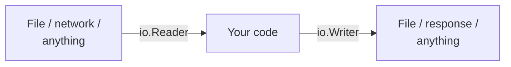
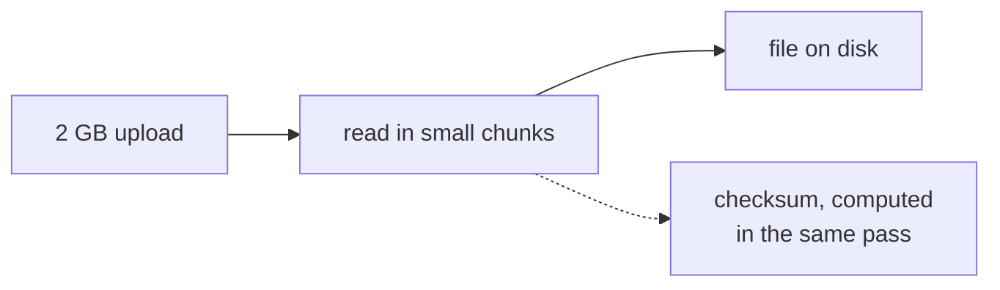
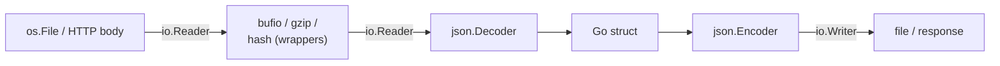
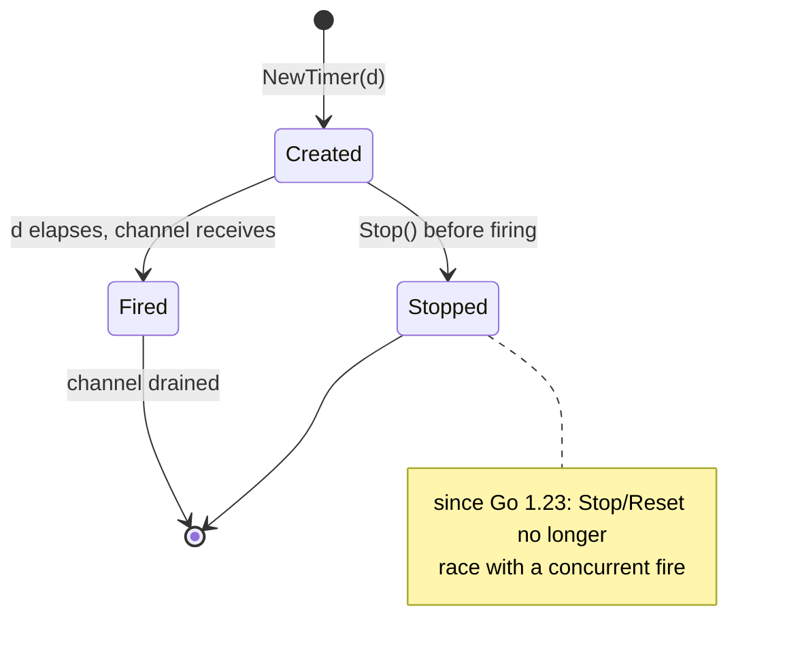
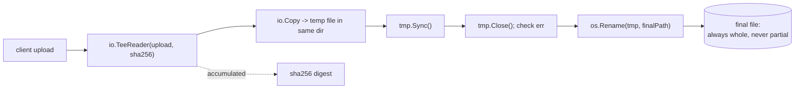

# Standard Library Essentials (time, io, files, encoding)

> [!summary] TL;DR
> Four packages carry most backend Go code: `time` for wall-clock and durations, `io`/`bufio` for streaming bytes without loading everything into memory, `os`/`path/filepath`/`io/fs` for files, and a handful of `encoding`/`crypto` packages for turning bytes into text and back. They are small interfaces that compose, and most production bugs here come from ignoring an error, not from a hard algorithm.

> [!abstract] Core idea
> - `time.Time` is a value with a wall-clock reading, an optional monotonic reading, and a location; compare instants with `Equal`/`Before`/`After`, never `==`.
> - `io.Reader` and `io.Writer` are one-method interfaces; `io.Copy`, `TeeReader`, `MultiWriter` and `LimitReader` build pipelines out of them without buffering the whole payload.
> - Writing a file safely means checking the error from `Close`, not just from `Write`, and renaming a finished temp file into place instead of writing in place.
> - `bufio.Scanner` silently stops at 64KB per token unless you grow its buffer.
> - Stdlib crypto/encoding helpers (`base64`, `hex`, `sha256`, `hmac`) are usually enough; reach for a library only past that.

## Start here: the basics 🟢

> [!info] How to read this note (pick your level)
> - 🟢 **New to this?** Read "From zero" below, then sections 1, 2 and the cheat sheet (10). Stop there, that is a full first pass.
> - 🟡 **Know the basics?** Add section 3 (how each package works) and 4 (worked example).
> - 🔴 **Interview / SDE-3 prep?** Add 7, 8 and 9. Headings are tagged 🟢🟡🔴 so you always know where you are.

> [!note] Before this note
> - [[Syntax, Types and Control Flow]]: you can read functions, structs and `for` loops.
> - [[Error Handling]]: Go functions return an `error` you check with `if err != nil`; ignoring it hides real failures.
> - [[Strings, Bytes, Runes and Unicode]]: a string is bytes, and `[]byte` is a changeable slice of bytes. Files and network data arrive as bytes.

**From zero, in 60 seconds** 🟢

Every program needs the same boring jobs done: know what time it is, read a file, write a file, turn data into text and back. Go ships ready-made code for all of that. That bundle is called the **standard library** — packages that come with Go, no download needed.

The clever part is one tiny idea: anything you can read bytes from is an **io.Reader**, and anything you can write bytes to is an **io.Writer**. A file, a network connection, a zip — all the same shape.



Because everything has the same shape, pieces snap together like pipe fittings. Read a file, hash it, and save it — all in one flow, piece by piece, without loading it all into memory.



The rest of this note is just these 4 questions:
1. How do you handle dates and times without timezone bugs?
2. How do you stream big data without big memory?
3. How do you write a file so a crash never leaves it half-written?
4. Which encoding/hashing helper do you reach for, and when?

**The problem in one story.**
Your service must log the time, read a 2 GB upload, save it to disk and return JSON.
Writing date maths, file handling and JSON parsing yourself would take weeks and be buggy.
Go's standard library ships all of these, built around a few small interfaces that plug together.

**Words you need first**

| Word | Plain meaning | Tiny example |
| --- | --- | --- |
| Standard library | Packages that come with Go | `time`, `io`, `os`, `encoding/json` |
| Interface | A set of methods a type promises to have | `io.Reader` has `Read(p []byte)` |
| Stream | Data handled piece by piece, not all at once | Copying a file in 32 KB chunks |
| Buffer | Temporary memory that batches small reads or writes | `bufio.NewWriter(f)` |
| Duration | A length of time | `5 * time.Second` |
| Monotonic clock | A clock that only moves forward, for measuring | `time.Since(start)` uses it |
| Encoding | Turning data into bytes and back | `json.Marshal(user)` |
| UTC | The world's reference clock with no time-zone offset; India (IST) is UTC+5:30 | `2026-11-07T00:00:00Z` |
| DST | Daylight saving time: some countries move clocks 1 hour twice a year | a "day" can be 23 or 25 hours |
| Atomic (file write) | Readers see either the whole old file or the whole new one, never a mix | write temp, then `os.Rename` |
| Hash / checksum | A short fingerprint of data; any change gives a different fingerprint | `sha256.Sum256(data)` |
| HMAC | A fingerprint made with a secret key, so only key holders can make a valid one | webhook signature check |
| Path traversal | An attacker using `../` in a file name to reach files outside the allowed folder | `../../etc/passwd` |

**Picture it**



**Analogy.** `io.Reader` and `io.Writer` are standard pipe fittings: any pipe connects to any other.
Where it breaks: real pipes leak visibly; a forgotten `Close` or `Flush` loses data silently.

**How the rest of this note builds up**

- First, why a small set of shared interfaces matters and the mental model (sections 1-2).
- Then each area: `time`, `io` and `bufio`, files and paths, encoding and hashing (section 3).
- Then a worked example wiring them together, plus comparisons and trade-offs (sections 4-6).
- Finally the SDE-3 deep dive: production gotchas (timers, buffering, atomic writes), interview questions (sections 7-9).

> [!tip] Remember
> Most of the standard library is small types plugged together through `io.Reader` and `io.Writer`.

## 1. Why it exists 🟢

An invoice service in Go 1.24 has to: parse a due date from a form field, store an uploaded PDF without ever leaving a half-written file if the client disconnects mid-upload, and compute a checksum of that file for later integrity checks. Three one-line mistakes are common here:

1. `time.Parse("2006-01-02", dueDate)` compiles, returns no error for a valid date, and is still wrong: it returns the date in **UTC**, not in the caller's intended timezone. For a company whose invoices use IST (India Standard Time) due dates, every "2026-11-07" becomes `2026-11-07T00:00:00Z`, which is 05:30 IST on the 7th — 5.5 hours *after* local midnight, so every deadline check is off by 5.5 hours (an invoice due at the start of the 7th is still treated as not due until 5:30 am).
2. `f, _ := os.Create(path); io.Copy(f, upload); f.Close()` — ignoring the error from `Close` — means a full disk or an NFS (network file system: a disk on another machine) write-back failure during `Close` is silently swallowed, and the invoice "succeeds" with a truncated PDF on disk.
3. `os.WriteFile(path, data, 0644)` writes in place. If the process crashes mid-write (deploy, OOM kill: the OS killing it for using too much memory), the next reader of `path` sees a partial file; there was no point at which the old and new versions didn't both risk being broken.

Each of these is a standard-library idiom away from being correct, and all three idioms — `ParseInLocation`, checking `Close`'s error, and write-to-temp-then-rename — are this note.

## 2. Mental model 🟢

The standard library's I/O and file packages are built from a few tiny interfaces that compose like Unix pipes:

```text
io.Reader  --- Read(p []byte) (n int, err error)
io.Writer  --- Write(p []byte) (n int, err error)
io.Copy(dst, src)      moves bytes until src returns io.EOF
io.TeeReader(r, w)     every byte read from r is also written to w
io.LimitReader(r, n)   stops after n bytes, even if r has more
io.MultiWriter(ws...)  one Write fans out to every w
```

`time.Time` is a value, not a pointer: it carries a wall-clock reading (what a calendar/clock would show), an optional **monotonic** reading (a clock that only moves forward, used for measuring elapsed time on the same machine), and a `*Location`.

Two `time.Time` values for "the same instant" can still differ in location or in whether they carry a monotonic reading, so `==` is the wrong comparison; `Equal` compares the instant only.

## 3. How it works 🟡

> 🟢 → 🟡 **You now know** that the standard library covers time, files and encoding, and that `io.Reader`/`io.Writer` let pieces plug together. **Next we open the box**: how `time` really stores and compares instants, how `io` and `bufio` stream data, how to write files safely, and which encoding or hash to pick.

### time: instants, durations, timers

**In plain words:** a `time.Time` is like a photo of a clock plus a label saying which city's clock it was — comparing two photos needs `Equal`, not `==`.

- **Fields and comparison.** `t.Year()/Month()/Day()` read wall-clock fields in `t`'s location. `t.UTC()`/`t.In(loc)` convert the location without changing the instant. Use `a.Equal(b)` for "same instant", `a.Before(b)`/`a.After(b)` for ordering, and reserve `==` for things like map keys where you deliberately want location and monotonic-reading equality too.
- **Elapsed time.** `time.Since(start)` and `time.Until(deadline)` use the monotonic reading when `start`/`deadline` still carry one, so they are immune to the wall clock being adjusted (NTP: the service that syncs the clock over the network; or a manual clock change) mid-measurement. Values decoded from JSON, a database, or `ParseInLocation` have **no** monotonic reading — they are reconstructed from wall-clock fields — so timing code should call `time.Now()` fresh, not reuse a parsed/stored time.
- **Layouts.** Go formats and parses dates with a **reference time**, not strftime-style verbs (the `%Y-%m-%d` codes other languages use): `Mon Jan 2 15:04:05 MST 2006` (`01/02 03:04:05PM '06 -0700`, mnemonically `1 2 3 4 5 6 7`). `time.DateOnly` (`"2006-01-02"`) and `time.RFC3339` are predefined layout constants since Go 1.20.
- **Parse vs ParseInLocation.** `time.Parse(layout, s)` assumes **UTC** when `s` has no zone/offset in it. `time.ParseInLocation(layout, s, loc)` assumes `loc` instead. For a date-only string with business meaning (a due date, a booking date), always use `ParseInLocation` with the business's timezone, store the result as UTC (`t.UTC()`), and never ignore the returned error — a malformed date must fail loudly, not silently become the zero time.
- **Duration arithmetic and DST.** `t.Add(d)` moves by an exact `time.Duration` (nanoseconds) — correct for "in 30 minutes". `t.AddDate(y, m, d)` moves by calendar units and re-normalizes wall-clock fields, so "add 1 day" across a DST transition in a timezone that observes it lands on the *same wall-clock hour*, which can be a 23- or 25-hour gap in absolute time. For calendar concepts (due date, billing cycle, "next Monday") use `AddDate`; for actual time intervals (timeouts, TTLs: how long a cached item may live; SLAs: promised response times) use `Add`.
- **Timer and Ticker.** `time.NewTimer`/`time.NewTicker` return a channel that fires once (`Timer`) or repeatedly (`Ticker`). Before Go 1.23, an unstopped `Timer`/`Ticker` was never garbage-collected even after its last reference was dropped, and `Stop`/`Reset` racing with a firing channel was a known footgun. Since Go 1.23, unreferenced `Timer`/`Ticker` values are eligible for GC without calling `Stop`, and `Stop`/`Reset` are synchronized with the firing goroutine, closing that race class — but calling `Stop()` when you are done is still good practice for releasing the timer's resources promptly and for readability. `time.After(d)` in a `for`/`select` loop allocates a new `Timer` on every iteration that is only ever drained by firing, which is wasteful in a hot loop; reuse a single `Timer` with `Reset` instead.



### io and bufio: streaming without buffering everything

**In plain words:** instead of pouring a whole lake into a bucket, you pass water along cup by cup — `io.Copy` and friends move data in small chunks so memory stays tiny.

- **Composition.** `io.Copy(dst, src)` streams in fixed-size chunks (32KB by default, or `src`'s own `WriteTo`/`ReadFrom` if it implements one) — a 2GB file copies without a 2GB buffer. `io.TeeReader(r, w)` lets you compute a hash *while* copying, in one pass, instead of reading the data twice. `io.LimitReader(r, n)` caps how much a handler will read from a client body, which is also a denial-of-service guard (stops one client from flooding the server with a huge body). `io.MultiWriter(a, b)` writes once, fans out to both. `io.Pipe()` returns a synchronous in-memory `*PipeWriter`/`*PipeReader` pair with no buffer: a `Write` blocks until a matching `Read` consumes it (and vice versa) — the standard way to feed something that only accepts an `io.Reader` (like `http.NewRequest`'s body) from something that only produces via `io.Writer` (like `json.NewEncoder`), by running the writer side in its own goroutine.
- **bufio.Scanner's token limit.** `bufio.NewScanner(r)` defaults to a 64KB (`bufio.MaxScanTokenSize`) maximum token (by default, one line with `ScanLines`). A longer line makes `Scan()` return `false` and `Err()` return `bufio.ErrTooLong` — not a crash, just silently-stops-reading unless you check `Err()`. Call `sc.Buffer(buf, max)` to raise the cap.
- **bufio.Writer.Flush.** A `bufio.Writer` buffers writes in memory; the underlying writer never sees the last partial buffer until `Flush()` (or `Close()` on types that call it) runs. Forgetting `Flush` is how "the file is empty" bugs happen when a program exits right after writing.

### Files and paths

**In plain words:** saving a file safely is like swapping a painting in a gallery — you hang the new one next to it fully finished, then swap in one move (`Rename`), so no visitor ever sees a half-painted canvas.

- **Whole-file helpers.** `os.ReadFile`/`os.WriteFile` are the right tool for small, complete files (open, do the I/O, close, in one call) — they are not streaming APIs. `os.OpenFile(path, flag, perm)` gives control: `O_RDONLY`/`O_WRONLY`/`O_RDWR`, `O_CREATE`, `O_TRUNC` (truncate existing content), `O_APPEND` (writes always go to the end, atomically per write on POSIX: the Unix standard Linux and macOS follow), `O_EXCL` (fail if the file already exists — useful for "create, don't overwrite").
- **Check Close's error.** `Write` can return `nil` even though the data isn't safely on disk yet if the writer buffers internally (true of some network filesystems and, for `*os.File`, true of the final flush at `Close` on some platforms/filesystems). Always check the error from `Close`, especially on the write path; see `AtomicWriteFile` below.
- **Atomic replace.** `os.Rename(oldpath, newpath)` is atomic when both paths are on the same filesystem (POSIX guarantee; true on the same Windows volume too): a reader of `newpath` always sees either the fully old file or the fully new one, never a partial write. The pattern — write to a temp file in the *same directory* as the target (so the rename doesn't cross filesystems), `Sync()` it (force the data from memory onto the disk), `Close()` it and check the error, then `Rename` — is how services write config, cache, and generated files safely.
- **filepath vs path.** `path/filepath` is OS-aware (`\` on Windows, honors `filepath.Separator`) and is for real filesystem paths. `path` always uses `/` and is for URL-like paths that are never touched by the OS. Mixing them up breaks on Windows.
- **Directory trees.** `filepath.WalkDir(root, fn)` (the `fs.WalkDirFunc` form, faster than the older `filepath.Walk` because it avoids a stat per entry) walks a real directory. `io/fs.FS` is a read-only filesystem interface implemented by `os.DirFS(dir)`, `embed.FS` (files baked into the binary at compile time via `//go:embed`), and, in tests, `testing/fstest.MapFS` — the same `ReadConfig` function below works unchanged against a real directory or a fake in-memory one. **Since Go 1.24**, `os.OpenRoot(dir)` returns an `*os.Root` whose `Open`/`Create`/`Stat` methods are confined to `dir`: even a path like `../../etc/passwd` or a symlink (a file that is just a pointer to another path) that points outside `dir` cannot escape it, which is the stdlib's answer to path-traversal bugs from untrusted file names (for example, a user-controlled attachment filename).
- **Never trust a user-supplied path directly.** `filepath.Join(base, userInput)` does not stop `userInput` from containing `..` segments; `filepath.Clean` normalizes but still won't prevent an absolute path from replacing `base` entirely in `Join`'s result if not checked. Validate with `filepath.IsLocal` (Go 1.20+, true only for paths that stay within and don't escape the root they'd be joined to) or use `os.Root` (Go 1.24) for the filesystem boundary itself.



### Encoding, hashing and a few more

**In plain words:** encodings are just safe ways to write raw bytes as text (like spelling a word out letter by letter over the phone), and hashes are short fingerprints of data.

- **base64.** `base64.StdEncoding` (`+`/`/`, padded with `=`) is for general binary-to-text; `base64.URLEncoding` (`-`/`_`) is safe inside URLs and filenames. `RawStdEncoding`/`RawURLEncoding` drop the `=` padding, which some systems (JWT: the signed login tokens many APIs use) require.
- **hex.** `encoding/hex.EncodeToString`/`DecodeString` — the simplest binary-to-text form, twice the length of the input, used for checksums and IDs that need to be eyeballed.
- **sha256 and hmac.** `crypto/sha256.Sum256(data)` for content fingerprints (not for passwords — use `golang.org/x/crypto/bcrypt` for those). `crypto/hmac.New(sha256.New, key)` for a keyed, forgery-resistant checksum (webhook signature verification); always compare the computed and received MAC with `hmac.Equal`, which runs in constant time (always takes the same time, whatever the input) and avoids leaking timing information a byte-by-byte `==` would.
- **net/url.** `url.Parse` splits a URL into scheme/host/path/query. `url.QueryEscape`/`QueryUnescape` encode for a query string (spaces become `+`); `url.PathEscape` encodes for a path segment (spaces become `%20`) — using the wrong one is a common bug in hand-built URLs.
- **regexp.** Compiles to RE2, which guarantees linear-time matching (no catastrophic backtracking, where some patterns take exponentially long on crafted input) but does not support backreferences or lookaround; `regexp.MustCompile` panics on a bad pattern and is meant for patterns known at compile time, never for an untrusted pattern string.
- **text/template vs html/template.** Same syntax, different escaping: `text/template` does none, `html/template` **contextually** escapes output for HTML, so interpolating untrusted data through `text/template` into an HTTP response is a stored-XSS bug (an attacker's saved text runs as script in other users' browsers) waiting to happen. Never use `text/template` to render anything sent to a browser.
- **os/exec and os/signal.** `exec.CommandContext(ctx, name, args...)` ties a subprocess's lifetime to a context, so a cancelled request kills the child instead of leaking it; `CombinedOutput`/`Output` capture stdout/stderr. `signal.Notify(ch, os.Interrupt, syscall.SIGTERM)` is how a service catches a graceful-shutdown signal from its orchestrator (the system that starts and stops your containers, like Kubernetes) instead of dying mid-request.
- **math/rand/v2 vs crypto/rand.** `math/rand/v2` (Go 1.22+) is fast and reproducible with a seed — fine for load-test jitter, shuffling non-security data, or sampling. It is never safe for tokens, session IDs, or anything an attacker could predict and exploit; use `crypto/rand.Read` (or `crypto/rand.Text()`, added in Go 1.24, for a ready-made random string) for those.

## 4. Worked example 🟡

### Whiteboard version

The shape every I/O-writing function in a Go backend should have: read once, compute what you need from the stream, write to temp, fsync, close-and-check, rename.

```go
func SaveAtomic(dir, name string, r io.Reader) error {
	tmp, _ := os.CreateTemp(dir, name+".tmp-*")
	io.Copy(tmp, r)
	tmp.Sync()
	return os.Rename(tmp.Name(), filepath.Join(dir, name)) // skips the Close()-error check; see the full version
}
```

The full version below checks every error, including `Close`'s, and reports a checksum computed in the same pass. It compiles and passes `go vet` and `go test -race` on Go 1.24.4.

**What this code does, in plain words:** `AtomicWriteFile` creates a temp file next to the target, copies the incoming data into it while a `TeeReader` feeds the same bytes into a SHA-256 hasher, forces it to disk with `Sync`, closes it and checks that error, then renames it over the real name. If anything fails, a deferred cleanup deletes the temp file. It returns the checksum and the byte count.

```go
// Package stdlib is the tested source for the Standard Library Essentials note.
package stdlib

import (
	"crypto/sha256"
	"encoding/hex"
	"fmt"
	"io"
	"os"
	"path/filepath"
)

// AtomicWriteFile streams r into dir/name without ever leaving a half-written
// file at that path: it writes to a temp file in the same directory, fsyncs
// it, then renames it into place (rename is atomic on the same filesystem).
// It returns the SHA-256 of the bytes written, computed in the same pass via
// a TeeReader so the data is only read once.
func AtomicWriteFile(dir, name string, r io.Reader) (sha256hex string, n int64, err error) {
	tmp, err := os.CreateTemp(dir, name+".tmp-*")
	if err != nil {
		return "", 0, fmt.Errorf("create temp: %w", err)
	}
	tmpPath := tmp.Name()
	defer func() {
		if err != nil {
			os.Remove(tmpPath) // best effort: don't leak the temp file on failure
		}
	}()

	h := sha256.New()
	n, err = io.Copy(tmp, io.TeeReader(r, h))
	if err != nil {
		tmp.Close()
		return "", 0, fmt.Errorf("copy: %w", err)
	}
	if err = tmp.Sync(); err != nil {
		tmp.Close()
		return "", 0, fmt.Errorf("sync: %w", err)
	}
	// Close's error matters: a buffered write can fail here even though every
	// earlier Write call returned nil. Ignoring it is how truncated files happen.
	if err = tmp.Close(); err != nil {
		return "", 0, fmt.Errorf("close: %w", err)
	}
	if err = os.Rename(tmpPath, filepath.Join(dir, name)); err != nil {
		return "", 0, fmt.Errorf("rename: %w", err)
	}
	return hex.EncodeToString(h.Sum(nil)), n, nil
}
```

Date handling for the invoice scenario from "Why it exists", anchored to the business's location instead of silently assuming UTC:

**What this code does, in plain words:** `ParseInvoiceDate` reads `"2026-11-07"` as midnight in the business's time zone (for example `Asia/Kolkata`). `DueIn3BusinessDaysUTC` adds 3 calendar days with `AddDate`. `IsOverdue` compares two times with `After`, never `==`.

```go
// ParseInvoiceDate parses a "2006-01-02" date as local midnight in loc.
// time.Parse (no "In") always returns UTC, which silently shifts the date
// for any other timezone; ParseInLocation anchors it to the real calendar day.
func ParseInvoiceDate(loc *time.Location, s string) (time.Time, error) {
	t, err := time.ParseInLocation(time.DateOnly, s, loc)
	if err != nil {
		return time.Time{}, fmt.Errorf("parse invoice date %q: %w", s, err)
	}
	return t, nil
}

// DueIn3BusinessDaysUTC adds a calendar duration, not a clock duration: issued
// is stored in UTC, and AddDate walks the calendar (DST-proof because UTC has
// no DST), landing on the same wall-clock hour three days later.
func DueIn3BusinessDaysUTC(issued time.Time) time.Time {
	return issued.UTC().AddDate(0, 0, 3)
}

// IsOverdue compares with Before/After, never ==: two Time values can describe
// the same instant with different monotonic readings or locations and still
// fail ==. Equal ignores location; Before/After ignore both location and the
// monotonic reading.
func IsOverdue(now, due time.Time) bool {
	return now.After(due)
}
```

A config reader built on `io/fs`, so the exact same function reads a real directory in production and an in-memory fake in a test — and demonstrates the `bufio.Scanner` buffer-growing fix:

```go
// ReadConfig reads simple "key=value" lines from name inside fsys. It works
// against a real directory (os.DirFS), an embedded tree (embed.FS), or a
// fstest.MapFS in a test: all three satisfy fs.FS.
//
// bufio.Scanner's default buffer caps a single token (here, one line) at
// bufio.MaxScanTokenSize, 64KB. A longer line makes Scan return false and Err
// return bufio.ErrTooLong, so a config line over 64KB is silently truncated
// unless the buffer is grown with Buffer, as done below (up to 1MB/line).
func ReadConfig(fsys fs.FS, name string) (map[string]string, error) {
	f, err := fsys.Open(name)
	if err != nil {
		return nil, fmt.Errorf("open %s: %w", name, err)
	}
	defer f.Close()

	out := make(map[string]string)
	sc := bufio.NewScanner(f)
	sc.Buffer(make([]byte, 0, 4096), 1<<20) // grow up to 1MB per line

	for sc.Scan() {
		line := strings.TrimSpace(sc.Text())
		if line == "" || strings.HasPrefix(line, "#") {
			continue
		}
		k, v, ok := strings.Cut(line, "=")
		if !ok {
			return nil, fmt.Errorf("bad line %q: no '='", line)
		}
		out[strings.TrimSpace(k)] = strings.TrimSpace(v)
	}
	if err := sc.Err(); err != nil {
		return nil, fmt.Errorf("scan %s: %w", name, err)
	}
	return out, nil
}
```

Tests covering all three (the checksum round trip, the DST-safe date math, and the scanner limit) — five tests, run with `go test -race`; two are shown below, and `ParseInvoiceDate`, `DueIn3BusinessDaysUTC` and `IsOverdue` each get an equally short one in the same file:

```go
func TestAtomicWriteFileChecksumAndContent(t *testing.T) {
	dir := t.TempDir()
	data := []byte("invoice #4821 attachment bytes")
	want := sha256.Sum256(data)

	gotHash, n, err := AtomicWriteFile(dir, "att.bin", bytes.NewReader(data))
	if err != nil {
		t.Fatalf("AtomicWriteFile: %v", err)
	}
	if n != int64(len(data)) {
		t.Fatalf("wrote %d bytes, want %d", n, len(data))
	}
	if gotHash != hex.EncodeToString(want[:]) {
		t.Fatalf("checksum mismatch: got %s want %x", gotHash, want)
	}
}

func TestReadConfigHandlesLineOverDefaultScannerLimit(t *testing.T) {
	long := "value=" + strings.Repeat("x", 100_000) // over bufio.MaxScanTokenSize (64KB)
	fsys := fstest.MapFS{"big.conf": &fstest.MapFile{Data: []byte(long + "\n")}}
	got, err := ReadConfig(fsys, "big.conf")
	if err != nil {
		t.Fatalf("ReadConfig: %v", err)
	}
	if len(got["value"]) != 100_000 {
		t.Fatalf("got %d chars, want 100000 (would be truncated/erred without Scanner.Buffer)", len(got["value"]))
	}
}
```

**Measured** (Go 1.24.4, darwin/arm64, 2026-11-07, `go test -race -v ./...`): all 5 tests pass, including `TestParseInvoiceDateIsAnchoredToLocation` which checks that `"2026-11-07"` parsed in `Asia/Kolkata` round-trips to `2026-11-07T00:00:00+05:30`, while the same string parsed in `UTC` gives `2026-11-07T00:00:00Z` — two different instants from the same digits, which is exactly the bug `ParseInLocation` prevents.

## 5. Variants and comparison 🟡

| Need | Option | Use when | Cost |
| --- | --- | --- | --- |
| Binary-to-text | `encoding/hex` | Debuggability matters (checksums, short IDs) | 2x size |
| Binary-to-text | `encoding/base64` (Std/URL) | Compact, transport in JSON/URLs | 1.33x size |
| File read | `os.ReadFile` | Whole small file, simplicity | Loads it all into memory |
| File read | `bufio.Scanner`/`bufio.Reader` | Line-by-line or custom-delimited streaming | Bounded memory; mind the 64KB token cap |
| Filesystem abstraction | `os.DirFS`/`embed.FS`/`fstest.MapFS` | Code must run unchanged over real, embedded, or fake files | Read-only (`io/fs.FS` has no write methods) |
| Path safety | `filepath.IsLocal` check | You just need to reject an escaping relative path | A check you must remember to call everywhere |
| Path safety | `os.Root` (Go 1.24) | You want the OS to enforce the boundary, not a check | New API; needs Go ≥ 1.24 |
| Random bytes | `math/rand/v2` | Simulations, jitter, load tests, shuffling | Predictable: never for security |
| Random bytes | `crypto/rand` | Tokens, IDs, nonces, anything security-sensitive | Slower; always check the error |

## 6. Trade-offs and when not to use 🟡

- `io.Copy`/streaming composition is the wrong tool when you must validate the *whole* payload before acting on any of it (e.g., verify a signature covering the full body before processing) — buffer first, or use a dedicated verifying reader that fails closed if the check happens after bytes have already been acted on.
- Atomic rename only protects a single file's replace; it does not make a multi-file update (config + its index) atomic. For that, write all the new files under a new directory name and rename the directory, or use a database.
- `os.Root` is new (Go 1.24): a service that must also support older Go, or needs the boundary enforced at the OS/container level (chroot, a read-only bind mount) rather than in-process, should not rely on it alone.
- `text/template` is fine, even preferred, for machine-to-machine output (config files, SQL fragments a human reviews) where HTML escaping would corrupt the output — just never for a browser response.

## 7. In production 🔴

> 🟡 → 🔴 **You now know** how to parse and compare times safely, stream data with `io`, write files atomically, read config through `io/fs`, and pick the right encoding, hash or random source. **Next is the advanced part**: where these patterns show up in real systems, the failures they prevent, and the low-level reasons (rename, monotonic clocks, RE2, HMAC) behind them.


- **Real systems:** S3 SDKs use `io.Reader`/`TeeReader` throughout for streaming uploads with checksums; most backup/export tools use the temp-file-then-rename pattern for crash-safe writes; API gateways validate webhook signatures with `hmac.Equal`.
- **Failure modes → fixes:**
  - Truncated file after a crash → write-to-temp-then-rename, always check `Close`'s error.
  - "Invoice due the day before it should be" → `ParseInLocation` with the business timezone, store UTC.
  - Config loader silently drops a long line → `bufio.Scanner.Buffer` with a sized cap, or switch to `bufio.Reader.ReadString`/`ReadBytes` with your own loop for unbounded lines.
  - Path-traversal in an upload/export feature → `os.Root` (Go 1.24) or `filepath.IsLocal` plus `filepath.Join` under a fixed base.
  - Timer leak in a hot retry loop → reuse one `Timer` with `Reset`, don't call `time.After` per iteration.
- **What to monitor:** disk free space before large atomic writes (temp + final both exist briefly, doubling peak usage); `Close`/`Sync` error rates on the write path; config-parse failures after a deploy (a line that grew past the old Scanner buffer is a real incident, not a flake).

## 8. Deep dive 🔴

- **Why rename is atomic but copy isn't.** `os.Rename` on the same filesystem just repoints a directory entry — one metadata operation the filesystem journals or makes atomic at the inode level (the inode is the filesystem's record for one file). Copying bytes into an existing file (`O_TRUNC`+write) is many separate write syscalls; a crash between any two of them leaves a mixed-content file. This is also why the temp file must be created in the **same directory** (same filesystem/mount) as the target — `os.Rename` across filesystems returns `EXDEV` and is not atomic (Go's `os.Rename` does not silently fall back to copy+delete).
- **Monotonic time internals.** On Linux, `time.Now()` reads both `CLOCK_REALTIME` (wall) and `CLOCK_MONOTONIC` (monotonic) in one call and stores both in the `Time` struct; `Sub`, `Since`, `Until`, `After`, `Before` prefer the monotonic reading when both values have one, so NTP step adjustments to the wall clock don't corrupt an elapsed-time measurement mid-flight. Marshaling a `Time` to text (`String`, `Format`, JSON) always drops the monotonic reading — only the wall clock and location survive a round trip through a layout.
- **Why RE2 (and hence `regexp`) refuses backreferences.** Backreferences make matching NP-hard in the worst case (the same mechanism that causes "catastrophic backtracking" denial-of-service in PCRE-style engines). RE2 guarantees `O(n)` matching by construction, at the cost of that expressive feature — fine for 99% of validation/extraction patterns, and important specifically when the pattern or its input could come from a user.
- **HMAC vs a plain hash for signatures.** `sha256.Sum256(secret + body)` is subtly breakable (length-extension attacks let an attacker append data and compute a valid hash for the extended message without knowing the secret, because SHA-256 is a Merkle–Damgård construction). `hmac.New(sha256.New, key)` is specifically designed to resist this; always use `hmac`, never a bare hash, for a keyed signature.
- **`embed` is compile-time.** `//go:embed templates/*.html` bakes the files into the binary at build time — there is no way to update an embedded file without rebuilding and redeploying. It is for static assets that ship with the binary (migrations, templates, default config), not for anything an operator needs to change independently.

## 9. Interview questions 🔴

> [!question]- Why does `time.Parse("2006-01-02", s)` return the "wrong" time for a non-UTC business?
> It has no timezone in the layout, so Go assumes UTC. `time.ParseInLocation(layout, s, loc)` assumes `loc` instead — always use it for a date with local business meaning, and store the result as UTC afterward.

> [!question]- Your service reads a file over NFS and a write reports no error, but the data is wrong on disk later. What did you miss?
> Checking the error from `Close`, not just `Write`. Buffered or network writers can fail to flush the last bytes until `Close`, so its error must be checked, especially on the write path.

> [!question]- How do you make a file write crash-safe?
> Write to a temp file in the same directory as the target, `Sync()` it, `Close()` it and check that error, then `os.Rename` it over the target. Rename is atomic on the same filesystem, so readers only ever see the fully old or fully new file.

> [!question]- A config loader works in dev but drops a line in prod. What's the likely cause, and the fix?
> A line longer than `bufio.Scanner`'s default 64KB token limit (`bufio.MaxScanTokenSize`); `Scan()` returns false and `Err()` reports `ErrTooLong`, which is easy to not check. Fix with `sc.Buffer(buf, max)` to raise the cap, or use a different reading strategy for unbounded lines.

> [!question]- `math/rand/v2` or `crypto/rand` for a password-reset token — and why?
> `crypto/rand`, always, for anything security-sensitive. `math/rand/v2` is a fast, seedable, **predictable** generator meant for simulations and non-adversarial randomness; an attacker who can guess or replicate its state can predict "random" tokens from it.

> [!question]- What's the actual difference between `text/template` and `html/template`, and why does it matter?
> Identical template syntax; `html/template` contextually escapes output for the surrounding HTML/JS/URL/CSS context, `text/template` escapes nothing. Rendering untrusted or user-controlled data through `text/template` into a browser response is a stored-XSS vulnerability.

> [!question]- Trap: is `a == b` ever wrong for two `time.Time` values that represent the same moment?
> Yes. `==` compares the struct fields directly, including location and whether a monotonic reading is attached; two `Time` values for the same instant in different locations, or one freshly read and one round-tripped through JSON, can differ there and fail `==` while still being the same instant. Use `a.Equal(b)`.

## 10. Cheat sheet 🟢

- `time.ParseInLocation` for business dates; store UTC; compare with `Equal`/`Before`/`After`, never `==`.
- `Add` for exact durations, `AddDate` for calendar units (DST-safe because it re-normalizes wall-clock fields).
- Since Go 1.23, unstopped `Timer`/`Ticker` values are GC'd and `Stop`/`Reset` are race-free — still call `Stop` for prompt cleanup.
- `io.TeeReader`/`MultiWriter`/`LimitReader` build streaming pipelines; `io.Copy` never loads the whole payload.
- Write files via temp-file + `Sync` + `Close` (check its error!) + `Rename`, never in place.
- `bufio.Scanner` caps a token at 64KB by default — `sc.Buffer(buf, max)` to raise it.
- `os.Root` (Go 1.24) confines file access to a directory, even against `..` and symlink escapes.
- `hmac.Equal` for signature comparison (constant-time); `crypto/rand` for anything security-sensitive.

## Self-check 🟢🟡

🟢 Easy

> [!question]- How should you compare two `time.Time` values for "same moment"?
> With `a.Equal(b)`, not `==`.

> [!question]- What does `io.Copy(dst, src)` avoid?
> Loading the whole payload into memory; it moves data in small chunks (32 KB by default).

> [!question]- Which random source is safe for a password-reset token?
> `crypto/rand`. `math/rand/v2` is predictable.

🟡 Medium

> [!question]- `time.Parse("2006-01-02", "2026-11-07")` in an Indian invoicing app. What goes wrong, and what is the fix?
> It gives midnight UTC, which is 5:30 am IST on the 7th, not local midnight. Use `time.ParseInLocation` with `Asia/Kolkata`, then store as UTC.

> [!question]- List the four steps of a crash-safe file write.
> Write to a temp file in the same folder, `Sync`, `Close` and check its error, then `os.Rename` over the target.

> [!question]- A config file with one 100 KB line loads with a key missing. Why?
> `bufio.Scanner` stops at its 64 KB token limit and sets `ErrTooLong`; raise it with `sc.Buffer(buf, max)` and always check `sc.Err()`.

## Links 🟢

- **Before this:** [[Syntax, Types and Control Flow]], [[Error Handling]], [[Strings, Bytes, Runes and Unicode]]
- **Next:** [[Testing in Go]], [[Context Package]]
- **Compare with:** [[Packages, Modules and Dependency Management]] (module layout vs runtime I/O), [[Hash Tables and Go Maps]] (the `map` used by `ReadConfig`'s result)

### Watch on YouTube

- [Go (golang) Tutorials - Buffered File I/O](https://www.youtube.com/watch?v=9BGfjOMeLEc) · Ambasoft Java · practical walkthrough of buffered file reading/writing
