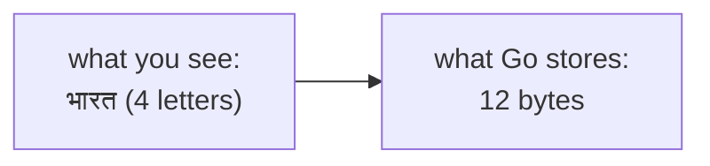
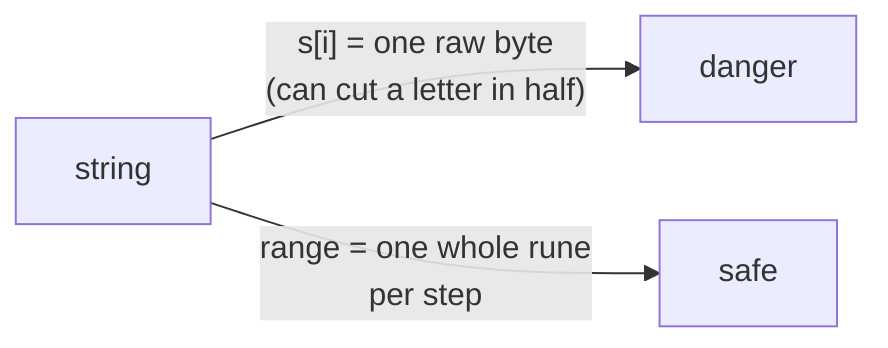
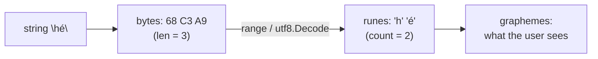
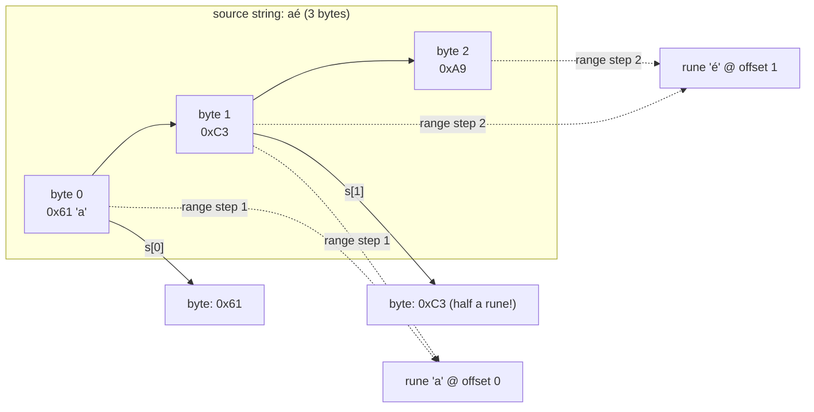
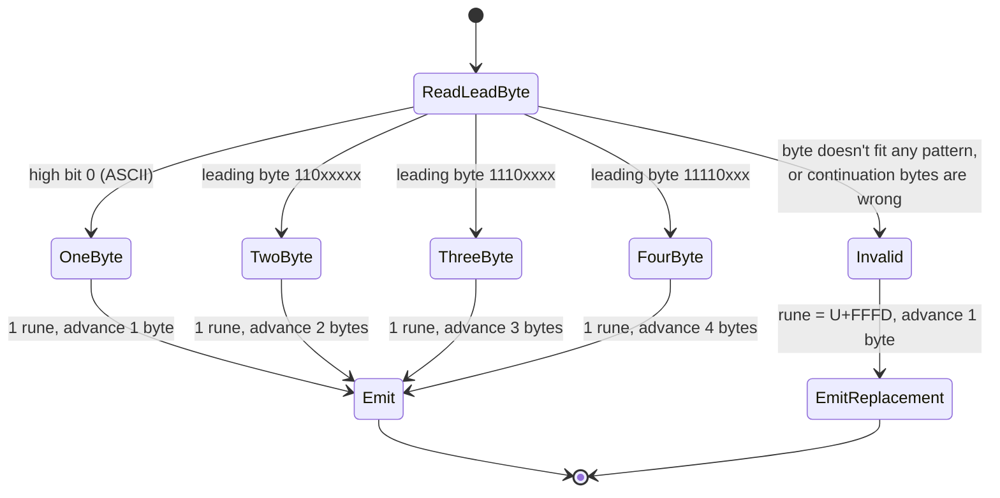

# Strings, Bytes, Runes and Unicode

> [!summary] TL;DR
> A Go string is an immutable, read-only sequence of bytes. By convention it holds UTF-8 text, but nothing enforces that: `len` counts bytes, not characters, and the compiler never validates the content.

> [!abstract] Core idea
> - A string is bytes, not characters. `len("भारत")` is 12 (bytes), not 4 (runes).
> - Indexing (`s[i]`) gives you one byte. `range` over a string gives you one **rune** (Unicode code point) per step, at its starting byte offset.
> - `[]byte(s)` and `[]rune(s)` both copy. They are never free.
> - A rune is not always what a human calls one "character" — that's a grapheme cluster, and Go's standard library doesn't compute those for you.

## Start here: the basics 🟢

> [!info] How to read this note (pick your level)
> - 🟢 **New to this?** Read "From zero" below, then sections 1, 2 and the cheat sheet (10). Stop there, that is a full first pass.
> - 🟡 **Know the basics?** Add section 3 (how decoding works) and 4 (worked example).
> - 🔴 **Interview / SDE-3 prep?** Add 7, 8 and 9. Headings are tagged 🟢🟡🔴 so you always know where you are.

**From zero, in 60 seconds** 🟢

A computer stores text as numbers. Each number slot is one **byte**. English letters fit in one byte each, but most of the world's letters do not: a Hindi or Japanese letter needs 3 bytes.

In Go, a string is just a row of these bytes. `len` counts the bytes, not the letters. So `len("भारत")` is 12, even though you see 4 letters.



Go's word for one letter-number is a **rune**. Loop over a string with `range` and Go hands you whole runes, one by one — that is the safe way to walk text.



Cut a string at a raw byte position and you can slice a letter in half — the user sees a `�` box. The rest of this note is just these 3 questions:
1. What is the difference between a byte, a rune, and the "character" a human sees?
2. How do you count, cut, and build text without breaking it?
3. What do the sharp edges look like in production (and interviews)?

**The problem in one story.**
You cut a user's name to 20 characters for a profile card.
English names look fine, but a Japanese name turns into garbage with a `�` box.
That's because Go counted bytes, and one Japanese character takes 3 bytes.
To handle text safely you need to know bytes, runes and characters apart.

**Words you need first**

| Word | Plain meaning | Tiny example |
| --- | --- | --- |
| Byte | 8 bits, the smallest unit Go strings are made of | `"A"` is 1 byte |
| String | Read-only sequence of bytes | `s := "héllo"` (6 bytes) |
| Unicode code point | A number for one symbol in the Unicode table | `é` is U+00E9 |
| Rune | Go's type for one code point (`int32`) | `r := 'é'` |
| UTF-8 | Encoding using 1-4 bytes per code point | `é` = 2 bytes, `製` = 3 bytes |
| `[]byte` | A changeable slice of bytes | `b := []byte(s)` copies |
| Grapheme | What a human sees as one character | An emoji with skin tone = several runes |

**Picture it**



**Analogy.** A string is a row of beads; some letters use one bead, some use three.
Where it breaks: beads look alike, but UTF-8 bytes carry markers that tell you where each letter starts.

**How the rest of this note builds up**

- First, why bytes vs runes matters and the mental model (sections 1-2).
- Then indexing, `range`, conversions, `strings.Builder` and the `utf8` package (section 3).
- Then a worked example counting and safely truncating text, plus comparisons and trade-offs (sections 4-6).
- Finally the SDE-3 deep dive: zero-copy conversions, normalization, interview questions (sections 7-9).

> [!tip] Remember
> `len` counts bytes, `range` walks runes, and humans see graphemes; never slice text by byte index blindly.

## 1. Why it exists 🟢

Say you take a client-facing invoice note field and truncate it to 20 characters before storing it, using plain byte slicing:

```go
name := "製造元：株式会社レビュー" // a vendor name, in Japanese
short := name[:20]
```

This panics at runtime with `panic: runtime error: slice bounds out of range`... no, worse: it doesn't panic, it silently cuts a multi-byte rune in half and produces invalid UTF-8 that will later fail JSON encoding or render as a `�` replacement box in the UI.

Every Han character here is 3 bytes in UTF-8, so byte index 20 lands in the middle of the 7th character.

The fix needs to know that Go strings are bytes, that slicing works on bytes, and that only `range` or `utf8.DecodeRuneInString` know where rune boundaries actually are. That distinction — bytes vs runes vs what a human perceives as one character — is this note.

## 2. Mental model 🟢

Think of a Go string as **a read-only `[]byte` with no attached encoding guarantee**, plus a convention that everyone treats it as UTF-8.

- **Byte** — one unit of storage. `s[i]` is always a byte, `0`–`255`.
- **Rune** — one Unicode code point, Go's name for `int32`. A code point can take 1 to 4 bytes in UTF-8.
- **Grapheme cluster** — what a human calls one visible "character". A single grapheme can be *several* runes: `é` can be one rune (U+00E9) or two (`e` + a combining acute accent, U+0301), and a flag emoji is two runes that render as one glyph.

A string is like a shipping container manifest written as raw bytes: `len()` tells you the container's total weight, not how many boxes are inside. You need to actually unpack it (`range`, or a Unicode-aware library) to count boxes, and unpacking it still won't tell you how the boxes look stacked together on a pallet (graphemes).

### Whiteboard version

**In plain words:** three lines of code that show the whole trap — a 2-letter string that is 3 bytes long, where `s[1]` hands you half a letter.

```go
s := "aé"       // 'a' = 1 byte, 'é' = U+00E9 = 2 bytes -> 3 bytes total
len(s)          // 3  (bytes)
s[0]            // 'a' as a byte (0x61)
s[1]            // 0xC3: the FIRST byte of 'é', not a usable rune by itself

for i, r := range s {
    // step 1: i=0, r='a'
    // step 2: i=1, r='é'  (range decoded both bytes of 'é' in one step)
}
```

## 3. How it works 🟡



**Decoding, step by step.** `range` walks the string calling the equivalent of `utf8.DecodeRuneInString` at each byte offset:

1. Look at the leading byte to work out how many continuation bytes follow (UTF-8's own encoding tells you this from the high bits).
2. Combine 1–4 bytes into one rune.
3. Yield `(byteOffset, rune)` and advance by however many bytes were consumed — **not always 1**.
4. If the bytes at the current offset are not valid UTF-8, yield `(byteOffset, utf8.RuneError)` — the replacement character `U+FFFD` — and advance by exactly 1 byte, so decoding can resynchronize.



Converting changes representation and always copies:

- `[]byte(s)` copies the string's bytes into a new, mutable byte slice.
- `[]rune(s)` decodes the whole string and copies it into a new `[]rune`, one `int32` per code point — 4 bytes per rune regardless of how many bytes it took in UTF-8. A string that's mostly ASCII can grow 4× in memory as a `[]rune`.
- Converting back, `string(b)` or `string(r)`, copies again.

None of these conversions are free, and Go never does them implicitly.

## 4. Worked example 🟡

### Whiteboard version

```go
func RuneLen(s string) int {
    return utf8.RuneCountInString(s) // walks the string once, O(n) in bytes
}
```

That's the whole trick: there is no O(1) way to count runes, because you must actually decode the string to know where the boundaries are.

### Full example: counting, truncating, and building safely

**In plain words:** two helpers — one cuts text only at whole-letter boundaries (like cutting a necklace between beads, never through one), and one glues many strings fast by pouring them into a single growing bucket.

```go
// SafeTruncate returns the first maxRunes runes of s, never splitting a
// multi-byte rune. It does NOT stop at grapheme-cluster boundaries: a
// combining accent or an emoji with skin-tone modifiers can still be cut
// in half. See the Deep dive for why that needs x/text or uniseg.
func SafeTruncate(s string, maxRunes int) string {
    if maxRunes <= 0 {
        return ""
    }
    count := 0
    for i := range s { // range decodes one rune per step; i is a byte offset
        if count == maxRunes {
            return s[:i]
        }
        count++
    }
    return s // fewer runes than maxRunes: return as-is
}

// BuildJoined demonstrates why a loop that concatenates with += is
// quadratic: each += allocates a brand-new string and copies everything
// built so far. strings.Builder grows a single buffer instead.
func BuildJoined(parts []string) string {
    var b strings.Builder
    size := 0
    for _, p := range parts {
        size += len(p)
    }
    b.Grow(size) // optional, but avoids repeated buffer growth
    for _, p := range parts {
        b.WriteString(p)
    }
    return b.String()
}
```

Tests, passing under `go test -race` on Go 1.24:

```go
func TestLenVsRuneCount(t *testing.T) {
    s := "भारत" // 4 Devanagari code points, 12 UTF-8 bytes
    if got, want := len(s), 12; got != want {
        t.Fatalf("len(%q) = %d, want %d", s, got, want)
    }
    if got, want := RuneLen(s), 4; got != want {
        t.Fatalf("RuneLen(%q) = %d, want %d", s, got, want)
    }
}

func TestSafeTruncateNeverSplitsARune(t *testing.T) {
    cases := []struct {
        in, want string
        n        int
    }{
        {"hello", "hel", 3},
        {"भारत", "भा", 2}, // 2 runes, 6 bytes: both kept whole
    }
    for _, c := range cases {
        got := SafeTruncate(c.in, c.n)
        if got != c.want {
            t.Fatalf("SafeTruncate(%q, %d) = %q, want %q", c.in, c.n, got, c.want)
        }
        if !utf8.ValidString(got) {
            t.Fatalf("SafeTruncate produced invalid UTF-8: %q", got)
        }
    }
}
```

**Measured** (Go 1.24.4, darwin/arm64, Apple M4, joining 2,000 five-byte strings, `go test -bench=. -benchmem`):

| Approach                 | Time/op    | Bytes/op | Allocs/op |
| ------------------------ | ---------- | -------- | --------- |
| `s += part` in a loop     | 742,592 ns | 10.6 MB  | 1,999     |
| `strings.Builder`         | 4,634 ns   | 10.2 KB  | 1         |

`+=` is roughly 160× slower here and allocates a new copy of everything built so far on every iteration — classic quadratic behavior. `strings.Builder` writes into one growable buffer.

Invalid UTF-8 decodes safely instead of corrupting data:

```go
func TestInvalidUTF8BecomesReplacementRune(t *testing.T) {
    bad := string([]byte{0xff, 'a'}) // 0xff is never valid UTF-8
    var runes []rune
    for _, r := range bad {
        runes = append(runes, r)
    }
    if runes[0] != utf8.RuneError { // U+FFFD
        t.Fatalf("first rune = %q, want the replacement rune", runes[0])
    }
}
```

## 5. Variants and comparison 🟡

| Tool                                  | Unit it works on                 | Use when                                                     | Cost |
| -------------------------------------- | --------------------------------- | -------------------------------------------------------------- | ---- |
| `len(s)`                               | bytes                              | buffer sizing, network/storage limits, fast length checks       | O(1) |
| `utf8.RuneCountInString(s)`             | runes (code points)                | "how many characters" for most scripts without combining marks  | O(n) |
| `[]rune(s)`                             | runes, materialized                | random access to individual code points, repeated indexing      | O(n) time and up to 4× memory |
| `strings` package                      | bytes, ASCII-ish helpers           | search/replace/split on byte content (`Index`, `Split`, `Trim`)  | O(n) |
| `bytes` package                        | `[]byte`, same API shape as `strings` | you already have a `[]byte` (from `io.Reader`, etc.) and want to avoid a string copy | O(n) |
| `strings.EqualFold`                    | simple Unicode case folding        | case-insensitive comparisons (careful: not locale-aware)        | O(n) |
| `golang.org/x/text/unicode/norm`       | normalization forms (NFC/NFD)      | comparing strings that may be composed differently (`é` as 1 vs 2 runes) | O(n) |
| `github.com/rivo/uniseg`               | grapheme clusters                  | "how many characters does a human see" (emoji, combining marks, CJK) | O(n), extra dependency |

## 6. Trade-offs and when not to use 🟡

- Counting runes (`utf8.RuneCountInString`) is still **not** "number of characters a user sees." A flag emoji or `é` built from two runes counts as 2. If you need true grapheme counting (for a tweet-style character limit), you need `uniseg`, not the standard library.
- `[]rune(s)` is convenient for random-access rune indexing, but converting a long string just to grab one character is wasteful — prefer `range` or `utf8.DecodeRuneInString` for a single pass.
- `strings.Builder` beats `+=` only inside a loop. For a single concatenation of a few known strings, plain `+` or `fmt.Sprintf` is clearer and the difference is noise.
- `strings.EqualFold` folds ASCII case correctly but is not a full Unicode collation — it will not treat `ß` as equal to `SS`, and the Turkish dotless-ı problem (`"I".ToLower() != "ı"` under Turkish rules) needs `golang.org/x/text/cases` with a locale.

## 7. In production 🔴

- **Real systems:**
  - HTTP routers and JSON encoders assume valid UTF-8; `encoding/json` replaces invalid bytes with `U+FFFD` rather than erroring, which can silently corrupt stored data if you don't validate on ingest.
  - Search and messaging backends normalize incoming text (NFC) before indexing, so visually identical strings compare equal.
  - Log pipelines rely on `%q` / `strconv.Quote` to make control characters and non-printable bytes visible instead of corrupting terminal output or log parsers.
- **Failure modes → fixes:**
  - Byte-slicing user text for display or storage limits → silently invalid UTF-8 → use `SafeTruncate`-style rune-boundary-aware slicing, or a grapheme-aware truncation for user-facing limits.
  - `+=` in a request-handling hot loop → latency spikes under load from repeated allocation → `strings.Builder`.
  - Comparing names or emails with `==` after users typed accents differently → false "different" results → normalize (NFC) both sides before comparing.
  - Logging raw user input directly → broken terminals, log-injection via newlines → `strconv.Quote` / `%q` before logging untrusted strings.
- **What to monitor:** rate of invalid-UTF-8 rejections at your input validation layer; size of `[]rune` conversions in hot paths (via profiling, see [[Benchmarks, Profiling and Tracing]]).

## 8. Deep dive 🔴

- **Substrings share memory.** `sub := big[100:120]` does not copy; `sub` points into `big`'s backing array. This is fast, but if `big` is a 10 MB string and `sub` is the only thing still referenced, the whole 10 MB stays alive. `strings.Clone(sub)` (Go 1.18+) copies `sub` into its own minimal backing array so `big` can be garbage collected.
- **`strings` vs `bytes`.** The two packages mirror each other's API (`strings.Index` / `bytes.Index`, `strings.Split` / `bytes.Split`, and so on) because a string and a `[]byte` are both just byte sequences — the difference is mutability and where the data came from (a literal vs an `io.Reader`). Converting between them to use "the right package" copies; prefer the package matching the type you already have.
- **Grapheme clusters.** Unicode's text-segmentation rules (UAX #29) define that a base letter plus its combining marks, or an emoji plus skin-tone and zero-width-joiner sequences, form one grapheme cluster that should never be split when truncating or counting "characters" for a UI. Neither `range` nor `utf8.RuneCountInString` knows this — only a library like `uniseg` or `x/text/unicode/norm` combined with segmentation does.
- **Raw string literals and quoting.** Backtick-delimited raw literals (`` `C:\path\no\escapes` ``) take no escape sequences, which is why they're the default choice for regexes and Windows paths. `%q` (or `strconv.Quote`) renders a string with Go-syntax escaping — useful for logs, because it turns invisible or malicious bytes (newlines, ANSI escapes) into a visible, safe representation.
- **Why the compiler never validates UTF-8.** Go strings are defined purely as "an array of bytes" in the spec; this is what lets you store arbitrary binary data in a string type (for instance a `[]byte` converted once and never touched again) without a validation pass. The cost is that every boundary with the outside world (JSON, logs, databases) must validate or sanitize explicitly, typically with `utf8.ValidString`.

## 9. Interview questions 🔴

> [!question]- What does `len("héllo")` return, and why does it surprise people?
> 6, not 5. `é` as a single precomposed code point (U+00E9) takes 2 bytes in UTF-8, and `len` counts bytes. People expect "character count" but get "byte count."

> [!question]- What's the difference between indexing a string and ranging over it?
> `s[i]` returns the raw byte at position `i`; it can land in the middle of a multi-byte rune and give you garbage. `for i, r := range s` decodes one full rune per step and gives you its starting byte offset — the only safe way to walk character-by-character.

> [!question]- Why is `s += part` in a loop a performance trap?
> Strings are immutable, so each `+=` allocates a new string and copies everything built so far into it, making the loop O(n²) in total bytes copied. `strings.Builder` (or a `[]byte` buffer) grows one buffer and copies each piece exactly once.

> [!question]- Is counting runes the same as counting the characters a user sees?
> No. A rune is one Unicode code point, but a user-visible "character" (grapheme cluster) can be built from several code points — an accented letter as base + combining mark, or an emoji with a modifier. `utf8.RuneCountInString` counts code points; true grapheme counting needs a segmentation-aware library like `uniseg`.

> [!question]- What happens when you `range` over a string containing invalid UTF-8?
> Decoding yields the replacement rune `U+FFFD` for the invalid byte and advances by exactly one byte, so the rest of the string still decodes correctly. It does not panic and does not stop iteration.

> [!question]- Does converting `string(byteSlice)` or `[]byte(str)` copy the data?
> Yes, both directions always copy. The compiler can sometimes avoid the copy for specific, narrow patterns like `m[string(b)]` map lookups, but you should not rely on that as a general rule — assume a copy happens.

## 10. Cheat sheet 🟢

- `len(s)` = bytes. `utf8.RuneCountInString(s)` = code points. Neither equals "characters a human sees" — that's a grapheme cluster.
- `s[i]` = one byte (can split a rune). `for i, r := range s` = one rune per step, `i` is its byte offset.
- `[]byte(s)`, `[]rune(s)`, and `string(x)` all copy. None are free.
- Build strings in a loop with `strings.Builder`, never `+=`.
- A substring shares the original's backing array; `strings.Clone` breaks that link so the original can be freed.
- Invalid UTF-8 decodes to `U+FFFD` (the replacement rune), it never panics.
- Use `%q` / `strconv.Quote` before logging untrusted strings.
- True "character" truncation for user-facing limits needs a grapheme-aware library (`uniseg`), not the standard library alone.

## Links 🟢

- **Before this:** [[Syntax, Types and Control Flow]], [[Arrays and Dynamic Arrays (Go Slices)]]
- **Next:** [[Standard Library Essentials (time, io, files, encoding)]], [[Structs, Methods and Embedding]]
- **Compare with:** [[Go Interview Questions and Traps]] (string/byte/rune traps)

### Watch on YouTube

- [Runes, Bytes, and Strings in Go](https://www.youtube.com/watch?v=OKshtT6g0_k) · Gary Clarke · Clear walkthrough of how Go strings/bytes/runes relate and why len() counts bytes
- [Characters do not exist in Go: Everything about runes!](https://www.youtube.com/watch?v=1pOfYd0y6_4) · Flo Woelki · Deep dive on runes vs grapheme clusters, directly covers the note's 'character' nuance
