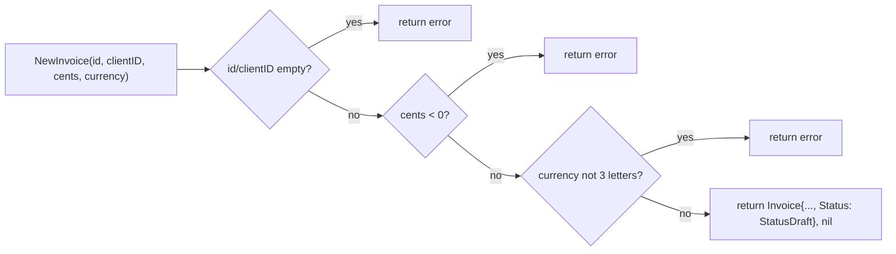
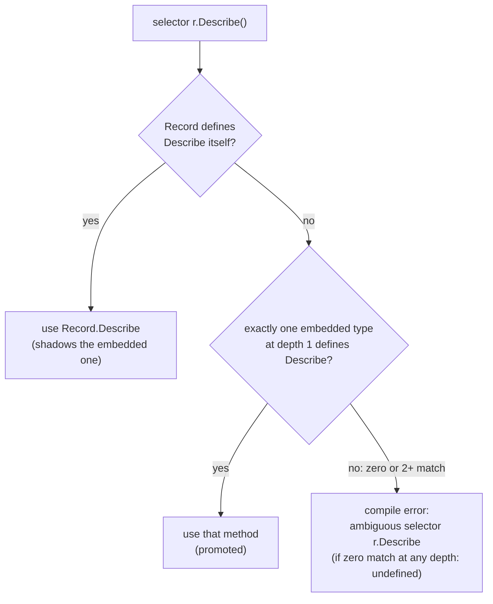

# Structs, Methods and Embedding

> [!summary] TL;DR
> A struct groups named fields into one type; a method is a function with an extra receiver argument that binds it to a type. Embedding one struct inside another promotes the inner type's fields and methods onto the outer type, giving Go a form of composition without classical inheritance.

> [!abstract] Core idea
> - A struct is a value: assigning or passing it copies every field, including slice and map *headers* (not their backing data).
> - A method is sugar for a function whose first parameter is the receiver; a pointer receiver can mutate the caller's value, a value receiver cannot.
> - Embedding promotes an inner type's fields and methods to the outer type by name, until two embedded types collide or the outer type defines its own method of the same name.
> - Field order affects struct size through padding, not through behavior — the compiler inserts padding so each field lands at an aligned memory offset.

## 1. Why it exists

A payments team keeps re-passing the same five arguments (`invoiceID`, `clientID`, `amountCents`, `currency`, `status`) to every function that touches an invoice:

```go
func Send(invoiceID, clientID string, amountCents int64, currency, status string) error
func Validate(invoiceID, clientID string, amountCents int64, currency, status string) error
```

Adding a sixth field means touching every function signature in the codebase. A struct fixes this by giving the five fields one name, `Invoice`, that every function can take as a single parameter — and a method lets `inv.Send()` read naturally instead of `Send(inv.ID, inv.ClientID, ...)`.

Embedding solves a related, narrower problem: many domain types need the same base fields (`ID`, `CreatedAt`, `CreatedBy`). Copy-pasting those fields into every struct means fixing a bug (say, an inconsistent JSON tag) in N places. Embedding a shared `Base` struct gives every type those fields and any methods on `Base`, written once.

## 2. Mental model

A struct is a **labeled box of fields**, stored contiguously in memory. A method is a function where the type whose box you're operating on is written before the function name instead of as the first argument in parentheses — `func (c Counter) Value() int` instead of `func Value(c Counter) int`. That's purely syntax; mechanically a method call `c.Value()` compiles to the same thing as `Value(c)`.

Embedding is like **inheriting a wing of a building, not a whole blueprint**: if `Record` embeds `Base`, then `Record` gets a copy of `Base`'s floor plan placed inside it, and anyone standing in `Record` can walk straight to `Base`'s rooms (`record.ID`) without saying "go through Base first" (`record.Base.ID`) — unless two embedded wings both have a room called the same thing, in which case you must say which wing you mean.

### Whiteboard version

```go
type Base struct{ ID string }
func (b Base) Describe() string { return "base:" + b.ID }

type Record struct {
    Base          // embedded: no field name, just the type
    Name string
}

r := Record{Base: Base{ID: "r1"}, Name: "widgets"}
r.ID          // "r1"          — promoted field
r.Describe()  // "base:r1"     — promoted method
```

## 3. How it works

**Keyed literals and validating constructors.** A struct literal with field names (`Invoice{ID: "x", Amount: 500}`) survives field reordering and documents intent; positional literals (`Invoice{"x", "", 500, "", 0}`) break the moment someone reorders fields. A constructor function (`NewInvoice`) rejects invalid states up front instead of letting a half-built zero-value struct escape into the rest of the program:



**Methods and receivers.** Every method is really a plain function with the receiver as a hidden first parameter. The choice between a value receiver and a pointer receiver decides whether the method sees (and can modify) the caller's actual data or a copy of it — covered fully, including method sets and `go build -gcflags=-m` escape output, in [[Pointers, Values and Escape Analysis]]. The rule of thumb here: **use a pointer receiver whenever the method must mutate the receiver**, and keep it consistent across all of a type's methods so callers don't have to remember which methods mutate.

**Embedding resolution.** When you embed a type, the compiler builds a field-and-method lookup table that includes the embedded type's exported members at "depth 1." A selector like `r.ID` or `r.Describe()` is resolved by searching outward by increasing depth:



- **Shadowing.** If the outer type defines its own `Describe()`, that one wins outright; the embedded one is still reachable by writing `r.Base.Describe()` explicitly.
- **Ambiguous selectors.** If two embedded types both define `Describe()` at the same depth, `r.Describe()` fails to compile. You must write `r.Base.Describe()` or `r.Audited.Describe()`.
- **Embedded pointers.** Embedding `*Base` instead of `Base` means the field can be `nil`. Calling a promoted method through a nil embedded pointer panics the same way any nil-pointer method call does — the method body dereferences a nil `*Base` the moment it touches `b.ID`.

## 4. Worked example

### Whiteboard version

```go
type InvoiceStatus int

const (
    StatusDraft InvoiceStatus = iota
    StatusSent
    StatusPaid
)

func (s InvoiceStatus) String() string {
    switch s {
    case StatusDraft:
        return "draft"
    case StatusSent:
        return "sent"
    default:
        return "paid"
    }
}
```

This `iota` + `String()` pattern is Go's idiomatic enum: cheap `int` comparisons, but readable `%v`/`%s` output.

### Full example

```go
// Invoice models one invoice row. Amount is in minor units (cents), never
// a float, so money never loses precision to binary rounding.
type Invoice struct {
    ID       string
    ClientID string
    Amount   int64 // minor units (cents)
    Currency string
    Status   InvoiceStatus
}

// NewInvoice validates before it constructs.
func NewInvoice(id, clientID string, amountCents int64, currency string) (Invoice, error) {
    if id == "" || clientID == "" {
        return Invoice{}, errors.New("id and clientID are required")
    }
    if amountCents < 0 {
        return Invoice{}, fmt.Errorf("amount must be >= 0, got %d", amountCents)
    }
    if len(currency) != 3 {
        return Invoice{}, fmt.Errorf("currency must be a 3-letter ISO code, got %q", currency)
    }
    return Invoice{
        ID: id, ClientID: clientID, Amount: amountCents,
        Currency: currency, Status: StatusDraft,
    }, nil
}

// Counter shows a pointer receiver: Inc must mutate the caller's struct.
type Counter struct{ n int }

func (c *Counter) Inc()      { c.n++ }
func (c Counter) Value() int { return c.n }

type Base struct{ ID string }

func (b Base) Describe() string { return "base:" + b.ID }

type Audited struct{ CreatedBy string }

func (a Audited) Describe() string { return "audited:" + a.CreatedBy }

// Record embeds Base by value: fields and methods are promoted.
type Record struct {
    Base
    Name string
}

// Conflicted embeds two types that both define Describe at the same
// depth: c.Describe() does not compile here.
type Conflicted struct {
    Base
    Audited
}

// Wrapper embeds a POINTER, which can be nil.
type Wrapper struct {
    *Base
    Extra string
}

// Cart demonstrates the shallow-copy pitfall: a slice field's HEADER is
// copied by value, but its backing array is shared until copied deeply.
type Cart struct{ Items []string }

func CopyDeep(a Cart) Cart {
    items := make([]string, len(a.Items))
    copy(items, a.Items)
    return Cart{Items: items}
}
```

Tests, passing under `go test -race` on Go 1.24:

```go
func TestEmbeddingPromotionAndShadowing(t *testing.T) {
    r := Record{Base: Base{ID: "r1"}, Name: "widgets"}
    if r.ID != "r1" { // promoted field
        t.Fatalf("promoted field ID = %q, want r1", r.ID)
    }
    if got, want := r.Describe(), "base:r1"; got != want { // promoted method
        t.Fatalf("Describe() = %q, want %q", got, want)
    }

    c := Conflicted{Base: Base{ID: "x"}, Audited: Audited{CreatedBy: "alice"}}
    // c.Describe() does not compile: ambiguous between Base and Audited.
    if got, want := c.Base.Describe(), "base:x"; got != want {
        t.Fatalf("c.Base.Describe() = %q, want %q", got, want)
    }
}

func TestEmbeddedNilPointerPanicsOnPromotedMethod(t *testing.T) {
    w := Wrapper{Base: nil, Extra: "e"} // embedded *Base is nil
    defer func() {
        if r := recover(); r == nil {
            t.Fatal("expected a panic calling Describe through a nil embedded *Base")
        }
    }()
    _ = w.Describe() // promoted through nil *Base: panics on b.ID
}

func TestShallowVsDeepCopy(t *testing.T) {
    orig := Cart{Items: []string{"a", "b"}}
    shallow := orig       // `:=` copy: slice header copied, array shared
    shallow.Items[0] = "mutated"
    if orig.Items[0] != "mutated" {
        t.Fatal("expected shallow copy to share the backing array with orig")
    }

    orig2 := Cart{Items: []string{"a", "b"}}
    deep := CopyDeep(orig2)
    deep.Items[0] = "mutated"
    if orig2.Items[0] == "mutated" {
        t.Fatal("deep copy should not affect the original's backing array")
    }
}

func TestComparableStructAsMapKey(t *testing.T) {
    type Key struct{ Tenant, ID string }
    seen := map[Key]int{}
    seen[Key{Tenant: "t1", ID: "a"}] = 1
    seen[Key{Tenant: "t1", ID: "a"}]++ // same key: structs compare field-by-field
    if seen[Key{Tenant: "t1", ID: "a"}] != 2 {
        t.Fatalf("map key collision failed: %v", seen)
    }
    set := map[string]struct{}{"a": {}} // the empty struct is the idiomatic "set" value
    if unsafe.Sizeof(struct{}{}) != 0 {
        t.Fatal("empty struct should be zero-sized")
    }
    _ = set
}
```

**Measured** field alignment (Go 1.24.4, darwin/arm64, `unsafe.Sizeof`):

```go
type fieldOrderSize struct {
    A bool  // 1 byte, then 7 bytes of padding before the int64
    B int64 // 8 bytes
    C bool  // 1 byte, then 7 bytes of trailing padding
}
type reordered struct {
    B int64 // 8 bytes
    A bool  // 1 byte
    C bool  // 1 byte, 6 bytes trailing padding
}
```

| Type             | `unsafe.Sizeof` | Why |
| ----------------- | --------------- | --- |
| `fieldOrderSize`   | 24 bytes         | `bool` before `int64` forces 7 bytes of padding so the `int64` starts 8-byte aligned, then the trailing `bool` adds its own padding |
| `reordered`        | 16 bytes         | both `bool` fields sit after the `int64` and share its trailing padding |

Same fields, same behavior, 33% less memory per value just from reordering — this matters for large slices of structs, not for one-off values.

## 5. Variants and comparison

| Form                         | What you get                                       | Use when                                                             | Cost |
| ----------------------------- | ---------------------------------------------------- | ------------------------------------------------------------------- | ---- |
| Named struct, positional literal | Compact literal `Invoice{"id", "c1", 500, "USD", 0}` | Never for production code — breaks silently on field reorder          | readability/safety risk |
| Named struct, keyed literal   | `Invoice{ID: "id", Amount: 500}`                      | Always, for any struct with more than 1–2 fields                     | none |
| Constructor function (`NewX`)  | Validated construction, invalid states unrepresentable | Any type with invariants (non-empty ID, non-negative amount)         | one extra function |
| Anonymous struct               | An inline, one-off type with no name                  | Table-driven tests, ad-hoc JSON shapes used in exactly one place     | can't be reused or named as a type elsewhere |
| Embedding (value)               | Promoted fields and methods, composition              | Sharing fields/behavior across types without inheritance semantics   | ambiguous-selector risk if two embeds collide |
| Embedding (pointer)             | Same, but the embedded value is optional/nilable      | The base behavior is genuinely optional, or shared across instances  | nil-panic risk on promoted method calls |
| Plain field (no embedding)      | `Base BaseInfo` with an explicit field name            | You want the relationship visible and don't want promotion at all    | callers must write `r.Base.ID` every time |

## 6. Trade-offs and when not to use

- Embedding is composition, not inheritance: there is no polymorphism through a `Base` reference, no virtual dispatch, and `Base`'s methods have no idea `Record` exists (they only ever see the `Base` value they were called on). Don't reach for embedding expecting OOP-style subtyping.
- Promoted methods make a type's full method set invisible at a glance — `go doc` and generated docs show promoted methods, but a quick scroll through the struct definition does not. For public APIs, consider whether a named field (`BaseInfo BaseInfo` instead of embedding `BaseInfo`) communicates intent better, at the cost of `r.BaseInfo.ID` everywhere.
- Field-order-for-alignment micro-optimization only pays off for types allocated in bulk (large slices, hot structs in a cache). For a request DTO constructed once per HTTP call, readability of field order beats a few bytes of padding.
- Anonymous structs can't be named as a return type or stored in a variable's declared type elsewhere, so they only fit genuinely one-off shapes (test tables, a function's inline return value).

## 7. In production

- **Real systems:** ORMs and `encoding/json` rely on exported fields and struct tags to map Go structs to database rows and JSON payloads; `sqlc`-generated code and hand-written repositories both lean on keyed struct literals so column additions don't silently misalign positional ones. Config structs across the standard library (`http.Server`, `tls.Config`) are built with keyed literals and zero-value-usable defaults (`http.Server{}` with no fields set still runs on `:80`-equivalent fallback behavior per field).
- **Failure modes → fixes:**
  - Positional literal silently reorders after a teammate adds a field → wrong data stored → lint for keyed literals (`go vet` flags composite literals that should be keyed for struct types in other packages; `golangci-lint`'s `govet`/`fieldalignment` checks catch both).
  - Copying a struct containing a slice/map and expecting independence → shared-mutation bugs → copy the backing data explicitly (`copy()` for slices, loop or `maps.Clone` for maps) when independence is required.
  - Embedding `*Base` and forgetting to initialize it → nil-pointer panic deep in a promoted method → initialize embedded pointers in every constructor, or embed by value when `nil` is never a valid state.
  - Giant structs with many hot-path instances and no attention to field order → extra cache-line pressure → run `fieldalignment` (`golang.org/x/tools/go/analysis/passes/fieldalignment`) in CI for allocation-heavy types.
- **What to monitor:** allocation counts and bytes/op from `go test -bench -benchmem` for types that appear in large slices (see [[Benchmarks, Profiling and Tracing]]); `go vet`/`fieldalignment` findings in CI.

## 8. Deep dive

- **Comparability.** A struct is comparable with `==` (and usable as a map key) only if every field is comparable. Slices, maps, and functions are not comparable, so a struct containing any of them can't use `==` or be a map key — the compiler rejects it at compile time, not at run time.
- **The empty struct `struct{}`.** It has size zero (`unsafe.Sizeof(struct{}{}) == 0`), which is why `map[K]struct{}` is Go's idiomatic set type: it costs nothing per entry beyond the map's own bookkeeping, versus `map[K]bool` which stores a real byte per entry.
- **Struct tags and reflection.** A struct tag is just a string literal attached to a field (`` `json:"id" db:"id"` ``), with no compiler-enforced meaning at all — it's `encoding/json`, `database/sql` drivers, and validators that read it back at run time via `reflect.StructTag.Get("json")`. A typo in a tag key is never a compile error; it silently does nothing.
- **Field alignment in depth.** The Go compiler lays out struct fields in declaration order (it does not reorder them for you) and inserts padding before each field so it starts at an address divisible by its own size (up to the platform's word size). This means `struct{ bool; int64; bool }` pads around the `int64` on both sides, while sorting fields from largest to smallest alignment requirement removes most of that padding. `golang.org/x/tools/go/analysis/passes/fieldalignment` finds and suggests fixes for this automatically — it is not one of `go vet`'s built-in checks, but it is vet-compatible (run it standalone, via `go vet -vettool=$(which fieldalignment)`, or as a `golangci-lint` linter).
- **Custom types vs. aliases.** `type InvoiceID string` creates a genuinely new, distinct type: you cannot pass a plain `string` where an `InvoiceID` is expected without an explicit conversion, which is exactly the point — it stops you from accidentally passing a `ClientID` where an `InvoiceID` belongs. `type MyString = string` is a type **alias**: `MyString` and `string` are the same type, interchangeable everywhere, useful mainly for gradual package renames, not domain modeling.

## 9. Interview questions

> [!question]- When do you need a pointer receiver instead of a value receiver?
> Whenever the method must mutate the receiver's state, or the struct is large enough that copying it on every call would be wasteful. A value receiver always operates on a copy, so `c.Inc()` with a value receiver would silently fail to persist the increment in the caller's variable.

> [!question]- What happens when two embedded types define the same method name?
> The selector becomes ambiguous and the outer type fails to compile if you call it directly (`c.Describe()`). You must disambiguate by naming the embedded type explicitly: `c.Base.Describe()` or `c.Audited.Describe()`.

> [!question]- Is embedding the same as inheritance?
> No. It's composition with automatic field/method promotion through the selector syntax. The embedded type has no awareness of the outer type, there's no dynamic dispatch, and a method defined on the embedded type cannot be overridden polymorphically — the outer type can only shadow it by defining its own method of the same name.

> [!question]- What's the trap with embedding a pointer type?
> The embedded pointer can be `nil`. Calling a promoted method through it panics the same way calling any method on a nil pointer that dereferences a field does — the zero value of `Wrapper{}` looks fine until you call `w.Describe()` and it panics inside `Base.Describe`.

> [!question]- Why does struct field order affect `unsafe.Sizeof`, and when should you care?
> The compiler pads each field so it starts at an aligned offset; interleaving small and large fields wastes space to padding (measured: 24 bytes vs 16 bytes for the same three fields reordered). Care about this for types instantiated in bulk — a slice of millions of structs — not for one-off request/response structs where clarity wins.

> [!question]- Can you use a struct as a map key? What's the catch?
> Yes, if every field is itself comparable (no slices, maps or funcs inside). Two struct values are equal as map keys when every field compares equal — useful for composite keys like `{Tenant, ID}` without needing to concatenate strings.

> [!question]- What does copying a struct that contains a slice field actually copy?
> Only the slice header — pointer, length, and capacity — not the backing array. The copy and the original share the same underlying data until one of them is explicitly deep-copied (`make` + `copy`), which is a common source of "I mutated a copy and the original changed too" bugs.

## 10. Cheat sheet

- Keyed struct literals always; positional literals break silently on field reorder.
- Validate in a `NewX` constructor so invalid states never escape as a zero value.
- Pointer receiver to mutate; value receiver to read. Keep it consistent across a type's methods.
- Embedding promotes fields/methods by name; it's composition, not inheritance, and has no dynamic dispatch.
- Two embedded types with the same method name at the same depth make that selector ambiguous — disambiguate explicitly.
- An embedded pointer can be nil; calling a promoted method through it panics like any nil-pointer method call.
- Copying a struct copies slice/map headers, not their backing data — deep-copy explicitly when independence matters.
- `map[K]struct{}` is Go's zero-cost set idiom; the empty struct is zero bytes.
- Custom types (`type ID string`) are distinct types that need explicit conversion; aliases (`type S = string`) are fully interchangeable.
- Field order affects struct size via padding; `fieldalignment` finds the win automatically for hot types.

## Links

- **Before this:** [[Syntax, Types and Control Flow]], [[Strings, Bytes, Runes and Unicode]]
- **Next:** [[Interfaces]], [[Pointers, Values and Escape Analysis]]
- **Compare with:** [[OOP in Go - Structs, Interfaces, Embedding]] (the same mechanics applied to LLD-style class design), [[Go Interview Questions and Traps]]
