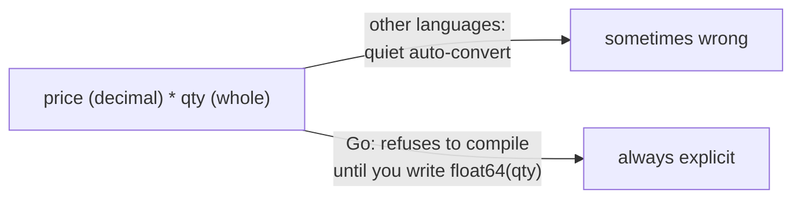
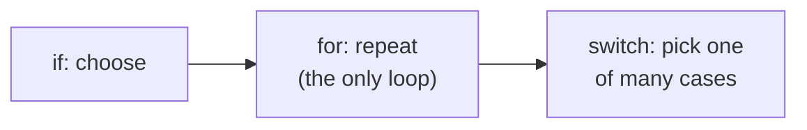
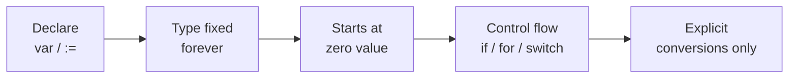
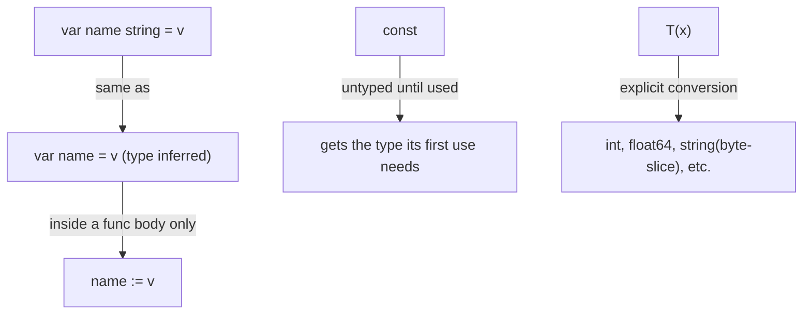
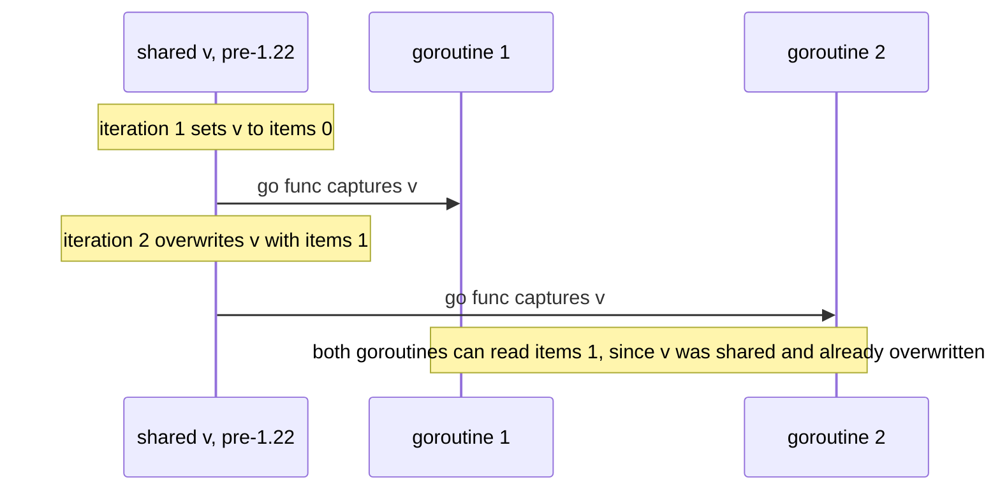

# Syntax, Types and Control Flow

> [!summary] TL;DR
> Go has a small, fixed set of statements (`if`, `for`, `switch`) and a strict type system with no implicit conversions; a variable's type is decided once, at declaration, and every number has one of a fixed set of zero values until you set it otherwise.

> [!abstract] Core idea
> - `var`, `:=`, and multiple assignment are the three ways to introduce a variable; `:=` only works inside a function body.
> - Go converts types explicitly, never implicitly — `float64(x)` not `x` used where a float is expected.
> - `for` is the only loop keyword; it covers counted loops, while-style loops, infinite loops, and (since Go 1.22) ranging over a plain integer.
> - `switch` never falls through by default, the opposite of C and Java.
> - Every type has a zero value (`0`, `""`, `false`, or `nil`), which is why an unvalidated, unset field silently "works" instead of crashing.

## Start here: the basics 🟢

> [!info] How to read this note (pick your level)
> - 🟢 **New to this?** Read "From zero" below, then sections 1, 2 and the cheat sheet (10). Stop there, that is a full first pass.
> - 🟡 **Know the basics?** Add section 3 (how each construct works) and 4 (worked example).
> - 🔴 **Interview / SDE-3 prep?** Add 7, 8 and 9. Headings are tagged 🟢🟡🔴 so you always know where you are.

**From zero, in 60 seconds** 🟢

A program is just boxes of values plus decisions about what to do next. In Go, every box is a **variable** with a fixed label saying what kind of thing it holds — a number, text, true/false. That label is its **type**, and it never changes.

Go never swaps labels behind your back. To treat a whole number as a decimal, you must say so: `float64(qty)`. That one habit kills a whole family of bugs.



For decisions and repeats, Go keeps just three words: `if`, `for`, `switch`. There is no `while` — `for` does that job too.



One more thing: a Go variable is never empty. Before you set it, it holds a default — `0`, `""`, `false` — called the **zero value**. The rest of this note is just these 4 questions:
1. How do you declare variables and convert between types?
2. How do `if`, `for` and `switch` really behave (and differ from C/Java)?
3. What do zero values do to your data silently?
4. Which sharp edges show up in production and interviews?

**The problem in one story.**
You write `total := price * qty` where `price` is a decimal and `qty` is a whole number.
Some languages quietly convert one of them and sometimes give a surprising answer.
Go refuses to compile until you say `price * float64(qty)` yourself.
That strictness, plus a small set of statements (`if`, `for`, `switch`), is the whole flavor of Go syntax.

**Words you need first**

| Word | Plain meaning | Tiny example |
| --- | --- | --- |
| Variable | A named box that holds a value | `x := 5` |
| Declaration | The line that creates a variable and fixes its type | `var name string` |
| Type | What kind of value a variable can hold | `int`, `float64`, `bool` |
| Conversion | Changing a value to another type, written explicitly | `float64(3)` |
| Zero value | The value a variable has before you set it | `0`, `""`, `false`, `nil` |
| Scope | The block where a name is visible | a variable made inside `if {}` is gone after `}` |
| Loop | Repeating code | `for i := 0; i < 3; i++ {}` |

**Picture it**



**Analogy.** Go variables are labelled jars: a jar marked "sugar" only ever holds sugar, and to pour sugar into the "flour" jar you must relabel it on purpose.
Where it breaks: real jars start empty; Go jars start with a default zero value already inside.

**How the rest of this note builds up**

- First, why Go keeps syntax small and strict (section 1) and a mental model (section 2).
- Then how declarations, types, conversions, `for`, `if` and `switch` work (section 3), and a worked example (section 4).
- Then comparison with other languages, trade-offs and production habits (sections 5-7).
- Finally the SDE-3 deep dive on untyped constants, the Go 1.22 loop-variable change, why there is no `while`, and modulo sign rules (section 8).

> [!tip] Remember
> Types are fixed at declaration, conversions are always explicit, `for` is the only loop, and `switch` never falls through.

## 1. Why it exists 🟢

A request handler reads a query parameter `page=2` and a team member writes:

```go
page := r.URL.Query().Get("page") // page is always a string here
items := allItems[page:page+10]   // compile error: invalid operation
```

This never compiles: `string` and `int` are different types with no automatic conversion between them, and slicing needs an `int`. The fix requires an explicit, fallible conversion:

```go
pageNum, err := strconv.Atoi(page)
if err != nil {
    pageNum = 1 // or reject the request
}
```

That extra line is not boilerplate — it is the exact point where a malformed `page=abc` gets handled instead of crashing the process. Go's refusal to convert types implicitly is a deliberate trade: more typing at the boundary, in exchange for every type mismatch being caught at compile time instead of surfacing as a runtime surprise.

## 2. Mental model 🟢

Go's type system is **static and explicit**: a variable's type never changes after declaration, and the compiler never silently reinterprets one type as another. Think of every value as living in a labelled box — moving a value between differently-labelled boxes (`int` to `float64`, `string` to `[]byte`) always needs an explicit relabelling step, spelled as a conversion.

Control flow is deliberately small: three keywords (`if`, `for`, `switch`) cover everything a C-family programmer reaches for `while`, `do-while`, `for`, `switch-with-fallthrough`, and `goto`-as-labelled-break to do. Fewer keywords means fewer ways the same idea gets written, which is also why `gofmt` can reformat any Go file into one canonical layout.

## 3. How it works 🟡

### Imports

**In plain words:** an import is how one file borrows another package's tools; the three forms below are plain borrowing, borrowing under a nickname, and "just switch it on, I won't call it".

```go
import (
	"fmt"                 // plain import: use as fmt.X
	mrand "math/rand/v2"  // aliased: use as mrand.X, when a name collides or is unclear
	_ "net/http/pprof"    // blank import: run the package's init() for its side effect, nothing else
)
```

A blank import (`_ "net/http/pprof"`) runs the package's `init()` functions — here, registering pprof's HTTP handlers on `http.DefaultServeMux` — without giving you any name to call; it exists purely for that side effect.

An aliased import renames the package's identifier in this file only, commonly to avoid a clash between two packages that would otherwise both be called `rand`, or to shorten a long default name.

An import that is in the file but never referenced is a compile error, the same as an unused local variable — the one exception is an unused package-level `var`, which compiles fine.

### `:=` shadowing: a new variable, not an update

`:=` declares a *new* variable whenever it runs in a new scope, even if a variable of the same name already exists outside it — it does not reuse or update the outer one. This is the most common source of a silently-swallowed error in Go:

```go
func ShadowBug(id string) error {
	var err error
	if val, err := lookup(id); err == nil { // := here creates an if-scoped err, not the outer one
		fmt.Println("looked up:", val)
	}
	return err // BUG: always nil — the shadowed err above was never seen out here
}
```
*(verified: Go 1.24.4 — `ShadowBug` returns `nil` even when `lookup` fails, and `go vet ./...` reports nothing, because shadowing isn't one of vet's default analyzers)*

The fix is to stop redeclaring `err` in the inner scope — move the call above the `if` so there is only one `err` to begin with:

```go
val, err := lookup(id) // one err, declared once
if err == nil {
	fmt.Println("looked up:", val)
}
return err
```

This same trap appears any time an `if`, `for` or `switch` body uses `:=` with a name that already exists one scope up — the compiler never warns, because both variables are completely legal Go on their own; only the logic is wrong.

### Variables, constants and conversions

**In plain words:** three ways to make a box (`var`, `var` with inference, `:=`), constants that stay shapeless until used, and conversions you always spell out yourself.



- `var name string = "InvoiceOps"` is the long form. `var port = 8080` infers the type from the right-hand side. `:=` does both declaration and inference in one step, but only inside a function body — package-level variables must use `var`.
- `const DefaultCurrency = "INR"` is **untyped** until it is used in a context that needs a specific type. This is why `const Pi = 3.14159` can be assigned to a `float32` variable in one place and a `float64` in another without a conversion — the constant has no fixed type of its own until that assignment forces one.
- `iota` numbers the constants in a `const (...)` block starting at 0, incrementing by one per line, and resets to 0 in the next block — the idiomatic way to write an enum.
- Go never converts between numeric types, or between `string` and numeric types, implicitly. `strconv.ParseInt(s, 10, 32)` takes a base (10 = decimal) and a bit size (32 = fits in `int32`); passing a value too large for that bit size returns an error with a wrapped `ErrRange`, rather than silently truncating.

### Integer behaviour: division, modulo and overflow

**In plain words:** whole-number math in Go has house rules — division throws away the remainder, `%` copies the sign of the left number, and a number that grows too big quietly wraps around like a car odometer.

Integer division truncates toward zero, and the sign of `%` follows the sign of the **dividend**, not the divisor — the opposite of Python, where `%` follows the divisor's sign:

```go
func DivMod(a, b int) (q, r int) {
	return a / b, a % b
}
```

| a | b | a/b | a%b |
| - | - | --- | --- |
| 7 | 2 | 3 | 1 |
| -7 | 2 | -3 | -1 |
| 7 | -2 | -3 | 1 |

Integer overflow is **silent**: no panic, no compiler error, the value simply wraps around using two's-complement arithmetic.

```go
func OverflowInt8(x int8, delta int8) int8 {
	return x + delta // 127 + 1 wraps to -128
}
```

This is why money and any other value that must never silently misbehave is stored as `int64` cents with an explicit bounds check, never as a smaller integer type trusted to "just fit".

### Control flow: if, for, switch

**`if` with an init statement** scopes a variable to the whole if/else chain, keeping a helper variable out of the surrounding function:

```go
func ClassifyAge(days int) string {
	if bucket := days / 30; bucket == 0 {
		return "new"
	} else if bucket < 12 {
		return "active"
	} else {
		return "stale"
	}
}
```

`bucket` does not exist outside this `if`/`else if`/`else` chain — it is a different scoping rule from a C-style `if`, where a variable declared before the `if` leaks into the rest of the function.

**`for`** is the only loop keyword, in four shapes:

```go
for i := 0; i < 3; i++ { }   // classic three-clause form
for condition { }            // while-style
for { }                       // infinite, exits via break/return
for i, v := range items { }  // range: index/key + value
```

Since **Go 1.22**, `for i := range n` (where `n` is a plain integer) loops `i` from `0` to `n-1`, replacing the common `for i := 0; i < n; i++` when the index is all you need:

```go
func SumRangeInt(n int) int {
	total := 0
	for i := range n {
		total += i
	}
	return total
}
```

**Labelled break and continue** reach out of nested loops, which a bare `break` cannot do — it only exits its own innermost loop:

```go
func FindFirstOverBudget(groups [][]int, budget int) (group, item int) {
	group, item = -1, -1
outer:
	for g, items := range groups {
		total := 0
		for i, v := range items {
			total += v
			if total > budget {
				group, item = g, i
				break outer
			}
		}
	}
	return group, item
}
```

**`switch`** does not fall through by default — each matched case's body runs and the switch exits, the opposite of C and Java:

```go
func GradeNoFallthrough(score int) string {
	switch {
	case score >= 90:
		return "A"
	case score >= 75:
		return "B"
	case score >= 60:
		return "C"
	default:
		return "F"
	}
}
```

A tagless `switch { case cond1: ... }`, as above, is idiomatic Go for a chain of conditions that would otherwise be `if/else if/else if`. Falling through to the next case is opt-in with the `fallthrough` keyword, and it always runs the next case's body **unconditionally** — even if that next case's own condition would evaluate false:

```go
func ExplicitFallthrough(n int) []string {
	var tags []string
	switch {
	case n >= 1:
		tags = append(tags, "positive")
		fallthrough
	case n >= 0:
		tags = append(tags, "non-negative")
	}
	return tags
}
```

### The Go 1.22 loop variable change

Before Go 1.22, a `for` loop reused the **same** loop variable across every iteration, so capturing `&v` or `v` in a goroutine or closure inside the loop body captured a reference that later iterations overwrote — the single most common Go concurrency bug in code written before 2024:



**Since Go 1.22** (verified: each iteration gets its own fresh copy of the loop variable), the same code is safe:

```go
for _, v := range items {
    go func() { use(v) }() // v is this iteration's own variable since 1.22
}
```

The remaining gotcha, unrelated to the 1.22 change: `v` is still a **copy** of the element. Mutating `v` never mutates `items[i]`; mutate through the index (`items[i].Field = ...`) when the change must stick.

### Zero values and exported names

Every type has a zero value, and a declared-but-unassigned variable always holds it — there is no "uninitialized" state in Go the way there is in C:

| Type | Zero value |
| --- | --- |
| `int`, `float64` | `0` |
| `bool` | `false` |
| `string` | `""` |
| pointer, slice, map, channel, func, interface | `nil` |
| array | every element is its own type's zero value |
| struct | every field is its own type's zero value |

This matters most for request decoding: a JSON field the client never sent and a field the client explicitly sent as `0` or `""` look identical once decoded into a plain `int` or `string` — both become the type's zero value.

Telling "absent" from "zero" needs a pointer field or a separate presence check (covered where request decoding lives, in [[Request Decoding, Validation and DTOs]]).

Exported names (capitalized) are visible outside their package; unexported names are not. This is Go's only visibility mechanism — there is no `public`/`private` keyword, just the first letter's case.

A doc comment is a plain `//` comment directly above a declaration, with no blank line between them, and it must start with the name it documents:

```go
// ParseAmountCents parses a decimal string of minor-unit amounts (e.g. "4999")
// into cents, rejecting values that don't fit in an int32.
func ParseAmountCents(s string) (cents int32, err error) { ... }
```

`go doc` and `pkg.go.dev` both render this exact comment as the symbol's documentation, so the "starts with the name" rule is not a style nitpick — tools rely on it to know where the doc comment for one symbol ends and unrelated code comments begin.

Only exported identifiers need one; an unexported helper can skip it unless its behaviour is non-obvious.

### Built-ins: min, max, clear (Go 1.21)

**In plain words:** three small helpers Go gives you for free, no import needed — pick the smallest, pick the biggest, empty a map or slice.

```go
func MinMaxClear() (int, int, map[string]int) {
	lo := min(7, 2, 9)
	hi := max(7, 2, 9)
	m := map[string]int{"a": 1, "b": 2}
	clear(m) // empties the map but keeps it non-nil and allocated
	return lo, hi, m
}
```

`clear` on a map removes every entry but leaves the map allocated and non-nil (`len(m) == 0`, `m != nil`); on a slice it zeroes every element without changing its length. `min`/`max` take any number of same-typed, ordered arguments.

### fmt verbs

**In plain words:** the `%` letters are camera lenses for printing a value — `%v` is the quick snapshot, `%+v` adds labels, `%#v` shows the exact Go source, `%T` tells you what the thing is.

```go
type Invoice struct {
	ID    string
	Cents int64
}
```

```text
$ go run ./fmtdemo
%v:  {inv_1 4999}
%+v: {ID:inv_1 Cents:4999}
%#v: main.Invoice{ID:"inv_1", Cents:4999}
%T:  main.Invoice
%q:  "inv_1"
%w via Error(): get invoice inv_1: row not found
Unwrap ==base: true
```
*(measured: Go 1.24.4, darwin/arm64, 2026-11-07)*

`%v` is the default format; `%+v` adds field names; `%#v` prints a Go-syntax representation you could paste back into source; `%T` prints the concrete type, which is the fastest way to see what a variable actually holds when an interface is involved; `%q` quotes a string safely for logs; `%w` (only valid inside `fmt.Errorf`) wraps an error so `errors.Is`/`errors.As` can still find the original beneath it — error wrapping itself belongs to [[Error Handling]], this note only covers the verb.

## 4. Worked example 🟡

### Whiteboard version

The shape every one of the functions above follows: take a plain value, apply one specific rule the type system or a control-flow keyword enforces, return a result a test can check exactly.

```go
func DivMod(a, b int) (q, r int) {
	return a / b, a % b
}
```

The full set, as a single tested file:

```go
package syntaxdemo

import (
	"fmt"
	"strconv"
)

// InvoiceStatus is an enum over int, built with iota.
type InvoiceStatus int

const (
	StatusDraft InvoiceStatus = iota
	StatusSent
	StatusPaid
	StatusVoid
)

// String implements fmt.Stringer so %v and %s print names instead of numbers.
// A real codebase generates this with `go generate` + stringer; written by
// hand here since stringer needs network access to install.
func (s InvoiceStatus) String() string {
	switch s {
	case StatusDraft:
		return "draft"
	case StatusSent:
		return "sent"
	case StatusPaid:
		return "paid"
	case StatusVoid:
		return "void"
	default:
		return fmt.Sprintf("InvoiceStatus(%d)", int(s))
	}
}

func DivMod(a, b int) (q, r int) {
	return a / b, a % b
}

func OverflowInt8(x int8, delta int8) int8 {
	return x + delta
}

func ParseAmountCents(s string) (cents int32, err error) {
	n, err := strconv.ParseInt(s, 10, 32)
	if err != nil {
		return 0, err
	}
	return int32(n), nil
}
```

```go
func TestInvoiceStatusString(t *testing.T) {
	if got := StatusPaid.String(); got != "paid" {
		t.Fatalf("got %q, want %q", got, "paid")
	}
}

func TestDivModSignFollowsDividend(t *testing.T) {
	cases := []struct{ a, b, q, r int }{
		{7, 2, 3, 1},
		{-7, 2, -3, -1}, // r takes the sign of a, not b
		{7, -2, -3, 1},
	}
	for _, c := range cases {
		q, r := DivMod(c.a, c.b)
		if q != c.q || r != c.r {
			t.Fatalf("DivMod(%d,%d) = %d,%d want %d,%d", c.a, c.b, q, r, c.q, c.r)
		}
	}
}

func TestOverflowInt8Wraps(t *testing.T) {
	if got := OverflowInt8(127, 1); got != -128 {
		t.Fatalf("127+1 as int8 = %d, want -128 (silent wraparound)", got)
	}
}
```

```text
$ go test -race -v ./...
=== RUN   TestInvoiceStatusString
--- PASS: TestInvoiceStatusString (0.00s)
=== RUN   TestDivModSignFollowsDividend
--- PASS: TestDivModSignFollowsDividend (0.00s)
=== RUN   TestOverflowInt8Wraps
--- PASS: TestOverflowInt8Wraps (0.00s)
PASS
ok  	syntaxdemo	1.154s
```
*(measured: these three tests plus the rest of the file above, `go test -race -v ./...`, Go 1.24.4, darwin/arm64, 2026-11-07; `go vet ./...` reported no issues)*

## 5. Variants and comparison 🟡

| Construct | How it works | Use when | Cost / gotcha |
| --- | --- | --- | --- |
| `var x T = v` | Explicit type, explicit value | Package-level vars, or when the type isn't obvious from `v` | More typing |
| `x := v` | Inferred type, function-local only | Almost everywhere inside a function | Does not work at package level |
| Tagless `switch` | A chain of boolean cases | Replaces `if/else if/else if` chains of 3+ | Reads oddly to C/Java programmers expecting a tag |
| Classic `for i := 0; i < n; i++` | Full control over start/step/bound | Need a non-1 step, or the index after the last iteration | Verbose for the common "0 to n-1" case |
| `for i := range n` (1.22+) | Loops i from 0 to n-1 | Only need the index, step is always 1 | Needs Go 1.22+; nothing before that version |
| Labelled `break`/`continue` | Names the loop to exit/skip | Nested loops where a bare `break` only exits the inner one | Easy to over-use into goto-style control flow |

## 6. Trade-offs and when not to use 🟡

- Explicit conversions mean more lines at every type boundary (parsing a query string, reading a DB numeric column); the payoff is that every mismatch is a compile error, not a runtime surprise.
- A tagless `switch` with many cases can become as hard to read as a long `if/else if` chain — once a chain is checking fundamentally different things, separate functions usually read better than one giant switch.
- `for i := range n` only helps when you need the index and nothing else; `for _, v := range slice` is still the right form when you need the value.
- Silent integer overflow is a real production risk for any size computed from untrusted input (a `int32` byte count, a page size); validate bounds explicitly rather than relying on the type to "just handle it".

## 7. In production 🔴

- **Real systems:** `iota`-based enums with a hand-written or `stringer`-generated `String()` method are the standard way Go APIs represent a small fixed set of states (order status, job state, log level).
- **Failure modes → fixes:**
	- A JSON request with a missing field silently becomes that field's zero value instead of erroring → validate presence explicitly, or use a pointer field (see [[Request Decoding, Validation and DTOs]]).
	- A computed size or count overflows a narrow integer type (`int32`, `int16`) silently → use `int64` for anything derived from user input or external data, and add an explicit range check before narrowing.
	- A pre-1.22 codebase still has the loop-variable-capture bug in old code paths compiled with an older `go` directive → check the `go` line in `go.mod`; the fix only applies automatically when the module's directive is `go 1.22` or higher.
- **What to monitor:** none of this is directly observable at runtime — these are compile-time and code-review concerns. The place this surfaces operationally is a spike in 500s from an unhandled parse error on a numeric query parameter, traceable back to a missing bounds check.

## 8. Deep dive 🔴

- **Why untyped constants exist.** `const Pi = 3.14159` has no fixed type so it can be used as a `float32` in one expression and a `float64` in another without a conversion at each site — the compiler picks the type the usage context demands, at compile time, with no runtime cost and no implicit narrowing hazard, since an untyped constant that doesn't fit its target type is a compile error, not a silent truncation.
- **Why the loop variable change in 1.22 was safe to make without a language version switch at the syntax level.** The Go team shipped it as a per-module opt-in keyed off the `go` directive in `go.mod`: a module declaring `go 1.21` or lower keeps the old, shared-variable semantics even when built with a Go 1.22+ toolchain, so the change could roll out without silently breaking code that (rarely, but sometimes intentionally) depended on the old sharing behaviour.
- **Why Go has no `while` or `do-while` keyword.** `for condition { }` already covers `while`, and Go has no construct for "run the body once before checking the condition" (`do-while`) — the spec's authors considered the one extra keyword not worth it for a loop shape that's rare in practice and easy to write as `for { ...; if !condition { break } }` when genuinely needed.
- **Modulo sign, formally.** The spec defines integer division to truncate toward zero (not floor, as some languages do), and guarantees `a == (a/b)*b + a%b`. Given that identity, `a%b`'s sign is fully determined by `a`'s sign once division truncates toward zero — it is a direct consequence of the division rule, not a separate design choice.

## 9. Interview questions 🔴

> [!question]- Why does `-7 % 2` equal `-1` in Go, not `1`?
> Go's `%` follows the sign of the dividend, not the divisor, because integer division truncates toward zero: `-7/2 = -3` (truncated, not floored to `-4`), and the identity `a == (a/b)*b + a%b` forces `a%b = -7 - (-3*2) = -1`. Python's `%` follows the divisor's sign instead, which is the usual source of the confusion.

> [!question]- Trap: does `int8(127) + int8(1)` panic in Go?
> No. Go has no runtime overflow checking for integer arithmetic; it wraps silently using two's-complement, so the result is `-128`. This is exactly why money and any input-derived size should use a wide type (`int64`) with an explicit bounds check, never trust a narrow type to catch its own overflow.

> [!question]- What's the scope of a variable declared in an `if`'s init clause, like `if bucket := days/30; bucket == 0 { ... } else { ... }`?
> It is scoped to the entire if/else-if/else chain and nothing outside it — a different rule from C, where a variable declared before an `if` is visible for the rest of the enclosing function.

> [!question]- Does a Go `switch` fall through by default?
> No, the opposite of C and Java: each matched case's body runs once and the switch exits. Falling into the next case needs the explicit `fallthrough` keyword, and when used, it runs the next case's body unconditionally — even if that next case's own condition would be false.

> [!question]- What changed about `for` loop variables in Go 1.22, and what does it NOT fix?
> Before 1.22, all iterations shared one loop variable, so a goroutine or closure that captured it could see a later iteration's value. Since 1.22 each iteration gets its own fresh variable, which fixes that capture bug.
>
> It does not change that the loop variable is still a copy of the element — mutating it never mutates the original slice element; you still index to mutate in place.

> [!question]- When would you intentionally choose a labelled `break` over restructuring into a function with an early `return`?
> Rarely as a first choice — extracting the nested loops into a function and using `return` is usually clearer. A labelled break earns its place when extracting a function would need to return several values just to signal "which loop matched, and where," and the labelled form keeps that logic in one place without an extra function signature.

> [!question]- A JSON request omits a field, and the handler proceeds as if it were explicitly set to zero. What Go behaviour causes this, and how do you detect "absent" instead?
> Every Go type has a zero value, and `encoding/json` leaves a struct field at its zero value when the key is absent — there is no separate "unset" state for a plain `int` or `string` field.
>
> To tell absent from explicit-zero, decode into a pointer field (`*int`) and check for `nil`, or check key presence in a `map[string]any` before decoding into the typed struct.

## 10. Cheat sheet 🟢

- `var`/`:=`/multiple assignment are the three ways to declare; `:=` is function-local only.
- No implicit conversions, ever: `T(x)` is always explicit, even `int` ↔ `int64`.
- Integer division truncates toward zero; `%`'s sign follows the dividend; overflow wraps silently with no panic.
- `for` is the only loop keyword: classic three-clause, while-style, infinite, and (1.22+) `for i := range n` for a plain integer.
- Labelled `break`/`continue` escape nested loops; a bare `break` only exits its own innermost loop.
- `switch` never falls through by default; `fallthrough` is explicit and unconditional.
- Since Go 1.22, each loop iteration gets its own copy of the range variable — captured closures/goroutines are now safe by default, but the variable is still a copy of the element.
- Zero values exist for every type (`0`, `""`, `false`, `nil`); an absent JSON field and an explicit zero are indistinguishable without a pointer field.
- `min`, `max`, `clear` (1.21) are built-ins, not package functions.

## Links 🟢

- **Before this:** [[Go Toolchain, Tooling and Debugging]]
- **Next:** [[Arrays, Slices and Maps (with internals)]], [[Functions, Closures, Defer, Panic and Recover]]
- **Compare with:** [[Structs, Methods and Embedding]] (custom types and struct tags build on the types covered here), [[Go Interview Questions and Traps]]

### Watch on YouTube

- [Go Basics: Syntax, Variables, and Control Structures - Beginner’s Guide](https://www.youtube.com/watch?v=o_Z80ZQ_2g0) · Michael Tyiska · Beginner-friendly tour of Go's var/:=, types, and if/for/switch control flow
