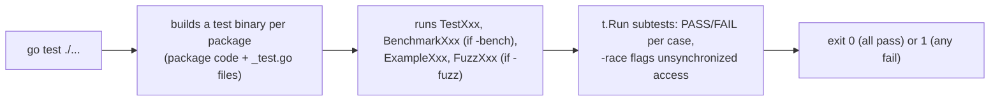
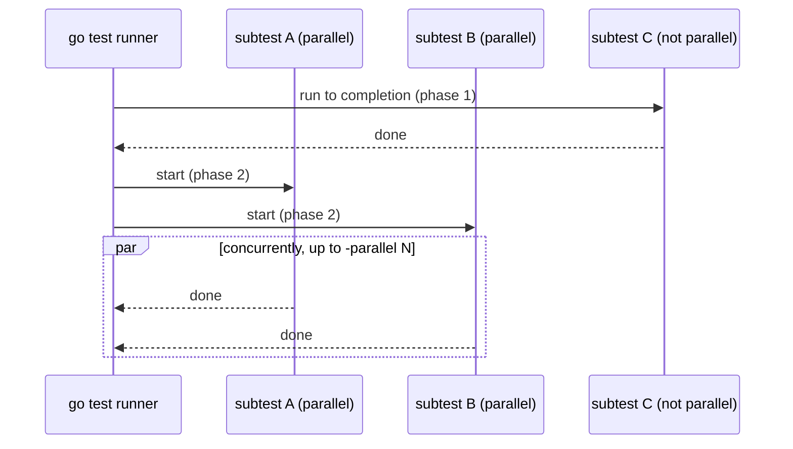

# Testing in Go

> [!summary] TL;DR
> `go test` runs any function named `TestXxx(t *testing.T)` in a `_test.go` file. The idiomatic Go test is table-driven: one function, a slice of input/expected-output cases, and a `t.Run` subtest per case, so a failure names exactly which case broke.

> [!abstract] Core idea
> - One test function, many cases: a table plus `t.Run` gives named, independently-failing subtests from one block of code.
> - `t.Parallel()` opts a subtest into running concurrently with other parallel subtests in the same parent; it does not itself add goroutines to the code under test.
> - `t.Cleanup` registers teardown right next to the setup that needs it, and runs even if the test fails.
> - Coverage and the race detector are cheap to run on every commit (`go test -race -cover ./...`) and catch different bugs: coverage finds untested branches, `-race` finds unsynchronized memory access.
> - Fuzzing and property tests (`FuzzXxx`) state what must always be true and let the tool search for an input that breaks it — the deep end of "test the rules," not a replacement for table tests.

This note is Go's testing *mechanics*: what the `testing` package gives you and how to use each piece. It does not cover **what** to test or **which layer** (unit vs integration vs E2E) — that's [[Testing Strategy and the Test Pyramid]] and [[Unit, Integration and E2E Tests]]. Fakes vs mocks as a design topic is [[Test Doubles and Mocking in Go]]; testing an LLD design end-to-end, including the concurrent "exactly one winner" test, is [[Testing LLD Code]]; fuzzing's theory and property-based testing with `rapid`/`gopter` is [[Fuzz and Property-Based Testing]]; CI staging and flaky tests are [[Testing in CI-CD, Flaky Tests and Testing in Production]].

## 1. Why it exists

A billing service has a `Total(items []Item) int64` function and a handler that calls it. Without tests, three real bugs slip through:

1. An empty `items` slice crashes a careless implementation that assumes at least one item (nil slice range is actually safe in Go, but a naive rewrite that indexes `items[0]` for a "default item" would panic — exactly the kind of edge case a table test with an empty case catches for free).
2. A fuzz test on this note's own `ParsePaise("123.45" → 12345)` parser found that `ParsePaise("100000000000000000")` silently returned a **negative** number: `strconv.ParseInt` accepts any value up to about 9.22×10¹⁸, but multiplying that by 100 overflows `int64` at about 9.22×10¹⁶ and wraps around. No hand-written test case would likely have picked `100000000000000000` as an input; with that string removed from the seed corpus, Go's coverage-guided fuzzer still landed on an equivalent overflowing value in well under a second of real searching (reproduced in this note's scratch module), which is the kind of input a human reviewing test cases by eye tends to skip.
3. A worker pool with no `-race` test in CI reports correct totals in every manual run, then corrupts a shared counter once a week under real concurrent load — the race detector catches this class of bug deterministically in CI, long before "once a week" becomes a production incident.

## 2. Mental model

`go test` compiles your package together with every `*_test.go` file in the same directory into one temporary test binary, then runs every function matching `func TestXxx(t *testing.T)` (and `BenchmarkXxx`, `ExampleXxx`, `FuzzXxx`). Think of `*testing.T` as a **scoped reporter**: it doesn't stop your code, it just tracks pass/fail for the current test (or subtest) and lets you register side effects (`Cleanup`, `Helper`, `Parallel`) that only apply to that scope.



## 3. How it works

### Files, packages, and the `_test.go` suffix

A file named `x_test.go` is excluded from a normal build and only compiled in by `go test`. It can declare `package x` (**white-box**: sees unexported names, for testing internals) or `package x_test` (**black-box**: imports `x` like any other caller, sees only the exported API). Prefer black-box by default — it tests what callers actually have — and use white-box only when you genuinely need to reach an unexported helper.

```go
// white-box: same package, sees unexported names
package invoice

// black-box: imports invoice like any caller
package invoice_test
import "myservice/invoice"
```

### Table-driven tests and subtests

The standard shape: a slice of struct literals, one `t.Run` per case.

```go
func TestTotal(t *testing.T) {
	tests := []struct {
		name  string
		items []Item
		want  int64
	}{
		{"empty", nil, 0},
		{"one item", []Item{{"pen", 3, 1000}}, 3000},
	}
	for _, tt := range tests {
		tt := tt // pre-Go 1.22: capture the loop variable; see Error Handling's note on this
		t.Run(tt.name, func(t *testing.T) {
			if got := Total(tt.items); got != tt.want {
				t.Errorf("Total(%v) = %d, want %d", tt.items, got, tt.want)
			}
		})
	}
}
```



`t.Run("case name", fn)` makes each case a named, independently reportable unit: `go test -run TestTotal/one_item` runs just that one, and a failure prints `--- FAIL: TestTotal/one_item`, not just `--- FAIL: TestTotal`.

- **`t.Error`/`t.Errorf`** mark the (sub)test failed and continue running the rest of the function — use for "record this mismatch, but check everything else in this case too."
- **`t.Fatal`/`t.Fatalf`** mark it failed and stop that goroutine immediately — use once a precondition means the rest of the function can't run meaningfully (a setup error, a nil you're about to dereference). `t.Fatal` inside a goroutine other than the test's own does **not** stop the test; call it only from the test's main goroutine.
- **`t.Parallel()`**, called inside a subtest, marks that subtest to run concurrently with every other parallel sibling under the same parent, once all non-parallel siblings have finished. It is for making **independent** test cases share wall-clock time; it does not add concurrency to the code under test, and two parallel subtests that share mutable state (a package-level variable, a shared temp directory) will race each other.
- **`t.Helper()`**, called in a function other than the test itself (like a shared assertion or setup helper), makes failure line numbers point at the *caller* of the helper, not at the line inside the helper — essential once you have more than one or two helpers, or every failure reports the same unhelpful line.
- **`t.Cleanup(fn)`** registers `fn` to run when the test (or subtest) completes, in LIFO order, whether it passed, failed, or panicked. `t.TempDir()` already uses this internally to delete its directory for you; `t.Cleanup` is what you reach for when *you* open a resource (a temp file via `os.MkdirTemp`, a listener, a goroutine) and need it to be guaranteed to close even on failure.
- **`t.Setenv(key, val)`** sets an environment variable for the duration of the test and restores it afterward — safer than `os.Setenv`/manual restore, and it fails the test immediately if called from a parallel subtest (environment variables are process-global, so two parallel subtests setting the same one would race).
- **`t.TempDir()`** returns a fresh, test-scoped directory, automatically removed after the test — the default way to get a disposable filesystem location instead of hand-rolling `os.MkdirTemp` + manual cleanup for the common case.
- **`t.Context()`** (Go 1.24) returns a `context.Context` that is canceled when the test completes — useful for passing to code under test that expects a context and should be torn down with the test, without building one by hand.

### Comparing values: go-cmp vs testify

The standard library gives you `reflect.DeepEqual` and manual field checks; two popular additions fill the gap:

- **`github.com/google/go-cmp`**'s `cmp.Diff(want, got)` produces a readable structural diff and lets you ignore fields (`cmpopts.IgnoreFields`) or define custom equality (for floats, times) — the Go team's own preference for comparing complex structs in tests.
- **`github.com/stretchr/testify`**'s `assert`/`require` give one-line assertions (`assert.Equal(t, want, got)`, `require.NoError(t, err)`); `assert` records a failure and continues, `require` stops like `t.Fatal`. Very common in application code, though some reviewers consider large assertion DSLs unnecessary over plain `if`/`t.Errorf`.

Neither replaces the other; many Go codebases use plain `if` + `t.Errorf` for simple scalar checks and `cmp.Diff` only for structs/slices where a diff actually helps readability.

### Test doubles and an injectable clock

Depending on a small interface you declare (not one the real dependency hands you) is what lets a test substitute a fake, stub, or mock — the vocabulary and design tradeoffs live in [[Test Doubles and Mocking in Go]]. Time-based code is the recurring case: an injected `Clock` interface with a `FakeClock.Advance(d)` method lets a test assert "the hold expires at exactly 10 minutes" without `time.Sleep`. `testing/synctest` takes a different approach: it runs a function in an isolated "bubble" with a fake clock built into the runtime itself, so goroutines that call `time.Sleep` or wait on a timer inside the bubble can be fast-forwarded by `synctest.Wait()`/advancing the bubble's clock, without threading a `Clock` interface through your code at all. It shipped **experimentally in Go 1.24** behind `GOEXPERIMENT=synctest`, with the function named `synctest.Run(f func())`; **Go 1.25 promoted it to the standard library** and replaced that entry point with `synctest.Test(t *testing.T, f func(t *testing.T))`, which hands the bubble its own `*testing.T` and plugs into normal test reporting — `synctest.Run` is deprecated since Go 1.25 and go.dev's own docs say it is scheduled for removal, so new code should call `synctest.Test`, not `Run`. Use an injected `Clock` interface when the design should be testable without any experimental flag or when the code must also support Go <1.25; reach for `synctest.Test` on Go 1.25+ when you want to test real `time.Timer`/`time.Sleep`-based code unchanged.

### testdata and golden files

A directory named `testdata` anywhere in a package is ignored by the Go toolchain's build (never compiled, never mistaken for a package) and is the conventional place for test fixtures: `.golden` expected-output files, sample JSON, fuzz corpora. The golden-file pattern renders real output and diffs it against a checked-in file, with a flag to refresh the file when the expected output intentionally changes:

```go
var update = flag.Bool("update", false, "update golden files")

func TestReceiptGolden(t *testing.T) {
	got := Receipt("INV-42", items)
	path := filepath.Join("testdata", "receipt.golden")
	if *update {
		os.WriteFile(path, []byte(got), 0o644)
	}
	want, _ := os.ReadFile(path)
	if got != string(want) {
		t.Errorf("mismatch (run -update to refresh):\n%s", got)
	}
}
```

Run `go test -run TestReceiptGolden -update` once to (re)generate `testdata/receipt.golden`, then commit it; ordinary `go test` runs diff against it.

### Example tests

A function named `ExampleXxx` with a trailing `// Output:` comment is compiled, run, and its actual stdout is compared to the comment — a test that is also runnable, checked documentation shown on pkg.go.dev next to the function it exemplifies.

```go
func ExampleTotal() {
	fmt.Println(Total([]Item{{"pen", 2, 500}}))
	// Output:
	// 1000
}
```

No `// Output:` comment means the example compiles (so it stays valid as the API changes) but is not executed or checked against output.

### httptest

`net/http/httptest.NewRequest` and `NewRecorder` let you call an `http.Handler` directly as a function — no real socket, no real port — and inspect the `*httptest.ResponseRecorder` for status code and body:

```go
req := httptest.NewRequest(http.MethodPost, "/total", bytes.NewBufferString(body))
rec := httptest.NewRecorder()
TotalHandler(rec, req)
// rec.Code, rec.Body.Bytes()
```

`httptest.NewServer` goes one step further and starts a real local HTTP server for cases that need an actual round trip (a client library under test, redirect following) — slower, but closer to production. For testing a service's own HTTP **client** code (calling an upstream), `httptest.NewServer` with a handler that returns canned responses is the usual approach; `httptest`-style handler testing, testcontainers-backed repository tests, and bufconn-backed gRPC tests for a real service are covered in `06 Backend Engineering in Go/Testing Go Services`.

### TestMain, build tags and -short

`func TestMain(m *testing.M)` replaces the default test runner for a whole package: it must call `m.Run()` (and typically `os.Exit` with its result), and is the place for setup/teardown that spans every test in the package — a shared test database connection, or a goroutine-leak check:

```go
func TestMain(m *testing.M) {
	goleak.VerifyTestMain(m) // fails the run if any test leaked a goroutine
}
```

Two independent ways to keep slow tests out of the default run:

- **`//go:build integration`** at the top of a file excludes it from a normal `go test ./...` entirely; only `go test -tags=integration ./...` compiles and runs it. Use this for tests that need a real external dependency (a database via testcontainers-go, a real queue).
- **`if testing.Short() { t.Skip(...) }`** inside a test that *does* compile normally, so `go test -short ./...` (a fast pre-commit gate) skips it while a full `go test ./...` still runs it — use this for a test that's merely slow (a large table, many iterations), not one that needs infrastructure the build tag would exclude.

A typical CI pipeline runs `go test -short -race ./...` on every push and `go test -tags=integration ./...` before merge; see [[Testing in CI-CD, Flaky Tests and Testing in Production]] for the full staging.

### The race detector

`go test -race` instruments every memory access and synchronization event and reports a **data race** — two goroutines accessing the same memory where at least one is a write, with no happens-before relationship between them — as a build-breaking failure with both goroutines' stacks, even if the test's assertions all passed. It roughly doubles memory use and slows execution several-fold, which is why it is normal to run it in CI but not necessarily on every local `go test` during rapid iteration. A race is probabilistic: `go test -race -count=5` (or more) reruns the whole suite that many times, because one race-free run proves nothing about the next one.

### Coverage

`go test -cover ./...` prints the percentage of statements executed by the tests. `go test -coverprofile=cover.out` writes a machine-readable profile; `go tool cover -html=cover.out` renders it as a browsable, line-by-line HTML view, and `go tool cover -func=cover.out` prints per-function percentages. `-coverpkg=./...` on an integration test's invocation attributes coverage back to packages that test exercises indirectly (e.g., a handler test that also covers a repository package it calls through), which plain per-package coverage would miss. Coverage percentage is a **lower bound on what's untested**, not a measure of test quality — 100% coverage with no real assertions proves nothing; use it to find the gaps, not as the goal. For coverage from an **integration** test (a built binary exercised by an external driver, not `go test` itself), `go build -cover -o svc ./cmd/svc` produces an instrumented binary that writes its coverage data to a directory named by `GOCOVERDIR` when it exits; `go tool covdata textfmt` turns that directory into the same profile format `go tool cover` reads — this is how a service gets a coverage number for scenarios driven by a real HTTP client or CLI invocation, not by `go test`.

### Fuzzing

`func FuzzXxx(f *testing.F)` declares a fuzz target; `f.Add(...)` seeds the corpus with known-interesting inputs, and `f.Fuzz(func(t *testing.T, ...) { ... })` is the property to check against every generated input. `go test` (no `-fuzz` flag) only runs the seed corpus, like a normal test — fast, deterministic, safe for CI. `go test -fuzz=FuzzXxx -fuzztime=30s` actually generates new inputs; a crashing input is written under `testdata/fuzz/FuzzXxx/<hash>` and becomes a permanent regression test from then on, re-run on every ordinary `go test` without needing `-fuzz` again. The theory behind what makes a good property, and property-based testing libraries (`rapid`, `gopter`) for when native fuzzing's single-string-or-[]byte inputs aren't expressive enough, are in [[Fuzz and Property-Based Testing]].

### Goroutine leaks and flakiness controls

`go.uber.org/goleak`'s `goleak.VerifyTestMain(m)` (shown above) or `goleak.VerifyNone(t)` inside one test asserts that no unexpected goroutine is still running — catching a forgotten `context.CancelFunc`, a worker that never sees its stop channel closed, or a `time.After` left blocking forever. Two flags make tests more honest about hidden assumptions: `-count=1` disables the test cache (by default, `go test` skips re-running a test whose inputs haven't changed — fine for speed, misleading when debugging a suspected flake) and `-shuffle=on` randomizes test and subtest order within a package, surfacing tests that secretly depend on running after another one (shared package-level state, accumulated side effects).

## 4. Worked example

### Whiteboard version

```text
package invoice: Item{Name, Qty, Rate}, Total(items), Receipt(id, items),
                 TotalHandler(w, r), ParsePaise(s)

TestTotal              table + t.Run + t.Parallel
TestParsePaise         table, including overflow-rejecting cases
TestReceiptWritesIntoTempDir   t.Cleanup via a small test helper
TestReceiptGolden      testdata/receipt.golden, -update flag
TestTotalHandler(ManyItems)(RejectsNegativeQty)   httptest.NewRequest/NewRecorder, testing.Short()
TestTotalFromOutside   package invoice_test (black-box)
ExampleTotal           // Output: comment
FuzzParsePaise         f.Add seeds + f.Fuzz property; found a real int64 overflow
TestMain               goleak.VerifyTestMain
BenchmarkTotal         b.Loop (Go 1.24)
integration_test.go    //go:build integration, skipped without a sandbox URL

Run: go vet ./... && go test -race -cover ./...
```

### Full example

All code below is one package (plus a black-box test file and a build-tagged file), tested with Go 1.24.4 on darwin/arm64: `go vet ./...` is clean and `go test -race -cover ./...` passes.

```go
// Package invoice is the tested source for the Testing in Go note.
package invoice

import (
	"encoding/json"
	"fmt"
	"math"
	"net/http"
	"strconv"
	"strings"
)

type Item struct {
	Name string
	Qty  int
	Rate int64 // paise
}

// Total sums Qty*Rate across items. Negative Qty or Rate is a caller bug, not
// a currency quirk, so it is validated at the boundary (handler), not here.
func Total(items []Item) int64 {
	var sum int64
	for _, it := range items {
		sum += int64(it.Qty) * it.Rate
	}
	return sum
}

// Receipt renders a deterministic plain-text receipt. Deterministic output is
// what makes it golden-file-testable: same input always produces the same
// bytes, with no timestamp or map-iteration-order inside it.
func Receipt(id string, items []Item) string {
	var b strings.Builder
	fmt.Fprintf(&b, "Invoice %s\n", id)
	for _, it := range items {
		fmt.Fprintf(&b, "  %-12s x%-3d %8d\n", it.Name, it.Qty, it.Rate)
	}
	fmt.Fprintf(&b, "Total %d\n", Total(items))
	return b.String()
}

// TotalHandler decodes a JSON array of items and writes back {"total": N}.
// It is the target of the httptest example: tested without a real listener.
func TotalHandler(w http.ResponseWriter, r *http.Request) {
	var items []Item
	if err := json.NewDecoder(r.Body).Decode(&items); err != nil {
		http.Error(w, "bad request: "+err.Error(), http.StatusBadRequest)
		return
	}
	for _, it := range items {
		if it.Qty < 0 || it.Rate < 0 {
			http.Error(w, "qty and rate must be non-negative", http.StatusBadRequest)
			return
		}
	}
	w.Header().Set("Content-Type", "application/json")
	json.NewEncoder(w).Encode(map[string]int64{"total": Total(items)})
}

// maxRupees is the largest whole-rupee amount that fits in paise without
// overflowing int64 (math.MaxInt64/100, rounded down). Fuzzing found that
// ParsePaise("100000000000000000") silently wrapped to a negative number
// before this bound existed: strconv.ParseInt(rupees, 10, 64) succeeds for
// any value up to ~9.22e18, but that value times 100 overflows int64 at
// ~9.22e16. The parser must reject amounts it cannot represent, not wrap.
const maxRupees = math.MaxInt64 / 100

// ParsePaise turns "123.45" into 12345 paise. Used by the fuzz/example test.
func ParsePaise(s string) (int64, error) {
	rupees, frac, ok := strings.Cut(s, ".")
	r, err := strconv.ParseInt(rupees, 10, 64)
	if err != nil {
		return 0, fmt.Errorf("parse paise %q: %w", s, err)
	}
	if r < 0 || r > maxRupees {
		return 0, fmt.Errorf("parse paise %q: out of range", s)
	}
	if !ok {
		return r * 100, nil
	}
	if len(frac) != 2 {
		return 0, fmt.Errorf("parse paise %q: want 2 fractional digits", s)
	}
	f, err := strconv.ParseInt(frac, 10, 64)
	if err != nil {
		return 0, fmt.Errorf("parse paise %q: %w", s, err)
	}
	if f < 0 || f > 99 {
		return 0, fmt.Errorf("parse paise %q: fractional part out of range", s)
	}
	return r*100 + f, nil
}
```

The tests, including the table tests, `t.Cleanup`, the golden file, `httptest`, `-short`, the example, and the benchmark:

```go
var update = flag.Bool("update", false, "update golden files")

func TestTotal(t *testing.T) {
	tests := []struct {
		name  string
		items []Item
		want  int64
	}{
		{"empty", nil, 0},
		{"one item", []Item{{"pen", 3, 1000}}, 3000},
		{"several items", []Item{{"pen", 3, 1000}, {"pad", 2, 2500}}, 8000},
		{"zero qty contributes nothing", []Item{{"sample", 0, 9999}}, 0},
	}
	for _, tt := range tests {
		tt := tt
		t.Run(tt.name, func(t *testing.T) {
			t.Parallel() // independent cases: safe to run concurrently with -parallel
			if got := Total(tt.items); got != tt.want {
				t.Errorf("Total(%v) = %d, want %d", tt.items, got, tt.want)
			}
		})
	}
}

// t.Cleanup registers teardown at the point of setup, so it stays next to the
// resource it frees even inside a helper, and still runs if the test fails.
func newTempInvoiceDir(t *testing.T) string {
	t.Helper()
	dir, err := os.MkdirTemp("", "invoice-*")
	if err != nil {
		t.Fatalf("MkdirTemp: %v", err)
	}
	t.Cleanup(func() {
		if err := os.RemoveAll(dir); err != nil {
			t.Logf("cleanup: %v", err) // cleanup errors are logged, not fatal
		}
	})
	return dir
}

// TestReceiptWritesIntoTempDir is the test that actually calls the helper
// above: t.Cleanup's removal runs when this test ends, pass or fail.
func TestReceiptWritesIntoTempDir(t *testing.T) {
	dir := newTempInvoiceDir(t)
	items := []Item{{"pen", 3, 1000}}
	got := Receipt("INV-1", items)

	path := filepath.Join(dir, "receipt.txt")
	if err := os.WriteFile(path, []byte(got), 0o644); err != nil {
		t.Fatalf("WriteFile: %v", err)
	}
	if _, err := os.Stat(path); err != nil {
		t.Fatalf("Stat: %v", err)
	}
}

// Golden-file test: the expected output lives in testdata/, regenerated with
// `go test -run TestReceiptGolden -update`.
func TestReceiptGolden(t *testing.T) {
	items := []Item{{"pen", 3, 1000}, {"pad", 2, 2500}}
	got := Receipt("INV-42", items)

	goldenPath := filepath.Join("testdata", "receipt.golden")
	if *update {
		if err := os.WriteFile(goldenPath, []byte(got), 0o644); err != nil {
			t.Fatalf("write golden: %v", err)
		}
	}
	want, err := os.ReadFile(goldenPath)
	if err != nil {
		t.Fatalf("read golden (run with -update first?): %v", err)
	}
	if got != string(want) {
		t.Errorf("Receipt mismatch (-update to refresh):\ngot:\n%s\nwant:\n%s", got, want)
	}
}

func TestTotalHandler(t *testing.T) {
	body := `[{"Name":"pen","Qty":3,"Rate":1000}]`
	req := httptest.NewRequest(http.MethodPost, "/total", bytes.NewBufferString(body))
	rec := httptest.NewRecorder()

	TotalHandler(rec, req)

	if rec.Code != http.StatusOK {
		t.Fatalf("status = %d, want 200; body=%s", rec.Code, rec.Body)
	}
	var out struct{ Total int64 }
	json.Unmarshal(rec.Body.Bytes(), &out)
	if out.Total != 3000 {
		t.Errorf("total = %d, want 3000", out.Total)
	}
}

// go test -short skips this slow table; a full run still executes it.
func TestTotalHandlerManyItems(t *testing.T) {
	if testing.Short() {
		t.Skip("skipping slow table in -short mode")
	}
	items := make([]Item, 10_000)
	for i := range items {
		items[i] = Item{Name: "x", Qty: 1, Rate: 100}
	}
	if got := Total(items); got != 1_000_000 {
		t.Fatalf("Total() = %d, want 1000000", got)
	}
}

func ExampleTotal() {
	fmt.Println(Total([]Item{{"pen", 2, 500}}))
	// Output:
	// 1000
}

func BenchmarkTotal(b *testing.B) {
	items := make([]Item, 100)
	for i := range items {
		items[i] = Item{Name: "x", Qty: i + 1, Rate: 999}
	}
	// b.Loop (Go 1.24) replaces `for i := 0; i < b.N; i++`: it resets the
	// timer after this setup runs, stops it once the loop ends, and the
	// compiler never optimizes away a call syntactically inside the braces
	// — the older b.N form could have Total's result discarded as dead code.
	for b.Loop() {
		Total(items)
	}
}
```

The fuzz target that found the overflow, with the crashing input kept as a permanent regression seed:

```go
func FuzzParsePaise(f *testing.F) {
	for _, seed := range []string{
		"10", "10.50", "0.00", "", ".", "10.", "-5.00", "999999999.99",
		"100000000000000000", // regression: used to overflow int64 silently
	} {
		f.Add(seed)
	}
	f.Fuzz(func(t *testing.T, s string) {
		got, err := ParsePaise(s)
		if err != nil {
			return // rejecting malformed input is fine; panicking is not
		}
		if got < 0 && len(s) > 0 && s[0] != '-' {
			t.Fatalf("ParsePaise(%q) = %d, negative result from non-negative-looking input", s, got)
		}
	})
}
```

A separate black-box test file, `package invoice_test`, proving the exported API alone is testable:

```go
package invoice_test

import (
	"testing"

	"testinggo/invoice"
)

func TestTotalFromOutside(t *testing.T) {
	items := []invoice.Item{{Name: "pen", Qty: 2, Rate: 500}}
	if got := invoice.Total(items); got != 1000 {
		t.Fatalf("Total() = %d, want 1000", got)
	}
}
```

A build-tagged integration test, excluded from `go test ./...` entirely and skipped on its own when no sandbox is configured — the two independent gates from "`TestMain`, build tags and `-short`" above, both in one file:

```go
//go:build integration

package invoice

import (
	"os"
	"testing"
)

// TestTotalHandler_AgainstRealPaymentSandbox would call a real payment
// sandbox and cross-check its total against TotalHandler's. The build tag
// keeps it out of a normal `go test ./...` entirely; only
// `go test -tags=integration ./...` even compiles it, and it still skips
// itself when no sandbox is configured.
func TestTotalHandler_AgainstRealPaymentSandbox(t *testing.T) {
	url := os.Getenv("INVOICE_SANDBOX_URL")
	if url == "" {
		t.Skip("INVOICE_SANDBOX_URL not set; skipping real sandbox call")
	}
	// ... call the sandbox at url and compare its total to TotalHandler's.
}
```

**Measured** (Go 1.24.4, darwin/arm64, Apple M4, 2026-11-07):
- `go test -race -count=2 -cover ./...`: 8 top-level tests (including the fuzz seed corpus and the example) pass twice over, **coverage: 83.3% of statements**.
- `go test -fuzz=FuzzParsePaise -fuzztime=10s` against the code **before** the `maxRupees` bound existed, with `"100000000000000000"` removed from the seed corpus (so the search has to find it, not just replay a seed): failed in under 0.2s of real fuzzing — well before `go test`'s first 3-second progress line, so no execution count is printed — with `ParsePaise("100000000000000000") = -8446744073709551616`, confirming the `int64` overflow. After adding the bound, a 5-second fuzz run completed cleanly with 629,894 executions (≈123,000 execs/sec on this machine); exact throughput is hardware-dependent, so treat the rate as illustrative, not a target.
- `go test -bench=BenchmarkTotal -run=^$`: `BenchmarkTotal-10  44879875  27.47 ns/op` (100-item slice, default benchtime) is representative; a rerun on different hardware or Go patch version will land at a different but similar ns/op.
- `go test -tags=integration ./...`: `TestTotalHandler_AgainstRealPaymentSandbox` reports `--- SKIP` (no `INVOICE_SANDBOX_URL` set); without the tag it does not even compile into the test binary.
- `go test -short`: `TestTotalHandlerManyItems` reports `--- SKIP`; a full run (no `-short`) runs it.

## 5. Variants and comparison

| Tool | Checks | Run by default? | Cost |
| --- | --- | --- | --- |
| `TestXxx` + table + `t.Run` | Named cases against expected output | Yes (`go test`) | Fast |
| `t.Parallel()` | Nothing extra; just concurrency between independent subtests | Only if called | Faster wall-clock on multi-core CI; can hide ordering bugs if cases aren't independent |
| `-race` | Unsynchronized concurrent memory access | No — pass `-race` | 2-10x slower, more memory |
| `-cover` | Which statements ran | No — pass `-cover` | Negligible |
| `ExampleXxx` | Printed output vs a comment | Yes, if present | Fast; only as good as the comment is kept current |
| `FuzzXxx` (seed corpus only) | The stated property, on known cases | Yes, as a normal test | Fast |
| `FuzzXxx -fuzz` | The stated property, on generated cases | No — pass `-fuzz` | Seconds to hours; needs a real property, not just "doesn't panic on one input" |
| `//go:build integration` | Whatever the real dependency validates | No — needs `-tags=integration` | Slow; needs infrastructure |
| `testing.Short()` skip | Same test, just the expensive path | Yes, skipped only with `-short` | None extra; just a branch |
| `goleak.VerifyTestMain` | No goroutine outlives the test run | No — must be wired into `TestMain` | Negligible; occasionally a false positive from a library's background goroutine (needs an `IgnoreTopFunction` option) |

## 6. Trade-offs and when not to use

- Table tests lose value once cases stop sharing a shape — if every case needs different setup and assertions, separate `TestXxx` functions are clearer than a table with a dozen optional fields.
- `t.Parallel()` is free performance only when subtests are genuinely independent; parallelizing subtests that share a package-level variable, a fixed port, or a shared temp file turns a flaky test into a flaky **and** hard-to-reproduce test, since failures depend on scheduling.
- Golden files are powerful for large, structured, rarely-changing output (rendered text, serialized responses) and overkill for a single scalar assertion — don't golden-file what a one-line `want` constant would express just as well.
- Fuzzing finds crashes and invariant violations, not business-logic correctness — `FuzzParsePaise` proves "never panics, never returns a negative paise value for non-negative input," not "correctly parses every currency format a user might type." Keep the table test for the latter.
- `synctest` (Go 1.25) only helps when the time-based code can run entirely inside its bubble (all the goroutines it starts, all the channels it waits on); code that talks to something outside the bubble (a real network call, a real OS timer outside the test) isn't a fit.

## 7. In production

- **Real systems:** nearly every Go service in production runs `go vet` and `go test -race -cover ./...` as a required CI gate before merge; the Go standard library itself is tested almost entirely with table-driven tests and a very large shared `FuzzXxx` corpus (Go's own `encoding/json`, `net/http`, and `image` packages have all had bugs found this way).
- **Failure modes → fixes:**
  - A flaky `-race` failure that reproduces once in twenty runs → `go test -race -count=20 -run TestName` to force many reruns locally before assuming it's a false alarm (true races detected by `-race` are real; the detector itself does not produce false positives, only false negatives when a race doesn't trigger on a given run).
  - A benchmark that "proves" an optimization helped, but the compiler had inlined the call away → `for b.Loop() { ... }` (Go 1.24) instead of the manual `b.N` loop, since calls inside it are never optimized away.
  - CI green, production goroutine count climbing → add `goleak.VerifyTestMain` to the suspect package's tests; it often catches the exact leak pattern (missed `cancel()`, unclosed channel) that caused the production leak.
  - "Works on my machine" test order dependency → `go test -shuffle=on`, which will reorder tests and surface the hidden shared state.
- **What to monitor:** CI test duration trend (a creeping suite slows every PR); flaky-test rate per test name over time; coverage delta per PR (a drop on a PR that adds logic is a signal, not an automatic block).

## 8. Deep dive

- **Why `-race` never false-positives (in practice).** The detector tracks a per-memory-location "happens-before" vector clock using goroutine and synchronization events (channel send/receive, mutex lock/unlock, `sync.WaitGroup`, atomics). If it reports a race, it found two actual concurrent accesses with no established ordering between them on *that run* — it cannot invent a race that didn't happen. What it can miss is a race that exists in the code but didn't manifest on that particular run's goroutine scheduling, which is why `-count=N` matters for confidence, not for correctness of a single report.
- **`t.Parallel()`'s actual scheduling.** Parallel subtests do not start immediately; `go test` first runs all non-parallel subtests of a parent to completion in order, then runs all parallel ones concurrently, bounded by `-parallel N` (default: `GOMAXPROCS`). A parallel subtest that calls another `t.Parallel()` nested subtest repeats the same two-phase behavior one level down.
- **Fuzzing's coverage-guided search.** Go's native fuzzer instruments the binary (similar to `-cover`) and uses the *coverage* achieved by each generated input to decide which inputs to mutate further — an input that reaches new code paths is kept and perturbed more, one that doesn't is deprioritized. This is why a 5-second fuzz run can find a specific 18-digit number: the search is steered by what code paths each attempt actually exercises, not a uniform random guess over all strings.
- **`testing/synctest`'s "bubble."** Code run via `synctest.Test(t, f)` (the stable Go 1.25 entry point; the original Go 1.24 experimental name was `synctest.Run(f)`, now deprecated) executes on goroutines whose view of `time` is virtual: `time.Now()`, `time.Sleep`, and timers inside the bubble advance only when every goroutine in the bubble is blocked ("durably blocked") and the test calls `synctest.Wait()` or advances past that point, making a 10-minute timeout test run in milliseconds of wall-clock time while still exercising the real `time` package APIs, not a hand-written fake. A subtlety worth knowing: calling `t.Run` on the `*testing.T` passed into the bubble panics, so you cannot start ordinary subtests from inside one.
- **Example tests and whitespace.** The `// Output:` comparison trims leading/trailing whitespace per line and ignores a trailing newline, but is otherwise exact — a stray extra blank line in the comment is a common cause of an example "failing" with output that looks identical at a glance.

## 9. Interview questions

> [!question]- Why table-driven tests instead of one `TestXxx` function per case?
> One function holds the assertion logic once; each case is a short struct literal. `t.Run(tt.name, ...)` still reports failures per-case by name, so you keep the granularity of separate tests without duplicating the test body.

> [!question]- Does `t.Parallel()` make the code under test run concurrently?
> No. It only tells the test runner that this subtest may run at the same time as its parallel siblings. The code under test runs exactly as many goroutines as it always does; `t.Parallel()` is purely about test wall-clock time.

> [!question]- When would you reach for `-tags=integration` versus `testing.Short()`?
> A build tag when the test needs infrastructure the normal build shouldn't even compile against (a real database driver, testcontainers) — it is excluded from `go test ./...` entirely. `testing.Short()` when the test compiles fine and needs nothing external, it's just slow (a big table, many iterations) and you want a fast pre-commit run to skip it.

> [!question]- A benchmark claims an "optimization" doubled speed, but you're suspicious. What would you check?
> Whether the loop uses `for b.Loop()` (Go 1.24) rather than the manual `for i := 0; i < b.N; i++`; the latter can have its call optimized away by the compiler if the result is unused, making an unoptimized baseline look artificially slow and an "optimized" version look artificially fast. Also check the benchmark actually does equivalent work before and after.

> [!question]- What exactly does `go test -cover` tell you, and what does it not tell you?
> The percentage of **statements** executed by the test run. It does not tell you whether the assertions made on those statements are meaningful — a test that calls a function and checks nothing still counts every line as covered.

> [!question]- Trap: your fuzz test for a parser only checks "it doesn't panic." Is that a sufficient test?
> No — on its own it only catches crashes and index/overflow bugs, not wrong-but-non-panicking output. `FuzzParsePaise` in this note also asserts a property on the *result* (never negative for non-negative-looking input), which is why it caught the `int64` overflow; "never panics" alone would have let the overflow through silently.

> [!question]- How do fakes, mocks, and an injected clock fit into "Testing in Go" versus a separate note?
> The mechanics (table tests, subtests, coverage, fuzzing) are this note. Choosing fakes vs mocks as a design decision is [[Test Doubles and Mocking in Go]]; using them inside a concurrent LLD design, including the "exactly one winner" race test, is [[Testing LLD Code]].

## 10. Cheat sheet

- `TestXxx(t *testing.T)` + table + `t.Run(name, fn)`; `t.Parallel()` only for independent cases.
- `t.Fatal` stops the current test goroutine; `t.Error` records and continues. Call `t.Helper()` in shared assertion/setup functions.
- `t.Cleanup(fn)` next to the setup it tears down; `t.TempDir()` for a disposable directory.
- `package x_test` (black-box, exported API only) is the default; `package x` (white-box) only when you must reach unexported names.
- `testdata/` is ignored by the build; golden files there + an `-update` flag for large expected output.
- `httptest.NewRequest`/`NewRecorder` for a handler, no real listener; `httptest.NewServer` when you need one.
- `-race` catches real unsynchronized access (never a false positive); `-count=N` reruns to catch a probabilistic race.
- `b.Loop()` (Go 1.24) over manual `b.N` loops — it resets the timer and stops the compiler from discarding the call.
- `FuzzXxx` + `f.Add` seeds + `f.Fuzz` property; a crasher becomes a permanent `testdata/fuzz/` regression test.
- `go.uber.org/goleak` in `TestMain` catches goroutine leaks; `-shuffle=on` catches order-dependent tests.

## Links

- **Before this:** [[Error Handling]], [[Packages, Modules and Dependency Management]]
- **Next:** [[Testing Strategy and the Test Pyramid]], [[Test Doubles and Mocking in Go]], [[Fuzz and Property-Based Testing]]
- **Compare with:** [[Testing LLD Code]] (testing a concurrent LLD design end-to-end), [[Unit, Integration and E2E Tests]] (which layer to put a test in), [[Testing in CI-CD, Flaky Tests and Testing in Production]] (how CI stages `-short`, `-race`, and integration runs)
