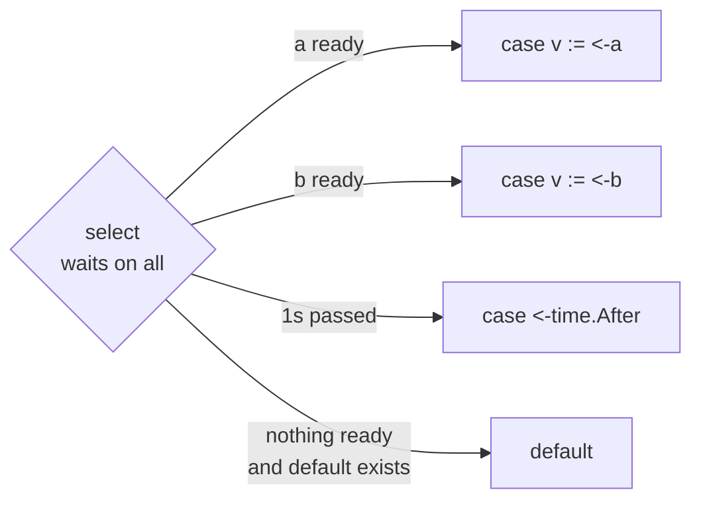
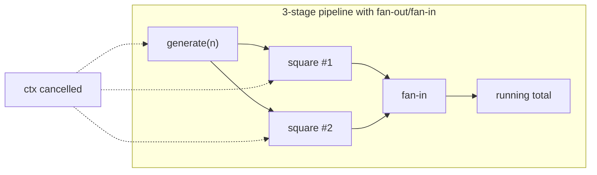
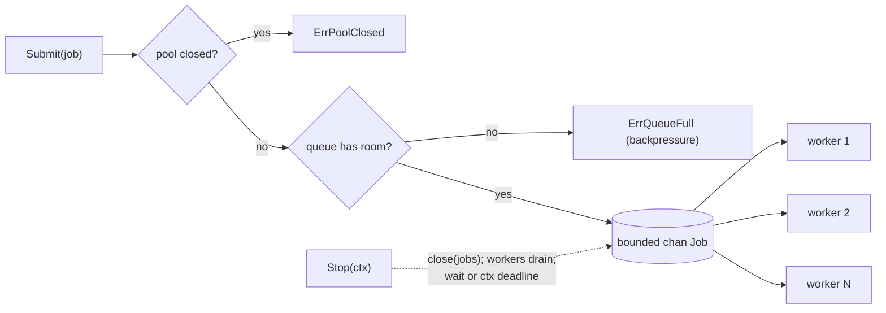
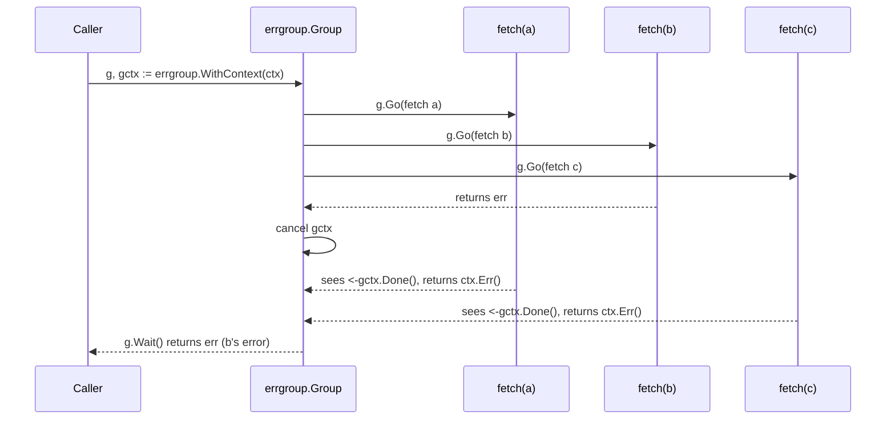

# select and Concurrency Patterns

> [!summary] TL;DR
> `select` waits on several channel operations at once and runs whichever one is ready first, choosing randomly among ties; adding a `default` case turns it into a non-blocking check. Every common Go concurrency shape — timeouts, pipelines, worker pools, bounded parallelism — is built by combining `select` with channels and a handful of small helper types.

> [!abstract] Core idea
> - `select` blocks until at least one of its cases can proceed, then runs exactly one, chosen at random if several are ready.
> - `default` makes `select` non-blocking: no case ready, no wait, run `default` instead.
> - A nil channel's case is never ready, which is how you disable one arm of a `select` at runtime.
> - Bound every unbounded concurrency source — a worker pool, a semaphore, `errgroup.SetLimit` — so load has a ceiling.
> - Cancellation is a tree: a parent `context` cancelling must reach every goroutine it started, almost always through a `case <-ctx.Done()`.

## Start here: the basics

**The problem in one story.**
You call two slow services and want whichever answers first, but you will not wait more than one second.
Waiting on one, then the other, then a clock, in order, does not work: you would be stuck on the first.
`select` lets one goroutine wait on all three at once and react to whichever happens first.

**Words you need first**

| Word | Plain meaning | Tiny example |
| --- | --- | --- |
| Goroutine | A lightweight function running at the same time as others | `go fetch()` |
| Channel | A pipe goroutines use to pass values | `ch := make(chan int)` |
| Send / receive | Put a value into / take one out of a channel | `ch <- 1` / `v := <-ch` |
| Blocking | Waiting until an operation can happen | `<-ch` waits for a sender |
| Timeout | Giving up after a set time | `time.After(time.Second)` |
| Context | A value that carries a "stop now" signal | `<-ctx.Done()` |
| Worker pool | A fixed number of goroutines sharing a job queue | 4 workers reading `jobs` |

**Picture it**



**Analogy.** A waiter watching several tables at once: whichever table raises a hand first gets served; if two raise hands together, the waiter picks one at random.
Where it breaks: a waiter can serve several tables in a row, but one `select` handles exactly one case, then you loop to wait again.

**How the rest of this note builds up**

- First, why `select` exists (section 1) and a mental model (section 2).
- Then how it works: blocking, `default`, nil channels, timeouts, and patterns like pipelines, fan-out/fan-in, worker pools, semaphores and `errgroup` (section 3).
- Then a worked example (section 4), variants and trade-offs (sections 5-6).
- Finally production habits (section 7) and the SDE-3 deep dive: why `select` picks randomly, semaphores as happens-before edges, `errgroup` and `singleflight` guarantees, `Ticker` vs `Timer` (section 8).

> [!tip] Remember
> `select` waits on many channel operations and runs one ready case; `default` makes it non-blocking; always bound concurrency and listen on `ctx.Done()`.

## 1. Why it exists

A request handler that calls three downstream services wants to run them in parallel, give up with a clear error if one takes too long, and stop the other two immediately so they do not keep burning CPU and connections after the client has already gotten a timeout response.

Doing this with plain channels alone needs a way to wait on "whichever happens first — a result, a timeout, or a cancellation" without picking one channel in advance.

That is exactly what `select` is for, and on top of it sit a small number of patterns — pipeline, worker pool, fan-out/fan-in, bounded parallelism — that keep reappearing because they solve the same shape of problem: process many things concurrently, but with a ceiling on how many run at once and a clean way to stop early.

## 2. Mental model

`select` is a **receptionist watching several phone lines at once**. The moment any line rings, she picks it up (if two ring in the same instant, she picks one of them at random — it is not "first line wins").

A `default` case means "if no line is ringing right now, don't wait — go do something else instead." A `case` on a nil channel is a phone line that was never connected: it is never going to ring, so the receptionist never picks it, which is a deliberate way to tell her "ignore this line entirely, for now."

The patterns below are all team structures built from that one primitive: a pipeline is workers in a row, each handing finished work to the next; a worker pool is many workers pulling from one shared queue; fan-out/fan-in is splitting work out to several workers and merging their results back into one stream.

## 3. How it works

### `select` semantics

```go
select {
case v := <-ch1:
    use(v)
case ch2 <- x:
    // sent x
case <-ctx.Done():
    return ctx.Err()
default:
    // runs only if NONE of the above are ready right now
}
```

- `select` with no `default` blocks until at least one case can proceed.
- If several cases are ready simultaneously, Go picks **one uniformly at random** — never "whichever was written first" or "whichever channel has more buffered values".
- `default` makes the whole statement non-blocking: it is evaluated immediately, and only runs if every other case would have blocked.
- A `case` on a `nil` channel is never selected, because send and receive on `nil` always block — see [[Goroutines and Channels]]. Setting a channel variable to `nil` after you are done with it is the standard way to permanently disable its `select` arm.

### Timeouts: `time.After` vs. a context deadline

```go
select {
case v := <-resultCh:
    return v, nil
case <-time.After(2 * time.Second):
    return zero, context.DeadlineExceeded
case <-ctx.Done():
    return zero, ctx.Err()
}
```

`time.After(d)` returns a channel that receives once after `d`. Before Go 1.23, a `time.After` timer that never fired (because another case won the `select` first) stayed referenced by the runtime's timer heap until it actually fired, so a `select` with `time.After` inside a hot loop could accumulate live timers.

**Since Go 1.23**, an unreferenced, unfired timer created this way can be garbage collected before it fires, which removes that leak for the common one-shot case; it is still wasteful to create a new timer on every iteration of a tight loop; prefer creating one `time.Timer` with `time.NewTimer` and calling `Reset` on it when the same deadline is checked repeatedly.

Preferring `ctx.Done()` over `time.After` is usually better practice regardless: a `context.Context` deadline is set once, at the top of a call chain, and every layer underneath just observes it, instead of each layer inventing its own `time.After` with its own guess at an appropriate duration.

### For-select worker loops

The shape that appears in almost every long-running goroutine: loop forever, and in each iteration, race "there is work" against "I have been told to stop".

```go
func worker(ctx context.Context, jobs <-chan Job) {
    for {
        select {
        case job, ok := <-jobs:
            if !ok {
                return // channel closed and drained: no more work, ever
            }
            process(job)
        case <-ctx.Done():
            return // told to stop, even with jobs still queued
        }
    }
}
```

### Pipelines

A pipeline is a chain of stages, each a function that takes an input channel and returns an output channel. Each stage is the **owner** of the channel it returns (see the ownership pattern in [[Goroutines and Channels]]): it alone writes to that channel and closes it once its own input is exhausted or cancelled.



```go
func Pipeline(ctx context.Context, n int) <-chan int {
    gen := func() <-chan int {
        out := make(chan int)
        go func() {
            defer close(out)
            for i := 1; i <= n; i++ {
                select {
                case out <- i:
                case <-ctx.Done():
                    return
                }
            }
        }()
        return out
    }
    square := func(in <-chan int) <-chan int {
        out := make(chan int)
        go func() {
            defer close(out)
            for v := range in {
                select {
                case out <- v * v:
                case <-ctx.Done():
                    return
                }
            }
        }()
        return out
    }
    return square(gen())
}
```

Cancelling `ctx` stops every stage: each stage's `select` races its send against `ctx.Done()`, so a cancelled context makes every stage return and close its own output, and the chain unwinds from the front.

### Fan-out / fan-in

Fan-out starts several goroutines reading from the same input channel (splitting the work); fan-in merges several goroutines' outputs into one channel (collecting the results).

The part that trips people up is **who closes the merged output, and when**: it must close only after every fan-out worker has finished, which needs a `sync.WaitGroup` plus a dedicated "closer" goroutine, because `wg.Wait()` cannot run on the same goroutine that is also ranging over the channel it is waiting to close — that would deadlock the goroutine waiting on itself.

```go
func FanOutFanIn(ctx context.Context, in <-chan int, workers int, f func(int) int) <-chan int {
    out := make(chan int)
    var wg sync.WaitGroup
    for i := 0; i < workers; i++ {
        wg.Add(1)
        go func() {
            defer wg.Done()
            for v := range in {
                select {
                case out <- f(v):
                case <-ctx.Done():
                    return
                }
            }
        }()
    }
    go func() {
        wg.Wait()
        close(out) // safe: every writer to `out` has already returned
    }()
    return out
}
```

### Worker pool with a bounded queue

A fixed number of long-lived worker goroutines pull from one bounded job queue. Unlike an unbounded "one goroutine per job" fan-out, the number of concurrently running jobs is capped at `workers`, and the queue itself is capped so a burst of submissions cannot grow memory without limit.



```go
type Pool struct {
    mu      sync.RWMutex // guards closed, so "check closed then send" is atomic with close
    closed  bool
    jobs    chan Job
    wg      sync.WaitGroup
    Results chan int
}

func (p *Pool) Submit(j Job) error {
    p.mu.RLock()
    defer p.mu.RUnlock()
    if p.closed {
        return ErrPoolClosed
    }
    select {
    case p.jobs <- j:
        return nil
    default:
        return ErrQueueFull // caller backs off, retries, or returns 429
    }
}
```

`Submit` never blocks: a full queue returns `ErrQueueFull` immediately instead of making the caller wait, which is **backpressure** — the caller finds out the system is saturated and can choose to retry, persist the job durably, or reject the request with an HTTP 429.

`Stop` closes the queue so the workers' `for range` loops drain whatever was already accepted before exiting (full code and tests in the worked example). This in-process pool is for bounded, best-effort background work inside one process; durable job queues (Postgres `SKIP LOCKED` tables, SQS, Kafka) that survive a crash belong to [[Background Workers and Job Queues]] in `06 Backend Engineering in Go`.

### Bounded parallelism: three ways to cap concurrency

| Tool | Where it comes from | What it caps |
| --- | --- | --- |
| Buffered channel of tokens | standard library only | How many goroutines hold a token at once |
| `golang.org/x/sync/semaphore.Weighted` | `golang.org/x/sync` | Weighted capacity (some callers can ask for more than one unit) |
| `errgroup.Group.SetLimit(n)` | `golang.org/x/sync` | How many of the group's `Go` calls run concurrently |

A buffered channel of empty structs works as a semaphore with zero extra dependencies: acquiring a slot is a send, releasing it is a receive.

```go
func BoundedChanSemaphore(ctx context.Context, items []int, n int, work func(int)) {
    tokens := make(chan struct{}, n)
    var wg sync.WaitGroup
    for _, it := range items {
        select {
        case tokens <- struct{}{}:
        case <-ctx.Done():
            wg.Wait()
            return
        }
        wg.Add(1)
        go func(v int) {
            defer wg.Done()
            defer func() { <-tokens }() // release the token
            work(v)
        }(it)
    }
    wg.Wait()
}
```

`semaphore.Weighted` is the same idea with weights, useful when different callers need different-sized shares of one capacity (for example, a batch job that occupies 4 "slots" against a pool of 10). `errgroup.Group` combines the semaphore idea with error propagation and context cancellation in one type, shown next.

### `errgroup`: cancel-on-first-error fan-out

```go
func FetchAll(ctx context.Context, ids []string, maxInFlight int64, fetch func(context.Context, string) error) error {
    g, gctx := errgroup.WithContext(ctx)
    sem := semaphore.NewWeighted(maxInFlight)
    for _, id := range ids {
        id := id
        if err := sem.Acquire(gctx, 1); err != nil {
            return err // gctx was already cancelled by a sibling's error
        }
        g.Go(func() error {
            defer sem.Release(1)
            return fetch(gctx, id)
        })
    }
    return g.Wait()
}
```



`errgroup.WithContext(ctx)` returns a derived context that is cancelled the moment any `g.Go` function returns a non-nil error, and `g.Wait()` returns the **first** such error. Every goroutine launched with `g.Go` should itself watch `gctx.Done()` (directly, or via whatever it calls downstream accepting a context) so that one failure actually stops the others' work instead of merely being reported after they all finish anyway.

### Request coalescing: `singleflight`

`singleflight.Group.Do(key, fn)` collapses concurrent calls that share the same key into a single execution of `fn`; every caller waiting on that key gets the same result once it completes. This is the standard fix for a **cache stampede**: when a hot cache key expires, dozens of concurrent requests would otherwise all miss at once and all hit the database for the same row — `singleflight` makes exactly one of them do the work.

### Rate limiting: `time.Ticker` vs. `x/time/rate`

A `time.Ticker` fires at a fixed interval and is useful for "do this roughly every N seconds" (background refreshes, periodic flushes), but it has no concept of bursts and a slow consumer drops ticks (the ticker's channel buffers only 1).

`golang.org/x/time/rate.Limiter` is a **token bucket**: tokens refill at a steady rate up to a burst capacity, `Allow()` checks instantly, and `Wait(ctx)` blocks until a token is available or the context is done — it is the right tool for "at most R requests per second, with short bursts allowed," such as throttling calls to a fragile downstream dependency.

### Broadcast / pub-sub

Fanning one event out to many subscribers needs a decision for what happens when a subscriber is slow: **block** the publisher (one slow subscriber stalls everyone — rarely acceptable), **drop** that subscriber's message (give every subscriber its own buffered channel, and if a send would block, drop the message instead of blocking the publisher), or disconnect slow subscribers entirely past some threshold.

Per-subscriber buffered channels with a drop-on-full policy is the usual default: it isolates one slow consumer from the rest and from the publisher.

### Leak-free shutdown ordering

Shutting down a pipeline or a worker pool correctly follows one order: stop accepting new work, signal existing work to wind down (`cancel()` or `close()` on the right channel), wait for in-flight goroutines with a bounded deadline, and only then release shared resources (close a database pool, flush logs).

Doing these out of order — for example, closing a shared resource before every goroutine using it has actually stopped — is a frequent source of "panic: send on closed channel" or "use of closed connection" errors during deploys.

## 4. Worked example

### Whiteboard version

The core of a non-blocking timeout, stripped to the essentials:

```go
package wb

import "time"

func firstOf(work <-chan int, timeout <-chan time.Time) (int, bool) {
    select {
    case v := <-work:
        return v, true
    case <-timeout:
        return 0, false
    }
}
```

The full version below adds the worker pool, fan-out/fan-in, `errgroup` with a weighted semaphore, and a channel-based semaphore, tested under the race detector with `go vet ./...` clean and `go test -race ./...` passing.

```go
package patterns

import (
    "context"
    "errors"
    "sync"
    "time"

    "golang.org/x/sync/errgroup"
    "golang.org/x/sync/semaphore"
)

// TryRecv is select with a default case: it never blocks.
func TryRecv(ch <-chan int) (int, bool) {
    select {
    case v := <-ch:
        return v, true
    default:
        return 0, false
    }
}

// CallWithTimeout races a slow call against a deadline using time.After.
func CallWithTimeout(ctx context.Context, timeout time.Duration, call func(context.Context) (int, error)) (int, error) {
    type result struct {
        v   int
        err error
    }
    out := make(chan result, 1) // buffered: the goroutine never blocks if we give up
    go func() {
        v, err := call(ctx)
        out <- result{v, err}
    }()
    select {
    case r := <-out:
        return r.v, r.err
    case <-time.After(timeout):
        return 0, context.DeadlineExceeded
    case <-ctx.Done():
        return 0, ctx.Err()
    }
}

type Job struct {
    ID  int
    Run func() int
}

var (
    ErrQueueFull  = errors.New("queue full")
    ErrPoolClosed = errors.New("pool closed")
)

type Pool struct {
    mu      sync.RWMutex
    closed  bool
    jobs    chan Job
    wg      sync.WaitGroup
    Results chan int
}

func NewPool(workers, queueSize int) *Pool {
    p := &Pool{jobs: make(chan Job, queueSize), Results: make(chan int, queueSize)}
    for i := 0; i < workers; i++ {
        p.wg.Add(1)
        go func() {
            defer p.wg.Done()
            for j := range p.jobs {
                p.Results <- j.Run()
            }
        }()
    }
    return p
}

func (p *Pool) Submit(j Job) error {
    p.mu.RLock()
    defer p.mu.RUnlock()
    if p.closed {
        return ErrPoolClosed
    }
    select {
    case p.jobs <- j:
        return nil
    default:
        return ErrQueueFull
    }
}

func (p *Pool) Stop(ctx context.Context) error {
    p.mu.Lock()
    if !p.closed {
        p.closed = true
        close(p.jobs)
    }
    p.mu.Unlock()
    done := make(chan struct{})
    go func() {
        p.wg.Wait()
        close(p.Results)
        close(done)
    }()
    select {
    case <-done:
        return nil
    case <-ctx.Done():
        return ctx.Err()
    }
}

// FetchAll runs fetch for every id with at most maxInFlight calls running at
// once, and returns the first error, cancelling the rest.
func FetchAll(ctx context.Context, ids []string, maxInFlight int64, fetch func(context.Context, string) error) error {
    g, gctx := errgroup.WithContext(ctx)
    sem := semaphore.NewWeighted(maxInFlight)
    for _, id := range ids {
        id := id
        if err := sem.Acquire(gctx, 1); err != nil {
            return err
        }
        g.Go(func() error {
            defer sem.Release(1)
            return fetch(gctx, id)
        })
    }
    return g.Wait()
}
```

Tests, including the pool's backpressure and drain-on-stop guarantees, and `errgroup`'s bound on concurrency:

```go
func TestPool_QueueFullIsBackpressure(t *testing.T) {
    release := make(chan struct{})
    p := NewPool(1, 1)
    _ = p.Submit(Job{ID: 0, Run: func() int { <-release; return 0 }})
    _ = p.Submit(Job{ID: 1, Run: func() int { <-release; return 1 }})
    full := 0
    for i := 2; i < 10; i++ {
        if errors.Is(p.Submit(Job{ID: i, Run: func() int { return 0 }}), ErrQueueFull) {
            full++
        }
    }
    close(release)
    ctx, cancel := context.WithTimeout(context.Background(), 2*time.Second)
    defer cancel()
    _ = p.Stop(ctx)
    for range p.Results {
    }
    if full == 0 {
        t.Fatal("want at least one ErrQueueFull once the queue is saturated")
    }
}

func TestFetchAll_RespectsMaxInFlightAndPropagatesError(t *testing.T) {
    var inFlight, peak atomic.Int64
    errBoom := errors.New("boom")
    ids := []string{"a", "b", "c", "d", "e", "f", "fail"}
    err := FetchAll(context.Background(), ids, 2, func(ctx context.Context, id string) error {
        if id == "fail" {
            return errBoom
        }
        n := inFlight.Add(1)
        defer inFlight.Add(-1)
        for {
            p := peak.Load()
            if n <= p || peak.CompareAndSwap(p, n) {
                break
            }
        }
        select {
        case <-time.After(10 * time.Millisecond):
            return nil
        case <-ctx.Done():
            return ctx.Err()
        }
    })
    if err == nil {
        t.Fatal("want an error: either boom or a cancellation from a sibling")
    }
    if peak.Load() > 2 {
        t.Fatalf("peak in-flight = %d, want <= 2", peak.Load())
    }
}
```

**Measured:** `go vet ./...` clean; `go test -race -v ./...` — `ok example.com/selectpatterns 1.192s`, both tests passed (Go 1.24.4, `golang.org/x/sync` v0.10.0, Apple Silicon, 2026-11-07).

## 5. Variants and comparison

| Pattern | How it works | Use when | Cost |
| --- | --- | --- | --- |
| Pipeline | Each stage owns an input and output channel; stages chain | A fixed sequence of transformations over a stream | Slowest stage sets the pace of the whole pipeline |
| Fan-out / fan-in | Several workers read one input channel; one goroutine merges their outputs, closing it only after a `WaitGroup.Wait()` | CPU- or I/O-bound work that splits into independent units | Output order is not preserved unless you add sequence numbers |
| Worker pool (bounded queue) | Fixed N workers pull from one bounded channel; `Submit` is non-blocking | Steady background work with a hard concurrency ceiling | A full queue needs an explicit backpressure decision (retry, persist, reject) |
| Buffered-channel semaphore | `chan struct{}` of capacity N as tokens | Simple cap, no extra dependency | No weighting, no built-in error handling |
| `x/sync/semaphore.Weighted` | Same idea with weighted acquisition | Callers need different-sized shares of one capacity | Extra dependency |
| `errgroup.Group` (+ `SetLimit`) | WaitGroup + first-error capture + context cancellation, optionally capped | Parallel calls where one failure should stop the rest | Extra dependency; only reports the first error, not all of them |
| `singleflight.Group` | Collapses concurrent same-key calls into one | Cache-stampede protection on a hot key | A slow load blocks every waiter on that key, not just the first |
| `time.Ticker` | Fires at a fixed interval, channel buffers 1 | "Roughly every N seconds", tolerant of a dropped tick | No burst allowance; drops ticks if the consumer falls behind |
| `x/time/rate.Limiter` | Token bucket with configurable burst | "At most R per second, bursts of B allowed" | Per-process only; needs a shared store (Redis) across instances |

## 6. Trade-offs and when not to use

- A worker pool adds a queue, a shutdown path, and backpressure decisions that a simple `errgroup` with `SetLimit` does not need — reach for the pool only when work genuinely outlives a single request (background jobs), not for "run these 5 calls in parallel and wait."
- Picking a queue size or a worker count by guesswork just moves the saturation point without fixing it; size pools to the resource they protect (a CPU-bound pool to `GOMAXPROCS`, an I/O-bound pool to what the downstream dependency can sustain), and measure under load.
- `errgroup.WithContext` only cancels goroutines that actually check the derived context; a `g.Go` function that ignores its context argument keeps running to completion even after a sibling fails, defeating the "cancel the rest" promise.
- `singleflight` trades "many calls" for "a few callers wait longer than they would have alone" — one slow load now blocks every concurrent caller for that key, not just the one that triggered it. It is a good trade for a cache miss storm, a bad one if the load is itself sometimes very slow.
- For a one-off "run these three things in parallel and collect results," three goroutines and a `sync.WaitGroup` (or three buffered channels) is simpler and clearer than reaching for a pipeline or a pool.

## 7. In production

- **Real systems:** `errgroup` fanning out parallel backend calls behind one HTTP handler; worker pools processing webhook deliveries or outbound notifications with a bounded concurrency ceiling; `singleflight` protecting a database from a stampede when a popular cache key expires; `x/time/rate` throttling calls to a third-party API with a published rate limit.
- **Failure modes → fixes:**
  - A downstream API starts rate-limiting the whole fleet → add an `x/time/rate.Limiter` sized to the documented quota, shared per process or via a distributed limiter across instances.
  - One failing dependency makes a fan-out hang instead of failing fast → the `errgroup`'s derived context was never checked inside the slow call; thread `gctx` all the way into the actual network call.
  - A worker pool's queue depth grows without bound during an incident → `Submit` is silently blocking instead of returning `ErrQueueFull`, or the caller is ignoring the error and retrying forever without backoff.
  - A cache-expiry spike triggers thousands of identical database queries → add `singleflight` keyed on the cache key.
- **What to monitor:** worker pool queue depth and the `ErrQueueFull` rate; `errgroup` task duration and failure rate; `x/time/rate.Limiter` rejection rate (`Allow()` returning false); goroutine count around each pattern (a pipeline or pool that is not draining shows up as a steady climb).

## 8. Deep dive

- **Why `select`'s choice among ready cases is random, not first-listed.** If it instead always preferred the first case in source order, a producer that keeps one channel slightly busier than another would starve the second case indefinitely under load. Uniform random choice among ready cases gives every ready case a fair chance each time through the loop, which avoids that starvation.
- **The buffered-channel semaphore is a capacity-N happens-before edge, not just a counter.** Acquiring a token via `tokens <- struct{}{}` and releasing via `<-tokens` relies on the same channel happens-before guarantees as any other channel use (see [[Goroutines and Channels]] and [[Memory Model and Data Races]]): whatever the releasing goroutine wrote before its receive is visible to the goroutine whose send then succeeds.
- **`errgroup.WithContext` cancels on the *first* error, but `Wait()` only ever returns that first error** — any errors from goroutines that were still running when cancellation happened are discarded (their return value is simply not the one reported, though the function body still executes to completion unless it checks `gctx`). If every individual error matters, collect them into a slice with your own mutex instead of relying on `Wait()`'s return value.
- **`singleflight`'s shared-result guarantee is per-group, not per-process-wide unless you share one `Group`.** Two different `singleflight.Group` values (for example, accidentally constructed per-request instead of once at startup) never deduplicate against each other — the whole benefit depends on one long-lived `Group` being shared by every caller.
- **`time.Ticker` vs. a self-resetting `time.Timer`:** a `Ticker` is appropriate for "fire every interval forever," but if the work done on each tick can itself take longer than the interval, ticks queue up to exactly one pending tick (the channel has capacity 1) and then silently drop — a `for { ...; timer.Reset(interval) }` loop that resets only after the previous tick's work finished avoids overlapping runs entirely, at the cost of drifting slightly off a perfectly fixed schedule.

## 9. Interview questions

> [!question]- `select` has three channels ready at the same instant. Which case runs?
> One of them, chosen uniformly at random — not the first one written in source order, and not based on which channel has more buffered data. This avoids one channel's producer starving another's under sustained load.

> [!question]- How do you make a channel receive non-blocking?
> Add a `default` case to the `select`. If the channel has a value ready, that case runs; otherwise `default` runs immediately with no waiting. Without `default`, the same `select` would block until some case became ready.

> [!question]- Design a function that calls three services in parallel and returns as soon as any one fails, cancelling the others.
> Use `errgroup.WithContext(ctx)`: launch each call with `g.Go`, have every call accept and check the group's derived context, and call `g.Wait()`, which returns the first non-nil error and has already cancelled the derived context for the others.
>
> Each callee must actually watch that context (in its own `select` or by passing it into a context-aware client call) or cancellation does nothing to it.

> [!question]- Trap: your worker pool's `Submit` is never returning `ErrQueueFull` even under heavy load. What did you get wrong?
> `Submit`'s `select` over the job channel and a `default` case must both be present — if the send case has no `default` to fall back to, the function blocks on a full queue instead of rejecting the job, silently turning a bounded queue into an unbounded wait.

> [!question]- When would you choose `singleflight` over a plain cache-aside pattern?
> When a popular key can expire and then receive many concurrent requests before it is repopulated — a cache stampede. `singleflight.Do(key, load)` ensures exactly one of those concurrent callers actually runs `load`, and all of them receive its result, instead of all hitting the database at once.

> [!question]- What is the difference between a `time.Ticker` and `golang.org/x/time/rate.Limiter` for throttling calls to a downstream API?
> A `Ticker` fires at a fixed interval with no concept of a burst, and a slow consumer silently drops ticks it cannot keep up with. `rate.Limiter` is a token bucket: it allows short bursts up to a configured size and then settles to a steady average rate, and its `Wait(ctx)` method blocks (respecting cancellation) until a token is available, which is the better fit for "at most R requests per second, with occasional bursts."

> [!question]- Your fan-out/fan-in merge channel is never closing, even though every worker has finished. What is the likely bug?
> The code is probably calling `wg.Wait()` directly in the same goroutine that ranges over the merged output channel, instead of in a separate "closer" goroutine. `Wait()` blocks until the workers finish, but the workers' sends on the merged channel are themselves blocked because nobody is ranging over it yet (the ranging goroutine is stuck in `Wait()`) — a deadlock.
>
> The fix is `go func() { wg.Wait(); close(out) }()` running independently of the goroutine that ranges over `out`.

## 10. Cheat sheet

- `select` blocks until some case is ready, then picks one at random among ready cases; `default` makes it non-blocking.
- A nil channel's `select` case never fires — use it to disable exactly one arm at runtime.
- Prefer `ctx.Done()` over ad hoc `time.After` timeouts where a context is already in scope; since Go 1.23, an unfired `time.After` timer can be GC'd instead of leaking until it fires.
- Pipeline: each stage owns its output channel and closes it; fan-in's closer goroutine must run separately from the goroutine ranging over the merged channel.
- Worker pool: bounded queue, `Submit` non-blocking via `select`/`default`, `Stop` closes the queue and drains.
- Bound concurrency with a buffered-channel semaphore, `x/sync/semaphore.Weighted`, or `errgroup.SetLimit` — never leave a fan-out unbounded.
- `errgroup.WithContext` cancels on the first error, but every goroutine must itself check that derived context for cancellation to actually stop its work.
- `singleflight` fixes cache stampedes; `x/time/rate` fixes "too many calls per second"; they solve different problems.

## Links

- **Before this:** [[Goroutines and Channels]]
- **Next:** [[sync Primitives and Atomics]], [[Context Package]]
- **Compare with:** [[Concurrency for LLD]] (pipeline and fan-out mechanics reused in an LLD framing), [[Background Workers and Job Queues]] (durable, crash-surviving queues instead of an in-process pool)

### Watch on YouTube

- [Google I/O 2012 - Go Concurrency Patterns](https://www.youtube.com/watch?v=f6kdp27TYZs) · Google for Developers · Canonical Rob Pike talk on select, pipelines, fan-in/fan-out concurrency patterns
