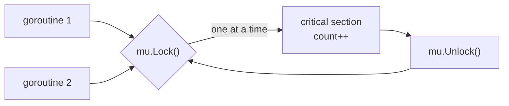
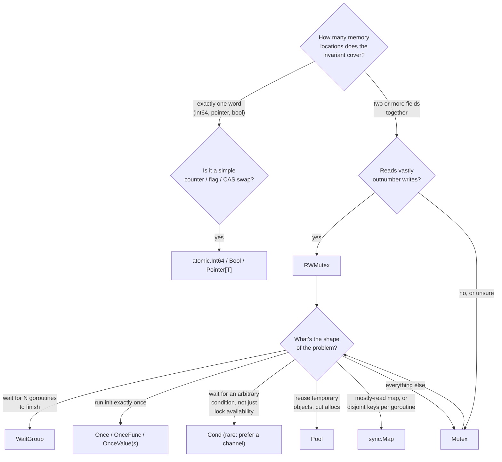
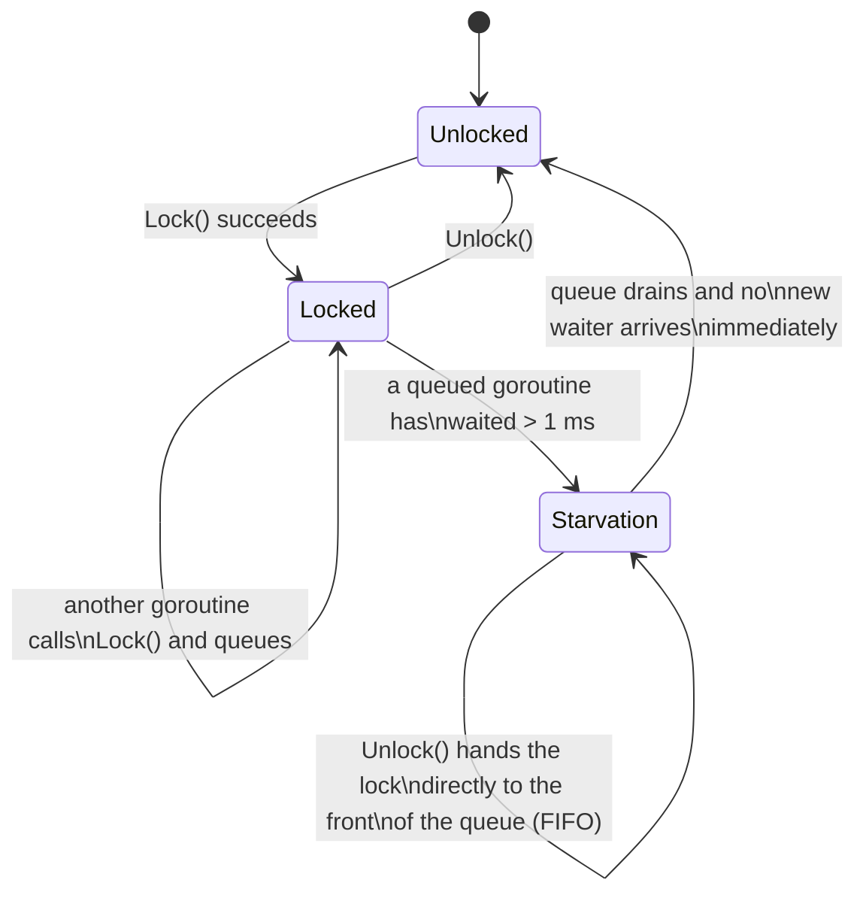
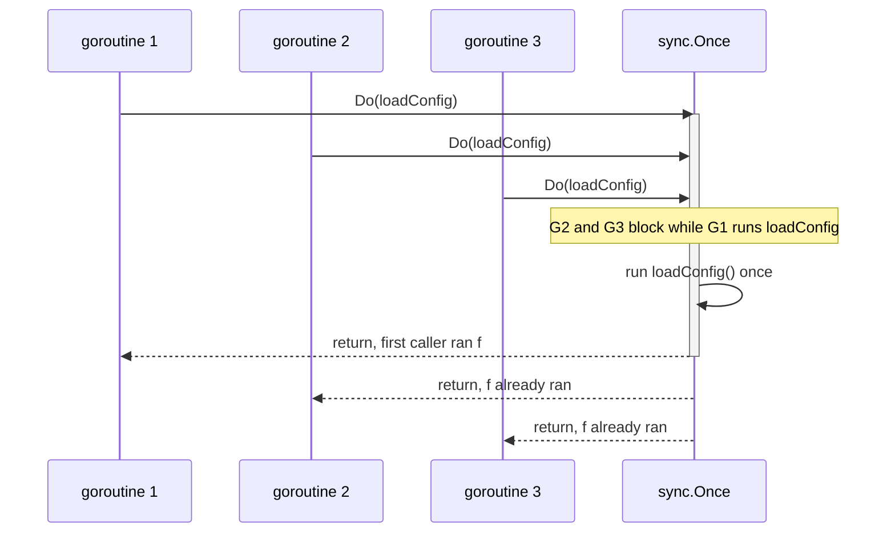

# sync Primitives and Atomics

> [!summary] TL;DR
> `sync` and `sync/atomic` are the toolbox for protecting shared memory that several goroutines touch at once: a `Mutex` locks a critical section, `atomic` types update a single word without locking at all, and `WaitGroup`/`Once`/`Cond`/`Pool`/`Map` solve five narrower, named problems (wait for N goroutines, run exactly once, wait for a condition, reuse temporary objects, and a map built for concurrent access).

> [!abstract] Core idea
> - A `Mutex` protects an **invariant across one or more fields**; `atomic` protects a **single word**. Reach for atomics only when the whole critical section really is one word.
> - `WaitGroup` counts goroutines to completion; `Once` runs init code exactly once; `Cond` wakes goroutines waiting on an arbitrary condition; `Pool` recycles short-lived objects; `Map` is a map built for two specific concurrent-access shapes, not a general replacement for `map` + `RWMutex`.
> - Every one of these has a correct, narrow job. Using the wrong one — an atomic for a multi-field invariant, a `Cond` where a channel would do, a `sync.Map` for a frequently-updated map — compiles fine and is still a bug or a needless complication.
> - Classic mistake: copying a value that embeds a `sync.Mutex` or `sync.WaitGroup`. `go vet`'s `copylocks` check catches this; it does not catch a forgotten `Unlock`.

## Start here: the basics

**The problem in one story.**
Two goroutines both add 1 to a shared counter at the same moment.
Each reads 10, each writes 11, and one increment is lost.
The `sync` package gives you locks and helpers so only one goroutine changes shared data at a time; `sync/atomic` does it for a single number without a lock.

**Words you need first**

| Word | Plain meaning | Tiny example |
| --- | --- | --- |
| Goroutine | A lightweight function running at the same time as others | `go work()` |
| Shared memory | A variable more than one goroutine reads or writes | a global `count int` |
| Data race | Unsynchronized access where at least one is a write | two `count++` at once |
| Critical section | Code that must run by one goroutine at a time | lines between `Lock` and `Unlock` |
| Mutex | A lock: one holder at a time | `mu.Lock(); count++; mu.Unlock()` |
| Atomic operation | A single-word update that cannot be interrupted midway | `n.Add(1)` on `atomic.Int64` |
| Invariant | A rule that must stay true about your data | `balance == sum(entries)` |

**Picture it**



**Analogy.** A mutex is the single key to a shop's restroom: whoever holds it goes in, everyone else queues.
Where it breaks: a real queue is fair and orderly; Go's mutex lets newcomers barge in until a waiter has waited over 1 ms, then switches to starvation (handoff) mode.

**How the rest of this note builds up**

- First, why these primitives exist (section 1) and a mental model of mutex vs atomic (section 2).
- Then how `Mutex`, `RWMutex`, `WaitGroup`, `Once`, `Cond`, `Pool`, `Map` and atomics work (section 3), with worked examples (section 4).
- Then choosing between them and trade-offs (sections 5-6), plus production habits (section 7).
- Finally the SDE-3 deep dive: mutex internals, why atomics beat a mutex for one word, memory ordering, `sync.Map` and `Pool` internals, `RWMutex` writer starvation (section 8).

> [!tip] Remember
> Mutex for an invariant across fields, atomic for one word, and never copy a value that contains a lock.

## 1. Why it exists

A checkout service tracks "requests served" in a package-level `int` that every handler goroutine increments. Under `go test -race` with 200 concurrent handlers, the counter comes out wrong — not by a predictable amount, but differently on every run — because `count++` is three machine steps (load, add, store) and two goroutines can interleave between them, each overwriting the other's increment.

This is the generic shape of nearly every concurrency bug: two or more goroutines touch the same memory, at least one of them writes, and nothing orders the accesses relative to each other.

`sync` and `sync/atomic` exist to put that ordering back, in two different ways. A `Mutex` makes the three steps of `count++` happen **inside a single critical section** that only one goroutine occupies at a time: correct, but every other goroutine that wants in has to wait, even if all it wanted was to read.

An atomic type does `count++` as one indivisible hardware instruction — no critical section, no waiting — but only because the whole operation fits in one machine word; the moment a "counter" needs a second field (say, a last-updated timestamp next to the count), one atomic word can no longer carry the invariant and a `Mutex` is the correct tool again.

## 2. Mental model

A **`Mutex`** is a single key to one room: whoever holds the key can read and write everything inside; everyone else waits at the door, no matter how little of the room they needed to touch.

An **`RWMutex`** is the same room with a rule change: any number of readers can be inside at once, but a writer needs the room empty, both of readers and of other writers.

An **atomic** value is not a room at all — it is a single slot that the CPU itself guarantees nobody can read halfway through someone else's write. There is nothing to lock because there is nothing bigger than one word to protect.

`WaitGroup`, `Once`, `Cond`, `Pool`, and `Map` are not variations on the mutex; they are five different problems that happen to live in the same package:

| Primitive | The one problem it solves |
| --------- | -------------------------- |
| `WaitGroup` | "Block until N background goroutines are all done." |
| `Once` | "Run this initializer exactly once, no matter how many goroutines race to trigger it." |
| `Cond` | "Block until some arbitrary condition becomes true, then wake up." |
| `Pool` | "Reuse short-lived objects instead of letting the allocator and GC handle every one." |
| `Map` | "A map for two specific access patterns, built to avoid the allocation and lock overhead a general map + mutex would need for them." |

## 3. How it works

### Choosing a primitive



### Mutex: one critical section, no exceptions



`sync.Mutex`'s zero value is already a valid, unlocked mutex — there is no `New`. It is **not reentrant**: a goroutine that already holds the lock and calls `Lock()` again deadlocks itself, because Go has no notion of "the same goroutine" at the mutex level, only "locked or not".

The normal mode is unfair-but-fast: a goroutine arriving at an unlocked mutex can barge ahead of goroutines that have been queued for a while, which is good for throughput.

If any queued goroutine has waited more than 1 ms (verified in `src/sync/mutex.go`), the mutex flips into **starvation mode**: `Unlock` now hands the lock directly to the front of the FIFO queue instead of letting a new arrival barge in, which trades some throughput for a bound on worst-case wait time, then flips back once the queue is short and fast again.

**Critical-section rules that the type system will not enforce for you:**
- **Check-then-act goes inside one lock.** `if balance >= amount { balance -= amount }` must happen under a single `Lock()`/`Unlock()`, never as a separate check followed by a separate update — otherwise two goroutines can both pass the check before either deducts.
- **Never do I/O while holding a lock.** A lock held across a network call or a `time.Sleep` turns every other goroutine waiting on it into collateral damage for that one slow call. Decide what to do under the lock, release it, then do the I/O.
- **Pick one lock order and never vary it.** If a function ever needs two locks at once, every caller must acquire them in the same order (for example, always by ascending account ID), or two goroutines locking in opposite orders can deadlock each other.

`go vet`'s `copylocks` check flags passing or assigning a `sync.Mutex` (or anything embedding one, including `WaitGroup`) by value instead of by pointer — a copy duplicates the lock's internal state and silently breaks mutual exclusion, so the struct that owns one should always be used through a pointer.

**`TryLock` exists; reach for it rarely.** `Mutex.TryLock()` (and `RWMutex.TryLock`/`TryRLock`) acquires the lock only if it is immediately free and reports whether it succeeded, instead of blocking.

The standard library's own doc comment is blunt about this: "correct uses of `TryLock` do exist, [but] they are rare, and use of `TryLock` is often a sign of a deeper problem in a particular use of mutexes" — a polling loop around `TryLock` usually means the code should have waited on `Lock()`, a channel, or a `Cond` instead of spinning.

**RWMutex has two deadlock traps `Mutex` doesn't:**
- **No recursive read-locking.** Calling `RLock()` twice from the same goroutine (directly, or via two functions each doing their own `RLock`/`RUnlock`) can deadlock: per `sync/rwmutex.go`'s doc comment, once any goroutine calls `Lock()` while readers hold the lock, *new* `RLock()` calls block until that writer has run — so if your second `RLock()` arrives after a writer is already queued, it waits on a writer that is itself waiting for your first `RLock()`'s `RUnlock()`, and neither ever happens.
- **No upgrading or downgrading.** An `RWMutex.RLock()` can never be upgraded into a `Lock()` (nor a `Lock()` downgraded into an `RLock()`) by the same goroutine — there is no API for it, and attempting the equivalent by calling `RUnlock()` then `Lock()` is not atomic, so another writer can slip in between and invalidate whatever the read lock protected.

### Four callers through sync.Once



`Once.Do(f)` guarantees `f` runs to completion exactly once across however many goroutines call `Do` concurrently; every other caller blocks until that one run finishes, then returns without running `f` again.

The guarantee is "ran once", not "ran successfully": if `f` panics, `Do` still marks the `Once` as done, so a later `Do` call on the same `Once` does **not** retry it — it returns immediately having done nothing.

`sync.OnceFunc`, `sync.OnceValue`, and `sync.OnceValues` (Go 1.21) wrap this pattern for the common "lazily compute a value" shape; `OnceValues` is the one to reach for when the computation can fail, because it caches **whatever `f` returned**, success or error, so a failed load is cached as a failure forever rather than silently retried on every call (see the test `TestLazyConfigErrCachesTheFailure` below).

The pattern itself, applied to building a single shared instance, is [[Singleton and sync.Once]]; this note is about the primitive's own mechanics.

## 4. Worked example

### Whiteboard version

The smallest correct `Mutex` use: one invariant (`n`), one lock, `defer Unlock` so a panic inside the critical section still releases it.

```go
package syncpkg

import "sync"

// Counter is the whiteboard version: a mutex guarding a single invariant.
type Counter struct {
    mu sync.Mutex
    n  int
}

func (c *Counter) Inc() {
    c.mu.Lock()
    defer c.mu.Unlock()
    c.n++
}

func (c *Counter) Value() int {
    c.mu.Lock()
    defer c.mu.Unlock()
    return c.n
}
```

```go
func TestCounterConcurrentInc(t *testing.T) {
    c := &Counter{}
    var wg sync.WaitGroup
    for i := 0; i < 100; i++ {
        wg.Add(1)
        go func() {
            defer wg.Done()
            c.Inc()
        }()
    }
    wg.Wait()
    if got := c.Value(); got != 100 {
        t.Fatalf("got %d, want 100", got)
    }
}
```

The sections below build out each primitive this note covers, each with its own test. All code compiles and passes `go vet` and `go test -race` on Go 1.24.4.

### RWMutex: a read-heavy cache

```go
// Cache is a read-heavy, in-memory cache protected by an RWMutex.
// Many goroutines can read at once; writes take the full lock.
type Cache struct {
    mu   sync.RWMutex
    data map[string]int
}

func NewCache() *Cache { return &Cache{data: make(map[string]int)} }

func (c *Cache) Get(key string) (int, bool) {
    c.mu.RLock()
    defer c.mu.RUnlock()
    v, ok := c.data[key]
    return v, ok
}

func (c *Cache) Set(key string, v int) {
    c.mu.Lock()
    defer c.mu.Unlock()
    c.data[key] = v
}

// Incr does a check-then-act read-modify-write. It must hold the FULL
// lock for the whole operation: RLock + a separate Lock for the write
// would let two callers both read 5, both write 6, and lose an increment.
func (c *Cache) Incr(key string) int {
    c.mu.Lock()
    defer c.mu.Unlock()
    c.data[key]++
    return c.data[key]
}
```

`TestCacheIncrIsAtomicAcrossGoroutines` fires 200 concurrent `Incr("hits")` calls and asserts the result is exactly 200 — proving the whole increment, not just the map write, is inside one lock.

### WaitGroup: already shown above, plus the Go 1.25 shortcut

`Counter`'s test above uses the classic shape: `wg.Add(1)` **before** `go func()`, never inside it — calling `Add` from inside the new goroutine races with `Wait()` on the caller, which can return having counted zero outstanding goroutines if it runs first.

`WaitGroup.Go` (new in **Go 1.25**, per the Go 1.25 release notes; not available on the Go 1.24 toolchain this note's code was tested against) does the `Add(1)` / goroutine-start / `Done()` sequence as one call, `wg.Go(func() { ... })`, removing that foot-gun entirely.

A `WaitGroup`'s zero value is ready to use, and like a `Mutex` it must never be copied after first use — `go vet`'s `copylocks` check flags that too.

### Once / OnceFunc / OnceValue(s): lazy init, and what happens on failure

```go
// Config is loaded lazily, once, no matter how many goroutines ask for it
// at the same moment.
type Config struct {
    DatabaseURL string
}

// NewLazyConfig returns a function that loads cfg at most once.
// sync.OnceValue (Go 1.21) caches the returned value AND re-returns it
// on every later call; it does not retry on panic or on error you ignore.
func NewLazyConfig(load func() Config) func() Config {
    var once sync.Once
    var cfg Config
    return func() Config {
        once.Do(func() {
            cfg = load()
        })
        return cfg
    }
}

// NewLazyConfigOnceValue is the same idea built directly on sync.OnceValue.
func NewLazyConfigOnceValue(load func() Config) func() Config {
    return sync.OnceValue(load)
}

// NewLazyConfigErr shows why a failing lazy init needs OnceValues, not a
// bare Once: Once.Do runs the function exactly once even if it panics or
// returns an error, so a naive Once around a fallible load caches the
// FAILURE forever, with no automatic retry.
func NewLazyConfigErr(load func() (Config, error)) func() (Config, error) {
    return sync.OnceValues(load)
}
```

```go
func TestLazyConfigLoadsExactlyOnce(t *testing.T) {
    var calls atomic.Int64
    get := NewLazyConfig(func() Config {
        calls.Add(1)
        return Config{DatabaseURL: "postgres://prod"}
    })
    var wg sync.WaitGroup
    results := make([]Config, 50)
    for i := 0; i < 50; i++ {
        i := i
        wg.Add(1)
        go func() { defer wg.Done(); results[i] = get() }()
    }
    wg.Wait()
    if calls.Load() != 1 {
        t.Fatalf("load called %d times, want exactly 1", calls.Load())
    }
}

func TestLazyConfigErrCachesTheFailure(t *testing.T) {
    var calls atomic.Int64
    get := NewLazyConfigErr(func() (Config, error) {
        calls.Add(1)
        return Config{}, errors.New("boom")
    })
    _, err1 := get()
    _, err2 := get()
    if err1 == nil || err2 == nil {
        t.Fatal("want both calls to return the cached error")
    }
    if calls.Load() != 1 {
        t.Fatalf("load called %d times; OnceValues never retries", calls.Load())
    }
}
```

### Cond: a bounded queue

`Cond` is shown here because interviewers ask about it, not because it is the first tool to reach for — a buffered channel does the same bounded-queue job with less code (see "Trade-offs").

`Wait` must always sit in a `for` loop re-checking the condition, never an `if`: `Wait` can return because of a `Signal`/`Broadcast` meant for a different state change, or (rarely) a spurious wakeup, so the woken goroutine has to re-verify the condition itself before proceeding.

```go
type BoundedQueue struct {
    mu       sync.Mutex
    notEmpty *sync.Cond
    notFull  *sync.Cond
    items    []int
    cap      int
    closed   bool
}

func NewBoundedQueue(capacity int) *BoundedQueue {
    q := &BoundedQueue{cap: capacity}
    q.notEmpty = sync.NewCond(&q.mu)
    q.notFull = sync.NewCond(&q.mu)
    return q
}

// Push blocks while the queue is full. It wakes one waiting Pop.
func (q *BoundedQueue) Push(v int) {
    q.mu.Lock()
    defer q.mu.Unlock()
    for len(q.items) == q.cap && !q.closed {
        q.notFull.Wait() // re-checks the condition on wake; never "if"
    }
    if q.closed {
        return
    }
    q.items = append(q.items, v)
    q.notEmpty.Signal()
}

// Pop blocks while the queue is empty and open.
func (q *BoundedQueue) Pop() (v int, ok bool) {
    q.mu.Lock()
    defer q.mu.Unlock()
    for len(q.items) == 0 && !q.closed {
        q.notEmpty.Wait()
    }
    if len(q.items) == 0 {
        return 0, false
    }
    v, q.items = q.items[0], q.items[1:]
    q.notFull.Signal()
    return v, true
}

// Close wakes every blocked Push and Pop so they can observe the close.
func (q *BoundedQueue) Close() {
    q.mu.Lock()
    defer q.mu.Unlock()
    q.closed = true
    q.notEmpty.Broadcast()
    q.notFull.Broadcast()
}
```

`TestBoundedQueueBlocksOnFullAndEmpty` pushes 20 items into a capacity-2 queue from one goroutine while popping from another, and asserts all 20 arrive, in order, through a queue that spent most of its life either full or empty.

### Pool: reusing buffers across requests

```go
var bufPool = sync.Pool{
    New: func() any { return new(bytes.Buffer) },
}

// EncodeWithPool simulates an encode step that borrows a buffer, writes
// into it, and returns it to the pool.
func EncodeWithPool(s string) []byte {
    buf := bufPool.Get().(*bytes.Buffer)
    buf.Reset() // must clear old contents: Get can return a dirty buffer
    defer bufPool.Put(buf)

    buf.WriteString("encoded:")
    buf.WriteString(s)

    out := make([]byte, buf.Len())
    copy(out, buf.Bytes())
    return out
}
```

`Pool`'s whole value proposition is that `New` is a fallback, not a guarantee of reuse: the runtime is explicitly allowed to drop a pool's contents at any garbage collection (Go implements this with a "victim cache" — objects survive one extra GC cycle as a second-chance pool before being dropped for good), so `Get` can legitimately call `New` far more often than "object count" alone would suggest, and nothing in the pool is ever a place to keep state the program actually depends on.

`TestEncodeWithPoolIsCorrectUnderConcurrency` hammers `EncodeWithPool` from four goroutines, 1,000 calls each, and checks every result is correct — the point being that reuse must never leak one caller's bytes into another's output, which is why `Reset` before use and a fresh copy on the way out both matter.

### Atomics: a sharded counter and a CAS retry loop

```go
// ShardedCounter spreads increments across several atomic.Int64 shards to
// cut contention on one hot cache line, at the cost of a slightly more
// expensive read (it must sum every shard). atomic.Int64 (typed atomics,
// Go 1.19) only protects THIS single int64; it is not a substitute for a
// mutex guarding a struct with more than one invariant.
type ShardedCounter struct {
    shards []atomic.Int64
}

func NewShardedCounter(n int) *ShardedCounter {
    return &ShardedCounter{shards: make([]atomic.Int64, n)}
}

func (c *ShardedCounter) Incr(shardKey int) {
    c.shards[shardKey%len(c.shards)].Add(1)
}

func (c *ShardedCounter) Total() int64 {
    var total int64
    for i := range c.shards {
        total += c.shards[i].Load()
    }
    return total
}

// HighWaterMark keeps the largest value ever recorded with a
// compare-and-swap retry loop: cheap because the critical section is a
// single word, lock-free so no goroutine ever blocks on it.
type HighWaterMark struct {
    max atomic.Int64
}

func (h *HighWaterMark) Record(v int64) {
    for {
        cur := h.max.Load()
        if v <= cur {
            return // someone already recorded a value >= v
        }
        if h.max.CompareAndSwap(cur, v) {
            return // won the race; nobody changed cur underneath us
        }
        // another goroutine updated max between Load and CompareAndSwap:
        // loop and re-read the new value.
    }
}
```

`TestHighWaterMarkKeepsTheMaxUnderRacingWriters` fires 500 goroutines recording values 1..500 in parallel and asserts the final max is exactly 500 — the CAS loop's retry is what makes that true even though many goroutines read a stale `cur` at the same instant.

**Measured** (`go test -bench . -benchtime=200000x -benchmem ./...`, `b.RunParallel`, Apple M4, `GOMAXPROCS=10`, Go 1.24.4, 2026-11-07), ns per operation under the race detector's cousin benchmark mode (no `-race`, since `-race` changes timing, not correctness, for this comparison):

| Approach | ns/op | B/op | allocs/op |
| -------- | ----- | ---- | --------- |
| `Mutex`-guarded `int` (`BenchmarkMutexCounter`) | 124.3 | 0 | 0 |
| single `atomic.Int64` (`BenchmarkSingleAtomicCounter`) | 30.51 | 0 | 0 |
| 16-way `atomic.Int64` sharded counter (`BenchmarkShardedCounter`) | 38.20 | 0 | 0 |

On this 10-logical-CPU machine a single atomic is already about 4x faster than the mutex and the shards add a small amount of indexing overhead rather than paying off — sharding earns its cost on machines with enough cores that one cache line genuinely becomes the bottleneck (see "Deep dive"), not as a default upgrade from a plain atomic.

The same sharding idea applies to a `Mutex`-guarded map, not just an atomic counter: instead of one `map` + one `RWMutex` that every goroutine contends on, split the keyspace into N buckets, each its own small `map` + `Mutex` (`shard := hash(key) % N`).

This is the standard fix for a single hot map under heavy concurrent writes — libraries such as `golang-lru`'s sharded caches use exactly this shape — and it trades a slightly more expensive key lookup (hash, then index) for far less lock contention than one map-wide lock.

### sync.Map: the two patterns it is actually for

```go
// MemoCache memoizes compute(key) using sync.Map. sync.Map is tuned for
// (1) a key written once and read many times by many goroutines, and
// (2) disjoint goroutines each touching their own keys. For frequent
// updates to the SAME keys, a map guarded by RWMutex is usually simpler
// and faster: sync.Map stores values as `any`, so every read pays a type
// assertion. Go 1.24 gave the BUILT-IN map type a Swiss Tables rework;
// sync.Map's default implementation is unchanged (still the read/dirty
// two-map design below) and the usage trade-off is unchanged either way.
type MemoCache struct {
    m        sync.Map // int -> int
    computes atomic.Int64
}

// Get computes compute(key), but NOT exactly once under a race:
// LoadOrStore computes eagerly before storing, so two goroutines racing
// on the same missing key can BOTH call compute, and only one result
// wins the store. Deduping the computation itself needs singleflight,
// not sync.Map.
func (c *MemoCache) Get(key int, compute func(int) int) int {
    if v, ok := c.m.Load(key); ok {
        return v.(int)
    }
    c.computes.Add(1)
    v := compute(key)
    actual, _ := c.m.LoadOrStore(key, v)
    return actual.(int)
}
```

`TestMemoCacheAllCallersGetTheWinningValue` fires 50 goroutines at the same missing key and asserts every one of them ends up with the same winning value, even though more than one of them may have called `compute`; `TestMemoCacheSecondCallDoesNotRecompute` checks the fast path never calls `compute` again once a value is stored.

## 5. Variants and comparison

| Option | How it works | Use when | Cost |
| ------ | ------------ | -------- | ---- |
| `Mutex` | Exclusive lock around a critical section | The default: any invariant spanning more than one word, or any read-modify-write | Blocks all other goroutines, including readers, while held |
| `RWMutex` | Many readers OR one writer | Reads vastly outnumber writes and the critical section is read-only | Slightly higher overhead per lock than `Mutex`; a steady stream of readers can starve a writer in some implementations, though Go's favors writers once one is waiting |
| `atomic.T` | One hardware-level atomic op on one word | A single counter, flag, or pointer swap; no second field to keep consistent with it | Cannot express "these two fields change together"; CAS loops can spin under heavy contention |
| Channel (buffered, as semaphore/queue) | Send/receive is the synchronization | Handing off data, bounding concurrency, or producer/consumer where "block until space" is the whole job | A goroutine and its own stack per blocked sender/receiver; more allocation than a `Mutex` for a pure counter |
| `sync.Map` | Internally two maps: a lock-free read map and a mutex-guarded dirty map that read-misses fall back to | Mostly-read keys, or disjoint key sets per goroutine (per-connection caches, pub/sub registries) | No `len()`, no typed values (`any` + assertion), slower than `map`+`RWMutex` under frequent updates to the same keys |
| `Cond` | Explicit wait/signal on an arbitrary predicate, under a `Mutex` | A condition more complex than "is the lock free" that several goroutines must wait on | More code and easier to get wrong than a channel; prefer a channel unless `Cond`'s broadcast-to-all-waiters shape is exactly what's needed |

## 6. Trade-offs and when not to use

- `Cond` almost always has a simpler channel-based equivalent; reach for it mainly when a library's existing lock (not one you control) must be the thing goroutines wait on, or in an interview that explicitly asks for it.
- `sync.Map` is a specialized tool, not a safer default `map`. For a cache with frequent updates to the same hot keys — the common backend shape — `map` + `RWMutex` is simpler, gives you `len()`, and is usually faster.
- `atomic` fields scattered through a struct for "performance" without a real multi-word invariant just move the bug: it is easy to update two atomic fields in a way that is individually race-free but jointly inconsistent (reader sees the new count but the old total). If two fields must agree, they need one lock, not two atomics.
- `Pool` only pays off for objects expensive enough to allocate that reuse beats letting the garbage collector handle them (buffers, not small structs); pooling cheap objects can cost more in bookkeeping than it saves.
- None of this matters if the data is never shared: confining state to one goroutine and communicating results over a channel sidesteps the whole category of bugs these primitives exist to prevent.

## 7. In production

- **Real systems:** `net/http`'s `Transport` guards its idle-connection pool with a mutex; `database/sql`'s `*DB` pool does the same for its free-connection list; `log/slog`'s JSON handler and `encoding/json` both use `sync.Pool` buffers on the hot encode path to cut allocations per request; Prometheus's `client_golang` counters and histograms are built on `sync/atomic` so recording a metric never blocks a request goroutine; `golang.org/x/sync/singleflight` (used by many caching layers) is itself a `Mutex` plus a map of in-flight calls.
- **Failure modes → fixes:**
  - A service's p99 latency rises under load even though CPU looks fine → mutex contention on one hot lock; profile it (`runtime.SetMutexProfileFraction`, `go tool pprof` on the `mutex` profile) before guessing, then consider `RWMutex` or sharding.
  - A `sync.Map`-based cache's memory keeps climbing → nothing ever deletes stale keys; `sync.Map` has no TTL or eviction built in, so that logic has to live in the caller.
  - A `Once`-guarded startup step silently never completes any request → the wrapped function panicked once, and every later caller is now blocking forever inside `Do` behind the one goroutine that is unwinding the panic, or returning instantly with nothing initialized if the panic was recovered elsewhere; either way, treat a `Once`-wrapped init as something that must not be allowed to fail silently.
  - A struct with a `sync.Mutex` field gets passed by value into a function or stored in a slice by value → `go vet`'s `copylocks` flags it; the fix is a pointer receiver and pointer storage, never a value copy.
- **What to monitor:** the mutex and block profiles (`SetMutexProfileFraction`, `SetBlockProfileRate`) for contention hotspots; `sync.Pool` get/put counts are not exposed by the runtime directly, so teams that care instrument their own pool wrapper; goroutine count alongside lock-wait time, since a rising wait time with a flat goroutine count usually means one lock, not a leak.

## 8. Deep dive

- **Mutex internals.** A `Mutex` is a 32-bit state word plus a wait queue coordinated through the runtime's internal futex-like primitive (`runtime.semacquire`/`semrelease` on most platforms). The fast path — an uncontended `Lock()` — is a single compare-and-swap with no syscall; only a contended `Lock()` parks the goroutine. This is why an uncontended mutex is cheap even though the type "supports" blocking: the blocking machinery is paid for only when it is actually needed.
- **Why atomics outperform a mutex for one word.** An atomic operation is a single CPU instruction (on amd64, a `LOCK`-prefixed instruction; on arm64, exclusive-load/store pairs) with no possibility of the goroutine parking. A mutex, even on the uncontended fast path, does more bookkeeping (the CAS on the state word, plus the surrounding `Lock`/`Unlock` call overhead) and on the contended path parks a goroutine through the scheduler — a far more expensive operation than any single instruction. The measured numbers above are one concrete instance of this general shape.
- **Memory ordering.** Since the Go 1.19 memory-model revision, Go's atomics are specified as sequentially consistent: all atomic operations across all goroutines appear to execute in one global total order consistent with each goroutine's own program order, and an atomic write happens-before a later atomic read of the same variable that observes it. A `Mutex`'s `Unlock` similarly happens-before the next `Lock` on the same mutex succeeds. Both guarantees, worked through in full with the race detector, are [[Memory Model and Data Races]].
- **`sync.Map`'s two-map design.** Internally, `sync.Map`'s default implementation keeps a lock-free `read` map (an atomic pointer to an immutable-ish structure) and a `dirty` map guarded by a mutex — this design is unchanged by Go 1.24. (It is Go's built-in `map` type, not `sync.Map`, that Go 1.24 reworked onto a Swiss Tables layout; `sync.Map` instead gained an experimental, opt-in hash-trie-based implementation under `GOEXPERIMENT=synchashtriemap`, which is a different data structure again and not the default.) A `Load` that hits the `read` map costs no lock at all; a miss falls through to the `dirty` map under the lock and, often enough, promotes `dirty` to be the new `read` map. This is exactly why it wins for "mostly read" and loses for "frequently updated": every update that is not already in `read` takes the slow, locked path.
- **`sync.Pool` and GC.** A `Pool`'s per-`P` private store avoids a lock on the fast path; the "victim cache" means an object can survive being dropped for exactly one extra GC cycle before it is really gone, which is a deliberate trade-off between memory held by idle pools and allocation cost on a traffic spike right after a GC.
- **RWMutex writer starvation.** Go's `RWMutex` is written to prevent a continuous stream of new readers from starving a waiting writer forever: once a writer is queued, new readers queue behind it rather than jumping ahead indefinitely. This does not make `RWMutex` fair in the way `Mutex`'s starvation mode is; it only bounds the specific writer-starvation failure mode.

## 9. Interview questions

> [!question]- When would you reach for `atomic.Int64` instead of a `Mutex`-guarded `int`?
> When the entire invariant is that one int64 — a counter, a flag, a single pointer swap — and nothing else must change atomically with it. The moment a second field has to stay consistent with the first, an atomic can no longer express the invariant and a `Mutex` is correct again.

> [!question]- Trap: you have two `atomic.Int64` fields, `count` and `total`, both updated on every request. Is this safe?
> Each individual update is race-free, but the pair is not: a reader can observe a `total` that reflects N updates and a `count` that reflects N-1, because nothing orders the two atomics relative to each other. If a reader ever needs `count` and `total` to agree, they need one `Mutex`, not two atomics.

> [!question]- What does `sync.Once` guarantee if the wrapped function panics?
> `Do` still marks the `Once` as "done" even though `f` panicked, so a later call to `Do` on the same `Once` does not retry `f` — it returns immediately having run nothing. A fallible initializer should use `sync.OnceValues` and have every caller check the returned error, rather than relying on a bare `Once` to retry.

> [!question]- Why does `sync.Map`'s own documentation say it is not a general replacement for `map` + `RWMutex`?
> Because its internal design (a lock-free read map plus a mutex-guarded dirty map) is optimized for keys that are written once and read many times, or for disjoint key sets per goroutine.
>
> A workload that updates the same keys repeatedly keeps falling through to the locked `dirty` path, so a plain `map` guarded by `RWMutex` is usually both simpler and faster there.

> [!question]- Your `Cond.Wait()` call is woken up, but the condition it was waiting for turns out to still be false. Is that a bug?
> No — `Wait` can return on a signal meant for a different state transition, or, rarely, spuriously. That is exactly why `Wait` must always sit inside a `for` loop that re-checks the predicate, never an `if`: the loop re-blocks if the condition still does not hold.

> [!question]- A struct has a `sync.Mutex` field. A teammate writes `func process(s MyStruct)` instead of `func process(s *MyStruct)`. What breaks, and what catches it?
> Passing `s` by value copies the mutex's internal state into the copy. The copy and the original now have independent lock state, so holding the lock on one does nothing to protect the other — the mutual exclusion is silently broken.
>
> `go vet`'s `copylocks` check flags this at build time; it is one of the few concurrency bugs the compiler toolchain catches for you.

> [!question]- `sync.Pool` held a `*bytes.Buffer` your code expects to be empty on `Get`. The first run after a deploy produces garbled output. Why?
> `Get` can return either a freshly-`New`-created object or a previously `Put` one that still has its old contents — `Pool` never resets objects for you. The fix is to always reset state (here, `buf.Reset()`) immediately after `Get`, before writing anything new into it.

> [!question]- Given a hot counter under heavy contention across many cores, would sharding it into N `atomic.Int64` shards always help?
> Not always — sharding adds an extra indexing step and a more expensive read (summing every shard), so on a machine with few cores, or at moderate contention, a single atomic can outperform the sharded version, which is exactly what this note's measured benchmark shows.
>
> Sharding earns its cost once contention on one cache line is the actual bottleneck, typically only visible on machines with many cores under heavy write load — profile before sharding.

## 10. Cheat sheet

- `Mutex` protects an invariant across one or more fields; `atomic` protects exactly one word. Don't use the second to half-solve the first's job.
- `Mutex`/`RWMutex`/`WaitGroup` zero values are ready to use; none of them may ever be copied after first use (`go vet`'s `copylocks`).
- Check-then-act goes inside one lock; never hold a lock across I/O; pick one lock order everywhere.
- `Once.Do` runs `f` once even if it panics — it does not retry. Use `OnceValues` for fallible init and check the error every call.
- `Cond.Wait()` always sits in a `for` loop re-checking the predicate, never an `if`.
- `sync.Pool` never guarantees reuse (GC can drop its contents) and never resets objects for you — always `Reset()` after `Get`.
- `sync.Map` wins only for mostly-read or disjoint-key workloads; a frequently-updated map usually wants `map` + `RWMutex` instead.
- `WaitGroup.Go` (Go 1.25) folds `Add`/`go`/`Done` into one call; on Go 1.24, `Add` must run before `go`, never inside the goroutine.

## Links

- **Before this:** [[Goroutines and Channels]], [[Concurrency Primitives - Mutex, Semaphore, Atomics]]
- **Next:** [[select and Concurrency Patterns]], [[Context Package]], [[Memory Model and Data Races]]
- **Compare with:** [[Singleton and sync.Once]] (the lazy-singleton pattern built on `Once`), [[Runtime - Goroutine Scheduler (GMP)]] (what actually parks and wakes a blocked goroutine)

### Watch on YouTube

- [2.3 Concurrency Primitives: Mutex, Atomics & WaitGroups / Goroutines, Channels, and the CSP Model](https://www.youtube.com/watch?v=HW1unwaqxbI) · Adsorp AI · Covers Mutex, atomics, and WaitGroup together, matching the note's toolbox framing
